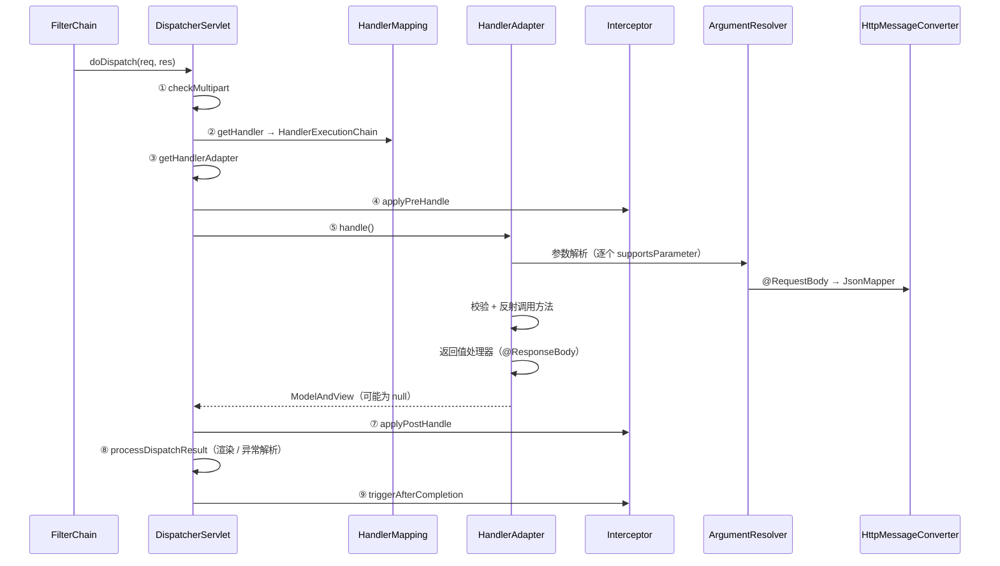

---
sources:
  - 04-第四阶段
---

# 04. DispatcherServlet 分发与参数解析

> [← 第四阶段导览](01-导览.md) · DispatcherServlet 只有九步，但每一步都留了扩展点；真正决定你写代码舒不舒服的，是**参数解析器**这一层——把「从 token 取用户」「从 header 取租户」收进注解 + 解析器，比在二十个方法里重复 `@RequestHeader` 干净一个数量级。

## 1. 九步分发：一次 `/orders/42` 的完整路径

`DispatcherServlet.doDispatch` 是整个 MVC 的心脏，它的结构三十年没变：找 handler、找适配器、前置处理、执行、后置处理、收尾。Spring 7 的版本多了异步与 multipart 两处分支，主干仍是九步。



| 步 | 做什么 | 谁能插手 | 失败会怎样 |
|---|---|---|---|
| ① | `checkMultipart`：是 multipart 就包成 `MultipartHttpServletRequest` | `MultipartResolver` | 解析失败 → `MultipartException` → 500 |
| ② | `getHandler`：遍历 `HandlerMapping` 拿 `HandlerExecutionChain` | 自定义 `HandlerMapping` | 拿不到 → 404（或 `NoHandlerFoundException`） |
| ③ | `getHandlerAdapter`：找能执行这个 handler 的适配器 | 自定义 `HandlerAdapter` | 找不到 → 500（配置错误） |
| ④ | `applyPreHandle`：拦截器正序 | `HandlerInterceptor` | 返回 false → 直接跳到 ⑨ |
| ⑤ | `ha.handle`：解析参数 → 校验 → 调用 → 处理返回值 | `ArgumentResolver`、`ReturnValueHandler`、`ConversionService` | 抛异常 → 跳到 ⑧ 的异常分支 |
| ⑥ | `applyDefaultViewName`：无视图名时套默认视图 | `RequestToViewNameTranslator` | 仅页面渲染相关 |
| ⑦ | `applyPostHandle`：拦截器逆序 | `HandlerInterceptor` | 异常 → ⑧ 异常分支，原返回值被丢弃 |
| ⑧ | `processDispatchResult`：渲染视图，或解析异常 | `HandlerExceptionResolver`、`ViewResolver` | 解析不了 → 500 |
| ⑨ | `triggerAfterCompletion` + 清理 multipart | `HandlerInterceptor` | 异常只记日志 |

**为什么第 ⑤ 步要拆成「适配器 + 解析器 + 返回值处理器」三层**：因为 handler 不一定是 `@RequestMapping` 方法。它可能是 `RouterFunction`、可能是 `HttpRequestHandler`（静态资源）、可能是函数式端点。适配器负责「怎么调」，解析器负责「参数从哪来」，返回值处理器负责「结果往哪去」——三者正交，才能让同一套机制服务所有 handler 类型。

**坑**：第 ⑤ 步是一个黑盒，但它是绝大多数 400 的来源。`@RequestBody` 反序列化失败、`@PathVariable` 类型转换失败、`@Valid` 校验失败，三种错误在这一步里长得完全一样（都是 400），但异常类型和 `ProblemDetail` 该带的字段完全不同。06 册会把它们逐个映射。

## 2. HandlerMapping：精确 > 路径变量 > 通配

`HandlerMapping` 的职责只有一个：给定 `HttpServletRequest`，回答「谁来处理」。Spring MVC 里有多个实现，按 `Ordered` 排序依次询问，第一个返回非 null 的胜出：

| 实现 | order 量级 | 处理什么 |
|---|---|---|
| `RequestMappingHandlerMapping` | 0（最优先） | `@RequestMapping` 家族，99% 的业务接口 |
| `ViewControllerHandlerMapping` | 1 | `addViewControllers` 注册的无逻辑页面 |
| `BeanNameUrlHandlerMapping` | 2 | 以 `/` 开头的 Bean 名，老式写法 |
| `RouterFunctionMapping` | 3 | 函数式路由 `RouterFunction` |
| `SimpleUrlHandlerMapping`（静态资源） | 最低 | `ResourceHandlerRegistry` 注册的 `/static/**` 等 |

**同一个 mapping 内部的优先级**由 `PathPattern` 的特异性决定，规则可以简化为三层：精确字面量 > 单段变量 > 通配。

| 模式 | 示例 | 特异性 | 说明 |
|---|---|---|---|
| 精确 | `/orders/me` | 最高 | 字面量最长者优先 |
| 单段变量 | `/orders/{id}` | 中 | 能匹配任意一段，但只一段 |
| 正则约束变量 | `/orders/{id:\\d+}` | 中高 | 有约束的变量比无约束更特异 |
| 多段通配 | `/files/{*path}` | 最低 | 吞掉剩余全部路径 |

由此得出一条实践：**`/orders/me` 与 `/orders/{id}` 同时存在时，`/orders/me` 一定赢**，与声明顺序无关。这是 `PathPattern` 相对老 `AntPathMatcher` 的重要改进——老实现按声明顺序匹配，同一个 URL 在不同 Controller 里的声明顺序会改变结果，属于「换个包扫描顺序就坏」的经典事故。

```kotlin
@RestController
@RequestMapping("/orders")
class OrderController {

    @GetMapping("/me")                    // 精确：永远优先
    fun mine(@CurrentUser user: UserPrincipal): List<OrderView> = service.byUser(user.id)

    @GetMapping("/{id}")                  // 变量：次之
    fun byId(@PathVariable id: OrderId): OrderView = service.byId(id)

    @GetMapping("/{id:\\d+}/items")       // 带正则约束的变量
    fun items(@PathVariable id: Long): List<ItemView> = service.items(id)
}
```

**三个容易误判的边界**：

1. **路径能匹配但方法不匹配 → 405，不是 404**。`POST /orders/42` 而你只写了 `@GetMapping`，`RequestMappingInfo` 的路径条件通过、方法条件不通过，最终抛 `HttpRequestMethodNotSupportedException`，响应带 `Allow: GET`。
2. **路径与方法都匹配但 `consumes` 不匹配 → 415**。客户端发 `text/plain` 到只接受 JSON 的接口，得到 415 而不是 400。
3. **`produces` 与 `Accept` 不匹配 → 406**。客户端要 `application/xml`，你只能出 JSON。

这三条的意义在于：**状态码告诉你该改哪一边**。404 是路径错了（客户端），405 是方法错了（客户端），415/406 是格式协商失败（客户端或契约没写清）。把它们统一成 400 或 500，排障时就没有线索了。

## 3. HandlerAdapter 与 RequestMappingHandlerAdapter

`HandlerAdapter` 回答的是「怎么执行这个 handler」。三个实现覆盖全部场景：`RequestMappingHandlerAdapter`（`HandlerMethod`）、`HttpRequestHandlerAdapter`（静态资源）、`SimpleControllerHandlerAdapter`（老式 `Controller` 接口）。

`RequestMappingHandlerAdapter` 是真正干活的那个，它在启动时做了三件事，运行时按顺序用它们：

| 启动时准备 | 内容 | 运行时的作用 |
|---|---|---|
| 参数解析器列表 | 30+ 个 `HandlerMethodArgumentResolver`，按顺序排 | 每个参数遍历列表，第一个 `supportsParameter` 为 true 的胜出 |
| 返回值处理器列表 | 10+ 个 `HandlerMethodReturnValueHandler` | 按返回值类型与注解选一个 |
| `WebDataBinder` 工厂 | `@InitBinder` 方法、`ConversionService`、`Validator` | 绑定简单类型与表单、触发校验 |

除此之外它还管三件常被忽略的事：

- **`@ModelAttribute` 方法**：每个请求前先执行 Controller 里标了 `@ModelAttribute` 的方法，把结果放进 `Model`。这是「每个接口都要塞一份字典数据」的老写法，在新项目里应该用 `@ControllerAdvice` + `@ModelAttribute` 收敛。
- **`@SessionAttributes`**：把模型里的指定属性提升到 session，跨请求共享。分布式部署下它是坑（session 不共享），慎用。
- **`@ResponseStatus`**：方法或异常上的静态状态码，由适配器在返回值处理阶段读取。

**为什么参数解析器是「有序列表」而不是「映射表」**：因为「一个参数从哪来」无法用类型唯一决定——`String` 可能来自 path、query、header、body。只能按注解 + 类型逐个试探。代价是每个参数最多遍历三十次 `supportsParameter`，但这些都是纯类型判断，纳秒级，账本上 ④ 站 25µs 主要花在反序列化而不是这里。

## 4. ArgumentResolver：最常用的六个与自定义

内置实现有三十多个，日常 95% 的场景只用六个：

| 解析器 | 触发条件 | 背后做什么 | 失败异常 |
|---|---|---|---|
| `RequestResponseBodyMethodProcessor` | `@RequestBody` / `@ResponseBody` | 选 `HttpMessageConverter` → `JsonMapper.readValue` | `HttpMessageNotReadableException` |
| `PathVariableMethodArgumentResolver` | `@PathVariable` | `ConversionService` 把 String 转目标类型 | `MethodArgumentTypeMismatchException` |
| `RequestParamMethodArgumentResolver` | `@RequestParam` 或**无注解的简单类型** | 从 query/form 取值 + 默认值 + 转换 | `MissingServletRequestParameterException` |
| `RequestHeaderMethodArgumentResolver` | `@RequestHeader` | 读 header + 转换 | `MissingRequestHeaderException` |
| `ServletModelAttributeMethodProcessor` | `@ModelAttribute` 或无注解的复杂类型 | 表单/query 逐字段绑定 + 校验 | `BindException` |
| `PrincipalMethodArgumentResolver` | 参数类型是 `Principal` | 从 `request.getUserPrincipal()` 取 | 无（可能为 null） |

**自定义解析器的价值**在于消灭重复。一个典型的坏味道：

```kotlin
@GetMapping("/orders")
fun list(@RequestHeader("Authorization") auth: String, @RequestHeader("X-Tenant-Id") tenant: String) {
    val user = tokenService.parse(auth)          // 每个方法都写一遍
    val ctx = TenantContext(user, tenant)        // 每个方法都写一遍
}
```

正确做法是把它变成一个参数：

```kotlin
@Target(AnnotationTarget.VALUE_PARAMETER)
@Retention(AnnotationRetention.RUNTIME)
annotation class CurrentUser(val required: Boolean = true)

class CurrentUserArgumentResolver : HandlerMethodArgumentResolver {

    // 两个条件缺一不可：有注解，且类型是我认识的类型
    override fun supportsParameter(parameter: MethodParameter): Boolean =
        parameter.hasParameterAnnotation(CurrentUser::class.java) &&
            UserPrincipal::class.java.isAssignableFrom(parameter.parameterType)

    override fun resolveArgument(
        parameter: MethodParameter,
        mavContainer: ModelAndViewContainer?,
        webRequest: NativeWebRequest,
        binderFactory: WebDataBinderFactory?,
    ): Any? {
        // 认证由 Filter 完成，这里只读结果；不要在解析器里再验一次 token
        val principal = webRequest.getAttribute(CURRENT_USER, RequestAttributes.SCOPE_REQUEST) as? UserPrincipal
        if (principal == null && parameter.getParameterAnnotation(CurrentUser::class.java)!!.required) {
            throw UnauthorizedException("未登录")
        }
        return principal
    }

    companion object { const val CURRENT_USER = "lab.currentUser" }
}

@Configuration
class WebMvcConfig : WebMvcConfigurer {
    override fun addArgumentResolvers(resolvers: MutableList<HandlerMethodArgumentResolver>) {
        // 自定义解析器会被追加到内置列表末尾，所以 supportsParameter 必须够严格
        resolvers += CurrentUserArgumentResolver()
    }
}

@RestController
@RequestMapping("/orders")
class OrderController(private val orders: OrderService) {

    @GetMapping
    fun list(@CurrentUser user: UserPrincipal): List<OrderView> = orders.byUser(user.id)
}
```

**这里有一个必须知道的顺序陷阱**：`addArgumentResolvers` 加进去的解析器排在**内置之后**。而内置的 `RequestParamMethodArgumentResolver` 在 `useDefaultResolution=true` 时会接受「任何简单类型且无注解」的参数。所以如果你把 `@CurrentUser` 标在 `String userId` 上，请求会先被 `RequestParam` 解析器接走，得到一个 400「缺少参数 userId」，你的解析器根本不会被调用。

修法有两个：**用一个专属类型**（`UserPrincipal`、`value class OrderId`），或者实现 `WebMvcRegistrations` 替换整个 `RequestMappingHandlerAdapter` 并手动插入到列表头部。前者成本低得多，也是本册推荐的做法——**类型比注解更能表达意图**。

## 5. `@RequestBody` 的反序列化链路与 `@PathVariable` 的转换

两条链路完全不同，混为一谈是「为什么 body 里的错误有字段名、path 里的错误没有」的根源。

**`@RequestBody` 的链路**（五段，每段都可能失败）：

```text
Content-Type: application/json
  → 选 converter：JacksonJsonHttpMessageConverter（Jackson 3）
  → 选 JavaType：方法参数类型，含泛型（List<OrderView> 的泛型信息也在这层）
  → JsonMapper.readValue(bytes, javaType)
      → KotlinModule 处理可空性 / 默认值 / 主构造器
      → 字段级失败抛 MismatchedInputException（带 path，如 items[0].sku）
  → 包装成 HttpMessageNotReadableException（message 里含原始 path）
```

失败形态有四种，客户端看到的都是 400，但细节不同：

| 情况 | Jackson 异常 | 消息里的线索 |
|---|---|---|
| body 为空 | 无（Spring 自己判断） | `Required request body is missing` |
| JSON 语法错 | `StreamReadException` 子类 | 行列号 + 附近字符 |
| 类型不匹配（`"abc"` → Int） | `InvalidFormatException`（`MismatchedInputException` 子类） | `path: $.age`、目标类型 |
| 必填字段缺失（Kotlin 非空） | `MissingKotlinParameterException` | `Missing required creator property` |

**`@PathVariable` 的链路**（三段）：

```text
URI 模板匹配 → 得到 String
  → WebDataBinder.convertIfNecessary
      → ConversionService：StringToNumber / StringToEnum / 自定义 Converter
      → 或 Formatter（带 Locale，@DateTimeFormat 走这条）
  → 失败抛 MethodArgumentTypeMismatchException（name + requiredType + value）
```

差异的关键在于：**body 的反序列化由 Jackson 负责，能报「哪个字段、第几个元素」；path 的转换由 Spring 的 `ConversionService` 负责，只能报「哪个参数、期望什么类型」**。所以契约里对 path 参数的类型要写死（`OrderId` 用 `^ord_[0-9a-z]{16}$`），不要指望错误消息告诉你更多。

自定义类型转换优先用 `Converter`（无 Locale、一对一、可组合）而不是 `Formatter`（有 Locale、面向展示）：

```kotlin
@JvmInline
value class OrderId(val value: String) {
    init { require(PATTERN.matches(value)) { "非法订单号: $value" } }
    companion object { private val PATTERN = Regex("^ord_[0-9a-z]{16}$") }
}

@Component
class OrderIdConverter : Converter<String, OrderId> {
    override fun convert(source: String): OrderId? =
        source.takeIf { OrderId.PATTERN.matches(it) }?.let(::OrderId)
}

@Configuration
class ConversionConfig : WebMvcConfigurer {
    override fun addFormatters(registry: FormatterRegistry) {
        registry.addConverter(OrderIdConverter())
    }
}
```

`Converter` 返回 `null` 时 Spring 会抛 `MethodArgumentTypeMismatchException`，客户端得到 400——注意**不要在这里抛业务异常**，格式错和业务错是两件事（前者 400，后者可能是 404）。

## 6. 返回值处理与 `ResponseBodyAdvice`

返回值处理器按「返回类型 + 注解」选一个：

| 处理器 | 触发条件 | 行为 |
|---|---|---|
| `RequestResponseBodyMethodProcessor` | `@ResponseBody` / `@RestController` | 选 converter 写 body |
| `HttpEntityMethodProcessor` | 返回 `ResponseEntity` | 用实体里的状态码与头 |
| `ViewNameMethodReturnValueHandler` | 返回 `String` 且非 `@ResponseBody` | 当视图名 |
| `CallableMethodReturnValueHandler` | 返回 `Callable` | 交给异步执行器 |
| `DeferredResultMethodReturnValueHandler` | 返回 `DeferredResult` | 挂起等待 |
| `StreamingResponseBodyReturnValueHandler` | 返回 `StreamingResponseBody` | 流式写 |

**`ResponseBodyAdvice` 是「统一响应包装」的唯一正解**，因为它在「对象已确定、还未序列化」的间隙执行，既能改对象又能看 `MediaType`：

```kotlin
data class ApiResponse<T>(
    val code: String = "OK",
    val data: T? = null,
    val traceId: String? = null,
)

@ControllerAdvice(basePackages = ["com.example.api"])
class ApiResponseAdvice(
    private val jsonMapper: JsonMapper,          // 包装 String 返回值时要自己序列化
) : ResponseBodyAdvice<Any> {

    override fun supports(returnType: MethodParameter, converterType: Class<out HttpMessageConverter<*>>): Boolean {
        // 文件下载、字节流、错误体（ProblemDetail）绝不能包
        val type = returnType.parameterType
        return !(Resource::class.java.isAssignableFrom(type) ||
            ByteArray::class.java.isAssignableFrom(type) ||
            ProblemDetail::class.java.isAssignableFrom(type))
    }

    override fun beforeBodyWrite(
        body: Any?,
        returnType: MethodParameter,
        selectedContentType: MediaType,
        selectedConverterType: Class<out HttpMessageConverter<*>>,
        request: ServerHttpRequest,
        response: ServerHttpResponse,
    ): Any {
        if (body is ApiResponse<*>) return body          // 已经包过，避免二次包装
        val traceId = MDC.get("traceId")

        // 陷阱：Controller 返回 String 时选中的是 StringHttpMessageConverter，
        // 直接返回 ApiResponse 会 ClassCastException，必须自己序列化成字符串
        if (selectedConverterType == StringHttpMessageConverter::class.java) {
            return jsonMapper.writeValueAsString(ApiResponse(data = body, traceId = traceId))
        }
        return ApiResponse(data = body, traceId = traceId)
    }
}
```

三个必须知道的边界：

1. **`String` 返回值会走 `StringHttpMessageConverter`**，上面那段 `if` 就是为它准备的。没有这段，第一个返回 `String` 的接口就会 500。
2. **`ProblemDetail` 不能被包装**。RFC 9457 要求错误体的顶层就是 `type`/`title`/`status`，包一层 `{code, data}` 会让所有按标准解析错误体的客户端失效。用 `supports` 排除，或用 `@ControllerAdvice(basePackages=...)` 把 advice 限制在业务包里。
3. **`ResponseEntity` 也会被 advice 处理**（body 是实体里的 body），但状态码与头不受影响——这是好事，`201 Created` + 包装体可以共存。

## 7. 自测

1. `/orders/me` 与 `/orders/{id}` 同时存在，请求 `/orders/me` 命中哪个？这个结论依赖声明顺序吗？换回老的 `AntPathMatcher` 会怎样？
2. 路径存在但方法不匹配、`consumes` 不匹配、`Accept` 不匹配，分别返回什么状态码？为什么不能统一成 400？
3. `addArgumentResolvers` 注册的解析器为什么可能「不生效」？举一个具体例子，并给出两种修法。
4. `@RequestBody` 的类型不匹配与 `@PathVariable` 的类型不匹配，客户端拿到的错误信息有什么本质差别？为什么？
5. 用 `ResponseBodyAdvice` 统一包装响应时，哪三类返回值必须排除？不排除会发生什么？
6. 返回 `ResponseEntity` 与返回 `@ResponseBody` 对象，分别由哪个 `HandlerMethodReturnValueHandler` 处理？状态码与响应头分别从哪来？

## 8. 延伸

- 上一册：[03-Filter-Interceptor-AOP的执行顺序](03-Filter-Interceptor-AOP的执行顺序.md)——`preHandle` 通过之后才轮到本册的第 ⑤ 步。
- 下一册：[05-校验体系与Kotlin陷阱](05-校验体系与Kotlin陷阱.md)——第 ⑤ 步里「校验」那一小段单独展开。
- 参数解析失败后错误体怎么构造：[06-错误模型-ProblemDetail与错误码](06-错误模型-ProblemDetail与错误码.md)。
- 反序列化用的 `JsonMapper` 怎么配：[07-Jackson3序列化](07-Jackson3序列化.md)。
- 路由与分发的耗时在账本里的位置：[第一阶段 02 册](../01-第一阶段/02-一次请求的十五站主时间线与账本.md)。
