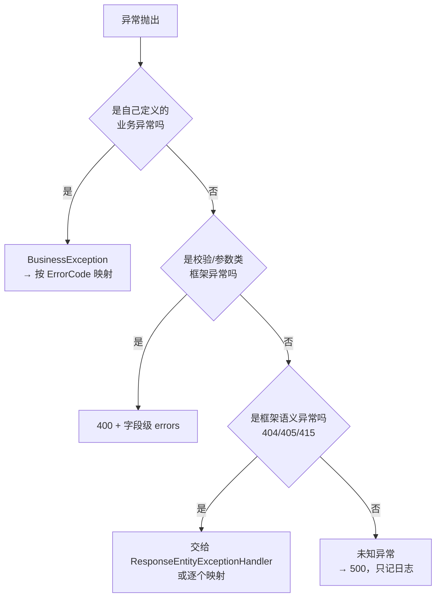

---
sources:
  - 04-第四阶段
---

# 06. 错误模型：ProblemDetail 与错误码

> [← 第四阶段导览](01-导览.md) · 错误体是接口契约里唯一「只在出事时才被看到」的部分，也正因如此它最容易被做成 `{code: 500, msg: "系统错误"}`——一旦这样，客户端无法区分「重试有用」和「改参数才有用」，监控也无法区分「我们的错」和「他们的错」。

## 1. RFC 9457：五个标准字段与扩展字段

RFC 9457（2023 年取代 RFC 7807）定义了一种媒体类型 `application/problem+json`，把错误体标准化成五个字段：

| 字段 | 语义 | 谁写 | 稳定性 |
|---|---|---|---|
| `type` | 问题**类型**的 URI 引用，默认 `about:blank` | 服务端定义 | 同一类错误永远同一个值 |
| `title` | 该类问题的**简短**人类可读摘要 | 服务端定义 | 同类型固定，可本地化 |
| `status` | HTTP 状态码（重复一遍，便于日志与代理读取） | 服务端 | 与响应行一致 |
| `detail` | **本次**发生的具体说明 | 服务端 | 每次可以不同 |
| `instance` | 本次问题的 URI 引用（哪个请求） | 服务端 | 每次不同 |

区分 `title` 与 `detail` 是理解这套标准的关键：`title` 回答「这是哪一类问题」（`订单状态不允许该操作`），`detail` 回答「这一次具体是什么」（`订单 ord_123 已发货，不能取消`）。很多实现把两者合并成一句 `message`，结果客户端想做「按类型分支」时无从下手。

**扩展字段是标准允许的**，只要不与保留字段重名。工程上值得加的有五个：

| 扩展字段 | 类型 | 为什么需要 |
|---|---|---|
| `code` | string | 机器可读的稳定标识（`ORDER-STATE-0002`），客户端按它分支，不解析文案 |
| `traceId` | string | 报障时用户念给你，你直接定位那一条链路 |
| `errors[]` | array | 字段级错误，每个含 `field`/`code`/`message` |
| `retryable` | boolean | 明确告诉客户端「重试有没有意义」，比让客户端背状态码表可靠 |
| `timestamp` | string | 排查时钟漂移与时序问题，ISO-8601 带时区 |

**为什么 `type` 不该用 `about:blank`**：`about:blank` 的意思是「没有更具体的类型」，此时客户端只能靠 `status` 判断。业务错误恰恰需要更细的区分——「库存不足」和「优惠券过期」都是 409，但客户端处理方式完全不同。把 `type` 指向一份可访问的错误文档（`https://errors.example.com/order/stock-shortage`），既给了人看的地方，也给了机器稳定的键。

**取舍**：`type` 用 URL 意味着你要维护一个错误文档站；小团队可以用 URN 形式（`urn:problem:order:stock-shortage`），不可解引用但仍是稳定标识。**关键是稳定**——一旦发布就不能改，否则客户端的判断全失效。

## 2. `ProblemDetail` 与 `ErrorResponse` 的原生支持

Spring 6 起内置了 `ProblemDetail`，它就是上面五个字段的载体，并允许挂任意扩展属性：

```kotlin
val pd = ProblemDetail.forStatusAndDetail(HttpStatus.CONFLICT, "订单已发货，不能取消")
pd.title = "订单状态冲突"
pd.type = URI.create("https://errors.example.com/order/state-conflict")
pd.instance = URI.create("/orders/ord_123")
pd.setProperty("code", "ORDER-STATE-0002")
pd.setProperty("traceId", MDC.get("traceId"))
```

三处关键 API：

| API | 用途 |
|---|---|
| `ProblemDetail.forStatus(status)` | 只带状态码，`title` 自动取状态码的短语 |
| `ProblemDetail.forStatusAndDetail(status, detail)` | 最常用，`detail` 写本次的具体原因 |
| `setProperty(name, value)` | 挂扩展字段，序列化时会被摊平到顶层 |

**Spring 的框架异常已经实现了 `ErrorResponse` 接口**（`MethodArgumentNotValidException`、`NoResourceFoundException`、`HttpRequestMethodNotSupportedException` 等），每个都能通过 `getBody()` 给出一个 `ProblemDetail`。这意味着你不需要为每个框架异常手写映射——只要让 `ResponseEntityExceptionHandler` 参与处理，它就会把框架异常统一转成 RFC 9457 结构。

Boot 4 里打开全局开关：

```yaml
spring:
  mvc:
    problemdetails:
      enabled: true     # 让框架异常与 /error 兜底也输出 problem+json
```

**为什么建议打开**：不打开时，`/error` 走的是 Boot 的默认错误结构（`timestamp`/`status`/`error`/`path`），与你自定义的 `ProblemDetail` 长得不一样。同一个服务出现两种错误体，客户端的解析代码就得写两份。打开之后，「框架异常」「过滤器里抛的」「404」至少结构一致。

**坑**：`ProblemDetail` 的 `status` 与响应行不一致时，客户端会困惑。永远用同一份 `status` 同时设置两处——不要让 `ProblemDetail.status` 写 400 而 `ResponseEntity` 返回 200。

## 3. `@ControllerAdvice` 的分层与映射表

一个健康的错误处理不是一个大 `when`，而是四层：



四层各自的原则：

| 层 | 异常 | 状态码 | 该带什么 | 不该带什么 |
|---|---|---|---|---|
| 业务 | `BusinessException(code)` | 由 `ErrorCode` 决定 | `code`、可读 `detail`、必要时 `errors` | 堆栈、SQL、内部 ID |
| 校验 | `MethodArgumentNotValidException`、`HandlerMethodValidationException`、`ConstraintViolationException` | 400 | 字段级 `errors[]` | 原始异常 message（含类名） |
| 框架语义 | `NoResourceFoundException`、`HttpRequestMethodNotSupportedException`、`HttpMediaTypeNotSupportedException` | 404/405/415/406 | 正确的状态码 + `Allow`/`Accept` 头 | 500（把客户端错误说成服务端错误） |
| 未知 | `Exception` | 500 | 固定文案 + `traceId` | `e.message`、堆栈、类名 |

完整映射表（可以直接抄进 `@ExceptionHandler` 清单）：

| 异常 | status | code 示例 | 备注 |
|---|---|---|---|
| `MethodArgumentNotValidException` | 400 | `VALIDATION-0001` | `@Valid @RequestBody` 失败 |
| `HandlerMethodValidationException` | 400 | `VALIDATION-0002` | 方法参数上的 `@Min` 等，Spring 6.1+ |
| `ConstraintViolationException` | 400 | `VALIDATION-0003` | Service 层 `@Validated` 失败 |
| `HttpMessageNotReadableException` | 400 | `REQUEST-0001` | body 缺失/语法错/类型不匹配 |
| `MissingServletRequestParameterException` | 400 | `REQUEST-0002` | 必填 query 缺失 |
| `MethodArgumentTypeMismatchException` | 400 | `REQUEST-0003` | path/query 类型转换失败 |
| `HttpRequestMethodNotSupportedException` | 405 | `REQUEST-0004` | 带 `Allow` 头 |
| `HttpMediaTypeNotSupportedException` | 415 | `REQUEST-0005` | 带 `Accept` 头 |
| `NoResourceFoundException` | 404 | `RESOURCE-0001` | 静态资源/路径不存在 |
| `BusinessException(NOT_FOUND)` | 404 | `ORDER-0001` | 资源不存在 |
| `BusinessException(CONFLICT)` | 409 | `ORDER-STATE-0002` | 状态冲突 |
| `OptimisticLockingFailureException` | 409 | `CONFLICT-0001` | 版本号冲突，可重试 |
| `DataIntegrityViolationException` | 409 | `CONFLICT-0002` | 唯一键冲突，不泄露约束名 |
| `UnauthorizedException` | 401 | `AUTH-0001` | 必须带 `WWW-Authenticate` |
| `AccessDeniedException` | 403 | `AUTH-0002` | 已认证但无权限 |
| `CallNotPermittedException` | 503 | `LIMIT-0001` | 熔断打开，带 `Retry-After` |
| 其它 `Exception` | 500 | `COMMON-9999` | 只记日志，不回细节 |

**两个顺序陷阱**：

1. `@ExceptionHandler(Exception::class)` 会**吞掉**所有没被更具体的 handler 匹配的异常，包括 `NoResourceFoundException`。所以要么为框架语义异常逐个写 handler，要么让 advice 继承 `ResponseEntityExceptionHandler` 并用 `@ExceptionHandler` 覆盖你想改的那些。
2. 多个 `@ControllerAdvice` 时，`@Order` 小的先匹配；一旦某个 advice 声明了能处理该异常的 `@ExceptionHandler`，后面的就不再有机会。常见的错误是「一个全局兜底 advice + 一个业务 advice」，兜底的 `@Order` 反而更小，于是业务异常也被当成 500。

## 4. 错误码命名体系

错误码是给人查、给机器分支的稳定标识。推荐 `域-模块-序号` 三段：

```text
ORDER-PAY-0012
│     │   └── 该模块内自增，4 位，永不复用
│     └────── 子模块/场景（PAY、STOCK、STATE）
└──────────── 业务域，与限界上下文对齐
```

六条规则：

1. **大写 + 连字符**，只用 `[A-Z0-9-]`，长度控制在 8~24 字符——它要进日志、进 URL、进客户端的 `switch`。
2. **序号只增不复用**。删掉的码不要回收，否则老客户端会把新语义当旧语义。
3. **一个 code 只对应一个 HTTP 状态码**。同一个 code 既可能 400 又可能 409，等于没有 code。
4. **粒度到「可行动」**。`ORDER-0001`（订单不存在）和 `ORDER-0002`（订单状态冲突）够用；不要为每个 `if` 造一个码，也不要只用一个 `BUSINESS-ERROR`。
5. **code 与 status 解耦**。不要把状态码编进序号（`ORDER-0400-0001`），否则「400 改成 422」时要么改码要么说谎。
6. **`code` 进日志，文案不进日志**。日志里打 code + 参数，文案可以随时改、可以本地化。

**为什么不用 HTTP 状态码直接当错误码**：状态码只有几十个，业务错误有几百个；而且状态码是给通用中间件看的（网关重试、监控告警），业务码是给你的客户端看的。两者是不同层次的抽象，合并会同时牺牲两边。

## 5. `traceId`、堆栈与国际化

三件事必须一起设计，因为它们共享同一个「出错时刻」：

| 关注点 | 生产做法 | 反例 |
|---|---|---|
| traceId | Filter 生成/透传，进 MDC、进响应头 `X-Trace-Id`、进 `ProblemDetail.traceId` | 只在日志里打，用户报障时拿不到 |
| 堆栈 | 只进日志（`log.error` 带异常对象），响应里一个字都不给 | `detail = e.message`，泄露 SQL 与内网主机名 |
| 国际化 | `title`/`detail` 按 `Accept-Language` 取 `MessageSource`；`code`/`type` 不变 | 把中文文案写进 `type` 或 `code` |

**为什么响应里绝不能有堆栈或原始 message**：`e.message` 里经常带表名、列名、文件路径、下游地址、甚至 SQL 片段。这些信息对攻击者是免费的侦察，对用户是噪音。正确姿势是响应里给 `traceId`，日志里用同一个 `traceId` 打全量堆栈——排障体验不降，泄露面归零。

国际化有一个必须接受的取舍：**`detail` 本地化之后，日志检索会变难**。所以在服务端日志里不要打本地化文案，打 `code` + 参数（`log.warn("business error code={} args={}", code, args)`），文案只在响应阶段渲染。

```yaml
# 输出侧的两个保险
server:
  error:
    include-stacktrace: never     # 默认值，但显式写出来更安全
    include-message: never
```

## 6. 完整实现

先定义错误码与业务异常，把「状态码」与「错误码」绑在一处：

```kotlin
enum class ErrorCode(val status: HttpStatus, val typeSlug: String) {
    ORDER_NOT_FOUND(HttpStatus.NOT_FOUND, "order/not-found"),
    ORDER_STATE_CONFLICT(HttpStatus.CONFLICT, "order/state-conflict"),
    STOCK_SHORTAGE(HttpStatus.CONFLICT, "order/stock-shortage"),
    AUTH_TOKEN_INVALID(HttpStatus.UNAUTHORIZED, "auth/token-invalid"),
    ;

    // code 由枚举名派生：ORDER_NOT_FOUND -> ORDER-NOT-FOUND
    val code: String get() = name.replace('_', '-')
}

class BusinessException(
    val errorCode: ErrorCode,
    val args: Array<Any> = emptyArray(),
    cause: Throwable? = null,
) : RuntimeException(errorCode.code, cause)
```

再写 advice。注意它同时处理四层，且每个分支都补齐 `code`、`traceId`、`type`、`instance`：

```kotlin
@RestControllerAdvice
class ApiExceptionHandler(
    private val messages: MessageSource,
) {
    private val log = LoggerFactory.getLogger(javaClass)

    // ① 业务异常：状态码与 code 都来自 ErrorCode
    @ExceptionHandler(BusinessException::class)
    fun onBusiness(ex: BusinessException, req: HttpServletRequest): ProblemDetail {
        val code = ex.errorCode.code
        log.warn("business error code={} args={} traceId={}", code, ex.args.contentToString(), MDC.get("traceId"))
        return base(ex.errorCode.status, code, req).apply {
            // type 指向可读的错误文档，用 slug；code 是给机器分支的稳定标识
            setType(URI.create("https://errors.example.com/${ex.errorCode.typeSlug}"))
            detail = msg("error.$code.detail", ex.args, "请求无法完成")
            title = msg("error.$code.title", emptyArray(), "业务规则冲突")
        }
    }

    // ② 校验异常：字段级 errors 必须完整，客户端靠它定位输入
    @ExceptionHandler(MethodArgumentNotValidException::class)
    fun onInvalid(ex: MethodArgumentNotValidException, req: HttpServletRequest): ProblemDetail {
        val errors = ex.bindingResult.allErrors.map { err ->
            when (err) {
                is FieldError -> mapOf(
                    "field" to err.field,
                    "code" to (err.code ?: "Invalid"),
                    "message" to (err.defaultMessage ?: "非法值"),
                )
                else -> mapOf(
                    "field" to "_global",
                    "code" to (err.code ?: "Invalid"),
                    "message" to (err.defaultMessage ?: "非法请求"),
                )
            }
        }
        return base(HttpStatus.BAD_REQUEST, "VALIDATION-0001", req).apply {
            title = msg("error.VALIDATION-0001.title", emptyArray(), "请求参数不合法")
            detail = msg("error.VALIDATION-0001.detail", emptyArray(), "有 ${errors.size} 处参数不合法")
            setProperty("errors", errors)
        }
    }

    // ③ 框架语义：body 读不出来 / 类型不匹配，都属于客户端问题
    @ExceptionHandler(HttpMessageNotReadableException::class)
    fun onUnreadable(ex: HttpMessageNotReadableException, req: HttpServletRequest): ProblemDetail =
        base(HttpStatus.BAD_REQUEST, "REQUEST-0001", req).apply {
            title = "请求体无法解析"
            detail = "请求体不是合法 JSON，或字段类型与契约不符"
        }

    @ExceptionHandler(MethodArgumentTypeMismatchException::class)
    fun onTypeMismatch(ex: MethodArgumentTypeMismatchException, req: HttpServletRequest): ProblemDetail =
        base(HttpStatus.BAD_REQUEST, "REQUEST-0003", req).apply {
            title = "参数类型不匹配"
            detail = "参数 ${ex.name} 期望类型为 ${ex.requiredType?.simpleName}"
            setProperty("errors", listOf(mapOf("field" to ex.name, "code" to "TypeMismatch")))
        }

    // ④ 未知异常：响应只给 traceId，堆栈只进日志
    @ExceptionHandler(Exception::class)
    fun onUnknown(ex: Exception, req: HttpServletRequest): ProblemDetail {
        val traceId = MDC.get("traceId")
        log.error("unhandled exception traceId={} uri={}", traceId, req.requestURI, ex)
        return base(HttpStatus.INTERNAL_SERVER_ERROR, "COMMON-9999", req).apply {
            title = "服务器内部错误"
            detail = "请稍后重试；如持续出现请提供 traceId：$traceId"
        }
    }

    private fun base(status: HttpStatus, code: String, req: HttpServletRequest): ProblemDetail {
        // 先在 apply 之外算好：apply 里的 status 会被 ProblemDetail 自己的属性遮蔽
        val retryable = status == HttpStatus.TOO_MANY_REQUESTS || status.is5xxServerError
        return ProblemDetail.forStatusAndDetail(status, "").apply {
            setType(URI.create("https://errors.example.com/$code"))
            // 路径可能含未编码字符，URI.create 会抛异常——错误处理器自己抛异常是最坏的 500
            setInstance(runCatching { URI.create(req.requestURI) }.getOrNull())
            setProperty("code", code)
            setProperty("traceId", MDC.get("traceId"))
            setProperty("retryable", retryable)
            setProperty("timestamp", OffsetDateTime.now(ZoneOffset.UTC).toString())
        }
    }

    private fun msg(key: String, args: Array<Any>, fallback: String): String =
        runCatching { messages.getMessage(key, args, LocaleContextHolder.getLocale()) }
            .getOrDefault(fallback)
}
```

三个实现细节值得强调：

- **`retryable` 由服务端算，而不是让客户端背规则**。`503` 与 `429` 可重试，`409` 有时可重试（乐观锁），`400` 永不。写进错误体，客户端逻辑就只有一行 `if (retryable)`。
- **`instance` 用请求路径而不是完整 URL**。路径是稳定的、不含主机名与查询串里的敏感参数；完整 URL 会泄露内部地址，也会让日志里的 `instance` 长度爆炸。
- **`getMessage` 包了 `runCatching`**。缺翻译文件时 `MessageSource` 会抛 `NoSuchMessageException`，如果它在异常处理里再抛一次，客户端会收到一个 500 的错误页而不是错误体——「错误处理器自己出错」是最难查的一类问题。

## 7. 客户端如何消费

服务端做完这套，客户端才有条件写出一段不需要背状态码表的逻辑：

| 情况 | 客户端动作 | 依据 |
|---|---|---|
| 400 / 422 | 不重试，把 `errors[]` 展示到对应字段 | `errors[].field` 与表单字段同名 |
| 401 | 尝试刷新令牌，重放一次；仍失败则跳登录 | 一次为限，避免刷新风暴 |
| 403 | 不重试，提示无权限 | 与 401 严格区分 |
| 404 | 不重试，提示资源不存在或跳列表 | — |
| 409 | 看 `code`：乐观锁 → 重读后重试一次；状态冲突 → 提示用户 | `code` 比状态码细 |
| 429 | 按 `Retry-After` 退避 | 头优先于 `retryable` |
| 5xx | 仅幂等请求可重试，带指数退避 + 抖动 | `retryable` + 方法语义 |
| 任意 | 报障时上报 `traceId` | 服务端能直接定位 |

**为什么 `code` 必须稳定**：客户端的 `when (code)` 分支一旦发布就分布在上百个客户端版本里，你改了码值，老版本客户端就落到 `else` 分支。所以码值只能新增，不能改语义。这也是为什么错误码要在项目早期定规矩——上线三个月后再统一，成本是几十个仓库。

## 8. 自测

1. `type` 与 `code` 各自的职责是什么？为什么 `type` 用 `about:blank` 会让客户端只能靠状态码分支？
2. `MethodArgumentNotValidException` 与 `ConstraintViolationException` 分别来自哪条校验入口？映射到状态码时有什么不同？
3. 为什么 `@ExceptionHandler(Exception::class)` 会让 404 变成 500？两种修法分别是什么？
4. 生产环境为什么连 `e.message` 都不能返回？举出它可能包含的三类信息。
5. 一个业务错误码既可能返回 400 又可能返回 409，会破坏客户端的什么能力？
6. `retryable` 字段相比让客户端自己判断状态码，好在哪里？409 该不该标 `retryable`？

## 9. 延伸

- 上一册：[05-校验体系与Kotlin陷阱](05-校验体系与Kotlin陷阱.md)——本册的第 ② 层就吃它抛出的异常。
- 下一册：[07-Jackson3序列化](07-Jackson3序列化.md)——`ProblemDetail` 本身也要经过序列化，扩展字段能不能输出取决于它。
- 异常在 Filter 与 Interceptor 的不同出口：[03-Filter-Interceptor-AOP的执行顺序](03-Filter-Interceptor-AOP的执行顺序.md)。
- 错误率指标怎么建、为什么「200 包错误体」让监控失明：[10-第十阶段 01 册](../10-第十阶段/01-导览.md)。
- HTTP 状态码的语义边界：[浏览器站 04 阶段 02 册](https://yidafu.github.io/tech-learning/browser/)。
