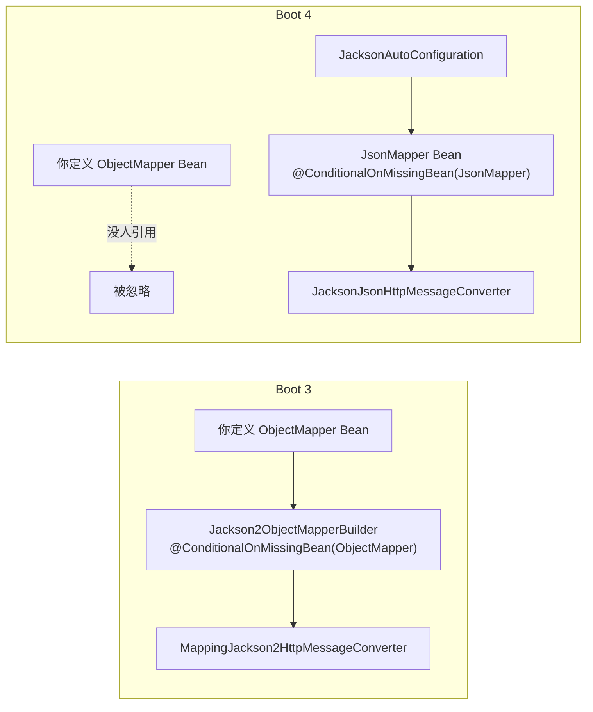

---
sources:
  - 04-第四阶段
---

# 07. Jackson 3 序列化

> [← 第四阶段导览](01-导览.md) · Jackson 3 换的不只是坐标：`JsonMapper` 不可变、异常不再受检、默认值也变了几处。真正的风险是「你自定义的 `ObjectMapper` 还在，但 MVC 已经不用它了」——编译通过、启动正常、响应形状悄悄变了。

## 1. 迁移清单

Jackson 3 是 2025 年的大版本，包名从 `com.fasterxml.jackson` 迁到 `tools.jackson`（`jackson-annotations` 是唯一例外）。Boot 4 直接以它为基线，所以这不是「可选升级」，而是迁移时必须逐条核对的一张表。

| Jackson 2 | Jackson 3 | 影响面 |
|---|---|---|
| `com.fasterxml.jackson.core:jackson-databind` | `tools.jackson.core:jackson-databind` | 依赖坐标 + import 全变 |
| `com.fasterxml.jackson.core:jackson-annotations` | 坐标不变（3.0.x），包名仍是 `com.fasterxml.jackson.annotation` | 注解 import **不用改**，这一点常被误改 |
| `new ObjectMapper()` | `JsonMapper.builder().build()` | 构造入口收进 builder，mapper 不可变 |
| `Jackson2ObjectMapperBuilderCustomizer` | `JsonMapperBuilderCustomizer` | Boot 4 的定制入口 |
| `@JsonComponent` | `@JacksonComponent` | 自定义序列化器/反序列化器的注册 |
| `Module` / `SimpleModule` | `JacksonModule` / `SimpleModule` | 避开 JPMS 模块名冲突 |
| `JsonProcessingException`（受检） | `JacksonException`（非受检） | 不再强制 try/catch，但别因此漏掉错误处理 |
| `spring.jackson.serialization.*`、`spring.jackson.deserialization.*` | `spring.jackson.json.write.*`、`spring.jackson.json.read.*` | 配置前缀整体收进 `json` 下；日期/枚举等特性另有 `spring.jackson.datatype.datetime.*`、`spring.jackson.datatype.enum.*` |

**为什么默认值也要列进迁移清单**：Jackson 3 翻转了六个默认值，代码一行不改，线上的 JSON 就变了形状。这是「升级完测试全绿、上线后客户端崩」的典型来源。

| 特性 | Jackson 2 默认 | Jackson 3 默认 | 后果 |
|---|---|---|---|
| `SORT_PROPERTIES_ALPHABETICALLY` | 关（按声明顺序） | **开（按字母序）** | 字段顺序全变；按位置解析或做签名的客户端会崩 |
| `WRITE_DATES_AS_TIMESTAMPS` | 开（epoch 数字） | **关（ISO-8601 字符串）**，且移入 `DateTimeFeature` | 前端 `date.getTime()` 报错 |
| `FAIL_ON_UNKNOWN_PROPERTIES` | 开 | **关** | 字段名拼错不再报错（Boot 3 本来就关了，净变化为零） |
| `FAIL_ON_EMPTY_BEANS` | 开 | 关 | 空对象输出 `{}` 而不是报错 |
| `DEFAULT_VIEW_INCLUSION` | 开 | 关 | 没标 `@JsonView` 的字段从视图里消失 |
| `USE_GETTERS_AS_SETTERS` | 开 | 关 | 只有 getter 没有 setter 的集合字段不再被填充 |

其中第一条最容易被忽略，因为它不报错、不抛异常，只是「响应里的字段换了个顺序」。对普通前端没影响，但对**按字符串比对做签名**的接口（很多支付回调是这么做的）是致命的——同一份数据签名对不上。

**为什么要动包名**：`com.fasterxml.jackson` 这个 group 在 JPMS 下与 `jackson-annotations` 的模块名纠缠，也让「哪些包属于 Jackson 核心」变得模糊。`tools.jackson` 是一次彻底的重整：core、databind、模块各有清晰的命名空间。

**为什么 `ObjectMapper` 变成不可变**：Jackson 2 里 `ObjectMapper` 是可变的，任何持有它的代码都能在运行期 `enable/disable` 一个 feature——线上出现「某个请求之后全站日期格式变了」的事故，根因常常是某个库在初始化时改了共享 mapper。Jackson 3 用 builder 构造 + 不可变实例，从类型层面消灭了这类事故，代价是「运行期动态改配置」这条路没了，必须重建实例。

**取舍**：不可变意味着配置必须集中在启动时完成。想在运行时按租户切换序列化策略（比如某些租户要 snake_case），只能维护多个 `JsonMapper` 实例并按需选择，而不是改全局。

## 2. 「定义 `ObjectMapper` Bean 不再替换默认 mapper」

这是升级到 Boot 4 最容易踩、也最难发现的坑。Boot 3 时代的标准做法是：

```kotlin
// Boot 3：这样写确实会替换掉 MVC 用的 mapper
@Bean
fun objectMapper(): ObjectMapper = ObjectMapper().apply {
    configure(DeserializationFeature.FAIL_ON_UNKNOWN_PROPERTIES, false)
    setPropertyNamingStrategy(PropertyNamingStrategies.SNAKE_CASE)
}
```

Boot 4 里，这段代码**仍然编译通过、仍然注册成一个 Bean、仍然能被你的代码注入**，但 MVC 的 `HttpMessageConverter` 用的不是它——因为 Boot 4 的 `JacksonAutoConfiguration` 提供的默认 Bean 类型是 `JsonMapper`，`@ConditionalOnMissingBean` 检查的也是 `JsonMapper`。你定义的 `ObjectMapper` 与它共存，谁也没报错，响应却回到了默认配置：蛇形命名失效、字段改成按字母排序、自定义的 `@JsonFormat` 全丢。更麻烦的是 `JsonMapper` 继承自 `ObjectMapper`，所以两个 Bean 都是每个 `ObjectMapper` 注入点的候选，而 Spring 自己的那个带了 `@Primary`——**你注入到的也可能是它**。



三种正确的介入方式，按推荐度排序：

| 方式 | 写法 | 优点 | 代价 |
|---|---|---|---|
| `JsonMapperBuilderCustomizer` | 定义一个该类型的 Bean，`customize(builder)` | 保留 `spring.jackson.*` 的全部效果，只加不改 | 只能改 builder，不能替换实例 |
| 定义 `JsonMapper` Bean | `@Bean fun jsonMapper() = ...` | 完全掌控 | 会绕过 `spring.jackson.*`，属性配置全部失效 |
| `@JacksonComponent` | 自定义 `JsonSerializer`/`JsonDeserializer` | 只针对某个类型，范围最小 | 不适合全局策略 |

**诊断方法**：跑一次 `--debug`，在条件评估报告里找 `JacksonAutoConfiguration#jacksonJsonMapper matched`——如果 `@ConditionalOnMissingBean (types: JsonMapper)` 显示「did not find any beans」，说明 Boot 自己造了一个，你的配置没生效。这是整件事唯一可见的地方：健康检查是 UP、启动日志干净、你的 Bean 也确实在容器里。再补一个测试断言 `writeValueAsString(LocalDate.now())` 的形状，就能把这类问题钉死。

## 3. Kotlin 模块：空安全、默认值、`@JsonCreator`

Kotlin 的类没有 JavaBean 式的无参构造器 + setter，Jackson 必须靠 `jackson-module-kotlin` 才能正确实例化 `data class`。Boot 4 在 classpath 上检测到该模块会自动注册，但**自建 `JsonMapper` 时要手动加**。

```kotlin
val mapper = JsonMapper.builder()
    .addModule(KotlinModule.Builder()
        .enable(KotlinFeature.StrictNullChecks)   // 显式 null 进非空参数 → 立刻失败
        .build())
    .build()
```

四个 feature 决定了「缺失」与「null」的语义：

| Feature | 作用 | 默认 | 什么时候开 |
|---|---|---|---|
| `StrictNullChecks` | 显式 `null` 赋给非空参数时抛异常 | 关 | 契约要求「非空就是非空」时开 |
| `NullIsSameAsDefault` | `null` 当作「字段缺失」，用默认值 | 关 | 兼容老客户端把可选字段传 null |
| `NullToEmptyCollection` | `null` 集合转成空集合 | 关 | 内部服务间调用，减少 null 判断 |
| `NullToEmptyMap` | 同上，针对 Map | 关 | 同上 |

**默认值的语义**：Kotlin 的 `data class` 默认值对 Jackson 是「字段缺失时使用」，不是「null 时使用」。

```kotlin
data class CreateOrderRequest(
    val sku: String,
    val qty: Int = 1,
    val remark: String? = null,
)
```

| 请求体 | 结果 | 说明 |
|---|---|---|
| `{"sku":"A"}` | `qty=1, remark=null` | 缺字段用默认值 |
| `{"sku":"A","qty":null}` | 抛异常（`qty` 非空） | 显式 null 不会被默认值兜住 |
| `{"sku":"A","remark":null}` | `remark=null` | 可空类型正常 |

第三行正是 05 册说的「缺失与显式 null 不可区分」在序列化层的源头：**默认值只在缺失时生效，一旦客户端显式传 null，语义就变了**。PATCH 类接口必须靠 `JsonNullable` 或干脆改成 PUT 全量替换。

**`@JsonCreator` 什么时候必须写**：有多个构造器、或者主构造器不能被唯一识别时。单构造器的 `data class` 不需要；一旦你加了次构造器用于内部构造，Jackson 可能选错，这时用 `@JsonCreator` + `@JsonProperty` 显式标注：

```kotlin
data class Money(val amount: BigDecimal, val currency: String) {
    @JsonCreator
    constructor(
        @JsonProperty("amount") amount: String,
        @JsonProperty("currency") currency: String,
    ) : this(BigDecimal(amount), currency.uppercase())
}
```

**取舍**：`@JsonCreator` 的静态工厂能让「反序列化即校验」成立（构造器里 `require` 不变量），但它也让 Jackson 的异常变成 `IllegalArgumentException` 包在 `ValueInstantiationException` 里，错误消息不再有字段路径。校验职责还是留给 Bean Validation 更清晰。

## 4. 输出策略：null、空集合、未知字段

三个开关决定响应体的「形状」，它们必须写进契约，而不是留在默认值里。

| 策略 | 配置 | 输出 | 适用 |
|---|---|---|---|
| 始终输出 null | `default-property-inclusion: always` | `{"nickname": null}` | 字段稳定、客户端强类型（推荐默认） |
| 省略 null | `non_null` | `{}` | 移动端省流量，但客户端无法区分「没有这个字段」与「值为空」 |
| 省略空集合 | `non_empty` | 省略 `[]` | 同上，且会让「空列表」与「字段不存在」混淆 |

**为什么推荐 `always`**：字段时有时无会让客户端生成代码（OpenAPI/TS 类型）把字段标成 optional，随后每个使用点都要判空。带宽收益在 JSON 里通常只有几个百分点，而契约稳定性收益是长期的。真要省流量，用 gzip 而不是删字段。

`FAIL_ON_UNKNOWN_PROPERTIES` 是另一个方向相反的开关：

| 侧 | Jackson 3 原生默认 | Boot 3/4 默认 | 建议 |
|---|---|---|---|
| 反序列化 | 关闭（3.0 起由 true 翻成 false） | 关闭 | 服务端保持关闭，客户端显式开启 |

**为什么服务端要关**：客户端版本总是落后于服务端，如果服务端对未知字段报错，那么「旧客户端发新字段」会 400——但旧客户端根本不知道有新字段。反过来，**客户端应当开启**，这样服务端多返回一个字段时能立刻发现契约漂移。

注意这里有个容易被博客写错的点：Jackson 2 的默认值是 `true`，所以「Jackson 3 翻了默认值」这句话本身没错；但从 Boot 3 升上来的人感觉不到变化，因为 Boot 3 的 `Jackson2ObjectMapperBuilder` 早就把它关了。**净变化为零，不要为它做迁移动作**。

**坑**：关闭 `FAIL_ON_UNKNOWN_PROPERTIES` 会让「字段名拼错」静默通过。`{"skuu": "A"}` 反序列化成一个 `sku = null` 的对象，如果 `sku` 可空，校验也过了。防御手段是在契约测试里断言「拼错字段名必须 400」——这条测试比配置更能保护你。

## 5. 多态：`@JsonTypeInfo` 与 sealed 类

Kotlin 的 `sealed interface` 天然适合表达「有限种支付方式」，但 Jackson 不会自动把类型信息写进 JSON，必须显式声明：

```kotlin
@JsonTypeInfo(use = JsonTypeInfo.Id.NAME, include = JsonTypeInfo.As.PROPERTY, property = "type")
@JsonSubTypes(
    JsonSubTypes.Type(value = CardPayment::class, name = "card"),
    JsonSubTypes.Type(value = WalletPayment::class, name = "wallet"),
)
sealed interface PaymentMethod {
    val amount: BigDecimal
}

data class CardPayment(override val amount: BigDecimal, val last4: String) : PaymentMethod
data class WalletPayment(override val amount: BigDecimal, val walletId: String) : PaymentMethod
```

输出形如 `{"type":"card","amount":100,"last4":"4242"}`。四个决定：

| 决定 | 选项 | 影响 |
|---|---|---|
| `use` | `NAME` / `CLASS` / `DEDUCTION` | `NAME` 最安全；`CLASS` 会泄露全限定类名；`DEDUCTION` 不写 type 字段，靠形状推断 |
| `include` | `PROPERTY` / `WRAPPER_OBJECT` / `EXISTING_PROPERTY` | `PROPERTY` 最直观 |
| 子类型注册 | `@JsonSubTypes` / `registerSubtypes` | 必须显式，sealed 的 `permits` 不会被自动读取 |
| 未知子类型 | 默认抛 `InvalidTypeIdException` | 这是对的：宁可 400 也不要静默降级 |

**`Id.DEDUCTION` 的取舍**：它让 JSON 更干净（省掉 `type` 字段），但要求各子类型的字段形状唯一可辨——两个子类型都有 `walletId` 时就无法区分。且错误消息从「未知 type」变成「无法推断类型」，排障更难。**默认用 `NAME`**，只有对外契约明确要求无类型字段时才用 `DEDUCTION`。

**安全红线**：不要开 `activateDefaultTyping`。它会把 Java 类名写进 JSON 并在反序列化时按名字实例化，是历史上多个 RCE 漏洞的入口。必须用多态时只用 `@JsonTypeInfo` + 显式白名单，并在 Jackson 3 里配 `PolymorphicTypeValidator` 限制可反序列化的包。

## 6. 时间、`BigDecimal` 与精度

时间与金额是「序列化看起来没问题、对账时才发现错了」的两个重灾区。

| 类型 | 默认行为（Jackson 3） | 建议 |
|---|---|---|
| `Instant` / `OffsetDateTime` | ISO-8601 带偏移（`2026-11-15T10:00:00Z`） | 统一 UTC，输出带 `Z`；不要混用 `long` 时间戳 |
| `LocalDate` | ISO-8601（`2026-11-15`） | 明确它是「日期」不是「时刻」，避免时区歧义 |
| `BigDecimal` | 可能输出科学计数法（`1E+2`） | 开 `WRITE_BIGDECIMAL_AS_PLAIN` |
| `Double` | 二进制浮点，`0.1 + 0.2 != 0.3` | 金额禁用 `Double` |

`BigDecimal` 有两个独立的坑，必须分别处理：

1. **科学计数法**。`BigDecimal("1E+2")` 序列化成 `1E+2` 而不是 `100`，很多语言的 JSON 解析器能读，但前端 `Number()` 之后精度已经丢了。开 `JsonWriteFeature.WRITE_BIGDECIMAL_AS_PLAIN` 强制平铺。
2. **scale 丢失**。`BigDecimal("1.10")` 经 `JsonNode` 中转后可能变成 `1.1`——对金额来说，`1.10` 与 `1.1` 数值相同但字符串不同，对账系统按字符串比对时会报差异。用 `JsonNodeFactory.withExactBigDecimals(true)` 保留 scale，或者干脆把金额序列化成字符串。

```kotlin
data class AmountView(
    // 金额用字符串传：不丢 scale、不进浮点、前端用 decimal 库解析
    @get:JsonFormat(shape = JsonFormat.Shape.STRING)
    val amount: BigDecimal,
    val currency: String,
)
```

**取舍**：字符串金额牺牲了「前端直接做算术」的便利，换来精确性。对外支付类接口这是唯一正确选择；内部报表类接口可以用数字 + 明确的 scale 约定（如「一律两位小数」）。

反序列化侧还要开 `USE_BIG_DECIMAL_FOR_FLOATS`，否则 `{"amount": 1.10}` 会先变成 `Double` 再转 `BigDecimal`，得到 `1.1000000000000000888...`。这个错误在金额上是致命的，而且只在特定数值上出现，测试很容易漏。

## 7. 循环引用与 DTO 边界

双向关联（订单 → 明细 → 订单）在序列化时会无限递归，Jackson 会抛 `DatabindException: Infinite recursion`（Jackson 2 里这个类叫 `JsonMappingException`）。三种修法，只有一种是对的：

| 修法 | 写法 | 评价 |
|---|---|---|
| 忽略反向字段 | `@JsonIgnore` | 能用，但注解散落在实体上，视角混乱 |
| 配对引用 | `@JsonManagedReference` / `@JsonBackReference` | 只适合一对一父子，且序列化结果依赖字段声明顺序 |
| DTO 边界 | 实体不进 Controller，手工映射成 `OrderView` | **唯一根治**，也顺带解决懒加载触发 N+1 |

**为什么只有 DTO 是根治**：循环引用的本质是「对象图里有环」，而**响应契约里不该有环**——客户端要靠 `id` 自己去取关联资源，这是 REST 的资源建模原则（08 册）。在实体上加 `@JsonIgnore` 只是把环剪断，没解决「实体直出」这个更根本的问题：懒加载、字段泄漏、内部枚举、数据库列名，全都会跟着出去。

**坑**：即使做了 DTO，`FAIL_ON_SELF_REFERENCES` 仍然会在「自己引用自己」时抛异常（比如树形结构的 `parent`）。这种结构要么限制深度，要么改成扁平列表 + `parentId` 让客户端组装。

## 8. 自定义 `JsonMapper` 与契约稳定性测试

推荐用 `JsonMapperBuilderCustomizer` 而不是替换整个 Bean——它保留 `spring.jackson.*` 的效果，只追加你需要的：

```kotlin
@Configuration
class JacksonConfig {

    @Bean
    fun jacksonTuning() = JsonMapperBuilderCustomizer { builder ->
        builder
            // 金额：平铺输出，禁止 1E+2
            .enable(JsonWriteFeature.WRITE_BIGDECIMAL_AS_PLAIN)
            // 反序列化浮点直接进 BigDecimal，避免先过 Double
            .enable(DeserializationFeature.USE_BIG_DECIMAL_FOR_FLOATS)
            // 未知字段忽略：服务端对旧客户端宽容（Jackson 3 默认已关，写出来是防回退）
            .disable(DeserializationFeature.FAIL_ON_UNKNOWN_PROPERTIES)
            // 属性排序：Jackson 3 默认已开，显式写出来是为了不随默认值变化而漂移
            .enable(MapperFeature.SORT_PROPERTIES_ALPHABETICALLY)
            // 日期 ISO-8601（特性在 Jackson 3 已挪到 DateTimeFeature，默认就是 false）
            .disable(DateTimeFeature.WRITE_DATES_AS_TIMESTAMPS)
    }
}
```

契约稳定性测试要盯三件事：**同一对象两次序列化一致**、**序列化再反序列化再序列化一致**（round-trip 幂等）、**与 golden 文件一致**（防止无意改字段）：

```kotlin
class JsonContractTest {

    private val mapper: JsonMapper = JsonMapper.builder()
        .addModule(KotlinModule.Builder().enable(KotlinFeature.StrictNullChecks).build())
        .enable(MapperFeature.SORT_PROPERTIES_ALPHABETICALLY)
        .build()

    private val sample = OrderView(
        id = "ord_0000000000000001",
        amount = BigDecimal("1.10"),
        createdAt = Instant.parse("2026-11-15T10:00:00Z"),
        tags = linkedMapOf("channel" to "app", "region" to "cn"),
    )

    @Test
    fun `同一对象两次序列化输出必须逐字节一致`() {
        val first = mapper.writeValueAsString(sample)
        val second = mapper.writeValueAsString(sample)
        assertEquals(first, second)
    }

    @Test
    fun `round-trip 之后形状不变`() {
        val json = mapper.writeValueAsString(sample)
        val back = mapper.readValue(json, OrderView::class.java)
        assertEquals(json, mapper.writeValueAsString(back))
    }

    @Test
    fun `金额按契约用字符串输出且保留 scale`() {
        val json = mapper.writeValueAsString(sample)
        assertTrue(json.contains("\"amount\":\"1.10\""), "实际输出: $json")
    }

    @Test
    fun `契约快照未漂移`() {
        val actual = mapper.writer().withDefaultPrettyPrinter().writeValueAsString(sample)
        val golden = java.nio.file.Files.readString(
            java.nio.file.Path.of("src/test/resources/contract/order-view.json"),
        )
        assertEquals(golden.trim(), actual.trim())
    }
}
```

三个让测试真正有效的细节：

- **属性排序在 Jackson 3 里默认就开了**，所以迁移到 Boot 4 时字段顺序会整体变成字母序——测试里显式 `enable` 不是为了打开它，而是为了**不依赖默认值**：哪天默认值再翻一次，你的 golden 文件不会莫名全红。反过来说，如果线上有按字符串签名的接口，这次升级会让签名全部对不上，必须用 `@JsonPropertyOrder` 固定顺序。
- **`Map` 必须是有序的**。`HashMap` 的迭代顺序在不同 JVM 上可能不同，序列化出来的 JSON 字段顺序就会抖。DTO 里的 Map 一律用 `LinkedHashMap`，或者开 `ORDER_MAP_ENTRIES_BY_KEYS`。
- **`@JsonTest` 在 Boot 4 里依然可用**，它自动配置 `JsonMapper`，但它配置的是「Boot 的 mapper」，不是「你生产环境的 mapper」——如果生产用了自定义 `JsonMapperBuilderCustomizer`，测试要显式导入那个配置类，否则测的是一个不存在的 mapper。

## 9. 自测

1. 升级到 Boot 4 后，你定义的 `ObjectMapper` Bean 注入正常，但接口的蛇形命名失效了。根因是什么？三种修法各自的代价？
2. `{"qty": null}` 与 `{}` 在 Kotlin `data class` 反序列化时的结果分别是什么？这个差异对 PATCH 接口意味着什么？
3. `BigDecimal("1.10")` 序列化后可能变成什么？两个独立的原因分别是什么，各自的配置项是什么？
4. `@JsonTypeInfo(use = Id.CLASS)` 为什么危险？`Id.DEDUCTION` 又有什么代价？
5. 为什么「实体直出」是循环引用的根因，而 `@JsonIgnore` 只是止血？它还会带来哪些别的问题？
6. 契约稳定性测试里为什么必须开属性排序、为什么 Map 要用 `LinkedHashMap`？不开会出现什么现象？

## 10. 延伸

- 上一册：[06-错误模型-ProblemDetail与错误码](06-错误模型-ProblemDetail与错误码.md)——`ProblemDetail` 的扩展字段也靠这台 mapper 输出。
- 下一册：[08-REST契约-幂等-分页-版本化与OpenAPI](08-REST契约-幂等-分页-版本化与OpenAPI.md)——序列化行为定完之后，才谈得上「契约」。
- Kotlin 数据建模与默认值的语义：[02-第二阶段 02 册](../02-第二阶段/02-空安全与不可变数据建模.md)。
- 序列化阶段触发懒加载导致 N+1：[第一阶段 02 册](../01-第一阶段/02-一次请求的十五站主时间线与账本.md)。
- 契约测试与消费者驱动契约：[10-第十阶段 01 册](../10-第十阶段/01-导览.md)。
