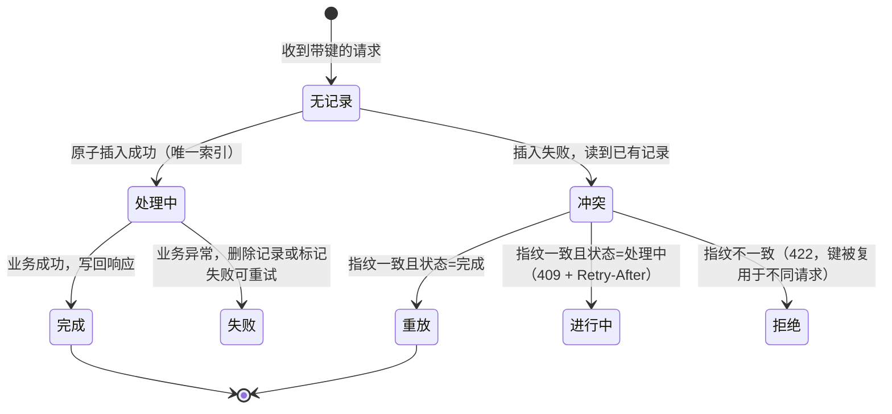
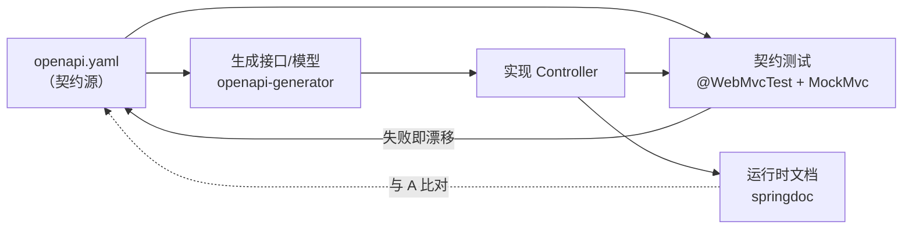

---
sources:
  - 04-第四阶段
---

# 08. REST 契约：幂等、分页、版本化与 OpenAPI

> [← 第四阶段导览](01-导览.md) · 契约不是「返回一个 JSON」，而是「别人可以据此写代码、并且你三年内不能随便改」的承诺。资源语义管住形状，幂等键管住重试，游标管住翻页，版本化管住演进——四件事缺一件，接口就会在上线三个月后开始还债。

## 1. 资源建模：名词、层级、动作子资源

REST 的路径表达的是「资源」，不是「函数」。判断一段 URL 是否合格，只需问一句：**它是一个东西，还是一个动作？**

| 反例 | 正例 | 问题 |
|---|---|---|
| `GET /getOrder?id=42` | `GET /orders/42` | 动词进路径，资源没被建模 |
| `POST /order/create` | `POST /orders` | 创建由方法与集合的组合表达 |
| `POST /orders/42/setStatus?to=PAID` | `POST /orders/42/payments` | 状态是结果，不是可任意赋值的字段 |
| `GET /orders/42/items/7/order/user` | `GET /users/{id}` 或 `GET /orders/42?expand=user` | 层级超过两级 |
| `GET /order_list` | `GET /orders` | 复数 + 连字符，不混用下划线 |

五条规则：

1. **名词用复数**。`/orders` 是集合，`/orders/42` 是集合里的一个元素——路径层级天然对应「集合 → 元素」，复数让这个语义自洽。
2. **层级不超过两级**。`/orders/{id}/items` 可以，`/orders/{id}/items/{itemId}/sku` 不行。深层级意味着「从属关系」被硬编码进 URL，一旦资源可以独立访问就得再造一套路径。
3. **状态变更用子资源动作**，而不是 `PUT status`。`POST /orders/42/cancel` 表达「取消是一次业务事件」，可以带原因、可以返回 202、可以有幂等键；`PATCH {"status":"CANCELLED"}` 表达「状态是个随便改的字段」，把状态机暴露成了可写字段。
4. **ID 放路径，筛选放 query**。`/orders/42` 是定位，`/orders?status=PAID&createdAfter=...` 是筛选。把筛选塞进路径会让缓存、日志聚合、OpenAPI 生成全部变难。
5. **命名统一小写 + 连字符**。`/order-items` 而不是 `/orderItems` 或 `/order_items`；URL 大小写敏感，驼峰在大小写不敏感的工具链里会被改写。

**为什么值得较真**：路径是契约里最不可改的部分。字段可以加，路径改一次所有客户端都得改。资源建模错了，后面每一个需求都要在错的地基上打补丁。

## 2. 状态码语义表

状态码是契约里唯一被所有中间件理解的部分——网关、CDN、监控、客户端 HTTP 库都按它决策。用错状态码，等于让这些环节集体失明。

| 码 | 用在什么场景 | 必带的头/体 | 常见误用 |
|---|---|---|---|
| 200 | 查询成功、更新成功且返回体 | 响应体 | 用 200 包一个 `{code:500}` |
| 201 | 创建成功 | `Location` 指向新资源 | 创建成功返回 200，客户端无法拿到 ID |
| 202 | 已接受、异步处理中 | `Location` 指向任务资源 | 同步处理完也返回 202 |
| 204 | 成功且无内容 | 无体 | 204 却带 body（协议上非法） |
| 206 | 范围请求 | `Content-Range` | 分页用 206（应是 200 + 分页字段） |
| 304 | 条件请求未修改 | `ETag` | 手造 304 |
| 400 | 请求格式/参数不合法 | `errors[]` | 把业务冲突也塞进 400 |
| 401 | 未认证 | `WWW-Authenticate` | 与 403 混用 |
| 403 | 已认证、无权限 | — | 用 403 表示「未登录」 |
| 404 | 资源不存在 | — | 用 404 隐藏「存在但无权限」（安全场景可接受） |
| 405 | 方法不支持 | `Allow` | 返回 404 让客户端以为路径错了 |
| 409 | 状态冲突 / 并发冲突 | `code` 区分具体冲突 | 所有冲突都返回 400 |
| 412 | 前置条件失败（`If-Match`） | `ETag` | 用 409 代替乐观锁 |
| 415 | 媒体类型不支持 | `Accept` | 用 400 |
| 422 | 语义校验失败（格式对、含义错） | `errors[]` | 与 400 混用且不区分 |
| 429 | 限流 | `Retry-After` | 无限流头，客户端只能盲重试 |
| 500 | 服务端未预期错误 | `traceId`，**无堆栈** | 把 `e.message` 返回给客户端 |
| 503 | 暂时不可用（过载/维护/熔断） | `Retry-After` | 与 500 混用，客户端无从判断能否重试 |

**400 与 422 的边界**：400 是「我读不懂你的请求」（JSON 语法错、类型不对、必填缺失），422 是「我读懂了，但语义不成立」（结束时间早于开始时间、优惠券不适用于该品类）。分不分都可以，但**必须统一**——同一个服务里一半 400 一半 422，客户端只能两个都处理。

**201 的 `Location` 不是装饰**：它是客户端拿新资源 ID 的唯一标准途径。返回 201 却不给 `Location`，客户端只能从响应体里猜字段名，或者再查一次列表。

## 3. 幂等键协议

POST 天然不幂等，而网络会超时、网关会重试、用户会连点。**幂等键的作用是把「非幂等请求」改造成「可安全重试的请求」**——客户端每次重试带同一个键，服务端见到重复键就返回首次结果。

协议由四部分组成：

| 部分 | 约定 | 理由 |
|---|---|---|
| 头 | `Idempotency-Key: <uuid>`，客户端生成 | 键属于「一次业务意图」，不是「一次 HTTP 请求」 |
| 作用域 | `(租户, 用户, 方法, 路径, 键)` 唯一 | 防止 A 用户猜到 B 用户的键重放结果 |
| 存储 | 键 → 指纹 + 状态 + 首次响应（status/headers/body） | 能原样重放，客户端无感 |
| 生命周期 | 24 小时 TTL，定时清理 | 太久占空间，太短覆盖不了重试窗口 |

服务端的判定有四种结果，必须区分清楚：



四个关键设计点：

1. **插入必须原子**。用唯一索引 `INSERT ... ON CONFLICT DO NOTHING` 或 Redis `SET NX`，不要「先查再插」——两个并发请求会同时查到空，然后都执行。
2. **指纹是「请求体 + 关键头」的哈希**。同一个键配不同 body，说明客户端用错了键，必须拒绝（422）而不是返回旧结果——否则用户改了金额重试，拿到的是上次的订单。
3. **进行中返回 409 + `Retry-After: 1`**，不要让它阻塞等待。阻塞会占住连接，在并发重复提交时把线程池拖垮。
4. **重放要标记**。响应加 `Idempotent-Replayed: true`，便于排查「为什么这次请求没产生新订单」。

**放哪一层**：Filter 能缓存并重放原始响应字节，但对流式响应无能为力；AOP 能拿到返回值对象，与事务边界配合更好。本册推荐 **AOP + 唯一索引表**（第六阶段 05 册展开实现），只在需要「原样重放任意响应」时才用 Filter。

**只给非幂等写接口加**。GET/PUT/DELETE 本身幂等，加键只是浪费一次存储；PATCH 视语义而定。要求「所有接口都带键」是过度设计——它会让读接口多一次 Redis 往返。

## 4. 分页：游标 vs offset

两种分页不是「新旧」关系，而是两种不同的访问模式。

| 维度 | offset / page | cursor |
|---|---|---|
| 请求 | `?page=3&size=20` 或 `?offset=40&limit=20` | `?cursor=<opaque>&limit=20` |
| 响应 | `items`、`total`、`page` | `items`、`nextCursor` |
| 随机跳页 | 支持 | 不支持（只能顺序往后） |
| 总数 | 能算（`COUNT(*)` 或近似） | 通常不提供 |
| 深翻页成本 | `OFFSET 100000` 要扫描并丢弃 10 万行 | 索引定位，成本恒定 |
| 数据变动时 | 插入/删除导致重复或漏行 | 稳定（游标是「位置」不是「序号」） |
| 实现复杂度 | 低 | 中（游标编码、排序键、校验） |
| 适用 | 后台报表、导出、小数据集、需要跳页 | 信息流、时间线、大表、开放 API |

**深翻页为什么会慢**：`SELECT ... ORDER BY created_at DESC OFFSET 100000 LIMIT 20` 在数据库里是「先取出 100020 行再丢掉前 100000 行」，即使有索引也要走完 B 树的前 10 万项。游标把它变成 `WHERE (created_at, id) < (?, ?) LIMIT 20`，直接定位。

**游标设计的四条规矩**：

1. **游标必须包含唯一键作为 tiebreaker**。只按 `created_at` 排序时，同一毫秒的多条记录顺序不稳定，翻页会重复或漏。排序键用 `(created_at DESC, id DESC)`，游标编码这两个值。
2. **游标对客户端不透明**。用 base64 包一层（`base64("2026-11-15T10:00:00Z|ord_0001")`），客户端不会去拼它，你改内部格式也不会破坏契约。要防篡改就加 HMAC 签名。
3. **`nextCursor` 只在还有数据时返回**。取 `limit + 1` 条，多出来那条说明还有下一页；返回 `null` 表示到底。不要用「返回条数 < limit」判断——正好整除时会多一次空查询。
4. **`limit` 必须有上限**。默认 20、最大 100。不设上限的 `limit` 是单请求拖垮数据库的最短路径。

```kotlin
data class PageResponse<T>(
    val items: List<T>,
    val nextCursor: String?,      // null 表示没有下一页
)

@GetMapping("/orders")
fun list(
    @RequestParam(required = false) cursor: String?,
    @RequestParam(defaultValue = "20") @Max(100) limit: Int,
): PageResponse<OrderView> {
    val decoded = cursor?.let(CursorCodec::decode)          // 解码失败抛 400，不是 500
    val rows = orders.page(decoded, limit + 1)              // 多取一条判断是否还有下一页
    val hasNext = rows.size > limit
    val page = if (hasNext) rows.subList(0, limit) else rows
    return PageResponse(
        items = page.map(OrderView::from),
        nextCursor = if (hasNext) CursorCodec.encode(page.last().createdAt, page.last().id) else null,
    )
}
```

**取舍**：游标分页没有 `total`，而运营后台几乎一定要「共 1234 条」。可行的折中是「列表用游标 + 单独的 count 接口（可缓存、可近似）」，而不是为了一个数字退回 offset。

## 5. Boot 4 的 API 版本化

优先「兼容式演进」，只有在必须破坏时才引入版本。真要版本化时，Boot 4 把它做成了框架能力，不用自己解析 header。

```yaml
spring:
  mvc:
    apiversion:
      # 版本从哪读：use 下只能配一种，path-segment 需要写段落下标
      use:
        header: X-API-Version
      supported: 1.0,1.1,2.0
      default: 1.0          # 注意是 default，不是 default-version；配了它未带版本的请求才可选
```

**配置语义的三个要点**：不配 `default` 时，未带版本的请求直接 400；配了 `default` 才是「可选 + 兜底」；`supported` 之外的版本号也是 400，不是 404。这三个行为决定了客户端升级期的兼容窗口，必须在契约里写清。

三种主流策略的取舍：

| 策略 | 形态 | 优点 | 缺点 |
|---|---|---|---|
| 路径段 | `/v1/orders` | 直观、易缓存、易在网关分流 | URL 变长；「资源」与「版本」混在一起；一个资源多版本要写多套路径 |
| 自定义头 | `X-API-Version: 1.1` | URL 干净、同一路径多版本共存 | 不便直接浏览器调试；CDN 缓存键要加 header；容易被代理剥掉 |
| 媒体类型参数 | `Accept: application/vnd.acme.v2+json` | 语义最正统（内容协商的一部分） | 客户端写法复杂；调试与缓存配置成本高 |

第四种是 query 参数（`?version=1.1`），实现最省事，但版本混进了业务查询串，缓存键、日志聚合、参数校验都要特殊处理——只在内部工具里考虑。

```kotlin
@RestController
@RequestMapping("/orders")
class OrderController(private val orders: OrderService) {

    // 请求未带版本时，落到 default 指定的 1.0
    @GetMapping(version = "1.0")
    fun getV1(@PathVariable id: String): OrderV1 = orders.viewV1(id)

    @GetMapping(version = "1.1")
    fun getV11(@PathVariable id: String): OrderV2 = orders.viewV2(id)

    // 支持基线版本：2.0 及其以上、尚未出现专属实现的所有版本都走这里
    @GetMapping(version = "2.0+")
    fun getV2(@PathVariable id: String): OrderV2 = orders.viewV2(id)

    // 不带 version 的映射匹配所有版本，但任何带 version 且匹配上的方法优先于它
    @PostMapping
    fun create(@RequestBody body: CreateOrderRequest): ResponseEntity<OrderView> = ...
}
```

**四条纪律**：

1. **默认版本要写死**。不写 `default` 时未带版本的请求直接 400——这个「严格」比「悄悄用某个版本」好，但会让没准备好的客户端在上线瞬间全挂，所以要么明确要求带版本，要么明确配 `default`。
2. **版本只在破坏性变更时加**。加字段、加可选参数不需要新版本；每加一个字段就 +0.1 的做法会让版本号失去意义。
3. **用基线版本减少重复**。`"2.0+"` 让一个方法承接 2.0 之后的全部版本，只有真正破坏时才写新方法——这能把「版本数 × 接口数」的笛卡尔积压回线性。
4. **废弃要有出口**。旧版本响应带 `Deprecation`、`Sunset`、`Link` 头（RFC 9745 / RFC 8594），文档里写清下线日期。没有下线日期的版本会永久存在，最终你要同时维护五个。

## 6. 兼容性规则

判断一次改动是否兼容，标准只有一个：**旧客户端不修改代码，行为是否仍然正确**。

| 变更 | 兼容 | 说明 |
|---|---|---|
| 响应加字段 | 是 | 前提是客户端容忍未知字段（见 07 册） |
| 请求加**可选**字段 | 是 | 服务端要有默认行为 |
| 请求加**必填**字段 | **否** | 旧客户端不带，直接 400 |
| 加新接口 / 新子资源 | 是 | — |
| 加枚举值 | 视客户端 | 严格客户端会崩（`when` 无 else），契约里要求客户端容忍未知枚举 |
| 删字段 | **否** | 客户端读到 undefined |
| 改字段类型（数字 → 字符串） | **否** | 反序列化失败 |
| 改字段语义（元 → 分、本地时区 → UTC） | **否** | 最隐蔽：类型没变，值全错 |
| 改默认值 | 慎 | 语义变了，客户端可能依赖旧默认 |
| 改错误码含义 | **否** | 客户端按 code 分支，语义变了分支就错了 |
| 加新错误码 | 是 | 前提是客户端有兜底分支 |

**最容易漏的是「改语义」**：把 `amount` 从「元」改成「分」，类型仍是 number，所有测试可能都过，但对账会差 100 倍。所以契约文档里每个数值字段都要写单位，每个时间字段都要写时区——这不是文档洁癖，是防止「兼容性事故」的唯一手段。

**Tolerant Reader 原则**：客户端应当忽略不认识的字段、把不认识的枚举值当未知处理。这条原则写进契约，服务端才有「加字段、加枚举值」的自由。反过来，服务端承诺「只加不改不删」，客户端才能安全地忽略。

## 7. OpenAPI 与契约测试的闭环

契约先行不是「先写文档再写代码」的流程洁癖，而是**让文档成为可执行的断言**。闭环有三段：



三段的职责：

| 段 | 工具 | 保证什么 |
|---|---|---|
| 契约源 | 手写 `openapi.yaml` 或从代码生成 | 有一份人和机器都能读的单一事实 |
| 生成 | `openapi-generator`（`kotlin-spring` 模板） | 接口签名、DTO 由契约派生，改契约就编译不过 |
| 契约测试 | `@WebMvcTest` + `MockMvc` + JSON Schema | 实现的响应形状与契约一致，字段名/类型/必填都对 |

`@HttpExchange` 让「同一份接口定义同时给服务端和客户端用」成为可能（Spring 6.1 起支持服务端）：

```kotlin
@HttpExchange("/api/orders")
interface OrderApi {

    @GetExchange("/{id}")
    fun get(@PathVariable id: String): OrderView

    @PostExchange
    fun create(
        @RequestBody body: CreateOrderRequest,
        @RequestHeader("Idempotency-Key") key: String,
    ): ResponseEntity<OrderView>
}

@RestController
class OrderController(private val orders: OrderService) : OrderApi {

    override fun get(id: String): OrderView = orders.view(OrderId(id))

    override fun create(body: CreateOrderRequest, key: String): ResponseEntity<OrderView> {
        val created = orders.create(body.toCommand(), key)
        return ResponseEntity.created(URI.create("/api/orders/${created.id}")).body(created.toView())
    }
}
```

**为什么这份接口值得抽出来**：客户端（`@HttpExchange` 的 `HttpServiceProxyFactory`）与服务端共用同一份签名，改一个字段两边同时编译失败。这是「契约测试」之外更便宜的一道防线——编译期就发现了漂移。

契约测试要断言四类东西，只断言 200 是不够的：

```kotlin
@WebMvcTest(OrderController::class)
@AutoConfigureMockMvc
class OrderContractTest @Autowired constructor(
    private val mvc: MockMvc,
) {
    @MockitoBean
    lateinit var orders: OrderService

    @Test
    fun `GET 单个订单：字段名、类型、格式都符合契约`() {
        given(orders.view(any())).willReturn(
            OrderView(
                id = "ord_0000000000000001",
                amount = BigDecimal("1.10"),
                createdAt = Instant.parse("2026-11-15T10:00:00Z"),
            ),
        )

        mvc.get("/api/orders/ord_0000000000000001") { accept = MediaType.APPLICATION_JSON }
            .andExpect(status().isOk)
            .andExpect(content().contentTypeCompatibleWith(MediaType.APPLICATION_JSON))
            .andExpect(jsonPath("$.id").value("ord_0000000000000001"))
            .andExpect(jsonPath("$.amount").isString)                       // 金额是字符串
            .andExpect(jsonPath("$.amount").value("1.10"))                  // scale 不能丢
            .andExpect(jsonPath("$.createdAt").value(matchesPattern("\\d{4}-\\d{2}-\\d{2}T.*Z")))
            .andExpect(jsonPath("$.internalCost").doesNotExist())            // 内部字段不能泄漏
    }

    @Test
    fun `创建成功返回 201 且带 Location`() {
        given(orders.create(any(), any())).willReturn(sampleOrder())
        mvc.post("/api/orders") {
            contentType = MediaType.APPLICATION_JSON
            header("Idempotency-Key", "8f14e45f-ea3b-4f5a-9c1d-2b7e6a0c9d11")
            content = """{"sku":"ABC-000001","qty":1}"""
        }
            .andExpect(status().isCreated)
            .andExpect(header().exists("Location"))
    }

    @Test
    fun `缺幂等键返回 400 且错误体是 problem+json`() {
        // 缺键由 @RequestHeader(required = true) 抛 MissingRequestHeaderException，
        // 再经 @RestControllerAdvice 转成 400 + ProblemDetail（06 册）
        mvc.post("/api/orders") {
            contentType = MediaType.APPLICATION_JSON
            content = """{"sku":"ABC-000001","qty":1}"""
        }
            .andExpect(status().isBadRequest)
            .andExpect(content().contentTypeCompatibleWith(MediaType.APPLICATION_PROBLEM_JSON))
            .andExpect(jsonPath("$.code").isString)
            .andExpect(jsonPath("$.traceId").exists())
    }
}
```

三个 Boot 4 特有的注意点：

- **`@SpringBootTest` 不再自动提供 `MockMvc`**，全链路测试里要用必须显式加 `@AutoConfigureMockMvc`；`@WebMvcTest` 切片仍然自带，但加上也无害（本册示例统一显式写，避免「换个注解就 NPE」）。
- **`@MockBean` 已移除，用 `@MockitoBean`**。`@MockBean` 在 Boot 4 里连编译都过不了。
- **`spring-boot-starter-webmvc`** 是新坐标，老 starter 名在依赖树里会带来两套 MVC 自动配置。

**取舍**：契约测试不能替代集成测试。它验证「形状」，不验证「业务正确」；它跑在 Mock 的 Service 上，所以查库、事务、序列化的大对象都不在覆盖范围。正确的分层是「契约测试锁形状 + 少量集成测试锁主流程」，而不是用契约测试追求覆盖率。

## 8. 自测

1. 为什么状态变更推荐 `POST /orders/{id}/cancel` 而不是 `PATCH {"status":"CANCELLED"}`？前者多出来的能力是什么？
2. 幂等键的四种服务端判定结果分别是什么？「键相同但请求体不同」为什么必须拒绝而不是返回旧结果？
3. 去掉 `total` 之后，运营后台要的「共 N 条」怎么给？为什么不能为了这个数字把列表退回 offset 分页？
4. `nextCursor` 为什么用「多取一条」判断，而不是「返回条数 < limit」？后者在什么情况下多一次空查询？
5. 把 `amount` 的单位从元改成分，是否兼容？为什么这类改动最容易通过测试却造成线上事故？
6. 契约测试能发现「加了字段但 OpenAPI 没更新」吗？要发现这类漂移，还需要哪一道工序？

## 9. 延伸

- 上一册：[07-Jackson3序列化](07-Jackson3序列化.md)——契约里的字段类型与格式，最终由它落地。
- 幂等键的服务端实现（去重表、状态机、并发同键）：[第六阶段 01 册](../06-第六阶段/01-导览.md)。
- 游标分页依赖的索引与执行计划：[第五阶段 01 册](../05-第五阶段/01-导览.md)。
- API 版本治理与多服务契约：[第十一阶段 01 册](../11-第十一阶段/01-导览.md)。
- 契约测试与消费者驱动契约的完整体系：[第十阶段 01 册](../10-第十阶段/01-导览.md)。
