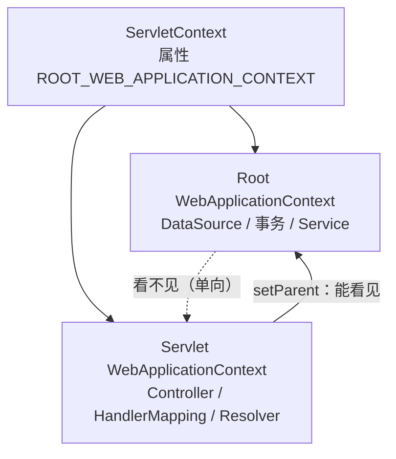
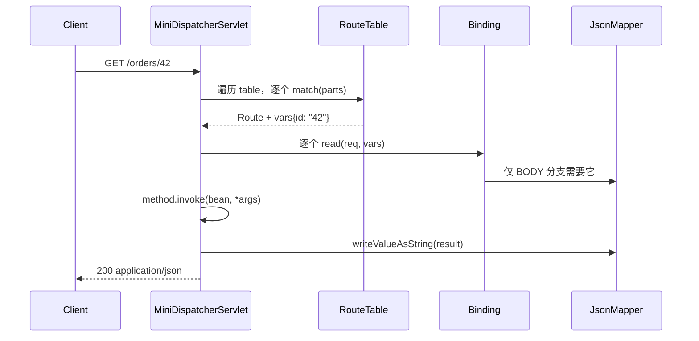

---
sources:
  - 04-第四阶段
---

# 09. 补充：注解版 Spring MVC 从零实现

> [← 第四阶段导览](01-导览.md) · 网上大量「Spring MVC 教程」还停在 `web.xml` + `spring-mvc.xml` + `<mvc:annotation-driven>` 的三件套上。本章不复述那套东西，而是回答一个更本质的问题：**注解版到底把 XML 里那份信息搬到了哪、又是谁在什么时候读它**。关键在于它有**两块砖**——IoC 容器（把 `@Controller` 造成 Bean）与 MVC 的建表（把 Bean 上的注解读成路由表），缺任何一块都跑不起来。答案落到可运行的代码上：两百来行实现一个无 XML、纯注解、能响应 `GET /orders/42` 的迷你 MVC（容器那一半直接复用第三阶段 07 册），再逐条对照 Spring。

## 1. XML 输在哪：三个具体成本，不是「老」

「XML 太老」不是理由，用年龄判断技术选型是懒惰。XML 装配真正的三个成本都在**变更**上：

| 成本 | 具体表现 | 后果 |
|---|---|---|
| 无编译期校验 | `<bean class="com.example.OrderServcie">` 拼错一个字母，编译通过，启动才炸 | 错误发现时机从「写完」推迟到「跑起来」，CI 里表现为一次启动失败 |
| 重构即断链 | 改包名、改类名，IDE 的重构只认得 Java/Kotlin 代码，不认得字符串 | 一次「安全」的包移动，让五份 XML 静默失效 |
| 装配不可推导 | 读 `OrderService.kt` 看不出它被谁注入、被几个代理包过 | 排查「Bean 是 null」「事务不生效」时必须同时开着 Java 和 XML 两个窗口 |

还有一条更隐蔽的：**多环境靠复制文件**。`application-dev.xml`、`application-prod.xml` 各存一份，两份之间差哪一行没人说得清——这正是 `application.yml` 的 profile 机制要解决的问题，也是 Boot 后来居上的直接原因。

但 XML 有一个场景至今仍然合理：**装配需要在部署期改变且不能重新打包**（同一份 war 交到不同客户环境，靠外置 XML 决定数据源）。这也是 Spring 至今保留 `XML` 支持的原因——不是因为怀旧，而是因为「配置外置」这个需求在某些交付形态下无法消失。判断标准很简单：**装配信息什么时候确定？** 编译期确定 → 注解；部署期才确定 → 外部配置。绝大多数业务代码属于前者。

## 2. 分水岭：元数据源换了，机制没换

先把一个误解拆掉：注解不是新机制，它只是**另一份元数据源**。容器最终要的东西完全一样——`BeanDefinition` 表和 `RequestMappingInfo` 表。XML 版是「读文件 → 得到类名 → 加载类」，注解版是「扫类 → 读注解 → 得到同样的东西」。产出物相同，所以你在注解版里遇到的每个问题，在 XML 版里都有一个对应的形状。

| XML 元素 | 注解 / 编程式等价物 | 落到哪个类 |
|---|---|---|
| `<context:component-scan base-package="...">` | `@ComponentScan` / `@SpringBootApplication` | `ClassPathBeanDefinitionScanner` |
| `<bean id="x" class="...">` | `@Component` / `@Bean` | `BeanDefinitionRegistry` |
| `<mvc:annotation-driven>` | `@EnableWebMvc` + `WebMvcConfigurer` | `WebMvcConfigurationSupport` |
| `<mvc:interceptors>` | `WebMvcConfigurer.addInterceptors` | `InterceptorRegistry` |
| `<bean class="InternalResourceViewResolver">` | `spring.mvc.view.prefix/suffix` 或 `@Bean ViewResolver` | `ViewResolver` |
| `<multipart-config>` | `spring.servlet.multipart.*` / `MultipartConfigElement` | `MultipartResolver` |
| `<servlet>` + `<servlet-mapping>`（web.xml） | 无注解；靠 SPI 或 `ServletRegistrationBean` | 见下一节 |

一个容易被误读的等价关系：**`<mvc:annotation-driven>` 与 `@EnableWebMvc` 是同一个开关**。前者由 `AnnotationDrivenBeanDefinitionParser` 解析，后者通过 `@Import(DelegatingWebMvcConfiguration)` 生效，两侧注册的组件集合一致（`RequestMappingHandlerMapping`、`RequestMappingHandlerAdapter`、`ExceptionHandlerExceptionResolver`、`ConversionService` 等）。

由此引出一条真实事故率极高的结论：**`@EnableWebMvc` 在 Boot 里不是「开启 Web」而是「接管 Web」**。`WebMvcAutoConfiguration` 上有 `@ConditionalOnMissingBean(WebMvcConfigurationSupport::class)`，你一旦 `@EnableWebMvc`，Boot 的 MVC 自动配置整体退出——静态资源映射、Jackson 的定制（Kotlin 模块、null 策略）、内容协商、`ProblemDetail` 的自动处理、`spring.mvc.*` 全部配置项一起消失。接口还在返回 JSON，但**形状变了**：日期格式、null 字段是否输出、错误体结构全换成框架默认值，而这类变化往往拖到前端报解析错误才被发现。注解不是增量开关，**是覆盖开关**。

## 3. 没有 web.xml，Servlet 谁来注册

```mermaid
flowchart TB
  subgraph A[XML 时代]
    A1[web.xml] --> A2[容器解析] --> A3[实例化 DispatcherServlet]
    A3 --> A4[按 servlet-mapping 挂载]
  end
  subgraph B[Servlet 3.0+ 无 XML]
    B1["META-INF/services/<br>jakarta.servlet.ServletContainerInitializer"] --> B2[SpringServletContainerInitializer]
    B2 --> B3["@HandlesTypes(WebApplicationInitializer)"]
    B3 --> B4["onStartup(ServletContext)"]
    B4 --> B5["addServlet(...).addMapping('/')"]
  end
  subgraph C[Boot]
    C1[DispatcherServletAutoConfiguration] --> C2[DispatcherServletRegistrationBean]
    C2 --> C3[ServletContextInitializer 回调]
  end
```

这是「无 XML」绕不过去的一环：`DispatcherServlet` 是个 Servlet，总得有人把它交给 Servlet 容器。历史上这件事由 `web.xml` 的 `<servlet>` + `<servlet-mapping>` + `<load-on-startup>` 完成。Servlet 3.0 之后，容器提供了 SPI 出口：



三条路线的差别只在「谁来 new 这个 Servlet」，Servlet 自身的生命周期完全一样。

**路线 A：纯 Spring MVC，war 部署，零 XML。** 继承 `AbstractAnnotationConfigDispatcherServletInitializer` 就够了，四个方法决定一切：

```kotlin
// 这个类没有任何注解，靠 Spring 提供的 SPI 实现被容器发现
class WebAppInitializer : AbstractAnnotationConfigDispatcherServletInitializer() {

    override fun getRootConfigClasses() = arrayOf(RootConfig::class.java)      // 父容器：数据源、事务、Service
    override fun getServletConfigClasses() = arrayOf(WebConfig::class.java)   // 子容器：MVC 组件
    override fun getServletMappings() = arrayOf("/")                          // 注意："/" 不是 "/*"
    override fun getServletFilters() = arrayOf<Filter>(CorrelationIdFilter()) // 等价于 <filter>
}
```

三个必须知道的事实：

1. **`"/"` 与 `"/*"` 不是一回事**。`/` 是「默认 Servlet 的替代」，未命中的请求会落回容器的 default servlet（静态资源、JSP 转发靠它）；`/*` 是通配拦截，会把静态资源和 JSP 的内部转发也吞掉，导致 404 满天飞。Spring 的默认值就是 `/`。
2. **父子容器是双层结构**。`getRootConfigClasses` 建的是父容器（Service、事务），`getServletConfigClasses` 建的是子容器（Controller）。子容器能看见父容器的 Bean，反之不行——这就是「Controller 里注入 Service 可以，Service 里注入 Controller 不行」的机制来源。Boot 把这两层合并成一个容器，所以你在 Boot 里从没遇到过这个问题，也就从没理解过它。
3. **SPI 文件不能少**。`spring-web` 的 jar 里有 `META-INF/services/jakarta.servlet.ServletContainerInitializer`，内容是 `org.springframework.web.SpringServletContainerInitializer`。容器启动时读这个文件、把 `@HandlesTypes` 声明的 `WebApplicationInitializer` 实现类交给它。所以「没有 web.xml」的前提是 **Servlet 3.0+ 容器 + 这个 SPI 文件在 classpath 上**——换成 Jetty 6 之类的老容器，仍然得写 web.xml。

**路线 B：嵌入式容器 + 编程式注册。** 自己 `new Tomcat()`，用 API 挂 Servlet（本章第 7 节会写全）。这条路只在「不能引 Boot、又要能 `java -jar`」的场景出现。

**路线 C：Boot。** `DispatcherServletAutoConfiguration` 注册 `dispatcherServlet`，再用 `DispatcherServletRegistrationBean`（Boot 3.4 起）交给容器，映射取 `spring.mvc.servlet.path`（默认 `/`）。想加自己的 Servlet，一个 `ServletRegistrationBean` 就够：

```kotlin
@Configuration
class ServletCustomization {
    @Bean
    fun miniMvc(table: RouteTable, jsonMapper: JsonMapper) =
        ServletRegistrationBean(MiniDispatcherServlet(table, jsonMapper), "/mini/*").apply {
            setLoadOnStartup(1)          // 等价于 <load-on-startup>1</load-on-startup>
        }
}
```

`ServletRegistrationBean` / `FilterRegistrationBean` / `ListenerRegistrationBean` 是 Boot 对「编程式注册」的统一抽象——它们都实现 `ServletContextInitializer`，在容器启动早期被批量回调。**这是 XML 的 `<servlet>` 在 Boot 里的唯一正解**，而不是 `@WebServlet` 注解（后者要求 `@ServletComponentScan`，且无法拿到 Spring 容器里的依赖）。

## 4. 无 XML 的 IoC 容器从哪来

上一节只解决了「Servlet 谁注册」。还差一个更前置的问题：**`@RequestMapping` 到底标注在谁身上？** 答案是「容器里的一个 Bean」。所以注解版 MVC 从来不是「MVC 一个机制」，而是**两套装配的串联**——先把 `@Controller` 造成 Bean，`RequestMappingHandlerMapping` 才有东西可读。少了 IoC 这一环，「无 XML 的 MVC」就只是把 `web.xml` 换成了 `@WebServlet`，核心的装配仍然是空的。

### 4.1 第一块砖是扫描，不是路由

`@Controller` 不是独立注解，它是 `@Component` 的**特化**：

```kotlin
@Target(AnnotationTarget.CLASS)
@Retention(AnnotationRetention.RUNTIME)
@Component                                    // ← 关键：它本身就是一个 @Component
annotation class Controller(val value: String = "")
```

`@Service`、`@Repository`、`@RestController`、`@Configuration` 全是同一套路——注意 `@Configuration` 自己也被 `@Component` 标注，所以**配置类本身也是一个 Bean**（它能被注入、能被代理，这不是巧合）。**因此「Controller 被容器管理」靠的是组件扫描，`@RequestMapping` 只是贴在已注册 Bean 类上的附加元数据。**

这条推论给出一条与直觉相反的排障顺序：**接口 404 且启动无报错时，先怀疑「这个类在不在容器里」，而不是「路径拼错了」**。Boot 下的两个入口（Actuator，第十阶段 05 册）：

| 现象 | 位置 | 说明 |
|---|---|---|
| `/beans` 里没有 `orderController` | 容器层 | 包在 `@ComponentScan` 范围外、类不是 public / 是内部类、被 `@Profile` 或 `@Conditional` 排除 |
| 有 `orderController`，`/mappings` 里没这条路由 | 元数据层 | 类上缺 `@Controller`/`@RestController`、方法是 `private`、注解写在 Kotlin `object` 或扩展函数上 |

两层的报错都可能是「沉默」的——这恰好是容器与 MVC 分工的证据：容器只负责造对象，MVC 只负责读对象，谁都没义务替对方检查另一半。

### 4.2 三个容器 API，对应三种交付形态

| 形态 | 容器类 | 谁 new 它 |
|---|---|---|
| 独立进程 / 测试 | `AnnotationConfigApplicationContext` | 你的 `main`、`@SpringBootTest` |
| war（无 Boot） | `AnnotationConfigWebApplicationContext` | `ContextLoaderListener` 或 `DispatcherServlet` |
| Boot | `ServletWebServerApplicationContext` | `SpringApplication.run` |

前两个的差别不只是名字：Web 版多实现 `ServletContextAware` / `ServletConfigAware`，并把 `ServletContext` 注册成资源前缀（`ServletContextResource`），所以 `classpath:` 之外还能写 `/WEB-INF/...`。

```kotlin
// 独立运行：容器只做「扫包 + 建 Bean + 注入」
val ctx = AnnotationConfigApplicationContext(WebConfig::class.java)
val svc = ctx.getBean(OrderService::class.java)

// Web 环境：多一个 ServletContext，且必须 refresh 之后 Bean 才存在
val wac = AnnotationConfigWebApplicationContext().apply {
    register(WebConfig::class.java)
    servletContext = sc                // 必须在 refresh 之前给
    refresh()
}
```

`register(...)` + `refresh()` 就是「无 XML 的容器装配」全貌：XML 的 `<context:component-scan>` 变成 `@ComponentScan`，`<bean>` 变成 `@Bean`，其余完全等价（Kotlin DSL 配 Bean 是第三种写法，见 02 阶段 06 册）。`refresh()` 之前容器里一个对象都没有——这就是 03 册 02 那句「注册早于实例化」在这里的具体样子。

### 4.3 两个容器怎么叠：root 与 servlet

war 形态下有**两个**容器，它们通过 `ServletContext` 的一个属性名互相找到：



| | Root | Servlet（子） |
|---|---|---|
| 谁建 | `ContextLoaderListener` | `FrameworkServlet.initWebApplicationContext` |
| 放什么 | 数据源、事务管理器、Service、MQ | `@Controller`、`HandlerMapping`、`ViewResolver` |
| 落在哪 | `ServletContext` 属性 `WebApplicationContext.ROOT_WEB_APPLICATION_CONTEXT_ATTRIBUTE` | 同名属性（子容器覆盖），父引用指向 root |

`DispatcherServlet` 启动只干三件事：**拿或建子容器 → `setParent(root)` → `onRefresh(wac)` 初始化九大组件**：

```text
initServletBean
  → initWebApplicationContext
      → root = WebApplicationContextUtils.getWebApplicationContext(sc)   // 读 ROOT_... 属性，可能为 null
      → 已有注入的 context？（initializer 传进来的） → 直接用
        否则 createWebApplicationContext(root)：按 contextClass new 一个，setParent(root)
      → onRefresh(wac)                     // FrameworkServlet 的模板方法
          → DispatcherServlet.onRefresh → initHandlerMappings / initHandlerAdapters / initResolvers ...
      → publishWebApplicationContext(wac)  // 放进 ServletContext，供 Filter 等取用
```

注意第 3 步的方向：**root 是从 `ServletContext` 属性里读出来的父容器，子容器是自己造的**；不是「从属性里取一个子容器」。这个细节决定了父子关系永远是「子知道父、父不知道子」。

**`initHandlerMappings` 查的是 `wac.getBeansOfType(HandlerMapping::class.java)`。** 这句话是本节的目的：**路由表来自容器**。容器没装好（扫不到 Controller、被条件排除、自定义配置覆盖了默认组件），就不存在 `RequestMappingHandlerMapping`，于是全部接口 404、启动期一声不响——因为在框架看来「一个 handler 都没有」是合法状态。

反过来说，这也解释了 Boot 为什么敢把父子两层塌成一层：它自己就是唯一容器，内嵌 Servlet 容器由它创建，`ServletContext` 反向由 `ServletWebServerApplicationContext.onRefresh` 提供，父子关系失去了存在理由。**Boot 的「简单」＝少一层容器 + 反向持有 `ServletContext`**。

## 5. 注解怎么变成路由表：真实 Spring 的五步

启动时发生的事，比运行时重要得多。`RequestMappingHandlerMapping` 初始化时只做五步：

| 步 | 动作 | 关键类 / 方法 |
|---|---|---|
| ① | 遍历容器内所有 beanName | `initHandlerMethods` → `getBeanNamesForType(Object)` |
| ② | 判断「是不是 handler」 | `isHandler`：类上有 `@Controller` 或 `@RequestMapping` |
| ③ | 找方法上的映射注解 | `MethodIntrospector.selectMethods`（跳过 bridge / synthetic） |
| ④ | 合并类级 + 方法级，生成映射条件 | `createRequestMappingInfo` → `AnnotatedElementUtils.findMergedAnnotation` |
| ⑤ | 注册进映射表，冲突立即报错 | `MappingRegistry.register` |

第 ④ 步是「注解能当框架用」的核心。`@GetMapping` 自己并不特殊——它就长这样：

```kotlin
@Target(AnnotationTarget.FUNCTION)
@Retention(AnnotationRetention.RUNTIME)
@RequestMapping(method = [RequestMethod.GET])   // 关键：它是一个被 @RequestMapping 标注的注解
annotation class GetMapping(val value: String = "", val path: String = "")
```

因为 `findMergedAnnotation` 会沿元注解向上找，所以 `@GetMapping`、`@PostMapping`、`@RestController`（= `@Controller` + `@ResponseBody`）全部免费获得。**你自己写的组合注解也能被识别**，只要它在元注解链上带 `@RequestMapping`；`@AliasFor` 则解决「`value` 与 `path` 互为别名」这类跨注解参数映射。

第 ⑤ 步的报错信息值得背下来，它几乎只在一个时刻出现——启动期：

```text
java.lang.IllegalStateException: Ambiguous mapping. Cannot map 'orderController' method
com.example.OrderController#get(Long) to {GET [/orders/{id}]}: There is already
'orderController' bean method com.example.OrderController#byId(Long) mapped.
```

**由此得到本节最重要的结论**：注解版 MVC 是「**启动期建表、运行期查表**」。运行时那条路径上没有任何注解扫描——`getHandler` 是一次 `PathPattern` 查表，纳秒级。所谓「注解影响性能」的说法，代价全在启动期那几百个 Bean 的元数据合并上，不在请求链路上：启动慢是注解装配的真实成本，接口慢不是。

## 6. 迷你实现：能力清单与三段代码

这个迷你 MVC 分两块：容器那一跳直接复用第三阶段 07 册的 `MiniContext`（扫包 + 构造器注入 + 单例），本节只写**读对象的那一半**。先划边界：它只实现「能让一个 `GET /orders/42` 正确返回 JSON」的最小闭环，其余一概不做——**每一项不做，都会在第 9 节的对照表里变成一个具体代价**。

| 能力 | 迷你实现 | Spring 对应 |
|---|---|---|
| 控制器发现 | 容器扫包找 `@MiniController` | 组件扫描 + `isHandler`（类上有 `@Controller` / `@RequestMapping`） |
| 路由表 | `List<Route>` + 线性匹配 | `MappingRegistry` + `PathPattern` |
| 路径匹配 | 切段比对，变量捕获 | `PathPattern` 解析树 |
| 参数绑定 | 3 个 `Binding` 枚举分支 | 30+ `HandlerMethodArgumentResolver` |
| 类型转换 | 手写 `when` 分支 | `ConversionService` |
| 返回值 | JSON（Jackson 3） | `HttpMessageConverter` + 内容协商 |
| 异常 | 统一 500 + 简版 ProblemDetail | `HandlerExceptionResolver` 链 |
| 注册 | `Tomcat.addServlet` | `ServletRegistrationBean` |

明确不做：视图解析、拦截器、参数校验、异步、multipart、内容协商、CORS。这些每一个都能独立写一篇（本阶段 03/05/06 册各占一篇）。

### 6.1 注解与路由表

```kotlin
@Target(AnnotationTarget.CLASS)
@Retention(AnnotationRetention.RUNTIME)          // 反射要读，必须 RUNTIME
annotation class MiniController(val path: String = "")

@Target(AnnotationTarget.FUNCTION)
@Retention(AnnotationRetention.RUNTIME)
annotation class MiniGet(val path: String = "")

@Target(AnnotationTarget.VALUE_PARAMETER)
@Retention(AnnotationRetention.RUNTIME)
annotation class MiniPath(val name: String)

@Target(AnnotationTarget.VALUE_PARAMETER)
@Retention(AnnotationRetention.RUNTIME)
annotation class MiniQuery(val name: String)

@Target(AnnotationTarget.VALUE_PARAMETER)
@Retention(AnnotationRetention.RUNTIME)
annotation class MiniBody

@Target(AnnotationTarget.FUNCTION)
@Retention(AnnotationRetention.RUNTIME)
annotation class MiniResponseBody
```

Kotlin 注解默认就是 `RUNTIME` 保留，但**显式写出来**，因为读到这段代码的人通常在 Java 世界里被 `RetentionPolicy.CLASS` 坑过。另一个 Kotlin 特有的坑：不写 `@Target` 时编译器按「最宽可用目标」推断，写错目标位置（比如把参数注解写在函数上）编译器不会报错，运行期反射拿不到——**注解的 `@Target` 是给自己写的断言**。

路由表与注册：

```kotlin
enum class Kind { PATH, QUERY, BODY }

class Binding(val kind: Kind, val name: String?, val type: Class<*>)

class Handler(val bean: Any, val method: Method, val bindings: List<Binding>)

class Route(val segments: List<String>, val handler: Handler) {
    fun match(parts: List<String>): Map<String, String>? {
        if (parts.size != segments.size) return null
        val vars = mutableMapOf<String, String>()
        segments.forEachIndexed { i, seg ->
            if (seg.startsWith("{") && seg.endsWith("}")) vars[seg.substring(1, seg.length - 1)] = parts[i]
            else if (seg != parts[i]) return null
        }
        return vars
    }
}

class RouteRegistry {
    private val routes = mutableListOf<Route>()

    fun register(controller: Any) {
        val clazz = controller.javaClass
        val base = clazz.getAnnotation(MiniController::class.java)!!.path.trim('/')

        clazz.declaredMethods.filter { it.isAnnotationPresent(MiniGet::class.java) }.forEach { m ->
            val own = m.getAnnotation(MiniGet::class.java).path.trim('/')
            val segments = listOf(base, own).filter { it.isNotEmpty() }.joinToString("/")
                .let { if (it.isEmpty()) emptyList() else it.split("/") }

            val bindings = m.parameters.map { p ->
                when {
                    p.isAnnotationPresent(MiniPath::class.java) ->
                        Binding(Kind.PATH, p.getAnnotation(MiniPath::class.java).name, p.type)
                    p.isAnnotationPresent(MiniBody::class.java) ->
                        Binding(Kind.BODY, null, p.type)
                    else -> Binding(Kind.QUERY, p.name, p.type)   // 兜底：无注解当 query
                }
            }
            routes += Route(segments, Handler(controller, m, bindings))
        }
    }

    fun freeze(): List<Route> {
        // 对齐 Spring 的 Ambiguous mapping：冲突必须在启动期炸，而不是看请求打到谁
        val key = { r: Route -> r.segments.joinToString("/") { if (it.startsWith("{")) "{}" else it } }
        routes.groupBy(key).filterValues { it.size > 1 }.values.firstOrNull()?.let {
            error("路由冲突：${it.joinToString { h -> h.handler.method.name }}")
        }
        // 字面量段多的优先：与 Spring 的「精确 > 变量 > 通配」同一条规则
        return routes.sortedByDescending { r -> r.segments.count { !it.startsWith("{") } }
    }
}
```

两处与 Spring 对齐的语义值得单独说：

- **冲突在启动期就炸**。上面那个 `error(...)` 对应 Spring 的 `Ambiguous mapping`。放在运行期（比如「后注册的覆盖前者」）是更糟的设计：两个同名路由谁生效，取决于扫描顺序——`Files.walk` 的顺序在 macOS 和 Linux 上不同，于是同一个包在不同机器上行为不同。这类事故排查成本极高，因为「我本地是好的」永远成立。
- **`p.name` 这一行就是坑 ① 的复现**。没开 `javaParameters` 时它返回 `arg0`、`arg1`，于是 query 参数永远取不到——`@MiniQuery` 明明写了名字却没用，因为没写注解的那个分支只能信 `p.name`。Spring 的处境完全一样，只是它给了一个显式名字的逃生出口（见 §8 ①）。
- **按字面量段数排序**是「特异性」的粗糙近似。Spring 的 `PathPattern` 做得更细（字面量长度、变量约束、通配位置都参与比较），但方向一致：`/orders/me` 必须赢 `/orders/{id}`，且**与声明顺序无关**。声明顺序决定路由优先级是 `AntPathMatcher` 时代的遗留问题，`PathPattern` 时代的核心改进（详见 04 册 §2）。

### 6.2 参数绑定与类型转换

```kotlin
private fun Binding.read(req: HttpServletRequest, vars: Map<String, String>, json: JsonMapper): Any? =
    when (kind) {
        Kind.PATH -> convert(vars[name] ?: throw MissingParam(name!!), type)
        Kind.QUERY -> convert(req.getParameter(name) ?: throw MissingParam(name!!), type)
        Kind.BODY -> req.inputStream.readAllBytes().takeIf { it.isNotEmpty() }   // 空 body → null
            ?.let { bytes -> try { json.readValue(bytes, type) } catch (e: Exception) { throw BadBody(e.message) } }
    }

private fun convert(raw: String, type: Class<*>): Any = when (type) {
    String::class.java -> raw
    Int::class.java, Integer::class.java -> raw.toIntOrNull() ?: throw BadParam(raw, "Int")
    Long::class.java, java.lang.Long::class.java -> raw.toLongOrNull() ?: throw BadParam(raw, "Long")
    Boolean::class.java -> raw.toBooleanStrictOrNull() ?: throw BadParam(raw, "Boolean")
    else -> throw BadParam(raw, type.simpleName)                      // 真实实现这里该交给 ConversionService
}
```

三个设计点，恰好对应 Spring 里三个真实机制：

1. **`read` 是策略选择，不是类型判断**。Spring 用 30 多个 `HandlerMethodArgumentResolver` 按序试探，每个实现 `supportsParameter`；这里用 `when (kind)` 简化成三个分支。差别在于「扩展性」：Spring 加一种参数来源只需加一个类，这里要改 `when`。**开闭原则在这一层的价值是可验证的**——你数一下内置解析器数量就知道它被扩展过多少次。
2. **转换失败 `BadParam` → 400，缺失参数 `MissingParam` → 400，但 body 反序列化失败也是 400**。三种 400 在客户端看来一样，内部异常类型完全不同（对应 Spring 的 `MethodArgumentTypeMismatchException`、`MissingServletRequestParameterException`、`HttpMessageNotReadableException`）——04 册 §5 讲过这条链路，第 8 节的坑 ① 会给出它的实战版本。
3. **`req.inputStream` 只能读一次**。这是「为什么 `@RequestBody` 不能配两个参数」「为什么在 Filter 里读了 body 之后 Controller 拿到空」的根源。Spring 用 `ContentCachingRequestWrapper` 缓存字节来绕过，代价是内存；迷你实现干脆不碰，所以它天然不支持「日志里打 body 的同时还能反序列化」。

### 6.3 分发主循环

```kotlin
class MiniDispatcherServlet(
    private val table: List<Route>,
    private val json: JsonMapper,
) : HttpServlet() {

    override fun service(req: HttpServletRequest, resp: HttpServletResponse) {
        val path = req.requestURI.removePrefix(req.contextPath).trim('/')
        val parts = if (path.isEmpty()) emptyList() else path.split("/")

        // ① 查表：拿不到 → 404（Spring 叫 getHandler）
        val hit = table.firstNotNullOfOrNull { r -> r.match(parts)?.let { r to it } }
        if (hit == null) { resp.sendError(404); return }

        val (route, vars) = hit
        val args = route.handler.bindings.map { it.read(req, vars, json) }.toTypedArray()

        try {
            // ② 调用：剥掉反射包装，让业务异常原样冒出来（同 03 册的 invoke）
            val result = try {
                route.handler.method.invoke(route.handler.bean, *args)
            } catch (e: InvocationTargetException) {
                throw e.targetException
            }

            // ③ 写回：Unit / null → 204，其余 → JSON
            if (result == null || result === Unit) { resp.status = 204; return }
            resp.contentType = "application/json;charset=UTF-8"
            resp.writer.write(json.writeValueAsString(result))
        } catch (e: MissingParam) {
            problem(resp, 400, "参数缺失", e.message)
        } catch (e: BadParam) {
            problem(resp, 400, "参数格式错误", e.message)
        } catch (e: BadBody) {
            problem(resp, 400, "请求体无法解析", e.message)
        } catch (e: Exception) {
            problem(resp, 500, "服务器内部错误", null)          // 注意：绝不要把 e.message 吐给客户端
        }
    }

    private fun problem(resp: HttpServletResponse, status: Int, title: String, detail: String?) {
        resp.status = status
        resp.contentType = "application/problem+json;charset=UTF-8"
        resp.writer.write(json.writeValueAsString(mapOf("status" to status, "title" to title, "detail" to detail)))
    }
}
```

这个 `service()` 就是 `DispatcherServlet.doDispatch` 的五步裁切版。它的一次请求长这样：



砍掉的是拦截器、视图渲染、内容协商、异步——**砍掉之后它对「写 REST 接口」这件事依然完整**，这恰好说明一件反直觉的事：Spring MVC 里一半的代码量服务于「返回 HTML 页面」的旧世界。

值得注意的两处细节：

- **`InvocationTargetException` 必须剥壳**。不剥，`catch (e: Exception)` 永远匹配不到业务异常，所有错误都变成 500，`@Transactional` 的回滚规则也会判断错（Spring 在 `JdkDynamicAopProxy` 与 `ReflectiveMethodInvocation` 里做了同样的事）。
- **500 不能带 `detail`**。上面 `problem(resp, 500, ..., null)` 里那个 `null` 是刻意的：错误信息泄露是安全册（第九阶段 07 册）的独立课题，但习惯要在写第一版代码时养成——**未知异常对客户端不透明，对日志透明**。

## 7. 零 XML 启动：三条路线

迷你实现要跑起来，还差两步：**把 Controller 交给容器造出来**（§4 的第一块砖），**再有人把 Servlet 交给 Tomcat**。前者复用第三阶段 07 册那个一百多行的 `MiniContext`，后者用嵌入式 Tomcat 的编程式 API：

```kotlin
fun main() {
    val json = JsonMapper.builder().build()                 // Jackson 3：tools.jackson

    // 第一块砖：容器。扫包 → 注册 → 构造器注入 → 单例
    val ctx = MiniContext("com.acme.mini").scan().start()

    // 第二块砖：读容器里的对象，建路由表（不 new 任何 Controller）
    val table = RouteRegistry().apply {
        ctx.allBeans()                                  // = singletons.values，03 册未暴露，补一行即可
            .filter { it.javaClass.isAnnotationPresent(MiniController::class.java) }
            .forEach(::register)
    }.freeze()

    val tomcat = Tomcat().apply { port = 8080 }
    val webCtx = tomcat.addContext("", Files.createTempDirectory("mini-mvc").toString())
    Tomcat.addServlet(webCtx, "miniMvc", MiniDispatcherServlet(table, json))
    webCtx.addServletMappingDecoded("/", "miniMvc")         // "/" 而非 "/*"，理由见第 3 节

    tomcat.start()
    tomcat.server.await()
}
```

注意这两步的**顺序与职责**：`start()` 返回之前一个 Controller 都不存在（依赖由构造器注入，`OrderService` 也是容器给的）；`RouteRegistry` 只读对象、不造对象。这正是 §4 那两块砖在迷你实现里的同构——真实 Spring 里分别对应「`refresh()` 完成」与「`initHandlerMethods` 扫面」。

反过来说，如果这里写成 `register(OrderController(OrderService()))`，这个 MVC 就退化成「手工 new 到底」：`OrderService` 再依赖 `JdbcTemplate`、再依赖 `DataSource`……依赖链上每一环都要你手写，事务、AOP、作用域全部无从谈起。**IoC 不是 MVC 的前置知识，而是同一套装配的另一半**。

`main` 里没有任何 `web.xml`，也没有 `spring-mvc.xml`。它在启动期做的事和 Spring 完全同构：**容器造对象 → 读对象建表 → 注册入口 Servlet**。区别只在「发现」的手段——Spring 用组件扫描（ASM 读元数据）把候选类注册成 Bean，这里靠 `MiniContext` 的 `Files.walk`。

三条路线怎么选：

| 场景 | 路线 | 注册方式 | 什么时候用 |
|---|---|---|---|
| 现代 Spring 项目 | C：Boot | `DispatcherServletRegistrationBean`（自动） | 99% 的情况 |
| 不能引 Boot 的 war 部署 | A：SPI | `AbstractAnnotationConfigDispatcherServletInitializer` | 老平台、共享容器、公司统一 base image |
| 不能引 Boot、又要 fat jar | B：嵌入式 | `Tomcat.addServlet` / `ServletContextInitializer` | 工具型服务、网关边缘组件 |

路线 A 与 C 的分歧点只有一个：**父子容器**。A 里 `RootConfig` 与 `WebConfig` 是两个容器，`@Transactional` 必须放在父容器的扫描范围里，否则「Service 上有注解但不生效」；C 里只有一个容器，这个问题不存在。**Boot 的易用性，本质上是用「少一层容器」换来的**——代价是「容器隔离」这个能力也没有了（比如想在子容器里放一份不共享的 MVC 配置，Boot 下没有天然位置）。

## 8. 五个真实项目里的坑

这五个都不是迷你实现的 bug，而是注解版 MVC 的固有陷阱。它们的共同点：**都不会在编译期报错**。

### ① 参数名丢失：`@PathVariable` 不写名字就炸

```kotlin
@GetMapping("/{id}")
fun byId(@PathVariable id: Long) = service.byId(id)     // 报错在这里
```

Spring 6.1+ 的报错信息：

```text
IllegalArgumentException: Name for argument of type [java.lang.Long] not specified,
and parameter name information not available via reflection.
```

原因：JVM 的 `Method.getParameters()` 默认只给 `arg0`、`arg1`，除非编译时加 `-parameters`。Kotlin 编译器的对应开关是：

```kotlin
// build.gradle.kts
kotlin { compilerOptions { javaParameters = true } }
```

三种修法，可靠性递减：

1. **显式写名字**：`@PathVariable("id") id: Long`。唯一 100% 可靠，且读代码的人一眼知道绑定的是哪个变量。
2. **开 `javaParameters = true`**（Java 侧是 `-parameters`）。对整个模块生效，但依赖构建脚本——换个模块、换个构建工具就失效。
3. **classpath 上有 `kotlin-reflect`**。Spring 的 `DefaultParameterNameDiscoverer` 里包含 `KotlinReflectionParameterNameDiscoverer`，能从 Kotlin 元数据里读出参数名。它经常「碰巧能用」，因为 `jackson-module-kotlin` 会把 `kotlin-reflect` 带进来——**但这是运气，不是契约**。

真实事故形状：本地正常、CI 正常，某天有人给 Controller 模块换了个轻量 starter，`kotlin-reflect` 被挤掉，全部 `@PathVariable` 接口开始 500。**所以第 1 种修法是规约，不是选项**。

### ② 漏写 `@ResponseBody`：返回值被当成视图名

```kotlin
@Controller                         // 不是 @RestController
class OrderController {
    @GetMapping("/orders/{id}")
    fun byId(@PathVariable("id") id: Long) = service.byId(id)   // 缺 @ResponseBody
}
```

Spring 会把 `OrderView` 当成 **ModelAndView 的模型 + 推导出的视图名**，交给 `ViewResolver`。Boot 下没有配置 JSP/Thymeleaf，最终落到静态资源处理器，抛 `NoResourceFoundException`（Spring 6.1+），表现为 404。

这条坑的价值不在「记住用 `@RestController`」，而在于理解 §5 的注解合并：`@RestController` = `@Controller` + `@ResponseBody`，它省掉的是**每个方法都要写一遍**。组合注解不是语法糖，是把「一类接口的共同契约」收进类型声明——这也是为什么 `@RestController` 出现之后，纯 API 项目里几乎见不到 `@Controller`。

### ③ `@EnableWebMvc`：一加就把 Boot 的 MVC 配置关掉

已在 §2 说过机制，这里补现象清单：加上之后依次消失的是——Jackson 的消息转换器（Jackson 3 下是 `JacksonJsonHttpMessageConverter`）退回默认配置、`ProblemDetail` 的自动处理、静态资源映射、内容协商（`produces` 不再按 `Accept` 排序）、`spring.mvc.*` 全部配置项失效。

判断方法：改一个 `spring.mvc.date-format`，看接口输出变不变；不变就是被接管了。**要定制 MVC，正确姿势是 `WebMvcConfigurer`（增量），不是 `@EnableWebMvc`（覆盖）**。

### ④ 尾斜杠与通配位置：Spring 6 之后的匹配规则变了

- `/orders/` 不再匹配 `/orders`。尾斜杠匹配在 Spring Framework 6.0 起已废弃、7 里被移除，升级时一批「前端多打了一个斜杠」的接口开始 404——这类 404 的特征是**路径看起来完全正确**，排障时一定要把原始 `requestURI` 打出来看结尾。
- `PathPattern` 只允许 `**` 出现在**末尾**；要捕获「剩余全部路径」得写 `/{*path}`，且这个变量含前导 `/`。老的 `AntPathMatcher` 允许 `/**/` 出现在中间，迁到 `PathPattern` 时会启动失败并给出明确报错——这算好事，但要在升级前搜一遍 `/**/`。

### ⑤ 单例 Controller 里的可变状态

Controller 默认是单例，任何 `var` 字段都是跨请求共享的：

```kotlin
@RestController
class BadController {
    private var currentUser: String? = null        // 灾难：请求 A 的值被请求 B 覆盖

    @GetMapping("/me")
    fun me(@RequestHeader("X-User") user: String): String {
        currentUser = user                          // 并发下互相污染，且极难复现
        return currentUser
    }
}
```

正确做法只有一条：**Controller 里只放 `val` 依赖，请求级状态走参数或 `ThreadLocal`（且必须 `finally` 清理）**。这条在迷你实现里同样成立——`RouteRegistry` 建完表就 `freeze()`，运行期只读，所以它天生线程安全；**不可变 + 一次性构建**是所有 Web 框架共享的设计前提。

## 9. 迷你 MVC vs Spring MVC

| 能力 | 迷你 | Spring 7 | 差距意味着什么 |
|---|---|---|---|
| 控制器发现 | `MiniContext` 扫包 | 组件扫描（ASM）+ `isHandler` | 依赖里的 Controller 扫不到 |
| 依赖注入 | `MiniContext` 构造器注入 | `DefaultListableBeanFactory` | 无 `@Qualifier`、无作用域、无事务代理 |
| 路由表 | `List` + 线性匹配 | `MappingRegistry` + `PathPattern` 解析树 | 100 个路由时线性匹配开始出现在火焰图上 |
| 特异性规则 | 字面量段计数 | 字面量长度 / 变量约束 / 通配位置 | 复杂路由组合下命中结果不同 |
| 参数来源 | 3 种 | 30+ 解析器 | 加一种来源要改 `when` |
| 类型转换 | 手写 `when` | `ConversionService` + `Formatter` | 无 Locale、无自定义 Converter 扩展点 |
| 校验 | 无 | Bean Validation 三入口 | 非法输入穿透到 Service |
| 内容协商 | 固定 JSON | `produces` / `Accept` / 415 / 406 | 状态码语义丢失，客户端无法判断该改哪边 |
| 视图 | 无 | `ViewResolver` 链 | 只能做纯 API，不能返回页面 |
| 异常 | 单个 `catch` | `HandlerExceptionResolver` 链 + `@ControllerAdvice` | 无法按异常类型分层映射状态码 |
| 异步 | 无 | `Callable` / `DeferredResult` / 响应式 | 长请求占满线程 |
| 注册 | `Tomcat.addServlet` | `ServletRegistrationBean` + 自动配置 | 无优雅停机、无 `load-on-startup` 管理 |

把表从下往上读，会看到一个和 03 册（迷你容器）相同的结论：**框架的复杂度几乎全部来自「让不适合理想的代码也能跑」**。迷你 MVC 的「读对象」那一半能只有一百多行，是因为它对使用者提了六个硬要求：只用 GET、只返回 JSON、参数只有三种来源、单一 Controller 实例无状态、不用视图、不管异常分类。

差别还有一条不在表里：**Spring 的每一条能力都有一个明确的状态码出口**。415 是格式协商失败、405 是方法不对、406 是 `Accept` 不满足——这些状态码不是「更规范」，而是**把排障线索编码进了协议**。迷你实现把所有失败压成 400/500 两个数字，功能上没少，排障时少了全部信息。这也是为什么第 6 节要强调「砍掉的每一项都对应一个具体代价」：**代价不在功能，在可诊断性**。

## 10. 自测

1. `<mvc:annotation-driven>` 与 `@EnableWebMvc` 是否等价？为什么在 Boot 里加 `@EnableWebMvc` 会出事？
2. 没有 `web.xml`，Servlet 容器是怎么知道要创建 `DispatcherServlet` 的？说出中间经过的两个类/文件。
3. `getServletMappings()` 返回 `"/"` 和 `"/*"` 有什么区别？各会带来什么现象？
4. `@GetMapping` 为什么能被 `RequestMappingHandlerMapping` 识别？如果自己写一个 `@MyPost`，需要满足什么条件？
5. 注解版 MVC 在运行期会扫描注解吗？启动期和运行期各自的成本在哪？
6. `@PathVariable id: Long` 不带名字为什么可能启动就失败、也可能一直正常？三种修法哪种该写进团队规约？
7. 父子容器结构下，把 `@Transactional` 的 Service 放在子容器（`getServletConfigClasses`）里会怎样？
8. `@Controller` 为什么会被组件扫描扫到？它和 `@Component`、`@RestController` 三者是什么关系？
9. 一个接口 404 且启动无任何报错，你会先去查 `/beans` 还是 `/mappings`？两个结果分别指向哪一层的问题？
10. `DispatcherServlet` 的 `WebApplicationContext` 从哪来？root 与子容器谁建谁、Bean 能不能互相看见？
11. Boot 为什么敢把父子两层塌成一个容器？它替代 `ContextLoaderListener` 的那部分能力是什么？

## 11. 延伸

- 分发的九步细节、`HandlerMapping` 优先级、`ArgumentResolver` 扩展点：[04-DispatcherServlet分发与参数解析](04-DispatcherServlet分发与参数解析.md)——本章的「五步裁切版」就是它的投影。
- 拦截器、Filter、AOP 各自能插手到哪一步：[03-Filter-Interceptor-AOP的执行顺序](03-Filter-Interceptor-AOP的执行顺序.md)。
- 异常归一与 `ProblemDetail` 的完整分层：[06-错误模型-ProblemDetail与错误码](06-错误模型-ProblemDetail与错误码.md)——本章那个「500 不带 detail」的约定在那里展开。
- 组件扫描如何产出 `BeanDefinition`、`refresh()` 里注册与实例化相隔哪六步：[第三阶段 02 册](../03-第三阶段/02-IoC容器与BeanDefinition注册.md)——§4 那两块砖在容器侧的完整展开。
- 手写 IoC 容器的同构思路（扫包、注册表、代理）：[第三阶段 07 册](../03-第三阶段/07-手写一个迷你容器.md)——本章 `main` 里那个 `MiniContext` 就是它。
- 容器里到底有什么、`@ConditionalOnMissingBean` 如何决定 MVC 组件在不在：[第三阶段 05 册](../03-第三阶段/05-自动配置与条件装配.md)。
- Kotlin `allopen` 与 CGLIB 代理：Controller 上要加 `@Transactional` / `@Validated` 时会撞上：[第二阶段 06 册](../02-第二阶段/06-Kotlin与Spring的接缝-allopen-noarg与DSL配置.md)。
- Boot 4 的 starter 改名（`spring-boot-starter-web` → `-webmvc`）与 Maven 坐标差异：[08-REST契约-幂等-分页-版本化与OpenAPI](08-REST契约-幂等-分页-版本化与OpenAPI.md) 末尾的迁移清单。
