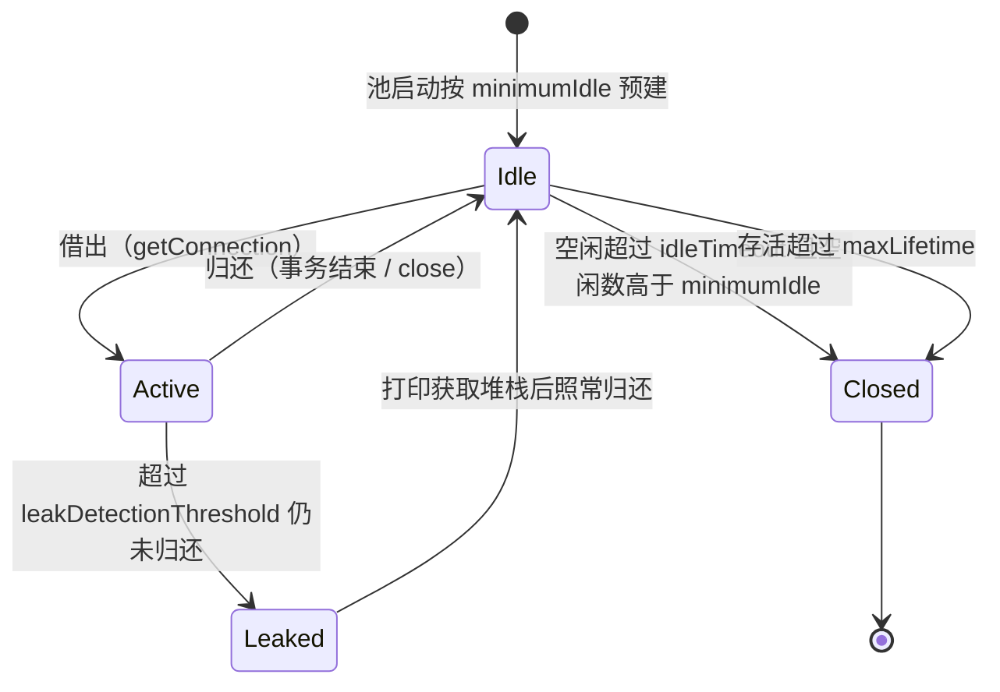

---
sources:
  - 05-第五阶段
---

# 02. 连接池与 JDBC 真相

> [← 第五阶段导览](01-导览.md) · `maximumPoolSize` 管的不是「并发数」，而是「你的服务最多允许多少个会话同时在数据库里干活」；池满时抛出的永远是 `connectionTimeout`，但十次里有九次，调它没有任何用。

## 1. 池在省什么：一次连接的固定成本

JDBC 的 `Connection` 不是一条已经打好的管道，而是「TCP 连接 + 认证会话 + 服务端后端进程」三件套的句柄。PostgreSQL 在这件事上比 MySQL 更贵：**PG 每个连接在服务端是一个独立操作系统进程**，不是线程。新建连接意味着父进程 `fork` 一份、复制页表、初始化 catalog cache、分配 `work_mem` 与各种 per-backend 缓冲。

| 动作 | 本地 loopback | 同机房（RTT 0.5ms） | 跨机房（RTT 30ms） |
|---|---|---|---|
| TCP 三次握手 | 0.05ms | 0.5ms | 30ms |
| TLS 握手（如果开） | 0.2ms | 1.5ms | 90ms |
| PG 认证（scram-sha-256，多轮往返） | 0.3ms | 1.5ms | 90ms |
| 后端进程 fork 与初始化 | 1.5ms | 1.5ms | 1.5ms |
| **合计** | **约 2ms** | **约 3.5ms** | **约 210ms** |

一个 2000 QPS 的服务如果不复用连接，每秒要在 fork 上烧掉 3 秒 CPU——比业务逻辑贵两个数量级。这就是池存在的唯一理由：**把「建连」从每次请求的成本，摊成每个连接一次的成本**。

池里的连接一生只经历四个状态，弄错任何一个参数的语义，都是把这四个状态之间的迁移条件配错：



注意 `Leaked --> Idle` 这条边：**泄漏检测不会回收连接**，它只在超时那一刻把「谁借的、从哪借的」打进日志，连接照样还回来——这解释了为什么泄漏现场常是「重启即自愈、几小时后复发」，以及为什么还回来的脏连接会在下一次使用时炸。

## 2. 七个参数逐个过

HikariCP 的参数少，但每一个都有人配错。下表是默认值与你真正需要关心的那一列：

| 参数 | 默认值 | 单位/下限 | 一句话语义 | 配错的后果 |
|---|---|---|---|---|
| `maximumPoolSize` | 10 | 个，≥1 | 池内物理连接上限 | 设成 Tomcat 线程数 → 数据库被打满 |
| `minimumIdle` | = max | 个 | 空闲时保留的连接数 | 设小 → 突发流量时现场建连（每次 2~200ms） |
| `connectionTimeout` | 30000 | ms，≥250 | **等一个可用连接**的最长时间 | 设大 → 池满时线程集体卡住 30s，雪崩放大 |
| `idleTimeout` | 600000 | ms，≥10000 | 空闲连接多久被回收 | 只在 `minimumIdle < max` 时生效，否则永远不触发 |
| `maxLifetime` | 1800000 | ms，≥30000 | 连接的最大存活时间 | 大于中间层空闲超时 → 拿到已被对端关闭的连接 |
| `keepaliveTime` | 0（关） | ms，≥30000 | 空闲连接的探活间隔 | 不开 → 被防火墙/LB 静默掐断的连接留在池里 |
| `leakDetectionThreshold` | 0（关） | ms，≥2000 | 借出多久未还就报警 | 设得比最长事务还短 → 满屏误报 |

逐个说人话：

**`maximumPoolSize`** 是唯一一个「调大看起来有用、实际最常有害」的参数。它约束的是同时在数据库里跑的语句数，不是你的接口并发数。后面 §3 专门算它。

**`minimumIdle`** 默认等于 `maximumPoolSize`，也就是 Hikari 默认「池不缩容」。这个默认值对延迟友好、对数据库不友好：20 个实例 × 20 连接 = 400 个常驻会话，其中大多数在 `idle`。生产上更常见的配法是取上限的一半左右。但**不要指望它做预热**：池在第一次请求时才真正建连，冷启动瞬间建 20 条、每条 2ms，第一个请求要多等 40ms。

**`connectionTimeout`** 是等连接的时间，不是查询时间——这是排障的第一分叉：**这条报错跟 SQL 一点关系都没有**。默认 30 秒在生产里偏大：池满时 30 秒意味着 worker 被占 30 秒，Tomcat 的 200 个线程 7 秒内就被占光，然后 `acceptCount` 排队、客户端超时、重试放大。合理值是 2~5 秒：**宁可快速失败让上游重试，也不要让线程积压**。

**`idleTimeout`** 有个前提：它只在 `minimumIdle < maximumPoolSize` 时才可能回收连接。两者都设成 20 时，这个参数写多少都不生效——不是 bug，是设计（缩容会让下次突发变慢）。

**`maxLifetime`** 是最容易出事故的一个，因为它要跟**你没配置过的东西**对齐：云厂商 LB 的空闲超时（常见 350~400 秒）、PgBouncer 的 `server_idle_timeout`、PG 14+ 的 `idle_session_timeout`、防火墙的 NAT 老化。这些组件会单方面关掉「看起来空闲」的连接，而池并不知情。经验规则：**取所有中间层最小空闲超时的 70%~80%**。

**`keepaliveTime`** 是 `maxLifetime` 的补丁：定期给空闲连接发一次轻量探活，让中间设备看到流量、不把它判死。前者防「被静默掐断」，后者防「连接活太久积累的服务端状态」，不能相互替代。

**`leakDetectionThreshold`** 的语义常被误解成「检测泄漏」，实际是「检测借出超时」。它的正确值是**比你最慢的正常事务再大一点**，比如最长事务 3 秒就设 10 秒，留三倍余量。设成 1000ms 的结果是所有批处理任务都在报警，然后团队学会忽略这条日志——比不开更糟。

## 3. 池大小怎么估

正确的公式只有一条，来自利特尔法则（Little's Law）：

```text
需要的并发连接数 = 峰值 QPS × 单次持有连接的时间
```

「持有时间」不是 SQL 执行时间，是**从 `getConnection` 到归还**的整段：包括事务里所有 SQL、中间的计算、以及你在事务里调的每一次下游。这一点决定了这个公式在真实系统里几乎总是被低估。

| 场景 | 峰值 QPS | 单次持有 | 需要的并发 | 建议池（含余量） |
|---|---|---|---|---|
| 纯读接口，命中索引 | 800 | 2ms | 1.6 | 8 |
| 写接口，一次事务 3 条 SQL | 400 | 8ms | 3.2 | 12 |
| 事务里有一次 Redis 调用 | 400 | 12ms | 4.8 | 16 |
| 事务里有一次下游 HTTP（P99 80ms） | 200 | 80ms | 16 | 24 |
| 报表类长事务 | 20 | 3s | 60 | 60（或独立池） |

两个必须修正的地方：

**第一，用 P99 而不是均值。** 连接被占住的时间由那一批慢请求决定。均值 8ms、P99 40ms 时，突发流量的瞬时占用按 40ms 算，需求量直接翻五倍。工程口径是：`池大小 ≥ 峰值 QPS × P99 持有时间`，再取 `min(这个值, 数据库能承受的并发)`。

**第二，池的大小必须除以实例数。** 20 个 Pod、每个池 20，对数据库就是 400 个会话，而 PG 默认 `max_connections` 是 100，云上小规格常给 80~200。**池上限之和超过数据库上限**是上线首日最常见的事故，现象还很迷惑：应用侧报 `connectionTimeout`，数据库侧报 `FATAL: sorry, too many clients already`，两边日志对不上。

### 为什么池不是越大越好

这条曲线的形状值得记住：吞吐随并发上升，到一个点后**下降**。原因全在数据库那一侧：

1. **PG 是每连接一进程**，20 个活跃连接就是 20 个进程抢同样几个核，上下文切换成本随之上升；
2. 所有进程共享 `shared_buffers`，连接越多，同一个 buffer 页的 pin/unpin 争用越激烈（`LWLock: BufferContent` 等待）；行锁冲突概率也随并发线性上升，锁等待又拉长持有时间，让需要的连接数进一步上升——正反馈；
3. 连接数超过核数后，**每个连接的吞吐都在下降**，总吞吐可能不升反降。Hikari 官方给的经验起点是 `连接数 = CPU 核数 × 2 + 有效磁盘数`（SSD 取 1，8 核约 17 条）；PG 社区更保守：**活跃连接数不超过核数时效率最高**。

所以「池调大后 P99 变好」通常只是把排队从应用挪到了数据库，总吞吐没变，而数据库的 CPU 曲线悄悄抬高了 20%。真正的解法永远是缩短持有时间。

## 4. `connectionTimeout` 报错原文与三种真实原因

池满时应用日志里出现的是这段（HikariCP 5/6 的格式一致）：

```text
java.sql.SQLTransientConnectionException: HikariPool-1 - Connection is not available,
request timed out after 30001ms (total=20, active=20, idle=0, waiting=37)
	at com.zaxxer.hikari.pool.HikariPool.createTimeoutException(HikariPool.java:696)
	at com.zaxxer.hikari.pool.HikariPool.getConnection(HikariPool.java:181)
```

括号里那四个数字是排障的全部线索，**先读它们，再读堆栈**：

- `total`：池里现有的物理连接总数（包括正在创建中的）；
- `active`：被借走、尚未归还的数量；
- `idle`：空闲可用的数量；
- `waiting`：当前阻塞在 `getConnection` 上的线程数。

三种原因在这四个数字上留下不同的指纹：

| 真实原因 | total | active | idle | waiting | 数据库侧特征 |
|---|---|---|---|---|---|
| **连接泄漏** | = max | = max | 0 | 持续增长 | `pg_stat_activity` 里 `idle in transaction` 的数量 ≈ 池大小，`xact_start` 很旧 |
| **慢查询/锁等待占满** | = max | = max | 0 | 波动 | 多数会话 `state = active`，`wait_event_type` 是 `Lock` 或 `IO` |
| **数据库连接数上限** | < max | < max | 0 | 增长 | 应用日志里先出现 `FATAL: sorry, too many clients already`；池连建都建不出来 |

第三种最容易被误判，因为 `total < max` 看起来「池没满」。本质是**池想扩但扩不动**：Hikari 尝试建新连接被 PG 拒绝，`total` 就卡在小于 `maximumPoolSize` 的值上，所有借连接的人排队到超时。判别方法只有去看数据库日志或 `pg_stat_activity` 的总数。

第四类常被忽略：**连接被中间层杀掉**。此时报错不是 `connectionTimeout`，而是 `An I/O error occurred while sending to the backend`，原因是 `maxLifetime` 没对齐（§2）。

## 5. 泄漏排查的完整手法

泄漏的本质是「借了不还」，几乎总是这四种写法之一：

1. 手动 `dataSource.connection` 后没有 `close()`（Kotlin 里就是没写 `use {}`）；
2. `@Transactional` 方法里调下游，下游超时把整个事务拖到分钟级——技术上不算泄漏，但占用时长足以让池满；
3. 事务传播用错，`REQUIRES_NEW` 在外层事务里开了新事务，内层异常后外层仍持有连接；
4. `EntityManager` 被跨线程持有（异步任务里用了请求线程的 `EntityManager`），事务早已结束但连接未归还。

**第一步：打开 `leakDetectionThreshold`。** 它是唯一能在泄漏发生的那一刻给出调用栈的手段。20 秒阈值下的日志长这样：

```text
WARN ... com.zaxxer.hikari.proxy.ProxyLeakTask : HikariPool-1 - Connection leak detection
triggered for org.postgresql.jdbc.PgConnection@5f2c1b3 on thread http-nio-8080-exec-42
java.lang.Exception: Apparent connection leak detected
	at com.zaxxer.hikari.HikariDataSource.getConnection(HikariDataSource.java:128)
	at org.springframework.orm.jpa.JpaTransactionManager.doBegin(JpaTransactionManager.java:424)
	at com.example.order.OrderService.create(OrderService.kt:41)
```

堆栈从下往上读：`OrderService.create` 开了事务 → 事务管理器取连接 → 之后再没有归还。**定位到方法就够了吗？不够**——同一个方法可能只在某个分支泄漏。这时要配合数据库侧的时间线。

**第二步：`pg_stat_activity` 对照。** `application_name` 是这里的关键：在 JDBC URL 里加 `ApplicationName=order-svc`（或 `dataSourceProperties["ApplicationName"]`），让每个会话自报家门，否则 20 个服务的连接在 `pg_stat_activity` 里长得一模一样。

```sql
SELECT pid,
       application_name,
       state,
       now() - xact_start   AS xact_age,
       now() - state_change AS state_age,
       wait_event_type,
       wait_event,
       left(query, 60)      AS last_query
FROM pg_stat_activity
WHERE datname = 'app'
  AND backend_type = 'client backend'
ORDER BY xact_start NULLS LAST
LIMIT 30;
```

读法与三条判据：

- `state = 'idle in transaction'` 且 `xact_age` 在分钟级：**事务开了没提交**，最典型的泄漏形态，`last_query` 指出事务停在哪个语句之后。
- `state = 'active'` 且 `state_age` 很大：慢查询或锁等待，不是泄漏。看 `wait_event_type`：`Lock` 等锁、`IO` 等磁盘、`Client` 等应用发包。
- 同一 `application_name` 下这类会话稳定等于池大小：泄漏已饱和，任何一次重启都会「自愈」，几小时后复发。

应急可以用 `pg_cancel_backend(pid)` 取消语句、`pg_terminate_backend(pid)` 踢会话，但两者都是**掩盖症状**：泄漏的代码还在，被踢的连接会被重建然后继续泄漏，只适合「先恢复业务，再慢慢查」。

## 6. 一段配置 + 一段诊断代码

配置用类型安全的 `@ConfigurationProperties`，把每个值的理由写在属性名旁边——半年后接手的人不会去翻 Hikari 文档：

```kotlin
@ConfigurationProperties("app.db.pool")
data class DbPoolProperties(
    /** 总并发上限 = 实例数 × 此值，必须小于 PG max_connections 的 80% */
    val maximumPoolSize: Int = 16,
    /** 取上限的一半：空闲时缩容，突发时还有一半余量可扩 */
    val minimumIdle: Int = 8,
    /** 等连接上限。宁可 3s 失败让上游重试，也不要 30s 卡死 worker */
    val connectionTimeout: Duration = Duration.ofSeconds(3),
    /** 必须小于 LB / PgBouncer / idle_session_timeout 中最小的那个 */
    val maxLifetime: Duration = Duration.ofMinutes(20),
    /** 探活间隔，让中间设备看到流量 */
    val keepaliveTime: Duration = Duration.ofMinutes(2),
    /** 大于最慢正常事务（3s）的三倍，只在诊断期打开 */
    val leakDetectionThreshold: Duration = Duration.ZERO,
)

@Configuration
@EnableConfigurationProperties(DbPoolProperties::class)
class DbConfig {

    @Bean(destroyMethod = "close")
    fun dataSource(props: DbPoolProperties, env: Environment): HikariDataSource =
        HikariDataSource(HikariConfig().apply {
            jdbcUrl = env.getRequiredProperty("app.db.url")
            username = env.getRequiredProperty("app.db.username")
            password = env.getRequiredProperty("app.db.password")
            poolName = "order-pool"
            maximumPoolSize = props.maximumPoolSize
            minimumIdle = props.minimumIdle
            connectionTimeout = props.connectionTimeout.toMillis()
            maxLifetime = props.maxLifetime.toMillis()
            keepaliveTime = props.keepaliveTime.toMillis()
            leakDetectionThreshold = props.leakDetectionThreshold.toMillis()
            // 让 pg_stat_activity 能按服务归因，排障第一步
            addDataSourceProperty("ApplicationName", "order-svc")
        })
}
```

诊断代码不走 JMX，直接读 `HikariPoolMXBean`——`HikariDataSource.getHikariPoolMXBean()` 在 `registerMbeans=false` 时同样可用，这比为了看一眼数字去开 JMX 端口划算得多：

```kotlin
data class PoolSnapshot(
    val total: Int, val idle: Int, val active: Int,
    val waiting: Int, val max: Int, val utilization: Double,
)

@Component
class PoolProbe(private val dataSource: DataSource) {

    private val hikari: HikariDataSource by lazy {
        dataSource.unwrap(HikariDataSource::class.java)
    }

    fun snapshot(): PoolSnapshot {
        val mx = hikari.hikariPoolMXBean
        val max = hikari.maximumPoolSize
        return PoolSnapshot(
            total = mx.totalConnections,
            idle = mx.idleConnections,
            active = mx.activeConnections,
            waiting = mx.threadsAwaitingConnection,
            max = max,
            utilization = mx.activeConnections.toDouble() / max,
        )
    }

    /** 在压测脚本里轮询这个方法，比看平均 QPS 有用得多 */
    fun classify(): String {
        val s = snapshot()
        return when {
            s.total < s.max && s.waiting > 0 -> "池扩不动：查 PG max_connections / 网络"
            s.utilization > 0.9 && s.waiting > 0 -> "池满：查持有时间与泄漏"
            s.total == s.max && s.idle == 0 && s.waiting == 0 -> "高位稳态：尚可，但无余量"
            s.utilization < 0.3 -> "池过大或流量不足：先别调参数"
            else -> "健康"
        }
    }
}
```

`classify()` 里的四条分支覆盖了 §4 的三种原因加一个「池配大了」的误判场景。压测时把它挂到一个内网限定的 `/internal/pool` 端点，比事后看 Micrometer 指标更快——指标有抓取间隔，而池满往往只持续几十秒。

## 7. 常见坑表

| 坑 | 现象 | 根因 | 修法 |
|---|---|---|---|
| 池上限总和 > `max_connections` | 部分实例反复 `connectionTimeout`，DB 日志 `too many clients` | 按单实例算池，漏乘副本数 | 池 = `max_connections × 0.8 / 实例数`，预留运维连接 |
| `maxLifetime` > LB 空闲超时 | 偶发 `An I/O error occurred while sending to the backend` | 拿到已被中间层静默关闭的连接 | `maxLifetime` 取最小空闲超时的 70% |
| 事务里调下游 HTTP | 下游抖动 3s → 全站 `connectionTimeout` | 持有时间被下游支配 | 把下游调用移出事务；或拆成两段事务 |
| `connectionTimeout` 设 30s | 一次池满导致 7 秒内 worker 全占满 | 快速失败没做 | 设 2~5s，配合上游重试与幂等 |
| 用 `minimumIdle = max` 想「预热」 | 启动瞬间 20 条连接一起建，DB CPU 尖刺 | 预建发生在首请求，不是启动时 | 用 Actuator 健康检查触发首连，或接受 40ms |
| `leakDetectionThreshold` 设 1000ms | 满屏泄漏告警，团队学会忽略 | 阈值小于正常事务耗时 | 设为最长事务的 3 倍，仅诊断期开 |
| OSIV 打开 + 视图层触发懒加载 | 序列化阶段额外取连接，池水位莫名抬高 | `open-in-view` 让 `EntityManager` 活到渲染后 | 关掉 OSIV，用 DTO 投影（06 册） |
| 手动取连接没 `use` | 连接数只增不减，重启即恢复 | 异常路径跳过 `close()` | Kotlin 一律 `dataSource.connection.use { }` |
| 只读副本与主库共用池 | 读流量把写连接的池占满 | 单 `DataSource` 承担两种负载 | 读写分离用两个池，各自独立上限 |

## 8. 自测

1. 服务 8 个副本，每副本池 20，PG `max_connections = 100`。上线后约三分之一的请求报 `connectionTimeout`，但 `total=20, active=20`。最可能的原因是什么？只改 `connectionTimeout` 会怎样？
2. 峰值 500 QPS，事务平均持有 6ms、P99 持有 45ms。按哪一个算池大小？算出两个数字并说明差在哪。
3. 应用日志出现 `An I/O error occurred while sending to the backend`，而池指标（total/active/idle）一切正常。为什么这不是池大小问题？该调哪个参数、调到多少？
4. `idleTimeout` 配了 5 分钟却没生效，连接一直不缩容。最可能配错了哪个参数？
5. `pg_stat_activity` 里 20 个会话是 `idle in transaction`、`xact_age` 8 分钟。这是泄漏还是慢查询？下一步查什么？
6. 为什么 `leakDetectionThreshold` 触发之后连接仍然会被归还？这如何解释「白天正常、夜间池满」？

## 9. 延伸

- 上一册：[01-第五阶段导览](01-导览.md)——阶段目标与三个必做实验。
- 下一册：[03-数据建模-表结构-约束与类型选型](03-数据建模-表结构-约束与类型选型.md)——连接拿到之后，第一件事是决定这张表长什么样。
- 池等待在请求账本上记在 ⑦ 站，读法见[第一阶段 02 册](../01-第一阶段/02-一次请求的十五站主时间线与账本.md)。
- 「事务里做 IO」的完整治理在[第六阶段 03 册](../06-第六阶段/03-编程式事务与事务边界设计.md)。
- 池指标与压测定位顺序在[第十阶段导览](../10-第十阶段/01-导览.md)。
