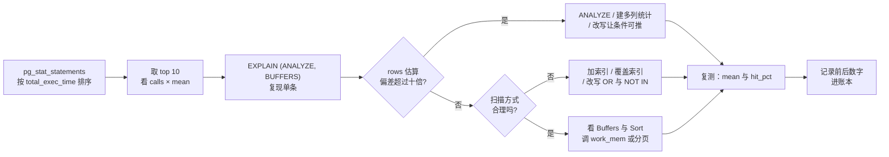

---
sources:
  - 05-第五阶段
---

# 03. SQL 与索引：执行计划与慢查询

> [← 第五阶段导览](01-导览.md) · `EXPLAIN` 的价值不在「有没有走索引」，而在**预估行数与实际行数的比值**——这个比值一旦超过十倍，优化器后面所有的决定都是基于一个错误的世界观做的。

## 1. 先造一张能验证结论的表

执行计划的所有结论都必须在自己手上跑出来，看别人的输出等于背答案。100 万行足够让「全表扫描」和「索引扫描」拉开两个数量级：

```sql
CREATE TABLE orders (
    id          bigserial PRIMARY KEY,
    customer_id bigint        NOT NULL,
    status      text          NOT NULL,
    amount      numeric(12,2) NOT NULL,
    created_at  timestamptz   NOT NULL,
    remark      text
);

INSERT INTO orders (customer_id, status, amount, created_at)
SELECT (random() * 50000)::bigint,
       (ARRAY['NEW','PAID','SHIPPED','CANCELLED'])[1 + floor(random() * 4)::int],
       round((random() * 1000)::numeric, 2),
       now() - (random() * 365) * interval '1 day'
FROM generate_series(1, 1_000_000);

CREATE INDEX idx_orders_customer_created ON orders (customer_id, created_at DESC);
CREATE INDEX idx_orders_status ON orders (status);
VACUUM ANALYZE orders;   -- 必须执行：统计信息与可见性映射都靠它
```

`status` 只有四个值，每值约 25 万行——这刻意造出了「选择性极低」的列，后面验证「索引建了也不会用」时不用另造数据。`customer_id` 有 5 万个值，每值约 20 行，是典型的「高选择性 + 范围排序」组合。

## 2. `EXPLAIN (ANALYZE, BUFFERS)` 逐列读

一条正常的分页查询：

```sql
EXPLAIN (ANALYZE, BUFFERS)
SELECT id, amount, created_at FROM orders
WHERE customer_id = 42 AND status = 'PAID'
ORDER BY created_at DESC
LIMIT 20;
```

```text
Limit  (cost=0.43..1021.10 rows=20 width=40) (actual time=0.031..0.412 rows=20 loops=1)
  Buffers: shared hit=25
  ->  Index Scan using idx_orders_customer_created on orders
        (cost=0.43..51033.55 rows=1000 width=40) (actual time=0.029..0.405 rows=20 loops=1)
        Index Cond: (customer_id = 42)
        Filter: (status = 'PAID'::text)
        Buffers: shared hit=25
Planning:
  Buffers: shared hit=8
Planning Time: 0.183 ms
Execution Time: 0.436 ms
```

逐列的含义与「什么算异常」：

| 字段 | 含义 | 读到什么要警惕 |
|---|---|---|
| `cost=a..b` | 优化器估算的启动代价..总代价，单位是「顺序读一个 8KB 页」的抽象值 | 只用来横向比较两个计划，绝对值没有意义 |
| `rows` | **每个 loops 输出**的估算行数 | 与实际行数差 10 倍以上 = 统计信息或相关性出了问题 |
| `width` | 输出行的平均字节数 | 宽度大（>200）时 `Sort`/`Hash` 更容易落盘 |
| `actual time=a..b` | 实际毫秒，**每个 loops 的平均值** | 只在这个节点是瓶颈时才值得看 |
| `rows`（actual 侧） | 实际行数，同样是**每个 loops 的平均值** | 总数 = 实际 rows × loops |
| `loops` | 该节点被执行了几次 | 内层节点 loops 上万 = 嵌套循环在放大成本 |
| `Buffers: shared hit/read` | 命中共享缓冲的页数 / 从磁盘读的页数 | `read` 占比高 = 缓存没兜住；`dirtied` 高 = 有写 |
| `Rows Removed by Filter` | 被过滤条件丢掉的行数 | 丢掉的远多于留下的 = 索引没起到筛选作用 |
| `Sort Method` | `quicksort`（内存）/ `external merge Disk: NkB` | 出现 `Disk` = `work_mem` 不够，排序落盘 |
| `Planning Time` / `Execution Time` | 计划耗时 / 执行耗时 | 计划时间接近执行时间 = 查询太碎，或表/分区太多 |

三个最容易读错的地方：

**`actual rows` 不是总数，是每次循环的平均数。** 一个 `loops=19843` 的内层节点显示 `rows=1`，意味着它实际吐了 19843 行。把 `loops` 当成装饰的人，会得出「这个节点很便宜」的错误结论。

**`cost` 的单位不是毫秒。** 默认 `seq_page_cost=1.0`、`random_page_cost=4.0`、`cpu_tuple_cost=0.01`，所以 `cost=51033` 大致对应 5 万个页的顺序读。SSD 上 `random_page_cost=4.0` 严重高估了随机 IO 的代价——这是「明明有索引却走了全表扫描」的常见原因之一，把 `random_page_cost` 调到 1.1~1.5 往往能让优化器改用索引。

**PG 17 起，含并行节点的计划里，非并行节点会带 `Serial` 前缀**（`Serial Seq Scan`）。看到它不要以为出了问题，它只是在告诉你「这一段没有并行」。相反，`Gather` 节点下面的 `Parallel Seq Scan` 才是并行段。

## 3. 扫描方式与连接方式

七个扫描节点，判断标准是「要读多少比例的页」：

| 节点 | 何时被选中 | 成本特征 |
|---|---|---|
| `Seq Scan` | 需要读的比例大（经验阈值 >5%~10%）、或没有可用索引 | 顺序 IO，页读得少就快 |
| `Index Scan` | 高选择性、需要按索引顺序输出（`ORDER BY`/`LIMIT`） | 随机 IO，行数一多就退化成大量随机读 |
| `Index Only Scan` | 查询的列全在索引里（覆盖索引） | 只读索引页；`Heap Fetches` 不为 0 说明可见性映射没跟上 |
| `Bitmap Index Scan` + `Bitmap Heap Scan` | 中等选择性、多条件 `AND`/`OR` | 先攒位图再按物理顺序读堆，把随机 IO 变成近似顺序 IO |
| `Tid Scan` | `WHERE ctid = ...` | 极少见，批量维护脚本会用 |
| `Subquery Scan` | 子查询未被展开 | 通常意味着可以改写 |
| `CTE Scan` | PG 12 之前 CTE 一律物化；12+ 只有带 `MATERIALIZED` 才强制物化 | 老代码里 `WITH` 慢，多半是这个原因 |

连接方式三种，选错的代价比索引选错还大：

| 节点 | 适用 | 典型误判 |
|---|---|---|
| `Nested Loop` | 外表小、内表有高选择性索引 | 外表估算成 10 行实际 10 万行 → 内表被扫 10 万次 |
| `Hash Join` | 两边都大、等值连接 | `work_mem` 不足时溢出到磁盘（`Batches: 8`） |
| `Merge Join` | 两边已按连接键有序 | 需要额外排序时反而更贵 |

## 4. 预估 vs 实际：优化器的世界观

优化器不读你的表，它读 `pg_statistic` 里的直方图和 MCV 列表，再由这些统计推出选择率。所以「计划不对」几乎总能归到三类原因：

1. **统计信息过期**。大批量导入/删除后没 `ANALYZE`，优化器还以为表只有 1000 行，于是选 `Nested Loop`。修法：`ANALYZE orders;`，大批量变更后必须跑。
2. **列之间相关性没被建模**。`city = 'Beijing' AND district = 'Haidian'` 两个条件各自选择率 10%，优化器按独立事件算成 1%，实际可能是 60%。PG 10+ 支持 `CREATE STATISTICS` 建多列统计。
3. **数据分布倾斜**。`status='CANCELLED'` 占 40%，`status='NEW'` 占 0.1%，同一个索引对两者的价值差 400 倍。PG 会为高频值存 MCV，但如果值太多（超过 `default_statistics_target` 的采样量）就会失真。

判断方法很机械：**找 `rows` 估算与实际差最多的那个节点**，它上面所有节点的代价估算都不可信。这时不要急着加索引，先 `EXPLAIN (ANALYZE, BUFFERS)` 重跑一次（第二次执行会用到已缓存的页，能区分「慢在 IO」还是「慢在计划」）。

## 5. 索引类型与选择

| 类型 | 擅长 | 不擅长 | 典型场景 |
|---|---|---|---|
| **B-tree** | 等值、范围、排序、前缀 `LIKE 'abc%'` | 多值包含、模糊匹配 | 默认选择，90% 的索引都该是它 |
| **Hash** | 仅等值 | 范围、排序 | 超长文本等值查找，索引比 B-tree 小 |
| **GIN** | 多值类型：`jsonb`、数组、`tsvector`、`pg_trgm` | 写入（每次更新要维护倒排） | 全文检索、`LIKE '%x%'`、JSON 字段查询 |
| **GiST** | 几何、范围类型、KNN 最近邻 | 精确等值 | 地理位置、时间段重叠 |
| **BRIN** | 物理顺序与列值强相关的超大表 | 随机分布的列 | 时间序列：1 亿行只要几 MB 索引 |
| **SP-GiST** | 非平衡树结构（四叉树、前缀树） | 通用场景 | 电话号码、IP 段 |

三个实践结论：

**GIN 的写放大是真的。** 一个 `jsonb` 列上的 GIN 索引，单行更新可能触发多个 pending list 条目，批量导入时能慢 3~5 倍。PG 的 `fastupdate` 把新条目先攒在 pending list 里，查询时再合并——所以刚导入完的数据查得慢是正常的，`VACUUM` 之后就恢复了。

**BRIN 的前提是物理相关性。** 它的原理是「每个数据块记录 min/max」，只有数据按列值顺序写入（自增 ID、时间戳）时才有效。乱序写入的表建 BRIN 等于建了个只能排除少量块的废物。

**不要给低选择性列建单列索引。** `status` 只有四个值、每值 25%，`WHERE status='PAID'` 会命中 25 万行，走索引要 25 万次随机 IO + 回表，比顺序扫全表还慢——所以优化器会正确地忽略它。这不是「索引失效」，是**索引本来就不该建**。真要加速，用部分索引：

```sql
CREATE INDEX idx_orders_pending ON orders (created_at)
WHERE status = 'NEW';
```

索引只包含 `NEW` 状态的行（本例约 25 万行，体积是全表的四分之一），查询也必须带同样的 `WHERE status = 'NEW'` 才能命中。

## 6. 索引失效的十种写法

下面每一条都在 §1 的表上可复现。判据统一：`EXPLAIN` 里出现 `Seq Scan` 且 `Rows Removed by Filter` 很大。

| # | 写法 | 为什么失效 | 修法 |
|---|---|---|---|
| 1 | `WHERE date(created_at) = '2026-11-15'` | 列被函数包裹，索引存的是原值 | 改范围：`created_at >= '2026-11-15' AND created_at < '2026-11-16'`；或建表达式索引 `(date(created_at))` |
| 2 | `WHERE id::text = '42'` | 显式转换让列变成表达式 | 让参数适配列类型：`WHERE id = 42`。MySQL 里反过来：`WHERE phone = 13800138000`（varchar 列）触发隐式转换，加引号即可 |
| 3 | `WHERE remark LIKE '%退款%'` | 前导通配无法用 B-tree 的有序性 | `CREATE EXTENSION pg_trgm;` + `USING gin (remark gin_trgm_ops)`；或反转字符串建后缀索引 |
| 4 | `WHERE customer_id = 1 OR status = 'NEW'` | 两个列各有索引，优化器只能选一个（或 BitmapOr） | 拆成 `UNION ALL` 两段，各自走最优索引 |
| 5 | 复合索引 `(customer_id, created_at)`，查 `WHERE created_at > '2026-01-01'` | 最左前缀断裂，第二列单独用不上 | 单独建 `(created_at)`；或调整复合列序 |
| 6 | 复合索引 `(a, b, c)`，查 `WHERE a=1 AND b>2 AND c=3` | 范围条件之后的列无法再用于定位 | 把范围列放最后：索引改成 `(a, c, b)` |
| 7 | `WHERE status != 'CANCELLED'` | 否定条件等价于「读掉 75% 的行」 | 改白名单 `status IN ('NEW','PAID','SHIPPED')`；或用部分索引 |
| 8 | `WHERE id NOT IN (SELECT order_id FROM refunds)` | 子查询含 NULL 时结果为空；且无法转成反连接 | `NOT EXISTS` 或 `LEFT JOIN ... WHERE r.id IS NULL` |
| 9 | `ORDER BY created_at ASC` 而索引是 `(customer_id, created_at DESC)` | 排序方向与索引顺序不一致，需额外 Sort | 建方向匹配的索引；混合方向时索引也要混合 |
| 10 | 统计信息过期 / 列选择性太低 | 优化器算出「走索引更贵」 | `ANALYZE`；低选择性列改用部分索引或覆盖索引 |

三条补充，都是上表没覆盖但线上高频的：

**`LIKE 'abc%'` 能不能用索引，取决于排序规则。** PG 的 B-tree 只有在 `C` 排序规则（或 `text_pattern_ops` 操作符类）下才对前缀匹配有效。数据库用 `zh_CN.UTF-8` 时，`LIKE 'abc%'` 依然会全表扫——建索引时写 `(remark text_pattern_ops)`。

**`IN` 列表过长会退化成全表扫。** 上千个值的 `IN` 让优化器放弃索引改走哈希，这是正常决策。真要按上千个 ID 取数，改成 `JOIN (VALUES ...)` 或临时表。

**隐式转换在 MySQL 里比 PG 危险得多。** PG 的类型系统严格，`varchar = integer` 直接报错；MySQL 会静默转换，而且**转换发生在列上**（把 varchar 列逐行转成数字），索引直接作废。跨库迁移时这是最高频的性能回归。

## 7. 覆盖索引与回表

B-tree 索引的叶子节点存的是「索引列 + 指向堆表的 ctid」。查询要的列不在索引里，就得按 ctid 回表取行——这叫回表（heap fetch）。行数少时无所谓，行数上万时随机 IO 会成为主要成本。

覆盖索引把需要的列直接放进索引：

```sql
CREATE INDEX idx_orders_cover ON orders (customer_id, created_at DESC)
INCLUDE (status, amount);
```

`INCLUDE` 的列只存在叶子节点、不参与排序与去重，所以既能覆盖查询又不破坏索引的有序性。改完之后：

```sql
EXPLAIN (ANALYZE, BUFFERS)
SELECT created_at, amount FROM orders
WHERE customer_id = 42 ORDER BY created_at DESC LIMIT 20;
```

期望看到 `Index Only Scan using idx_orders_cover` 且 `Heap Fetches: 0`。**`Heap Fetches` 不为 0 是最常见的「假覆盖」**：索引里虽然有数据，但 PG 还要回表确认这一行对当前事务可见——可见性信息存在堆页的 visibility map 里，只有 `VACUUM` 过的页才会被标记为 all-visible。所以刚大批量导入的表，`Index Only Scan` 照样回表，看起来像没生效。

覆盖索引的代价要说清楚：**每一个被 `INCLUDE` 的列都让索引变大，每一次 UPDATE 都要多写一份**。`amount` 是高频更新的列时，把它塞进索引会让写放大 1.5 倍以上。索引是「用写换读」的交易，`INCLUDE` 越多，这笔交易越贵。

## 8. 慢查询治理流程

顺序不能反：**先按总耗时排序，再按单次耗时看**。一条 5ms 但每秒 2000 次的查询，比一条 3 秒但每天 10 次的报表查询更值得优化。

```sql
CREATE EXTENSION IF NOT EXISTS pg_stat_statements;   -- 需要 shared_preload_libraries 并重启

SELECT calls,
       round(total_exec_time::numeric, 1) AS total_ms,
       round(mean_exec_time::numeric, 2)  AS mean_ms,
       round(100.0 * shared_blks_hit
             / nullif(shared_blks_hit + shared_blks_read, 0), 1) AS hit_pct,
       rows,
       left(query, 80) AS q
FROM pg_stat_statements
WHERE query NOT LIKE '%pg_stat_statements%'
ORDER BY total_exec_time DESC
LIMIT 15;
```



四个纪律：

**一、`mean_exec_time` 会被长尾污染。** 同一条 SQL 在 `pg_stat_statements` 里按「查询文本 + 参数化后的形态」聚合，快慢样本混在一起。要看分布得开 `track_planning` 之外的采样，或者直接用 `auto_explain` 抓慢样本的实际计划。

**二、先看 `hit_pct`。** 低于 95% 说明缓存没兜住，先查 `shared_buffers` 与工作集大小，别急着加索引。索引优化的是「读多少页」，缓存优化的是「页在哪」。

**三、改完必须复测同一指标。** 「感觉快了」不算数，`mean_ms` 从 180 降到 0.4 才算。复测前记得 `SELECT pg_stat_statements_reset();`，否则新旧样本混在一起。

**四、`auto_explain` 是抓「偶发慢」的唯一手段。** `pg_stat_statements` 只给聚合值，偶发的坏计划（比如参数不同导致计划翻转）只有 `auto_explain.log_min_duration = '500ms'` 能抓到当时的真实计划。

## 9. JPA 生成的 SQL 与手写 SQL 的计划对照

同一个需求：查某客户最近 20 条已支付订单。Spring Data 的派生查询只写一行：

```kotlin
interface OrderRepository : JpaRepository<Order, Long> {
    // 方法名即查询：Hibernate 7 生成下面那条 SQL
    fun findByCustomerIdAndStatusOrderByCreatedAtDesc(
        customerId: Long, status: OrderStatus,
    ): List<Order>
}
```

Hibernate 7 实际发出的 SQL（`logging.level.org.hibernate.SQL=DEBUG`）：

```sql
select o1_0.id, o1_0.amount, o1_0.created_at, o1_0.customer_id, o1_0.remark, o1_0.status
from orders o1_0
where o1_0.customer_id=? and o1_0.status=?
order by o1_0.created_at desc
```

注意两个细节：**没有 `LIMIT`**（方法签名里没传 `Pageable`/`Limit`），**选了全部六列**（实体映射了六列就全查）。执行计划因此是：先用 `idx_orders_customer_created` 定位，再逐行回表取 `remark` 等宽列，最后 `Sort` 一次——如果这个客户有 2 万条订单，这 2 万行会全部进内存。

手写版本把「只取需要的列」和「只取 20 行」写进 SQL：

```kotlin
@Repository
class OrderQuery(private val jdbc: JdbcClient) {

    fun recentPaid(customerId: Long, limit: Int): List<OrderBrief> =
        jdbc.sql(
            """
            SELECT created_at, amount
            FROM orders
            WHERE customer_id = :cid AND status = 'PAID'
            ORDER BY created_at DESC
            LIMIT :lim
            """.trimIndent(),
        )
            .param("cid", customerId)
            .param("lim", limit)
            .query { rs, _ ->
                OrderBrief(rs.getTimestamp("created_at").toInstant(), rs.getBigDecimal("amount"))
            }
            .list()
}

data class OrderBrief(val createdAt: Instant, val amount: BigDecimal)
```

两条 SQL 的计划差异，用一张表钉住：

| 维度 | JPA 派生查询 | 手写 + 覆盖索引 |
|---|---|---|
| 扫描节点 | `Index Scan` + 逐行回表 | `Index Only Scan`（`idx_orders_cover`，`Heap Fetches: 0`） |
| 排序 | 取回全部匹配行后 `Sort` | 索引本身有序，无 `Sort` 节点 |
| 传输行数 | 该客户全部订单（可达数万） | 20 |
| Buffers | `read` 上千页 | `hit` 二十几页 |
| 典型耗时（20 条 vs 2 万条） | 12~40ms | 0.1~0.5ms |

这不是「JPA 慢」，是**「把实体的全部列 + 全量结果集」当成了默认行为**。同样的 JPA 也能写出等价的高效版本：加 `Pageable`、用接口投影（`interface OrderBrief { ... }`）、或者 `@Query` 手写 JPQL 加 `LIMIT`。区别在于——JPA 要你**知道自己在要什么**，手写 SQL 逼你**声明自己在要什么**。05、06 两册会把这条差异展开成选型问题。

## 10. 自测

1. `EXPLAIN` 显示某内层节点 `rows=1 loops=19843`，这个节点实际吐出多少行？为什么这个读法会影响你对「谁最贵」的判断？
2. 一条查询 `cost=51033` 却只跑了 0.4ms。为什么 cost 和实际耗时不能直接换算？SSD 上哪个参数最该调？
3. `status` 只有四个值，你给它建了索引，`WHERE status='PAID'` 却走了全表扫描。这是「索引失效」吗？正确做法是什么？
4. `Index Only Scan` 的 `Heap Fetches` 是 8000 而不是 0，说明什么？怎么修？
5. 同一条 SQL，测试环境走 `Index Scan`、生产走 `Bitmap Heap Scan`，两次都只返回 30 行。什么变了？哪种更快？
6. 一条 SQL 在测试环境走 `Nested Loop`，生产走 `Hash Join`，耗时反而更短。用统计信息与数据量解释，并说明该不该强行固定计划。

## 11. 延伸

- 上一册：[02-连接池与JDBC真相](02-连接池与JDBC真相.md)——连接拿到之前，池已经在排队了。
- 下一册：[04-事务与隔离级别的实证](04-事务与隔离级别的实证.md)——同一张表上，两个会话的可见性规则。
- 慢查询在请求账本上记在 ⑨ 站，读法见[第一阶段 02 册](../01-第一阶段/02-一次请求的十五站主时间线与账本.md)。
- JPA 侧怎么避免「顺手写出一条慢 SQL」，见[06 册](06-JPA实战-映射-脏检查-N+1与批量.md)。
- 索引治理在容量规划里的位置，见[第十阶段导览](../10-第十阶段/01-导览.md)。
