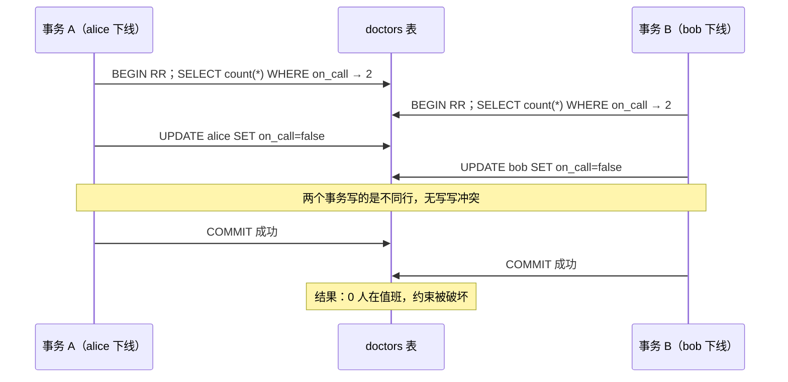

---
sources:
  - 05-第五阶段
---

# 04. 事务与隔离级别的实证

> [← 第五阶段导览](01-导览.md) · 隔离级别不是教科书上的四条定义，而是「快照什么时候拍」加「冲突什么时候报」；PG 与 MySQL 在同一个名字下做的是两件不同的事，跨库迁移的坑全在这里。

## 1. MVCC：版本链、快照与可见性

PostgreSQL 的行更新不是原地改，而是**写一个新版本、把旧版本的 `xmax` 标记为当前事务**。每行有两个隐藏列：`xmin`（插入它的事务 ID）、`xmax`（删除/更新它的事务 ID）。于是「一行」在物理上是版本链：

```text
accounts 表中 id=1 的三个版本（堆页里同时存在）：

ctid (0,1)  xmin=100  xmax=205  balance=1000   ← 被 205 更新掉了
ctid (0,4)  xmin=205  xmax=310  balance=900    ← 被 310 更新掉了
ctid (0,7)  xmin=310  xmax=0    balance=800    ← 当前版本（xmax=0 表示没被删）
```

一条 SELECT 能不能看到一个版本，取决于它手上的**快照**：快照记录了「哪些事务 ID 还没提交」（`xip` 列表）与「下一个可分配的事务 ID」（`xmax`）。规则很短：`xmin` 已提交且不在 `xip` 里、`xmax` 未提交或为空，这个版本才可见。

这解释了 MVCC 的三个直接后果：

1. **读不阻塞写、写不阻塞读**——读的是旧版本，写的是新版本，谁也不等谁；
2. **UPDATE 不覆盖，只追加**，所以表会膨胀（bloat），必须靠 `VACUUM` 回收死版本；
3. **快照的拍法决定了隔离级别**，而不是「加不加锁」决定了隔离级别。

自己看快照：

```sql
SELECT pg_current_xact_id();   -- 当前事务 ID（PG 13+，旧名 txid_current）
SELECT pg_current_snapshot();  -- 形如 1005:1010:1005,1008 —— xmin:xmax:xip 列表
```

`1005:1010:1005,1008` 读作：小于 1005 的事务都已结束；1005 和 1008 还在跑；大于等于 1010 的是快照之后才开始的，一律不可见。

### 快照在什么时候拍

这是本册的第一个关键事实，也是最容易记错的一条：

| 隔离级别 | 快照时机 | 一句话 |
|---|---|---|
| `READ COMMITTED` | **每条语句开始时** | 同一事务里两条相同的 SELECT 可能看到不同数据 |
| `REPEATABLE READ` | **事务里第一条语句开始时** | 整个事务共用一个快照 |
| `SERIALIZABLE` | 同 RR，另加 SSI 冲突检测 | 快照 + 事后判冲突 |

注意 RR 的快照是「第一条语句」而不是 `BEGIN`。你在 `BEGIN` 之后去接个电话、十分钟后再发第一条 SELECT，快照仍然是那第一条 SELECT 的时刻——`BEGIN` 本身不分配事务 ID（PG 里叫 lazy xid assignment），所以「长事务拖慢 vacuum」的判据是 `xact_start`，而「看到哪个版本」的判据是第一条语句。

## 2. 四种隔离级别的两会话实测

准备一张两行的表，所有实验都在两个 `psql` 会话里做（A 是观察者，B 是干扰者）：

```sql
DROP TABLE IF EXISTS accounts;
CREATE TABLE accounts (id int PRIMARY KEY, balance numeric(12,2) NOT NULL);
INSERT INTO accounts VALUES (1, 1000), (2, 1000);
```

### 2.1 脏读：PG 里做不出来

```sql
-- 会话 B
BEGIN;
UPDATE accounts SET balance = 0 WHERE id = 1;   -- 未提交

-- 会话 A（任何隔离级别）
SELECT balance FROM accounts WHERE id = 1;      -- 结果：1000
```

A 读到 1000，因为 B 的版本 `xmin` 未提交，对 A 的快照不可见。**PG 的最低级别就是 READ COMMITTED**，`READ UNCOMMITTED` 会被静默提升为 RC。所以「PG 能不能脏读」这个问题的答案是「不能，而且你无法配出来」——这一点在迁移 MySQL（同样不支持脏读，但 MyISAM 时代的历史包袱让人总想问）时可以先划掉。

### 2.2 不可重复读：RC 与 RR 的分水岭

```sql
-- 会话 A
BEGIN ISOLATION LEVEL READ COMMITTED;
SELECT balance FROM accounts WHERE id = 1;      -- ① 1000

-- 会话 B（自动提交）
UPDATE accounts SET balance = 500 WHERE id = 1;

-- 会话 A
SELECT balance FROM accounts WHERE id = 1;      -- ② 500  ← RC 下变了
COMMIT;
```

把 A 的第一行换成 `BEGIN ISOLATION LEVEL REPEATABLE READ;`，② 仍然是 1000。差别只在快照的粒度——**没有任何锁参与**，B 的 UPDATE 在 RC 下也没有被 A 阻塞。

RR 下如果 A 接着更新同一行，会撞上写写冲突：

```sql
-- 会话 A（RR）
UPDATE accounts SET balance = balance - 100 WHERE id = 1;
-- ERROR:  could not serialize access due to concurrent update
```

这是 PG 的「first updater wins」：A 的事务开始后该行已被别人改过，A 不能基于旧快照覆盖，只能整事务重来。**这个错误码是 `40001`，必须由应用重试**——RR 不是「不会失败」，是「失败得很明确」。

### 2.3 幻读：PG 的 RR 实际上防住了

```sql
-- 会话 A
BEGIN ISOLATION LEVEL REPEATABLE READ;
SELECT count(*) FROM orders WHERE customer_id = 42;   -- ① 10

-- 会话 B
INSERT INTO orders (customer_id, status, amount, created_at)
VALUES (42, 'NEW', 10, now());

-- 会话 A
SELECT count(*) FROM orders WHERE customer_id = 42;   -- ② 10
COMMIT;
```

② 还是 10。SQL 标准允许 RR 出现幻读，但 PG 的快照隔离顺带把它解决了：快照之外的新行根本不可见。MySQL InnoDB 的 RR 也防幻读，但它靠的是**间隙锁**（§4），机制完全不同，副作用也完全不同。

### 2.4 写偏差：RR 挡不住的那一类

这是最需要动手做一遍的实验。业务约束是「至少一名医生值班」：

```sql
CREATE TABLE doctors (name text PRIMARY KEY, on_call boolean NOT NULL);
INSERT INTO doctors VALUES ('alice', true), ('bob', true);
```



```sql
-- 会话 A
BEGIN ISOLATION LEVEL REPEATABLE READ;
SELECT count(*) FROM doctors WHERE on_call;                    -- 2
UPDATE doctors SET on_call = false WHERE name = 'alice';
-- 会话 B（同时）
BEGIN ISOLATION LEVEL REPEATABLE READ;
SELECT count(*) FROM doctors WHERE on_call;                    -- 2（各自快照）
UPDATE doctors SET on_call = false WHERE name = 'bob';
-- 两边都 COMMIT
SELECT count(*) FROM doctors WHERE on_call;                    -- 0
```

两个事务读的是同一份快照、写的是不同的行，没有任何机制会阻止它们同时提交。这不是实现缺陷，是**快照隔离（SI）的能力边界**：它只能检测「同一行的写写冲突」，检测不了「读集合与别人写集合交叉」这种跨行的因果。

把两个会话都改成 `BEGIN ISOLATION LEVEL SERIALIZABLE;`，第二个 COMMIT 会失败：

```text
ERROR:  could not serialize access due to read/write dependencies among transactions
DETAIL:  Reason code: Canceled on identification as a pivot, during commit attempt.
HINT:  The transaction might succeed if retried.
```

## 3. PG 的 SERIALIZABLE：SSI 在检测什么

PG 9.1 起用 SSI（Serializable Snapshot Isolation）实现可串行化：**不加锁，只在读的时候记下「我读过哪些索引页/堆页」**（谓词锁，`SIReadLock`），提交时检查这些读与并发事务的写之间有没有形成危险的环。

具体检测两类结构：

1. **rw-antidependency（读写反依赖）**：T1 读了 X，T2 写了 X。T1 和 T2 之间就有一条 rw 边。
2. **危险结构**：两条连续的 rw 边（T1 →rw T2 →rw T3），且 T3 先提交。这时 T1 或 T2 必须回滚。

所以 SSI 的代价分两部分：**内存**（谓词锁要按页记录，长事务读得多就吃得多）和**误判**（它检测的是「可能不可串行化」，不追求精确，只读事务也可能被卷进去）。实践上的三条结论：

- 应用**必须**能重试 `40001`，否则 SERIALIZABLE 没法用；
- 只读长事务在 SERIALIZABLE 下最好显式声明 `DEFERRABLE`（`BEGIN ISOLATION LEVEL SERIALIZABLE READ ONLY DEFERRABLE`），它会等到一个「安全快照」再开始，代价是可能等；
- SSI 不是「更严格的 RR」，而是「另一个协议」：RR 靠快照，SERIALIZABLE 靠快照 + 事后验证。想靠调隔离级别解决并发问题，先问自己有没有重试路径。

## 4. MySQL InnoDB：间隙锁，以及「RR 不等于 RR」

InnoDB 的 RR 也是快照读，但**当前读**（`SELECT ... FOR UPDATE`、`UPDATE`、`DELETE`）走的是另一套：除了锁住命中的记录，还锁住记录之间的**间隙**（next-key lock = record lock + gap lock），目的是阻止别人往这个间隙里插入，从而防幻读。

```sql
-- MySQL 8.0，RR
-- 会话 A
BEGIN;
SELECT * FROM orders WHERE customer_id BETWEEN 100 AND 200 FOR UPDATE;
-- 锁住 (…,100] 到 [200,…) 之间的记录与间隙

-- 会话 B
INSERT INTO orders (customer_id, ...) VALUES (150, ...);
-- 阻塞：150 落在被锁的间隙里
```

同样两个会话在 PG 里：A 的 `FOR UPDATE` 只锁住**已存在**的 100~200 的行，B 插入 150 完全不阻塞。**这是跨库迁移最容易被忽略的行为差异**：一个在 PG 上「加了锁就安全」的逻辑，搬到 MySQL 会多出一堆插入阻塞，反之亦然。

把两边的差异列清楚：

| 维度 | PG `REPEATABLE READ` | MySQL InnoDB `REPEATABLE READ` |
|---|---|---|
| 实现机制 | 纯快照隔离（SI），无间隙锁 | 快照读 + next-key lock（当前读） |
| 普通 SELECT | 事务级快照 | 事务级快照（第一次读时建立） |
| `SELECT ... FOR UPDATE` | 只锁已存在的行 | 锁行 + 锁间隙 |
| 并发插入同范围 | 不阻塞 | 阻塞（等间隙锁） |
| 并发更新同一行 | **立刻报 40001**，由应用重试 | 等锁，等到后基于最新版本继续 |
| 幻读 | 快照层面不发生 | 普通读不发生，当前读靠间隙锁 |
| 典型故障 | 重试风暴 | 死锁、插入超时 |

第五行的差异最致命：**依赖「RR 下捕获 40001 然后重试」的代码，迁到 MySQL 后不会重试，而是变成锁等待**。等待时间一长，连接被占住，池满，雪崩路径与 02 册完全一致。迁移时必须逐条审查「捕获 40001」的代码路径。

## 5. 死锁：日志怎么读

PG 的死锁检测由 `deadlock_timeout`（默认 1 秒）驱动：一个等锁超过 1 秒的事务会触发检测，发现环就选一个牺牲者回滚。日志长这样：

```text
ERROR:  deadlock detected
DETAIL:  Process 12345 waits for ShareLock on transaction 67890; blocked by process 23456.
         Process 23456 waits for ShareLock on transaction 67891; blocked by process 12345.
         Process 12345: UPDATE accounts SET balance = balance - 100 WHERE id = 2;
         Process 23456: UPDATE accounts SET balance = balance + 100 WHERE id = 1;
HINT:  See server log for query details.
CONTEXT:  while updating tuple (0,3) in relation "accounts"
```

读法只有三步：

1. **`DETAIL` 的前两行是环**：12345 等 23456，23456 等 12345。多于两个进程时，把 `blocked by` 串起来就是环。
2. **后面几行是各自卡住的语句**，它们告诉你「每个人手里已经有什么、还想要什么」。
3. **`CONTEXT` 的 `tuple (0,3)`** 是物理位置，配合 `ctid` 能定位到具体行——这在行数很多、语句一样但参数不同的场景里是唯一线索。

MySQL 侧看 `SHOW ENGINE INNODB STATUS` 的 `LATEST DETECTED DEADLOCK` 段，信息更全（含 `WAITING FOR THIS LOCK TO BE GRANTED` 与 `HOLDS THE LOCK(S)`），但格式更啰嗦。两边的共同读法一致：**先找环，再看每个人手里的锁**。

日常还可以打开 `log_lock_waits = on`：任何超过 `deadlock_timeout` 的等锁都会记一条，不必等到真死锁。这是发现「慢但不死」的锁竞争的性价比最高的开关。

## 6. 四种死锁模式与解法

| 模式 | 现场 | 根因 | 解法 |
|---|---|---|---|
| **相反顺序更新** | A 改 1 再改 2，B 改 2 再改 1 | 加锁顺序不统一 | 按主键排序后批量更新；单行更新也统一按 id 升序 |
| **唯一键并发插入** | 两个事务插同一个唯一键，其中一个先回滚 | 插入时对唯一索引加锁，回滚释放前另一方等待 | `INSERT ... ON CONFLICT DO NOTHING` + 查回；或捕获唯一冲突重试 |
| **间隙锁交叉**（MySQL） | 两个范围 `FOR UPDATE` 互相覆盖对方要插的位置 | next-key lock 的间隙重叠 | 缩小范围、改用等值条件、或该查询降到 RC |
| **外键 + 父子更新** | 更新父行与插入子行交叉 | 外键检查对父行加共享锁 | 先父后子统一顺序；或去掉外键改为应用层保证 |

三种通用解法按成本排序：

1. **统一加锁顺序**（最便宜）：所有涉及多行的写操作，按 `ORDER BY id` 排序后再逐行处理。`UPDATE ... WHERE id IN (...)` 的执行顺序不保证，所以显式排序或用游标逐行。
2. **缩小事务**：把下游调用、消息发送、文件写入全部移出事务。事务越短，持有锁的窗口越小，死锁概率呈平方级下降。
3. **改用乐观锁**：`UPDATE ... WHERE id = ? AND version = ?`，冲突时影响行数为 0，由应用重试。彻底没有行锁等待，代价是冲突率高时重试成本上升（第六阶段 04 册展开）。

## 7. 复现脚本与重试代码

死锁复现（两个会话，顺序刻意相反）：

```sql
-- 准备
CREATE TABLE IF NOT EXISTS accounts (id int PRIMARY KEY, balance numeric(12,2) NOT NULL);
INSERT INTO accounts VALUES (1, 1000), (2, 1000) ON CONFLICT (id) DO NOTHING;

-- 会话 A
BEGIN;
UPDATE accounts SET balance = balance - 100 WHERE id = 1;

-- 会话 B
BEGIN;
UPDATE accounts SET balance = balance + 100 WHERE id = 2;

-- 会话 A（此时阻塞）
UPDATE accounts SET balance = balance + 100 WHERE id = 2;

-- 会话 B（触发检测，1 秒后其中一个被回滚）
UPDATE accounts SET balance = balance - 100 WHERE id = 1;
```

约 1 秒后，其中一个会话收到 `ERROR: deadlock detected`，另一个正常提交。**被回滚的那个不一定是「后发的」**，PG 选牺牲者的依据是「回滚代价最小」，所以不能靠语句顺序猜。

手工敲 psql 适合一次性验证，回归验证要落成测试。两条独立连接的测试能直接断言隔离语义（必须连真实 PG，H2 的隔离实现与 PG 不同，用它测出来的结论不可迁移）：

```kotlin
@SpringBootTest
class IsolationProofTest @Autowired constructor(private val ds: DataSource) {

    @Test
    fun `READ COMMITTED 下同一事务两次读到不同的值`() {
        ds.connection.use { a ->
            a.autoCommit = false
            a.transactionIsolation = Connection.TRANSACTION_READ_COMMITTED
            assertThat(a.balanceOf(1)).isEqualByComparingTo("1000")

            ds.connection.use { b ->          // 另一条连接，自动提交
                b.prepareStatement("UPDATE accounts SET balance = 500 WHERE id = ?").use {
                    it.setInt(1, 1)
                    it.executeUpdate()
                }
            }
            assertThat(a.balanceOf(1)).isEqualByComparingTo("500")   // 同一事务内变了
            a.rollback()
        }
    }

    private fun Connection.balanceOf(id: Int): BigDecimal =
        prepareStatement("SELECT balance FROM accounts WHERE id = ?").use { ps ->
            ps.setInt(1, id)
            ps.executeQuery().use { rs -> rs.next(); rs.getBigDecimal(1) }
        }
}
```

把 `TRANSACTION_READ_COMMITTED` 换成 `TRANSACTION_REPEATABLE_READ`，第二条断言应该变成 1000；再换成 `TRANSACTION_SERIALIZABLE` 并在事务里加一次 `UPDATE` 同一行，则会拿到 SQLState `40001`。**同一段测试跑出三种结果，比读十遍文档更能记住三者的差别**。

重试代码要遵守三条：只重试可重试的错误码、整段事务重来、退避带抖动：

```kotlin
@Component
class TxRetrier(private val tx: TransactionTemplate) {

    /**
     * block 必须满足：无外部副作用、可重复执行。
     * 事务内已经发出去的 MQ 消息、HTTP 请求不在重试范围内。
     */
    fun <T> execute(block: () -> T): T {
        var attempt = 1
        while (true) {
            try {
                return tx.execute { block() }!!
            } catch (e: RuntimeException) {
                val sqlState = generateSequence(e as Throwable?) { it.cause }
                    .filterIsInstance<java.sql.SQLException>()
                    .firstOrNull()?.sqlState
                if (sqlState !in RETRYABLE || attempt >= MAX_ATTEMPTS) throw e
                // 指数退避 + 抖动：多实例同时重试时避免再度撞车
                val base = 20L shl (attempt - 1)
                Thread.sleep(base + Random.nextLong(base))
                attempt++
            }
        }
    }

    companion object {
        // 40001 序列化失败；40P01 死锁被选为牺牲者
        val RETRYABLE = setOf("40001", "40P01")
        const val MAX_ATTEMPTS = 4
    }
}
```

三个必须注意的细节：

**必须用 `TransactionTemplate` 或 `REQUIRES_NEW`。** 如果重试发生在已经被标记为 rollback-only 的外层事务里，Spring 会抛 `UnexpectedRollbackException`，重试永远不会成功。重试的循环必须在事务边界之外。

**`@Retryable` 与 `@Transactional` 不能标在同一个方法上。** 两者都是 AOP，顺序不可控：如果重试在事务内层，第一次失败后事务已污染；如果重试在外层，才是正确语义。安全做法是把 `@Retryable` 放在调用方，让被调方是独立 Bean 上的 `@Transactional` 方法。

**`Thread.sleep` 在虚拟线程上是可接受的**（JDK 25 下不会 pinning，除非在 `synchronized` 块里），但重试期间仍然占着一个 Tomcat worker。这就是为什么 `MAX_ATTEMPTS` 要小：重试是给偶发冲突用的，不是给持续竞争用的。

## 8. 自测

1. `BEGIN` 之后隔十分钟才发第一条 SELECT，RR 的快照是 `BEGIN` 时刻还是第一条语句时刻？这对「长事务」的判定有什么影响？
2. 写偏差为什么在 RR 下必然发生、在 SERIALIZABLE 下被检测到？用「读集合与写集合的交叉」描述那个环。
3. 同样一句 `SELECT ... FOR UPDATE WHERE id BETWEEN 100 AND 200`，PG 与 MySQL 分别锁了什么？哪一个会阻塞 `INSERT id=150`？
4. PG 报 `could not serialize access due to concurrent update`，这句是死锁吗？应用该做什么？
5. 你的服务在 PG 上靠「捕获 40001 重试」保证正确性，迁到 MySQL 8 后这段代码还会触发吗？会变成什么现象？
6. 死锁日志里 `Process A waits for ShareLock on transaction 123; blocked by process B`，为什么等的是「事务」而不是「行」？

## 9. 延伸

- 上一册：[03-SQL与索引-执行计划与慢查询](03-SQL与索引-执行计划与慢查询.md)——锁等待在执行计划里表现为 `wait_event_type = Lock`。
- 下一册：[05-持久化选型-JPA-MyBatis-JdbcClient](05-持久化选型-JPA-MyBatis-JdbcClient.md)——`@Transactional` 到底把事务边界画在哪。
- `@Transactional` 的六种失效现场与传播行为矩阵在[第六阶段 02 册](../06-第六阶段/02-Transactional全解与六种失效现场.md)。
- 乐观锁、`SELECT FOR UPDATE` 与唯一约束兜底在[第六阶段 04 册](../06-第六阶段/04-并发控制-乐观锁-悲观锁与唯一约束.md)。
- 长事务如何拖慢 autovacuum，见[03 册](03-SQL与索引-执行计划与慢查询.md) §5 关于 bloat 的部分。
