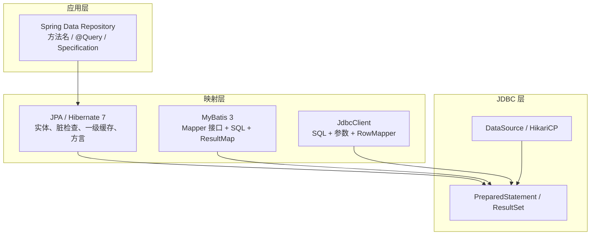
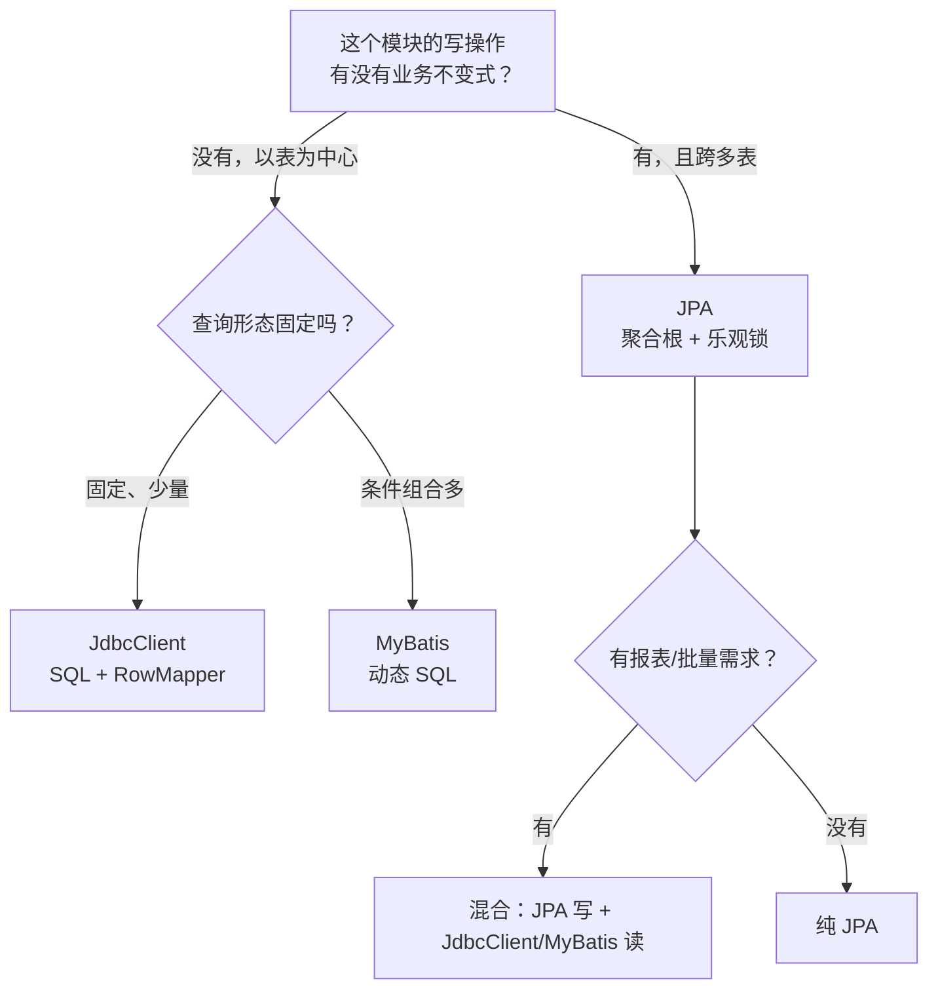

---
sources:
  - 05-第五阶段
---

# 05. 持久化选型：JPA、MyBatis 与 JdbcClient

> [← 第五阶段导览](01-导览.md) · 选型的真正问题不是「哪个快」，而是「你愿意把 SQL 的控制权交给谁」——JPA 拿走控制权换自动映射，MyBatis 保留控制权换维护成本，`JdbcClient` 两者都不换、也就两者都不给。

## 1. 三者站在不同的抽象层

先摆清位置，否则「JPA 和 MyBatis 哪个好」这个问题永远吵不出结论——它们根本不在同一层：



区别在于**「谁决定 SQL 长什么样」**：

| | JPA | MyBatis | JdbcClient |
|---|---|---|---|
| SQL 由谁生成 | 框架（JPQL/HQL → 方言 SQL） | 你（注解或 XML） | 你（Kotlin 字符串） |
| 你看到 SQL 的时机 | 打开日志才看得到 | 写的时候就看到 | 写的时候就看到 |
| 映射方式 | 注解 + 约定 | ResultMap / 别名约定 | 手写 `RowMapper` |
| 状态管理 | 一级缓存 + 脏检查（实体有「被管理」状态） | 无状态（每次查询返回新对象） | 无状态 |

这张表决定了后面所有的取舍：**JPA 是唯一一个「记得你改过什么」的方案**，所以它也是唯一一个能自动发 `UPDATE` 的方案；代价是它的 SQL 你看不见，而且一旦看不见，N+1、全列查询、隐式 join 都会悄悄发生。

## 2. 能力边界对照

把五个维度摊开，选型时逐行打勾比凭印象可靠：

| 维度 | JPA / Hibernate 7 | MyBatis 3 | JdbcClient（Spring 6.1+） |
|---|---|---|---|
| **映射** | 实体 ↔ 表自动映射，支持继承、嵌值、集合 | 显式 ResultMap，复杂结构（一对多嵌套）表达力强 | 手写 `RowMapper`，一行一个 lambda |
| **SQL 可控性** | 弱：靠 JPQL / 原生 SQL 逃生口 | 强：SQL 就是源码 | 最强：SQL 就是字符串，无任何加工 |
| **批量写入** | 需开 `jdbc.batch_size` + `order_inserts`，且 `IDENTITY` 主键会禁用批处理 | `ExecutorType.BATCH` 或 `<foreach>` 拼多值 INSERT | 直接 `batchUpdate`，参数化批量最可控 |
| **复杂查询** | 弱：多表聚合、窗口函数要么写原生 SQL 要么 Criteria 地狱 | 强：任意 SQL，动态拼接 | 强：任意 SQL，但动态条件要自己拼 |
| **学习/维护成本** | 高：脏检查、flush、抓取策略、N+1 全是隐式规则 | 中：SQL 与映射分离，XML 会膨胀 | 低：无魔法，但重复代码多 |
| **重构安全** | 高：改字段名有编译期检查（JPQL 字符串除外） | 低：XML 里的列名改了不会报错 | 低：同 MyBatis |
| **适合的写模型** | 有不变式的聚合根 | 表驱动的 CRUD / 报表 | 批量、upsert、运维脚本 |

三句总结，对应三种典型误用：

- **用 JPA 写报表**：一条「按月、按渠道、按状态分组，带窗口函数排名」的 SQL，JPQL 写不出来，退化成原生 SQL 后 JPA 只剩「结果映射」一个功能，还要额外承受实体状态管理的复杂度。
- **用 MyBatis 写领域模型**：每个聚合的写操作都要手写 `INSERT`/`UPDATE`/`DELETE` 加字段级 diff，业务规则散落在 SQL 里，改一个不变式要改五个 XML。
- **用 JdbcClient 写整个应用**：每个查询的 `RowMapper` 都手写，20 个实体就是 200 行样板代码，且没有任何编译期保护。

## 3. JPA 的三层抽象：每往下一层，你多拿到什么

JPA 的复杂度来自「同一个操作有三层入口」，搞不清在哪一层动手，就会出现「明明写了 `@Query` 却还是慢」这类问题。

| 层 | 入口 | 你能控制 | 你失去 |
|---|---|---|---|
| **Repository** | `JpaRepository`、派生查询、`@Query`、`Specification` | 方法名即查询、分页排序、投影 | 看不到最终 SQL；派生查询的方法名一长就没法读 |
| **EntityManager** | `em.createQuery`、`EntityGraph`、`flush`/`clear`、`LockMode` | 抓取策略、flush 时机、锁、一级缓存 | 要自己管事务边界与实体状态 |
| **JDBC** | `Session.doWork`、`JdbcClient`、原生 SQL | 批处理、fetch size、游标、`COPY` | 失去全部对象映射 |

关键认知：**Repository 不是「更简单的 JPA」，它是「约定优于配置的 Criteria 生成器」**。`findByCustomerIdAndStatusOrderByCreatedAtDesc` 这个方法名会被解析成 `where customer_id = ? and status = ? order by created_at desc`，没有 `LIMIT`、没有投影、没有 join 策略——你在方法名里没写的，它一概不做。

三层之间还有一条容易忽略的通道：**Spring Data 的投影（projection）**。接口投影只查需要的列，是少数几个「不加代码就能显著降低开销」的手段：

```kotlin
interface OrderBrief {
    val createdAt: Instant
    val amount: BigDecimal
}

interface OrderRepository : JpaRepository<Order, Long> {
    // 只 select created_at, amount；不加载实体、不进一级缓存
    fun findByCustomerIdOrderByCreatedAtDesc(customerId: Long, page: Pageable): List<OrderBrief>
}
```

它生成的是 `select o.created_at, o.amount from orders o where ...`，比实体查询少读四列。代价是投影对象是代理，`toString`/`equals` 行为与普通对象不同（不要拿它当 DTO 传递）。

## 4. MyBatis：动态 SQL 的收益与账单

MyBatis 的核心价值是**把 SQL 当一等公民**，动态 SQL 是它最强也最贵的能力：

```kotlin
@Mapper
interface OrderMapper {

    @Select(
        """
        <script>
        SELECT customer_id, count(*) AS cnt, sum(amount) AS total
        FROM orders
        WHERE status = #{status}
        <if test="minAmount != null">AND amount &gt;= #{minAmount}</if>
        <if test="from != null">AND created_at &gt;= #{from}</if>
        GROUP BY customer_id
        HAVING count(*) &gt; #{minCount}
        ORDER BY total DESC
        </script>
        """,
    )
    fun summarize(
        @Param("status") status: String,
        @Param("minAmount") minAmount: BigDecimal?,
        @Param("from") from: Instant?,
        @Param("minCount") minCount: Int,
    ): List<OrderSummaryRow>
}
```

收益很直接：**同一个方法覆盖 2³ = 8 种查询形态，且每种都是最优 SQL**。JPA 要实现同样的效果，要么写 8 个方法，要么上 `Specification`（可读性断崖式下降），要么退回原生 SQL。

账单也很直接：

1. **分支爆炸后不可测**。8 个分支里通常只有 2 个有测试；剩下 6 个的 SQL 语法错误只有上线才暴露。缓解手段是给 Mapper 写「SQL 快照测试」——把生成的 SQL 与参数一起断言。
2. **`#{}` 与 `${}` 混用就是注入**。`${}` 是字符串拼接，`ORDER BY ${sortColumn}` 这种写法必须配白名单，否则就是 SQL 注入（第九阶段 05 册）。Kotlin 里更容易犯：`"$column"` 写起来太顺手。
3. **ResultMap 与表结构耦合**。列改名不会编译报错，只会在运行时返回 null。用 `mapUnderscoreToCamelCase` 能减少一半映射配置，但一对多嵌套仍然要手写 `<collection>`。
4. **XML 的可读性随 `<if>` 数量线性下降**，超过十个条件后基本没人敢改。这时应该考虑把查询拆成多个专用语句，而不是继续加 `<if>`。

## 5. JdbcClient：Spring 6.1 补上的那块空白

`JdbcClient`（Spring Framework 6.1 引入，Boot 3.2+ 可用，本站基线 4.1 自带）填补了 `JdbcTemplate` 与现代 Kotlin 之间的空隙：链式 API、命名参数、`RowMapper` 内联。

```kotlin
@Repository
class OrderReportQuery(private val jdbc: JdbcClient) {

    fun topCustomers(status: String, limit: Int): List<CustomerTotal> =
        jdbc.sql(
            """
            SELECT customer_id, sum(amount) AS total, count(*) AS cnt
            FROM orders
            WHERE status = :status
            GROUP BY customer_id
            ORDER BY total DESC
            LIMIT :lim
            """.trimIndent(),
        )
            .param("status", status)
            .param("lim", limit)
            .query { rs, rowNum ->
                CustomerTotal(
                    customerId = rs.getLong("customer_id"),
                    total = rs.getBigDecimal("total"),
                    count = rs.getInt("cnt"),
                )
            }
            .list()
}
```

它适合的场景有一个共同特征：**SQL 的形状是固定的，且你希望它一字不差地被执行**。

| 适合 | 不适合 |
|---|---|
| 报表与聚合查询（窗口函数、CTE、`GROUPING SETS`） | 有不变式的领域写模型（需要脏检查与乐观锁） |
| 批量 upsert（`INSERT ... ON CONFLICT DO UPDATE`） | 复杂对象图的读取（要手写嵌套映射） |
| 热点路径上的单条查询（要精确控制列与 `LIMIT`） | 需要跨库方言适配的产品代码 |
| 运维脚本、数据修复、健康检查 | 动态条件超过三个的查询（拼字符串容易出错） |

一个容易被忽略的优势：`JdbcClient` 走的是 `DataSourceUtils`，**它天然加入当前 Spring 事务**，不需要额外配置。这让它成为「JPA 主写、SQL 读」混合架构里最顺手的读侧工具。

## 6. 同一个查询，三种写法

需求：按状态统计每个客户的订单数与金额合计，取前 10。

**JPA 版**——JPQL 构造器表达式：

```kotlin
data class CustomerTotal(val customerId: Long, val total: BigDecimal, val count: Long)

interface OrderRepository : JpaRepository<Order, Long> {
    @Query(
        """
        select new com.example.order.CustomerTotal(o.customerId, sum(o.amount), count(o))
        from Order o
        where o.status = :status
        group by o.customerId
        order by sum(o.amount) desc
        """,
    )
    fun summarize(status: OrderStatus, pageable: Pageable): List<CustomerTotal>
}
```

Hibernate 7 生成（`?` 是绑定参数，`limit` 由 `Pageable` 追加）：

```sql
select o1_0.customer_id, sum(o1_0.amount), count(o1_0.id)
from orders o1_0
where o1_0.status = ?
group by o1_0.customer_id
order by sum(o1_0.amount) desc
fetch first ? rows only
```

**MyBatis 版**：SQL 与 JPA 版几乎一样，区别是你能在 XML 里加任意条件、可以写 `/*+ hint */`、可以用数据库特有语法（`DISTINCT ON`、`FILTER (WHERE ...)`）。生成的 SQL 就是上面那条，一字不差。

**JdbcClient 版**：同 §5 的代码，SQL 也是上面那条，但没有 `Pageable` 抽象，`LIMIT` 直接写在 SQL 里。

三者对同一条 SQL 的执行计划**完全一致**——因为最终都是同一条 SQL 进同一条连接。差异不在性能，在四件事：

| 差异点 | JPA | MyBatis | JdbcClient |
|---|---|---|---|
| 改动时谁会发现 | 编译期（JPQL 字符串除外） | 运行时 | 运行时 |
| 加一个可选条件 | 加方法或上 Specification | 加一个 `<if>` | 拼字符串（易错） |
| 换数据库 | 方言自动适配 | 手改 SQL | 手改 SQL |
| 结果映射出错的表现 | 启动时校验 | 运行时 null | 运行时 null |

这张表解释了为什么「性能」很少是选型的主因：**同一查询在三者下的性能差异通常小于 5%，而维护成本的差异是数倍**。真正的性能差异来自「你写不出来的那条 SQL」——JPA 写不出 `DISTINCT ON`，于是你用 `group by` 绕，绕出来的计划差十倍。

## 7. 选型决策树



三条经验判据，比决策树更快：

1. **看团队**。团队里没人读得懂执行计划，就别选 MyBatis——SQL 可控意味着 SQL 出事也要你负责；团队没人搞得清 flush 与抓取策略，就别选 JPA。
2. **看变更频率**。表结构一年改两次、查询天天加条件 → MyBatis；实体模型天天加字段、查询形态稳定 → JPA。
3. **看数据量级**。单表千万行以上、需要批量导入导出、需要 `COPY`/分区裁剪，SQL 可控性的价值会被放大，JPA 的隐式全列查询会变成事故。

## 8. 混合使用的边界与事务共享

「JPA 写 + 手写 SQL 读」是最常见的混合形态，它成立的前提是三者**共享同一个 `DataSource` 与同一个事务**：

- JPA 用 `JpaTransactionManager`，它持有一个 `EntityManager` 并绑定到线程；
- MyBatis 用 `SqlSessionTemplate` + `SpringManagedTransaction`，从 `DataSourceUtils` 取连接；
- `JdbcClient` 同样走 `DataSourceUtils`。

三者都从 `DataSourceUtils` 拿连接，所以只要在同一个 `@Transactional` 方法里，它们看到的是**同一个物理连接、同一个事务**。这一点不需要额外配置，但需要验证——用一个「JPA 写 + JdbcClient 读同一行」的测试就能确认。

真正的坑在**缓存不一致**：

```kotlin
@Transactional
fun rename(customerId: Long, name: String) {
    val customer = customerRepo.findById(customerId).orElseThrow()  // 进一级缓存
    jdbc.sql("UPDATE customers SET name = :n WHERE id = :id")
        .param("n", name).param("id", customerId)
        .update()                                                   // 绕过 JPA，直接改库
    // 这里 customer.name 仍是旧值；下面这条查询会 flush 但不会 refresh
    val again = customerRepo.findById(customerId).orElseThrow()
    check(again.name == name) { "读到的还是旧值" }                    // 必然失败
}
```

原因：`findById` 命中一级缓存，直接返回同一个对象实例；`flush` 只把「脏实体」写回库，不会把库里的变化读回实体。修法只有两个：直写后 `em.refresh(customer)`（或 `em.clear()`），或者**把直写 SQL 放在事务最外层、之后不再用 JPA 碰同一实体**。后者更稳，因为它不依赖读者记得刷新。

另一条边界是**不要混用两套事务管理器**。如果项目里同时存在 `JpaTransactionManager` 与 `DataSourceTransactionManager`，`@Transactional` 会按 Bean 名/类型选一个，另一个操作就不在事务里——这类 bug 只在回滚测试里暴露。

## 9. 迁移成本评估清单

从一种方案迁到另一种，成本几乎全在「看不见的地方」。逐项打分（0=无，1=小，2=中，3=大），总分超过 12 就别迁：

| 项 | 要查什么 | 高分信号 |
|---|---|---|
| 实体与关联复杂度 | 关联层级、集合映射、继承策略 | 三层以上嵌套、`@Inheritance` |
| 动态查询数量 | `<if>` / `Specification` 的个数 | 单条 SQL 超过 6 个可选条件 |
| 批量路径 | 导入导出、`saveAll` 的实际行为 | 依赖 `IDENTITY` 主键 + 批量 |
| 原生 SQL / 存储过程 | 搜索 `nativeQuery`、`${}` | 有存储过程或数据库特有语法 |
| 二级缓存 | `@Cacheable` 与 JPA 二级缓存共用 | 依赖实体缓存的失效语义 |
| 测试覆盖 | 有多少测试断言了 SQL 行为 | 靠 `@DataJpaTest` 覆盖写路径 |
| 横切注解 | `@SQLRestriction`、`@TenantId`、审计 | 多租户靠 Hibernate 过滤器实现 |
| 分页与排序 | `Pageable` 的方言实现 | 依赖 `Page` 的 total 查询优化 |

最后一项特别容易被低估：JPA 的 `Page` 会自动发一条 `count(*)` 查询，MyBatis 与 `JdbcClient` 要自己写；而 `count(*)` 在大表上往往比数据查询还慢（03 册 §5）。迁移时这一条经常直接改变接口的 P99。

## 10. 自测

1. 为什么「JPA 和 MyBatis 哪个快」这个问题本身问错了？在什么条件下两者生成的 SQL 会完全相同？
2. `findByCustomerIdAndStatusOrderByCreatedAtDesc` 这条派生查询，方法名里没有体现的三个决策是什么？
3. 一个模块有 12 个可选筛选条件、表结构每月变一次、团队没人看执行计划。你会选哪个方案？说出两个理由。
4. 同一事务里先用 JPA 读实体、再用 `JdbcClient` 更新同一行，为什么再查一次拿到的还是旧值？两种修法各有什么代价？
5. `JdbcClient` 与 `JdbcTemplate` 的本质区别是什么？为什么说它「天然加入当前事务」？
6. 迁移成本清单里，哪一项最容易被低估？它如何直接影响接口 P99？

## 11. 延伸

- 上一册：[04-事务与隔离级别的实证](04-事务与隔离级别的实证.md)——三者共享的正是那个事务边界。
- 下一册：[06-JPA实战-映射-脏检查-N+1与批量](06-JPA实战-映射-脏检查-N+1与批量.md)——选了 JPA 之后，必须掌握的隐式规则。
- `@Transactional` 与代理边界的完整分析在[第六阶段 02 册](../06-第六阶段/02-Transactional全解与六种失效现场.md)。
- 手写 SQL 的注入风险与 `${}` 白名单在[第九阶段导览](../09-第九阶段/01-导览.md)。
- 报表查询的执行计划读法回到[03 册](03-SQL与索引-执行计划与慢查询.md)。
