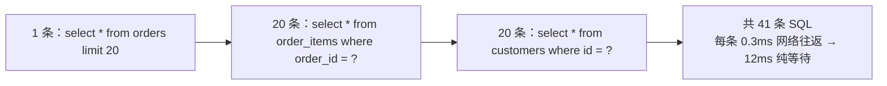

---
sources:
  - 05-第五阶段
---

# 06. JPA 实战：映射、脏检查、N+1 与批量

> [← 第五阶段导览](01-导览.md) · JPA 的全部性能问题都来自三个隐式行为：**它记得你改过什么（脏检查）、它决定什么时候发 SQL（flush）、它决定关联是现在查还是以后查（抓取策略）**。把这三件事变成显式的，JPA 就只剩好处。

## 1. 映射要点：五个决定后面全部行为的选择

实体映射不是「注解配对」，前五个决定会一路影响批处理、索引与迁移：

| 决策 | 推荐 | 为什么 | 代价 |
|---|---|---|---|
| 主键生成 | `SEQUENCE` + `allocationSize = 50` | 预分配 ID，Hibernate 才能攒批 INSERT | ID 有跳号（多实例各领一段） |
| 值对象 | `@Embeddable` + `@Embedded` | 避免裸类型，且列名可覆盖 | 多一层解包，JPQL 里要写 `o.money.amount` |
| 枚举 | `@Enumerated(EnumType.STRING)` | `ORDINAL` 在枚举重排后静默错位 | 占空间、改值要迁移数据 |
| 时间 | `Instant` | 映射到 `timestamptz`，带时区语义 | 展示层要显式转换 |
| 开关 | `spring.jpa.open-in-view=false` | 关掉「视图层懒加载」这扇后门 | 必须在事务内组装 DTO |

主键策略值得单独展开，因为它直接决定批量能力：

| 策略 | 生成的 DDL | 批量 INSERT | 适用 |
|---|---|---|---|
| `IDENTITY` | `bigint generated by default as identity` | **不可用**（必须逐条取回 ID） | 用别的框架写、只读为主 |
| `SEQUENCE` | `bigint` + 独立 sequence | 可用 | 默认选择 |
| `TABLE` | 一张模拟序列的表 | 可用但慢 | 不要用，行锁热点 |
| `UUID` | `uuid` | 可用 | 客户端生成、跨库合并；注意索引随机写 |

`IDENTITY` 禁用批量是硬约束：Hibernate 必须执行完 `INSERT` 才能拿到自增 ID，而 JDBC 批处理是把多条语句攒起来一次发。这两件事互斥。PG 上正确的写法是：

```kotlin
@Entity
@Table(name = "orders")
class Order(
    @Id
    @GeneratedValue(strategy = GenerationType.SEQUENCE, generator = "order_seq")
    @SequenceGenerator(name = "order_seq", sequenceName = "order_id_seq", allocationSize = 50)
    var id: Long? = null,

    @Embedded
    var money: Money = Money.ZERO,

    @Enumerated(EnumType.STRING)
    @Column(nullable = false, length = 16)
    var status: OrderStatus = OrderStatus.NEW,

    @Column(name = "created_at", nullable = false, updatable = false)
    var createdAt: Instant = Instant.now(),
) {
    // 实体不要用 data class：equals/hashCode 基于全部字段会让 Set 与缓存行为异常，
    // copy() 还会造出一个 id 相同但不受管理的游离对象
    override fun equals(other: Any?) = this === other || (other is Order && id != null && id == other.id)
    override fun hashCode() = javaClass.hashCode()
}

@Embeddable
data class Money(
    @Column(name = "amount", nullable = false, precision = 12, scale = 2)
    val amount: BigDecimal,
    @Column(name = "currency", nullable = false, length = 3)
    val currency: String,
) {
    companion object { val ZERO = Money(BigDecimal.ZERO, "CNY") }
}
```

`allocationSize = 50` 的含义：Hibernate 一次向 sequence 要 50 个 ID 缓存在内存里，用完再要。所以数据库 sequence 的 `increment by` 必须是 50，否则会撞主键——这是改 `allocationSize` 时最常见的翻车点（`ddl-auto` 会帮你建对，手工建表则不会）。

枚举用 `STRING` 不是洁癖：`ORDINAL` 存的是序号，产品在中间插入一个 `PARTIALLY_REFUNDED`，库里所有历史数据的语义就整体错位一格，而且不会报错。PG 原生的 `CREATE TYPE ... AS ENUM` 也不建议用——加值要 `ALTER TYPE`，删值删不掉，迁移成本远高于一张 `varchar + CHECK`。

关联还有一个只写一次却影响所有写路径的决定：**双向关联由谁维护**。`@OneToMany` 一侧必须标 `mappedBy`，否则 Hibernate 会以为这是两个独立关联，额外维护一张中间表；而「把明细加进订单」时，只改 `order.items` 不设 `item.order`，外键列不会被更新——因为关系的所有者是 `@ManyToOne` 那一侧。这类 bug 的表现是「事务提交成功、重启后关联丢了」，排查成本极高。稳妥的写法是在聚合根里提供 `addItem()`，由它同时设置两侧，禁止外部直接操作集合；配合 `orphanRemoval = true`，从集合里移除即删除子行。

## 2. 一级缓存与脏检查

`EntityManager` 是一个「工作单元」：它加载过的每个实体都放在一级缓存（persistence context）里，同时保存一份**加载时的字段快照**。`flush` 时逐字段比对快照与当前值，有差异就生成 `UPDATE`——这就是脏检查。

推论有三条，都很反直觉：

1. **不调 `save()` 也会更新**。托管态实体的任何 setter 都会被脏检查捕获，事务提交时自动 `UPDATE`。所以你「只是读出来改了个字段做判断」也会写库。
2. **调了 `save()` 也不一定立刻发 SQL**。`save` 对托管实体是空操作，对新实体只是 `persist`（放进缓存），真正 INSERT 发生在 flush。
3. **`@Transactional(readOnly = true)` 会跳过脏检查**，因为它把 flush 模式设成 `MANUAL`。这是最便宜的读优化，没有之一。

`flush` 的四个触发点，缺一个都会导致「SQL 什么时候发的」判断错误：

| # | 触发点 | 说明 |
|---|---|---|
| 1 | 事务提交前 | `TransactionCoordinator` 在 commit 前 flush，异常则回滚 |
| 2 | 执行 JPQL / Criteria 查询前 | `FlushModeType.AUTO` 下，若查询涉及的表与待刷新的实体重叠才 flush（Hibernate 会做 query space 检查） |
| 3 | 显式 `em.flush()` / `saveAndFlush()` | 想在事务中途拿到 ID 或让约束提前报错时用 |
| 4 | 原生 SQL 查询前 | 仅当 `FlushMode.ALWAYS`，或查询显式声明了同步实体（`addSynchronizedEntityClass` / `@Modifying` 的 `flushAutomatically`） |

第 2 条的「query space 检查」是很多人踩过的坑：先改了一个 `Order`，再查 `Customer`，不会 flush——因为两张表无关；但如果查的是 `Order`，就会先 flush。这让「同一段代码在不同查询顺序下发的 SQL 条数不同」，也是 `@Modifying` 原生更新必须先 flush 的原因（否则原生 SQL 与缓存里的脏数据打架）。

## 3. LAZY、代理与三种 `LazyInitializationException`

`@ManyToOne(fetch = LAZY)` 拿到的不是实体，是**代理**：一个只有 id 的子类实例。访问 id 不触发查询，访问其他字段才初始化。这套机制带来三个必须知道的边界：

- `toString()`、`equals()`、`hashCode()` 如果碰到非 id 字段，会触发初始化——在日志里打一个实体，可能悄悄发出十条 SQL；
- `getReference()` 返回的也是代理，`entityManager.getReference(Order::class.java, 1L)` 在事务外访问字段会直接抛异常；
- 代理的 `equals` 与真实实例不对称，所以实体的 `equals` 只能比 id（§1 的写法）。

`LazyInitializationException: could not initialize proxy - no Session` 的三种成因，对应三种修法：

| 成因 | 现场 | 修法 |
|---|---|---|
| **事务外访问** | Service 返回实体，Controller/序列化阶段访问关联 | 在事务内组装 DTO；或在 Repository 层用 `EntityGraph` 一次取全 |
| **跨线程** | `@Async` 方法里访问传进来的实体 | 传 id 不传实体，异步方法自己重查 |
| **已 detach** | 手动 `em.detach`/`clear`，或 `readOnly` 事务结束后继续用实体 | 同上；`clear()` 之后所有引用都失效 |

这里有一条纪律比任何修法都重要：**实体不出事务边界**。Controller 的返回值必须是 DTO，序列化器不允许见到实体。OSIV（`open-in-view=true`，Boot 默认开启）之所以危险，就是它让实体活到了序列化阶段，问题被推迟到「某天某个字段变懒了」才爆——而那时你已经在生产上。

## 4. N+1 与四种修法

N+1 的形状：1 条查询取回 N 个订单，然后每访问一次 `order.items` 发一条 SQL，总计 N+1 条。20 条订单就是 21 条，加上客户关联就是 41 条。



四种修法各有适用面，选错会把 N+1 换成更糟的问题：

| 修法 | 写法 | 适用 | 副作用 |
|---|---|---|---|
| `JOIN FETCH` | JPQL `left join fetch o.items` | 单个聚合、结果集不大 | 笛卡尔积膨胀；**不能与分页共存** |
| `@EntityGraph` | `@EntityGraph(attributePaths = ["items"])` | Repository 方法、声明式 | 同上；多个集合会相乘 |
| `@BatchSize` | `@BatchSize(size = 50)` 或全局 `default_batch_fetch_size` | 分页列表、懒加载不可控 | SQL 变成 N/50+1，仍是多条 |
| 投影 DTO | `select new ...` 或接口投影 | 只读展示 | 要手写构造，失去实体便利 |

### 分页 + fetch join 的冲突

这是 JPA 最著名的陷阱。`JOIN FETCH` 一个集合后，数据库返回的是「订单 × 明细」的笛卡尔积，SQL 层面一行订单变成多行。此时 `setMaxResults(20)` 限制的是**结果行数**，不是订单数——Hibernate 只能把全部结果读进内存再切分，日志里出现：

```text
HHH000104: firstResult/maxResults specified with collection fetch; applying in memory
```

数据量一大就是 OOM。正确做法是**两段查询**：先分页查 id，再用 id 批量取详情。

```kotlin
interface OrderRepository : JpaRepository<Order, Long> {

    // 第一段：只查 id，不 fetch 集合，分页下推到数据库
    @Query("select o.id from Order o where o.status = :status order by o.createdAt desc")
    fun pageIds(status: OrderStatus, pageable: Pageable): List<Long>

    // 第二段：按 id 批量取，一次查完
    @EntityGraph(attributePaths = ["items", "customer"])
    fun findByIdIn(ids: Collection<Long>): List<Order>
}
```

两段查询总共 2 条 SQL，且分页是数据库做的。代价是「第一页之后数据可能变化」——两段之间若有订单状态变更，第二段可能少返回几条。对列表页可以接受，对账类场景不行。

### `@BatchSize` 的定位

它不消除 N+1，只是把「每行一条」变成「每 50 行一条」。价值在于**不需要改查询**：分页逻辑、动态条件、`Page` 的 count 查询全都不动，只在实体或全局配置上加一行。

```yaml
spring:
  jpa:
    properties:
      hibernate:
        default_batch_fetch_size: 50   # 全局生效，比逐个 @BatchSize 更省心
```

41 条 SQL 变成 3 条（1 + 20/50 取整 + 20/50 取整），耗时从 12ms 降到 1ms 量级。**它的天花板是「仍然要走网络」**：N=1000 时是 21 条，不是 2 条。

## 5. 批量插入的三件套

`saveAll(list)` 默认**不是**批量插入。它只是循环 `persist`，flush 时逐条发 `INSERT`——一万行就是一万次往返。要真正批量，三件事缺一不可：

| # | 配置 | 作用 | 缺了会怎样 |
|---|---|---|---|
| 1 | `hibernate.jdbc.batch_size=50` | 攒够 50 条发一次 | 逐条发送，1 万次往返 |
| 2 | `hibernate.order_inserts=true`（配合 `order_updates`） | 按实体类型排序，避免批被不同类型打断 | 批次被拆碎，实际批大小远小于 50 |
| 3 | JDBC 层重写：PG `reWriteBatchedInserts=true`，MySQL `rewriteBatchedStatements=true` | 把多条 `INSERT` 合成多值 `INSERT` | 仍是 50 条独立语句（一次网络往返但服务端逐条执行） |

第 3 条最容易漏，因为它的名字在两个驱动里不一样：**PostgreSQL 是 `reWriteBatchedInserts`（大写 W），MySQL 是 `rewriteBatchedStatements`（全小写）**。抄错一个字母，配置静默失效。

一万行插入的实测对比（本地 PG 17，单表六列，事务一次提交）：

| 配置 | 耗时 | 服务端执行的 INSERT 语句数 |
|---|---|---|
| 默认 `saveAll`（`IDENTITY` 主键） | 8.5s | 10000 |
| `batch_size=50`（`SEQUENCE` 主键） | 1.3s | 10000（200 次往返） |
| 再加 `reWriteBatchedInserts=true` | 0.6s | 200（多值 INSERT） |
| `JdbcClient.batchUpdate` | 0.45s | 200 |
| `COPY`（`CopyManager`） | 0.12s | 1 |

两个必须注意的点：

**一级缓存会吃内存。** 批量插入一万个实体，persistence context 里就有一万个托管对象，脏检查的代价随数量线性上升，最后可能 OOM。标准写法是每批 `flush()` + `clear()`：

```kotlin
@Transactional
fun importAll(rows: List<OrderRow>) {
    rows.chunked(500).forEach { chunk ->
        chunk.forEach { em.persist(it.toEntity()) }
        em.flush()
        em.clear()   // 必须 clear，否则下一批的脏检查要遍历已处理过的全部实体
    }
}
```

**`clear()` 之后旧引用全部失效**，后续访问会抛 `LazyInitializationException` 或静默变成游离对象。这也是「实体不出事务边界」的又一条理由。

## 6. 只读查询优化

四个手段，按收益排序：

| 手段 | 收益 | 代价 |
|---|---|---|
| `@Transactional(readOnly = true)` | 跳过脏检查、连接设为只读（可路由到只读库） | 无 |
| 投影（接口 / 构造器 DTO） | 少读列、不进一级缓存 | 手写映射 |
| `Stream<T>` + `fetchSize` | 恒定内存处理大结果集 | 必须在事务内消费，游标要 `autocommit=false` |
| 查询提示 `readOnly` / `cacheable=false` | 避免无谓的实体化 | 仅特定场景有效 |

`Stream` 这条有个 PG 特有的坑：pgjdbc 默认会把**整个结果集**读进内存再返回，`fetchSize` 必须配合 `autocommit=false`（Spring 事务里天然满足）才生效为服务端游标。否则你以为在流式处理，实际内存里已经躺了一百万行。

```kotlin
// Repository 上声明：@QueryHints(QueryHint(name = "org.hibernate.fetchSize", value = "500"))
@Transactional(readOnly = true)
fun exportAll(status: OrderStatus, sink: (OrderBrief) -> Unit) {
    orderRepository.streamByStatus(status).use { stream ->
        stream.map { OrderBrief(it.createdAt, it.money.amount) }.forEach(sink)
    }
}
```

## 7. 用 SQL 计数证明 N+1

优化之前先拿到数字，否则你无法证明改完有效。Hibernate 的 `Statistics` 是最轻的手段：

```kotlin
@DataJpaTest
class NPlusOneProofTest(
    private val em: EntityManager,
    private val sessionFactory: SessionFactory,
) {
    @Test
    fun `列表页 20 条订单应只发 2 条 SQL`() {
        val stats = sessionFactory.statistics
        stats.isStatisticsEnabled = true

        // 第一段：故意用会触发 N+1 的写法
        stats.clear()
        val orders = em.createQuery("select o from Order o order by o.id", Order::class.java)
            .setMaxResults(20)
            .resultList
        orders.forEach { it.items.size }          // 触发懒加载
        val naive = stats.prepareStatementCount
        println("naive = $naive")                  // 期望 41

        em.clear()
        stats.clear()

        // 第二段：EntityGraph 一次取全
        val fetched = em.createEntityGraph(Order::class.java).apply { addAttributeNodes("items") }
        val optimized = em.createQuery("select o from Order o order by o.id", Order::class.java)
            .setHint("jakarta.persistence.fetchgraph", fetched)
            .setMaxResults(20)
            .resultList
        optimized.forEach { it.items.size }        // 已在图里，不再发 SQL
        val fast = stats.prepareStatementCount
        println("graph = $fast")                   // 期望 1（分页场景见 §4 的两段查询）
    }
}
```

三条使用纪律：

- **`stats.clear()` 必须在每次测量前调**，否则计数会累积到整个测试类；
- **`prepareStatementCount` 数的是 JDBC 语句数**，不区分查询与更新，也不含 `count(*)` 之外的开销；要看更细的用 `datasource-proxy` 或 p6spy；
- **断言具体数字而不是「小于某个值」**。数字写死，任何一次映射改动导致多一条 SQL，测试立刻红——这是唯一能防止 N+1 回归的手段。

生产上不要开 `hibernate.generate_statistics`（有性能开销，且统计对象本身吃内存）。用 Micrometer 的 `hibernate.statements` 指标，或直接在 `DataSource` 层用 `datasource-proxy` 记录每请求 SQL 条数。

## 8. 自测

1. `@GeneratedValue(strategy = IDENTITY)` 为什么会让 `hibernate.jdbc.batch_size` 完全失效？换成 `SEQUENCE` 后还要改数据库里的什么？
2. 一个方法只做了「读出实体、改一个字段做判断、不保存」，为什么库里的数据还是变了？怎么让它不变？
3. `flush` 的四个触发点里，哪一个最容易让人误判「SQL 什么时候发的」？举一个具体例子。
4. `LEFT JOIN FETCH` 加 `Pageable` 为什么会在内存里分页？写出两段查询的替代方案，并说明它的正确性边界。
5. `@BatchSize(50)` 与 `JOIN FETCH` 在「41 条 SQL」这个场景下分别变成几条？各自在什么数据量下会失效？
6. 一万行导入从 8.5s 优化到 0.6s，三件套里哪一件贡献最大？为什么 `reWriteBatchedInserts` 少写一个大写字母就完全没用？

## 9. 延伸

- 上一册：[05-持久化选型-JPA-MyBatis-JdbcClient](05-持久化选型-JPA-MyBatis-JdbcClient.md)——先决定要不要用 JPA，再谈怎么用好。
- 下一册：[07-Schema演进与零停机迁移](07-Schema演进与零停机迁移.md)——实体改了，表怎么跟着改而不停服。
- 事务边界与 `@Transactional` 的失效现场在[第六阶段 02 册](../06-第六阶段/02-Transactional全解与六种失效现场.md)。
- 乐观锁与 `version` 字段在[第六阶段 04 册](../06-第六阶段/04-并发控制-乐观锁-悲观锁与唯一约束.md)。
- 用切片测试与 Testcontainers 固化这些断言，见[第十阶段导览](../10-第十阶段/01-导览.md)。
