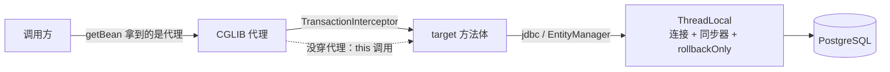

---
sources:
  - 06-第六阶段
---

# 02. @Transactional 全解与六种失效现场
> [← 第六阶段导览](01-导览.md) · 加上注解不等于有事务：它只在一个条件成立时才有事务——**这次方法调用穿过了代理，且异常从代理出口冒了出去**。

## 1. 它到底做了什么：三层事实

把 `@Transactional` 拆成三层，后面所有失效现场都能从这三层里推导出来，不需要背：

1. **代理层**：`@EnableTransactionManagement`（Boot 自动配置已开）注册一个 `BeanFactoryTransactionAttributeSourceAdvisor`，它给带注解的 Bean 生成代理。Boot 2.0 起 `proxyTargetClass=true`，所以默认是 CGLIB 子类代理。
2. **拦截器层**：`TransactionInterceptor` 包在方法调用外面，进方法前 `getTransaction()`，正常返回 `commit()`，抛异常按回滚规则 `rollback()`。
3. **资源绑定层**：`AbstractPlatformTransactionManager` 从 `DataSource` 取一条连接，绑到 `TransactionSynchronizationManager` 的 ThreadLocal 上。同一线程里此后所有 `JdbcClient`、`JdbcTemplate`、`EntityManager` 都复用这一条连接。



三句话就能推出全部失效场景：

- **没穿代理** → 没有拦截器 → 根本没有事务（自调用、非 `public`、`new` 出来的对象）。
- **穿了代理但异常没出去** → 拦截器看到「正常返回」→ 提交（异常被 `catch` 吞掉）。
- **异常出去了但不在回滚规则里** → 提交（受检异常）。
- **换了线程** → ThreadLocal 里什么都没有 → 要么新开一个事务，要么自动提交。

还有一个「第零层」前提：数据库得支持事务。PostgreSQL 全支持，但如果哪天连了 MySQL 的 MyISAM 表，`@Transactional` 的提交回滚全是空转——这类事故在跨库迁移时真的会发生。

## 2. 七种传播行为

传播行为回答的是同一个问题：**进入这个方法时，已经有一个事务了，怎么办？**

| 传播行为 | 有外层事务时 | 无外层事务时 | 真实使用场景 | 主要陷阱 |
|---|---|---|---|---|
| `REQUIRED`（默认） | 加入 | 新建 | 99% 的写操作 | 内层失败会污染外层，迟到抛 `UnexpectedRollbackException` |
| `REQUIRES_NEW` | 挂起外层，新建独立事务 | 新建 | 审计日志、失败记录、发号器——「无论如何要落库」 | 占两条连接；看不到外层未提交数据；可能自己锁死自己 |
| `NESTED` | 建保存点，回滚到保存点 | 新建 | 批量导入里「单条失败不拖垮整批」 | 只有 JDBC 系事务管理器支持；异常必须冒泡出内层方法 |
| `SUPPORTS` | 加入 | 无事务执行 | 查询方法，调用方给不给事务都行 | 无事务时 JPA 行为变了（无 flush 边界、延迟加载易炸） |
| `NOT_SUPPORTED` | 挂起外层，无事务执行 | 无事务执行 | 报表大查询、批量导出，不想占着事务和锁 | 挂起期间看不见外层的未提交写；代码里以为在事务内 |
| `MANDATORY` | 加入 | 抛 `IllegalTransactionStateException` | 强制「只能被事务调用」的内部方法 | 单独调用或测试里直接调，启动正常、运行报错 |
| `NEVER` | 抛异常 | 无事务执行 | 声明「这段绝不能进事务」 | 几乎没人用，价值在于把约束写进代码 |

`SUPPORTS`/`NOT_SUPPORTED`/`MANDATORY`/`NEVER` 这四个的实际价值不是「功能」，而是**显式表达意图**：看代码的人不必去追调用链就能知道这里期不期待事务。真正需要理解透的是前三个。

### 2.1 `REQUIRED`：默认值，也是最容易「全回滚」的那个

```kotlin
@Service
class OrderService(
    private val jdbc: JdbcClient,
    private val stockService: StockService,
) {
    @Transactional
    fun place(cmd: PlaceOrder) {
        jdbc.sql("insert into orders(id, status) values (:id, 'CREATED')")
            .param("id", cmd.id).update()
        try {
            stockService.deduct(cmd.sku, cmd.qty)   // REQUIRED，加入当前事务
        } catch (e: StockShortageException) {
            // 想「库存不足也把订单留下，标记待补货」
            jdbc.sql("update orders set status = 'WAIT_STOCK' where id = :id")
                .param("id", cmd.id).update()
        }
    }
}

@Service
class StockService(private val jdbc: JdbcClient) {
    @Transactional   // REQUIRED
    fun deduct(sku: String, qty: Int) {
        val n = jdbc.sql("update stock set qty = qty - :q where sku = :sku and qty >= :q")
            .param("q", qty).param("sku", sku).update()
        if (n == 0) throw StockShortageException(sku)
    }
}
```

这段代码看起来天衣无缝，实际结果是：**整个下单回滚，而且抛给你的是 `UnexpectedRollbackException`，不是你 `catch` 的那个异常**。

原因：`StockShortageException` 从 `deduct` 冒到 `TransactionInterceptor` 时，内层事务（参与外层，没有独立提交权）只能做一件事——把共享事务标记为 `rollbackOnly`。外层 `catch` 住了异常、继续执行、正常返回，提交时发现 `rollbackOnly=true`，只能回滚，然后抛 `UnexpectedRollbackException` 告诉你「你让我提交，但这个事务已经被判死刑了」。

修法三选一：把「库存不足」做成返回值而不是异常（业务分支不该用异常表达）；或者让 `deduct` 用 `REQUIRES_NEW`（意味着库存扣减要独立成功，语义往往不对）；或者把订单落库拆到外层事务之外。**注意 `noRollbackFor` 在这里救不了你**——它管的是「异常不触发本层回滚」，管不了「参与的事务已被别人标记 rollback-only」。

### 2.2 `REQUIRES_NEW`：独立提交，也独立占一条连接

```kotlin
@Service
class AuditService(private val jdbc: JdbcClient) {
    @Transactional(propagation = Propagation.REQUIRES_NEW)
    fun record(action: String, payload: String) {
        jdbc.sql("insert into audit_log(action, payload) values (:a, :p)")
            .param("a", action).param("p", payload).update()
    }
}
```

典型场景是「主业务失败也必须留下痕迹」：支付失败要留失败流水，否则对账时无从查起。

它的实现方式是**挂起**：外层事务的连接、同步器、`rollbackOnly` 标记全部从 ThreadLocal 摘下，放进一个 `SuspendedResourcesHolder`，内层跑完再挂回去。由此产生三个陷阱：

1. **连接占用翻倍**。外层连接一直被 `SuspendedResourcesHolder` 攥着不归还，内层再要一条。一个 10 条连接的池子，在有嵌套 `REQUIRES_NEW` 的接口上实际并发容量会掉一半，高峰期表现是「池等待超时」而不是「慢」。
2. **看不见外层的未提交数据**。内层那条连接是另一个事务、另一个快照，读不到外层刚写的订单。如果审计日志要引用订单号，只能靠参数传，不能去查库。
3. **可能自己把自己锁死**。同一线程、两条连接，外层已持有某行的写锁，内层去更新同一行——内层等外层释放，外层等内层返回。PostgreSQL 的死锁检测会在一秒左右打断它，日志里是一条 `deadlock detected`。这类死锁的特点是「同一个线程」参与的，看 `pg_stat_activity` 时两条连接 `application_name` 一样、都指向同一段代码。

### 2.3 `NESTED`：保存点，只对外层已存在的事务有意义

`NESTED` 在有外层事务时不做新事务，而是在当前连接上 `SAVEPOINT`，内层失败时 `ROLLBACK TO SAVEPOINT`，外层可以继续；外层回滚时，所有保存点连同内层一起消失。

```kotlin
@Service
class ImportService(private val jdbc: JdbcClient, private val rowWriter: RowWriter) {
    @Transactional
    fun importAll(rows: List<Row>) {
        val failed = mutableListOf<Row>()
        for (row in rows) {
            try {
                rowWriter.writeOne(row)       // NESTED：失败只回滚这一行
            } catch (e: DataIntegrityViolationException) {
                failed += row
            }
        }
        jdbc.sql("insert into import_result(failed_count) values (:n)")
            .param("n", failed.size).update()
    }
}
```

四个必须知道的限制：

- **只有 JDBC 系事务管理器支持**。`DataSourceTransactionManager`、`JpaTransactionManager`（Hibernate 会 `setSavepoint`）可以；JTA 不支持，配了 JTA 就退化成 `REQUIRES_NEW` 或直接报错。
- **异常必须冒泡出内层方法**。上面的写法能成立，是因为异常从 `writeOne` 的代理出口出去了；如果在 `writeOne` 内部 `try/catch` 掉，保存点根本不会被回滚。
- **没有外层事务时，`NESTED` 等价于 `REQUIRED`**（新建事务），行为悄悄变了。这是最阴的一点：单元测试里直接调 `writeOne` 通过，生产上在批量里调却是另一种语义。
- **保存点不减少锁**。回滚到保存点释放的是内层之后的锁，外层之前拿的锁还在；大批量导入照样是长事务。

## 3. `readOnly`、`timeout`、`rollbackFor`、`noRollbackFor`

| 属性 | 你以为它做的 | 它实际做的 |
|---|---|---|
| `readOnly = true` | 「禁止写」的安全阀 | Hibernate 把 FlushMode 设为 `MANUAL`（跳过脏检查自动 flush），连接标为 read-only。**写入会静默丢失**，因为它根本不 flush |
| `timeout = 5` | 5 秒后中断执行 | 把超时交给事务管理器；本地 JDBC + PostgreSQL 下通常**不会真的中断**已在跑的语句，只影响获取连接/开始事务的等待 |
| `rollbackFor = [Exception::class]` | 所有异常都回滚 | 确实如此，这是最该无脑配的一项 |
| `noRollbackFor = [BizException::class]` | 这个异常不回滚 | 只有「本层是事务发起方」时有效；参与别人事务时，`rollbackOnly` 已被置位就无效 |

`readOnly` 的真实收益是性能而不是安全：省掉每次查询前的脏检查遍历，也让「读写分离路由」有据可依（按 `TransactionSynchronizationManager.isCurrentTransactionReadOnly()` 选数据源）。它最常见的误用是在只读事务里写审计日志——日志没落库，代码也不报错，直到某天排查问题发现「操作记录全丢了」。

`timeout` 的可靠性取决于事务管理器。要真正限制一条 SQL 跑多久，PostgreSQL 侧的手段更靠谱：

```sql
-- 会话级：任何语句超过 3 秒被取消
SET statement_timeout = '3s';
-- 等锁超过 2 秒直接失败，而不是挂住连接
SET lock_timeout = '2s';
```

`rollbackFor` 在 Kotlin 里有一个特有陷阱：Kotlin 没有受检异常的语法，`throw IOException()` 不需要 `throws` 声明——但**异常的类型没变**。Spring 判断的是「是否 `RuntimeException` 或 `Error`」，与语言无关，所以 Kotlin 里抛 `IOException` 同样不回滚。团队规约建议统一写 `@Transactional(rollbackFor = [Exception::class])`，别在这上面靠记性。

## 4. 六种失效现场

以下每一段都是最小可复现的：跑一次，看数据库里留下了什么。

### 4.1 同类自调用

```kotlin
@Service
class OrderService(private val jdbc: JdbcClient) {

    fun create(id: Long) {
        jdbc.sql("insert into orders(id, status) values (:id, 'NEW')").param("id", id).update()
        markFailed(id)      // 等价于 this.markFailed(id)：this 是 target，不是代理
    }

    @Transactional
    fun markFailed(id: Long) {
        jdbc.sql("update orders set status = 'FAILED' where id = :id").param("id", id).update()
        error("boom")       // 期望回滚，实际已提交
    }
}
```

**为什么失效**：`create` 里的 `this` 指向目标对象本身，代理只在「从容器里取出来的引用」上。方法体内部的调用是普通 Java 调用，`TransactionInterceptor` 完全不在链路上。

**修法**：把 `markFailed` 拆到另一个 Bean；或者改用 `TransactionTemplate`（编程式事务不依赖代理，见下一册）。`AopContext.currentProxy()` 也能用，但要开 `exposeProxy=true`，等于把 AOP 的实现细节泄漏到业务代码里，不推荐。

### 4.2 方法非 `public`

```kotlin
@Service
class ReportService(private val jdbc: JdbcClient) {

    @Transactional
    protected fun rebuild() {
        jdbc.sql("delete from report_daily").update()
        error("half done")
    }
}
```

**为什么失效**：代理模式下事务属性解析默认只认 `public` 方法（`allowPublicMethodsOnly`），非 `public` 上的注解被**静默忽略**——不警告、不报错、不生效。CGLIB 能生成 `protected` 的重写方法，但属性解析阶段就返回了 `null`，切面不会应用。

**修法**：改 `public`。顺带一句 Kotlin 侧的话：`internal` 编译后是 public 但方法名被改写，同样不可依赖，别拿它当「模块内可见的事务方法」。

### 4.3 异常被 `catch` 未重抛

```kotlin
@Transactional
fun pay(orderId: Long) {
    jdbc.sql("update account set balance = balance - 100 where id = 1").update()
    try {
        downstream.charge(orderId)          // 抛异常
    } catch (e: Exception) {
        log.warn("扣款失败", e)              // 吞掉，方法正常返回
    }
}
```

**为什么失效**：回滚信号只有两条路——异常冒泡到拦截器，或显式调用 `TransactionAspectSupport.currentTransactionStatus().setRollbackOnly()`。`catch` 之后正常返回，拦截器认为「业务成功」，提交。

**修法**：重抛（哪怕包一层自定义异常）；或者捕获后显式 `setRollbackOnly()`。注意后者要求当前确实在事务里，用之前判一下 `TransactionSynchronizationManager.isActualTransactionActive()`。

### 4.4 抛受检异常未配 `rollbackFor`

```kotlin
@Transactional      // 少 rollbackFor
fun export(id: Long) {
    jdbc.sql("update export_task set status = 'RUNNING' where id = :id").param("id", id).update()
    throw IOException("磁盘已满")
}
```

**为什么失效**：默认规则只对 `RuntimeException` 和 `Error` 回滚。`IOException` 是受检异常，拦截器走 `commit`。Kotlin 不会因为你没写 `throws` 就把它变成运行时异常。

**修法**：`@Transactional(rollbackFor = [Exception::class])`。

### 4.5 对象非 Spring 管理

```kotlin
class CouponService(private val jdbc: JdbcClient) {
    @Transactional
    fun grant(userId: Long) {
        jdbc.sql("insert into coupon(user_id) values (:u)").param("u", userId).update()
        error("boom")
    }
}

@Configuration
class JobConfig {
    @Bean
    fun couponJob(jdbc: JdbcClient) = CouponJob(CouponService(jdbc))   // 手工 new
}
```

**为什么失效**：注解靠代理实现，`new` 出来的对象没有代理，就是一个普通对象。

这里有个容易搞混的细节：**`@Bean` 方法 `new` 出来的对象是有代理的**——它要经过 `BeanPostProcessor` 链，`AnnotationAwareAspectJAutoProxyCreator` 会为它生成代理；而上面这段里 `new CouponService(jdbc)` 是作为构造参数直接塞进 `CouponJob` 的，那个引用是裸对象。区别不在 `new`，在「有没有作为 Bean 返回给容器」。

**修法**：把 `CouponService` 声明成 `@Service` 并注入。

### 4.6 跨线程 / 异步调用

```kotlin
@Transactional
fun handle(cmd: Cmd) {
    jdbc.sql("insert into jobs(id, status) values (:id, 'NEW')").param("id", cmd.id).update()
    thread { auditService.record(cmd) }            // 新线程：ThreadLocal 里没有事务
    executor.submit { notifyService.push(cmd) }    // 同上
}
```

**为什么失效**：事务的上下文（连接、同步器、`rollbackOnly`）全在 `TransactionSynchronizationManager` 的 ThreadLocal 里。新线程读到的是空，`REQUIRED` 会新建一个事务，`@Async` 方法同理。

后果有两个方向，都很难查：

- **主线程回滚，异步任务照常提交**：留下一条指向不存在订单的审计记录。
- **异步任务读不到主线程未提交的数据**：查出来的订单是 `null`，触发空指针或「订单不存在」的业务异常。

更隐蔽的是手动起线程那种：任务可能在主事务提交**之前**就开始跑，此时主事务的写对它是不可见的（不同快照），表现为随机失败、压测时复现率更高。

**修法**：事务内只改库；需要通知外部，放到提交之后（`TransactionSynchronization#afterCommit` 或 `@TransactionalEventListener(phase = AFTER_COMMIT)`，下一册展开）。如果异步任务本身要写库，让它自己带 `@Transactional` 并接受「两个事务之间有一致性窗口」。

## 5. 症状 → 根因 → 修法

| 症状 | 根因 | 修法 |
|---|---|---|
| 部分数据回滚了、部分没有，日志里没有异常 | 自调用绕过代理，被调方法根本没事务 | 拆 Bean，或改 `TransactionTemplate` |
| 注解写了但从没生效，方法抛异常数据照样留下 | 方法非 `public` | 改 `public` |
| 捕获了异常、也想继续，结果整个事务回滚并抛 `UnexpectedRollbackException` | 内层 `REQUIRED` 已标记 `rollbackOnly` | 业务分支用返回值；或把内层拆成独立事务 |
| 异常被记录在日志里，数据却在库里 | `catch` 吞异常 | 重抛或 `setRollbackOnly()` |
| 只有受检异常的场景不回滚 | 缺 `rollbackFor` | `rollbackFor = [Exception::class]` |
| 单测通过，生产不生效 | 测试里直接 `new` 了 Service | 用 `@SpringBootTest` 注入 Bean |
| 主事务回滚，异步写的数据还在 | 事务上下文不跨线程 | 提交后再投递；异步方法自管事务 |
| 启动直接报 `Cannot subclass final class` | Kotlin 类默认 `final`，CGLIB 无法继承 | 加 `kotlin-spring`（`allopen`）插件，见[第二阶段 06 册](../02-第二阶段/06-Kotlin与Spring的接缝-allopen-noarg与DSL配置.md) |
| 内层方法读不到外层刚写的数据 | `REQUIRES_NEW` 是另一个事务 | 数据靠参数传，别回查 |
| 高峰期连接池耗尽，池里全是同一段代码 | `REQUIRES_NEW` 嵌套占用两条连接 | 缩短内层事务，或改用 `NESTED` |

## 6. 用测试证明它确实没回滚

「我觉得它没回滚」不算证据。要证明，得在事务之外观察数据库的最终状态：

```kotlin
@SpringBootTest
class TransactionalFailureTest @Autowired constructor(
    private val orderService: OrderService,
    private val jdbc: JdbcClient,
) {
    // 关键：测试方法上不要加 @Transactional。
    // 加了的话，回滚的是测试框架，业务代码提交的脏数据也跟着没了，
    // 你会得到一个「假绿」。
    @Test
    fun `自调用时 markFailed 抛异常但不会回滚`() {
        jdbc.sql("insert into orders(id, status) values (1, 'NEW')").update()

        assertThrows<IllegalStateException> { orderService.create(1L) }

        val status = jdbc.sql("select status from orders where id = 1")
            .query(String::class.java).single()
        assertThat(status).isEqualTo("FAILED")   // 脏数据还在 = 证明没回滚
    }

    @Test
    fun `修正后同样的调用会回滚`() {
        jdbc.sql("insert into orders(id, status) values (2, 'NEW')").update()

        assertThrows<IllegalStateException> { orderServiceFixed.create(2L) }

        val status = jdbc.sql("select status from orders where id = 2")
            .query(String::class.java).single()
        assertThat(status).isEqualTo("NEW")      // 回到初始值 = 证明回滚了
    }
}
```

三个写这类测试的纪律：

1. **测试不要带 `@Transactional`**。Spring 测试的事务回滚会掩盖一切，这是「事务测试永远绿」的头号原因。
2. **断言最终状态，而不是断言异常**。异常类型对不上只是表象，数据留下才是事实。
3. **每个用例自己造数据、自己清理**，别依赖上一个用例的残留——这类测试最容易变成「单跑绿、全跑红」。

## 7. 自测

1. 一个 `REQUIRED` 的内层方法抛异常、外层 `catch` 住并继续执行，最终提交时会发生什么？抛出的异常是谁的？
2. `REQUIRES_NEW` 挂起的到底是什么？为什么它会让连接池的有效容量下降？
3. `NESTED` 在没有外层事务时会退化成什么？这个退化为什么在单元测试里最容易骗人？
4. `readOnly = true` 的事务里执行 `insert`，数据库里会多一行吗？为什么？
5. 一段 Kotlin 代码里 `throw IOException("x")`，`@Transactional` 没配 `rollbackFor`，会回滚吗？Kotlin 没有受检异常这件事影响结论吗？
6. 你怎么用一条 `SELECT` 证明「这个方法的 `@Transactional` 是假的」？

## 8. 延伸

- 下一册：[03-编程式事务与事务边界设计](03-编程式事务与事务边界设计.md)——代理靠不住的时候，用 `TransactionTemplate` 把边界画在代码里。
- 自调用的代理原理在[第三阶段 04 册](../03-第三阶段/04-AOP与代理-自调用的真相.md)；`@Transactional` 在请求链路里的位置见[第四阶段 03 册](../04-第四阶段/03-Filter-Interceptor-AOP的执行顺序.md)。
- 隔离级别、MVCC 快照、死锁日志怎么读，属于数据库层，见[第五阶段 05 册](../05-第五阶段/05-事务与隔离级别的实证.md)。
- Kotlin 的 `final` 与 CGLIB 的冲突，见[第二阶段 06 册](../02-第二阶段/06-Kotlin与Spring的接缝-allopen-noarg与DSL配置.md)。
