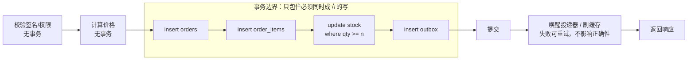
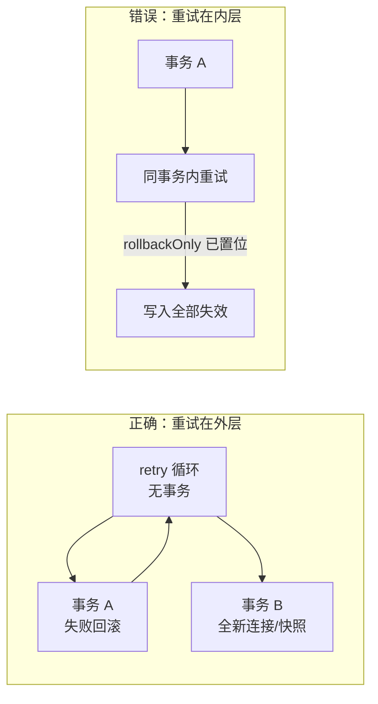

---
sources:
  - 06-第六阶段
---

# 03. 编程式事务与事务边界设计
> [← 第六阶段导览](01-导览.md) · 事务边界不该由「一个 Service 方法」决定，而应由「一组必须同时成立的数据变更」决定；边界之内只准改库，其他一切动作都得挪到提交之后。

## 1. 声明式到不了的三个地方

`@Transactional` 的边界是「方法」。这个粒度在大多数 CRUD 上够用，但有三类需求它天然表达不了：

| 需求 | 为什么方法粒度不够 | 编程式怎么解 |
|---|---|---|
| 一段循环要分批提交 | 一个方法只能一个事务，100 万行会变成一次长事务 | 循环里每批开一个 `TransactionTemplate` |
| 按结果决定回滚 | 返回值表示「业务失败」时没有异常可抛 | `status.setRollbackOnly()` |
| 事务只覆盖方法的前半段 | 方法里还有远程调用、文件写入不该进事务 | 事务只包住写库那几行 |

还有一类是「代理靠不住」：自调用、非 `public`、`@Async`（见上一册）。`TransactionTemplate` 是普通对象调用，完全绕开代理，这类场景下它是最省事的解法。

## 2. `TransactionTemplate` 与 `PlatformTransactionManager`

两者是封装关系：`PlatformTransactionManager` 是 SPI（`getTransaction` / `commit` / `rollback`），`TransactionTemplate` 是它的模板方法封装，负责「开事务 → 执行回调 → 按结果提交或回滚 → 清理 ThreadLocal」。Boot 在只有一个事务管理器时会自动配一个 `TransactionTemplate` Bean，直接注入即可；需要非默认语义（传播行为、超时、只读）时自己 `new` 一个，它是线程安全的，可以做成单例复用。

```kotlin
@Service
class SettlementService(
    private val jdbc: JdbcClient,
    private val tx: TransactionTemplate,
) {
    /** 按天结算：读在事务外，每 500 行一个短事务 */
    fun settle(day: LocalDate): SettleResult {
        var cursor = 0L
        var ok = 0
        var skipped = 0
        while (true) {
            // 读不放进事务：避免为了「一致读」把连接占满整个批次
            val rows = jdbc.sql(
                "select id, amount from settlement where biz_date = :d and id > :c order by id limit 500"
            ).param("d", day).param("c", cursor).query { rs, _ ->
                Row(rs.getLong("id"), rs.getBigDecimal("amount"))
            }.list()
            if (rows.isEmpty()) break
            cursor = rows.last().id

            val r = tx.execute { status ->
                try {
                    rows.forEach { row ->
                        val n = jdbc.sql(
                            "update account set balance = balance + :a where id = (select account_id from settlement where id = :id) and status = 'ACTIVE'"
                        ).param("a", row.amount).param("id", row.id).update()
                        if (n == 0) throw IllegalStateException("account inactive: ${row.id}")
                    }
                    BatchResult(rows.size, 0)
                } catch (e: IllegalStateException) {
                    // 返回值为「失败」而不是抛异常：必须自己判死刑
                    status.setRollbackOnly()
                    BatchResult(0, rows.size)
                }
            } ?: BatchResult(0, rows.size)
            ok += r.ok
            skipped += r.skipped
        }
        return SettleResult(ok, skipped)
    }
}

data class Row(val id: Long, val amount: java.math.BigDecimal)
data class BatchResult(val ok: Int, val skipped: Int)
data class SettleResult(val ok: Int, val skipped: Int)
```

这段代码里有四个必须记住的语义：

1. **回调抛 `RuntimeException` 自动回滚**，抛受检异常**不回滚**（和注解版一致的默认规则）。
2. **`setRollbackOnly()` 之后 `execute` 仍会正常返回**，不抛异常——因为这是它自己发起的新事务，`processCommit` 看到 `rollbackOnly` 就静默回滚。注意这跟「参与外层事务」时的行为不同：那种情况会抛 `UnexpectedRollbackException`。
3. **返回值出事务后是游离的**。如果回调返回的是 JPA 实体，出 `execute` 时事务已提交，实体是 detached 状态，访问未加载的关联会抛 `LazyInitializationException`。要么在事务内转成 DTO，要么只返回 ID。
4. **`execute` 可重入**。外层已有事务时直接加入（默认 `REQUIRED`），所以「Service 里注入 `TransactionTemplate`，被另一个 `@Transactional` 方法调用」不会多开事务。

什么时候直接摸 `PlatformTransactionManager`？基本只有写基础设施代码时：自定义注解的事务切面、批处理框架的 `ChunkListener`、需要把 `TransactionStatus` 跨方法传递的场景。业务代码里直接用它，就意味着你要自己写 `try/finally` 和 `rollback`，那正是 `TransactionTemplate` 已经替你做完的事。

## 3. 提交之后的动作：两种回调的差别与选型

事务提交后要发消息、刷新缓存、调下游，Spring 给了两条路：

```kotlin
// 路 1：注册事务同步器
private fun afterCommit(action: () -> Unit) {
    if (!TransactionSynchronizationManager.isSynchronizationActive()) {
        action()                       // 没有事务时直接执行，别静默丢掉
        return
    }
    TransactionSynchronizationManager.registerSynchronization(
        object : TransactionSynchronization {
            override fun afterCommit() = action()
        }
    )
}

// 路 2：发布事件，监听器挂在 AFTER_COMMIT 阶段
publisher.publishEvent(OrderCreatedEvent(orderId))

@Component
class OrderCreatedListener {
    @TransactionalEventListener(phase = TransactionPhase.AFTER_COMMIT)
    fun on(event: OrderCreatedEvent) { cache.evict(event.orderId) }
}
```

| 维度 | `afterCommit` | `@TransactionalEventListener(AFTER_COMMIT)` |
|---|---|---|
| 代码形态 | 在业务方法里塞一段注册代码，侵入 | 发布事件 + 独立监听器，解耦 |
| 无事务时的行为 | 需要自己判断 `isSynchronizationActive()` | 默认**不执行**（`fallbackExecution = false`），显式开 `true` 才执行 |
| 多消费者 | 一个方法里注册多段，顺序靠注册次序 | 多个监听器 + `@Order`，可独立增删 |
| 异常处理 | 冒到提交调用方；此时事务已提交，回滚不了 | 同样冒泡；一旦配 `@Async` 就变成另一个线程里静默失败 |
| 能否跨进程 | 不能，都是进程内 | 不能，Spring 事件不是消息队列 |
| 适用 | 框架/基础设施的一处收尾 | 业务代码，尤其是「一件事有多个后续动作」 |

两个共同的坑，比选型更重要：

- **`afterCommit` 阶段连接还没归还**。Spring 在 `afterCompletion` 才把连接还给池；在 `afterCommit` 里开新事务，会同时占两条连接。这是「用了 `REQUIRES_NEW` 之后池不够用」的常见来源。
- **提交后回调失败，数据已经提交了**。回调里抛异常不会撤销任何东西，只会在调用方看到一个「明明成功却报错」的响应。所以回调里的动作要么可重试、要么有落库兜底（Outbox，见 [06 册](06-跨服务一致性-Outbox-Saga-TCC与分布式锁.md)）。

选型一句话：**业务里要通知多个下游，用事件；只有一处收尾且不想引入事件机制，用 `afterCommit`。两者都不解决「投递可靠性」。**

还有一个隐性差别：`@TransactionalEventListener` 的监听器默认**同步**执行，一旦加上 `@Async` 就彻底脱钩——事务回滚不影响它（它本来只在提交后触发），但反过来它失败也没人知道，异常消失在另一个线程里。异步监听器必须自带重试与落库，否则它比同步版本更危险：同步至少会报错给你看。

## 4. 边界画在哪，以及三种画错的后果

判断标准只有一条：**在这个边界内，任何时刻被外部看到的状态都必须满足业务不变量。**



### 4.1 三种画错的后果

| 画错方式 | 典型样子 | 后果 |
|---|---|---|
| 边界过大 | 在事务里调支付网关、发短信、跑报表 | 长事务：连接被占、锁持有到远程返回、回滚代价大、复制延迟 |
| 边界过小 | 「先提交订单，再扣库存」两个独立事务 | 半成品状态：中间崩溃后订单存在但库存没扣，或者超卖 |
| 边界跨远程 | 事务里调下游扣款接口（HTTP） | 白回滚：本地回滚了，远程已经扣了；或本地提交了，远程超时其实没扣 |

「边界过大」和「边界过小」是一对反方向的错，判断依据不是代码长短，而是**不变量**。「订单总额必须等于明细之和」要求订单和明细同事务；「订单创建后必须发通知」不要求同事务，因为通知丢失不会破坏数据正确性。

### 4.2 一个常见的正确切法

```text
[无事务]  鉴权、参数校验、幂等键占位
[事务]    写订单 + 写明细 + 条件扣库存 + 写 outbox        ← 短，只碰本地库
[无事务]  唤醒投递器、清缓存、返回 201
```

这里的 outbox 是关键：它把「必须发消息」降级成「必须记下要发消息」，于是消息发送失败可以用重试解决，不必占用事务。

### 4.3 三个提问快速定位边界

拿不准某段代码该不该进事务时，按顺序问三句：

1. **「它失败了，必须让另一件事也不发生吗？」** 是 → 同事务。否 → 移到事务外，用重试或补偿。
2. **「它慢吗？它会超时吗？」** 会 → 移到事务外。事务内的耗时必须是你完全控制的本地操作。
3. **「它改的是同一个数据库吗？」** 不是 → 事务管不了，只能靠 Outbox / Saga（[06 册](06-跨服务一致性-Outbox-Saga-TCC与分布式锁.md)）。

三问全过才配进事务。多数「事务太大」的代码，第一问就过不了——发短信失败并不需要撤销订单。

## 5. 事务内做 IO 的四类灾难

### 5.1 远程慢：连接与锁的持有时间被远程 P99 决定

本地写 5 ms，远程 P99 800 ms。你按「5 ms 一个事务」算出的连接池容量，实际需要 160 倍。表现是高峰期 `HikariPool ... Connection is not available, request timed out`，而数据库 CPU 很闲。更糟的是行锁也被持有 800 ms，同一行的其他请求排队，队列又反过来拖长响应时间。

### 5.2 远程失败：本地回滚，远程可能已经成功

超时不等于失败。事务里调远程扣款，远程扣成功但响应超时，本地按失败回滚，钱少了订单没了。这时候真正的解法不是「把事务放大」，而是把远程调用移出事务 + 远程侧幂等 + 对账兜底。

### 5.3 消息已发：消费方看得见消息，看不见数据

事务未提交时发消息，消费方立刻消费，回查数据库发现订单不存在（另一个事务的快照里根本没有）；如果本地随后回滚，消息已经发出去，消费方会去处理一个不存在的订单。Kafka 的事务消息能解决一部分，但代价是消费侧要读未提交（`isolation.level=read_committed`）且吞吐下降。工程上更常见的是 Outbox：先把消息写进本地表，提交后由投递器发。

### 5.4 读大结果集：快照把 vacuum 拖住

一个事务里 `findAll()` 十万行，连接被占几十秒，更要紧的是 PostgreSQL 的快照一直持有旧 `xmin`——这期间 autovacuum 清不掉任何比它更旧版本的死元组，表膨胀、索引膨胀，最终全库变慢。长事务的伤害不止是「它自己慢」，而是**它让整个库的垃圾回收停摆**。

## 6. 长事务治理清单

| 项 | 怎么发现 | 处置 |
|---|---|---|
| 连接被占 | `pg_stat_activity` 里 `state = 'idle in transaction'` 的会话数、Hikari 的 `active`/`pending` | 找出那段「开事务 → 调远程 → 再写库」的代码，把远程挪出去 |
| 锁持有 | `pg_locks` + `log_lock_waits=on` + `deadlock_timeout` | 缩短事务；统一加锁顺序；必要时 `lock_timeout` |
| 回滚代价 | 单事务写入行数（`n_tup_ins/upd` 差值） | 分批提交，每批几百到几千行 |
| 膨胀与冻结 | `pg_stat_user_tables.n_dead_tup`、`age(relfrozenxid)` | 长事务消失后 autovacuum 才能工作；必要时手动 `VACUUM` |
| 复制延迟 | `pg_stat_replication.write_lag` | 大事务会整段复制，拆小可让备库平滑跟上 |
| 误留事务 | 连接池 + `idle_in_transaction_session_timeout` | 服务端强制杀掉挂住的事务，比任何代码规范都可靠 |

治理顺序建议：**先加服务端超时（兜底），再改代码（治本）**。`idle_in_transaction_session_timeout = '30s'`、`statement_timeout = '3s'` 这两条配置能在一次发布内把最坏情况封顶，成本几乎为零。

## 7. 事务与重试的正确组合

重试必须在事务外层，理由是事务的失败是不可复用的：一次回滚之后 `TransactionStatus` 已经 `rollbackOnly`，同一个事务里再试一遍，所有写都不会生效，最后倒在一个和真实原因无关的 `UnexpectedRollbackException` 上。



```kotlin
@Service
class PaymentAppService(
    private val tx: TransactionTemplate,
    private val jdbc: JdbcClient,
) {
    /** 正确：每次重试都是一个全新事务 */
    fun markPaid(orderId: Long): Boolean {
        repeat(MAX_ATTEMPTS) { attempt ->
            try {
                tx.execute {
                    val n = jdbc.sql(
                        "update orders set status = 'PAID' where id = :id and status = 'PENDING'"
                    ).param("id", orderId).update()
                    if (n == 0) throw IllegalStateException("state changed")
                    jdbc.sql("insert into payment_log(order_id, attempt) values (:id, :a)")
                        .param("id", orderId).param("a", attempt).update()
                }
                return true
            } catch (e: Exception) {
                if (!isRetryable(e) || attempt == MAX_ATTEMPTS - 1) throw e
                Thread.sleep(backoffMillis(attempt))   // 退避 + 抖动
            }
        }
        return false
    }

    /** 只有序列化失败、死锁这类「重来就可能成功」的错误才值得重试 */
    private fun isRetryable(e: Exception): Boolean {
        val sqlState = (e as? DataAccessException)?.mostSpecificCause
            ?.let { (it as? java.sql.SQLException)?.sqlState }
        return sqlState == "40001" || sqlState == "40P01"      // serialization_failure / deadlock_detected
    }
}
```

三个配套纪律：

- **只重试可重试的错误**。唯一键冲突、参数非法、业务状态不符，重试一万次也是一样的结果，只会把一次失败放大成一次雪崩。PostgreSQL 的 `40001`（序列化失败）和 `40P01`（死锁）是典型可重试，`23505`（唯一键冲突）不是。
- **重试要幂等**。业务上必须能承受「同一次操作执行两遍」，见 [05 册](05-幂等-幂等键-去重表与状态机.md)。
- **别把 `@Retryable` 和 `@Transactional` 堆在同一个方法上**。两个切面的顺序由 advisor 的 `order` 决定，默认都是 `Ordered.LOWEST_PRECEDENCE`，谁包谁不可依赖；顺序反了就是「在一个已回滚的事务里重试」。要么显式配 `@EnableRetry(order = 0)`，要么像上面这样分层：外层负责重试，内层负责事务。

## 8. 完整实现：订单创建的事务边界

把前面的结论落到一段能直接改吧改吧用的代码上（`Outbox` 表结构在 [06 册](06-跨服务一致性-Outbox-Saga-TCC与分布式锁.md) 展开）：

```kotlin
@Service
class OrderAppService(
    private val tx: TransactionTemplate,
    private val jdbc: JdbcClient,
    private val outboxPump: OutboxPump,
) {
    fun create(cmd: CreateOrder): Long {
        // 事务内：只碰本地库，且所有变更必须一起成立
        val orderId = tx.execute { status ->
            val id = jdbc.sql("select nextval('order_seq')").query(Long::class.java).single()
            jdbc.sql("insert into orders(id, user_id, amount, status) values (:id, :u, :a, 'PENDING')")
                .param("id", id).param("u", cmd.userId).param("a", cmd.amount).update()

            cmd.items.forEach { item ->
                jdbc.sql("insert into order_items(order_id, sku, qty) values (:o, :s, :q)")
                    .param("o", id).param("s", item.sku).param("q", item.qty).update()
                // 条件更新：影响行数为 0 说明库存不足，按结果决定回滚
                val n = jdbc.sql("update stock set qty = qty - :q where sku = :s and qty >= :q")
                    .param("q", item.qty).param("s", item.sku).update()
                if (n == 0) {
                    status.setRollbackOnly()
                    return@execute null
                }
            }

            // 与业务变更同事务写入待发消息：这是「必须发消息」的唯一可靠落地方式
            jdbc.sql(
                "insert into outbox(aggregate_id, event_type, payload) values (:id, 'ORDER_CREATED', :p)"
            ).param("id", id).param("p", """{"orderId":$id}""").update()

            // 提交后回调：必须在事务内注册（此时同步器还活着），只有提交成功才会执行
            afterCommit { runCatching { outboxPump.wakeUp() } }
            id
        } ?: throw StockShortageException(cmd.items.first().sku)

        // 走到这里事务已经提交，正确性由数据库保证；回调失败只是延迟，不影响返回
        return orderId
    }

    /** 见 §3：无事务时立即执行，有事务时挂到 afterCommit 阶段 */
    private fun afterCommit(action: () -> Unit) {
        if (!TransactionSynchronizationManager.isSynchronizationActive()) {
            action()
            return
        }
        TransactionSynchronizationManager.registerSynchronization(
            object : TransactionSynchronization {
                override fun afterCommit() = action()
            }
        )
    }
}
```

这段代码体现了本册的四条结论：

1. 事务边界包住了「订单 + 明细 + 库存 + 待发消息」这组必须同时成立的数据变更，不多不少；
2. 业务失败用 `setRollbackOnly()` 表达，不靠异常控制流；
3. 需要通知外部时写 outbox，而不是在事务里发消息，`afterCommit` 只负责「叫醒」投递器；
4. 提交后的动作失败了只记录，不抛给用户——正确性已经由数据库保证，投递器下一轮会把它捡起来。

如果哪天真需要「提交后立刻写另一个库」，记住两件事：必须在 `afterCommit` 里开 `REQUIRES_NEW`（否则没有事务上下文），并且接受它要多占一条连接。

## 9. 自测

1. `TransactionTemplate.execute` 的回调里 `setRollbackOnly()` 之后正常返回，调用方会收到异常吗？如果这个模板加入的是外层事务呢？
2. `afterCommit` 里为什么不能直接用当前事务再写库？它和 `afterCompletion` 的时序差在哪？
3. 「订单 + 明细 + 库存 + outbox」为什么可以画在同一个事务里，而「订单 + 发短信」不行？判断依据是什么？
4. 事务内读十万行会拖慢全库，原因不止「这条查询慢」，还有什么？
5. `@Retryable` 和 `@Transactional` 同时标在一个方法上，为什么结果不可依赖？正确的分层长什么样？
6. 一个接口 P99 从 80 ms 涨到 900 ms，`pg_stat_activity` 里大量 `idle in transaction`，你会先看哪段代码？

## 10. 延伸

- 上一册：[02-@Transactional 全解与六种失效现场](02-Transactional全解与六种失效现场.md)——为什么有时连边界都建不起来。
- 下一册：[04-并发控制](04-并发控制-乐观锁-悲观锁与唯一约束.md)——边界之内多个事务同时改一行时，靠什么不打架。
- 消息投递与消费侧的可靠性见[第七阶段 05、06 册](../07-第七阶段/05-消息中间件-Kafka与RabbitMQ模型.md)；Outbox 的完整设计见[本阶段 06 册](06-跨服务一致性-Outbox-Saga-TCC与分布式锁.md)。
- 连接池参数与「池满」现场见[第五阶段 02 册](../05-第五阶段/02-连接池与JDBC真相.md)；长事务导致的膨胀属于数据库层，见[第五阶段 05 册](../05-第五阶段/05-事务与隔离级别的实证.md)。
