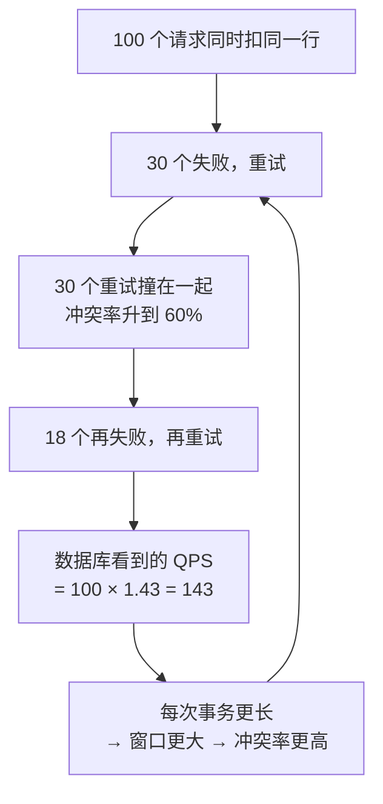

---
sources:
  - 06-第六阶段
---

# 04. 并发控制：乐观锁、悲观锁与唯一约束
> [← 第六阶段导览](01-导览.md) · 三种手段解决三个不同的问题：乐观锁防「并发覆盖」，悲观锁保「必须串行」，唯一约束防「重复写入」。选错不是性能问题，是正确性问题。

## 1. 三种手段的定位

先分清它们各自在防什么，后面的取舍才有依据：

| 手段 | 它判定的是 | 一句话语义 | 主要代价 | 什么时候失效 |
|---|---|---|---|---|
| 乐观锁（version / 条件更新） | 「我读到的这行，现在还是我看到的样子吗」 | 先干活，提交时发现被改过就失败重来 | 冲突时白做一遍，重试放大流量 | 冲突率高时重试风暴；原生 SQL 绕过 version |
| 悲观锁（`SELECT ... FOR UPDATE`） | 「这一行现在归我」 | 进门先锁，别人排队 | 持锁期间吞吐=1/行，死锁风险 | 事务过长；锁在事务外无效；漏加锁 |
| 唯一约束 | 「这个键已经存在了吗」 | 由数据库原子裁决，重复就插不进去 | 冲突时抛异常，要处理事务状态 | 无法表达「更新覆盖」；跨库无效 |

三者不是三选一，而是**分层**。一个扣库存接口最稳的写法是：条件更新（防超卖）+ 唯一约束（防重复请求）+ 关注热点行（防吞吐塌方）。反过来，只用唯一约束去防「余额被覆盖」是不可能的——两次扣款是两个不同的键。

## 2. 乐观锁：`@Version` 与条件 UPDATE 的等价性

### 2.1 `@Version` 帮你做了什么

```kotlin
@Entity
@Table(name = "account")
class Account(
    @Id val id: Long,
    var balance: BigDecimal,
    @Version var version: Long? = null,
)

@Service
class AccountService(private val repo: AccountRepository) {
    @Transactional
    fun deduct(id: Long, amount: BigDecimal) {
        val acc = repo.findById(id).orElseThrow()      // version = 7
        acc.balance = acc.balance - amount
        // flush 时 Hibernate 生成：
        // update account set balance = ?, version = 8 where id = ? and version = 7
        // 影响 0 行 -> OptimisticLockingFailureException
    }
}
```

Hibernate 在 flush 时自动把 `where id = ?` 扩成 `where id = ? and version = ?`，并把 `version` 自增。影响行数为 0 就抛 `OptimisticLockingFailureException`（底层是 `StaleObjectStateException`）。本质是**把「读-判-写」压进一条 SQL**，让数据库来裁决中间有没有人插队。

### 2.2 条件 UPDATE 是同一个思路，但判据更强

```kotlin
/** 判据是业务不变量，不是「有没有人改过」 */
fun deduct(id: Long, amount: BigDecimal): Boolean =
    jdbc.sql("""
        update account set balance = balance - :a, version = version + 1
        where id = :id and balance >= :a
    """).param("a", amount).param("id", id).update() == 1
```

两者都以「影响行数」为判据，都只发一条 SQL，区别在于**判据的粒度**：

| 对比项 | `@Version` | 条件 UPDATE |
|---|---|---|
| 判据 | 这行的任何字段有没有被改过 | 业务前置条件是否仍成立 |
| 是否需要先读 | 需要（要拿到 version） | 不需要，一条 SQL 到底 |
| 冲突误判 | 高：改个昵称也会让你失败 | 低：只有真正影响不变量的冲突才失败 |
| 能否表达「余额充足」 | 不能，要另写判断（且有窗口） | 能，`and balance >= :a` 就是 |
| 适用 | 整实体编辑（表单保存、状态机推进） | 计数、扣减、状态迁移这类单字段运算 |

**等价性的坑**在「绕过 version」这一侧，而且全都是静默的：

- **批量 JPQL / Criteria 更新不递增 version**。`update Account a set a.balance = ... where ...` 是直接发 SQL，Hibernate 不知道 version 该加一；此后再用 `@Version` 乐观锁，读到的 version 是旧的，判定会失效。
- **原生 SQL、`JdbcClient`、`JdbcTemplate` 全都绕过**。用它们更新实体表时，要么手动 `version = version + 1`，要么承认这张表不再受乐观锁保护。
- **`@Version` 只在 flush 时校验**。`persist` 之后到 flush 之前，别人改了这行你也不知道；如果业务需要「立刻知道冲突」，用 `saveAndFlush` 或条件更新。
- **别用 `Int` 做 version**。理论上会溢出，虽然要 21 亿次更新，但用 `Long` 没有任何成本。

## 3. 重试策略与重试次数的数学期望

乐观锁失败之后只有两条路：报冲突让用户重来，或者自己重试。重试该几次，可以算。

设单次尝试的冲突概率为 p（简化成独立同分布），尝试 n 次的成功率是 `1 - p^n`，期望尝试次数是 `1 / (1 - p)`：

| 冲突率 p | n=3 成功率 | 期望尝试次数 | 现象与建议 |
|---|---|---|---|
| 0.05 | 99.99% | 1.05 | 乐观锁的理想区，重试 2~3 次足够 |
| 0.1 | 99.9% | 1.11 | 同上，注意加抖动退避 |
| 0.3 | 97.3% | 1.43 | 每 3 次请求多打 1 次库；需要退避，否则重试同步化 |
| 0.5 | 87.5% | 2.00 | 数据库负载翻倍，开始出现「越重试越慢」 |
| 0.7 | 65.7% | 3.33 | 乐观锁已经错了，换悲观锁或排队 |
| 0.9 | 27.1% | 10.0 | 重试等于自我 DDoS |

这张表最重要的不是数字，是那个**独立性假设是假的**：真实世界里多个写者争同一行，冲突概率随并发数上升，而重试又把负载集中到同一时刻——本来 30% 的冲突率，在重试风暴里会变成 60%。



这个正反馈就是重试风暴的形状：**它不是「多试几次」，而是把负载放大后反过来提高冲突率**。所以工程结论比公式更保守：

- **p 低于 0.1**：乐观锁 + 最多 3 次 + 指数退避 + 随机抖动。
- **p 在 0.1~0.5**：乐观锁 + 更短的重试（1~2 次），失败就直接返回 409 让上游决定；或者改用条件更新减少误判。
- **p 高于 0.5**：别再重试了。要么用悲观锁把并发变成排队，要么从架构上消除热点（下一节）。

退避必须带抖动。固定 `sleep(50)` 会让所有失败的线程在同一时刻醒来，形成第二波冲突；`50 * 2^n + random(0..50)` 这种形式才能把重试摊开。

## 4. 悲观锁：锁类型与经典用法

PostgreSQL 的 `SELECT` 有四种行锁模式，锁强度从高到低：

| 语法 | 锁强度 | 阻塞谁 | 用途 |
|---|---|---|---|
| `FOR UPDATE` | 最强 | 所有其他行锁请求 | 即将更新这行，且要求绝对独占 |
| `FOR NO KEY UPDATE` | 中 | 阻塞 `FOR UPDATE`/`FOR NO KEY UPDATE`/`FOR SHARE`，不阻塞 `FOR KEY SHARE` | 普通 UPDATE 内部用的就是它——不涉及唯一键时更轻 |
| `FOR SHARE` | 共享 | 阻塞 `FOR UPDATE`/`FOR NO KEY UPDATE` | 读的时候不希望被改，但允许多人同时读 |
| `FOR KEY SHARE` | 最弱 | 只阻塞 `FOR UPDATE` | 外键检查用；`FOR NO KEY UPDATE` 不会挡住它 |

配套两个修饰符，工程上比锁模式更常用：

- **`SKIP LOCKED`**：跳过已被别人锁住的行，立刻返回剩下的。这是「数据库当队列」的标准写法。
- **`NOWAIT`**：拿不到锁立刻报错，而不是排队。适合「宁可失败也不要拖长响应」的接口。

```kotlin
@Repository
interface JobRepository : JpaRepository<Job, Long> {
    @Lock(LockModeType.PESSIMISTIC_WRITE)
    @Query("select j from Job j where j.id = :id")
    fun findForUpdate(id: Long): Job?
}

@Service
class JobPuller(private val jdbc: JdbcClient) {

    /** 队列消费：多个实例并发拉取，靠 SKIP LOCKED 各拿各的 */
    @Transactional
    fun claim(limit: Int): List<Long> {
        val ids = jdbc.sql("""
            select id from job
            where status = 'READY'
            order by id
            limit :n
            for update skip locked
        """).param("n", limit).query(Long::class.java).list()

        if (ids.isEmpty()) return ids
        jdbc.sql("update job set status = 'RUNNING', claimed_at = now() where id in (:ids)")
            .param("ids", ids).update()
        return ids
    }
}
```

`SKIP LOCKED` 的三个特性必须清楚：**不保证顺序**（后面的行先被拿到是正常的，队列语义通常无所谓）；**不会等待**（这是它全部价值）；**只在事务内有效**（出了事务锁立刻释放，等于没锁）。用它做队列，吞吐能随消费者数量线性上升——这是它比「一个消费者加锁轮询」强的地方。

悲观锁的纪律，四条都是血换来的：

1. **必须在事务里**。锁在事务提交或回滚时释放；`@Transactional` 漏了，锁在语句结束就没了，等于没加。
2. **事务必须短**。持锁期间不能调远程、不能等用户输入、不能跑大查询，否则锁的持有时间就是对方的超时时间。
3. **加锁顺序必须一致**。批量扣减多个账户时按 `id` 排序再加锁，是避免死锁最便宜的办法。
4. **锁要加在「读」上，不是「写」上**。`update ... where id = ?` 也会加锁，但那时冲突已经发生；要串行化的是「读出来判断再写」这个整体。

## 5. 热点行与三种拆解

同一行被高频更新时，任何行锁都会退化成串行点。1000 QPS 打在一行上，无论用乐观锁还是悲观锁，这一行的最大更新速率就是「一次事务的往返时间」的倒数——本地 PG 大约 2~5 ms，也就是 200~500 TPS，而且这还是理想值。三种拆解：

| 方案 | 做法 | 吞吐 | 一致性 | 复杂度 | 适用 |
|---|---|---|---|---|---|
| 拆分计数行 | 一个逻辑计数拆成 N 行，写时随机挑一行，读时 `SUM` | 提升约 N 倍（受限于 N） | 强一致，读要聚合 | 中：要多一张表、读路径改造 | 计数类（播放量、点赞数、库存分片） |
| 异步合并 | 写进 Redis `INCR`，定时批量落库 | 极高（内存级） | 最终一致，崩溃可能丢最后一批 | 中高：要处理丢失与重放 | 允许短暂不准的指标 |
| 队列削峰 | 写请求进队列，单消费者串行更新 | 稳定但受消费者数限制 | 最终一致，有延迟 | 高：多一套队列与消费 | 秒杀、抢购这类脉冲流量 |

拆分计数行的关键细节是**读**：`select sum(value) from counter_shard where sku = ?` 每次要扫 N 行，N 大了读就贵。折中是「写分片、读缓存」——分片保证写入不冲突，缓存承接读流量，两者用同一个 TTL 兜住短暂不一致。

算一下量级就明白为什么必须拆：单行更新的理论峰值约等于「一个事务往返时间的倒数」，本地 PG 按 3 ms 算就是 330 TPS，跨可用区按 20 ms 算只有 50 TPS。拆 16 片后峰值是 16 × 330，但读要扫 16 行——**用读的代价换写的容量**，这笔账在「写多读少」的计数场景里是划算的，在「读多写少」的场景里就未必。

## 6. 唯一约束：最后一道防线

应用层「先查有没有，没有再插」永远有窗口：两个线程同时查到「没有」，然后都插。这个窗口不是靠加锁能消掉的（加锁就退化成本节的悲观锁方案），只能靠数据库的原子判定。

```kotlin
@Service
class OrderCreationService(
    private val jdbc: JdbcClient,
    private val repo: OrderRepository,
) {
    /**
     * request_key 上有唯一索引：并发同键只有一个能插入成功。
     * ON CONFLICT DO NOTHING 让「失败」表现为影响行数 0，而不是抛异常——
     * 这一点在 PostgreSQL 上尤其重要，见下文。
     */
    @Transactional
    fun createOrGet(requestKey: String, userId: Long, amount: BigDecimal): Long {
        val inserted = jdbc.sql("""
            insert into orders(request_key, user_id, amount, status)
            values (:k, :u, :a, 'PENDING')
            on conflict (request_key) do nothing
        """).param("k", requestKey).param("u", userId).param("a", amount).update()

        if (inserted == 1) return jdbc.sql("select id from orders where request_key = :k")
            .param("k", requestKey).query(Long::class.java).single()

        // 已存在：视为幂等成功，返回原来那单
        return repo.findByRequestKey(requestKey)?.id
            ?: error("conflict without row, key=$requestKey")
    }
}
```

这里有个**PostgreSQL 特有的、必须知道的行为**：一旦某条语句抛错（比如 `23505` 唯一键冲突），整个事务就被标记为 aborted，后续任何语句都会失败并报 `25P02 current transaction is aborted`——你没法在同一个事务里「捕获异常然后继续查」。MySQL 是语句级回滚，行为不一样，跨库迁移时这类代码会突然全部报错。

所以正确的写法只有两种：

1. **`INSERT ... ON CONFLICT DO NOTHING`**（推荐）：冲突不抛异常，用影响行数表达结果，同一事务可以继续；
2. **把捕获放在事务边界之外**：外层方法没有事务，或内层用 `REQUIRES_NEW`——异常把内层事务打回滚，外层重新开一个事务去查。

```kotlin
/** 方式 2 的写法：捕获发生在事务边界之外，此时可以安全地再查一次 */
fun create(requestKey: String): Long =
    try {
        tx.execute { repo.saveAndFlush(Order(requestKey = requestKey, status = "PENDING")) }!!.id
    } catch (e: DuplicateKeyException) {
        // 内层事务已回滚，这里是干净的新事务（Spring Data 的查询方法自带事务）
        repo.findByRequestKey(requestKey)?.id ?: throw e
    }
```

如果非要用 JPA 的 `save` + `catch`，还要注意 `persist` 的 SQL 可能延迟到提交才发——异常在 `commit` 时抛出，那时事务已经结束，`catch` 到的位置根本没有可回滚的上下文。要让它「在方法内可捕获」，必须 `saveAndFlush`。

唯一索引还能表达更细的语义：**部分唯一索引** `create unique index uk_order_active on orders(request_key) where deleted_at is null` 允许「软删之后用同一个键重建」；**复合唯一索引** `(tenant_id, biz_no)` 表达「租户内唯一」。这些都是应用层判断做不到的。

它做不到的：**防更新覆盖**（两次扣款是两个不同的键）、**跨库/跨服务**（唯一性只在单个数据库实例内成立）。所以它只能当「防线」，不能当「方案」。

## 7. 三种方案的取舍表

把三种手段放到同一张「冲突率 × 吞吐」的坐标里：

| 冲突率 | 乐观锁（重试 3 次） | 悲观锁 | 唯一约束 | 建议 |
|---|---|---|---|---|
| 极低（<1%） | 吞吐接近裸写，冲突时多一次 RTT | 白付锁开销，吞吐下降 20%~50% | 无冲突，开销可忽略 | 乐观锁 + 唯一约束兜底 |
| 低（1%~10%） | 吞吐约为裸写的 90%，P99 抬高 | 明显下降，但延迟稳定 | 只在插入路径生效 | 乐观锁 + 抖动退避 |
| 中（10%~50%） | 有效吞吐开始低于悲观锁，P99 抖动 | 稳定，锁等待时间可控 | 无法解决覆盖问题 | 条件更新减少误判，或转悲观锁 |
| 高（>50%） | 重试风暴，吞吐断崖 | 吞吐=串行速率，但不再恶化 | 无法解决 | 悲观锁排队，或拆热点行 |
| 极高（同一行 QPS 过千） | 不可用 | 队列长度爆炸 | 不可用 | 拆分行 / 异步合并 / 队列削峰 |

三条可以直接背下来的判断：

- **能不能重试**：操作幂等、冲突后重来的代价小 → 乐观锁；不幂等、重来要额外补偿 → 悲观锁。
- **冲突是不是「异常」**：冲突在正常流量里占比很低，说明它是异常，值得失败重试；冲突是常态（抢购），就得排队。
- **冲突的判据是「行」还是「键」**：判据是「这行被改过」用 version，判据是「这个键已存在」用唯一约束，判据是「这条记录现在归我」用悲观锁。

## 8. 自测

1. `@Version` 和 `update ... where balance >= :a` 都以影响行数为判据，什么时候后者明显更好？
2. 冲突率 0.3、重试 3 次，成功率和期望尝试次数分别是多少？为什么真实系统里应该比这个结果更保守？
3. `FOR UPDATE` 与 `FOR NO KEY UPDATE` 的差别是什么？为什么说普通 UPDATE 用的是后者？
4. `SKIP LOCKED` 为什么适合队列消费？它牺牲了什么？
5. 在 PostgreSQL 里 `catch (DuplicateKeyException)` 之后同事务继续查询会发生什么？两个正确解法分别是什么？
6. 一行 QPS 打到 2000，你会按什么顺序考虑三种拆解方案？为什么不是先上 Redis？

## 9. 延伸

- 上一册：[03-编程式事务与事务边界设计](03-编程式事务与事务边界设计.md)——锁的持有时间由事务边界决定。
- 下一册：[05-幂等](05-幂等-幂等键-去重表与状态机.md)——唯一约束在幂等方案里扮演什么角色。
- 隔离级别、MVCC、死锁日志的读法见[第五阶段 04 册](../05-第五阶段/04-事务与隔离级别的实证.md)；索引设计与 `EXPLAIN` 见[第五阶段 03 册](../05-第五阶段/03-SQL与索引-执行计划与慢查询.md)。
- 重试、退避、熔断的通用策略见[第八阶段 06 册](../08-第八阶段/06-弹性-超时-重试-熔断-舱壁与限流.md)；并发一致性的测试方法见[第十阶段 04 册](../10-第十阶段/04-并发-幂等与故障注入测试.md)。
