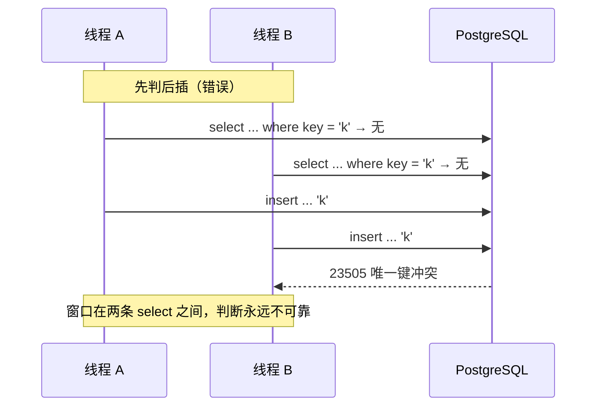

---
sources:
  - 06-第六阶段
---

# 05. 幂等：幂等键、去重表与状态机
> [← 第六阶段导览](01-导览.md) · 幂等不是某一层加的补丁，而是「这个操作执行一次和执行两次，结果一样」这个属性；有了它，上面每一层才敢重试。

## 1. 重复请求的六个来源

重复请求不是异常情况，是分布式系统的常态。六条路径，每条都能单独造成事故：

| 来源 | 机制 | 典型表现 | 该在哪一层防 |
|---|---|---|---|
| 用户重复点击 | 双击、刷新重发、移动端弱网点两次 | 同一秒两笔订单 | 前端按钮置灰（只降概率）+ 服务端幂等键 |
| 网关超时重试 | Nginx `proxy_next_upstream`、云负载均衡在 504 后重发 | 上游只收到一次日志，数据库多一行 | 幂等键（服务端唯一能控的层） |
| 客户端/SDK 重试 | HTTP 客户端重试策略、RPC 框架失败重试 | 调用方日志一条，服务端执行两次 | 幂等键 + 调用方只重试幂等接口 |
| MQ 重复投递 | at-least-once：消费完、ack 前进程崩溃，消息重投 | 同一订单被扣两次库存 | 消费侧按业务键去重 |
| 定时任务多实例 | 每个副本都跑 `@Scheduled`，没有互斥 | 一天发了三遍日报 | 分布式锁（ShedLock）或任务幂等 |
| 回滚重放 / 人工补单 | 数据修复脚本重跑、补偿任务重试、MQ 重平衡 | 历史数据被二次处理 | 让脚本本身幂等，可重放 |

这张表的作用是：**你没法防住所有来源，只能让「重复」变得无害**。前端防抖能挡住第 1 条的一部分，网关重试你根本管不到，第 4、5、6 条全在服务端自己手里。所以幂等键不是「可选优化」，而是写操作接口的默认配置。

## 2. 幂等键：怎么生成、怎么传

### 2.1 两种生成方式

| 方式 | 谁生成 | 能表达什么 | 防不住什么 |
|---|---|---|---|
| 客户端 UUID（`Idempotency-Key`） | 调用方，每次「一次业务意图」生成一个，重试时复用 | 「这是同一个意图的重复提交」 | 调用方不传；恶意方每次换 key；无法覆盖 MQ 场景 |
| 业务键拼装（`userId:sku:date` 之类） | 服务端，从请求内容推导 | 「同一个业务对象上的同一类操作」 | 误杀：用户真的想再下一单时被当成重复 |

现实里两者要配合：**有客户端 key 就用它，没有就用业务键兜底**。判断标准是「同一个键出现两次，是否一定是重复」——如果是「用户可能真的想再来一次」，就不能拿业务键当幂等键（比如转账）。

键的组成有两个原则：**包含「谁 + 做什么 + 对什么」**，**不包含时间戳和随机数**。业务键建议做一次哈希再存，避免超长和特殊字符带来的索引问题。

「一次业务意图」的边界最容易被设计错，三个例子对照着看：

| 场景 | 幂等键 | 为什么 |
|---|---|---|
| 用户点「提交订单」 | 前端在打开结算页时生成一个 UUID，整个页面生命周期复用 | 用户改数量再提交，算不算新意图取决于产品；用页面级 UUID 可以把选择权交给前端 |
| 支付渠道回调 | 渠道流水号 `transaction_id` | 这是渠道侧的唯一标识，天然适合做键，且重试时不变 |
| 批量导入 | 文件内容的 SHA-256 + 目标租户 | 同一个文件重复上传应该收敛成一次导入，改了内容就是新任务 |

反例是把 `System.currentTimeMillis()` 或请求体哈希直接当键：前者每次都不一样，等于没有幂等；后者一旦请求里带了「客户端时间」这类易变字段，同一意图的两次请求会得到两个键。

### 2.2 传递方式

- **HTTP 头**优先：`Idempotency-Key: 8f14e45f-...`。不污染 body 契约，网关、日志、链路追踪都能直接读到，重试时原样透传。
- **body 字段**：只在内部 RPC 或表单场景用；缺点是 schema 要多一个字段，且容易被业务字段淹没。
- **MQ**：用消息 key 或业务主键 + 事件类型，例如 `order:123:PAID`。消费侧的幂等键来自消息内容本身，不需要生产方额外传。

服务端必须先做三件事，再谈去重：**键缺失要报错**（400，而不是「没键就当不幂等」——那等于给了绕过通道）；**限长限字符集**（防大 key 撑爆索引）；**按 scope 隔离**（唯一索引建在 `(scope, key)` 上，否则「创建订单」的键可能把「退款」的键顶掉）。

## 3. 三种实现层次

可靠性从高到低：**唯一约束 > 去重表 / Redis SETNX > 状态机条件更新**。但覆盖面是反过来的：唯一约束只防「插入」，状态机只防「迁移」。真实系统通常同时用两层。

| 层次 | 可靠性 | 覆盖场景 | 额外成本 | 主要失败模式 |
|---|---|---|---|---|
| 唯一约束 | 最高，数据库原子裁决 | 创建类操作（下单、建任务、发消息记录） | 需要设计幂等键列与索引 | 只能防插入；冲突后需读回结果 |
| 去重表 / Redis SETNX | 高，但依赖「占位 + 结果」两步都对 | 任意操作 | 一张表或一个 Redis；要清理 | 占位成功业务失败、进程崩溃键不释放、Redis 与库不同步 |
| 状态机条件更新 | 高（同覆盖范围内） | 状态迁移（支付、发货、关闭） | 需要显式状态机 | 只覆盖已有实体的迁移；`0` 行需要再查区分「重复」与「非法」 |

### 3.1 唯一约束：让数据库来判

```kotlin
// idempotency_record 上：unique (scope, key)
fun claim(scope: String, key: String): Boolean =
    jdbc.sql("""
        insert into idempotency_record(scope, key, status, created_at)
        values (:s, :k, 'PROCESSING', now())
        on conflict (scope, key) do nothing
    """).param("s", scope).param("k", key).update() == 1
```

`on conflict do nothing` 而不是 `catch (DuplicateKeyException)`，原因是 PostgreSQL 的语句报错会让整个事务进入 aborted 状态，同一个事务里没法继续查询（`25P02`）。这一点在[上一册](04-并发控制-乐观锁-悲观锁与唯一约束.md) §6 已经踩过。

### 3.2 去重表 / Redis SETNX：占位 + 结果

Redis 版本胜在快、能挡住绝大部分重复流量，代价是「占位」和「业务」不在一个事务里：

```kotlin
@Service
class RedisIdempotencyGuard(private val redis: StringRedisTemplate) {

    /** 返回 true 表示抢到了处理权 */
    fun tryClaim(scope: String, key: String): Boolean {
        val k = "idem:$scope:$key"
        // SET NX PX 是原子操作：要么我占住，要么我看到别人占了
        return redis.opsForValue()
            .setIfAbsent(k, "PROCESSING", Duration.ofSeconds(30)) == true
    }

    fun complete(scope: String, key: String, resultJson: String, ttl: Duration) {
        redis.opsForValue().set("idem:$scope:$key", "DONE:$resultJson", ttl)
    }

    fun release(scope: String, key: String) = redis.delete("idem:$scope:$key")
}
```

三个必须处理的细节：

1. **处理中的 TTL 要短**（上面是 30 秒），完成后的 TTL 要长（小时级）。否则进程崩了，键要挂一整天，用户重试永远被拒。
2. **失败要 `release`**，而且要在 `finally` 里——这一条漏了，就是「一次失败导致这个键永久不可用」。
3. **`DONE` 和 `PROCESSING` 要用不同的返回**：`PROCESSING` 应该回 409/425（「正在处理，稍后再试」），不能回成功，也不能回失败。

去重表版本（DB 里存记录）比 Redis 可靠：它和业务数据在同一个事务里，不会出现「占位成功、业务失败、键还在」的错位。代价是一张会膨胀的表，需要按 `created_at` 定期清理。

### 3.3 状态机条件更新：天然幂等

```kotlin
fun pay(orderId: Long): PayResult {
    val n = jdbc.sql("""
        update orders set status = 'PAID', paid_at = now()
        where id = :id and status = 'PENDING'
    """).param("id", orderId).update()

    if (n == 1) return PayResult.OK
    // 0 行：可能是「已经付过了」，也可能是「状态不允许支付」，必须再查
    val status = jdbc.sql("select status from orders where id = :id")
        .param("id", orderId).query(String::class.java).optional().orElse(null)
    return when (status) {
        "PAID" -> PayResult.ALREADY_PAID        // 幂等成功
        null -> PayResult.NOT_FOUND
        else -> PayResult.ILLEGAL_STATE         // CANCELLED / REFUNDED
    }
}
```

这类写法的价值不只是幂等，还顺带把「非法状态流转」挡掉了：`PENDING -> PAID` 只允许走一次，重复的支付回调拿到 `ALREADY_PAID` 正常应答，乱序到达的「取消」也不会把已支付的单改回去。

## 4. 并发同键：两种顺序的竞态



「先查再插」的窗口无法靠缩短代码消除，它是两次网络往返之间的物理间隔。正确顺序是**先插后判**：让数据库的原子操作当判据，插入成功的那一方获得处理权，另一方读到已存在的记录后按「重复」处理。

| 顺序 | 判据 | 并发安全性 | 适用 |
|---|---|---|---|
| 先判后插 | 应用层的 `select` | 不安全，有 TOCTOU 窗口 | 只作为快速路径（命中就直接返回，不回表） |
| 先插后判 | 唯一索引 / `SETNX` / 影响行数 | 安全 | 默认选择 |
| 先占坑再异步 | 占位记录 + 状态字段 | 安全，但要处理「占位后没结果」 | 长耗时操作（生成报表、批量导出） |

有一点容易忽略：**并发同键的第二个请求在 `insert` 上会被阻塞，而不是立刻返回 0 行**。PostgreSQL 的 `ON CONFLICT` 实现会在冲突时等待对方事务结束——如果对方提交，它返回 0 行；如果对方回滚，它插入成功。这个「等待」恰好就是我们要的互斥，不需要额外的锁。

但这套等待只对「秒级事务」友好。如果一次业务要跑十几秒（生成报表、批量导出），让第二个请求一直挂着会先撞上网关超时，然后网关重试，越堆越多。长耗时操作改用「先占坑再异步」：事务里只写占位记录并立刻提交，返回 202 + 查询地址；客户端拿同一个键轮询，看到 `DONE` 取结果、看到 `PROCESSING` 继续等。占位记录的 `PROCESSING` 加一个短 TTL 或心跳时间戳，超时未完成就允许重新抢占——否则进程一崩，这个键就废了。

## 5. 结果存什么、存多久、存不下怎么办

**存什么**：HTTP 状态码 + 响应体（或响应体的引用）+ 业务主键 + 完成时间。响应体建议限长（如 8 KB），超了就只存业务主键，重复请求时按主键重新查——查询本身是幂等的，重查的结果和第一次一致。

**存多久**：必须**大于所有上游的最长重试窗口**，这是唯一的安全约束。

| 场景 | 建议保留 | 依据 |
|---|---|---|
| 普通 HTTP 写接口 | 24 小时 | 客户端/网关的重试窗口通常在分钟级，24 小时足够覆盖人工重试 |
| 支付、退款 | 7 天 | 与对账周期对齐，跨日重放要能命中 |
| MQ 消费去重 | 消息保留期 + 1 天 | 超过保留期消息不会再来，记录可以删 |
| 定时任务 | 一个调度周期 + 余量 | 下个周期是新的业务意图，不该被判重复 |

**存不下怎么办**：三条退路，按顺序考虑。① 只存「已处理 + 业务主键」，重复请求时回查业务表（多数场景够用）；② 分级 TTL：短 TTL 存完整响应，长 TTL 只存标记；③ 冷数据归档进独立的表，热表只留窗口内的记录。

还有一个语义问题必须明确：**记录过期之后，同一个键再来，就是一个新请求**。所以「过期时间够长」不是性能参数，是正确性参数。反过来，如果业务上真的要求「永久幂等」，那就不能靠 TTL，得把唯一键做成业务主键（例如订单号），由业务表自身保证。

## 6. 状态机幂等：`UPDATE ... WHERE status = ?` 的影响行数

条件更新的返回值只有三种含义，混淆它们就会把「重复」当成「失败」：

| 影响行数 | 可能含义 | 正确响应 |
|---|---|---|
| 1 | 我完成了这次迁移 | 成功 |
| 0，且当前状态 = 目标状态 | 别人已经做过 | 幂等成功（回放结果） |
| 0，且当前状态是其他值 | 非法流转或对象不存在 | 业务失败 / 404 |

区分后两种必须再查一次状态——这一次查询是「读」，不会引入竞态，因为状态只可能从「非目标」变成「目标」，读到哪个都能给出确定答案。

再往前一步是把状态机和乐观锁合起来：`where id = ? and status = 'PENDING' and version = ?`。这样既能防重复迁移，也能防「读到旧状态后基于旧数据做决策」。代价是冲突时要重试，回到上一册的重试期望问题。

状态机幂等的另一个收益是**审计友好**：每次迁移都是一条带条件的 UPDATE，影响行数天然记录了「这次操作是否真的改变了什么」，比事后比对日志可靠得多。

## 7. 完整实现：幂等切面与并发测试

把前面几节拼成一个能用的切面。核心设计：**占位记录与业务在同一个事务里**，业务失败则占位一起回滚（允许重试），业务成功则写入结果（重复请求直接回放）。

```kotlin
@Target(AnnotationTarget.FUNCTION)
@Retention(AnnotationRetention.RUNTIME)
annotation class Idempotent(val scope: String = "", val ttlHours: Long = 24)

@Aspect
@Component
class IdempotentAspect(
    private val tx: TransactionTemplate,
    private val jdbc: JdbcClient,
    private val json: JsonMapper,
) {
    @Around("@annotation(idem)")
    fun around(pjp: ProceedingJoinPoint, idem: Idempotent): Any? {
        val key = headerKey() ?: throw MissingIdempotencyKeyException()
        val scope = idem.scope.ifBlank { pjp.signature.toShortString() }

        return tx.execute { status ->
            val claimed = jdbc.sql("""
                insert into idempotency_record(scope, key, status, created_at, expires_at)
                values (:s, :k, 'PROCESSING', now(), now() + make_interval(hours => :ttl))
                on conflict (scope, key) do nothing
            """).param("s", scope).param("k", key).param("ttl", idem.ttlHours).update()

            if (claimed == 0) {
                val rec = load(scope, key)
                // 对方已提交：回放结果；对方还在跑：让调用方稍后重试
                if (rec?.status == "DONE") {
                    val body = rec.body ?: throw IllegalStateException("DONE without body")
                    return@execute json.readValue(body, Any::class.java)
                }
                throw IdempotentInProgressException(key)
            }

            val result = try {
                pjp.proceed()
            } catch (e: Throwable) {
                status.setRollbackOnly()        // 占位与业务一起回滚，键不残留
                throw e
            }

            jdbc.sql("""
                update idempotency_record
                set status = 'DONE', body = :b, finished_at = now()
                where scope = :s and key = :k
            """).param("b", json.writeValueAsString(result))
                .param("s", scope).param("k", key).update()
            result
        }
    }

    private fun headerKey(): String? =
        (RequestContextHolder.getRequestAttributes() as? ServletRequestAttributes)
            ?.request?.getHeader("Idempotency-Key")

    private fun load(scope: String, key: String): Record? =
        jdbc.sql("select status, body from idempotency_record where scope = :s and key = :k")
            .param("s", scope).param("k", key)
            .query { rs, _ -> Record(rs.getString("status"), rs.getString("body")) }
            .optional().orElse(null)

    data class Record(val status: String, val body: String?)
}
```

并发同键的正确性由唯一索引 + 同事务保证：第二个请求的 `insert` 会阻塞到第一个事务结束，然后拿到 0 行、读到 `DONE`、回放结果。清理交给一个定时任务按 `expires_at < now()` 删除，保留时长由注解的 `ttlHours` 决定（默认 24 小时，理由见 §5 的表）。

测试必须用真数据库、真并发，不能靠 mock：

```kotlin
@SpringBootTest
class IdempotencyConcurrencyTest @Autowired constructor(
    private val orderService: OrderService,
    private val jdbc: JdbcClient,
) {
    // 不能用 @Transactional：另一个线程看不到未提交的数据，测试会假通过
    @Test
    fun `两线程同键只落一单`() {
        val key = UUID.randomUUID().toString()
        val start = CountDownLatch(1)
        val pool = Executors.newFixedThreadPool(2)
        try {
            val futures = (1..2).map {
                pool.submit<Long> {
                    start.await()                       // 让两个线程尽量同时出发
                    orderService.create(key, 1001L, BigDecimal("9.90"))
                }
            }
            start.countDown()

            val ids = futures.map { it.get(10, TimeUnit.SECONDS) }
            assertThat(ids.toSet()).hasSize(1)          // 两个线程拿到同一个 orderId

            val count = jdbc.sql("select count(*) from orders where request_key = :k")
                .param("k", key).query(Long::class.java).single()
            assertThat(count).isEqualTo(1)              // 库里只有一单
        } finally {
            pool.shutdownNow()
        }
    }
}
```

三个测试纪律：**不加 `@Transactional`**（否则另一线程看不到数据，或者回滚掩盖问题）；**用 `CountDownLatch` 制造同时出发**，而不是顺序调用两次（顺序调用测的是缓存，不是并发）；**断言数据库行数**，而不只是断言返回的 ID 相同。

## 8. 自测

1. 六个重复来源里，哪些是服务端完全无法阻止、只能靠幂等消化的？为什么「前端防抖」不能算防线？
2. 客户端 UUID 和业务键拼装各自防不住什么？什么业务绝对不能拿业务键当幂等键？
3. 为什么「先查后插」在并发下一定不安全？「先插后判」里那个阻塞等待是谁提供的？
4. Redis `SETNX` 方案里，`PROCESSING` 和 `DONE` 的 TTL 为什么必须不同？进程崩溃时会留下什么？
5. `update ... where status = 'PENDING'` 返回 0 行时，你怎么区分「重复」和「非法流转」？
6. 幂等记录的保留时长为什么是正确性参数而不是性能参数？

## 9. 延伸

- 上一册：[04-并发控制](04-并发控制-乐观锁-悲观锁与唯一约束.md)——唯一约束与条件更新在并发语义上的细节。
- 下一册：[06-跨服务一致性](06-跨服务一致性-Outbox-Saga-TCC与分布式锁.md)——幂等是 Saga 补偿、Outbox 投递的共同前提。
- 消息重复投递与消费侧去重的工程配置见[第七阶段 06 册](../07-第七阶段/06-Spring消息集成-幂等消费-重试死信与积压.md)；定时任务多实例互斥见[第七阶段 07 册](../07-第七阶段/07-定时任务与调度.md)。
- 幂等键作为 HTTP 契约的一部分，见[第四阶段 08 册](../04-第四阶段/08-REST契约-幂等-分页-版本化与OpenAPI.md)；并发测试的方法论见[第十阶段 04 册](../10-第十阶段/04-并发-幂等与故障注入测试.md)。
