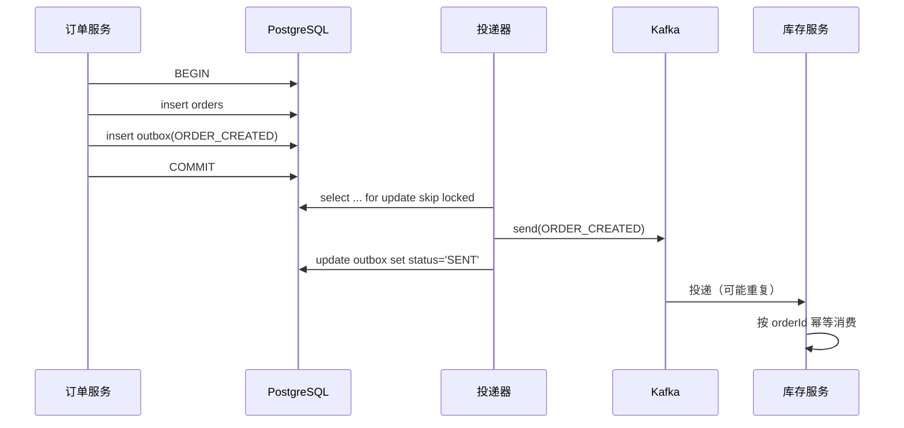
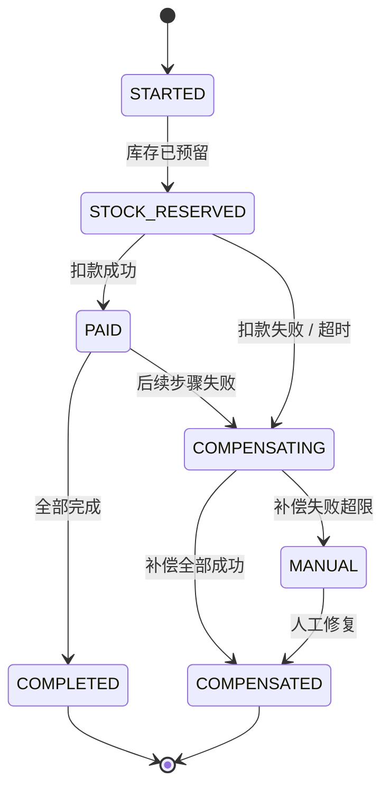

---
sources:
  - 06-第六阶段
---

# 06. 跨服务一致性：Outbox、Saga、TCC 与分布式锁
> [← 第六阶段导览](01-导览.md) · 跨服务没有事务，只有「本地事务 + 可重试的投递 + 幂等的消费 + 能闭环的补偿 + 对账」这五件套；先判断业务到底需要哪一档一致性，再选手段。

## 1. 先立标准：什么必须强一致

「分布式事务」这个词害了很多人，因为它暗示存在一种像本地事务一样的东西。事实是：跨服务没有原子提交，任何方案都在「一致性强度」和「成本」之间做交换。所以第一件事不是选方案，是给业务分级。

| 业务 | 不一致的后果 | 必要强度 | 手段 |
|---|---|---|---|
| 扣款、记账、清结算 | 钱不守恒，且**不可自动修复** | 强一致 | 本地事务 + TCC / Saga + 每日对账 |
| 库存扣减 | 超卖，要么赔付要么砍单 | 强一致（单库内可做到） | 条件更新 + 唯一约束，别跨库拆 |
| 创建订单 + 发通知 | 用户没收到短信 | 最终一致 | Outbox |
| 加积分、发券 | 少给或多给一点，可补发 | 最终一致 | Outbox + 消费幂等 |
| 搜索索引、推荐特征 | 搜不到最新的，可重建 | 最终一致 | 消息 + 定时全量重建 |

判断只需要三问：

1. **不一致会造成不可逆损失吗？** 钱和货是不可逆的，积分和索引不是（能补、能重建）。
2. **能靠重放修复吗？** 索引重跑一遍就对了；账错了要人工介入，还有合规问题。
3. **中间态会被外部看到并据此行动吗？** 用户看到「已扣款未发货」会投诉、会重复下单，这种中间态就必须被业务状态机挡住（`PENDING` 而不是直接 `PAID`）。

三条都往「严重」那一侧倾斜的，才配得上 TCC 这种成本。其余的，Outbox 加幂等消费就够了——而且**大多数系统里 90% 的「分布式事务需求」其实是 Outbox 能解决的**。

## 2. Outbox：本地消息表

### 2.1 它解决的问题

「写库成功、发消息失败」和「发消息成功、写库回滚」是两个方向的裂缝。Outbox 的办法是把「发消息」拆成两步：**在业务事务里写一条「待发消息」记录**（这一步和业务变更同生共死），再由独立投递器把它发出去（这一步可以失败、可以重试）。



### 2.2 表结构与索引

```sql
create table outbox (
  id              bigserial primary key,
  aggregate_id    bigint      not null,
  event_type      text        not null,
  payload         jsonb       not null,
  status          text        not null default 'NEW',   -- NEW / SENT / DEAD
  attempts        int         not null default 0,
  next_attempt_at timestamptz not null default now(),
  created_at      timestamptz not null default now(),
  sent_at         timestamptz
);

-- 投递器只扫「到期的 NEW」，部分索引让扫描量恒定
create index idx_outbox_due on outbox (next_attempt_at) where status = 'NEW';
-- 同一聚合的同一事件只允许一条，防止业务侧重放产生重复
create unique index uk_outbox_event on outbox (aggregate_id, event_type);
```

四个设计决定都值得解释：`bigserial` 而不是 UUID，因为要按 id 顺序投递、按 id 清理；`payload` 用 `jsonb`，让排查时能直接查内容；`status` 只有三个值，`DEAD` 表示超过重试上限需要人工；部分索引 `where status = 'NEW'` 是关键——没有它，投递器每次都要扫全表，表一大就变成慢查询。

### 2.3 投递器

```kotlin
@Component
class OutboxPump(
    private val jdbc: JdbcClient,
    private val producer: EventProducer,
) {
    /** 每 500ms 拉一批；多实例靠 skip locked 各拿各的 */
    @Scheduled(fixedDelay = 500)
    fun pump() {
        while (true) {
            val batch = claim(BATCH_SIZE)
            if (batch.isEmpty()) return
            batch.forEach { row -> deliver(row) }
        }
    }

    private fun claim(n: Int): List<OutboxRow> =
        jdbc.sql("""
            select id, aggregate_id, event_type, payload, attempts
            from outbox
            where status = 'NEW' and next_attempt_at <= now()
            order by id
            limit :n
            for update skip locked
        """).param("n", n).query { rs, _ ->
            OutboxRow(rs.getLong("id"), rs.getLong("aggregate_id"),
                rs.getString("event_type"), rs.getString("payload"), rs.getInt("attempts"))
        }.list()

    private fun deliver(row: OutboxRow) {
        try {
            // 分区键用 aggregate_id：同一聚合的事件落同一分区，顺序才有保证
            producer.send(topic = row.eventType, key = row.aggregateId.toString(), body = row.payload)
            jdbc.sql("update outbox set status = 'SENT', sent_at = now() where id = :id")
                .param("id", row.id).update()
        } catch (e: Exception) {
            val attempts = row.attempts + 1
            jdbc.sql("""
                update outbox
                set attempts = :a,
                    status = case when :a >= 10 then 'DEAD' else 'NEW' end,
                    next_attempt_at = now() + (:a * interval '2 seconds')
                where id = :id
            """).param("a", attempts).param("id", row.id).update()
        }
    }

    data class OutboxRow(
        val id: Long, val aggregateId: Long,
        val eventType: String, val payload: String, val attempts: Int,
    )
}
```

投递器有五个必须想清楚的点：

1. **至少一次，不是恰好一次**。发出去之后、标记 `SENT` 之前崩溃，重启会重发。所以消费侧必须幂等——这是 Outbox 的合同条款，不是可选项（见[05 册](05-幂等-幂等键-去重表与状态机.md)）。
2. **顺序只在「同一聚合 + 单条串行」时才成立**。上面用 `order by id` 串行发送，靠分区键把同一聚合固定到同一分区，两者缺一不可；并发 `forEach` 或随机 key 都会乱序。
3. **`skip locked` 是多实例的前提**。不加的话，两个实例会拿到同一批记录，各发一次。
4. **重试要退避、要有上限**。无限重试会让一条坏消息堵住整个队列（因为它一直排在最前面）；超过上限进 `DEAD` 并告警，人工处理。
5. **清理独立进行**：`delete from outbox where status = 'SENT' and sent_at < now() - interval '7 days'`。表按天分区更省事，直接 `drop partition`。

还有两个工程选择：轮询（500 ms 延迟、实现简单）和 CDC（Debezium 读 WAL，延迟毫秒级但多一套组件）。日订单量在百万以内，轮询完全够用；量大或要求亚秒延迟再上 CDC。

## 3. Saga：长事务拆成一组本地事务 + 补偿

### 3.1 两种形态

| 维度 | 编排式（orchestration） | 协同式（choreography） |
|---|---|---|
| 谁决定下一步 | 一个协调者，内部是显式状态机 | 各服务监听事件，自己决定做什么 |
| 可观测性 | 一处能看到全流程当前状态 | 要拼多个服务的日志/链路才能还原 |
| 耦合 | 协调者知道所有参与者（集中但显式） | 参与者只认识事件（松但隐式） |
| 加一步 | 改状态机，编译期就能发现漏改 | 加一个监听器，容易漏、容易循环 |
| 超时兜底 | 天然，协调者能扫超时 | 没人负责，只能各服务自己做 |
| 适用 | 3 步以上、涉及钱、需要人工介入 | 2~3 步、链路线性、团队自治 |

**默认选编排。** 协同式看起来优雅，但它的代价在半年后显现：没人能回答「这个订单现在卡在哪一步」，加一个补偿要改三个服务。编排式的协调者多写几百行，换来一个能查、能重放、能人工推进的中心。

### 3.2 状态机与补偿



补偿动作与正向动作一一对应，但**语义上是新事务，不是回滚**：

| 正向步骤 | 补偿动作 | 补偿失败怎么办 |
|---|---|---|
| 创建订单（PENDING） | 置为 CANCELLED | 重试；不成功则用户看到一笔待支付单，可接受 |
| 预扣库存 | 回补库存 | 重试 + 告警，最终人工核对 |
| 扣款 | 退款 | 重试 + 对账，钱的问题必须人工闭环 |
| 发放优惠券 | 回收券 | 允许失败（成本低），记录不回收原因 |

### 3.3 三个必须写进设计的东西

**补偿必须幂等。** 补偿会被重复执行：协调者超时重试、进程重启重放、人工再点一次。所以补偿动作要写成「退款按 `refund_no` 唯一」「回补库存用 `set qty = qty + n where not exists(已回补记录)`」这种形式，而不是裸的 `qty + n`。

**状态持久化 + 超时兜底。** 协调者的状态机必须落库（`saga_instance` + `saga_step`），不能只在内存里。每一步记 `deadline`，定时任务扫超时：超时且无法确定结果（比如扣款请求发出去了但没收到响应）→ 进入 `MANUAL`，而不是盲目补偿——**盲目退款可能退两次**。

**人工工单是一等公民。** 任何「补偿失败超限」「状态不确定」的情况都要进一张工单表，带上下文（saga id、卡在哪步、已尝试次数、相关单号），并且有查询界面。没有人工兜底的 Saga 不是 Saga，是把分布式问题藏进了日志里。

Saga 还有一个绕不开的缺陷：**没有隔离性**。中间态（已扣库存、未付款）对其他事务可见。解法是用语义锁把中间态标出来：订单状态是 `PENDING` 而不是 `PAID`，库存记的是「预留」而不是「已扣」，读路径据此过滤。这也是为什么 Saga 里的业务表几乎都需要一个「中间态」字段。

## 4. TCC：三个接口与三笔必须还的债

TCC 把每个参与方拆成 Try（预留资源）、Confirm（确认扣减）、Cancel（释放预留）三个接口，由事务协调者按顺序调用。

| 接口 | 语义 | 幂等要求 | 失败处理 |
|---|---|---|---|
| Try | 检查并**预留**（冻结余额、锁定库存） | 必须幂等 | 失败则整个事务取消 |
| Confirm | 把预留变成真实扣减 | 必须幂等 | 失败要一直重试，不能放弃 |
| Cancel | 释放预留 | 必须幂等 | 失败要一直重试，不能放弃 |

三笔债，少还一笔就是生产事故：

1. **空回滚**。Try 因为网络超时没到达（或者到达了但对方超时回滚），Cancel 却来了。Cancel 必须识别「这个分支根本没 Try 过」，直接返回成功；否则它会去释放一个不存在的预留，抛异常，协调者以为补偿失败，无限重试。
2. **悬挂**。Cancel 先到、Try 后到（网络乱序、Try 重试）。此时 Try 会预留成功，但这笔业务早就取消了——预留的资源永远没人释放。解法是 Try 前先查/写一条分支记录，`Cancel` 也写，Try 看到「已取消」就拒绝。
3. **幂等**。Confirm 和 Cancel 都可能被重复调用，必须靠分支记录的状态条件更新来兜。

```kotlin
@Service
class InventoryTccService(private val jdbc: JdbcClient) {

    /** 分支控制表：(tx_id, branch_id) 唯一，status: TRIED / CONFIRMED / CANCELLED */
    fun tryReserve(txId: String, sku: String, qty: Int): Boolean {
        val branch = "inventory:$sku"
        val inserted = jdbc.sql("""
            insert into tcc_branch(tx_id, branch_id, status)
            values (:t, :b, 'TRIED') on conflict (tx_id, branch_id) do nothing
        """).param("t", txId).param("b", branch).update()

        if (inserted == 0) {
            // 冲突要看状态：TRIED 是重复 Try（幂等成功）；CANCELLED 说明 Cancel 先到，
            // 此时再预留就是「悬挂」，必须拒绝。
            return branchStatus(txId, branch) == "TRIED"
        }

        val n = jdbc.sql("""
            update stock set reserved = reserved + :q
            where sku = :s and qty - reserved >= :q
        """).param("q", qty).param("s", sku).update()
        if (n == 0) {
            jdbc.sql("update tcc_branch set status = 'CANCELLED' where tx_id = :t and branch_id = :b")
                .param("t", txId).param("b", branch).update()
            return false
        }
        return true
    }

    fun cancel(txId: String, sku: String, qty: Int): Boolean {
        // 空回滚：没 Try 过也要成功返回，并留下 CANCELLED 防止后续悬挂
        val n = jdbc.sql("""
            update tcc_branch set status = 'CANCELLED'
            where tx_id = :t and branch_id = :b and status = 'TRIED'
        """).param("t", txId).param("b", "inventory:$sku").update()

        if (n == 1) {
            jdbc.sql("update stock set reserved = reserved - :q where sku = :s")
                .param("q", qty).param("s", sku).update()
        }
        // n == 0：要么已 Cancel（幂等），要么从未 Try（空回滚），都算成功
        return true
    }

    private fun branchStatus(txId: String, branch: String): String? =
        jdbc.sql("select status from tcc_branch where tx_id = :t and branch_id = :b")
            .param("t", txId).param("b", branch)
            .query(String::class.java).optional().orElse(null)
}
```

`insert ... on conflict do nothing` 同时挡住了「重复 Try」和「悬挂」：Cancel 先到时分支记录已是 `CANCELLED`，后到的 Try 读到这个状态就拒绝预留，不会留下一笔永远没人释放的库存。**如果 Try 在冲突时直接 `return true`**，悬挂就发生了——这是 TCC 实现里最常见的一行错误。

**成本账**：每个参与方 3 个接口 + 2 张表（事务、分支）+ 补偿调度 + 幂等/空回滚/悬挂三套逻辑。一个 3 参与方的链路，代码量大约是 Saga 的 3 倍。所以 TCC 只在「必须预留资源、且不能靠补偿挽回」的场景用：支付冻结、库存锁定、额度占用。**能靠退款补偿的，就别用 TCC。**

## 5. 分布式锁：能解决什么、不能解决什么

分布式锁只解决一个问题：**同一时刻只允许一个执行者**。它不解决一致性、不解决顺序、不提供可见性保证。

```kotlin
@Component
class RedisLock(private val redis: StringRedisTemplate) {

    /** 加锁：SET key token NX PX ttl —— 一条命令原子完成「不存在才设置 + 带过期」 */
    fun tryLock(name: String, ttl: Duration): String? {
        val token = UUID.randomUUID().toString()
        val ok = redis.opsForValue().setIfAbsent("lock:$name", token, ttl)
        return if (ok == true) token else null
    }

    /** 解锁：只能删自己的锁，用 Lua 保证「比较 + 删除」原子 */
    fun unlock(name: String, token: String) {
        redis.execute(UNLOCK_SCRIPT, listOf("lock:$name"), token)
    }

    companion object {
        private val UNLOCK_SCRIPT = RedisScript.of(
            """
            if redis.call('get', KEYS[1]) == ARGV[1] then
              return redis.call('del', KEYS[1])
            else
              return 0
            end
            """.trimIndent(),
            Long::class.java,
        )
    }
}
```

四件事必须做对：

- **value 必须是唯一 token**。否则会出现：A 的锁过期 → B 拿到锁 → A 执行完把自己的「锁」删了，删的其实是 B 的。删锁必须比较 token。
- **释放必须是 Lua**。`get` 再 `del` 两条命令之间，锁可能已经过期并被别人拿走。Lua 在 Redis 里单线程执行，比较和删除是一体的。
- **TTL 要覆盖业务耗时，且要续期**。续期用看门狗：每 `TTL/3` 检查一次并延长，业务结束就停。风险在于续期线程自己挂了、或者 JVM 长时间 GC——锁到期，业务还在跑。
- **别把锁当成正确性保证**。锁过期后两个执行者同时写，这是**必然会发生**的事件（GC 停顿、网络抖动、节点时钟漂移），不是小概率。

**Redlock 的争议**值得知道结论：它向 N 个独立 Redis 实例顺序加锁，多数成功才算拿到锁。反对方的核心论点是「时钟漂移 + 长时间停顿会让锁在两个客户端上同时有效」，因此它不比单实例 + fencing token 更安全；支持方认为在合理假设下它足够好。工程上的落点是：**需要绝对互斥时，靠资源侧的 fencing token（单调递增的版本号，资源只接受更大的 token），而不是靠锁本身**。

**替代方案**：etcd 的 lease + revision 天然带单调版本，`CompareAndSwap` 可以做 fencing；数据库锁（`pg_advisory_lock`、`SELECT ... FOR UPDATE`、或者「插入一行唯一键当锁」）最土但最可靠，因为它的失效语义和你要保护的数据在同一个系统里。

真正需要分布式锁的场景其实不多：定时任务多实例互斥、缓存击穿时的单飞、跨实例的「只允许一个执行者」。**能写成唯一约束或条件更新的，都不该用锁。**

## 6. 锁不能替代约束

这条要单独说，因为它是最常见的错误直觉：「我加了分布式锁，所以不会超卖」。

三个论证：

1. **锁有失效窗口，约束没有**。锁依赖 TTL、续期、网络、时钟；约束由数据库在写入那一刻原子校验。前者是「尽力而为」，后者是「不满足就拒绝」。
2. **锁的正确性依赖所有写者守规矩**。任何一条绕过锁的写入路径（运维 SQL、数据修复脚本、另一个没接锁的服务、老版本代码）都会击穿它。唯一约束不依赖调用方，谁写都一样。
3. **锁的故障模式是「两个执行者」，而约束的故障模式是「一个失败」**。前者造成数据错误，后者造成一次重试。故障模式决定了哪个能当最后防线。

具体到超卖：用 Redis 锁扣库存，主从切换的一瞬间锁丢了，两个请求同时读到 `qty = 1`，都扣，卖出去两件；用 `update stock set qty = qty - 1 where sku = ? and qty >= 1`，无论多少写者、锁有没有生效，都不可能扣成负数。

所以正确的关系是：**锁用来降低冲突概率和成本（少打几次库、少做无用功），约束用来保证正确性**。前者可以省，后者不能省。

## 7. 对账：最后一道防线

前面所有机制的共同点是「尽力」：消息可能丢、补偿可能失败、锁可能失效。对账是唯一能**发现**这些失败的机制，所以它不是可选的运营动作，是架构的一部分。

| 类型 | 频率 | 比什么 | 能发现什么 |
|---|---|---|---|
| 全量对账 | T+1 凌晨 | 本地流水 vs 渠道账单（逐笔） | 漏单、多单、金额不符 |
| 增量对账 | 每小时 | 近 N 小时流水 | 及时发现，缩短故障窗口 |
| 内部对账 | 每 5 分钟 | 订单表 vs 支付流水表 | 服务内部的不一致（消息丢了） |

差异分类之后，处理方式是不同的：

| 差异 | 含义 | 处理 |
|---|---|---|
| 本地有、渠道无 | 我方多记了一笔收款 | 挂账 + 人工核实，别自动冲正 |
| 渠道有、本地无 | 漏记，用户可能已付款 | 优先处理，按渠道流水补单（幂等重放） |
| 金额不符 | 手续费、汇率、重复扣款 | 人工，涉及合规 |
| 状态不符（渠道成功本地失败） | 消息丢或补偿漏 | 重放事件，走幂等路径 |

对账要产出两个指标：**差异率**（差异笔数 / 总笔数）和**修复时长**。前者衡量系统健康度，后者衡量兜底能力。差异率突然上升，通常意味着上游某个环节刚改过——这比任何监控都灵敏。

## 8. 方案成本对照与选择顺序

| 方案 | 一致性 | 额外延迟 | 实现成本 | 运维成本 | 适用 |
|---|---|---|---|---|---|
| Outbox | 最终一致 | 百毫秒到秒级（轮询间隔） | 低：一张表 + 一个投递器 | 低：清理、死信告警 | 通知、积分、索引、绝大多数跨服务通知 |
| Saga（编排） | 最终一致 + 补偿 | 秒级（多步串行） | 中：状态机 + 补偿 + 工单 | 中：卡单排查、人工介入 | 3 步以上、含资金、需要超时兜底 |
| Saga（协同） | 最终一致 + 补偿 | 秒级 | 看似低，长期高 | 高：链路难还原 | 步骤少、团队强自治 |
| TCC | 准强一致（预留 + 确认） | 两次远程调用 | 高：3 接口 × N 方 + 2 张表 | 高：空回滚/悬挂/幂等三套逻辑 | 支付冻结、库存锁定、额度占用 |
| 分布式锁 | 不提供一致性 | 无 | 低 | 中：续期、脑裂、失效排查 | 任务互斥、单飞 |
| 对账 | 不提供一致性，提供**发现** | T+1 或小时级 | 中：拉账单、比对、工单 | 中：日常运营 | 所有涉及钱的系统，必须有 |

一句话的选择顺序：**能本地事务就本地事务 → 跨服务先上 Outbox → 需要补偿再加 Saga → 需要预留才上 TCC → 无论选哪个，涉及钱就必须有对账。**

## 9. 自测

1. 用哪三个问题判断一个业务需不需要强一致？「加积分」和「扣款」分别落在哪一档，为什么？
2. Outbox 的投递器为什么必须配 `skip locked`？「至少一次」这个语义把什么责任转移给了消费方？同一聚合的事件顺序又靠哪两件事保证？
3. Saga 的补偿为什么必须幂等？举一个「不幂等补偿」会造成资损的例子。
4. TCC 的空回滚和悬挂分别是什么时序？分支控制表怎么同时挡住这两个问题？
5. 为什么「加了 Redis 分布式锁」不能推出「不会超卖」？给出一个能击穿锁的具体场景。
6. 对账能发现哪一类前面所有方案都发现不了的问题？

## 10. 延伸

- 上一册：[05-幂等](05-幂等-幂等键-去重表与状态机.md)——Outbox 的消费侧、Saga 的补偿动作都建立在它之上。
- 事务的基础语义见[本阶段 02 册](02-Transactional全解与六种失效现场.md)；边界设计见[03 册](03-编程式事务与事务边界设计.md)。
- 消息中间件的投递语义、消费组与积压排查见[第七阶段 05、06 册](../07-第七阶段/05-消息中间件-Kafka与RabbitMQ模型.md)；定时任务多实例互斥见[第七阶段 07 册](../07-第七阶段/07-定时任务与调度.md)。
- 微服务下的服务边界与「一服务一库」是 Outbox 成立的前提，见[第十一阶段 03、07 册](../11-第十一阶段/07-分布式事务与Saga编排.md)；跨服务链路追踪怎么把 Saga 串起来，见[第十一阶段 08 册](../11-第十一阶段/08-多服务可观测性与契约治理.md)。
