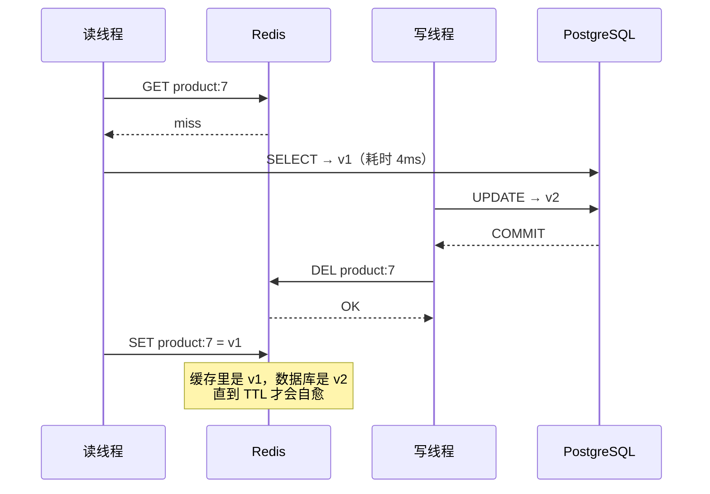

---
sources:
  - 07-第七阶段
---

# 03. 缓存模式与一致性取舍

> [← 第七阶段导览](01-导览.md) · 缓存不是「把数据复制一份变快」，而是「在数据库前面放一份允许过期的副本」；承认「允许过期」，剩下的问题就只有「窗口多长、谁兜底」。

上一册讲的是 Redis 这个组件本身怎么用不坏。这一册往上走一层：应用该在什么时机读缓存、什么时机写缓存、什么时机删缓存。四种缓存模式的名字很好背，难的是说清每种模式在并发下会留下什么形态的脏数据、这个脏数据能活多久、以及为什么你不可能把它彻底消灭。

## 1. 四种模式：读写路径与适用面

| 模式 | 读路径 | 写路径 | 谁管缓存 | 一致性 | 典型场景 |
|---|---|---|---|---|---|
| Cache-Aside（旁路） | 应用先读缓存，miss 则读库并回填 | 应用写库，然后删除缓存 | 应用代码 | 中，窗口毫秒级到 TTL | 绝大多数读多写少的业务 |
| Read-Through（读穿透） | 应用只读缓存，miss 由缓存组件回源并回填 | 同 Cache-Aside | 缓存组件（需 loader） | 中，同 Cache-Aside | 有统一缓存框架、想收敛回源逻辑 |
| Write-Through（写穿透） | 同 Read-Through | 同步写缓存 + 写库，两者都成功才返回 | 缓存组件 | 较高，但仍有双写失败窗口 | 写后立刻读、目录/配置类数据 |
| Write-Behind（写回） | 同 Read-Through | 只写缓存，异步批量刷库 | 缓存组件 | 低，可能丢数据 | 计数、点赞、行情等高频写 |

Cache-Aside 是默认答案，因为它把控制权留在应用手里：缓存什么时候失效、失败了怎么兜底、哪些 key 不回填，都是显式代码。Read-Through 把「miss 回源」藏进缓存组件，代码更薄，但回源逻辑变得不可见——出问题时你不知道是缓存没命中还是 loader 抛了异常。Spring Cache 的 `@Cacheable` 默认就是 Cache-Aside 的自动化（方法体负责回源），`@CachePut` 是 Write-Through 语义，`@CacheEvict` 是删除；注意它们都靠 AOP 代理生效，自调用会绕过（第三阶段 04 册）。

Write-Through 的关键差别是「写缓存和写库在同一个调用里同步完成」。它的一致性比 Cache-Aside 好一点，因为写完返回时缓存已经是新值；代价是写延迟变成两个系统的和，且第二步失败时你要决定「回滚第一步还是重试第二步」——Redis 和数据库没有共同的事务，这个决定没有免费选项。

Write-Behind 把写延迟压到最低：写内存就返回，后台按批刷库。它适合「丢几条不影响正确性」的场景（点赞数、阅读数），不适合任何涉及钱和库存的场景。它的隐藏成本在刷写逻辑：同一 key 的多次更新要合并、刷写失败要重试、进程崩溃会丢最后一批、批量写的顺序要保证（后写的不能先落库）。

模式选型之外，还有一个更基础的决定：**缓存 key 的粒度**。按实体 ID 缓存（`product:42`）最容易失效，但聚合查询（列表、搜索）要么缓存整个结果集（失效范围大），要么不缓存。按「查询条件」缓存（`product:list:cat=3:page=1`）命中率高，但一个实体变更要失效 N 个 key，通常靠短 TTL 而不是精确失效。这个选择决定了后面所有一致性方案的复杂度。

## 2. 为什么「更新库 + 删缓存」优于「更新库 + 更新缓存」

先看「更新缓存」在并发写下的经典覆盖：

| 时刻 | 写线程 W1 | 写线程 W2 | 数据库 | 缓存 |
|---|---|---|---|---|
| T1 | UPDATE → v1，提交 | | v1 | v0 |
| T2 | | UPDATE → v2，提交 | v2 | v0 |
| T3 | | SET 缓存 = v2 | v2 | v2 |
| T4 | SET 缓存 = v1 | | v2 | v1（脏） |

W1 的缓存写发生在 W2 之后，于是一个更旧的值覆盖了更新的值。注意这不是「网络乱序」这种小概率事件，而是两个线程的调度顺序问题：只要 W1 在 T1 之后被调度得慢一点，就会发生。删缓存没有这个问题：T3 和 T4 都是 `DEL`，删两次和删一次结果一样，最终缓存是空的，下一次读回源拿到 v2。

三个理由归纳：

1. **删除是幂等的，更新不是**。并发写的最终状态取决于「谁最后写缓存」，而删除的最终状态恒为「没有缓存」。
2. **更新要求写路径构造完整的新值**。如果缓存的是聚合结果（商品 + 库存 + 价格），写路径要重新查一遍才能拼出完整对象，等于把读路径的代价搬到了写路径；删除只要一个 `DEL`。
3. **写多读少时，更新缓存是在写「不会被读的数据」**。一次批量导入更新十万行，逐行更新缓存会把 Redis 打满，而这些 key 可能一天都没人读。

但「删缓存」不是没有代价：它把一次读的开销推迟到下一次读（cache miss 回源），如果写后立刻有大量读，会出现一小段「缓存空了、全打 DB」的尖峰。这个尖峰在热点 key 上就是击穿（04 册），需要单飞或互斥重建来兜。

## 3. 两种顺序：先删后写，还是先写后删

两种顺序都有不一致窗口，但窗口的位置和概率不同。

**先删缓存，再更新数据库**：删除后、事务提交前，任何读请求都会 miss 并回源，读到的是**旧值**，然后回填。等写事务提交，缓存里已经是旧值了，且没有任何后续动作去删它——只能等 TTL。更糟的是，如果写事务最后回滚了，缓存被无谓地清空（冷缓存，不是脏数据，但会引发一次回源尖峰）。

**先更新数据库，再删缓存**：删除是最后一步，删除之后不会再有「应用主动写入旧值」的动作。剩下的风险只有两个：删除本身失败；以及某个读线程在写提交之前已经读到了旧值、在删除之后才把旧值写回缓存。

| 顺序 | 主要窗口 | 脏数据能活多久 | 额外问题 |
|---|---|---|---|
| 先删后写 | 删除后到事务提交之间，读回源旧值并回填 | 到 TTL | 写回滚也会清空缓存 |
| 先写后删 | 读线程「提交前读库、删除后回填」 | 到 TTL | 删除失败则一直是旧值 |

第二种的窗口更窄，因为它要求读线程的「读库」和「写缓存」跨越写线程的「提交 + 删除」两个动作。第一种只要读发生在删除之后、提交之前，几乎必然回填旧值。所以工业界的默认是**先写库、后删缓存**，而且删除要放在事务提交之后。

「事务提交之后」这个细节很容易写错。如果在 `@Transactional` 方法体里直接 `redis.delete()`，删除发生在提交之前：此时并发读会读到未提交的旧值并回填，提交后缓存就是脏的；如果事务回滚，删除也白做了。正确做法是注册 `afterCommit` 回调，或者用 `@TransactionalEventListener(phase = AFTER_COMMIT)`。第六阶段 02 册讲过事务同步的时机，这里只强调结论：**缓存的删除动作必须挂在「数据库已经确认提交」之后**。

## 4. 旧值回填：完整时刻表

把最坏情况摊开成一条时间线。假设缓存里原本是 v1，写线程要把数据库改成 v2。



逐时刻对照：

| 时刻 | 读线程 R | 写线程 W | 缓存值 | 数据库值 | 说明 |
|---|---|---|---|---|---|
| T0 | | | v1 | v1 | 初始一致 |
| T1 | GET → miss | | 空 | v1 | 缓存被别的原因清掉了，或刚好过期 |
| T2 | SELECT 开始 | | 空 | v1 | R 即将读到 v1 |
| T3 | SELECT 返回 v1 | | 空 | v1 | v1 已经在 R 的堆内存里 |
| T4 | 序列化、准备 SET | UPDATE → v2，COMMIT | 空 | v2 | 写已生效 |
| T5 | | DEL（成功） | 空 | v2 | 删除本身是对的 |
| T6 | SET v1 | | v1 | v2 | **脏数据落盘** |
| T7 | 返回 v1（本次读也是旧值） | | v1 | v2 | 后续所有读都命中 v1 |

窗口的起点是 T2（R 开始读库），终点是 T6（R 写回缓存）。宽度约等于「一次数据库查询 + 序列化 + 一次网络往返」，同机房大约 2 到 5ms。在这 5ms 内，任何读请求都可能成为「最后一个回填者」。按单 key 1000 QPS 算，5ms 内有 5 个读请求在途；写操作每秒 10 次，那么每秒大约有 50 次「读在窗口内」的机会，只要其中一次跨过 T5，脏数据就成立。

这解释了为什么这个问题在低流量测试环境几乎复现不了，在上线后却偶发：它正比于「读 QPS × 窗口宽度 × 写频率」。

还有两个容易漏掉的变体：

- **删除失败**：`DEL` 超时或连接断开。超时不等于没执行——服务端可能已经删了，只是响应丢了。所以删除要重试（幂等，重试安全），重试仍失败则要留下可观测的痕迹（日志、指标、兜底标记）。
- **读的是从库**：读写分离下，T2 的 `SELECT` 走从库，而主从延迟 20ms，R 读到的可能是更旧的 v0；即使写线程的 `DEL` 发生在 R 的回填之前，R 回填的也是 v0。这类脏数据的根源不在缓存，在复制延迟，但表现出来一模一样。

## 5. 三种补丁的代价，与 TTL 这个底线

针对上面的窗口，工业界有三种补丁。它们不是「更优的方案」，而是「用不同成本换更小的窗口」。

### 5.1 延迟双删

流程是：写库 → 删缓存 → 延迟一段时间 → 再删一次。第二次删除的目标是清掉「在第一次删除之后、延迟时间之内」回填的旧值。

```kotlin
private val delayer: ScheduledExecutorService = Executors.newSingleThreadScheduledExecutor { r ->
    Thread(r, "cache-delay-del").apply { isDaemon = true }
}

fun evictWithDelay(id: Long, delay: Duration = Duration.ofMillis(800)) {
    evict(id)                                   // 第一次：提交后立刻删
    delayer.schedule({ evict(id) }, delay.toMillis(), TimeUnit.MILLISECONDS)
}
```

它的代价很实在：延迟时间只能猜（要大于「读库 + 回填」的 P99，常见 500ms 到 1s）；延迟任务在进程内，实例重启就丢了；多实例部署时只有执行写的那台会安排第二次删除，它一挂就没了；如果读线程因为 GC 或慢查询卡了 2 秒才回填，第二次删除照样盖不住。它适合「读回源很快、写 QPS 不高、能接受秒级不一致」的场景，不适合当成通用方案。

### 5.2 binlog 驱动的失效

用 CDC 组件（Canal、Debezium）订阅数据库的 binlog，把行变更转成「失效这个 key」的消息，由消费者删缓存。

它多解决了两类问题：一是**所有写路径都被覆盖**，包括不走应用的批量脚本、DBA 手工 SQL、其他服务的直连写入；二是**失效动作与业务事务解耦**，应用不需要在写路径上关心缓存。代价是一整套新组件：CDC 的位点管理、断点恢复、DDL 变更的兼容、同一行的变更顺序（binlog 有序，但消费并发会打乱）、以及「删缓存仍然可能失败」——消费者要有重试和死信。

它的延迟通常是几十毫秒到一秒，比应用内删除慢，但比 TTL 快几个数量级。适合「写入方多、缓存 key 与表行有一一映射」的系统；如果缓存的是聚合结果（一个 key 对应多张表），映射关系要自己维护，复杂度会反超收益。

### 5.3 版本号

给数据加一个单调递增的版本，缓存 key 带上版本：`product:42:v17`。写操作先递增版本（数据库的 `version` 字段或 Redis 的 `INCR`），旧 key 自然不会再被读到，新读会 miss 并回填新版本。

它把「删除」换成了「换 key」，因此不存在「删除失败」这个问题——旧 key 留在那里也无害，等 TTL 清掉。代价是：key 的数量随写次数增长（要靠 TTL 清理）；读路径多一次「取当前版本」的往返；版本号本身不能丢，如果存在 Redis 里被淘汰，读会回落到 v0，可能命中一个很旧的缓存。所以版本号更适合存在数据库行里（跟着数据走），或者用「时间戳 + 短 TTL」代替严格递增。

| 补丁 | 覆盖的窗口 | 额外延迟 | 复杂度 | 残留风险 |
|---|---|---|---|---|
| 延迟双删 | 延迟时间内的回填 | 写路径多一次延迟删除 | 低 | 超过延迟的慢读、进程重启、第二次删除失败 |
| binlog 失效 | 所有写路径 | 几十毫秒到 1 秒 | 高（CDC + 位点 + 重试） | CDC 延迟、映射错误、删除失败 |
| 版本号 | 删除失败 | 读路径多一次取版本 | 中 | 版本 key 丢失、旧 key 堆积 |
| 只靠 TTL | 不覆盖，只兜底 | 无 | 最低 | 脏数据活到 TTL 到期 |

### 5.4 TTL 是最后的一致性保障

所有方案都必须有 TTL，包括「这个数据永远不会变」的那些。原因不是「怕忘记删」，而是：**任何主动失效机制都会失败**——删除会超时、CDC 会停、消息会丢、进程会崩。TTL 是唯一不依赖「另一个系统还活着」的兜底，它把「永久脏」变成「有界陈旧」。

TTL 的长度是一个业务决策，不是技术参数：商品价格能容忍 30 秒陈旧吗？用户余额能容忍 1 秒吗？权限能容忍 5 分钟吗？把这个答案写进代码注释和接口文档，比在评审上说「加了缓存所以快了很多」有用得多。

工程上要监控「没有 TTL 的 key 占比」。`INFO keyspace` 只能看到总数，精确统计要靠 `SCAN` 采样；一个简单有效的巡检是每天扫一批 key，`TTL key` 返回 `-1` 的比例超过阈值就告警。这个指标能提前发现「某个新写的缓存忘了设过期」——这类 bug 通常要等到内存报警才被发现。

## 6. 为什么双写不可能强一致

把「缓存 + 数据库」看成一个系统，强一致（线性一致）要求：所有读写看起来像是在某个单一时间点上原子发生的。这需要三个条件，缺一不可：

1. **读和写经过同一个序列化点**。缓存和数据库是两个独立的服务，各自有自己的并发控制，没有一个全局的顺序。
2. **写的两个副本要么同时成功，要么同时失败**。Redis 不支持 XA，也没有和 PostgreSQL 共享的事务协调者；任何「先 A 后 B」都存在「A 成功、B 失败」的中间态。
3. **读不能读到落后的副本**。缓存本身就是数据库的一个副本，它天生落后。

逐条枚举所有顺序，没有一种能消除窗口：

| 顺序 | 中间态 | 读到什么 | 后果 |
|---|---|---|---|
| 先写缓存，后写库 | 缓存新值、库旧值 | 新值 | 库若回滚，读到的是「从未存在过」的值（脏读，比旧值严重） |
| 先写库，后写缓存 | 库新值、缓存旧值 | 旧值 | 陈旧读，等 TTL 自愈 |
| 先删缓存，后写库 | 缓存空、库旧值 | 回源旧值并回填 | 陈旧读，且缓存被写回旧值 |
| 先写库，后删缓存 | 库新值、缓存旧值（或空） | 旧值 | 陈旧读，窗口最短 |

加锁也救不了：给写路径加分布式锁能保证「两个写不并发」，但读路径不加锁，读仍然可以在「库已提交、缓存未删」的间隙里读到旧值；如果读也加锁，所有读串行化，缓存的存在意义就没了（你只是把一个快的副本变成了一把锁）。

所以正确的目标不是「强一致」，而是明确三件事：

- **不一致的方向**：允许读到旧值，不允许读到「未来值」（所以「先写缓存后写库」比「先写库后删缓存」更危险）。
- **不一致的时长**：由 TTL 给出上界，由补丁缩小实际窗口。
- **谁来兜底**：读己之写用「写后短时间强制走主库/绕过缓存」；资金类读用「不用缓存，或缓存只做展示、决策走库」。

一句话：**缓存与数据库的双写，只能在「陈旧读的窗口」和「系统复杂度」之间做交换，不能在「一致」和「不一致」之间做选择。**

## 7. Cache-Aside 的完整实现

下面这段代码把前面几节的结论落成可运行的形态：空值缓存、TTL 抖动、提交后删除、删除重试、兜底绕过。

```kotlin
@Service
class ProductCacheService(
    private val redis: StringRedisTemplate,
    private val json: JsonMapper,
    private val repo: ProductRepository,
) {
    companion object {
        private const val NULL_VALUE = "__NULL__"
        private val BASE_TTL: Duration = Duration.ofMinutes(10)
        private val NULL_TTL: Duration = Duration.ofSeconds(30)
        private val BYPASS_TTL: Duration = Duration.ofSeconds(30)
    }

    fun get(id: Long): Product? {
        val key = cacheKey(id)
        // 删除连续失败时留下的标记：这段时间直接回源，避免继续读旧值
        if (redis.hasKey(bypassKey(id))) return loadAndFill(key, id)

        val raw = redis.opsForValue().get(key) ?: return loadAndFill(key, id)
        if (raw == NULL_VALUE) return null
        return json.readValue(raw, Product::class.java)
    }

    fun update(id: Long, cmd: UpdateProduct): Product {
        val saved = repo.update(id, cmd)
        afterCommit { evict(id) }     // 必须等事务提交，否则并发读会回填旧值
        return saved
    }

    private fun loadAndFill(key: String, id: Long): Product? {
        val product = repo.findById(id)
        if (product == null) {
            redis.opsForValue().set(key, NULL_VALUE, NULL_TTL)
            return null
        }
        redis.opsForValue().set(key, json.writeValueAsString(product), withJitter(BASE_TTL))
        return product
    }

    private fun evict(id: Long) {
        repeat(3) { attempt ->
            val ok = runCatching { redis.delete(cacheKey(id)) }.isSuccess
            if (ok) return
            Thread.sleep(50L shl attempt)          // 50ms、100ms、200ms
        }
        // 三次都失败：写 30 秒的绕过标记，读路径在这段时间内直接回源
        runCatching { redis.opsForValue().set(bypassKey(id), "1", BYPASS_TTL) }
    }

    private fun afterCommit(action: () -> Unit) {
        if (TransactionSynchronizationManager.isSynchronizationActive()) {
            TransactionSynchronizationManager.registerSynchronization(
                object : TransactionSynchronization {
                    override fun afterCommit() = action()
                },
            )
        } else {
            action()
        }
    }

    private fun withJitter(base: Duration): Duration =
        base.plusMillis(ThreadLocalRandom.current().nextLong(0, base.toMillis() / 10))

    private fun cacheKey(id: Long) = "product:$id"
    private fun bypassKey(id: Long) = "product:bypass:$id"
}
```

几个必须理解的细节：

- `afterCommit` 依赖调用方已经开启了事务。如果 `update` 被一个没有 `@Transactional` 的入口调用，同步器不活跃，删除会立即执行——此时「写库」和「删缓存」之间仍然有一个未提交窗口，但这是调用方的事务边界问题，不是缓存层能修的。
- 删除重试只重试「异常」，不重试「key 不存在」。`DEL` 返回 0 表示 key 本来就不在，这就是成功。
- 兜底标记本身也可能写失败（Redis 挂了）。这时候唯一剩下的保障是 TTL，所以「所有缓存必须有 TTL」不是风格问题，是最后一道防线。
- 读路径为了检查绕过标记多做了一次 `hasKey`。高 QPS 下这次往返不可忽略，常见优化是把「标记」和「值」合并成一个特殊值（比如 value 为 `__BYPASS__` 时直接回源），把两次 GET 变成一次。
- `NULL_VALUE` 的 TTL 必须短。空值缓存的目的是挡住「反复查同一个不存在的 ID」，不是长期记住「这个 ID 不存在」——后者会在数据被创建后继续返回 null。

四种模式在三个维度上的对照：

| 模式 | 一致性 | 读性能 | 写性能 | 实现复杂度 | 适用 |
|---|---|---|---|---|---|
| Cache-Aside | 中：窗口 ms 级到 TTL | 高：miss 才回源 | 高：多一次 `DEL` | 低 | 读多写少，绝大多数业务 |
| Read-Through | 中：同 Cache-Aside | 高 | 高 | 中：需要 loader 与统一封装 | 想收敛回源逻辑、统一埋点 |
| Write-Through | 较高：返回时缓存已新 | 高 | 低：双写同步，延迟相加 | 中：要处理第二步失败 | 写后立刻读、配置/目录 |
| Write-Behind | 低：可能丢最后一批 | 高 | 最高：只写内存 | 高：合并、刷写、补偿 | 计数、点赞、非关键指标 |

最后一句取舍：**如果你的业务不能接受「读到 10 秒前的数据」，正确做法不是把 TTL 调到 1 秒，而是这类读根本不该走缓存。** 缓存优化的是「读放大」，不是「读正确性」。

## 8. 自测

1. 为什么「更新缓存」在并发写下会长期脏，而「删除缓存」不会？用两个写线程的时刻表说明。
2. 画出「读线程回填旧值」的完整时序，标出窗口的起点和终点；窗口宽度由哪些操作构成？
3. 延迟双删的延迟时间怎么定？举两个它盖不住的场景。
4. binlog 失效比应用内删除多解决了哪类写路径？又多引入哪些运维成本？
5. 用「两个系统 + 无共享事务 + 读不串行化」论证双写不可能强一致；如果你非要接近强一致，愿意付什么代价？
6. 写路径删除缓存三次都失败，除了重试还有哪些兜底？每种兜底的恢复时间是多少？

## 9. 延伸

- 上一册：[02-Redis 数据模型与原子性](02-Redis数据模型与原子性.md)——删除、重试、兜底标记都建立在它的原子命令与过期语义上。
- 下一册：[04-穿透、击穿、雪崩与多级缓存](04-穿透击穿雪崩与多级缓存.md)——删缓存之后的回源尖峰，就是击穿要解决的问题。
- 事务提交时机与 `afterCommit` 的完整语义见[第六阶段 02 册](../06-第六阶段/02-Transactional全解与六种失效现场.md)；跨服务的一致性方案（Outbox/Saga）见[第六阶段 06 册](../06-第六阶段/06-跨服务一致性-Outbox-Saga-TCC与分布式锁.md)。
- 缓存与服务边界的取舍（哪些数据该由哪个服务持有）见[第十一阶段 03 册](../11-第十一阶段/03-服务边界-DDD限界上下文与数据所有权.md)。
