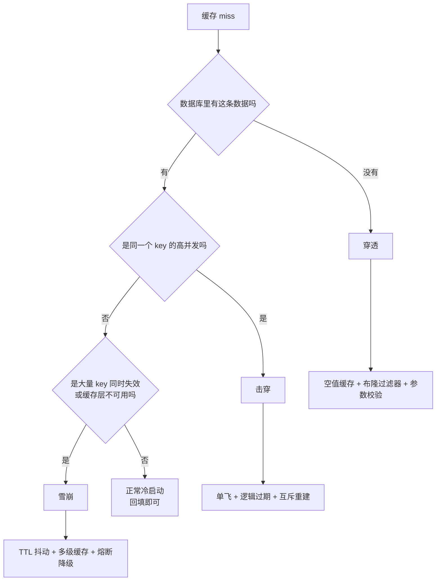
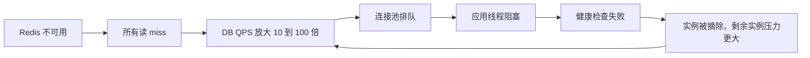
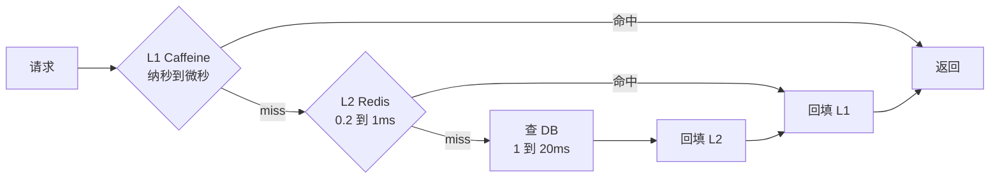

---
sources:
  - 07-第七阶段
---

# 04. 穿透、击穿、雪崩与多级缓存

> [← 第七阶段导览](01-导览.md) · 三种失效听起来像同一件事，判别只看两个变量：数据存不存在、失效的是单个 key 还是整个缓存层。

「缓存把数据库打挂了」这句话背后至少有三种完全不同的故障。它们的表象都是「大量请求打到数据库」，但根因分别是「查了不存在的东西」「一个热点同时过期」「整个缓存层没了」。根因不同，解法就不能互换：给雪崩加布隆过滤器没用，给穿透做互斥重建也没用。这一册先把判别标准立起来，再逐个给方案，最后用压测数字说明「多一级缓存到底值不值」。

## 1. 三种失效的判别

| 名称 | 触发条件 | 请求特征 | 数据库压力形态 | 典型场景 |
|---|---|---|---|---|
| 穿透 | 查询的 key 在数据库里也不存在 | 大量**不同**的 key，缓存永远不会命中 | 恒定 QPS 的无效查询，索引也救不了 | 恶意 ID 遍历、爬虫、参数错误的客户端 |
| 击穿 | 单个热点 key 过期或被删 | 同一 key 的高并发同时 miss | 瞬间尖峰，持续几十到几百毫秒 | 首页商品、配置、活动信息 |
| 雪崩 | 大量 key 同时过期，或 Redis 整体不可用 | 所有 key 一起 miss | 断崖式全量回源，可能压垮连接池 | 批量预热用了同一个 TTL、实例宕机、网络分区 |

判别流程：



三个补充判别点：

- **看 key 的分布**。穿透的 key 通常没有规律（或呈现明显的遍历规律），击穿的 key 高度集中，雪崩的 key 覆盖全站。
- **看持续时间**。击穿是尖峰，几十毫秒到几秒就过去（缓存被重建后恢复）；雪崩是持续高压，因为缓存层没有恢复之前，每个请求都要回源。
- **看数据库指标**。穿透表现为「QPS 高但命中率极低、慢查询不多」；击穿表现为「短时 QPS 尖峰、连接池瞬间打满」；雪崩表现为「QPS 打到数据库上限、连接池排队、应用线程全部阻塞」。

## 2. 穿透：空值缓存与布隆过滤器

穿透的本质是「缓存没有能力回答『这个 key 不存在』」。缓存只在有数据时才有条目，查不到就不写，于是同一个不存在的 ID 每次都要回源。解法是让缓存也能记住「不存在」。

### 2.1 空值缓存

回源返回 null 时，写一个占位值（`__NULL__`），TTL 设得很短（30 到 60 秒）。这样同一个 ID 的重复查询在 TTL 内只打一次库。

它解决的是「重复查同一个不存在的 key」，解决不了「每次换一个不存在的 key」——攻击者用随机 ID 遍历，每个 ID 都产生一个占位，反而把 Redis 内存打满。所以空值缓存必须配两个前置条件：**入参做格式/范围校验**（ID 必须是合法雪花 ID，超出范围直接拒），以及**按来源限流**（同一 IP/用户每分钟的 miss 次数）。

空值缓存的另一个坑是「删了又建」：如果数据被删除时只删了数据库、没删缓存，缓存里的旧值还在；反过来，如果新建的数据 ID 之前被缓存过空值，新数据在空值 TTL 内读不到。所以删除和创建都要走「删缓存」，不能只依赖 DB。

### 2.2 布隆过滤器

布隆过滤器是一个位数组加 k 个哈希函数。写入时把 k 个位置置 1；查询时如果有一位是 0，**一定不存在**；如果全是 1，**可能存在**。它没有假阴性（说不存在就一定不存在），只有假阳性（说可能存在，实际不存在）。

参数计算：

```text
m = -n * ln(p) / (ln 2)^2      // 位数组长度
k = (m / n) * ln 2             // 哈希函数个数
```

| 数据量 n | 误判率 p | 位数组 m | 内存 | 哈希数 k |
|---|---|---|---|---|
| 1000 万 | 1% | 约 9585 万位 | 约 11.4 MiB | 7 |
| 1000 万 | 0.1% | 约 1.44 亿位 | 约 17.1 MiB | 10 |
| 1 亿 | 1% | 约 9.6 亿位 | 约 114 MiB | 7 |

Redis 侧用 RedisBloom 模块：

```text
BF.RESERVE product:bloom 0.01 100000000
BF.ADD product:bloom 123456
BF.EXISTS product:bloom 123456
BF.MADD product:bloom 1 2 3 4 5
```

误判率的工程含义：1% 意味着「每秒 1 万个不存在的查询，有 100 个会漏到数据库」。这个量级通常可以接受；把 p 从 1% 降到 0.1%，内存要多 50%，漏过去的请求只从 100 降到 10——收益递减。选 p 的依据是「数据库能承受多少无效查询」，不是「越准越好」。

### 2.3 删除数据后怎么处理

标准布隆过滤器**不支持删除**：把某一位清 0 会影响其他元素的判断（多个元素共享位）。三条路：

1. **定期重建**：离线扫全表重新构建，用双缓冲切换（写 `product:bloom:new`，建好后 `RENAME` 成 `product:bloom`）。代价是重建期间的新增数据要么漏、要么要双写。
2. **计数布隆 / Cuckoo filter**：计数布隆给每位加计数器（4 位计数器在 15 次插入后溢出，需要扩容），Cuckoo filter 支持 `CF.DEL` 但有装载率和删除失败的问题。复杂度都高于标准 BF。
3. **接受误判，用空值缓存兜底**：删除时只删缓存，不删 BF。BF 仍然说「可能存在」，请求落到数据库，数据库返回 null，回填一个短 TTL 的空值。代价是「删除后的第一次查询会打库」，但删除是低频操作，这个代价通常可以接受。

第三条是实践中最常用的，因为它不需要任何额外结构。它的前提是「数据库查询本身不贵」——如果回源是一条三表 JOIN，那还是老老实实做重建。

| 方案 | 防穿透 | 内存 | 支持删除 | 误判 | 适用 |
|---|---|---|---|---|---|
| 空值缓存 | 只防重复 key | 每个 key 一份 | 自然过期 | 无 | 无效查询集中在少量 ID |
| 布隆过滤器 | 防任意不存在 key | 按 n 和 p 计算 | 需重建 | 有，可计算 | 数据量大、ID 空间可枚举 |
| 计数布隆 / Cuckoo | 同上 | 更高 | 支持（有坑） | 有 | 删除频繁且必须精确 |
| 参数校验 + 限流 | 挡住非法与恶意 | 无 | — | 无 | 所有方案的必备前置 |

## 3. 击穿：单飞、逻辑过期、互斥重建

击穿是「一个热点 key 过期，同时有 1000 个请求发现它没了」。如果没有协调，这 1000 个请求会同时回源，数据库瞬间多出 1000 次相同查询。

### 3.1 三种解法对照

| 方案 | 协调范围 | 读延迟 | 一致性 | 实现复杂度 | 适用 |
|---|---|---|---|---|---|
| 进程内单飞 | 单实例内同一 key | 等待者阻塞到重建完成 | 强（重建后立即新值） | 低 | 热点 key、实例数不多 |
| 逻辑过期 + 异步刷新 | 全集群（靠不设 TTL） | 立即返回旧值 | 弱（返回陈旧值） | 中 | 极端热点、可容忍秒级陈旧 |
| 互斥重建（分布式锁） | 全集群 | 未抢到锁的短暂重试 | 强 | 中 | 跨实例只能回源一次 |
| 永不过期 + 主动更新 | 全集群 | 立即 | 取决于更新 | 中 | 数据量小、可全量推送 |

### 3.2 进程内单飞

单飞（singleflight）把「同一 key 的并发加载」合并成一次：第一个线程负责查库，其余线程等它的结果。核心是一个 `ConcurrentHashMap<K, CompletableFuture<V>>`，`putIfAbsent` 决定谁是 leader。

```kotlin
class SingleFlight<K, V> {
    private val inflight = ConcurrentHashMap<K, CompletableFuture<V>>()

    fun run(key: K, loader: () -> V): V {
        val mine = CompletableFuture<V>()
        val existing = inflight.putIfAbsent(key, mine)

        if (existing != null) {
            return try {
                existing.get(2, TimeUnit.SECONDS)
            } catch (e: TimeoutException) {
                loader()          // 等不及就自己查，宁可多一次回源也不拖死调用方
            } catch (e: ExecutionException) {
                throw e.cause ?: e
            }
        }

        try {
            val value = loader()
            mine.complete(value)
            return value
        } catch (t: Throwable) {
            mine.completeExceptionally(t)
            throw t
        } finally {
            inflight.remove(key, mine)
        }
    }
}
```

四个必须处理的细节：

- **`remove(key, mine)` 要带值比较**。否则 leader 完成、另一个线程刚好开始新一轮加载时，可能把新一轮的 future 删掉，导致后续请求永远等一个已完成的 future。
- **等待要有超时**。leader 卡在慢查询上时，所有等待者会一起挂到业务线程池耗尽。超时后自己回源是「用重复换可用」，比级联阻塞好。
- **异常要传播给所有等待者**，不能只让 leader 失败、其他人拿到 null。
- **key 必须能被回收**。`finally` 里删是标准做法；如果 loader 永远不返回，map 会泄漏，所以 loader 本身要有超时。

单飞的边界是「进程内」：10 个实例各自合并，最坏仍有 10 次回源。这个量级通常没问题；如果连 10 次都承受不了，说明这个 key 的回源成本极高，应该用逻辑过期或互斥重建。

Caffeine 的 `LoadingCache.get(key, loader)` 本身就实现了每 key 的单飞，语义和上面这段一样。自己写单飞的价值在于它可以包住「L1 → L2 → DB」三级加载，而不是只包一层 map。

### 3.3 逻辑过期 + 异步刷新

思路是「物理上永不过期，逻辑上带一个过期时间」：value 里包一个 `expireAt`，读到 `expireAt` 已过时，**先返回旧值**，同时提交一个异步任务去刷新。

- 优点：没有任何请求阻塞，Redis 挂了也能返回旧值（如果 L1 还有），彻底消除尖峰。
- 缺点：读到的可能是几秒前的数据；刷新失败要退避，否则会不断重试；key 不会自动释放，必须有一个足够长的物理 TTL 兜底（比如 24 小时）；实现比单飞复杂，因为要处理「谁来刷新」「刷新期间又过期」。
- 适用：商品详情、榜单、配置——业务能接受「秒级陈旧」，但绝不能接受「读等待」。

它和 Cache-Aside 的区别是「过期语义从 Redis 搬到了应用」：Redis 不再负责让 key 消失，应用负责判断「这份数据该刷新了」。这也意味着你失去了 Redis 的惰性删除和淘汰保护，要自己控制内存。

### 3.4 互斥重建

用 `SET lock:rebuild:product:42 1 NX PX 3000` 抢锁，抢到的查库回填，没抢到的睡 20 到 50ms 后重试读缓存。

它比单飞多解决「跨实例」的问题，但引入锁的全部麻烦：持有者崩溃要等 `PX` 过期（这期间所有请求都在重试），锁过期时间小于重建耗时会导致两个实例同时重建，重试的线程会占住业务线程池。实践里通常和单飞组合：进程内先合并，跨进程再抢锁，抢不到就短暂重试。

## 4. 雪崩：TTL 抖动、多级、熔断降级

雪崩有两个来源，治理手段不同。

### 4.1 大量 key 同时过期

根因通常是「批量预热时用了同一个 TTL」：凌晨 2 点把 10 万个商品写进缓存，TTL 都设 30 分钟，2 点 30 分一起失效。

解法是 **TTL 抖动**：在基础 TTL 上加一个随机偏移，通常 0 到 10%。10 万个 key 的过期时间就被摊到 3 分钟的窗口里，回源速率从「瞬间 10 万」降到「每秒几百」。

```kotlin
fun withJitter(base: Duration, ratio: Double = 0.1): Duration =
    base.plusMillis(ThreadLocalRandom.current().nextLong(0, (base.toMillis() * ratio).toLong()))
```

抖动只解决「同时过期」，不解决「Redis 挂了」。而且抖动比例不能太大：10 分钟的 TTL 抖 10% 是 1 分钟，可以；1 秒的 TTL 抖 10% 是 100ms，没意义。短 TTL 的场景应该用「预热时分批写入 + 分批设置过期」，而不是靠抖动。

### 4.2 缓存层整体不可用

Redis 集群主节点挂了、网络分区、连接池打满，都会让「缓存」变成「每次都 miss 的中间层」。此时全部流量回源，数据库连接池在几秒内耗尽，应用线程全部阻塞在获取连接上，健康检查失败，更多实例被摘除——这是一条完整的雪崩链。



治理分三层：

1. **快速失败**：Redis 客户端超时要短（`spring.data.redis.timeout=200ms`，连接超时 100ms 级），不要让请求挂在缓存上。Lettuce 默认超时是 60 秒，这个默认值在故障时是灾难。
2. **熔断**：用 Resilience4j 的 `CircuitBreaker` 包住缓存调用，失败率超过阈值直接打开，后续请求不再尝试 Redis。打开后走哪条路由是业务决策（见下表）。
3. **多级缓存**：L1（进程内）在 Redis 挂掉时还能挡住一部分热点读，给数据库留出缓冲。

降级姿态的取舍：

| 姿态 | 保护谁 | 用户看到什么 | 适用 |
|---|---|---|---|
| fail-open 直接打 DB | 可用性 | 正常（如果 DB 扛得住） | DB 有余量、流量不大 |
| fail-closed 直接拒绝 | 数据库 | 503 / 429 | DB 绝对不能被压垮（大促、资金） |
| 返回 L1 旧值 / 默认值 | 两者 | 可能陈旧或空白 | 有可接受的兜底数据 |
| 限流 + 部分放行 | 数据库 | 部分 429 | 无法预估 DB 容量时的默认选择 |

「缓存不可用时直接拒流量」听起来粗暴，但在「数据库一旦被打挂，恢复要几十分钟」的系统里，它是正确的：拒绝 30% 的请求比全站瘫痪两小时便宜。判断依据是「数据库的剩余容量」和「恢复时间」，不是「用户体验」这种无法量化的话。

## 5. Caffeine + Redis 两级缓存

### 5.1 加载顺序



L1 解决「同一个实例内反复读同一个 key」的网络往返，L2 解决「跨实例共享」和「容量」。两级都 miss 才回源。

L1 的容量和 TTL 决定它的收益与风险：

- `maximumSize` 按堆内存估算，别超过老年代的 10%。一个商品对象 2KB，2 万条就是 40MB，加上 Caffeine 的索引开销差不多 60MB。
- `expireAfterWrite` 要短（5 到 30 秒）。L1 的一致性最差，多个实例各自持有一份，写操作很难精确失效所有实例；短 TTL 是「用陈旧换简单」。
- 用 `expireAfterWrite` 而不是 `expireAfterAccess`。后者会让热点 key 永不过期，等于放弃了 TTL 这道兜底。

### 5.2 一致性策略

写操作要同时处理 L2 和所有实例的 L1。三种做法：

| 策略 | 做法 | 陈旧窗口 | 复杂度 | 适用 |
|---|---|---|---|---|
| 只靠短 TTL | 写时删 L2，L1 等自己过期 | 最长等于 L1 TTL | 最低 | 能接受 10 秒陈旧 |
| 广播失效 | 写时删 L2 + 发 Pub/Sub，各实例收到后删 L1 | 广播延迟（毫秒级） | 中 | 大多数业务 |
| 版本号 | 缓存 key 带版本，写时换版本 | 取决于版本传播 | 高 | 强一致要求高、能改 key 设计 |

广播失效的实现要点：

- 用 Redis Pub/Sub（`convertAndSend` + `RedisMessageListenerContainer`），消息体只放 key，不放数据（放数据会让消息变大，且各实例可能收到乱序的多个版本）。
- 广播是「尽力而为」：订阅者断线期间的消息会丢。所以必须保留短 TTL 作为兜底，不能假设广播一定到达。
- 消息可能乱序：实例 A 收到「删除」后回填了旧值，实例 B 的「删除」才到。概率低但存在，缓解办法是「删除消息带版本，实例只接受比本地更新的删除」，或者删除后延迟 100ms 再删一次。

还有一个实现层的坑：**L1 里不要存可变对象**。Kotlin 的 `data class` 只保证引用不可变，如果字段里有 `MutableList`，调用方拿到后 `add` 一下，缓存里的对象就被改了，而且没有任何日志。要么返回 `copy()`，要么只用不可变集合。

## 6. 完整实现与压测数字

### 6.1 两级缓存 + 单飞

```kotlin
@Configuration
class L1CacheConfig {
    @Bean
    fun productL1(): Cache<Long, Optional<Product>> = Caffeine.newBuilder()
        .maximumSize(20_000)
        .expireAfterWrite(Duration.ofSeconds(10))
        .recordStats()
        .build()
}

@Component
class ProductQueryService(
    private val l1: Cache<Long, Optional<Product>>,
    private val redis: StringRedisTemplate,
    private val json: JsonMapper,
    private val repo: ProductRepository,
) {
    private val flight = SingleFlight<Long, Optional<Product>>()
    private val ttl: Duration = Duration.ofMinutes(10)
    private val channel = "cache:invalidate:product"

    fun get(id: Long): Product? {
        l1.getIfPresent(id)?.let { return it.orElse(null) }

        return flight.run(id) {
            val fromL2 = readL2(id)
            if (fromL2 != null) {
                l1.put(id, fromL2)
                return@run fromL2
            }
            val fromDb = Optional.ofNullable(repo.findById(id))
            writeL2(id, fromDb)
            l1.put(id, fromDb)
            fromDb
        }.orElse(null)
    }

    fun update(id: Long, cmd: UpdateProduct): Product {
        val saved = repo.update(id, cmd)
        afterCommit {
            redis.delete(key(id))          // L2
            l1.invalidate(id)              // 本机 L1
            redis.convertAndSend(channel, id.toString())   // 其他实例的 L1
        }
        return saved
    }

    private fun readL2(id: Long): Optional<Product>? {
        val raw = redis.opsForValue().get(key(id)) ?: return null
        if (raw == "__NULL__") return Optional.empty()
        return Optional.of(json.readValue(raw, Product::class.java))
    }

    private fun writeL2(id: Long, value: Optional<Product>) {
        if (value.isEmpty) {
            redis.opsForValue().set(key(id), "__NULL__", Duration.ofSeconds(30))
        } else {
            redis.opsForValue().set(key(id), json.writeValueAsString(value.get()), withJitter(ttl))
        }
    }

    private fun key(id: Long) = "product:$id"
}
```

注意 `Cache<Long, Optional<Product>>`：Caffeine 不允许 null value，如果直接存 `Product?`，`getIfPresent` 返回 null 时无法区分「没缓存」和「缓存了 null」，空值穿透会重新出现。用 `Optional` 或哨兵对象是必须的。`afterCommit` 与 `withJitter` 沿用上一册的实现；广播的订阅端（`RedisMessageListenerContainer` 加一个 `MessageListener`）收到消息后调用 `l1.invalidate(id)`，这里省略。

`flight.run` 包住了「L2 + DB」两级加载，所以即使 L1 和 L2 同时 miss，同一实例内也只有一个线程去查。跨实例的合并要靠 L2 的互斥重建或逻辑过期，这一段没做——10 个实例最多 10 次回源，对 DB 来说可以接受。

### 6.2 压测数字与收益边界

测试条件：应用 4 vCPU（JDK 25，Tomcat 默认线程池），PostgreSQL 17 4 vCPU（连接池 50），Redis 8 单节点，100 万商品，访问分布 Zipf(1.1)，10k QPS 纯读，wrk2 固定速率跑 5 分钟。

| 方案 | L1 命中率 | 总命中率 | Redis QPS | DB QPS | P99 | 备注 |
|---|---|---|---|---|---|---|
| 无缓存 | — | — | — | 10,000 | 38ms | PG CPU 85%，连接池接近满 |
| 仅 Redis | — | 96.2% | 10,000 | 380 | 4.2ms | 同 AZ RTT 约 0.3ms |
| L1 + L2，L1 TTL 10s | 87.4% | 99.5% | 1,260 | 50 | 1.1ms | 最多 10 秒陈旧 |
| L1 + L2 + 广播失效 | 87.4% | 99.5% | 1,260 | 50 | 1.2ms | 陈旧窗口约 10ms，多一条订阅连接 |
| 仅 L1（Redis 故障时） | 87.4% | 87.4% | 0 | 1,260 | 3.5ms | DB 仍安全，证明 L1 的兜底价值 |

击穿场景的对照（手动删掉一个占总流量 30% 的热点 key）：

| 方案 | DB 瞬时 QPS | 尖峰持续 | 说明 |
|---|---|---|---|
| 无协调 | 约 8,000 | 200ms | 3,000 QPS 的该 key 请求全部回源 |
| 进程内单飞（10 实例） | 约 10 | 单次查询耗时 | 每实例合并成 1 次 |
| 逻辑过期 | 约 1 | 无尖峰 | 后台单线程刷新 |

怎么读这组数字：

- **收益是非线性的**。DB QPS = 总 QPS × (1 - 命中率)。命中率从 0 到 96.2%，DB 从 10,000 降到 380（26 倍）；从 96.2% 到 99.5%，只从 380 降到 50（7.6 倍）；再往上到 99.9%，只省 45 QPS，却要多一套广播失效和版本管理。**优化的拐点在「DB 是否安全」，不在「命中率是否接近 100%」。**
- **命中率是访问分布的函数，不是缓存组件的函数**。同一份缓存，Zipf 分布下 2 万条能到 87%，均匀分布下可能只有 2%。评估缓存收益必须先拿到真实的 key 分布（从访问日志采样），否则压测数字会严重偏乐观。
- **L1 的 P99 收益（4.2ms 到 1.1ms）主要来自省掉网络往返**，不是省掉 Redis 的计算。跨可用区部署时这个差距会更大（RTT 从 0.3ms 变成 1.5ms），L1 的收益也更明显。
- **L1 的一致性成本要在业务侧定价**。10 秒陈旧对商品详情无所谓，对库存和价格就是事故。同一套两级缓存不能不加区分地套到所有数据上。

## 7. 自测

1. 三个请求同时 miss，怎么判断它是穿透、击穿还是雪崩？说出你的判别顺序和依据。
2. 布隆过滤器在 n=1000 万、p=1% 时需要多少内存、几个哈希？删除一条数据后，有哪三种处理方式，各自的代价是什么？
3. 单飞在 10 个实例下能把 1000 次回源降到几次？为什么不是 1 次？如果要做到 1 次，需要什么？
4. 逻辑过期读到旧值时，「刚写完立刻读」的场景怎么保证读到新值？给出两种做法。
5. Redis 整体不可用时，fail-open、fail-closed、返回 L1 旧值、限流四种姿态分别保护谁？你会怎么选？
6. 两级缓存为什么必须广播失效或把 L1 TTL 设得很短？如果两者都不做，最坏情况是什么？

## 8. 延伸

- 上一册：[03-缓存模式与一致性取舍](03-缓存模式与一致性取舍.md)——击穿的另一面就是「删缓存后的回源尖峰」，一致性窗口的计算方式在那里。
- 缓存命令与原子性、过期与淘汰的行为见[02 册](02-Redis数据模型与原子性.md)；分布式锁的过期与续期问题见[第六阶段 06 册](../06-第六阶段/06-跨服务一致性-Outbox-Saga-TCC与分布式锁.md)。
- 熔断、限流、舱壁的完整工具箱见[第八阶段 06 册](../08-第八阶段/06-弹性-超时-重试-熔断-舱壁与限流.md)；压测方法与命中率度量见[第十阶段 08 册](../10-第十阶段/08-压测与调优方法论.md)。
