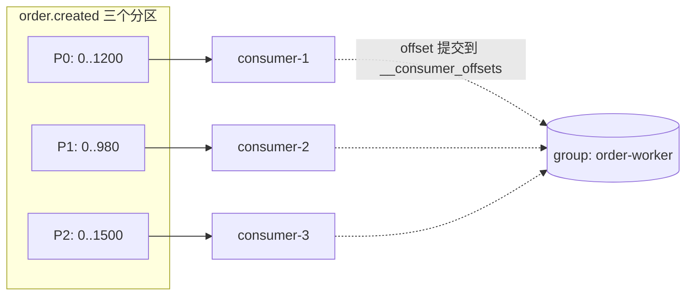

---
sources:
  - 07-第七阶段
---

# 05. 消息中间件的 Kafka 与 RabbitMQ 模型

> [← 第七阶段导览](01-导览.md) · 消息队列解决的不是「发消息」，而是「把一次写拆成两个时间」；Kafka 与 RabbitMQ 的差异，本质是「日志」与「队列」两种数据结构的差异。

缓存解决读太慢，消息解决「写太慢」和「耦合太紧」。但消息一引入，系统里就多了一个「至少一次」的语义、一个会积压的缓冲区、一个可能丢消息或重复投递的组件。这一册只讲两件事：Kafka 和 RabbitMQ 各自的模型是什么，以及在这两个模型上「可靠性」到底能配到什么程度。Spring 侧的消费配置、幂等、死信与积压排查放下一册。

## 1. Kafka：分区日志，不是队列

Kafka 的核心抽象只有三个：topic、partition、offset。

- **topic** 是逻辑名字；**partition** 是物理上的追加日志（append-only log），每个分区在磁盘上是一串按 offset 递增的段文件。
- **offset** 是消息在分区内的位置，单调递增。消费者不「删除」消息，只记录「我读到哪了」。这个位点存在 Kafka 内部的 `__consumer_offsets` topic 里。
- 消息的保留由时间或大小决定（`retention.ms` 默认 7 天，`retention.bytes` 默认 -1 即不限），与「是否被消费」无关。这是它和 RabbitMQ 最根本的区别。

因为消息不被消费删除，所以 Kafka 天然支持三件 RabbitMQ 做不到的事：**重放**（把 offset 重置到很早的位置重新读）、**多订阅**（不同消费组各自维护 offset，互不影响）、**回填**（新服务上线时从头消费历史数据重建视图）。

| 概念 | 作用 | 常见误解 |
|---|---|---|
| offset | 消费者在分区内的位置 | 不是全局消息 ID；唯一标识是 `(topic, partition, offset)` |
| partition | 并行与顺序的单位 | 不是副本；副本数由 `replication.factor` 单独决定 |
| 消费组 | 逻辑订阅者，组内瓜分分区 | 组内是竞争，组间是广播 |
| ISR | 与 leader 保持同步的副本集合 | `acks=all` 等的是 ISR，不是「所有副本」 |
| KRaft | Kafka 4 的元数据层 | ZooKeeper 在 4.0 已移除，部署只剩 broker + controller |

分区数决定了单个消费组的最大并行度：一个分区同一时刻只能被组内一个消费者消费。所以「消费者数超过分区数」不会更快，只会多出空闲消费者。

## 2. 消费组与再均衡



再均衡（rebalance）是「重新分配分区给消费者」的过程。触发条件有五类：消费者加入、消费者离开、订阅的 topic 变化、分区数变化、以及消费者被认为「死了」（心跳超时或 `max.poll.interval.ms` 超时）。

两种协议：

| 协议 | 行为 | 代价 | 现状 |
|---|---|---|---|
| Eager（`RangeAssignor` 等） | 所有消费者先放弃全部分区，再重新分配 | 全组暂停消费（stop-the-world） | 兼容性最好 |
| Cooperative（`CooperativeStickyAssignor`） | 只撤销需要迁移的分区，其余继续消费 | 可能需要多轮才稳定 | 默认策略列表里已包含，全组支持时生效 |
| KIP-848（`group.protocol=consumer`） | 服务端负责分配，客户端只收结果 | 需要新版客户端与 broker | Kafka 4.0 起可用 |

两个超时参数必须分清，它们导致的是完全不同的故障：

- `session.timeout.ms`（默认 45 秒）：多久没收到心跳就认为消费者死了。心跳由后台线程发，与业务线程无关。
- `max.poll.interval.ms`（默认 5 分钟）：两次 `poll()` 之间的最大间隔。**业务处理太慢**会触发它，消费者被踢出组，分区被收回，然后重新加入——如果处理一直慢，就会陷入「加入 → 超时 → 被踢 → 再加入」的再均衡风暴，永远消费不完。

`group.instance.id`（静态成员）能让消费者重启时保留原来的分区分配，避免「发布一次触发一次全组再均衡」。滚动发布时这个配置的价值很大。

再均衡期间有两个必须处理的点：分区被撤销前要提交 offset（`ConsumerRebalanceListener.onPartitionsRevoked`），否则已处理的消息会被重投；分区被分配后要从提交的 offset 继续，而不是从头开始。

## 3. 顺序性、副本与 acks

**顺序只在分区内成立**。同一订单的三条事件要按序处理，就把订单 ID 作为消息 key，Kafka 用 `murmur2(key) % partitionCount` 决定分区，同一个 key 永远落在同一个分区。跨分区没有任何顺序保证，消费端如果要做全局有序，只能在业务层按时间戳排序或做窗口聚合。

分区数变化会打破这个映射：从 3 个分区扩到 6 个，`hash % 3` 变成 `hash % 6`，同一个 key 可能落到不同分区，历史消息和新消息的顺序就断了。所以**扩分区是有代价的**，需要「双写新旧 topic + 迁移 + 切读」或者接受一段时间的乱序。

副本与确认：

| `acks` | 语义 | 丢失风险 | 延迟 | 适用 |
|---|---|---|---|---|
| `0` | 发出去就返回 | broker 没收到也不知道 | 最低 | 日志、指标，可丢 |
| `1` | leader 写入就返回 | leader 挂了、未同步到 follower 时丢 | 低 | 一般业务 |
| `all`（`-1`） | ISR 全部写入才返回 | 配置正确时只丢「未提交」的 | 高 | 订单、资金、不可丢事件 |

`acks=all` 必须配合 `min.insync.replicas` 才有意义。RF=3、`min.insync.replicas=2` 时，允许一个 broker 挂掉仍可写；挂两个 broker，ISR 不足 2，生产端会收到 `NotEnoughReplicasException`——**这是设计好的行为**：宁可拒绝写入，也不接受可能丢数据的写入。如果 `min.insync.replicas=1`，`acks=all` 退化成 `acks=1`。

`unclean.leader.election.enable` 默认 `false`，防止落后的副本在 leader 挂掉后当选（会丢数据）。可用性换一致性，默认选得对。

## 4. 幂等生产者与事务：边界在哪

生产者重试会带来重复，重试加多线程在途还会带来乱序。Kafka 用两个机制解决：

- **幂等生产者**（`enable.idempotence=true`，3.0 起默认）：broker 分配 PID，每条消息带「分区 + 序列号」，broker 按序列号去重。它保证「单生产者会话、单分区内不重复、不乱序」。
- **事务**（`transactional.id`）：跨分区原子写，配合 `sendOffsetsToTransaction` 可以把「消费 → 处理 → 生产」做成一个原子操作，消费者用 `isolation.level=read_committed` 只读已提交的消息。

但「恰好一次」的边界必须说清：

| 范围 | 能否恰好一次 | 原因 |
|---|---|---|
| 生产端单分区重试 | 能 | 幂等生产者去重 |
| Kafka 内部多分区写 + offset 提交 | 能 | 事务覆盖两者 |
| 消费 → 写数据库 → 提交 offset | 不能 | 数据库不在 Kafka 事务里 |
| 消费 → 调用外部 HTTP → 提交 offset | 不能 | 外部系统没有事务协调 |

所以端到端的真实语义仍然是「至少一次 + 消费侧幂等」。想接近「恰好一次」，要么把副作用也做成 Kafka 事务的一部分（只有「写另一个 Kafka topic」满足），要么用 Outbox（本地事务 + 消息表，第六阶段 06 册），要么老老实实做幂等。

`max.in.flight.requests.per.connection` 在幂等开启时可以设到 5 而不乱序（broker 会按序列号重排）；关闭幂等时，只要大于 1 就有乱序风险。

## 5. RabbitMQ：exchange、queue、ack

RabbitMQ 的模型比 Kafka 多一层路由：

```text
producer → exchange --binding--> queue → consumer
```

生产者不直接写队列，而是发给 exchange，由 binding（routing key 或 header 匹配）决定进哪些队列。

| exchange 类型 | 路由规则 | 典型用途 |
|---|---|---|
| `direct` | routing key 精确匹配 | 按任务类型分发（`order.paid`） |
| `topic` | `*` 匹配一个词，`#` 匹配零到多个词 | 按维度订阅（`order.*.paid`） |
| `fanout` | 忽略 key，广播到所有绑定队列 | 缓存失效、配置推送 |
| `headers` | 按消息头键值匹配 | 多条件路由，性能较差，少用 |
| 默认 exchange（`""`） | routing key 等于队列名 | 点对点，简单场景 |

队列的关键属性：`durable`（ broker 重启后还在）、`exclusive`（只允许创建它的连接用）、`auto-delete`（最后一个消费者断开后删除）、`x-queue-type`。RabbitMQ 4 移除了经典镜像队列，高可用队列要用 **quorum queue**（基于 Raft，至少 3 个节点）。

消费侧的三个概念：

- **prefetch**（`basic.qos`）：每个消费者允许「已投递但未 ack」的消息上限。设太大，一个消费者囤一堆消息而其他消费者空闲；设太小，吞吐上不去。经验值：处理快的任务 30 到 100，处理慢的任务 1 到 10。
- **ack**：`basic.ack` 确认、`basic.nack`（可 `requeue`）、`basic.reject`。`autoAck=true` 是「投递即确认」，消费者崩溃消息就丢了，生产环境不应该用。
- **死信交换（DLX）**：队列配置 `x-dead-letter-exchange` 和 `x-dead-letter-routing-key`，消息在三种情况下进入死信：被 `reject`/`nack` 且 `requeue=false`、TTL 过期、队列超过 `x-max-length`。

RabbitMQ 是推送模型：有消息就推给消费者（受 prefetch 限制），空闲消费者能立刻拿到。Kafka 是拉取模型：消费者 `poll`，靠 `fetch.max.wait.ms` 做长轮询。这决定了两者的延迟特性：RabbitMQ 在低流量下延迟更低（毫秒级），Kafka 在批量下吞吐更高但单条延迟受 `linger.ms` 和批量影响。

## 6. 取舍表与「投递语义」的真实含义

| 维度 | Kafka | RabbitMQ |
|---|---|---|
| 数据模型 | 分区追加日志，消费不移除 | 队列，ack 后删除 |
| 消费模式 | 拉取（长轮询） | 推送（受 prefetch 限制） |
| 吞吐 | 单集群十万到百万级（批量 + 压缩） | 单节点万到十万级（quorum 受 Raft 影响） |
| 延迟 | 毫秒到几十毫秒 | 亚毫秒到毫秒 |
| 路由 | 简单：key → 分区 | 复杂：exchange + binding + header |
| 顺序 | 分区内严格有序 | 单队列单消费者有序 |
| 重放 | 原生支持（重置 offset） | 不支持（ack 即删） |
| 多订阅 | 消费组天然支持 | 需要 fanout 绑多个队列 |
| 积压 | 磁盘顺序写，堆积能力强 | 堆积能力较弱，深积压会拖慢 |
| 运维 | 分区/再均衡调优门槛高，KRaft 省了 ZK | 相对简单，但 quorum queue 要规划节点 |
| 典型场景 | 事件流、CDC、日志、需要重放 | 任务分发、命令、复杂路由、低延迟 |

投递语义只有三种，定义取决于「提交位点」和「处理消息」的先后：

| 语义 | 顺序 | 崩溃后果 | 实现方式 |
|---|---|---|---|
| 至多一次 | 先提交，后处理 | 消息丢 | 自动提交 + 处理前确认 |
| 至少一次 | 先处理，后提交 | 消息重复 | 处理成功后手动提交 |
| 恰好一次 | 处理与提交原子 | 不丢不重 | 需要事务覆盖两者，跨系统做不到 |

「至少一次是默认答案」的原因不是它更优雅，而是它是唯一能同时满足「不丢」和「可实现」的选项：

1. **不丢比不重重要**。重复可以通过幂等消除，丢失没有任何补偿手段（除非上游能重发，而那通常不可靠）。
2. **「先处理后提交」是唯一不丢的顺序**。先提交后处理，处理前崩溃就永久丢失。
3. **恰好一次需要「处理」和「提交」在同一个事务里**。Kafka 内部可以（offset 和输出 topic 在同一个事务），一旦处理涉及数据库或 HTTP，就没有共同的事务边界，只能退化为「至少一次 + 幂等」。

## 7. 消息设计：事件、命令、schema 与大小

**事件 vs 命令**是最先要定的事：

| 维度 | 事件（Event） | 命令（Command） |
|---|---|---|
| 语义 | 已经发生的事实，过去时 | 请求做某事，祈使句 |
| 消费者 | 0 到 N 个，发布者不关心 | 通常 1 个，发送者关心结果 |
| 可否拒绝 | 不可拒绝，只能补偿 | 可以拒绝（库存不足） |
| schema 稳定性 | 高，改起来代价大 | 可以随业务调整 |
| 例子 | `OrderPaid`、`InventoryReserved` | `ReserveInventory`、`SendEmail` |

把命令当事件发（`SendEmail` 广播给所有订阅者），会导致多个服务重复发邮件；把事件当命令用（发布者等 `OrderPaid` 的「结果」），会把异步变成伪同步。判断标准：**发布者是否需要知道「谁会处理、处理结果是什么」**——需要就是命令，不需要就是事件。

**schema 演进**的三条硬规则：

1. 只加可选字段，不删字段、不改字段语义、不复用字段名。JSON 用 `@JsonIgnoreProperties(ignoreUnknown = true)` 做 tolerant reader；Avro/Protobuf 用 Schema Registry 的兼容性检查（`BACKWARD` 默认，允许新消费者读旧消息）。
2. 版本放在消息头（`schema-version`）或 schema 的 namespace 里，不要放在 body 的字段里让业务代码判断。
3. 老消息会被重放（offset 重置、DLT 重放），所以新代码必须能读旧消息——这是「只加不删」的根本原因。

**key 与幂等键**要分开：

- key 决定分区，用聚合 ID（`orderId`），保证同一聚合的事件有序。
- 幂等键决定「这条消息是否处理过」，用 `eventId`（生产端生成的 UUID）或 `aggregateId:version`。消费端建唯一索引，重复直接忽略。

**大小**：Kafka 默认 `max.request.size` 1MB、broker `message.max.bytes` 约 1MB；RabbitMQ 受 `frame_max` 和内存限制。经验值是单条消息控制在 100KB 以内。大 payload 用 claim-check：把文件/大 JSON 存对象存储或数据库，消息里只放引用。消息在磁盘上会保留数天，放大对象会让保留成本和网络开销一起失控。

**headers** 放元数据：`traceparent`（链路追踪）、`event-type`、`schema-version`、`content-type`、`occurred-at`。不要把业务字段塞进 header，它们不可索引、不可查询，且各客户端的 header 类型支持不一致。

## 8. 两段配置与消费语义

生产端的核心配置（显式装配版，等价于 `spring.kafka.producer.*`）：

```kotlin
@Configuration
class KafkaProducerConfig {
    @Bean
    fun producerFactory(): ProducerFactory<String, String> = DefaultKafkaProducerFactory(
        mapOf(
            ProducerConfig.BOOTSTRAP_SERVERS_CONFIG to "kafka-1:9092,kafka-2:9092,kafka-3:9092",
            ProducerConfig.ACKS_CONFIG to "all",
            ProducerConfig.ENABLE_IDEMPOTENCE_CONFIG to true,
            ProducerConfig.COMPRESSION_TYPE_CONFIG to "lz4",
            ProducerConfig.MAX_IN_FLIGHT_REQUESTS_PER_CONNECTION to 5,
            ProducerConfig.LINGER_MS_CONFIG to 10,
            ProducerConfig.BATCH_SIZE_CONFIG to 64 * 1024,
            ProducerConfig.DELIVERY_TIMEOUT_MS_CONFIG to 120_000,
            ProducerConfig.KEY_SERIALIZER_CLASS_CONFIG to StringSerializer::class.java,
            ProducerConfig.VALUE_SERIALIZER_CLASS_CONFIG to StringSerializer::class.java,
        ),
    )

    @Bean
    fun kafkaTemplate(factory: ProducerFactory<String, String>) = KafkaTemplate(factory)
}
```

四个参数之间的关系值得记住：`acks=all` 保不丢，`enable.idempotence=true` 保重试不重复不乱序，`max.in.flight=5` 在幂等开启时是安全上限（再大 broker 的重排缓冲压力上升），`delivery.timeout.ms=120s` 必须大于 `request.timeout.ms + linger.ms`，否则生产者会在重试预算用完之前就报超时。`linger.ms=10` 是用 10ms 延迟换批量，吞吐能提升几倍；对延迟敏感的 topic 设 0。

消费组语义的说明代码（原生客户端，看清 offset 与再均衡）：

```kotlin
fun consumeLoop() {
    val props = Properties().apply {
        put(ConsumerConfig.BOOTSTRAP_SERVERS_CONFIG, "kafka-1:9092")
        put(ConsumerConfig.GROUP_ID_CONFIG, "order-worker")
        put(ConsumerConfig.ENABLE_AUTO_COMMIT_CONFIG, "false")
        put(ConsumerConfig.AUTO_OFFSET_RESET_CONFIG, "earliest")
        put(ConsumerConfig.MAX_POLL_RECORDS_CONFIG, 100)
        put(ConsumerConfig.MAX_POLL_INTERVAL_MS_CONFIG, 300_000)
        put(ConsumerConfig.KEY_DESERIALIZER_CLASS_CONFIG, StringDeserializer::class.java)
        put(ConsumerConfig.VALUE_DESERIALIZER_CLASS_CONFIG, StringDeserializer::class.java)
        put(
            ConsumerConfig.PARTITION_ASSIGNMENT_STRATEGY_CONFIG,
            CooperativeStickyAssignor::class.java.name,
        )
    }

    KafkaConsumer<String, String>(props).use { consumer ->
        consumer.subscribe(listOf("order.created"), object : ConsumerRebalanceListener {
            override fun onPartitionsRevoked(partitions: Collection<TopicPartition>) {
                consumer.commitSync()      // 撤销前提交，缩窄重复窗口
            }

            override fun onPartitionsAssigned(partitions: Collection<TopicPartition>) = Unit
        })

        while (running) {
            val records = consumer.poll(Duration.ofMillis(500))
            for (record in records) {
                handle(record)             // 业务处理，必须幂等
            }
            consumer.commitSync()          // 处理完再提交 → 至少一次
        }
    }
}
```

这段代码里每个选择都对应一个语义：`enable.auto.commit=false` 让提交时机可控；`commitSync` 在处理之后，崩溃会重放这一批（至少一次）；`onPartitionsRevoked` 里提交，避免分区被收回后新消费者从更早的位点开始；`CooperativeStickyAssignor` 减少再均衡时的全组暂停。`max.poll.interval.ms=300s` 是给「一批 100 条、每条 2 秒」留的余量——如果实际处理超过这个时间，消费者会被踢出组，表现为「消费着消费着就重复了」。

## 9. 自测

1. Kafka 的 offset 和「消息 ID」有什么区别？为什么重置 offset 能重读历史消息，而 RabbitMQ 的 ack 之后不能？
2. `acks=all`、RF=3、`min.insync.replicas=2`，同时挂两个 broker 会发生什么？这是 bug 还是设计？
3. 为什么「恰好一次」出了 Kafka 就不成立？举一个「消费后写数据库」的反例。
4. RabbitMQ 的 prefetch 设成 1000 和设成 1，分别会出现什么现象？
5. 事件和命令的判别标准是什么？各举一个「用错类型」会造成什么后果。
6. 设计「订单支付成功」消息的 key、幂等键和 schema 演进策略；如果金额字段以后要改成多币种，怎么改？

## 10. 延伸

- 上一册：[04-穿透、击穿、雪崩与多级缓存](04-穿透击穿雪崩与多级缓存.md)——缓存解决读，消息解决写，两者的共同敌人都是「重复」。
- 下一册：[06-Spring 消息集成](06-Spring消息集成-幂等消费-重试死信与积压.md)——`@KafkaListener` 的配置、手动 ack、重试与积压排查。
- 消息侧的事务语义（Outbox 为什么必要）见[第六阶段 06 册](../06-第六阶段/06-跨服务一致性-Outbox-Saga-TCC与分布式锁.md)；消费幂等的三层防御见[第六阶段 05 册](../06-第六阶段/05-幂等-幂等键-去重表与状态机.md)。
- 同步与异步通信的选择、超时与重试预算见[第十一阶段 04 册](../11-第十一阶段/04-服务间通信-同步与异步.md)。
