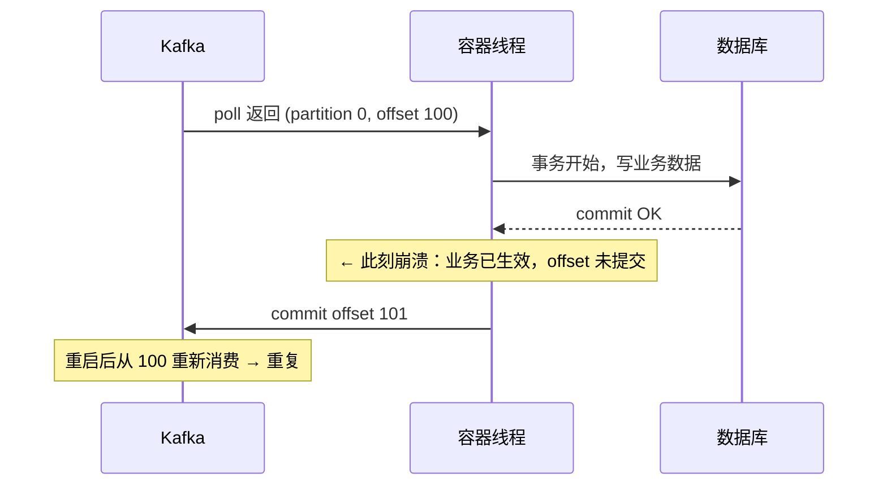
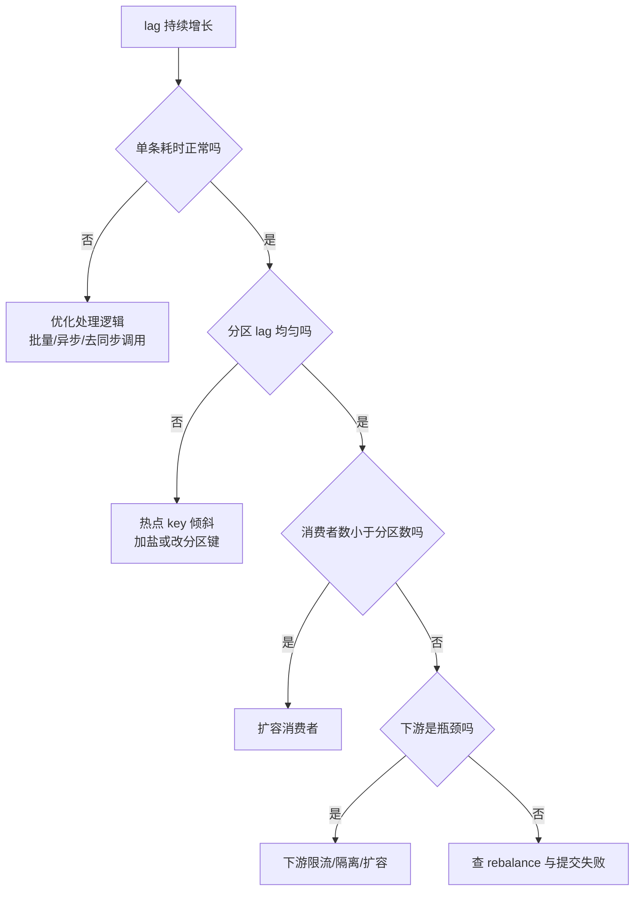

---
sources:
  - 07-第七阶段
---

# 06. Spring 消息集成：幂等消费、重试死信与积压

> [← 第七阶段导览](01-导览.md) · 消费端的可靠性不是「配一个 ack 模式」，而是「一条消息从进入容器到 offset 提交之间，每一步失败会怎样」。

上一册讲的是 Kafka 和 RabbitMQ 的模型。这一册落到 Spring：`@KafkaListener` 的几个开关怎么组合、什么时候算「消费成功」、重试放在容器里还是转发到另一个 topic、死信队列为什么必须有人看、积压了按什么顺序查。这些问题的共同点是——**配置项的名字很好查，但每个组合的失败行为没人替你推演**。

## 1. `@KafkaListener` 的四个开关

一个监听器的行为由四组配置共同决定，它们不是独立的，任意两个组合都可能产生意料之外的语义。

| 配置 | 默认 | 作用 | 典型坑 |
|---|---|---|---|
| `concurrency` | 1 | 每个容器的消费者线程数 | 超过分区数就是空闲线程；总线程数 = 实例数 × concurrency |
| `ackMode` | `BATCH` | 何时提交 offset | 只有关闭自动提交时才有意义；`MANUAL` 和 `MANUAL_IMMEDIATE` 差一次 RPC |
| 批量 vs 单条 | 单条 | `spring.kafka.listener.type=batch` 或 `batchListener=true` | 批量模式下一条失败会让整批重试 |
| `enable.auto.commit` | 客户端默认 `true` | 是否让客户端在 `poll` 里自动提交 | 自动提交与「业务是否处理成功」完全脱钩 |

配置键（Boot 4.1 的真实键名）：

```yaml
spring:
  kafka:
    consumer:
      enable-auto-commit: false
      max-poll-records: 100
      properties:
        max.poll.interval.ms: 300000
        isolation.level: read_committed
    listener:
      ack-mode: manual_immediate
      concurrency: 3
      type: single
```

`ackMode` 的七个值对应七种提交时机：

| ackMode | 提交时机 | 失败时重复多少 | 适用 |
|---|---|---|---|
| `BATCH` | 一批 `poll` 的记录全部处理完 | 整批 | 默认，吞吐最高 |
| `RECORD` | 每条处理完 | 当前条之后未提交的 | 单条语义、能接受多次 commit |
| `TIME` | 距上次提交超过 `ackTime` | 一个时间窗内的 | 低频 topic |
| `COUNT` | 累计 `ackCount` 条 | 一批 | 折中 |
| `COUNT_TIME` | 满足时间或条数任一 | 一批 | 折中 |
| `MANUAL` | 调用 `acknowledge()` 后，**下次 poll 时**提交 | 一批 | 想自己控制提交点 |
| `MANUAL_IMMEDIATE` | `acknowledge()` 立即提交 | 当前条之后未提交的 | 要求提交及时，代价是每条一次 RPC |

这里最容易踩的是 `enable.auto.commit`。客户端默认是 `true`，它会在 `poll` 时按 `auto.commit.interval.ms` 提交「上次 poll 返回的位点」，**和你的业务方法有没有执行成功毫无关系**。Spring 的 `ackMode` 只在自己管理提交时才生效；两者同时开着，你会看到「明明抛了异常，offset 还是往前走了」。生产配置统一写 `enable-auto-commit: false`，不要依赖默认值。

第二个坑是 `concurrency` 与分区数的关系。3 个分区、`concurrency=6`，多出来的 3 个线程会一直空转（分配到 0 个分区）；反过来，3 个分区、10 个实例、每个 `concurrency=1`，只有 3 个实例能分到分区，另外 7 个完全空闲。**有效并行度 = min(分区数, 实例数 × concurrency)**。

## 2. 什么时候算「消费成功」

这个问题的答案不是「方法没抛异常」，而是「业务副作用已经持久化，且 offset 已经提交」。两者之间有一个窗口，窗口里的崩溃会导致重复。



所以「消费成功」的定义要拆成两层：

- **业务成功**：数据库事务提交（或外部调用确认成功）。
- **位点成功**：offset 提交到 broker。

手动 ack 只是把「位点成功」的时机交给你，不能让两层变成一个原子操作。`ack.acknowledge()` 在 `MANUAL` 模式下只是标记，真正的提交发生在下一次 `poll`；`MANUAL_IMMEDIATE` 会立刻发 `OffsetCommit` 请求。如果提交失败（比如再均衡已经把分区收走），会抛 `CommitFailedException`，这条消息实际上会被新消费者重新处理。

由此得到两条纪律：

1. **业务处理必须幂等**。这不是「最好有」，是「至少一次语义的必然要求」。
2. **不要在业务事务提交前 ack**。先 ack 后提交，进程在中间崩溃就是永久丢失。

## 3. 重试的两种形态

### 3.1 容器内重试

`DefaultErrorHandler` + `BackOff` 在同一个消费者线程里循环重试：

```kotlin
val errorHandler = DefaultErrorHandler(
    recoverer,
    FixedBackOff(1_000L, 3L),        // 间隔 1s，最多 3 次尝试（含首次）
)
```

行为：处理抛异常 → 等待 1 秒 → 重新调用监听方法 → 三次都失败 → 交给 `recoverer`（通常是投递到 DLT）。

它的优点是简单、保持分区顺序、不需要额外 topic。缺点是**阻塞分区**：重试期间这个分区不能消费新消息；退避时间一长，`max.poll.interval.ms` 就会被突破，消费者被踢出组，触发再均衡——而此时消息还没处理完，新消费者会从头再消费一遍。所以容器内重试适合「瞬时故障、快速恢复」（数据库连接闪断、下游 503），退避总时长要显著小于 `max.poll.interval.ms`。

不可重试的异常要显式排除，否则会白白消耗重试预算：

```kotlin
errorHandler.addNotRetryableExceptions(IllegalArgumentException::class.java)
```

反序列化失败、消息格式错误、业务校验失败都属于「重试一万次也不会成功」的类别，应该直接进 DLT。

### 3.2 转发到重试 topic

`@RetryableTopic` 把失败消息转发到 `topic-retry-0`、`topic-retry-1`……每个 topic 配不同的延迟，最后进 `topic-dlt`：

```kotlin
@RetryableTopic(
    attempts = "4",
    backoff = Backoff(delay = 1_000, multiplier = 2.0, maxDelay = 10_000),
    dltTopicSuffix = ".DLT",
    autoCreateTopics = "false",
)
@KafkaListener(topics = ["order.created"], groupId = "order-worker")
fun onMessage(record: ConsumerRecord<String, String>, ack: Acknowledgment) {
    handler.handle(record.key(), record.value())
    ack.acknowledge()
}

@DltHandler
fun onDlt(record: ConsumerRecord<String, String>) {
    log.error("dead letter: key={} offset={}", record.key(), record.offset())
}
```

Kafka 没有原生的延迟消息，`@RetryableTopic` 的实现是「把消息转发到重试 topic，由另一个监听器暂停/延迟后再投递」。它的好处是不阻塞主分区，重试可以拉到几分钟甚至几小时；坏处是：

- **顺序会乱**。原消息进了 retry topic，同一 key 的后续消息还在主 topic 继续被消费，等重试成功时已经晚于后来者。「同一订单必须先创建后支付」这类约束会被打破。
- **topic 数量膨胀**。每个重试链一组 topic，几十个消费者就是几百个 topic，运维和监控成本上升。
- **需要 `KafkaTemplate` 和 topic 管理**。`autoCreateTopics=true` 依赖 broker 的自动创建，生产环境通常关掉，要自己用 `NewTopic` 声明。

| 维度 | 容器内重试 | 重试 topic |
|---|---|---|
| 是否阻塞分区 | 是 | 否 |
| 重试时长上限 | 受 `max.poll.interval.ms` 限制 | 可以很长 |
| 顺序 | 保持 | 可能乱序 |
| 额外 topic | 无 | 每个重试级别一个 |
| 运维复杂度 | 低 | 中高 |
| 适用 | 瞬时故障、秒级恢复 | 下游长时间不可用、需要退避几十分钟 |

选择标准：**如果重试总时长会超过 `max.poll.interval.ms` 的一半，就用重试 topic；否则容器内重试更简单。**

## 4. 死信队列必须有人看

DLT 不是「处理完了」，而是「放弃自动处理，转人工」。没有告警和重放工具的 DLT 就是一个黑洞：消息堆在那里，业务数据少了一部分，没人知道。

必须配套三件事：

1. **告警**：监控 DLT topic 的 lag 和消息速率。DLT 的 lag 从 0 变成 1 就应该有人收到通知，而不是等到「用户投诉订单没发货」。用独立的消费组（比如 `dlt-monitor`）读 DLT 的 `LOG-END-OFFSET`，或者在 DLT 监听器里打点到 Micrometer。
2. **重放工具**：能按时间范围/业务 key 把 DLT 消息重新投递回原 topic。重放时要保留原始 headers（`traceparent`、`event-type`、`schema-version`），并且重放本身要幂等——同一批消息可能被重放两次。
3. **保留期**：DLT 的 `retention.ms` 要长于排查周期，通常 7 到 14 天。默认 7 天，如果事故是周五晚上发生、周一才排查，正好卡在边界上。

消息进 DLT 时要带上「为什么失败」：异常类名、异常消息、失败次数、原 topic/partition/offset，放在 headers 里而不是 body 里。body 的 schema 是给业务用的，塞异常栈会让所有消费者都要处理一个它们不认识的字段。

## 5. 幂等消费的三层防御

至少一次语义下，重复是常态，不是异常。三层防御各管一段：

| 层 | 机制 | 覆盖 | 成本 | 失效场景 |
|---|---|---|---|---|
| 入口去重 | 去重表 `(consumer, event_id)` 唯一索引；或 Redis `SETNX` | 所有重复消息 | 一张表/一个 key，需要清理 | 去重表与业务不在同一事务；Redis 键被淘汰 |
| 状态机 | `update ... where status = 'PENDING'` | 状态迁移类操作 | 需要设计状态与合法迁移 | 只覆盖已有实体；0 行要再查区分「重复」与「非法」 |
| 业务唯一键 | `(order_id, type)` 唯一索引 | 创建类操作 | 一个索引 | 冲突后要读回结果 |

三层不是三选一，而是「入口挡量、状态机保正确、唯一约束兜底」。只做入口去重，去重表写失败时会漏；只做状态机，非状态迁移的操作（比如发通知）没有保护；只做唯一约束，冲突处理逻辑会散落在每个 DAO 里。

去重表的关键是**和业务副作用在同一个事务**：

```kotlin
@Service
class OrderCreatedHandler(
    private val jdbc: JdbcClient,
    private val json: JsonMapper,
) {
    @Transactional
    fun handle(orderId: String, payload: String) {
        val event = json.readValue(payload, OrderCreatedEvent::class.java)

        val inserted = jdbc.sql("""
            insert into consumed_event(consumer, event_id, consumed_at)
            values ('order-worker', :eventId, now())
            on conflict (consumer, event_id) do nothing
        """).param("eventId", event.eventId).update()

        if (inserted == 0) return          // 已处理过，直接返回，ack 照常

        jdbc.sql("""
            update orders set status = 'CREATED', updated_at = now()
            where id = :id and status = 'DRAFT'
        """).param("id", orderId).update()
    }
}
```

`on conflict do nothing` 而不是 catch 唯一键异常，是因为 PostgreSQL 的语句报错会让整个事务进入 aborted 状态，同一个事务里没法继续执行（第六阶段 05 册踩过）。`inserted == 0` 表示重复，直接返回成功——重复消息要 ack 掉，不能让它一直重投。

如果去重表和业务表不在同一个库（分库或用了独立的 Redis），这个方案就退化：去重记录写成功、业务失败，消息重投时被当成重复而跳过，业务永久缺失。跨库场景只能用「状态机 + 唯一约束」在业务侧兜底，或者用 Outbox 把「业务写」和「消息发」放进同一个本地事务。

## 6. 积压排查的固定顺序

积压不是「消费者不够」的同义词。按下面的顺序查，每一步都能排除一类原因：

| 步骤 | 检查什么 | 命令/指标 | 判定 | 处置 |
|---|---|---|---|---|
| 1 | 生产速率 vs 消费速率 | `kafka-consumer-groups.sh --describe` 的 `LAG` 趋势；topic 的 `BytesInPerSec` | lag 持续增长 = 消费跟不上；lag 平稳 = 只是历史存量 | 流量突增就先限流/降级 |
| 2 | 单条处理耗时 | 监听器 P99、JFR、日志 | 单条 > 100ms 就有优化空间 | 批量化、去掉同步 HTTP、异步化 |
| 3 | 分区倾斜 | 每个分区的 `LAG` 和 `CURRENT-OFFSET` 差值 | 某分区 lag 远高于其他 | 检查 key 分布，热点 key 加盐 |
| 4 | 消费者数 vs 分区数 | `--describe` 的 `CONSUMER-ID` 列 | 有消费者分不到分区 = 白扩容 | 加分区（注意顺序）或减实例 |
| 5 | 同步慢下游 | DB 慢查询、连接池等待、下游 HTTP P99 | 下游是瓶颈 | 超时、隔离线程池、批量写 |
| 6 | 再均衡/提交失败 | 日志里的 `Rebalance`、`CommitFailedException` | 频繁 rebalance = 消费反复中断 | 调 `max.poll.interval.ms`、加静态成员 |



两个量化公式，用来判断「扩容有没有用」：

```text
单实例消费能力 ≈ concurrency × (1000 / 单条耗时ms)   条/秒
集群消费能力   ≈ min(分区数, 实例数 × concurrency) × (1000 / 单条耗时ms)
```

3 个分区、单条 50ms、`concurrency=6`：有效线程只有 3 个，集群能力约 60 条/秒，加实例完全没用。这时候要么加分区，要么把单条耗时降下来。

### 6.1 扩容与再均衡风暴

扩容不是无代价的：

- **消费者数超过分区数**：多出来的实例分不到分区，只是白占资源。Kafka 不允许「多个消费者协作处理一个分区」（除非用共享订阅的新协议）。
- **加分区会打乱 key 的顺序**：`hash % 3` 变成 `hash % 6`，同一订单的历史消息和新消息可能落在不同分区。正确做法是新建一个分区更多的 topic、双写、迁移、切读，而不是原地扩。
- **每次扩容都触发再均衡**：再均衡期间全组（eager 协议）或部分分区（cooperative）暂停消费，lag 会短时上升。滚动发布时如果没配 `group.instance.id`，每个实例重启都触发一次再均衡，形成「一直在 rebalance、一直消费不动」的风暴。

再均衡风暴的典型症状是日志里反复出现 `Revoking previously assigned partitions` 和 `(Re-)joining group`，lag 不降反升。根因通常只有一个：**单次 `poll` 之间的处理时间超过了 `max.poll.interval.ms`**。处置顺序是：先调大 `max.poll.interval.ms` 止血，再减小 `max.poll.records`，最后把慢处理移出消费线程（用内部队列 + 背压，注意别把队列撑爆）。

## 7. 一套可用的监听器配置

把前面的结论落成配置：手动 ack、容器内重试、DLT、不可重试异常直通。

```kotlin
@Configuration
class OrderConsumerConfig {

    @Bean
    fun orderListenerFactory(
        consumerFactory: ConsumerFactory<String, String>,
        kafkaTemplate: KafkaTemplate<String, String>,
    ): ConcurrentKafkaListenerContainerFactory<String, String> {
        val factory = ConcurrentKafkaListenerContainerFactory<String, String>()
        factory.consumerFactory = consumerFactory
        factory.setConcurrency(3)
        factory.containerProperties.ackMode = ContainerProperties.AckMode.MANUAL_IMMEDIATE
        factory.containerProperties.isSyncCommits = true

        val recoverer = DeadLetterPublishingRecoverer(kafkaTemplate) { record, _ ->
            TopicPartition("${record.topic()}.DLT", record.partition())
        }
        val errorHandler = DefaultErrorHandler(recoverer, FixedBackOff(1_000L, 3L)).apply {
            addNotRetryableExceptions(IllegalArgumentException::class.java)
            setCommitRecovered(true)      // 关键：DLT 投递成功后提交 offset
        }
        factory.commonErrorHandler = errorHandler
        return factory
    }
}
```

`setCommitRecovered(true)` 是手动 ack 模式下最容易漏的一行。默认 `false` 时，消息被成功投递到 DLT，但 offset 没有提交，重启后会再次消费、再次进 DLT，DLT 里出现重复条目，监控上看起来像「一直在失败」。

监听器本身保持薄：

```kotlin
@Component
class OrderCreatedListener(private val handler: OrderCreatedHandler) {

    @KafkaListener(
        topics = ["order.created"],
        groupId = "order-worker",
        containerFactory = "orderListenerFactory",
    )
    fun onMessage(record: ConsumerRecord<String, String>, ack: Acknowledgment) {
        handler.handle(record.key(), record.value())   // 幂等 + 事务，失败会抛
        ack.acknowledge()                              // 只在业务成功后才 ack
    }
}
```

这段代码的失败路径要能背下来：

| 失败点 | 结果 | 重复窗口 |
|---|---|---|
| `handler.handle` 抛异常 | 容器内按 `FixedBackOff` 重试，耗尽后进 DLT | 重试期间未提交，可能重复 |
| 业务提交成功、`acknowledge` 前崩溃 | offset 未提交，重启后重投 | 重复一次，靠幂等表挡住 |
| `acknowledge` 时再均衡已发生 | `CommitFailedException`，消息被新消费者重投 | 重复，靠幂等 |
| DLT 投递成功、offset 提交失败 | 重启后再次进 DLT | DLT 重复条目，需要按 event id 去重 |

## 8. 自测

1. `MANUAL` 与 `MANUAL_IMMEDIATE` 的提交时机差在哪？各自在崩溃时的重复窗口有多大？
2. `enable.auto.commit=true` 与 `ackMode=MANUAL` 同时存在时，offset 会怎样前进？为什么这是危险的？
3. 容器内重试为什么会触发再均衡？由哪个参数决定？什么情况下应该改用重试 topic？
4. 重试 topic 为什么会破坏同一 key 的顺序？业务上怎么缓解？
5. 去重表为什么必须和业务副作用在同一事务？跨库时有哪些替代方案？
6. 一个 topic 有 12 个分区、3 个实例各 `concurrency=4`，有效并行度是多少？如果单条耗时 200ms，集群消费上限大约多少条每秒？

## 9. 延伸

- 上一册：[05-消息中间件：Kafka 与 RabbitMQ 的模型](05-消息中间件-Kafka与RabbitMQ模型.md)——offset、消费组、acks 的语义在这一册被翻译成 Spring 配置。
- 幂等的完整设计（幂等键、去重表、状态机）见[第六阶段 05 册](../06-第六阶段/05-幂等-幂等键-去重表与状态机.md)；Outbox 与「本地事务 + 消息」见[第六阶段 06 册](../06-第六阶段/06-跨服务一致性-Outbox-Saga-TCC与分布式锁.md)。
- 消费链路的指标、日志与 trace 贯穿见[第十阶段 05 册](../10-第十阶段/05-可观测性落地-指标-日志与链路.md)；发布时的消费停机顺序见[第十阶段 07 册](../10-第十阶段/07-交付-分层镜像-探针与优雅停机.md)。
