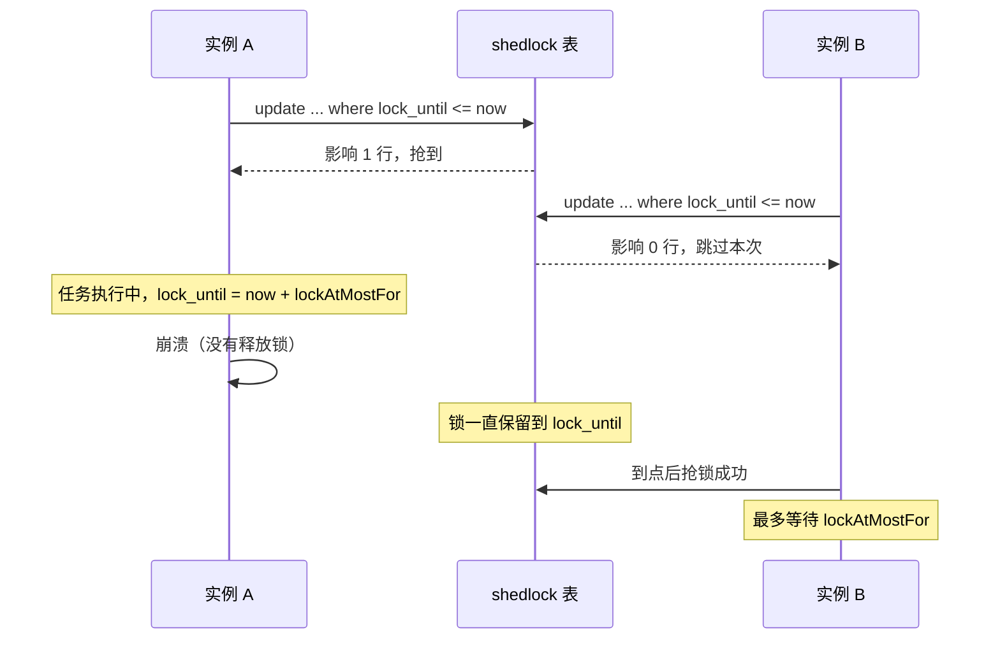

---
sources:
  - 07-第七阶段
---

# 07. 定时任务与调度

> [← 第七阶段导览](01-导览.md) · 定时任务是最容易「看起来能跑」的一类代码：单机测试永远正确，多副本上线就开始重复，长任务一崩就再也不会跑。

定时任务的复杂度不在 `@Scheduled` 这个注解，而在它默认假设的三件事：只有一个实例、只有一个线程、每次执行都会成功。生产环境三条都不成立。这一册先把这三个假设逐个拆掉，再给出两条重构路线：加互斥（ShedLock/Quartz），或者把任务变成消息。

## 1. `@Scheduled` 的三个坑

### 1.1 多实例重复执行

`@Scheduled` 是进程内的调度器，每个 JVM 各跑各的。三个副本，`@Scheduled(cron = "0 0 3 * * *")` 就会在凌晨三点同时发三份日报、跑三次对账、扣三次积分。

这不是「偶发」，是必现。而且本地开发和单实例测试永远发现不了，因为只有一个进程。

### 1.2 默认单线程

Boot 自动配置的 `TaskScheduler` 默认线程池大小是 1（`spring.task.scheduling.pool.size=1`）。所有 `@Scheduled` 任务共享这一个线程：

- 一个任务跑了 10 分钟，其他任务全部排队，cron 到点也不会执行；
- 排队是静默的，日志里只会看到「任务开始时间比预期晚了十分钟」；
- 如果任务里有阻塞 IO（HTTP 调用、大文件），整个调度器就被一个任务占死。

修法是调大池子：

```yaml
spring:
  task:
    scheduling:
      pool:
        size: 4
      thread-name-prefix: sched-
```

但调大只是让任务之间不互相阻塞，不解决「同一个任务重复执行」和「长任务占线程」的问题。

### 1.3 异常：默认被吞，改错则永久停摆

Spring 的 `ThreadPoolTaskScheduler` 默认错误处理器是 `TaskUtils.LOG_AND_SUPPRESS_ERROR_HANDLER`：任务抛异常时，它打一行日志，然后**吞掉**。从调度器角度看，这次执行「正常结束」，下一次照常触发。

于是你得到的是一个「一直在跑、一直失败、没有任何告警」的任务。日报没发出去，日志里有一行被埋在几千行里的 stack trace，没人看见。

如果为了「让失败可见」把错误处理器改成抛出异常，问题会变成另一种：`ReschedulingRunnable` 在 `run()` 里先执行任务，再安排下一次；错误处理器把异常抛出来后，安排下一次的那行代码不会执行，**这个任务从此永久停止**。进程不重启，它再也不会跑。

正确做法是两者都避开：保留「不中断调度」的行为，但在任务内部捕获异常、打结构化日志、打失败指标、发告警；同时用「最后成功时间」这个指标做兜底——超过预期周期没成功就报警，而不是等异常日志。

| 坑 | 现象 | 怎么发现 | 修法 |
|---|---|---|---|
| 多实例重复 | 数据重复、下游收到多份 | 对比各实例日志、业务表出现重复行 | ShedLock / 任务即消息 / 唯一约束 |
| 单线程 | 任务延迟、cron 不准时 | 任务开始时间与 cron 的偏差 | 调 `pool.size`、拆分调度器 |
| 异常被吞 | 任务「在跑」但数据不对 | 缺「最后成功时间」告警 | 内部捕获 + 指标 + 告警 |
| 异常抛出 | 任务永久停止 | 只有一次失败日志，之后再也没有执行记录 | 不要替换默认 errorHandler，或在内部处理 |

怎么确认「已经重复了」？三条线索：业务表出现同一业务日期的多行（加唯一约束可以直接挡住）；下游收到多份同样的请求（对账时差异率突然升高）；日志里同一任务在同一秒有多个实例的开始记录（按实例 ID 聚合）。第三条只能在事故后回溯，前两条才是防线——**定时任务写的数据，必须有一把数据库层的唯一约束兜底**。

还有一个隐蔽的坑：`@Scheduled` 的 `zone` 默认是服务器时区。容器基础镜像通常是 UTC，你在代码里写 `cron = "0 0 3 * * *"`，以为是北京时间凌晨三点，实际是北京时间上午十一点。要么显式写 `zone = "Asia/Shanghai"`，要么全链路统一用 UTC 并在文档里写清楚。

## 2. `fixedRate`、`fixedDelay`、`cron` 的语义差别

| 类型 | 下一次的计时起点 | 任务超时后的行为 | 漂移 | 适用 |
|---|---|---|---|---|
| `fixedRate` | 上一次**开始**时间 + interval | 立即补跑（背靠背执行） | 不累积（按绝对时间表） | 固定频率采样、心跳 |
| `fixedDelay` | 上一次**结束**时间 + delay | 自然顺延，不补跑 | 周期 = 耗时 + delay，天然变长 | 跑完歇一会的批处理 |
| `cron` | 日历时间 | 按 misfire 策略，可能跳过 | 不累积，但会漏触发 | 「每天三点」这类日历语义 |

用数字说清 `fixedRate` 和 `fixedDelay` 的差别。假设周期 1000ms、任务耗时 200ms：

```text
fixedRate:   开始 0     1000    2000    3000
             结束 200   1200    2200    3200
             周期 = 1000ms（开始到开始）

fixedDelay:  开始 0     1200    2400    3600
             结束 200   1400    2600    3800
             周期 = 1200ms（结束到开始）
```

如果任务耗时变成 1500ms（超过周期）：

- `fixedRate` 会在上一次结束后立刻开始下一次，形成背靠背执行，实际频率被处理能力限制；
- `fixedDelay` 的周期变成 1500 + 1000 = 2500ms，永远不会堆积；
- `cron` 会按日历计算下一次，如果 3:00 的任务跑到 3:10，3:05 的触发就被跳过（或按 misfire 策略补一次）。

`fixedRate` 的「补跑」在单线程调度器下表现为队列堆积：任务不会并发，但会一个接一个不停歇，CPU 和下游压力持续走高。它适合「每次执行很快、必须保持频率」的场景；只要任务可能慢，就该用 `fixedDelay`。

`cron` 的表达式在 Spring 是六位（秒 分 时 日 月 周），和 Linux crontab 的五位不同。常见写法：`0 0 3 * * *`（每天 3 点）、`0 */5 * * * *`（每 5 分钟）、`0 0 9 * * MON-FRI`（工作日 9 点）。Spring 6 还支持 `CRON_TZ=Asia/Shanghai 0 0 3 * * *` 这种带时区的写法，但更推荐用 `zone` 属性，可读性更好。

日历语义还有两个边界：夏令时切换的那天，某些本地时间不存在或出现两次，cron 的触发次数会与平时不同（中国没有夏令时，但服务部署在海外时会遇到）；月末的 `0 0 3 31 * *` 在只有 30 天的月份不会触发，想表达「每月最后一天」要用 Quartz 的日历或自己在代码里判断。这两个坑在测试环境几乎不会被覆盖，只能靠「任务必须可重跑 + 有最后成功时间监控」兜底。

## 3. ShedLock：多实例互斥的最小方案

ShedLock 不负责「什么时候跑」，它只负责「同一时刻只有一个实例在跑」。触发仍然由 `@Scheduled` 负责。

### 3.1 互斥原理

它用一张共享表当锁：

```sql
create table shedlock (
  name       varchar(64)  not null,
  lock_until timestamp    not null,
  locked_at  timestamp    not null,
  locked_by  varchar(255) not null,
  primary key (name)
);
```

加锁的本质是一条条件更新：`update shedlock set lock_until = :until, locked_at = :now, locked_by = :me where name = :name and lock_until <= :now`。影响行数为 1 表示抢到；为 0 表示别人持有且未过期。第一次执行时表里没有这行，走 insert，冲突则说明别人刚插入。

三个参数决定行为：

- `name`：锁的名字，全局唯一。不同任务必须用不同的 name，否则会互相排斥。
- `lockAtMostFor`：锁的最长持有时间。进程崩溃后，其他实例最多等这么久才能接手。它必须大于任务的 P99 耗时，否则会出现「任务还在跑，锁已经过期，另一个实例也进来跑」。
- `lockAtLeastFor`：锁的最短持有时间。防止「任务执行很快（比如 50ms），锁立刻释放，下一个实例马上又执行一次」——在时钟抖动或调度误差下，短时间内可能跑两次。设成「任务预期周期的一个小比例」即可。

```kotlin
@Configuration
@EnableSchedulerLock(defaultLockAtMostFor = "PT10M")
class SchedulerLockConfig {
    @Bean
    fun lockProvider(dataSource: DataSource): LockProvider =
        JdbcTemplateLockProvider(
            JdbcTemplateLockProvider.Configuration.builder()
                .withJdbcTemplate(JdbcTemplate(dataSource))
                .usingDbTime()          // 用数据库时间，避免实例时钟漂移
                .build(),
        )
}
```

```kotlin
@Component
class DailyReportJob(private val service: ReportService) {

    @Scheduled(cron = "0 0 3 * * *", zone = "Asia/Shanghai")
    @SchedulerLock(
        name = "daily-report",
        lockAtMostFor = "PT30M",
        lockAtLeastFor = "PT1M",
    )
    fun run() {
        service.generate(LocalDate.now().minusDays(1))
    }
}
```

锁的生命周期是「触发时抢、结束时放、崩溃时等过期」：



正常结束时 ShedLock 会把 `lock_until` 改回当前时间，下一个周期可以立刻抢；崩溃时没有这个机会，只能等 `lockAtMostFor`。这就是「锁过期时间」和「任务恢复时间」的直接换算关系：你把它设成 30 分钟，就等于接受「崩溃后最长 30 分钟没有任务运行」。

### 3.2 失效场景

ShedLock 只保证「同一时刻最多一个」，不保证「只执行一次」，更不保证「一定执行」。它的失效场景要能背出来：

| 场景 | 后果 | 规避 |
|---|---|---|
| `lockAtMostFor` 小于实际耗时 | 两个实例并发执行 | 按 P99 的 2 到 3 倍设置，并监控执行时长 |
| 进程崩溃 | 锁要等到 `lock_until` 才释放，期间任务不执行 | 设合理的 `lockAtMostFor`；关键任务加「补跑」 |
| 应用时钟与数据库不一致 | 锁的过期判断错误 | 用 `usingDbTime()`，不要用应用时间 |
| 用 Redis 作为 LockProvider | 主从切换可能丢锁（Redlock 争议） | 资金类任务用 DB provider；或接受极小概率 |
| 任务内部起线程/异步后立即返回 | 锁释放了，后台还在跑 | 锁必须覆盖到真正完成，或改用消息 |
| 锁表与业务表不在同一库 | 锁本身可用，但故障域分开 | 可接受，但要监控锁库 |

最关键的一条：**ShedLock 不提供幂等**。如果任务执行到一半崩溃，锁过期后另一个实例会从头再跑一遍，前一半的副作用已经生效。所以任务本身仍要幂等（按业务日期去重、状态机、唯一约束），ShedLock 只是减少并发，不是正确性保障。

## 4. Quartz：什么时候值得上

ShedLock 解决不了三件事：错过触发后的补偿、动态增删任务、复杂的日历调度。这些是 Quartz 的领域。

Quartz 集群模式用数据库存 Job/Trigger，节点通过 `QRTZ_LOCKS` 表的行锁竞争触发权：

```yaml
spring:
  quartz:
    job-store-type: jdbc
    properties:
      org.quartz.jobStore.isClustered: true
      org.quartz.jobStore.clusterCheckinInterval: 20000
      org.quartz.scheduler.instanceId: AUTO
```

两个关键能力：

- **错过触发（misfire）策略**：`withMisfireHandlingInstructionFireAndProceed` 表示「立即补一次然后按原计划继续」，`DoNothing` 表示「跳过这次」。`@Scheduled` 没有对应能力——错过就是错过。
- **`@DisallowConcurrentExecution`**：保证同一个 JobDetail 不会并发执行，即使集群里有多个节点同时触发。

代价也很实在：需要 11 张 `QRTZ_*` 表、需要管 `quartz.properties` 的一堆参数、版本升级要跑 DDL、调度日志和业务日志混在一起排查。它适合「任务数量多、需要动态管理、错过必须补偿」的系统；一个每天跑一次的日报用 Quartz 是过度设计。

## 5. 任务即消息：把调度和计算分开

ShedLock 和 Quartz都在回答「谁来跑、跑几次」。另一条路是把问题拆开：**调度器只负责在正确的时间投递一条消息，计算由消费者完成**。

```mermaid
flowchart LR
  A[调度器<br>@Scheduled + ShedLock] -->|投递 report:2026-11-15| B[(Kafka topic<br>report-jobs)]
  B --> C[消费者 1]
  B --> D[消费者 2]
  B --> E[消费者 3]
  C --> F[生成报表<br>失败重试 / DLT]
  D --> F
  E --> F
```

调度器仍然需要互斥（否则同一条消息投递三次），但它的工作变轻了：只发一条消息，几毫秒就返回。真正的计算在消费者侧，天然获得：

- **重试**：消费失败按退避重试，不需要自己写 try-catch 循环；
- **死信**：重试耗尽进 DLT，有人告警、可重放；
- **水平扩展**：消费者数按分区扩展，长任务不再受「一台机器一个线程」限制；
- **可观测**：lag、消费耗时、失败率都是现成指标；
- **可重放**：补历史数据就是把消息重新投一遍。

调度器仍然需要互斥。消息队列保证的是「同一条消息在组内只被一个消费者处理」，不保证「不会被投递两次」：两个调度实例各发一条，消费者会当成两个任务。所以要么用 ShedLock 让只有一个实例投递，要么接受重复投递、用 `(job_type, run_date)` 的唯一约束把它收敛成一次。后者更简单，也更符合「至少一次 + 幂等」的通用模式。

幂等键用「任务类型 + 业务日期」（`daily-report:2026-11-15`），消费端建唯一索引。这样即使调度器重复投递，也只会处理一次。

代价也要说清：多了一个 MQ 依赖；任务触发从「精确到秒」变成「秒级延迟」；「只执行一次」的语义更弱（消息可能重复），必须靠幂等；调度器本身仍然是个单点，要么用 ShedLock，要么只部署一个调度实例。

## 6. 长任务的切片与断点续跑

一个跑两小时的全量任务，最大的风险不是慢，是「跑到 90% 崩了，重启从头再来」。切片 + 游标解决这个问题。

三条原则：

1. **按主键递增分批**，不用 `offset` 分页。`offset` 在数据变动时会跳过或重复，主键游标不会。
2. **checkpoint 与业务副作用同事务提交**，或者至少「处理完再落 checkpoint」。顺序反了会漏数据。
3. **每片处理必须幂等**，因为崩溃可能发生在「业务已提交、checkpoint 未提交」之间。

```kotlin
interface CheckpointRepository {
    fun load(jobId: String, shard: Int): Long?
    fun save(jobId: String, shard: Int, cursor: Long)
}

@Component
class OrderBackfillJob(
    private val jdbc: JdbcClient,
    private val checkpoint: CheckpointRepository,
) {
    fun run(jobId: String, shard: Int, shards: Int, batchSize: Int = 500) {
        var cursor = checkpoint.load(jobId, shard) ?: 0L

        while (true) {
            val ids = jdbc.sql("""
                select id from orders
                where id > :cursor and mod(id, :shards) = :shard
                order by id
                limit :limit
            """)
                .param("cursor", cursor)
                .param("shards", shards)
                .param("shard", shard)
                .param("limit", batchSize)
                .query(Long::class.java)
                .list()

            if (ids.isEmpty()) return

            processBatch(ids)                  // 内部幂等，失败可重入
            cursor = ids.last()
            checkpoint.save(jobId, shard, cursor)
        }
    }

    private fun processBatch(ids: List<Long>) {
        // 按 id 批量更新/重建，单批一个短事务
    }
}
```

`mod(id, :shards) = :shard` 让多个实例并行跑不同分片，每个实例只扫自己那一份。它有一个性能代价：`mod` 不能走索引，范围扫描靠 `id > cursor` 走主键索引，`mod` 只是过滤。数据量大时，可以改成「按 id 区间预分配」（每个分片负责 `[start, end)`），这样两边都能走索引。

切片的粒度要配合监控：暴露「当前 cursor / 最大 id」和「处理速率」，才能算出剩余时间。没有进度指标的长任务，运维只能靠猜。

checkpoint 的粒度是另一个取舍。每批都存（500 条一次）恢复时最多重跑 500 条，但写 checkpoint 的频率高；每万条存一次恢复时要重跑一万条。选择依据是「单条处理的成本 × 重跑条数」——如果单条要调一次外部接口，500 条都嫌多；如果只是本地计算，一万条也无所谓。无论选哪个，**checkpoint 只能落后于业务，不能领先于业务**：先存 checkpoint 再处理，崩溃时那一段就永久漏掉了。

还有一点：分片数不是越多越好。每个分片是一个独立的扫表序列，分片太多会让每个分片都做一次全表范围扫描（`id > cursor` 从头开始），数据库的 IO 总量反而上升。经验值是「分片数 = 并行实例数 × 1 到 2」，并且分片数在任务开始后不能再改——改了 `mod` 的映射，游标就对不上了。

## 7. 四种方案对照

| 维度 | `@Scheduled` | `@Scheduled` + ShedLock | Quartz 集群 | 任务即消息 |
|---|---|---|---|---|
| 多实例互斥 | 无 | 有（同一时刻最多一个） | 有（集群锁） | 由 MQ 竞争消费 |
| 错过补偿 | 无 | 无 | 有（misfire 策略） | 有（消息保留期内可重放） |
| 动态增删任务 | 无（改代码重启） | 无 | 有 | 有（投递即任务） |
| 失败重试 | 自己写 | 自己写 | 有限（Job 重试） | 有（消费重试 + DLT） |
| 水平扩展 | 不能 | 不能 | 有限（任务粒度） | 能（按分区） |
| 长任务友好 | 差 | 差（锁要覆盖全程） | 中 | 好 |
| 运维复杂度 | 最低 | 低（一张表） | 高（11 张表 + 参数） | 中（多一个 MQ） |
| 适用 | 单机小任务 | 多副本的简单定时 | 复杂日历/动态调度 | 长任务、高吞吐、要可观测 |

不管选哪种方案，四类指标必须有：

| 指标 | 回答什么问题 | 缺失的后果 |
|---|---|---|
| 最后成功时间 | 任务还在正常跑吗 | 只能等业务方投诉「昨天的报表没有」 |
| 执行时长 P99 | 任务是不是在变慢 | 锁过期、调度堆积都从这里开始 |
| 失败次数 / 失败率 | 是偶发还是持续 | 异常被吞时唯一能看见的信号 |
| 错过触发次数 | 调度器是否被占满 | 任务「没跑」和「跑了但失败」混为一谈 |

「最后成功时间」比「最后执行时间」重要得多。后者只能说明调度器还活着，前者才能说明业务真的完成了。一个任务可以每秒都在执行、每次都失败，监控上「执行次数」完全正常。

选择顺序：**单实例能跑完就用 `@Scheduled`；多副本就加 ShedLock；需要错过补偿或动态任务再上 Quartz；任务超过几分钟、或者需要重试与扩容，就改成任务即消息。**

## 8. 自测

1. 三个副本 + `@Scheduled(cron = "0 0 3 * * *")`，会发生什么？ShedLock 能保证「只执行一次」吗？它保证的是什么？
2. `fixedRate` 周期 1 秒、任务耗时 1.5 秒，单线程调度器下的实际执行形态是什么？换成 `fixedDelay` 呢？
3. `lockAtMostFor = PT5M`，任务实际跑了 8 分钟，会发生什么？怎么发现和避免？
4. Quartz 的 misfire 策略解决什么问题？`@Scheduled` 有没有对应能力？
5. 「任务即消息」相比 ShedLock 多获得什么、多付出什么？幂等键怎么设计？
6. 分片扫表时，为什么 checkpoint 必须在业务处理之后保存？如果顺序反过来会漏数据还是重复数据？

## 9. 延伸

- 上一册：[06-Spring 消息集成](06-Spring消息集成-幂等消费-重试死信与积压.md)——「任务即消息」的重试、DLT、积压监控全部复用那一册的配置。
- 分布式锁的完整语义（过期、续期、Redis 主从切换丢锁）见[第六阶段 06 册](../06-第六阶段/06-跨服务一致性-Outbox-Saga-TCC与分布式锁.md)；任务幂等的实现见[第六阶段 05 册](../06-第六阶段/05-幂等-幂等键-去重表与状态机.md)。
- 发布时的优雅停机（正在跑的任务怎么处理）见[第十阶段 07 册](../10-第十阶段/07-交付-分层镜像-探针与优雅停机.md)；容量与压测见[第十一阶段 09 册](../11-第十一阶段/09-大型应用工程化-联调-灰度与容量.md)。
