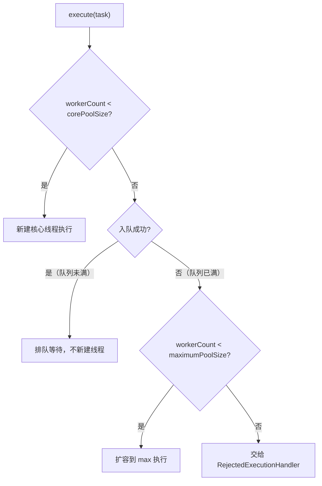
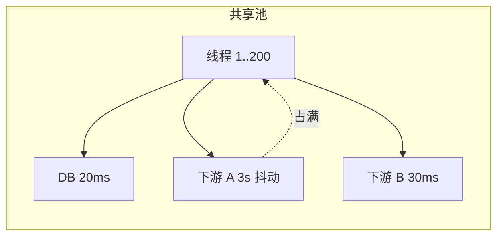
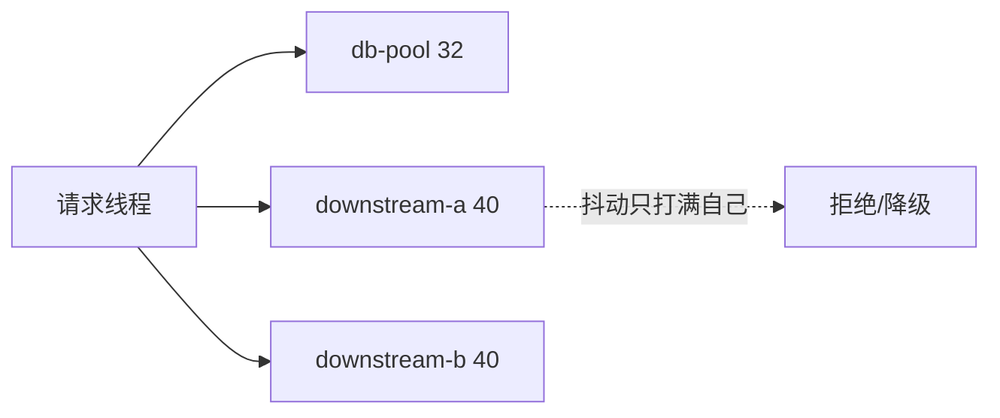

---
sources:
  - 08-第八阶段
---

# 02. 线程池参数：池隔离与上下文传递

> [← 第八阶段导览](01-导览.md) · `ThreadPoolExecutor` 的执行顺序是 core → queue → max → reject，队列只要没满 `maximumPoolSize` 就永远不会被创建；所以「大 max + 大队列」这个最流行的配法，实际等价于「固定 `corePoolSize` 个线程 + 一个几乎无限的缓冲区」。

## 1. 一次 `execute` 的四个分叉

`ThreadPoolExecutor` 的参数有七个，但真正决定行为的是四个数字之间的优先级关系。`execute` 的判定顺序写死在源码里，且**不按直觉**：



**为什么是这个顺序**：线程池的第一设计目标是「控制资源」，第二才是「尽快响应」。队列是用来吸收突发、平滑抖动的缓冲层，池子认为**能排队就不要新建线程**——多一个线程就是多一份栈内存和上下文切换成本。所以「扩容」被排在了「排队失败」之后。

**坑**：几乎所有「线程池配了却不生效」的困惑，都来自这条顺序被违反直觉地忽略了。你在监控上看到 `pool size = 8` 恒定不变、`queue size` 一路涨到几万，不是线程池坏了，是它忠实执行了这条规则。

**取舍**：想让线程数真的跟着流量涨，唯一的办法是**让队列先满**——小队列 + 大 max。这恰恰是大多数团队不敢做的，因为它意味着负载高时会拒绝请求。而「不拒绝」和「能扩容」在 `ThreadPoolExecutor` 里是一对互斥选项。

## 2. 「大队列让 max 永远用不上」的推演

把最常见的生产配置拿出来算一遍：`core=8, max=200, queue=10000`，单个任务耗时 100ms，峰值到达率 2000 rps。

| 时间点 | 池内线程 | 队列长度 | 新任务排队时间 | 现象 |
|---|---|---|---|---|
| t=0 | 8 | 0 | ~0ms | 正常 |
| t=1s | 8 | ~1920 | **~24s** | 延迟已经爆掉 |
| t=5.2s | 8 | 10000（满） | **~125s** | 队列满，此时才开始扩容 |
| t=5.3s | 200 | 10000 | ~5s | 扩到 max，排空需要 5 秒 |
| 稳态 | 200 | 10000 | ~5s | 到达 2000 rps ≈ 容量 2000 rps，队列不再下降 |

三个结论：

1. **前 5 秒只有 8 个线程在干活**，吞吐上限 80 rps，而到达是 2000 rps——25 倍的缺口全靠队列兜着；
2. 队列满之后才扩容，扩容把排队时间从 **125 秒**压到 **5 秒**，但已经排上的那一万个请求仍然要等——扩容改变的是「未来的延迟」，不是「已经发生的延迟」；
3. 稳态延迟 ≈ 队列长度 / 吞吐。队列越长延迟越高，而且这个延迟**不受超时控制**——请求还没开始执行，任何超时机制都还没生效。

**为什么队列会拖长延迟而不是提高吞吐**：吞吐由「线程数 / 单任务耗时」决定，队列长度完全不参与。队列只改变「任务什么时候开始」。所以大队列的唯一效果是**把拒绝变成等待**——把「第 501 个请求立刻收到 503」变成「两分钟后收到 504，期间它还占着连接和内存」。

**坑**：无界队列（`LinkedBlockingQueue()` 不传容量，或 `queueCapacity=Integer.MAX_VALUE`）下连拒绝都不会发生，队列会一直涨到 OOM。这类事故的日志特征很典型：GC 时间缓慢上升、`OutOfMemoryError: Java heap space` 的堆栈落在 `LinkedBlockingQueue$Node` 上，而不是业务代码。

## 3. 队列容量：有界 + 快速失败

队列容量不是一个「留多少余量」的问题，而是一个**你要容忍多长排队时间**的问题：

```text
queueCapacity ≈ 可容忍排队时间 × 稳态吞吐
```

8 个线程、100ms 任务、容忍 200ms 排队 → 吞吐 80 rps × 0.2s ≈ 16。也就是说这个池的队列应该是**几十**的量级，不是一万。

| 队列容量 | 排队上限 | 满了之后 | 适用 |
|---|---|---|---|
| `SynchronousQueue` | 0 | 立刻扩容 / 立刻拒绝 | 任务极短、线程数受控 |
| 32~128 | 百毫秒级 | 拒绝 | 在线请求处理（推荐起点） |
| 1000 | 秒级 | 拒绝 | 可接受秒级延迟的后台任务 |
| 无界 | 无上限 | 永远不拒绝 | **只应出现在「必须有界」的批处理之外的场景，几乎总是错的** |

**为什么有界队列是对的**：线程池的容量是有限的，队列只是把「容量不足」这件事延后暴露。有界队列让容量不足**在入口就以 `RejectedExecutionException` 的形式暴露**，上游能立刻降级、限流或返回 503；无界队列把它变成「所有请求一起变慢，最后一起超时」。前者是可观测的局部故障，后者是不可观测的全站故障。

**取舍**：队列设小会提高拒绝率，团队必须在入口准备好 429/503 的返回和告警，否则「快速失败」会变成「快速 500」。这是线程池改造里真正需要跨团队协调的部分。

## 4. 四种拒绝策略的后果

| 策略 | 行为 | 调用方感知 | 适用与代价 |
|---|---|---|---|
| `AbortPolicy`（默认） | 抛 `RejectedExecutionException` | 立刻拿到异常 | 在线请求首选。必须在上层捕获并转 503/降级，否则变成 500 |
| `CallerRunsPolicy` | 在**调用线程**上执行该任务 | 调用方被阻塞 | 天然背压，但调用线程可能是 Tomcat worker |
| `DiscardPolicy` | 静默丢弃 | **无感知** | 只适合可丢的埋点/日志；在线请求上是数据丢失 |
| `DiscardOldestPolicy` | 丢掉队首（最老的）任务后重试入队 | 无感知 | 只有「新数据比旧数据有价值」的场景才成立 |

`CallerRunsPolicy` 值得单独说，因为它是唯一「看起来优雅」的策略。它的语义是：池满了就让提交者自己跑。这形成了天然背压——提交者变慢，生产速度自然下降。

**坑**：在 Web 应用里，提交者通常是 Tomcat 的 worker 线程。让 worker 去跑一个 100ms 的下游调用，等于把线程池的过载**直接转嫁成容器的过载**：本来只耗尽业务池，现在连接收新连接的能力都一起没了。更隐蔽的是，`CallerRunsPolicy` 在池已 `shutdown` 时会**静默丢弃**任务（源码里 `if (!e.isShutdown()) r.run()`），停机窗口里的请求就这么消失了。

**取舍**：`CallerRunsPolicy` 适合「提交者是批处理主线程」的场景（如导入任务），一个线程顺序跑完所有任务，天然限速；不适合「提交者是容器线程」的场景，除非你已经算过最坏情况下的容器线程占用。

无论选哪个策略，都应该在外面包一层**计数**，因为默认实现不暴露任何指标：

```kotlin
class MeteredRejectionHandler(
    private val delegate: RejectedExecutionHandler,
    private val rejected: Counter,
) : RejectedExecutionHandler {
    override fun rejectedExecution(r: Runnable, e: ThreadPoolExecutor) {
        rejected.increment()
        delegate.rejectedExecution(r, e)   // 计数后仍按原策略处理
    }
}
```

## 5. 池隔离：按依赖分池与线程总数的账

一个请求会碰很多种资源：数据库、Redis、下游 A、下游 B。如果它们共用一个池，那么**任何一种资源的变慢都会占满整个池**，与它无关的请求一起排队。这就是「一个依赖抖动拖垮全站」的机制，不需要任何代码 bug。



分池之后：



| 池 | 用途 | 线程数 | 队列 | 上限并发 | 满了之后 |
|---|---|---|---|---|---|
| `tomcat` | 请求接入 | 200 | `accept-count=100` | 200 | 连接排队 |
| `db-io` | JDBC 调用 | 32 | 64 | 32 | 快速失败 |
| `downstream-a` | 商品服务 | 40 | 40 | 40 | 降级返回缓存 |
| `downstream-b` | 库存服务 | 40 | 40 | 40 | 降级返回兜底 |

**线程总数的账**：上面四个池加起来是 312 个线程/实例，按每线程 1MB 栈（`-Xss` 可调）算，单实例光栈就预留 312MB 地址空间，20 个实例是 6GB 量级。更贵的不是内存而是**调度**：单实例里 312 个线程抢 8 个核，一旦有一批线程同时变成可运行（下游同时返回），上下文切换会明显抬高 P99。所以分池不是「分得越细越好」，而是**按故障域分**：会一起坏的分到一个池，不会一起坏的分开。

**坑**：分池之后，一个请求可能同时持有两个池的线程（A 池的线程里再去 B 池提交任务），这会形成**跨池的死锁**——A 池满时所有线程都在等 B 池，B 池满时所有线程都在等 A 池。避免办法是规定「池内不再跨池阻塞」：需要扇出时用 `CompletableFuture` 组合后由调用线程等待，而不是在池线程里同步等待另一个池。

**取舍**：分池让线程总数上升、监控面板变多、参数需要逐个调。收益是故障半径可控。判断标准很简单：**这两个依赖会不会同时变慢**？会，就合并；不会，就分开。

## 6. 复现：一个依赖抖动耗尽全站线程

场景：`/order/{id}` 要查库存（下游 A，正常 30ms，故障时 3s）和价格（下游 B，30ms），两者共用一个 16 线程的池；同时 `/ping` 也走这个池。

```kotlin
// 事故版：一个池服务所有下游
@Configuration
class SharedPoolConfig {
    @Bean("sharedIo", destroyMethod = "shutdown")
    fun sharedIo(): ThreadPoolExecutor = ThreadPoolExecutor(
        16, 16, 0L, TimeUnit.MILLISECONDS,
        LinkedBlockingQueue(),                       // 无界：拒绝永远不会发生
        ThreadFactory { r -> Thread(r, "shared-io") },
    )
}

@Service
class OrderService(
    @Qualifier("sharedIo") private val pool: ThreadPoolExecutor,
    private val inventory: InventoryClient,          // 故障时 3s 超时
    private val pricing: PricingClient,
) {
    fun detail(id: Long): OrderDetail {
        // 16 个线程全部卡在 inventory 上，pricing 连提交的机会都没有
        val stock = pool.submit(Callable { inventory.query(id) }).get()
        val price = pool.submit(Callable { pricing.query(id) }).get()
        return OrderDetail(id, stock, price)
    }
}
```

故障注入后（inventory 延迟 3s）的观测：`shared-io` 的 16 个线程全部 `WAITING` 在 socket read 上，队列涨到 2 万，`/ping` 的 P99 从 2ms 变成 30s（它的任务排在 2 万个任务之后）。**注意 `/ping` 和 inventory 毫无关系**，它只是共用了池。

修复版：分池 + 有界 + 每池独立超时 + 每池独立拒绝计数。

```kotlin
@Configuration
class IsolatedPoolConfig {
    private fun pool(name: String, size: Int, queue: Int, rejected: Counter) =
        ThreadPoolExecutor(
            size, size, 0L, TimeUnit.MILLISECONDS,
            ArrayBlockingQueue(queue),
            ThreadFactory { r -> Thread(r, name) },
            MeteredRejectionHandler(ThreadPoolExecutor.AbortPolicy(), rejected),
        )

    @Bean("inventoryPool", destroyMethod = "shutdown")
    fun inventoryPool(m: MeterRegistry) =
        pool("inv-io", 32, 32, m.counter("pool.rejected", "pool", "inventory"))

    @Bean("pricingPool", destroyMethod = "shutdown")
    fun pricingPool(m: MeterRegistry) =
        pool("price-io", 16, 16, m.counter("pool.rejected", "pool", "pricing"))
}

@Service
class OrderService(
    @Qualifier("inventoryPool") private val invPool: ThreadPoolExecutor,
    @Qualifier("pricingPool") private val pricePool: ThreadPoolExecutor,
    private val inventory: InventoryClient,
    private val pricing: PricingClient,
    private val fallback: StockFallback,
) {
    fun detail(id: Long): OrderDetail {
        val stock = try {
            invPool.submit(Callable { inventory.query(id) }).get(300, TimeUnit.MILLISECONDS)
        } catch (e: RejectedExecutionException) {
            fallback.stock(id)                       // 拒绝 = 立即降级，不排队
        } catch (e: TimeoutException) {
            fallback.stock(id)
        }
        val price = pricePool.submit(Callable { pricing.query(id) })
            .get(200, TimeUnit.MILLISECONDS)
        return OrderDetail(id, stock, price)
    }
}
```

修复后的关键差异不在「线程变多了」，而在三处：inventory 抖动只打满 `inv-io` 的 32 个线程；`/ping` 用的池完全不受影响；被拒绝的请求走降级而不是排队 30 秒。**这就是舱壁（bulkhead）在代码层面的样子**，06 册会把它抽象成 Resilience4j 的 `Bulkhead`。

## 7. `ThreadLocal` 不跨线程：三种传法

`ThreadLocal` 的值存在 `Thread` 对象的 `threadLocalMap` 字段里。任务被交给另一个线程执行时，**新的线程读到的是它自己的 map**，所以父线程设的值一律看不到。MDC（`org.slf4j.MDC`）底层就是 `ThreadLocal<Map<String,String>>`，因此 traceId 在异步任务里丢失是必然，不是 bug。

| 传法 | 做法 | 优点 | 代价 |
|---|---|---|---|
| `TaskDecorator` | 提交时快照、执行时恢复 | 对业务代码零侵入 | 只覆盖线程池，覆盖不到裸 `new Thread` |
| 显式参数 | 把 traceId 作为方法入参/数据字段往下传 | 最可靠、可测试 | 污染签名，跨层要一路带 |
| 可传播上下文 | Micrometer `ContextSnapshot` / 协程 `CoroutineContext` / Reactor `Context` | 跨模型统一 | 依赖框架版本，有性能开销 |

`TaskDecorator` 的标准实现（必须保存并恢复调用前的值，否则池线程复用时会串味）：

```kotlin
class MdcTaskDecorator : TaskDecorator {
    override fun decorate(runnable: Runnable): Runnable {
        val captured = MDC.getCopyOfContextMap()
        return Runnable {
            val previous = MDC.getCopyOfContextMap()
            captured?.let(MDC::setContextMap) ?: MDC.clear()
            try {
                runnable.run()
            } finally {
                previous?.let(MDC::setContextMap) ?: MDC.clear()   // 还原，避免污染下一个任务
            }
        }
    }
}
```

**为什么 `finally` 里的还原不能省**：池线程是被复用的。任务 A 设了 `traceId=aaa` 后没清理，任务 B 没设 traceId，日志里就会带上 A 的 traceId——这比丢失更难排查，因为日志看起来「有链路」但指向了别的请求。

Spring Boot 的 `ThreadPoolTaskExecutor` 会自动应用容器里唯一的 `TaskDecorator` bean；如果用了 Micrometer 的上下文传播模块，直接用现成的 `ContextPropagatingTaskDecorator` 即可，它同时处理 MDC、Observation 和 trace 上下文。

**取舍**：`TaskDecorator` 是「运行时隐式传递」，适合日志/链路这类横切关注点；**业务参数（租户 ID、用户 ID）不要走这条路**，它们在跨线程后应该是显式参数——否则一个池配置错误就能让请求串到别的租户。

## 8. Spring 里 `@Async` 的默认执行器陷阱

Boot 自动配置的 `applicationTaskExecutor` 默认值是 `core=8, max=Integer.MAX_VALUE, queue=Integer.MAX_VALUE, keepAlive=60s`。按 §2 的推演，**队列无界意味着 max 永远用不上**，所以 `@Async` 的实际并发就是 8 个线程。

更麻烦的是它没有拒绝：任务无限堆积，内存慢慢涨，直到 OOM，而监控上一切「正常」——没有拒绝计数，没有队列告警。

```yaml
spring:
  task:
    execution:
      pool:
        core-size: 16
        max-size: 32
        queue-capacity: 200        # 关键：有界，让 max 有机会生效
        keep-alive: 60s
      thread-name-prefix: async-
      shutdown:
        await-termination: true
        await-termination-period: 20s
```

三个必须知道的细节：

1. **`@Async` 需要 `@EnableAsync`**，Boot 不会自动开。忘了加的表现是方法**同步执行**，日志里没有 `async-` 线程名。
2. **`@Async` 方法返回 `Unit` 时异常被吞掉**。异常进了 `AsyncUncaughtExceptionHandler`（默认只打日志），调用方永远不知道失败。要么返回 `CompletableFuture<T>`，要么自己配 handler 并接告警。
3. **`spring.threads.virtual.enabled=true` 时，上面这些池参数全部失效**——`applicationTaskExecutor` 会换成基于虚拟线程的 `SimpleAsyncTaskExecutor`，`spring.task.execution.pool.*` 不再被读取。切虚拟线程时忘了删这段配置，会得到「配了但没生效」的第二次困惑（03 册展开）。

**坑**：`@Async` 与 `@Transactional` 一样是代理生效，**自调用失效**。同一个类里 `this.asyncMethod()` 会同步执行，且没有任何报错。

## 9. 参数组合后果表

把常见配法一次列全，对着症状排查：

| core | max | queue | 实际并发 | 拒绝 | 典型症状 |
|---|---|---|---|---|---|
| 8 | 8 | 无界 | 8 | 永不 | 吞吐到顶后延迟线性上升，内存缓慢增长 |
| 8 | 200 | 无界 | 8 | 永不 | **以为配了 200，其实只有 8**（最常见） |
| 8 | 200 | 100 | 8 → 200 | 队列满且到 max 时 | 线程数阶跃，扩容瞬间有延迟尖刺 |
| 8 | 8 | 100 | 8 | 队列满即拒 | 快速失败，要求上游能处理 503 |
| 0 | 200 | `SynchronousQueue` | 0 → 200 | 到 max 时 | 线程数随流量无上限增长（Cached 形态） |
| 200 | 200 | 100 | 200 | 队列满即拒 | 常驻 200 线程，空载也占内存 |
| 8 | 8 | 0（`SynchronousQueue`） | 8 | 几乎总是 | 并发稍高就大面积拒绝 |

配套的两个参数常被忘掉：

- `allowCoreThreadTimeOut(true)` 要求 `keepAlive > 0`，否则抛 `IllegalArgumentException`；开了之后核心线程也会回收，低峰期能省内存，但突发时有建线程延迟。
- `prestartAllCoreThreads()` 适合启动即高峰的服务（如网关），避免前几十个请求付建线程的成本。

## 10. 自测

1. `core=4, max=64, queue=200`，持续 500 rps、单任务 50ms 时，稳态线程数是多少？队列长度是多少？把 queue 改成 20 之后行为怎么变？
2. `CallerRunsPolicy` 在「提交者是 Tomcat worker」时，最坏情况下会额外占用多少容器线程？为什么它在池 `shutdown` 后会静默丢任务？
3. 你有 DB、Redis、下游 A 三个依赖，怎么决定分几个池？分池后线程总数上升，怎么论证这个代价是值得的？
4. `TaskDecorator` 里为什么必须保存并恢复调用前的 MDC，而不是执行完直接 `MDC.clear()`？
5. 一个 `@Async` 方法返回 `Unit`，内部抛了异常，调用方、日志、监控三处分别能看到什么？怎么改成「失败可见」？
6. 队列长度 10000、8 个线程在跑、任务 100ms，扩容到 max 之前的排队延迟是多少？为什么调大 `max` 不能改善已经排队的请求？

## 11. 延伸

- 上一册：[01-导览](01-导览.md)——本阶段的实验设计与选型目标。
- 下一册：[03-虚拟线程-pinning与适用边界](03-虚拟线程-pinning与适用边界.md)——当线程本身变便宜之后，「池大小」这个问题的形状会怎么变。
- 容器线程的来源与 `maxThreads`/`accept-count` 的关系在[第四阶段 02 册](../04-第四阶段/02-Tomcat线程模型与Servlet6.1.md)。
- 连接池容量与线程池容量的联动在[第五阶段 02 册](../05-第五阶段/02-连接池与JDBC真相.md)。
- 池隔离在框架层的抽象（`Bulkhead`）见本阶段 [06 册](06-弹性-超时-重试-熔断-舱壁与限流.md)。
