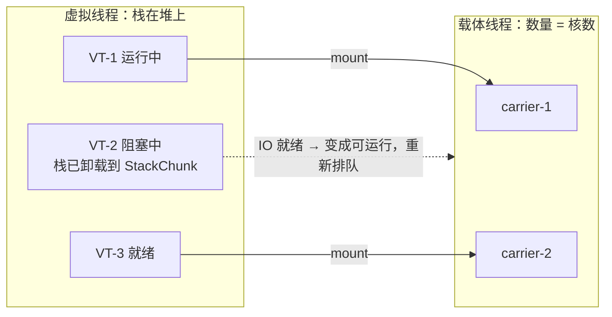

---
sources:
  - 08-第八阶段
---

# 03. 虚拟线程：pinning 与适用边界

> [← 第八阶段导览](01-导览.md) · 虚拟线程把「一个请求占一个线程」的成本从 1MB 栈 + 内核调度降到几百字节堆 + 一次 Java 层栈切换，代价是**你不能再用线程数当限流器**——真正稀缺的资源从线程变成了连接池、下游配额和数据库并发。

## 1. 成本模型：一个虚拟线程到底占什么

平台线程的贵，贵在三处：**栈是连续内存**（默认 1MB，创建时预留）、**调度要进内核**（上下文切换微秒级）、**数量受 OS 限制**（几万个就开始明显吃力）。虚拟线程把这三笔账逐一改掉：

| 维度 | 平台线程 | 虚拟线程 |
|---|---|---|
| 栈 | 连续内存，1MB 起，`-Xss` 固定 | 堆上的 `StackChunk` 对象，初始几百字节，按需增长 |
| 调度 | 内核调度器，微秒级切换 | JVM 调度器，几百纳秒级挂载/卸载 |
| 数量上限 | 几千到几万 | 百万级（受堆内存约束） |
| 阻塞代价 | 整个内核线程被占住 | 卸载（unmount），载体线程去跑别的虚拟线程 |
| 调试 | 线程 dump 可读 | dump 巨大，需要专门工具 |

关键机制是**挂载（mount）/卸载（unmount）**：虚拟线程跑在载体线程（carrier）上，遇到 `Socket.read`、`Thread.sleep`、`LockSupport.park` 这类会阻塞的 JDK 操作时，JVM 把它的栈帧搬到堆上（`StackChunk`），把载体线程还回调度器；数据到了再挂载回来继续跑。

载体线程的数量默认等于 `Runtime.availableProcessors()`，由 `jdk.virtualThreadScheduler.parallelism` 控制，载体池上限是 `jdk.virtualThreadScheduler.maxPoolSize`（默认 256）。这意味着：**虚拟线程的并行度仍然只有 CPU 核数那么多**，它买到的是「并发度」而不是「算力」。

```text
10 万虚拟线程  ≈  8 个载体线程在跑
    ↓ 任一时刻可运行的
  8 个（= 核数）
```

**为什么这条最重要**：它直接推出了后面所有结论。虚拟线程解决的是「大量请求在等 IO」的场景，对「所有请求都在算」的场景毫无帮助——CPU 密集时，10 万虚拟线程排队等 8 个载体，和 10 万任务排队等 8 个线程池线程，吞吐完全一样，只是前者多付了调度开销。



同一个载体线程在不同时刻服务不同虚拟线程，这就是「并发度上去了、并行度没变」的图形化表述。

**坑**：`-Xss` 对虚拟线程的栈上限仍然有效。递归很深的代码在虚拟线程上一样会 `StackOverflowError`；不同的只是栈的**初始占用**变小了。

把「便宜」量化一下，才知道边界在哪：

| 操作 | 量级 | 10 万次的总成本 |
|---|---|---|
| 创建虚拟线程 | ~1µs（分配 + 提交调度） | 100ms |
| 挂载 / 卸载一次 | 数百纳秒 | 几十毫秒 |
| 平台线程上下文切换 | 1~10µs | 1 秒 |
| 创建平台线程 | ~50µs（含栈预留） | 5 秒 |

这张表说明了虚拟线程的收益来自哪里：**它把「等待」的单位成本降了一个数量级，同时把「创建」的成本降到可以忽略**。但它也说明了边界：当一次请求里有 1000 次挂载/卸载而每次只等 1µs 时，调度开销会超过等待本身——这种「极短 IO + 极多往返」的场景（比如逐条读 ResultSet 的 N+1 查询）该优化的是往返次数，不是并发模型。

## 2. 为什么不池化

线程池存在的理由是「创建线程太贵，复用能省成本」。虚拟线程的创建成本是**在堆上分配一个对象 + 一次 `Thread.start` 的调度提交**，量级接近创建一个普通对象。池化在这里做的是负功：

1. **池会把并发度限制在池大小上**，直接抹掉虚拟线程唯一的优势；
2. 池化的虚拟线程被复用时，`ThreadLocal` 会跨任务残留（和 02 册的池线程污染同一个问题，但更隐蔽）；
3. 池的排队语义会掩盖真实的过载，让背压消失。

正确写法是每任务一个：

```kotlin
// 每任务一个虚拟线程，执行完即回收；不要缓存，不要复用
val executor: ExecutorService = Executors.newVirtualThreadPerTaskExecutor()

// 需要命名时用工厂，便于 dump 与日志排查
val named = Thread.ofVirtual().name("downstream-", 0).factory()
val executor2 = Executors.newThreadPerTaskExecutor(named)
```

**那用什么来限流**：用信号量（`Semaphore`）或框架的并发上限，把「限制在途数量」这件事和「线程从哪来」解耦。这是从平台线程思维切到虚拟线程思维最关键的一步：

| 想控制的东西 | 平台线程时代的做法 | 虚拟线程时代的做法 |
|---|---|---|
| 同时在途请求数 | 线程池大小 | `Semaphore` / 容器并发上限 |
| 对下游的并发压力 | 池大小 | 连接池大小 + 信号量 |
| 排队策略 | 队列 | 信号量的 `tryAcquire` 超时 |
| 拒绝 | 拒绝策略 | `tryAcquire` 失败即降级 |

有人尝试「池化虚拟线程以复用热点线程」。两头都不成立：任务极短且数量极大时，瓶颈是 CPU，池化不增加并行度；任务较长时，创建开销占比可以忽略。所以**没有需要池化虚拟线程的场合**。如果观察到「虚拟线程创建占用了可观的 CPU」，正确的动作是减少线程数（加限流），不是池化。

## 3. pinning：从 JDK 21 到 25 的变化

**pinning（钉住）**指虚拟线程在阻塞时无法卸载，只能连载体一起被占住。一个被钉住的虚拟线程在等待期间，那个载体线程什么也干不了——如果所有载体都被钉住，其余几十万虚拟线程一起停摆。

历史上最主要的原因是 `synchronized`：JDK 21~23 的监视器实现绑定了载体线程，虚拟线程在 `synchronized` 块内阻塞时无法把栈搬走。**JEP 491（JDK 24）重写了监视器实现**，让 `synchronized` 不再钉住虚拟线程。

| 版本 | `synchronized` 内阻塞 | 说明 |
|---|---|---|
| JDK 21（Loom 正式版） | 钉住 | 需要把热点代码改成 `ReentrantLock` |
| JDK 22 / 23 | 钉住 | 同上，`-Djdk.tracePinnedThreads` 可诊断 |
| JDK 24（JEP 491） | **不钉住** | 监视器改为与载体解耦 |
| JDK 25（LTS） | 不钉住 | 生产基线；`-Djdk.tracePinnedThreads` 已退役 |

所以在 JDK 25 上，「`synchronized` 导致 pinning」这个流传最广的说法**已经过期**。真实剩下的 pinning 来源有五类：

| 来源 | 机制 | 典型现场 |
|---|---|---|
| native 方法 / JNI 阻塞 | 栈上有 native 帧时无法搬栈 | 老版本 JDBC 驱动、本地压缩/加密库 |
| 文件 IO | 多数文件系统不支持非阻塞轮询，只能占住载体 | `FileChannel.read`、大日志写入、本地缓存落盘 |
| Foreign Function & Memory 下行调用 | 调用进入 native 后阻塞 | 用 Panama 调 C 库做加解密、图像处理 |
| 类初始化锁 | 等待 `<clinit>` 完成时持有 VM 级锁 | 首次访问某类的静态初始化，恰好初始化很慢 |
| JVMTI / agent | 调试器、部分 profiler 强制挂起线程 | 本地 debug、APM agent 的某些模式 |

另外还有一类**不是 pinning 但后果相同**的情况：在 `synchronized` 或锁里做长耗时计算。JDK 25 下它不钉住载体，但载体仍然被这个虚拟线程占着跑 CPU——8 个载体被 8 个这样的线程占满，剩下的虚拟线程依然停摆。所以「临界区要短」这条纪律在虚拟线程时代没有消失，只是原因从「钉住」变成了「占着 CPU」。

## 4. 检测：从启动参数到 JFR

JDK 21~23 用系统属性就能看到钉住的堆栈：

```bash
# JDK 21~23：钉住超过阈值时打印堆栈（full 会打印完整栈）
java -Djdk.tracePinnedThreads=full -jar app.jar
```

JDK 24 起该属性随 JEP 491 退役，改用 JFR 事件 `jdk.VirtualThreadPinned`（默认只记录超过 20ms 的钉住，阈值由 `jdk.virtualThreadPinnedThreshold` 控制）：

```bash
jcmd <pid> JFR.start name=pin settings=profile duration=60s filename=pin.jfr
jfr print --events jdk.VirtualThreadPinned pin.jfr
```

事件里会带上虚拟线程的栈和钉住时长。判读方法：堆栈顶端是不是 native 帧、是不是 `<clinit>`、是不是某个第三方库的同步块。如果堆栈落在业务代码的 `synchronized` 上而 JDK 是 25，那说明你实际跑在 21~23 的运行时上——**先确认 `java -version`，再谈 pinning**。

**取舍**：JFR 采样有开销（`profile` 配置约 1~2%），不要长期开着；压测时开一轮，把钉住点改掉，再关掉。持续监控应该看的是另一个指标：**载体线程的利用率**。如果载体 8 个常年 100% 忙而虚拟线程数只有几十，说明有东西在钉住或在跑 CPU。

## 5. `ThreadLocal` 在百万线程下的内存代价

每个虚拟线程有自己的 `ThreadLocalMap`（首次 `set` 时创建）。单看一个不算什么，乘上百万就是事故：

```text
总内存 ≈ 线程数 × (Thread 对象 + ThreadLocalMap + Σ 每个 ThreadLocal 的值)

100 万线程 × (300B + 40B + 3 个 ThreadLocal × 200B) ≈ 1GB
```

| 场景 | 每线程 ThreadLocal 占用 | 100 万线程的总开销 |
|---|---|---|
| 只有 MDC（一条 traceId） | ~200B | ~200MB |
| MDC + 安全上下文 + 租户信息 | ~700B | ~700MB |
| 框架塞了 RequestContextHolder + 缓存 + 大对象 | ~2KB | ~2GB |

**为什么这个问题在平台线程时代不明显**：200 个线程 × 2KB = 400KB，谁都懒得管。虚拟线程把线程数放大三个数量级，同一段代码的内存账就翻了三个数量级。

**JDK 25 的答案**：`ScopedValue`（JEP 506，JDK 25 正式）用「不可变、有界生命周期、结构化继承」替代 `ThreadLocal`，值只在 `ScopedValue.where(...).run { }` 的作用域内可见，且不绑定线程对象——因此百万虚拟线程共享同一份值，不产生 per-thread 副本。

**取舍**：`ScopedValue` 不能替代所有 `ThreadLocal`（它只读、不可跨作用域修改、需要改调用链把作用域铺开）。渐进路径是：**新代码优先 `ScopedValue`，老代码先做「每个线程的 ThreadLocal 不超过三个、每个值不超过 1KB」的瘦身**。

## 6. Boot 4 开启虚拟线程

一行配置：

```yaml
spring:
  threads:
    virtual:
      enabled: true
```

它一次性换掉三处：

| 组件 | 开启前 | 开启后 |
|---|---|---|
| Tomcat 请求处理 | 平台线程池，`server.tomcat.threads.max` 控制 | 每请求一个虚拟线程，`maxThreads` 不再决定并发 |
| `applicationTaskExecutor`（`@Async`） | `ThreadPoolTaskExecutor` | `SimpleAsyncTaskExecutor` + 虚拟线程 |
| `spring.task.execution.pool.*` | 生效 | **全部被忽略** |

三个必须核对的连带影响：

1. **`server.tomcat.threads.max` 失效**。原来靠它做入口限流，现在没有任何限制——并发直接压到连接池和下游。必须补一个信号量或网关限流。
2. **`@Scheduled` 仍然是平台线程**。定时任务的调度器没有被替换，长任务照样阻塞调度线程。
3. **`spring.task.execution.pool.*` 静默失效**。这是最容易踩的坑：配置还在、启动不报错、行为已经变了。

**坑**：开启后线程 dump（`jstack`）会包含成千上万个虚拟线程，直接看是灾难。用 `jcmd <pid> Thread.dump_to_file -format=json` 并按状态过滤，或者只看载体线程。

## 7. 瓶颈转移：连接池与数据库

虚拟线程把「线程」这个瓶颈消掉之后，下一个瓶颈会立刻浮出来。用利特尔法则算：

```text
下游能承受的吞吐 = 连接池大小 / 单次持有连接时间
需要的并发       = 到达率 × 单次耗时
```

决定吞吐的不是「SQL 执行了多久」，而是「连接被占住了多久」。池 20 在不同持有时间下的天花板：

| 每请求持有连接的时间 | 池 20 能支撑的吞吐 | 持有时间里都包含了什么 |
|---|---|---|
| 10ms | 2000 rps | 纯查询 |
| 30ms | 670 rps | 查询 + 一次 Redis |
| 50ms | 400 rps | 事务里夹了一次缓存回填 |
| 100ms | 200 rps | **事务里夹了一次下游 HTTP** |

注意这张表的每一行都只是「一个请求只借一次连接」的情形。如果事务把下游调用包在里面，持有时间就是整段事务的长度——这也解释了为什么[第六阶段 03 册](../06-第六阶段/03-编程式事务与事务边界设计.md)反复强调「事务里不要做 IO」。

**这是虚拟线程最容易触发的翻车方式**：线程不再是瓶颈，2000 个请求可以同时进来，全部挤在 20 个连接上，默认 `connectionTimeout` 30 秒让它们一起卡住，30 秒后一起报 `Connection is not available`，然后一起重试，把数据库再打一遍。

| 现象 | 平台线程时代 | 虚拟线程时代 |
|---|---|---|
| 池满时的表现 | worker 线程耗尽，容器排队 | 几十万虚拟线程 park 在 `getConnection`，堆内存涨 |
| 报错 | `Connection is not available` | 同一个错，但出现得晚得多、量大得多 |
| 修复 | 调大池 / 加超时 | **必须**缩短持有时间 + 调小 `connectionTimeout` |

**必须同步改的两个参数**：`spring.datasource.hikari.connection-timeout` 从 30s 降到 2~3s（快速失败），`maximum-pool-size` 按 `峰值 QPS × P99 持有时间` 重算。虚拟线程让「等待」变便宜，但**等待本身不会让数据库变快**。

## 8. 不适合的场景

| 场景 | 为什么不适合 | 替代 |
|---|---|---|
| CPU 密集型（加解密、图像、大 JSON 转换） | 并行度还是核数，虚拟线程只增加调度开销 | 固定大小线程池 / `parallelStream` / 结构化并发 |
| 依赖 `ThreadLocal` 的框架（部分老 ORM、模板引擎） | 百万线程各持一份上下文，内存爆炸 | 先瘦身，或留在平台线程 |
| 重度 JNI / native 驱动 | 钉住载体，退化到平台线程水平 | 换纯 Java 驱动，或隔离到独立执行器 |
| 需要精细线程控制（优先级、亲和性、按线程限流） | 虚拟线程不支持优先级，调度不可控 | 平台线程 |
| 长临界区 / 自旋等待的库 | 载体被占满，整体停摆 | 改库或用独立载体池 |

**取舍**：虚拟线程的最佳场景是「**阻塞式代码 + IO 密集 + 高并发**」——这正是绝大多数 CRUD 后端的样子。它不是「更快的线程」，是「更便宜的等待」。

## 9. 完整示例：开启 + 用信号量替代池

```kotlin
@Configuration
class ConcurrencyConfig {
    // 线程不再限流，用信号量限住「同时在途的下游调用数」
    @Bean(destroyMethod = "close")
    fun downstreamLimiter(): Semaphore = Semaphore(64)

    // 需要一个显式执行器的地方（如 @Async 的目标方法），用虚拟线程
    @Bean(destroyMethod = "close")
    fun virtualExecutor(): ExecutorService =
        Executors.newThreadPerTaskExecutor(
            Thread.ofVirtual().name("vt-worker-", 0).factory(),
        )
}

@Service
class InventoryService(
    private val limiter: Semaphore,
    private val client: InventoryClient,
) {
    fun query(id: Long): Stock? {
        // 拿不到许可就快速失败，绝不排队——排队会把延迟转成超时
        if (!limiter.tryAcquire(50, TimeUnit.MILLISECONDS)) {
            return null
        }
        try {
            return client.query(id)      // 阻塞调用，在虚拟线程上是便宜的
        } finally {
            limiter.release()
        }
    }
}
```

如果要用 JDK 25 的结构化并发把「扇出 + 超时 + 任一失败即取消」写对，注意它在 JDK 25 仍是 **preview**（JEP 505），需要 `--enable-preview` 编译与运行；生产上更稳的是协程的 `coroutineScope`（04 册）或 `CompletableFuture` 组合。虚拟线程负责「便宜地阻塞」，结构化并发负责「正确地取消」，两者是两件事。

## 10. 自测

1. 8 核机器上跑 10 万个虚拟线程做纯 CPU 计算，吞吐会比 8 个平台线程高吗？为什么？
2. 为什么「池化虚拟线程」是有害的？如果确实需要限制同时在途数，应该用什么？
3. JDK 25 上还剩下哪些 pinning 来源？`-Djdk.tracePinnedThreads` 还能用吗？
4. 一个接口每请求持有数据库连接 100ms，池 20，虚拟线程开启后单实例吞吐上限是多少？怎么把它提上去？
5. `spring.threads.virtual.enabled=true` 之后，`server.tomcat.threads.max` 和 `spring.task.execution.pool.core-size` 还有效吗？
6. 100 万虚拟线程、每个线程通过 MDC 存一个 traceId，量级是多少内存？JDK 25 有什么替代方案？

## 11. 延伸

- 上一册：[02-线程池参数-池隔离与上下文传递](02-线程池参数-池隔离与上下文传递.md)——池化思维从哪里来，以及它为什么会成为虚拟线程时代的负债。
- 下一册：[04-Kotlin协程在服务端](04-Kotlin协程在服务端.md)——另一种「便宜的等待」，但把调度和取消写进了类型系统。
- 连接池容量与持有时间的完整算法在[第五阶段 02 册](../05-第五阶段/02-连接池与JDBC真相.md)。
- 容器线程模型与 `maxThreads` 的原始语义在[第四阶段 02 册](../04-第四阶段/02-Tomcat线程模型与Servlet6.1.md)。
- 三种模型在压测台上的实际差异见本阶段 [07 册](07-三种并发模型压测对比.md)。
