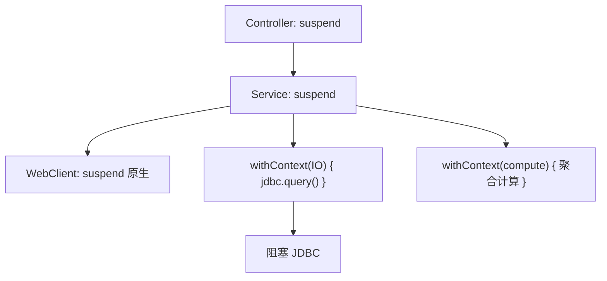

---
sources:
  - 08-第八阶段
---

# 04. Kotlin 协程在服务端

> [← 第八阶段导览](01-导览.md) · 协程不是「更轻的线程」，而是一套**把「等待」写进类型系统**的机制：`suspend` 标记了函数可能挂起，`CoroutineScope` 决定了谁负责取消，`withTimeout` 只有落在挂起点上才真的有效。它的价值不在于快，而在于**把并发结构显式化**。

## 1. `suspend` 边界划在哪

`suspend` 是编译期的状态机标记，不是运行时约定。它的含义只有一句：**这个函数可能挂起，因此只能在协程里调用**。它不保证函数真的挂起，也不保证它不阻塞。

所以边界划法的唯一准则是**按实现是否阻塞**，而不是按「这一层听起来像不像 IO 层」：

| 层 | 该不该 `suspend` | 判据 |
|---|---|---|
| Controller | 可以 | 内部调用链全是挂起函数时，收益最大 |
| Service | 可以 | 编排逻辑，本身不做阻塞 IO |
| 下游 HTTP 客户端（`WebClient`/Ktor） | 是 | 原生支持挂起 |
| 缓存客户端（Lettuce 异步 / Redisson 阻塞） | 视驱动而定 | 阻塞驱动要包 `withContext` |
| JDBC / JPA / MyBatis | **否** | 阻塞 API，包在 `Dispatchers.IO` 里，函数签名保持 `suspend` 但内部标注 |
| 文件 / 本地磁盘 | 否 | 同上 |
| 纯计算（序列化、校验、聚合） | 否 | 不需要挂起，别包 |



**为什么 JDBC 层不能「伪装成 suspend」**：把阻塞调用直接标成 `suspend` 而不切调度器，编译器会放过它（语法合法），运行时它的行为是**占着当前线程阻塞**。在 `Dispatchers.Default` 上，这意味着一个载体线程被占住——默认调度器的线程数等于核数，几个慢查询就能让整个应用的协程全部停摆。这是协程在生产里最典型的翻车方式，且不报任何错。

**取舍**：全链路 `suspend` 的收益是可组合（`async`/`withTimeout`/`supervisorScope` 都能作用到最底层）。混入一个不切调度器的阻塞调用，整条链的收益归零。所以边界一旦划错，不是「局部性能差一点」，而是**结构性失效**。

## 2. 阻塞调用必须进 `Dispatchers.IO` 并显式声明

正确写法不是在调用点随手包一层，而是**在边界层一次性封装、上层只见 `suspend`**：

```kotlin
@Repository
class OrderRepository(private val jdbc: JdbcClient) {

    // 签名是 suspend，但阻塞发生在 IO 调度器上，绝不占用调用方线程
    suspend fun findById(id: Long): Order? = withContext(Dispatchers.IO) {
        jdbc.sql("select * from orders where id = :id")
            .param("id", id)
            .query(Order::class.java)
            .optional()
            .orElse(null)
    }

    // 批量查询：一次 IO 上下文切换拿一批，而不是 N 次
    suspend fun findByIds(ids: List<Long>): List<Order> = withContext(Dispatchers.IO) {
        jdbc.sql("select * from orders where id in (:ids)")
            .param("ids", ids)
            .query(Order::class.java)
            .list()
    }
}
```

三个必须知道的细节：

**第一，`Dispatchers.IO` 的默认并行度是 64**（`max(64, 核数)`），不是无限。它专为阻塞 IO 设计，线程可以超过核数。64 个线程跑 10ms 的查询，理论上限 6400 QPS——超过这个数，协程会在 IO 调度器里排队，表现和线程池排队一样。

**第二，别在循环里逐条 `withContext`**。每次切换有成本，而且会放大成 N 次调度：

```kotlin
// 错：N 次上下文切换
ids.map { withContext(Dispatchers.IO) { repo.find(it) } }

// 对：一次切换，一次批量查询
withContext(Dispatchers.IO) { repo.findByIdsIn(ids) }
```

**第三，`@Transactional` 与挂起点不能混**。JDBC 事务把连接绑定在 `ThreadLocal` 上，协程一旦在事务中途挂起并在**另一个线程**恢复，事务上下文就断了——轻则事务失效，重则连接错乱。规矩是：**一个 JDBC 事务块内不允许出现挂起点**。需要「事务 + 下游调用」时，把它拆成「先查/先算，再开短事务写」。

## 3. 自定义 Dispatcher：慢 IO 与 CPU 分开

`Dispatchers.IO` 是全局共享的。所有阻塞调用挤在 64 个线程上，一个慢下游就能把数据库查询一起拖慢——和 02 册的池隔离是同一个问题，只是换了个名字。

```kotlin
@Configuration
class DispatcherConfig {
    // 慢下游：独立池，数量按「并发 × 耗时」估算，与 DB 隔离
    @Bean(destroyMethod = "close")
    fun slowIoDispatcher(): ExecutorCoroutineDispatcher =
        Executors.newFixedThreadPool(24) { r -> Thread(r, "slow-io") }
            .asCoroutineDispatcher()

    // CPU 密集：等于核数，避免上下文切换
    @Bean(destroyMethod = "close")
    fun computeDispatcher(): ExecutorCoroutineDispatcher =
        Executors.newFixedThreadPool(Runtime.getRuntime().availableProcessors()) { r ->
            Thread(r, "compute")
        }.asCoroutineDispatcher()
}

@Service
class ReportService(
    private val slowIo: ExecutorCoroutineDispatcher,
    private val compute: ExecutorCoroutineDispatcher,
) {
    suspend fun build(id: Long): Report = coroutineScope {
        val raw = async(slowIo) { fetchFromLegacy(id) }        // 200ms 的老系统
        val stats = async(slowIo) { fetchStats(id) }           // 80ms
        withContext(compute) { render(raw.await(), stats.await()) }   // 纯 CPU
    }
}
```

线程数怎么定，还是利特尔法则：

| Dispatcher | 用途 | 线程数算法 | 示例（8 核） |
|---|---|---|---|
| `Dispatchers.Default` | 纯计算 | = 核数 | 8 |
| `Dispatchers.IO` | 通用阻塞 | 默认 64 | 64 |
| `slowIo` | 慢下游（200ms 级） | 峰值 QPS × P99 耗时 | 24 |
| `compute` | 序列化/聚合 | = 核数 | 8 |

**坑**：自定义 Dispatcher 也要限流。24 个线程的池配上 5000 个协程，效果和「24 线程 + 无限队列」的线程池完全一样——排队时间不受 `withTimeout` 约束，因为超时只在挂起点检查，而排队本身不是挂起点（`withContext` 的调度是）。正确做法是配合 `Semaphore` 或 `limitedParallelism`：

```kotlin
// 用受限并行度替代独立线程池，成本更低
val bounded = Dispatchers.IO.limitedParallelism(24)
```

`limitedParallelism` 不新建线程，只是给现有调度器加一个「最多 N 个协程同时进入」的门——这正是虚拟线程时代推荐的限流方式（03 册 §2）。

## 4. 上下文传播：`CoroutineContext` 里的 traceId

`CoroutineContext` 是协程的「随行环境」，`async`/`launch`/`withContext` 创建的子协程会**继承父上下文**。这意味着 traceId 放进去就能自动传播，比 `ThreadLocal` 可靠得多——但有一个前提：**它必须是一个 `CoroutineContext.Element`，且子协程不会切到另一个与它无关的上下文**。

```kotlin
// 自定义上下文元素：随协程走，不随线程走
data class TraceId(val value: String) : AbstractCoroutineContextElement(TraceId) {
    companion object Key : CoroutineContext.Key<TraceId>
}

suspend fun <T> withTrace(id: String, block: suspend () -> T): T =
    withContext(TraceId(id)) { block() }

// 在任意子协程里取
suspend fun currentTrace(): String =
    coroutineContext[TraceId]?.value ?: "none"
```

MDC 是另一回事：它是 `ThreadLocal`，协程切线程时就丢了。`kotlinx-coroutines-slf4j` 提供 `MDCContext` 把它桥接成上下文元素：

```kotlin
val mdc = MDC.getCopyOfContextMap() ?: emptyMap()
withContext(MDCContext(mdc)) {
    launch { log.info("子协程也能看到 traceId") }   // 日志里 traceId 正常
}
```

| 传法 | 跨协程 | 跨线程 | 跨线程池 | 备注 |
|---|---|---|---|---|
| `CoroutineContext` 元素 | 自动 | 自动 | 不跨（出了协程就没了） | 推荐给业务 ID |
| `MDCContext` | 自动 | 自动 | 不跨 | 只为日志服务 |
| 显式参数 | 手动 | 手动 | 手动 | 最可靠，适合跨边界 |
| `ThreadLocal` | **不继承** | 丢 | 丢 | 唯一的正确用法是「不跨」 |

**坑**：`MDCContext` 只在协程内部生效。如果你在协程里调了一个**内部起线程池**的库（比如某些异步 SDK），MDC 又断了——这时候要靠 `TaskDecorator`（02 册 §7）或把 traceId 显式传给那个库。

## 5. 超时与取消：`withTimeout` 只对挂起点有效

```kotlin
suspend fun load(id: Long): Detail = withTimeout(300) {
    val a = async { remoteA(id) }     // 挂起点，可被取消
    val b = async { remoteB(id) }
    Detail(a.await(), b.await())
}
```

`withTimeout` 的实现是「起一个定时器，到点给这个协程发 `CancellationException`」。协程只在**挂起点**检查取消标志，所以：

| 被包裹的代码 | `withTimeout` 有效吗 | 原因 |
|---|---|---|
| `delay()` / `awaitSingle()` / `suspendCancellableCoroutine` | 有效 | 挂起点会响应取消 |
| `withContext(IO) { jdbc.query() }` | **无效** | 阻塞调用不检查取消标志，超时到了线程还在跑 |
| `Thread.sleep()` | 无效 | 同上，且不可中断 |
| `while (true) { compute() }` | 无效 | 没有挂起点，需要手动 `ensureActive()` |

对阻塞调用要用 `runInterruptible`（把阻塞调用包成可中断的），或者依赖底层客户端自己的超时：

```kotlin
withTimeout(300) {
    runInterruptible(Dispatchers.IO) {
        legacyClient.call(id)      // 依赖 socket 超时 + 线程中断
    }
}
```

**坑一**：`TimeoutCancellationException` 是 `CancellationException` 的子类。如果你写 `catch (e: Exception) { fallback() }`，会把超时**吞掉并让协程继续跑**，取消语义被破坏，还可能泄漏子协程。正确做法是单独捕获 `TimeoutCancellationException`，其它 `CancellationException` 一律重抛：

```kotlin
try {
    call()
} catch (e: TimeoutCancellationException) {
    fallback()
} catch (e: CancellationException) {
    throw e                        // 别吞，让结构化并发正常工作
}
```

**坑二**：超时只保证「调用方不再等」，不保证「下游不再干活」。取消一个 HTTP 请求能否真正中断 TCP，取决于客户端实现。所以超时预算必须配合下游自己的超时（06 册）。

## 6. `supervisorScope` 与失败隔离

`coroutineScope` 的语义是「任一子协程失败，取消所有兄弟并抛出」；`supervisorScope` 的语义是「子协程失败只影响自己」。这个差异决定了聚合接口的降级策略：

```kotlin
suspend fun aggregate(id: Long): Aggregated = supervisorScope {
    val a = async { runCatching { serviceA(id) }.getOrElse { null } }
    val b = async { runCatching { serviceB(id) }.getOrElse { null } }
    val c = async { runCatching { serviceC(id) }.getOrElse { null } }
    Aggregated(a.await(), b.await(), c.await())
}
```

| 写法 | 一个子任务失败时 | 适用 |
|---|---|---|
| `coroutineScope` + `awaitAll` | 取消兄弟，整体抛异常 | 三个数据缺一不可 |
| `supervisorScope` + `runCatching` 各自兜 | 其余照常返回 | 可降级的聚合页 |
| `supervisorScope` + `awaitAll` | **仍然整体抛异常** | 常见误解：`supervisorScope` 不改变 `await` 的抛出行为 |

**为什么最后一行是个坑**：`supervisorScope` 只保证「失败不取消兄弟」，不会让 `await()` 不抛。失败的 `Deferred` 在 `await()` 时照样抛出原始异常。所以降级必须显式写在每个子任务里，而不是指望作用域类型。

**取舍**：`supervisorScope` 会让「部分成功」成为常态，调用方必须能处理 `null` 字段。如果业务上不允许部分成功，就用 `coroutineScope` 直接失败——这比返回一个半残的对象更好。

## 7. 与 Spring 的集成：三种接入方式的边界

| 方式 | 线程模型 | 适合 | 代价 |
|---|---|---|---|
| WebMvc + `suspend` Controller | 请求线程在挂起时归还容器 | 已有 MVC 应用渐进引入 | 只有挂起链全非阻塞才有收益 |
| WebMvc + `runBlocking` | **占用请求线程直到完成** | 绝不该用于请求路径 | 等于没用协程，还多了调度开销 |
| WebFlux + `coRouter`/`coController` | 事件循环 + 协程 | 全新响应式服务 | 全链路必须非阻塞 |

**`runBlocking` 在请求线程上的三重危害**：① 占住一个 Tomcat worker，并发度退化成线程池大小；② 它在当前线程上建了一个事件循环，协程内部的调度和容器线程池抢同一批线程；③ 如果协程内部又提交任务到同一个有界线程池并等待，直接死锁。它只应该出现在 `main` 函数和测试里。

WebMvc 下的正确姿势是让 Controller 直接 `suspend`：

```kotlin
@RestController
class OrderController(private val service: OrderService) {
    @GetMapping("/orders/{id}")
    suspend fun detail(@PathVariable id: Long): OrderView = service.detail(id)
}
```

Spring MVC 会把挂起的调用适配成异步请求（`DeferredResult` 语义），请求线程在挂起期间归还容器。**但这不会让阻塞消失**：如果 `service.detail` 内部有未包 `withContext` 的 JDBC 调用，请求线程照样被占住，只是「占住的时机」变了。

WebFlux 下用 Kotlin 扩展：

```kotlin
@Configuration
class Routes(private val handler: OrderHandler) {
    @Bean
    fun router() = coRouter {
        GET("/orders/{id}") { req ->
            val id = req.pathVariable("id").toLong()
            ok().bodyValueAndAwait(handler.detail(id))
        }
    }
}
```

`coRouter` 的每个 handler 都是 `suspend` 的，`awaitBody()` / `bodyValueAndAwait()` 是对 Reactor 的桥接。**坑**：在 `coRouter` 里调用阻塞 JDBC，阻塞的是事件循环线程（数量 = 核数），比在 MVC 里严重得多——因为 MVC 至少有 200 个线程可以浪费。

还有一个选型上的组合值得说清：**WebMvc + 虚拟线程 + `suspend` Controller 三者不必同时用**。虚拟线程已经让「阻塞」变得便宜，此时引入协程的主要收益不再是省线程，而是拿到 `withTimeout`、`supervisorScope`、取消传播这套结构化能力。如果团队只是想解决「线程不够」，`spring.threads.virtual.enabled=true` 就够了，不要顺手把 Controller 改成 `suspend`——那会让两套并发模型同时存在于一条链路上，排查问题时既要看载体线程又要看调度器。

## 8. 并发调三个下游并聚合

把前面几节拼起来：三个下游并行、各自超时、各自降级、整体有预算。

```kotlin
@Service
class ProductPageService(
    private val detailClient: DetailClient,      // 原生挂起，80ms
    private val priceClient: PriceClient,        // 原生挂起，50ms
    private val stockClient: StockClient,        // 阻塞 SDK，需要 IO 调度器
    private val slowIo: CoroutineDispatcher,
) {
    suspend fun page(id: Long): ProductPage = supervisorScope {
        val detail = async { fetchOrDefault(300) { detailClient.get(id) } }
        val price = async { fetchOrDefault(200) { priceClient.get(id) } }
        val stock = async(slowIo) {                  // 阻塞 SDK 切到 IO
            fetchOrDefault(150) { stockClient.get(id) }
        }
        ProductPage(
            detail = detail.await(),
            price = price.await(),
            stock = stock.await(),
        )
    }

    // 统一的「超时 + 降级 + 不吞取消」封装
    private suspend fun <T> fetchOrDefault(ms: Long, block: suspend () -> T): T? =
        try {
            withTimeout(ms) { block() }
        } catch (e: TimeoutCancellationException) {
            null
        }
        // 只捕获 TimeoutCancellationException；其它 CancellationException 继续向上抛
}
```

这个实现的三个要点：

1. **总耗时 ≈ max(300, 200, 150) + 调度开销**，不是三者之和；
2. **单个下游超时不影响其它两个**，因为 `supervisorScope` + 每个 `async` 内部自带兜底；
3. **阻塞的那个必须显式 `async(slowIo)`**，否则它会占住调用方线程，把并行变成串行——这是最常见的「写了 `async` 却没并行」的原因。

**取舍**：`async` 的默认调度器是调用方上下文。如果调用方是 WebFlux 的事件循环线程，那么在 `async` 里做任何阻塞都会卡住事件循环。显式写调度器不是啰嗦，是把「这段代码会阻塞」写在脸上。

## 9. 自测

1. 一个 `suspend` 函数内部直接调用阻塞 JDBC 而不切调度器，会发生什么？为什么编译器不报错？
2. `Dispatchers.IO` 的默认并行度是多少？64 个线程、每次查询 10ms，吞吐上限是多少？
3. `withTimeout(100)` 包住一段 `Thread.sleep(1000)`，100ms 后协程会返回吗？为什么？
4. `catch (e: Exception) { return null }` 为什么会破坏协程取消？正确的捕获边界在哪？
5. `supervisorScope` 里的 `awaitAll()` 在某个子任务失败时会抛异常吗？怎么实现「部分成功」？
6. 为什么 `runBlocking` 不能出现在 Controller 里？三个具体危害分别是什么？

## 10. 延伸

- 上一册：[03-虚拟线程-pinning与适用边界](03-虚拟线程-pinning与适用边界.md)——同样在解决「便宜的等待」，但没有取消传播这套类型系统。
- 下一册：[05-Reactor与WebFlux-背压与取舍](05-Reactor与WebFlux-背压与取舍.md)——协程的上游是 `Mono`/`Flux`，桥接点在这里。
- `suspend` 的编译产物、结构化并发与取消传播的语言层原理在[第二阶段 05 册](../02-第二阶段/05-协程基础-suspend与结构化并发.md)。
- 事务边界与「事务内不做 IO」的完整论证在[第六阶段 03 册](../06-第六阶段/03-编程式事务与事务边界设计.md)。
- 超时预算怎么在协程外也成立，见本阶段 [06 册](06-弹性-超时-重试-熔断-舱壁与限流.md)。
