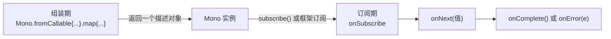
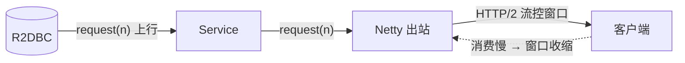

---
sources:
  - 08-第八阶段
---

# 05. Reactor 与 WebFlux：背压与取舍

> [← 第八阶段导览](01-导览.md) · `Mono`/`Flux` 是**声明**，`subscribe` 才执行；不订阅的流什么都不会发生，订阅了但里面藏一个阻塞调用，事件循环线程就会被钉住。WebFlux 不是「更快的 MVC」，它是「用线程换可控性」，代价必须在选型时一次算清。

## 1. 心智模型：声明与执行是两件事



Reactive Streams 只有四个信号加两个动作：`onNext`、`onComplete`、`onError`、`onSubscribe`，以及下游的 `request(n)` 和 `cancel()`。全部操作符都只是在这几个信号上做转换——理解这一点之后，所有「为什么它不执行」的问题都有了统一的答案。

**为什么「声明」这个区分如此重要**：`Mono` 是一个**装配说明书**，不是一次执行。写 `val m = Mono.fromCallable { slowCall() }` 不会调用 `slowCall()`；只有 `m.subscribe()` 或者把它作为 Controller 的返回值交给框架，才会真正触发。同一个 `Mono` 可以被订阅多次，每次都是独立的一次执行——这也是为什么有状态的操作必须放在 `Mono.defer { }` 里。

**坑之一**：`Mono.just(compute())` 会在**组装时**就执行 `compute()`（Java 是即时求值），而 `Mono.fromCallable { compute() }` 是延迟的。两者看起来都是「包一层」，执行时机完全不同。

**坑之二**：在 `@RestController` 里返回 `Mono`，框架会替你订阅；但在 Service 里手动 `map` 完就丢弃，什么都不会发生，且不报错：

```kotlin
// 错：组装完就丢，请求永远不会发出
fun refresh(id: Long) {
    client.get(id).doOnNext { cache.put(it) }   // 没有 subscribe
}

// 对：要么返回给调用方（由框架订阅），要么显式订阅并处理错误
fun refresh(id: Long): Mono<Void> =
    client.get(id).doOnNext { cache.put(it) }.then()
```

## 2. 最容易犯的四个错

| 错误 | 表现 | 根因 | 修法 |
|---|---|---|---|
| 忘记订阅 | 代码「没执行」，无异常 | `Mono` 只是声明 | 返回给框架，或显式 `subscribe` |
| 在流里阻塞 | 吞吐暴跌到接近核数，`BlockHound` 报警 | 事件循环线程被占 | 移到 `Schedulers.boundedElastic()` 或改响应式驱动 |
| `flatMap` 当 `concatMap` 用 | 返回顺序错乱、下游被打爆 | `flatMap` 并发订阅所有内层 | 需要顺序用 `concatMap`，需要限并发用 `flatMap(f, n)` |
| 异常被吞 | 错误率 0%，但数据缺失 | `onErrorResume { Mono.empty() }` 掩盖了一切 | 区分「预期降级」与「意外异常」，后者要冒泡并计数 |

**`flatMap` 与 `concatMap` 的真实差别**，用三个各 100ms 的调用说明：

| 操作符 | 订阅内层的方式 | 总耗时 | 输出顺序 | 并发度 |
|---|---|---|---|---|
| `flatMap` | 立刻全部订阅 | 100ms | 完成顺序（乱） | 默认无上限 |
| `concatMap` | 上一个完成才订阅下一个 | 300ms | 源顺序 | 1 |
| `flatMapSequential` | 立刻全部订阅 | 100ms | 源顺序（缓存后重排） | 无上限 |

`flatMap` 的「默认无上限」是最危险的一点：一个 1000 元素的 `Flux` 走 `flatMap`，会瞬间发出 1000 个并发请求。生产上几乎总要写成 `flatMap({ call(it) }, 16)` 显式限并发。

**异常被吞的隐蔽形态**：`subscribe()` 不带错误消费者时，错误会被交给 `Operators.onErrorDropped`，默认只打一行 `Operator called default onErrorDropped` 的日志。指标上看是「没有错误」，日志里能翻到一行不起眼的 WARN——这类 bug 可以潜伏很久。

**取舍**：响应式代码里「显式」是常态。每一个可能失败的地方都要写明「失败之后怎么办」，这既是它的啰嗦之处，也是它比 try/catch 更可靠的地方——因为编译器不会让你忘，操作符链的形状会逼你想清楚。

## 3. 背压：四种策略与它们的边界

背压是 Reactive Streams 的核心协议：**下游通过 `request(n)` 告诉上游「我还能处理 n 个」**，上游不得超发。它是「推」模型上的一个「拉」的补丁。

当上游不遵守（例如一个热源、一个 `Flux.create` 里循环 `next()`），Reactor 提供四种溢出策略：

| 策略 | 行为 | 内存 | 丢什么 | 适用 |
|---|---|---|---|---|
| `onBackpressureBuffer(cap, onOverflow)` | 缓冲到上限，溢出时按回调处理 | 有界 | 溢出时的元素 | 下游短暂变慢、不能丢 |
| `onBackpressureDrop(cb)` | 满了就丢新来的 | O(1) | 最新元素 | 指标采样、日志 |
| `onBackpressureLatest()` | 只保留最新一个 | O(1) | 中间元素 | 界面刷新、行情快照 |
| `onBackpressureError()` | 溢出即 `onError` | O(1) | 整体失败 | 绝不能丢的场景，让上游感知 |

**为什么这四种都是「补丁」而不是「解法」**：它们都作用在**下游消费不过来**的那一刻，而那一刻已经意味着上游生产速度超过了系统能力。缓冲只是把问题推迟（`buffer` 最终也会满），丢弃是承认「这些数据不重要」，报错是把压力反弹给上游。真正的解法只有两个：**降低生产速率**，或者**让链路每一段都能表达需求**。

`onBackpressureBuffer` 不传上限时用的是无界缓冲（`Queues.SMALL_BUFFER_SIZE` 起步但可增长），它和 02 册的无界队列是同一类错误：把过载变成 OOM。

## 4. 端到端背压才有效



背压要真正起作用，链条上每一段都得支持：

| 环节 | 支持背压 | 不支持时 |
|---|---|---|
| 数据源（R2DBC / reactive Kafka / reactive Redis） | 是 | 用 `Flux.create` 包装阻塞源 → 退化成无界推送 |
| 中间操作符 | 是 | `flatMap` 无限并发会打破它 |
| 传输层 | HTTP/2 流控、WebSocket | HTTP/1.1 没有流控，只能靠 TCP 窗口间接施压 |
| 客户端 | 会按需读取 | 不读就是「不要」，但服务端无法区分「慢」和「不要」 |

**为什么对浏览器做背压基本无效**：HTTP/1.1 没有应用层的流控语义，服务端能做的只是「socket 写不进去时暂停」——这依赖 Netty 的 `isWritable`，粒度粗、反馈慢，而且是**按连接**而不是按流的。所以在「返回一个大列表给前端」这种场景里谈背压没有意义，该做的是分页。

**取舍**：背压最有价值的场景是**服务端到服务端**的流式传输（SSE 推送、gRPC streaming、reactive Kafka 消费），双方都懂协议，`request(n)` 才有意义。对外给浏览器的接口，控制手段应该是分页和限流，不是 `onBackpressureBuffer`。

## 5. WebFlux 的真实收益与代价

| 维度 | Spring MVC（平台线程） | WebFlux |
|---|---|---|
| 并发单位 | 线程（200 个左右） | 事件（每核一个事件循环） |
| 线程数 | 200+ | 约等于核数 |
| 单连接内存 | 线程栈 1MB | 连接缓冲，KB 级 |
| 慢 IO 并发能力 | 受线程数限制 | 受内存与连接数限制 |
| 阻塞依赖 | 天然支持 | **必须隔离**，否则退化 |
| 排错方式 | 线程栈，直观 | 操作符链 + `checkpoint()`，需要练习 |
| 团队门槛 | 低 | 高 |

**收益的本质只有一条**：把「等待」的存储成本从「1MB 栈」换成「一个对象」。所以收益大小完全取决于**等待时间占总时间的比例**：

```text
收益 ≈ 平均等待时间 / 平均总耗时
```

一个 95% 时间在等下游的聚合接口，WebFlux 能用 8 个线程撑起几千并发；一个 95% 时间在算的接口，WebFlux 一点收益都没有。

**代价的三条**：① 依赖必须全响应式，一个阻塞 JDBC 就让整条链退化；② 栈追踪被切成碎片，一张异常日志里出现十几个 `MonoFlatMap` 帧，必须靠 `checkpoint("after-fetch-price")` 打标记；③ 团队要重新学「什么时候会发生订阅」这件事，学习曲线比虚拟线程陡得多。

## 6. 什么时候 WebFlux 反而更慢

两个具体机制，都能在压测里复现：

**第一，阻塞依赖把并发压到核数。** 事件循环只有 `核数` 个线程。一个 50ms 的 JDBC 查询放在流里，8 核机器上理论吞吐就是 `8 / 0.05 = 160 rps`——而 200 个平台线程能做到 `200 / 0.05 = 4000 rps`。**差了 25 倍**，而且这个数字与「响应式更省资源」的直觉完全相反。这也是为什么 WebFlux 应用必须配 `BlockHound` 做单元测试守卫。

**第二，极短请求的操作符开销占比过高。** 一个纯内存读、P50 只有 1ms 的接口，MVC 的路径是「解析 → 调用 → 序列化」，WebFlux 在这之上多了操作符链的组装、`Subscription` 对象分配、上下文传播。实测差距通常在 5%~15%，在低延迟接口上这是可感知的。加上事件循环只有 8 个线程，一旦某次 GC 或一次意外的长任务占住一个循环，影响的是 1/8 的流量，而 MVC 里只是 1/200。

| 场景 | 更该选 | 原因 |
|---|---|---|
| 全阻塞 JDBC + 简单 CRUD | MVC 或 MVC + 虚拟线程 | 响应式拿不到收益，只拿到复杂度 |
| 扇出多个下游、等待为主 | WebFlux 或虚拟线程 | 等待占比高 |
| 流式推送 / SSE / 大文件 | WebFlux | 背压与增量写出 |
| CPU 密集 | 都不适合，加机器 | 并发模型不增加算力 |
| 团队不熟响应式、排期紧 | MVC + 虚拟线程 | 同样的并发收益，更低的学习成本 |

## 7. Kotlin 协程 × WebFlux

协程可以在 WebFlux 之上跑，把操作符链写成顺序代码。三种桥接方式：

| 方式 | 写法 | 适合 |
|---|---|---|
| 函数式端点 | `coRouter { GET("/x") { ... } }` | 新服务，路由集中管理 |
| 注解控制器 | `suspend fun` + 返回 `Mono`/直接返回对象 | 迁移成本最低 |
| 局部桥接 | `mono { }` / `flux { }` / `awaitSingle()` | 在响应式代码里插一段顺序逻辑 |

```kotlin
@RestController
class PriceController(private val client: WebClient) {

    // 注解式：suspend 返回值，Spring 自动桥接到 Reactor
    @GetMapping("/price/{sku}")
    suspend fun price(@PathVariable sku: String): PriceView =
        client.get().uri("/prices/{sku}", sku).retrieve()
            .bodyToMono(PriceView::class.java)
            .timeout(Duration.ofMillis(200))
            .awaitSingle()
}
```

**坑**：`awaitSingle()` 在没有元素时会抛 `NoSuchElementException`，在多于一个元素时抛 `IllegalArgumentException`。空结果应该用 `awaitSingleOrNull()`。另外，`suspend` 控制器底层仍走 WebFlux 的调度，**不要在里面调用阻塞代码**——协程不会自动帮你切线程。

**取舍**：协程 + WebFlux 的组合价值在于「保留背压能力，同时让业务代码可读」。如果不需要背压，MVC + 虚拟线程能达到同样的并发，且不需要团队学两套模型。

## 8. WebClient 并发聚合：超时 + 降级

```kotlin
@Service
class ProductAggregator(private val webClient: WebClient) {

    fun aggregate(id: Long): Mono<ProductPage> {
        val detail = fetch("/detail/$id", ProductDetail::class.java, 250)
        val price = fetch("/price/$id", Price::class.java, 200)
        val stock = fetch("/stock/$id", Stock::class.java, 150)

        return Mono.zip(detail, price, stock)
            .map { t -> ProductPage(t.t1.orElse(null), t.t2.orElse(null), t.t3.orElse(null)) }
            .timeout(Duration.ofMillis(300))            // 兜底：整条链的总预算
            .onErrorResume { e ->
                log.warn("aggregate degraded, id={}", id, e)
                Mono.just(ProductPage.empty(id))        // 整体降级，而不是 500
            }
    }

    // 单路：成功 → Optional.of；失败/超时/无数据 → Optional.empty
    // 用 Optional 包一层，是为了让「这一路没有」本身成为一个正常的元素，
    // 这样 Mono.zip 不会因为某个源为空而整体变空。
    private fun <T : Any> fetch(path: String, type: Class<T>, timeoutMs: Long): Mono<Optional<T>> =
        webClient.get().uri(path).retrieve()
            .bodyToMono(type)
            .timeout(Duration.ofMillis(timeoutMs))
            .map { Optional.of(it) }
            .defaultIfEmpty(Optional.empty())
            .onErrorReturn(Optional.empty())
}
```

这段代码有三个必须解释的取舍：

1. **`Mono.zip` 在任一源为空时整体为空**。所以 `fetch` 必须先 `map` 成 `Optional` 再 `defaultIfEmpty`——把「这一路失败」变成一个**正常的元素**。如果直接写 `onErrorResume { Mono.empty() }`，失败的那一路会让 `zip` 整体变空，接口 200 但没有 body，是最难查的一类 bug。
2. **每路一个超时，整条链一个超时**。单路超时决定降级粒度（3 个字段各自为空），总超时决定最坏情况下的响应时间（最多 300ms 一定有响应）。两者都不能省。
3. **降级粒度由操作符的位置决定**。`onErrorReturn` 放在 `fetch` 内部是「单路降级」，`onErrorResume` 放在链尾是「整体降级」——后者只在 `zip` 本身失败（如总超时）时才触发。只写链尾而不写单路，等于放弃部分成功。

**坑**：`WebClient` 的连接池是共享的，默认 `maxConnections` 是 500（Reactor Netty 的 `ConnectionProvider`）。高并发下真正的瓶颈往往在这里，而不是事件循环——07 册会把这条量化。

## 9. 三者对照

| 维度 | MVC + 平台线程 | MVC + 虚拟线程 | WebFlux |
|---|---|---|---|
| 并发上限 | 线程数（200 左右） | 内存 / 连接数 | 内存 / 连接数 |
| 阻塞依赖 | 支持 | 支持 | 必须隔离 |
| 代码形态 | 顺序 | 顺序 | 声明式链 / 协程 |
| 背压 | 无 | 无 | 有（端到端才有效） |
| 排错 | 线程栈 | 线程栈（虚拟线程 dump 大） | 操作符链 + checkpoint |
| 学习成本 | 低 | 低 | 高 |
| 典型吞吐瓶颈 | 线程数 | 连接池 / 下游 | 事件循环 / 连接池 |
| 最适合 | 常规 CRUD | 高并发阻塞 IO | 流式、扇出、网关 |

## 10. 自测

1. `Mono.just(compute())` 与 `Mono.fromCallable { compute() }` 的执行时机差别是什么？为什么这会导致「服务启动了但任务没跑」？
2. 三个各 100ms 的调用，用 `flatMap` 和 `concatMap` 分别耗时多少？顺序如何？`flatMap` 不限并发会带来什么后果？
3. `onBackpressureBuffer` 为什么不能算「解决」了背压？四种溢出策略分别在什么场景下才是对的？
4. 8 核机器上，一个 50ms 的阻塞 JDBC 放在 WebFlux 的事件循环里，理论吞吐是多少？换成 200 个平台线程呢？
5. 为什么「返回大列表给浏览器」这个场景谈背压没有意义？应该用什么手段？
6. `Mono.zip` 遇到某个源为空 `Mono` 时会怎样？在聚合代码里怎么避免这个坑？

## 11. 延伸

- 上一册：[04-Kotlin协程在服务端](04-Kotlin协程在服务端.md)——`suspend` 与 `Mono` 的桥接点就在这里。
- 下一册：[06-弹性-超时-重试-熔断-舱壁与限流](06-弹性-超时-重试-熔断-舱壁与限流.md)——本节手写的超时与降级，在下一册会被抽象成可配置的组件。
- 响应式的协议基础（HTTP/2 流控）在[浏览器站第四阶段 03 册](https://yidafu.github.io/tech-learning/browser/docs/第四阶段/HTTP2-分帧多路复用与优先级)。
- 三种模型同台压测的数据见本阶段 [07 册](07-三种并发模型压测对比.md)。
