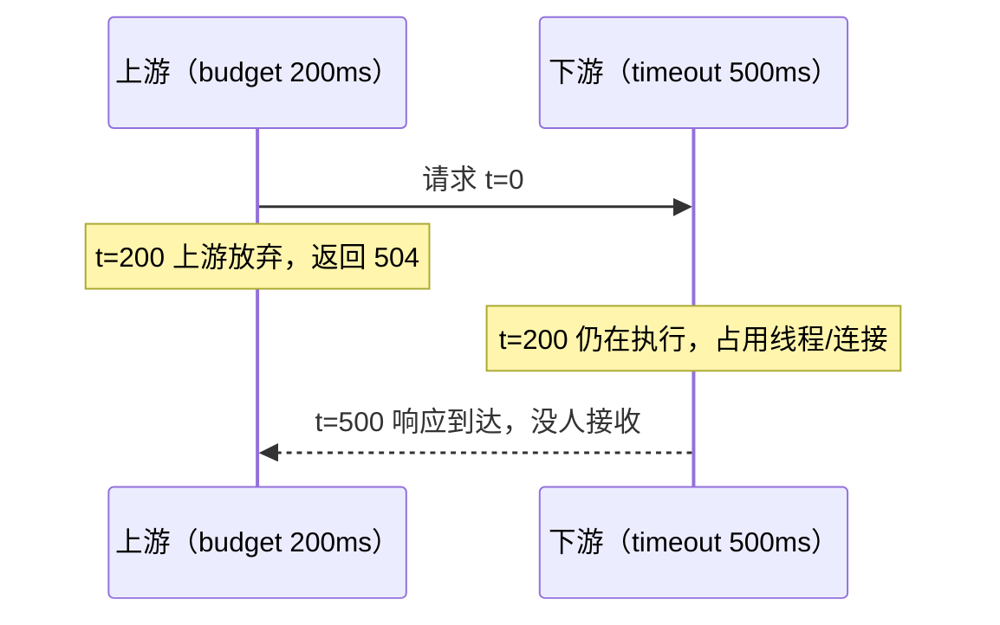
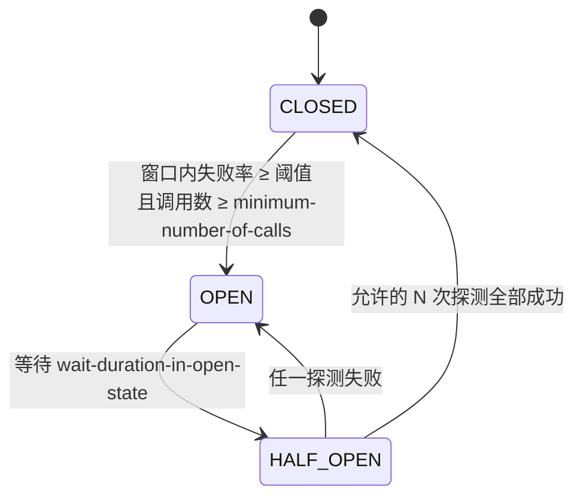

---
sources:
  - 08-第八阶段
---

# 06. 弹性：超时、重试、熔断、舱壁与限流

> [← 第八阶段导览](01-导览.md) · 弹性不是「加个重试」，而是**给每一次调用标一个价格**：超时定价格上限，重试定价格上涨的倍数，熔断定什么时候不再买，舱壁定最多同时买几份，限流定门口放进多少人。五件事的数值必须相互自洽，否则它们会互相抵消。

## 1. 超时预算：自顶向下算

超时不是一个一个拍的，是**从入口倒推**出来的。算法只有三步：

```text
1. 入口超时 = 业务能接受的最长响应时间（由 SLA 决定，不是由下游决定）
2. 每层留给下一跳 = 本层预算 − 本层固定开销 − 安全余量
3. 每个下游的超时 = min(分到的预算, 该下游 P999 × 1.5)
```

以一个入口 500ms 的接口为例，它要做三件本地事、调三个下游：

| 环节 | 预算 | 自身开销 | 留给下游 | 依据 |
|---|---|---|---|---|
| 入口总计 | 500ms | — | — | SLA 承诺 |
| 解析 + 校验 + 鉴权 | — | 15ms | — | 本地 CPU，实测 P99 |
| 业务编排 | — | 10ms | — | 本地 CPU |
| 序列化 + 写回 | — | 15ms | — | Jackson 3，实测 P99 |
| 安全余量 | — | 50ms | — | 覆盖 GC、调度抖动 |
| **可分给下游** | **410ms** | — | **410ms** | 500 − 90 |
| 下游 A（并行） | 200ms | 10ms | 190ms | 并行不叠加，取 200ms 留 210ms 余量 |
| 下游 B（并行） | 200ms | 10ms | 190ms | 同上 |
| 下游 C（并行） | 200ms | 10ms | 190ms | 同上 |

如果是**串行**三个下游，410ms 要三等分：`120 / 120 / 100`，余 70ms 给重试。串行调用在预算上天然吃亏，这也是 04、05 册反复讲并行的原因之一。

**为什么余量必须是显式的一项**：GC 停顿、线程调度、日志 IO 抖动都在预算之外发生。不留余量，正常情况下的百分比也会超时——而超时一旦触发，后面所有保护手段（重试、熔断）都会被误触发，连锁反应。

**坑**：预算要在**每一跳**都递减。网关 800ms、服务 A 900ms 这种「下游比上游还长」的配置，等于没有超时（见下一节）。

## 2. 下游超时必须小于上游



**论证**：上游已经放弃了，下游继续干活没有任何收益，只有成本——它占着一个线程、一个连接、一份数据库会话。当下游本身已经过载时，这些「白干」的请求正是压垮它的那一份。

**违反之后的现象**，按可观测性顺序排列：

| 现象 | 含义 |
|---|---|
| 上游 504 率上升，下游成功率正常 | 下游比上游慢，超时白设 |
| 下游 CPU 打满但 QPS 不高 | 大量请求在做无用功 |
| 上游重试率上升，下游负载进一步上升 | 超时 + 重试形成正反馈 |
| 连接池 `active` 长期等于 max | 下游连接被「已放弃」的请求占着 |

**规则**：`超时(下游) ≤ 超时(上游) − 上游本层开销 − 余量`。跨团队时这条规则必须写进接口契约，否则每一层都会「为了稳一点」把自己的超时设长一点，最后发现整条链上没有一个超时是真的。

**取舍**：把下游超时设得太紧会误杀正常慢请求（P99 本来就 180ms，你设 150ms）。所以下限是「该下游 P999 × 1.5」，上限是「上游分到的预算」。区间为空说明这个下游不该在这条链上同步调用——该改成异步或预计算。

## 3. 重试放大

三层调用，每层都配「失败重试 3 次」（即最多 3 次尝试）：

| 层 | 该层的放大倍数 | 到达最底层的调用数 |
|---|---|---|
| 客户端 | ×1 | 1 |
| 网关 | ×3 | 3 |
| 服务 A | ×3 | 9 |
| 服务 B | ×3 | **27** |

**为什么是乘法不是加法**：每一层的重试都会**重新发起一次完整的下游调用**，而那次调用在下游看来又是一次独立的请求，它自己也会重试。三层叠加就是 3³ = 27 倍。

真正致命的不是 27 倍这个数字，而是**它发生在下游已经出问题的时候**：下游本来就慢，现在还要承受 27 倍的流量，于是更慢，于是更多超时，于是更多重试。这是标准的正反馈，几秒内就能把一个小故障放大成全站雪崩。

四条约束，缺一不可：

| 约束 | 做法 | 不做的后果 |
|---|---|---|
| 只重试幂等操作 | GET/PUT/DELETE，或带幂等键的 POST | 重复下单、重复扣款 |
| 指数退避 + 抖动 | `wait 100ms × 2^n`，叠加 ±20% 随机 | 重试风暴整齐划一，同时到达 |
| 重试预算 | 额外流量不超过总量的 10% | 放大倍数失控 |
| 与熔断配合 | 熔断打开时**不重试**，直接失败 | 熔断形同虚设 |

**取舍**：重试应该在**最外层**（离用户最近的那一层）做，并且只做一层。内层重试 + 外层重试是放大倍数的来源。如果某个下游确实需要内层重试（比如它自己的抖动很短暂），那外层就必须关掉重试。

## 4. Resilience4j：四个组件与组合顺序

| 组件 | 解决的问题 | 关键参数 | 放哪 |
|---|---|---|---|
| `TimeLimiter` | 慢调用占资源 | `timeout-duration`、`cancel-running-future` | 最内层（贴着调用） |
| `Bulkhead` | 一个依赖吃光资源 | `max-concurrent-calls`、`max-wait-duration` | 内层，包住调用 |
| `CircuitBreaker` | 持续打无用请求 | `failure-rate-threshold`、`wait-duration-in-open-state` | 中层 |
| `Retry` | 瞬时故障 | `max-attempts`、`wait-duration`、`enable-exponential-backoff` | 最外层 |

（第五个组件 `RateLimiter` 不在这条装饰链上——它管的是入口速率，见 §6。）

官方推荐的装饰顺序（从外到内）：

```text
Retry ( CircuitBreaker ( RateLimiter ( TimeLimiter ( Bulkhead ( 实际调用 ) ) ) ) )
```

**为什么 Retry 在最外**：重试要能重新穿过熔断器和舱壁，才能让每一次重试都重新受「熔断是否打开」「舱壁是否还有位置」的约束。把 Retry 放在里面，重试就绕过了这些保护。

**为什么 TimeLimiter 在最内**：它包住的是「这一次调用最多等多久」，越贴近实际调用越准确；放在外面会连重试的间隔一起计时。

```yaml
resilience4j:
  circuitbreaker:
    instances:
      inventory:
        sliding-window-type: COUNT_BASED
        sliding-window-size: 50
        minimum-number-of-calls: 20
        failure-rate-threshold: 50
        slow-call-duration-threshold: 300ms
        slow-call-rate-threshold: 60
        wait-duration-in-open-state: 5s
        permitted-number-of-calls-in-half-open-state: 5
        automatic-transition-from-open-to-half-open-enabled: true
  retry:
    instances:
      inventory:
        max-attempts: 3
        wait-duration: 100ms
        enable-exponential-backoff: true
        exponential-backoff-multiplier: 2
        retry-exceptions:
          - java.io.IOException
        ignore-exceptions:
          - com.example.OrderNotFoundException
  timelimiter:
    instances:
      inventory:
        timeout-duration: 200ms
        cancel-running-future: true
  bulkhead:
    instances:
      inventory:
        max-concurrent-calls: 32
        max-wait-duration: 10ms
```

**三个必须知道的行为细节**：

1. **`TimeLimiter` 的注解只对异步返回类型生效**（`CompletableFuture`、`Mono`、`suspend`）。在同步方法上加 `@TimeLimiter` 不会超时，也不报错——这是它最常见的失效方式。同步调用要用客户端自己的超时（`HttpClient` 的 `connectTimeout`/`readTimeout`）。
2. **`ignore-exceptions` 比 `retry-exceptions` 更该显式配**。业务异常（订单不存在、参数非法）重试一百次也是同样的结果，只会放大流量。
3. **`minimum-number-of-calls` 不设或设得太大，熔断永远不触发**。默认 100，低流量接口可能一天都凑不齐 100 次调用。

## 5. 熔断三态与半开探测



（另外还有两个运维态：`DISABLED` 永不熔断、`FORCED_OPEN` 强制打开，用于演练与紧急制动。）

| 状态 | 行为 | 关键问题 |
|---|---|---|
| `CLOSED` | 放行，统计窗口内成功率/慢调用率 | 窗口多大？太小误判，太大反应慢 |
| `OPEN` | **直接拒绝**，不发请求 | 拒绝要快，且要能被上游识别（503 而不是 500） |
| `HALF_OPEN` | 放行 N 个探测请求 | N 太小会反复跳闸，太大等于没熔断 |

**为什么需要 `HALF_OPEN`**：`OPEN` 状态下没有任何请求，就没有任何信息判断下游是否恢复。半开是「用最小的代价试探」——放 5 个请求过去，全成功就闭合，有一个失败就重新打开。

**参数怎么定**（以 200ms 预算的下游为例）：

| 参数 | 取值 | 理由 |
|---|---|---|
| `sliding-window-size` | 50 | 20 rps 下约 2.5 秒的窗口，反应够快 |
| `minimum-number-of-calls` | 20 | 低于这个数统计不显著，不做判断 |
| `failure-rate-threshold` | 50% | 一半失败说明不是偶发 |
| `slow-call-duration-threshold` | 300ms | 已经超过上游预算，慢等于失败 |
| `wait-duration-in-open-state` | 5s | 小于典型的下游恢复时间，避免空转 |
| `permitted-number-of-calls-in-half-open-state` | 5 | 足够暴露问题，又不至于再压垮下游 |

**坑**：熔断器是**按实例**隔离的。10 个 Pod 各自熔断，下游恢复时是「逐个恢复」，形成一段时间的混合状态；反过来，下游故障时也是「逐个打开」，第一个打开的实例会把流量推给其它 9 个——**这会让故障扩散得更快**。跨实例的熔断需要共享状态（Redis）或者依赖网关层的熔断。

## 6. 限流：四种算法与选型

| 算法 | 机制 | 允许突发 | 实现成本 | 适用 |
|---|---|---|---|---|
| 令牌桶 | 按速率放令牌，桶可攒 | 是（桶容量） | 低 | 对外 API，允许短突发 |
| 漏桶 | 恒定速率流出，超出排队/丢弃 | 否 | 低 | 保护自身处理能力 |
| 滑动窗口 | 统计窗口内的请求数 | 取决于窗口 | 中（要存时间戳） | 精确配额（计费、试用额度） |
| 并发信号量 | 限制同时在途数 | 是 | 极低 | 保护下游连接/线程 |

**令牌桶为什么是对外 API 的默认选择**：真实流量本来就有突发（用户点击、定时任务），令牌桶通过「桶容量」把突发限制在可控范围内，而不是把突发直接拒掉。桶容量 = 允许的突发秒数 × 速率。

实现上两条路：Resilience4j 的 `RateLimiter` 是**固定窗口刷新**（每 `limit-refresh-period` 重置配额），够用但窗口边界处允许 2 倍突发；需要精确的令牌桶语义（连续补充、多档带宽）时用 Bucket4j，`Bandwidth.classic(n, Refill.greedy(n, Duration.ofSeconds(1)))` 就表达了「每秒 n 个、连续补充」。

**并发信号量为什么常被忽略却最有用**：它限的不是速率，而是**同时在途数**。下游的承载能力本质上由并发决定（连接数、线程数），而不是由 QPS 决定。一个 10 QPS 但每次 5 秒的调用，比 100 QPS 每次 50ms 的调用更危险——前者需要 50 个并发，后者只需要 5 个。

```yaml
resilience4j:
  ratelimiter:
    instances:
      publicApi:
        limit-for-period: 100          # 每个刷新周期允许的请求数
        limit-refresh-period: 1s
        timeout-duration: 0            # 拿不到许可立即失败，不排队
```

**取舍**：分布式限流需要共享计数器（Redis + Lua），代价是每次请求多一次网络往返（~0.5ms）。单机限流便宜但总量是「单机配额 × 实例数」，扩缩容时会漂移。工程上常见组合是「网关做分布式全局限流 + 服务做单机并发保护」。

## 7. 降级的三个层次

| 层次 | 做法 | 对用户的影响 | 触发条件 |
|---|---|---|---|
| 一级：返回兜底值 | 缓存旧值、默认值、空列表 | 数据可能过期，功能可用 | 单次调用失败 |
| 二级：关非核心功能 | 推荐位下线、评论不加载、评分隐藏 | 主流程可用，体验下降 | 依赖整体不可用 |
| 三级：直接拒流量 | 429/503 + `Retry-After` | 明确失败，可重试 | 自身接近过载 |

**为什么要有层次而不是一刀切**：降级的本质是「用体验换可用性」，不同故障程度该换掉不同的东西。一次下游超时就把整个页面变成 503，是把可用性换掉了；反过来，下游全挂还坚持加载推荐位，是把主流程拖死。

**坑**：降级必须**可观测**。降级返回兜底值时，HTTP 状态码仍然是 200，监控上看一切正常——所以必须单独打点（`degraded=true` 的标签），否则故障会以「数据不对」的形式在几周后被业务方发现。

## 8. 保护手段放在哪一层

| 手段 | 该放的位置 | 保护对象 | 放错的后果 |
|---|---|---|---|
| 限流 | 网关 + 服务入口 | 自身容量 | 放在最内层，流量已经进来了 |
| 舱壁 | 每个依赖的调用点 | 资源隔离 | 全局一个舱壁，等于没隔离 |
| 熔断 | 每个依赖的调用点（跨实例需共享） | 故障依赖 | 只在一处配，其它路径照样打 |
| 重试 | 最外层，只一层 | 瞬时故障 | 每层都配，放大 27 倍 |
| 超时 | 每一跳 | 慢调用 | 只有入口有，下游无限等 |
| 降级 | 业务编排层 | 用户体验 | 放在基础设施层，不知道怎么兜 |

一条经验：**越靠近入口的手段越「粗」，越靠近调用的手段越「细」**。限流是粗的（按请求数），超时是细的（按单次调用）。

## 9. 两种写法：注解式与编程式

注解式最省事，但有三个硬约束：只能用在 Spring Bean 的**公开方法**上、自调用失效、`TimeLimiter` 只对异步返回类型生效。

```kotlin
@Service
class InventoryService(private val client: InventoryClient) {

    @CircuitBreaker(name = "inventory", fallbackMethod = "stockFallback")
    @Retry(name = "inventory")
    @Bulkhead(name = "inventory")
    fun stock(sku: String): Int =
        client.query(sku)                       // 阻塞调用，超时靠 HTTP 客户端

    // fallback 的签名必须与原方法一致，末尾多一个 Throwable
    fun stockFallback(sku: String, e: Throwable): Int {
        log.warn("inventory degraded, sku={}, cause={}", sku, e.toString())
        return -1                                // 兜底值，同时打点
    }
}
```

编程式适合「需要按参数动态选择策略」或者「注解不生效时的排查对照」：

```kotlin
@Service
class InventoryService(
    cbRegistry: CircuitBreakerRegistry,
    retryRegistry: RetryRegistry,
) {
    private val cb: CircuitBreaker = cbRegistry.circuitBreaker("inventory")
    private val retry: Retry = retryRegistry.retry("inventory")

    fun stock(sku: String): Int {
        // 先熔断、再重试：每次重试都会重新判断熔断器状态
        val guarded = CircuitBreaker.decorateCheckedSupplier(cb) { client.query(sku) }
        val withRetry = Retry.decorateCheckedSupplier(retry, guarded)
        return try {
            withRetry.call()
        } catch (e: Exception) {
            metrics.counter("inventory.degraded").increment()
            -1
        }
    }
}
```

**坑**：Kotlin 里 `@CircuitBreaker` 的 `fallbackMethod` 要求方法签名匹配。suspend 函数需要 `resilience4j-kotlin` 的扩展（`executeSuspendFunction`），把注解直接加在 `suspend fun` 上在部分版本里会静默不生效——**验证方式是看指标里有没有 `resilience4j_circuitbreaker_calls`**，没有就是没织入。

## 10. 自测

1. 入口 500ms，本地固定开销 40ms，安全余量 50ms，三个下游**串行**，每个该分多少？如果改成并行呢？
2. 网关 800ms、服务 900ms、下游 1000ms，这套配置会发生什么？给出至少三个可观测现象。
3. 三层各重试 3 次，最坏放大多少倍？加哪四条约束能把它压回来？
4. 为什么 `Retry` 要放在装饰链的最外层，而 `TimeLimiter` 要在最内层？
5. `HALF_OPEN` 状态放 5 个探测请求，其中 1 个失败会怎样？这个策略在什么情况下会「反复跳闸」？
6. 一个 10 QPS、每次 5 秒的下游，和一个 100 QPS、每次 50ms 的下游，哪个更需要并发限制？为什么？

## 11. 延伸

- 上一册：[05-Reactor与WebFlux-背压与取舍](05-Reactor与WebFlux-背压与取舍.md)——`timeout` 与 `onErrorResume` 在流式代码里的等价物。
- 下一册：[07-三种并发模型压测对比](07-三种并发模型压测对比.md)——把本节的手段放进压测，看它们在故障注入下是否真的起作用。
- 超时与重试预算在服务间的完整算法见[第十一阶段导览](../11-第十一阶段/01-导览.md)（04 册服务间通信）。
- 幂等键如何让 POST 变得可重试，见[第六阶段 05 册](../06-第六阶段/05-幂等-幂等键-去重表与状态机.md)。
- 事务边界与「事务内不做 IO」的关系见[第六阶段 03 册](../06-第六阶段/03-编程式事务与事务边界设计.md)。
