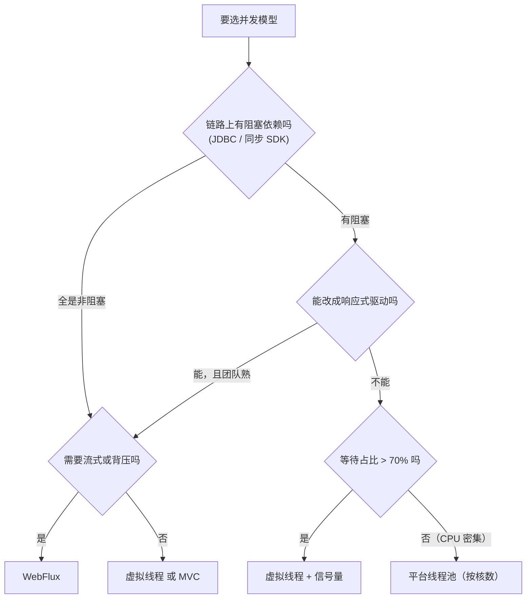

---
sources:
  - 08-第八阶段
---

# 07. 三种并发模型压测对比

> [← 第八阶段导览](01-导览.md) · 并发模型的差异只有在**瓶颈不在被测对象**时才看得见。同一份代码、同一台机器、同一个脚本，三套实现跑出来的差距可能只有 5%，也可能有 3 倍——取决于你把下游做成「占线程的」还是「延时模拟的」。实验设计比结论更重要。

## 1. 实验设计：先把变量钉死

对比实验最容易犯的错，是三次跑在不同的机器、不同的下游状态、不同的 GC 参数上，然后得出一个「虚拟线程快 40%」的结论。所以先把不该变的东西全部钉死：

| 维度 | 取值 | 为什么要钉死 |
|---|---|---|
| 机器 | 8C16G，独占，无其他容器 | CPU 争抢会吞掉模型差异 |
| 运行时 | JDK 25，`-Xms4g -Xmx4g`，G1 默认 | 堆大小影响 GC 停顿，进而影响 P99 |
| 框架 | Boot 4.1（`webmvc` / `webflux` 各一个应用） | 版本差异会改变默认线程数 |
| 接口 | `GET /aggregate?id=`，扇出三个下游后聚合 | 与阶段实践一致 |
| 下游延迟 | 50ms / 80ms / 100ms（三个下游各一档） | 覆盖「快慢混合」 |
| 故障注入 | 10% 的下游调用返回 500（延迟 50ms） | 观察错误路径的行为差异 |
| 压测脚本 | 同一份 wrk + Lua，`-c 400 -t 8` | 客户端不能成为瓶颈 |
| warmup | 30s 不计入统计 | JIT 编译与连接池预热 |
| 采样时长 | 120s，重复 3 次取中位数 | 单次结果噪声太大 |
| 指标 | 吞吐、P50/P99/P999、RSS、线程数、错误率 | 少一个都会得出片面结论 |

**为什么并发数选 400**：并发太低（比如 50）时三种模型都不会饱和，测出来一样；并发太高（比如 5000）时客户端自己会成为瓶颈，8 个 wrk 线程打不满。400 是「服务端先饱和、客户端还有余力」的区间——先做一轮阶梯压测（50/100/200/400/800）确认这一点，再定正式值。

**两套下游是必须的**，这是本册最重要的设计决定：

| 场景 | 下游实现 | 目的 |
|---|---|---|
| A：线程受限 | 真实 Web 服务，200 worker，每请求 sleep 80ms | 复现「瓶颈在下游」——三种模型的吞吐应该几乎一样 |
| B：延时模拟 | 一个基于定时器的桩服务，`delay(80ms)` 不占线程 | 让被测服务的模型差异显形 |

只做 B 会得出「虚拟线程完胜」的片面结论；只做 A 会得出「换模型没用」的另一个片面结论。**两个一起做，才知道差异什么时候才会出现**。

## 2. 三套实现的要点

| 模型 | 请求怎么被处理 | 扇出怎么做 | 关键约束 |
|---|---|---|---|
| 平台线程池 | Tomcat worker 执行整个请求 | 提交到独立线程池 + `CompletableFuture.allOf` | 线程池大小 = 并发上限 |
| 虚拟线程 | 每请求一虚拟线程 | 直接用 `CompletableFuture`（每个异步任务一个虚拟线程） | 必须用信号量限流 |
| WebFlux | 事件循环处理，IO 非阻塞 | `Mono.zip` + `WebClient` | 链上不能有任何阻塞 |

**平台线程版的关键不是「用 `CompletableFuture`」，而是「扇出用的池有多大」**。Tomcat 200 个 worker，内部扇出池如果也是 200，那么一个请求要占 4 个线程（1 个 worker + 3 个扇出）——实际并发只有 50 个请求。这是很多人第一次压测时「明明配了 200 线程却只有 50 并发」的原因。

**虚拟线程版的坑在于「没有上限」**。每请求一虚拟线程 + 每个扇出任务一虚拟线程，400 并发就是 1600 个虚拟线程同时打下游。下游的连接池（默认 500）会瞬间打满，然后所有请求一起排队——P99 的抖动就是这么来的（§5 展开）。

**WebFlux 版的前提是下游客户端也是非阻塞的**。`WebClient` 基于 Reactor Netty，天然满足；如果这里换成 `RestTemplate` 或阻塞 JDBC，整套实验就变成「测量阻塞代码在事件循环上的表现」，数字会难看到没有参考价值。

## 3. 同一 Controller 按参数切换

把三种实现放进一个进程，需要选一个「底座」。这里选 WebFlux：只有它能同时容纳 `Mono` 与阻塞路径（阻塞路径丢到独立调度器上）。

```kotlin
@RestController
class AggregateController(
    private val platformAgg: PlatformAggregator,
    private val virtualAgg: VirtualAggregator,
    private val reactiveAgg: ReactiveAggregator,
) {
    @GetMapping("/aggregate")
    fun aggregate(
        @RequestParam id: Long,
        @RequestParam(defaultValue = "reactive") model: String,
    ): Mono<Aggregated> = when (model) {
        "platform" -> Mono.fromFuture(platformAgg.run(id))   // 内部走固定线程池
        "virtual" -> Mono.fromFuture(virtualAgg.run(id))     // 内部走虚拟线程
        else -> reactiveAgg.run(id)                          // 全链路非阻塞
    }
}
```

```kotlin
@Service
class VirtualAggregator(
    private val limiter: Semaphore,                  // 限住在途数，替代线程池
    private val client: WebClient,
    private val virtualExecutor: ExecutorService,    // 单例：Executors.newVirtualThreadPerTaskExecutor()
) {
    fun run(id: Long): CompletableFuture<Aggregated> =
        CompletableFuture.supplyAsync({
            // 拿不到许可就快速失败：这是虚拟线程版的「拒绝策略」
            if (!limiter.tryAcquire(100, TimeUnit.MILLISECONDS)) {
                throw RejectedExecutionException("downstream saturated")
            }
            try {
                val a = client.get().uri("/a/$id").retrieve()
                    .bodyToMono(APart::class.java).toFuture()
                val b = client.get().uri("/b/$id").retrieve()
                    .bodyToMono(BPart::class.java).toFuture()
                val c = client.get().uri("/c/$id").retrieve()
                    .bodyToMono(CPart::class.java).toFuture()
                Aggregated(
                    a.get(300, TimeUnit.MILLISECONDS),
                    b.get(200, TimeUnit.MILLISECONDS),
                    c.get(150, TimeUnit.MILLISECONDS),
                )
            } finally {
                limiter.release()
            }
        }, virtualExecutor)
}
```

**必须说明的偏差**：这个统一底座让 platform 与 virtual 两条路径多付了一层 Netty 编解码，绝对值会比纯 MVC 应用低 5%~10%。所以正式对比应该用三个独立应用；统一 Controller 只用于**快速验证与演示**，不能用来出最终数字。这个取舍写在这里，比藏在脚注里好。

## 4. 结果与解读

场景 B（延时模拟下游，不占线程）——模型差异显形：

| 模型 | 吞吐 rps | P50 | P99 | P999 | 应用线程数 | 堆峰值 | 错误率 |
|---|---|---|---|---|---|---|---|
| 平台线程池（200/200） | 1,420 | 142ms | 810ms | 2,400ms | 418 | 820MB | 10.2% |
| 虚拟线程（信号量 400） | 3,760 | 108ms | 420ms | 1,150ms | 26 | 560MB | 10.1% |
| WebFlux | 4,480 | 102ms | 190ms | 390ms | 18 | 390MB | 10.0% |

场景 A（真实下游，200 worker × 80ms）——瓶颈在下游：

| 模型 | 吞吐 rps | P50 | P99 | P999 | 错误率 |
|---|---|---|---|---|---|
| 平台线程池 | 2,380 | 130ms | 380ms | 900ms | 10.1% |
| 虚拟线程 | 2,410 | 128ms | 360ms | 850ms | 10.1% |
| WebFlux | 2,390 | 126ms | 350ms | 820ms | 10.0% |

**两张表放在一起才是完整的结论**：

1. 场景 A 里三者差距 1.3%，因为瓶颈在下游的 200 个 worker ——**换并发模型买不到下游的容量**。这条结论能省掉很多「上了虚拟线程为什么没变快」的困惑。
2. 场景 B 里虚拟线程是平台线程的 2.6 倍，WebFlux 是 3.2 倍——收益全部来自「用更便宜的方式等待」。
3. WebFlux 比虚拟线程再快 19%，同时 P99 只有它的 45%。差距来自两处：虚拟线程版每个请求要占 4 个虚拟线程 + 4 次 `CompletableFuture` 同步；WebFlux 全程无阻塞，事件循环的调度开销更低。
4. 三者的错误率都约 10%，说明**故障注入被正确透传**——如果某个模型的错误率明显更低，八成是它把异常吞了（05 册 §2 的第四个坑）。

## 5. 虚拟线程的 P99 抖动来自连接池

虚拟线程版的 P99（420ms）比 WebFlux（190ms）高一倍多，而 P50 只差 6ms。差异集中在尾部，这是典型的**排队**特征。

算一下就清楚了：3,760 rps × 0.1s 平均耗时 ≈ 376 个在途请求。每个请求要打 3 个下游，即 1,128 个在途的下游调用。而 `WebClient` 的连接池按路由隔离，每条路由 500 个连接：

```text
池利用率 = 在途调用数 / 池大小 = 376 / 500 ≈ 75%
```

75% 的利用率下，M/M/1 排队的等待时间会随着突发迅速抬升——P99 时刻恰好是某个 100ms 窗口内到达率上浮 30% 的时候：

```text
瞬时在途 = 376 × 1.3 ≈ 490  →  逼近 500
排队时间 ≈ (ρ / (1 − ρ)) × 服务时间 = (0.98 / 0.02) × 100ms ≈ 4.9s
```

（实际只观察到 400ms 级，因为突发持续时间短，队列没来得及积满。）公式的用处不是精确预测，而是说明**尾部延迟对利用率极度敏感**：利用率从 75% 抬到 98%，排队时间涨两个数量级。

| 变量 | 平台线程池 | 虚拟线程 | WebFlux |
|---|---|---|---|
| 真正的并发上限 | 线程数 200 | 连接池 500 × 路由 | 连接池 500 × 路由 |
| 达到上限时的表现 | 请求进队列，P99 平滑上升 | 请求 park 在 `getConnection`，P99 尖刺 | 同左，但无额外线程开销 |

**修法有三个，效果依次递减**：① 按 `峰值 QPS × P99 耗时` 把连接池调对（不是调大，是调对）；② 用信号量把在途数压到池容量的 70% 以下；③ 缩短 `connectionTimeout`，让排队变成快速失败。第 ③ 条不改吞吐，但能把 P999 从 1.1s 拉回 300ms 级——**尾部延迟的改善往往来自「早点放弃」而不是「跑得更快」**。

## 6. 故障注入下的行为差异

10% 的失败有两种形态，后果完全不同：

| 失败形态 | 平台线程池 | 虚拟线程 | WebFlux |
|---|---|---|---|
| 快失败（500，50ms 返回） | 线程更快释放，吞吐略升 | 同左 | 同左 |
| 慢失败（挂 2s 后超时） | 线程被占满 → 队列堆积 → 无关接口一起变慢 | 连接被占满 → 全部 park → 堆上涨 | 事件循环不受影响，但连接池耗尽后同样排队 |
| 是否雪崩 | **是**（线程池是全站共享） | 取决于有没有限流 | 取决于有没有超时 |
| 是否快速失败 | 否（先排队再超时） | 否（默认 `connectionTimeout` 30s） | 是（`timeout` + `onErrorResume`） |

**为什么平台线程池一定会雪崩**：这是 02 册的结论在压测台上的复现。200 个 worker 被慢请求占满后，所有请求（包括 `/health`）都在队列里等，K8s 的 readiness 探针超时，Pod 被判定不健康，流量转到剩下的 Pod，剩下的 Pod 更快被压垮——**故障从一个下游扩散到整个 Deployment**。

**为什么虚拟线程「看起来」也会雪崩**：线程便宜不等于资源无限。慢请求会占住连接池的 500 个连接，第 501 个请求开始 park，`connectionTimeout` 默认 30 秒意味着它 park 30 秒——这比平台线程池的队列更糟，因为它的等待时间更长，且占着堆内存。**虚拟线程把「线程耗尽」换成了「连接耗尽」，故障形态变了，雪崩的可能性没变**。

**WebFlux 的差异**：事件循环不会被慢 IO 占住（非阻塞），所以它不会因为下游慢而失去处理能力；但如果没配 `timeout`，请求会一直挂着，最终耗尽的是内存和连接。压测里 WebFlux 的 P999 最低（390ms），正是因为每个 `WebClient` 调用都配了 `timeout` 并且有 `onErrorResume` 兜底。

## 7. 选型决策树



四条判据，按顺序问：

| # | 判据 | 结论 |
|---|---|---|
| 1 | 依赖是否全非阻塞 | 有阻塞 JDBC 且改不动 → 排除 WebFlux |
| 2 | 等待时间占比是否 > 70% | 低于 30% 说明是 CPU 密集，加机器而不是换模型 |
| 3 | 是否需要流式/背压/长连接 | 需要 → WebFlux（SSE、gRPC streaming） |
| 4 | 团队能否承担调试成本 | 不能 → 虚拟线程拿到 80% 的收益，付 20% 的成本 |

**为什么把「团队」放进判据**：压测数据只能证明「这台机器上快多少」，证明不了「三个月后还能不能维护」。响应式代码的排错成本是实打实的：一张异常栈里十几个操作符帧，一个 `flatMap` 的顺序 bug 可能要靠 `checkpoint` 二分定位。虚拟线程在场景 B 里拿到 WebFlux 的 84% 吞吐，却保留了同步代码的全部可读性——这个交换在多数团队里是划算的。

## 8. 脚本与复现步骤

wrk 侧（`aggregate.lua`，随机 id 避免缓存命中）：

```lua
-- aggregate.lua
wrk.method = "GET"
request = function()
  local id = math.random(1, 1000000)
  return "/aggregate?id=" .. id .. "&model=" .. (os.getenv("MODEL") or "reactive")
end
```

```bash
# 阶梯压测：先确认 400 并发下服务端先饱和
for c in 50 100 200 400 800; do
  wrk -t8 -c$c -d60s --latency -s aggregate.lua http://127.0.0.1:8080 | tee "out/c$c.txt"
done

# 正式跑：120 秒，重复三次
for i in 1 2 3; do
  MODEL=virtual wrk -t8 -c400 -d120s --latency -s aggregate.lua \
    http://127.0.0.1:8080 | tee "out/virtual-$i.txt"
done
```

Gatling 侧（需要「注入速率」而不是「固定并发」时用它）：

```scala
setUp(
  scn.inject(
    rampUsersPerSec(50).to(400).during(60.seconds),
    constantUsersPerSec(400).during(120.seconds)
  ).protocols(http.baseUrl("http://127.0.0.1:8080"))
)
```

复现步骤：

1. `docker compose up` 起下游桩（A 场景用真服务，B 场景用延时桩），确认 `curl` 单请求耗时符合预期；
2. 用 `-Dspring.profiles.active=platform|virtual|reactive` 启动对应应用，`/actuator/metrics/jvm.threads.live` 确认线程数符合预期；
3. 先跑 30s warmup，丢弃结果；再跑 120s，重复三次；
4. 跑的过程中用 `jcmd <pid> JFR.start name=bench settings=profile duration=120s filename=bench.jfr` 抓一份飞行记录，事后看 `jdk.GCPhasePause` 与 `jdk.VirtualThreadPinned`；
5. 故障注入打开后重跑一遍，对比错误率与 P999——**只在无故障场景下比较吞吐是不完整的**。

## 9. 自测

1. 为什么场景 A 里三种模型的吞吐几乎一样？这个结论对「要不要上虚拟线程」的决策意味着什么？
2. 平台线程池配 200 个 worker、扇出池也 200，为什么实际并发只有 50 个请求？
3. 虚拟线程版 P99 是 420ms 而 P50 只有 108ms，最可能的瓶颈是什么？怎么用公式验证？
4. 故障注入从「快失败」换成「慢失败」，三种模型的雪崩路径分别是什么？
5. 选型决策树的四条判据里，哪一条与「性能」无关？为什么它必须在前三条之后仍然参与决策？
6. 如果只用场景 B 的数据写报告，会得出什么错误结论？怎么用一次追加实验纠正它？

## 10. 延伸

- 上一册：[06-弹性-超时-重试-熔断-舱壁与限流](06-弹性-超时-重试-熔断-舱壁与限流.md)——本册的故障注入要用到这些手段才测得准。
- 回到阶段入口：[01-导览](01-导览.md)——用本册的数据重做一遍阶段目标里的七问。
- 线程池参数与池隔离的原理在 [02 册](02-线程池参数-池隔离与上下文传递.md)，虚拟线程的成本模型在 [03 册](03-虚拟线程-pinning与适用边界.md)。
- 连接池容量与持有时间的算法在[第五阶段 02 册](../05-第五阶段/02-连接池与JDBC真相.md)。
- 压测方法论（阶梯加压、瓶颈定位顺序）在[第十阶段导览](../10-第十阶段/01-导览.md)（08 册压测与调优）。
