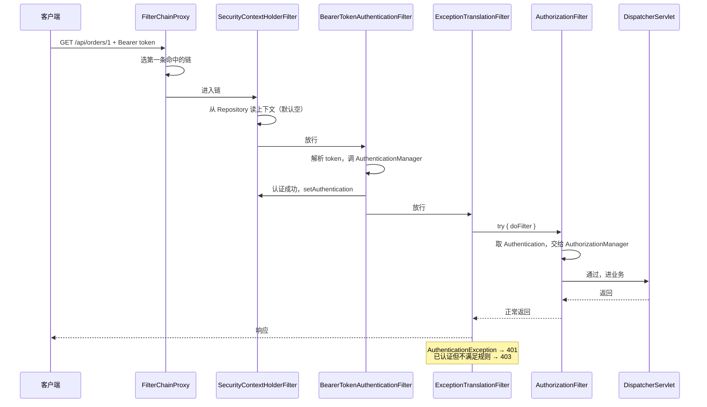

---
sources:
  - 09-第九阶段
---

# 02. Spring Security 过滤器链与认证授权时序

> [← 第九阶段导览](01-导览.md) · 安全在 Spring 里是一串**有序的过滤器**，不是一个注解：认证在前、授权在后、异常在中间兜底。位置错了不会报错，只会表现为「登录了但拿不到用户」或「匿名也能过」。

## 1. 三层委托：谁真正干活

Servlet 容器装配过滤器时，Spring 的 `ApplicationContext` 还没刷新完。所以塞给容器的是一个「空壳」——`DelegatingFilterProxy`，bean 名固定 `springSecurityFilterChain`，顺序默认 `-100`。它不做任何安全判断，只在首次请求时按名字从 `WebApplicationContext` 捞出真正的 bean 转发。这是**第一层**：容器只认 `Filter`，Spring 只认 bean，代理把两者接上。

被捞出来的是 `FilterChainProxy`（**第二层**），它做三件容器不该知道的事：

1. 从 `List<SecurityFilterChain>` 里按顺序挑**第一条**命中的链。一条都不命中，请求**原样放行**——没有安全头、没有上下文、没有 CSRF，比 `permitAll` 还彻底。
2. 把请求包成 `FirewalledRequest` 交给 `StrictHttpFirewall`，拒绝 `%2e`、`;`、反斜杠、重复斜杠这类易造成路径混淆的 URL。
3. 在 `finally` 里清空 `SecurityContextHolder`，防止 Tomcat 复用线程时把上一个请求的用户串到下一个。

**第三层** `SecurityFilterChain` 本身极简：一个 `RequestMatcher` 加一串有序 `Filter`。全部语义都在「有哪些过滤器」和「它们什么顺序」里。

| 层 | 类型 | 由谁创建 | 出错表现 |
|---|---|---|---|
| 容器接入 | `DelegatingFilterProxy` | `SecurityFilterAutoConfiguration` | 安全链整体不生效 |
| 链选择 | `FilterChainProxy` | `WebSecurityConfiguration` | 走错链 / 完全没走安全链 |
| 链内 | `SecurityFilterChain` | 你的 `@Bean` | 认证或授权位置错，症状隐蔽 |

**为什么要有这层抽象**：直接把过滤器注册进容器，顺序就由 `@Order` 和扫描顺序决定，多链隔离无从谈起。`FilterChainProxy` 把「选链」与「链内执行」分开，才有了 `/api/**` 走 JWT、`/admin/**` 走表单登录并存。

## 2. 核心过滤器的顺序与职责

完整顺序硬编码在 `FilterOrderRegistration` 里，常用这一段是固定的：

```text
SecurityContextHolderFilter        ← 建立上下文
HeaderWriterFilter                 ← 安全响应头
CorsFilter / CsrfFilter
UsernamePasswordAuthenticationFilter
BearerTokenAuthenticationFilter    ← 资源服务器
AnonymousAuthenticationFilter      ← 兜底匿名身份
ExceptionTranslationFilter         ← try/catch 包住后面
AuthorizationFilter                ← 判权，必须是最后一个
```

顺序不是风格问题，是**依赖关系**：

- `SecurityContextHolderFilter` 必须早于所有认证过滤器，否则它读出的空上下文会覆盖上游刚设的认证；
- 认证过滤器必须早于 `AuthorizationFilter`，否则判权时看到的还是匿名；
- `ExceptionTranslationFilter` 必须在 `AuthorizationFilter` **之前**，因为它的实现是 `try { chain.doFilter(...) } catch (...)`——排在后面一个异常也接不到，本该 401/403 的请求全变 500。

| 过滤器 | 职责 | 配错/缺失的后果 |
|---|---|---|
| `SecurityContextHolderFilter` | 读上下文进 holder，`finally` 清空 | 放太后覆盖认证结果；缺失则结果无处安放 |
| `HeaderWriterFilter` | 写 HSTS/CSP/nosniff | 安全头全消失，且没人报错 |
| `CorsFilter` | 处理预检、写 CORS 头 | 排到判权之后，预检被 401 拦掉 |
| `CsrfFilter` | 校验 CSRF token | 关掉且用 Cookie 会话 = 防护归零 |
| `BearerTokenAuthenticationFilter` | 解析 Bearer 并认证 | 缺失 = 全站匿名 |
| `AnonymousAuthenticationFilter` | holder 为空时填匿名 token | 缺失 = principal 为 null，`@PreAuthorize` 抛 NPE |
| `ExceptionTranslationFilter` | 认证/授权异常转 401/403 | 排在判权之后 = 全部 500 |
| `AuthorizationFilter` | 调 `AuthorizationManager` 判权 | 排在认证之前 = 认证没做完就判权 |

**坑**：`SecurityContextHolderFilter` 只读不写，不会在响应结束时把上下文存回仓库（会自动保存的老 `SecurityContextPersistenceFilter` 已废弃）。自定义登录接口必须自己调 `securityContextRepository.saveContext(...)`，否则「登录成功，下次请求又是匿名」——Security 6 升级时这类问题集中爆发过一次。

## 3. 一次请求的完整时序



401 与 403 的分界就落在 `ExceptionTranslationFilter`：它拿到 `AccessDeniedException` 后先问 `AuthenticationTrustResolver`——匿名身份转 401（「你还没登录」），已认证转 403（「登录了但不许」）。这也是 `AnonymousAuthenticationFilter` 不能少的原因：没有它，未认证请求的 `Authentication` 是 `null`，判权直接 NPE，异常类型不是 `AccessDeniedException`，最终变成 500。

**为什么判权要放最后一个**：`AuthorizationFilter` 的输入只有 `Authentication` 和请求本身（路径、方法、头），不关心业务对象。所以「这个订单是不是你的」放不进 URL 级规则——那是第 04 册的事。

## 4. 多链匹配与 `securityMatcher`

一个应用通常三条链：Actuator、API、兜底。选链规则只有一条：**按 `@Order` 从小到大，第一条 `securityMatcher` 命中的链独占这次请求**，其它链的过滤器一个都不跑。

```kotlin
@Configuration
@EnableWebSecurity
class SecurityConfig {

    // 顺序 1：健康检查，只放行精确路径
    @Bean
    @Order(1)
    fun actuatorChain(http: HttpSecurity): SecurityFilterChain = http {
        securityMatcher("/actuator/health", "/actuator/health/**")
        csrf { disable() }
        authorizeHttpRequests { authorize(anyRequest, permitAll) }
    }.build()

    // 顺序 2：业务 API，JWT 资源服务器
    @Bean
    @Order(2)
    fun apiChain(http: HttpSecurity): SecurityFilterChain = http {
        securityMatcher("/api/**")
        csrf { disable() }
        sessionManagement { sessionCreationPolicy = SessionCreationPolicy.STATELESS }
        authorizeHttpRequests {
            authorize("/api/public/**", permitAll)
            authorize(anyRequest, authenticated)
        }
        oauth2ResourceServer { jwt { } }
    }.build()

    // 顺序 3：兜底。不写这条，没匹配上的路径等于没有安全
    @Bean
    @Order(3)
    fun fallbackChain(http: HttpSecurity): SecurityFilterChain = http {
        securityMatcher(AnyRequestMatcher.INSTANCE)
        authorizeHttpRequests { authorize(anyRequest, denyAll) }
    }.build()
}
```

三个坑，一个比一个安静：

1. **宽链排前面**。把 `anyRequest` 那条放在 `@Order(1)`，后面所有链永远不执行——症状是「新加的 JWT 配置完全没生效」，日志里没有任何提示。
2. **谁都不匹配**。请求 `/actuator/env` 时两条 `securityMatcher` 都不命中，`FilterChainProxy` 直接放行。兜底链不是洁癖，是必需品。
3. **把 `securityMatcher` 和 `requestMatchers` 当成一回事**。前者决定**哪些过滤器跑**，后者只决定**跑完怎么判**。`permitAll` 之后 `CsrfFilter`、`HeaderWriterFilter` 照样执行——这是它与 `ignoring` 的本质差别。

## 5. 自定义过滤器插错位置的两个症状

### 症状一：登录了，业务里拿不到用户

把认证过滤器注册在 `SecurityContextHolderFilter` 之前（比如为了「尽早认证」用了 `addFilterBefore(f, DisableEncodeUrlFilter::class.java)`），它设好的 `Authentication` 会被随后的 `SecurityContextHolderFilter` 用仓库里的空上下文覆盖，链尾再清一次。表现是：token 合法、日志也打印了「认证成功」，业务代码取到的却是 `null` 或匿名。

同源症状：把 `Filter` 标了 `@Component`。Spring Boot 会把它当普通 servlet filter 注册进容器（安全链之外），于是它执行两次——链外那次设的上下文不算数，链内那次若顺序靠后又太晚。判断方法只有一个：`logging.level.org.springframework.security=DEBUG` 看 `Security filter chain: [...]` 打印的实际顺序，别猜。

### 症状二：匿名能过鉴权

最常见的原因不是位置，是**自己造了一个「已认证」的匿名身份**：

```kotlin
// 错：缺 token 时造一个 isAuthenticated() == true 的 token
val anonymous = UsernamePasswordAuthenticationToken("anonymous", null, emptyList())
SecurityContextHolder.getContext().authentication = anonymous
```

三参构造只要 `authorities` 非 null 就置 `authenticated = true`，于是 `anyRequest().authenticated()` 全部放行。它**没有**任何权限，`hasRole('ADMIN')` 仍然不过，这让人误以为「鉴权是好的」，直到有人用 `authenticated()` 保护了某个接口。

正确做法是**什么都不做**：缺 token 就不设上下文，让 `AnonymousAuthenticationFilter` 生成 `AnonymousAuthenticationToken`（`isAuthenticated()` 也是 true，但 `AuthenticationTrustResolver` 认得出它是匿名，401/403 才不会错）。

```kotlin
@Component
class TenantContextFilter : OncePerRequestFilter() {

    override fun doFilterInternal(
        request: HttpServletRequest,
        response: HttpServletResponse,
        chain: FilterChain,
    ) {
        val auth = SecurityContextHolder.getContext().authentication
        // 只处理已认证请求，匿名就原样放行，绝不伪造身份
        if (auth != null && auth.isAuthenticated && auth !is AnonymousAuthenticationToken) {
            TenantContext.set((auth.principal as JwtPrincipal).tenantId)
        }
        try {
            chain.doFilter(request, response)
        } finally {
            TenantContext.clear()
        }
    }
}

// 位置由依赖决定：它读认证结果，所以必须排在认证之后
http.addFilterAfter(tenantContextFilter, BearerTokenAuthenticationFilter::class.java)
```

**取舍**：`addFilterAfter(x, BearerTokenAuthenticationFilter::class.java)` 依赖「这条链配了资源服务器」这个前提。哪天改成表单登录，位置就悬空了——`FilterComparator` 只按类名排序，不会提示你。所以自定义过滤器要么绑在自己也控制的锚点上，要么在测试里断言实际顺序。

## 6. `WebSecurityCustomizer#ignoring` 为什么危险

它的语义不是「放行」，而是**从 `FilterChainProxy` 里彻底摘掉**：这些路径不经过任何安全过滤器，包括 `HeaderWriterFilter`、`CsrfFilter`、`SecurityContextHolderFilter`，也包括 `StrictHttpFirewall`。后者是关键——正常路径上 `%2e%2e`、`;jsessionid=`、`//` 会被拒绝，被 ignore 的路径没有这道闸。

```kotlin
// 危险：把业务接口当静态资源放行
@Bean
fun webSecurityCustomizer() = WebSecurityCustomizer { web ->
    web.ignoring().requestMatchers("/api/public/**", "/upload/**")
}
```

| 维度 | `permitAll` | `web.ignoring()` |
|---|---|---|
| 安全响应头 | 有 | 无 |
| 安全上下文 | 建立（匿名） | 不建立 |
| CSRF / 防火墙检查 | 有 | 无 |
| 审计日志能拿到身份 | 能（匿名标识） | 不能 |
| 后续在该前缀下挂动态接口 | 仍受规则约束 | **静默变成公开接口** |

最后一行才是它真正的事故来源：今天 `/upload/**` 只是静态目录，明天有人在下面加了 `GET /upload/{id}/meta`，代码评审看不出来，因为它「本来就在白名单里」。

**规矩**：`ignoring` 只用于真正的静态资源，且优先让容器或反代直接服务；任何读数据库、返回业务数据的路径，一律用 `permitAll`。

## 7. 方法级安全的代理位置与自调用绕过

`@EnableMethodSecurity` 注册的是 AOP 通知（`AuthorizationManagerBeforeMethodInterceptor`），作用点是**代理对象的方法调用**。所以：

```kotlin
@Service
class OrderService(private val repo: OrderRepository) {

    @PreAuthorize("hasRole('ADMIN')")
    fun deleteAll(userId: Long) { repo.deleteByUserId(userId) }

    // 同类内部调用：this 不是代理，注解完全不生效
    fun cleanup(userId: Long) {
        deleteAll(userId)          // 绕过 @PreAuthorize
    }
}
```

Controller 调 `cleanup(...)` 走代理，但 `cleanup` 自身没注解；它内部调 `deleteAll` 用的是 `this`，不经过代理，注解形同虚设。修法三种：拆到另一个 bean、`AopContext.currentProxy()`（要求 `exposeProxy = true`，很脆）、把判权下沉成显式调用（`authorizationService.checkCanDeleteAll(auth)`）——最后一种最可靠，因为它不依赖代理。

还有两个容易忽略的点：

- **类级与方法级是覆盖不是叠加**。类上 `hasRole('USER')`、方法上 `permitAll`，结果是 `permitAll`——Spring 只取「最具体的那一个注解」。
- **Kotlin 的 final 类**。CGLIB 代理需要可继承，Kotlin 类默认 final，没有 `allopen` 插件时方法级安全直接失效或启动报错。

URL 级规则和方法级规则是**两道独立的门，都要过**。`anyRequest().authenticated()` 保证「登录了」，`@PreAuthorize("hasRole('ADMIN')")` 保证「是管理员」；只配前者就是第 04 册要讲的越权。

## 8. 串起来看：配置项与失败模式

第 4 节那段代码的每个配置项，实际改变了什么：

| 配置项 | 它改变的东西 | 配错的后果 |
|---|---|---|
| `securityMatcher` | 哪些请求进入这条链 | 宽链吞窄链 / 谁都不匹配则无安全 |
| `csrf { disable() }` | 移除 `CsrfFilter` | 有 Cookie 会话时会话被跨站利用 |
| `sessionCreationPolicy = STATELESS` | 不创建 `HttpSession`、不发 `JSESSIONID` | 仍发 Cookie，CDN 缓存串号 |
| `oauth2ResourceServer { jwt { } }` | 插入 `BearerTokenAuthenticationFilter` | 缺失则全站匿名 |
| `authorizeHttpRequests` | `AuthorizationFilter` 内的规则表 | 顺序写反，`anyRequest` 吃掉后面所有规则 |
| `authenticationEntryPoint` | 401 的响应形态 | 默认空体，前端分不清未登录 |
| `@EnableMethodSecurity` | 方法级 AOP 通知 | 方法上的 `@PreAuthorize` 静默无效 |
| `addFilterAfter` | 自定义过滤器位置 | 上下文被覆盖 / 认证结果不可见 |

**验收方法**：启动后打开 DEBUG，把打印的 `Security filter chain` 顺序抄下来，对着第 2 节的表逐行核对。

## 9. 自测

1. `ExceptionTranslationFilter` 为什么必须排在 `AuthorizationFilter` 之前？排到后面会看到什么状态码？
2. 一次请求里 `AuthenticationEntryPoint` 和 `AccessDeniedHandler` 分别何时被调用？靠什么区分？
3. 三条链 `@Order` 为 1、2、3，只有第二条配了 `securityMatcher("/api/**")`，请求 `/favicon.ico` 会怎样？
4. `permitAll` 与 `web.ignoring()` 在执行链路上差哪些过滤器？各举一个因此产生的真实风险。
5. `SecurityContextHolderFilter` 为什么被称为「只读」？它不保存上下文会带来什么必须自己做的事？
6. `@PreAuthorize` 加在 Service 方法上，同类内部调用为什么绕过？给出两种不依赖代理的修法。

## 10. 延伸

- 下一册：[03-会话-JWT与OAuth2-OIDC](03-会话-JWT与OAuth2-OIDC.md)——`BearerTokenAuthenticationFilter` 从哪来、`JwtDecoder` 要校验什么。
- 再下一册：[04-授权模型与多租户数据隔离](04-授权模型与多租户数据隔离.md)——URL 规则管不到的「这条数据是不是你的」。
- Filter / Interceptor / AOP 三层的执行顺序与能力边界在[第四阶段 03 册](../04-第四阶段/03-Filter-Interceptor-AOP的执行顺序.md)。
- 自调用绕过代理的完整原理（JDK 代理 vs CGLIB）在[第三阶段 04 册](../03-第三阶段/04-AOP与代理-自调用的真相.md)。
- 安全链里的异常如何变成 RFC 9457 响应，见[第四阶段 06 册](../04-第四阶段/06-错误模型-ProblemDetail与错误码.md)。
