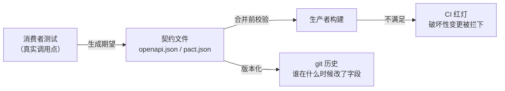

---
sources:
  - 10-第十阶段
---

# 03. Testcontainers与契约测试

> [← 第十阶段导览](01-导览.md) · 切片测试证明「代码按你想的方式拼起来」，只有真组件能证明「它在真实世界里成立」。Testcontainers 把真 PG/Redis/Kafka 搬进测试，代价是启动时间与数据污染；契约测试则解决另一半问题——**你不改代码，别人改了期望，你什么时候知道**。

## 1. 为什么必须真容器

嵌入式替身（H2、embedded-redis、embedded-kafka）能骗过你四件事：

| 骗局 | H2 上的表现 | PG 上的表现 |
|---|---|---|
| 类型系统 | `jsonb` 当 `varchar` 存，读写都「成功」 | 列类型不匹配直接报错 |
| 锁与隔离 | 简化实现，`SELECT FOR UPDATE` 行为不同 | 真实 MVCC、真实死锁检测 |
| 方言与语法 | `ON CONFLICT`、`RETURNING`、部分索引不支持 | 都支持，且执行计划真实 |
| 约束时机 | 部分约束延迟到提交才校验的差异 | 与线上完全一致 |

`embedded-kafka` 更危险：它常常是「另一个版本的 Kafka」，序列化、事务、消费组再均衡行为都和线上有差异。**用替身测出来的绿，是对替身的信心，不是对系统的信心。**

真容器还有一类不可替代的收益：它能测「**组件之间的协议**」。你的代码用 `jsonb` 存了一个对象、用 Kafka 的 headers 传了 traceId、用 Redis 的 Lua 做了原子扣减——这些只有在真组件上才能验证。

**取舍**：不是所有测试都该用真容器。规则是「**被测行为是否依赖组件的真实语义**」——查一条 SQL 有没有 N+1 用 `@DataJpaTest` 就够，验证「唯一索引在并发插入时真的挡住重复」就必须真 PG。

## 2. 最小配置：`@ServiceConnection` 与单例容器

`@ServiceConnection` 是 Boot 3.1 引入、4.x 继续强化的机制：容器起来后，它把连接信息**直接注册成 Boot 的 `ConnectionDetails` Bean**，于是你一行 `spring.datasource.url` 都不用写。相比 `@DynamicPropertySource`，它的好处是不需要手写属性名（属性名改了不会悄悄失效）。

```kotlin
@Testcontainers
@SpringBootTest
class OrderRepositoryIT {

    companion object {
        // 单例容器：整个 JVM 只起一次，所有测试类共享
        @Container @JvmStatic
        val postgres = PostgreSQLContainer("postgres:17-alpine")

        @Container @JvmStatic
        val kafka = KafkaContainer(DockerImageName.parse("apache/kafka:4.0.0"))

        // Redis 没有官方 ConnectionDetails 工厂，用 DynamicPropertySource 兜住
        @Container @JvmStatic
        val redis = GenericContainer("redis:8-alpine").withExposedPorts(6379)
    }

    @DynamicPropertySource
    @JvmStatic
    fun redisProps(registry: DynamicPropertyRegistry) {
        registry.add("spring.data.redis.host") { redis.host }
        registry.add("spring.data.redis.port") { redis.getMappedPort(6379) }
    }

    @Autowired lateinit var orders: OrderRepository

    @Test
    fun `version column prevents lost update`() {
        val saved = orders.save(OrderMother.pending())

        val a = orders.findById(saved.id).orElseThrow()
        val b = orders.findById(saved.id).orElseThrow()
        a.markPaid(); orders.saveAndFlush(a)

        assertThatThrownBy { b.markPaid(); orders.saveAndFlush(b) }
            .isInstanceOf(ObjectOptimisticLockingFailureException::class.java)
    }
}
```

关键点：

- 容器声明为 `companion object` 的 `static` 字段（Kotlin 里必须 `@JvmStatic`），**JUnit 的 `@Container` 才会在类级别管理它**；写成实例字段会变成「每个测试方法起一次容器」，一个类 10 个测试就是 10 次启动。
- `@ServiceConnection` 靠容器的类型推断，PG 与 Kafka 都内置支持；第三方镜像（Redis、MinIO、LocalStack）没有推断规则，退回 `@DynamicPropertySource` 是正常做法，不是退步。
- `@SpringBootTest` 会**继承生产配置**，包括连接池大小。记得在 `src/test/resources/application.yml` 里把 `spring.datasource.hikari.maximum-pool-size` 调小（如 4），否则一个测试类就占满 10 个 PG 连接，并行跑直接超 `max_connections`——报错还是 `FATAL: sorry, too many clients already`，与测试本身毫无关系。

## 3. 三个坑：启动慢、数据污染、假就绪

### 3.1 启动慢

一个 PG 容器冷启动 3~8 秒，Kafka 10~20 秒。10 个测试类各起一套 = 2 分钟纯等待。三种压缩手段，收益递减：

| 手段 | 做法 | 收益 |
|---|---|---|
| 单例容器 + 共享上下文 | `companion object` + 统一注解组合 | 启动次数从「每类一次」降到「每 JVM 一次」 |
| 镜像预热 | CI 里先 `docker pull` 三个镜像，再跑测试 | 省掉每轮 3 次拉取（首次或缓存失效时最明显） |
| `withReuse(true)` | 本地复用容器，跳过启动 | 本地二次运行接近 0 成本 |

`withReuse` 有个前提常被忽略：它要求 `~/.testcontainers.properties` 里有 `testcontainers.reuse.enable=true`，而且**容器不能被 `@Container` 生命周期管理**——`@Container` 会在测试类结束后 `stop()` 它。所以可复用的容器要么手动 `start()`，要么用 `@Testcontainers(disabledWithoutDocker = true)` 之外的启动方式。CI 上不要开 reuse：复用的容器会带着上一轮的脏数据与新代码打架。

### 3.2 测试间数据污染

典型症状：单跑必过，全量跑随机挂；或者「第二个测试查到了第一个测试插的数据」。根因永远是共享容器 + 共享库 + 没隔离。

### 3.3 假就绪：`sleep` 不是健康检查

PG 打印了 `database system is ready to accept connections` 才算就绪；Kafka 要等 broker 注册完 listener。`Thread.sleep(10_000)` 的两种失败方式：

- 机器慢时 10 秒不够，测试偶发失败；
- 机器快时白等 8 秒，每次 CI 都付这笔钱。

正确做法是让容器自己声明就绪条件，Testcontainers 会在 `start()` 里阻塞到满足：

```kotlin
val redis = GenericContainer("redis:8-alpine")
    .withExposedPorts(6379)
    .waitingFor(Wait.forLogMessage(".*Ready to accept connections.*", 1))
    .withStartupTimeout(Duration.ofSeconds(60))
```

`PostgreSQLContainer` 与 `KafkaContainer` 已内置合适的 wait strategy，**自己加 `sleep` 只会让它们更慢**。对自定义镜像，优先用 `Wait.forHttp("/health")` 或 `Wait.forListeningPort()`，日志匹配是最次选（日志文案会随版本改）。

## 4. 数据隔离的三种方式

| 方式 | 做法 | 隔离强度 | 速度 | 掩盖的问题 |
|---|---|---|---|---|
| 事务回滚 | 测试方法加 `@Transactional`，结束回滚 | 中 | 最快 | **提交后才触发的行为全部测不到**：延迟约束、`@TransactionalEventListener(AFTER_COMMIT)`、Outbox 写入、缓存失效 |
| 清表 | `@BeforeEach` 里 `TRUNCATE ... CASCADE` | 强 | 中 | 无（但要维护表清单与顺序） |
| 独立 schema | 每个测试类 `CREATE SCHEMA` + `search_path` | 最强（可并行） | 中 | 无（但要处理 Flyway 迁移到新 schema） |

选择规则：

- **纯 SQL/映射测试**用事务回滚，快且省事；
- **涉及事务提交语义**（Outbox、事件发布、`@Transactional` 传播）必须清表，否则你测的是「未提交状态下的世界」；
- **需要并行**时才上独立 schema，代价是每个 schema 要重放一次迁移。

清表的实现细节：`TRUNCATE` 比 `DELETE` 快一个量级，但要 `RESTART IDENTITY` 才能重置序列；有外键时要么 `CASCADE`，要么按依赖倒序删。用 `JdbcTemplate` 从 `information_schema.tables` 动态取表名，比手写清单更抗漂移。

**坑**：清表只清数据库。Redis 的 key、Kafka 的 topic、本地缓存都还在。一个「下单 → 扣库存 → 发消息」的测试跑第二遍时，可能因为 Redis 里残留的幂等键而「意外通过」——它证明的是幂等生效了，不是你这次要测的下单逻辑。**隔离要覆盖所有有状态的依赖**。

**异步副作用的断言方式**：消息发出去不等于消费完。`Thread.sleep(2000)` 是最常见的写法，也是最糟的——它把「消费慢」变成「测试必挂」，又把「消费快」变成「白等 2 秒」。用轮询带超时：

```kotlin
Awaitility.await()
    .atMost(Duration.ofSeconds(10))
    .pollInterval(Duration.ofMillis(100))
    .untilAsserted {
        assertThat(consumedEvents()).describedAs("订单创建事件应被消费一次").hasSize(1)
    }
```

它既不会假失败，也不会在成功路径上多花一秒。断言里那个 `hasSize(1)` 才是重点：**消息系统最常见的 bug 是重复消费，而不是丢消息**，`hasSize` 恰好能同时抓到两者。

## 5. 容器复用与 CI 缓存

CI 上真正有效的加速不是 `withReuse`，而是三层缓存：

1. **镜像层缓存**：runner 上保留 Docker 镜像，或在 job 开始时并行 `docker pull` 三个镜像（不阻塞编译）。
2. **构建缓存**：Gradle build cache 缓存的是编译产物，不是测试结果——但它能让「改一行代码」的 CI 从 3 分钟编译降到 20 秒，从而把预算留给测试。
3. **测试结果缓存**：Gradle 的 `Test` task 在输入未变时直接 `UP-TO-DATE`。要让它生效，测试不能依赖「当前时间」「随机端口」「外部网络」——这三样是缓存失效的常客。

一个常被忽视的成本：**每个测试 JVM 都要重新起容器**。所以 `maxParallelForks` 与容器数量是一对矛盾——并行 4 个 fork 就是 4 套 PG。要么把集成测试收敛到 1 个 fork（慢但稳），要么用共享的外部容器（`testcontainers.reuse` 在 CI 上不可靠）。

## 6. 契约测试：方向比工具重要

契约测试的核心是一句话：**消费者定义期望，生产者负责满足**。方向搞反（生产者写 schema、消费者被动接受）就退化成「文档测试」，发现不了真正的破坏性变更。



它解决的问题是**并行开发的时序**：消费者按新字段开发，生产者还在老版本上。没有契约，你只能在联调环境里撞；有契约，生产者一提交就知道自己破坏了谁。

三条纪律：

- **契约进 git**，和代码一起走 PR 评审。字段改名会产生 diff，diff 会被人看到——这是契约测试最大的价值，比自动化校验还大。
- **破坏性变更要显式**：删字段、改类型、加必填、收紧枚举，这四类必须升级版本号或走弃用周期。
- **契约只覆盖「跨边界的东西」**：HTTP 状态码、字段名与类型、必填性、错误结构。不要试图把业务规则写进契约。

## 7. 没有 Pact 时的轻量做法：OpenAPI 快照 + 实现校验

引入 Pact 需要 broker、消费者侧埋点、pact 文件流转，对单服务项目是重资产。一个够用的替代方案是两段式：

**第一段：快照**。把 `openapi.json` 放进 `src/main/resources/contract/`，CI 里重新生成并与已提交版本比对，有差异就失败（除非 PR 显式更新）。这一步拦住「悄悄改了接口」。

**第二段：实现校验**。用同一份 schema 校验真实响应，拦住「文档没改但代码改了」。

```kotlin
@SpringBootTest
@AutoConfigureMockMvc
class OrderApiContractTest {

    @Autowired lateinit var mockMvc: MockMvc
    private val jsonMapper = JsonMapper.builder().build()

    private val orderSchema: JsonSchema by lazy {
        val doc = jsonMapper.readTree(
            javaClass.getResource("/contract/openapi.json")!!.readText()
        )
        JsonSchemaFactory.getInstance(SpecVersion.VersionFlag.V202012)
            .getSchema(doc.at("/components/schemas/OrderResponse"))
    }

    @Test
    fun `response body satisfies the published OrderResponse schema`() {
        val body = mockMvc.get("/api/orders/o-1")
            .andExpect { status { isOk() } }
            .andReturn().response.getContentAsString(StandardCharsets.UTF_8)

        val errors = orderSchema.validate(jsonMapper.readTree(body))

        assertThat(errors)
            .describedAs("响应必须满足已发布的 OrderResponse 契约。" +
                "加字段要同步更新 openapi.json；改字段名属于破坏性变更，需要升版本")
            .isEmpty()
    }
}
```

这段测试的价值不在「跑通」，而在**改了 DTO 忘了改契约**时它会红。配合快照比对，两个方向都堵住了：契约变了代码没变、代码变了契约没变。

**坑**：把 `openapi.json` 当成「生成的产物」而不是「源文件」。如果 CI 每次都重新生成并覆盖它，快照比对就永远通过——你只剩下一半的保护。正确姿势是**契约是源，代码要满足它**；生成器只用来在契约变更时更新这个源，且更新动作要出现在 PR diff 里。

**取舍**：这套方案比 Pact 弱在哪？它不知道**谁**在消费、每个消费者实际用了哪些字段。所以「删掉一个没人用的字段」它也会报警（保守），而「某个消费者其实依赖了未在契约里声明的字段」它发现不了（漏报）。要补这一层，只能上 Pact 或 OpenAPI 变更检测工具，代价是基础设施。

## 8. 自测

1. 用 H2 跑 `@DataJpaTest` 全绿，线上却在 `jsonb` 列上报错。列出至少三个原因，并说明哪个注解能修。
2. 把 `@Container` 打在 Kotlin 类的实例字段上（而非 `companion object`）会发生什么？怎么从执行时间上看出来？
3. `withReuse(true)` 开了却完全没复用，最可能漏了哪两件事？
4. 一个测试用 `@Transactional` 测「发消息到 Kafka」，永远收不到消息。这是隔离方式的问题还是配置的问题？怎么改？
5. 契约快照测试在 CI 里永远通过，最可能是什么用法错了？它的保护能力损失了什么？
6. 消费者说「你们把 `amount` 从数字改成了字符串」，生产者说「契约里没写类型」。这套轻量方案在哪一步漏了？

## 9. 延伸

- 上一册：[02-测试金字塔与切片测试](02-测试金字塔与切片测试.md)——切片测试负责「层内契约」，本册负责「组件与跨服务契约」。
- 并发场景下容器测试要造真并发，见[04-并发-幂等与故障注入测试](04-并发-幂等与故障注入测试.md)。
- 事务提交后才有副作用（Outbox、事件）的完整讨论见[第六阶段 06 册](../06-第六阶段/06-跨服务一致性-Outbox-Saga-TCC与分布式锁.md)。
- 唯一约束兜底幂等的写法见[第六阶段 05 册](../06-第六阶段/05-幂等-幂等键-去重表与状态机.md)。
- 跨服务契约治理与 API 版本策略在[第十一阶段 08 册](../11-第十一阶段/08-多服务可观测性与契约治理.md)。
- 依赖健康与容器就绪的边界，见[07-交付-分层镜像-探针与优雅停机](07-交付-分层镜像-探针与优雅停机.md)。
