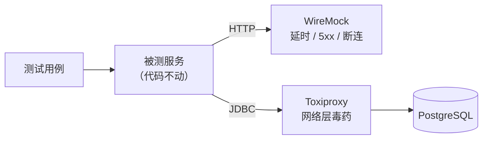

---
sources:
  - 10-第十阶段
---

# 04. 并发、幂等与故障注入测试

> [← 第十阶段导览](01-导览.md) · 前两册的测试都在「一次一个请求」的世界里。这一册进入真实世界：请求会同时到、会重复到、下游会慢会断。**这三类行为单线程测不出来，而它们恰好是线上事故的主要来源。**

## 1. 并发测试：先制造「真并发」

一个常见错误写法是循环调用：

```kotlin
repeat(50) { service.deduct(sku, 1) }    // 这不是并发测试
```

它测的是「连续扣 50 次」，任何有 `synchronized`、`@Version`、唯一索引的实现都能通过。真并发要求**多个线程在同一时刻越过同一行代码**。`CountDownLatch` 做的是「起跑线」：

```kotlin
class StockConcurrencyTest {

    private val stock = InMemoryStockRepository(available = 1)   // 只有 1 件库存
    private val service = StockService(stock)

    @Test
    fun `only one of twenty concurrent buyers gets the last item`() {
        val buyers = 20
        val ready = CountDownLatch(buyers)
        val start = CountDownLatch(1)                 // 发令枪
        val done = CountDownLatch(buyers)
        val success = AtomicInteger()
        val failures = ConcurrentHashMap<String, AtomicInteger>()

        val pool = Executors.newFixedThreadPool(buyers)   // 线程数必须 >= 并发数
        repeat(buyers) { i ->
            pool.execute {
                ready.countDown()
                start.await()                          // 全部就位后才放行
                try {
                    service.deduct("SKU-1", 1, buyerId = "b-$i")
                    success.incrementAndGet()
                } catch (e: OutOfStockException) {
                    failures.computeIfAbsent("out_of_stock") { AtomicInteger() }.incrementAndGet()
                } finally {
                    done.countDown()
                }
            }
        }
        ready.await()                                  // 等所有线程排好队
        start.countDown()                              // 同时冲线
        assertThat(done.await(10, TimeUnit.SECONDS)).`as`("所有买家应在 10s 内返回").isTrue()
        pool.shutdown()

        assertThat(success.get())
            .describedAs("库存只有 1 件，必须恰好 1 个买家成功。实际成功 %s 次，失败分布 %s",
                success.get(), failures)
            .isEqualTo(1)
        assertThat(stock.available())
            .describedAs("超卖是最严重的资损类 bug：库存不允许为负")
            .isZero()
    }
}
```

四个必须做对的细节：

- **线程数 ≥ 并发数**：固定线程池只有 4 个线程时，20 个任务里有 16 个在队列里排队，它们根本不会同时执行，测试退化成串行。
- **两把 latch 各司其职**：`ready` 保证「都到齐」，`start` 保证「同时出发」。只用一个 latch 时，先到的线程已经跑完了，后到的才刚启动。
- **断言要带上下文**：`isEqualTo(1)` 失败时你只看到 `expected 1 but was 3`，不知道是重复扣减还是没扣。把 `failures` 的分布拼进 `describedAs`，失败现场才有诊断价值。
- **池必须关**：`shutdown()` 漏了，测试 JVM 会挂住不退出，CI 表现为「测试超时」。

**为什么不能用 `@Transactional` 包住并发测试**：测试方法上的事务只对当前线程生效，其他线程看不到未提交的数据——它们会读到「库存不存在」，然后抛出完全无关的异常。并发测试必须让每个线程自己开事务、真提交，所以它是一个**必须清库**的测试（03 册 §4 的第二种隔离方式）。

**取舍**：这类测试有天然的不确定性——它验证的是「并发下不变式成立」，不是「执行顺序确定」。所以要断言的是**不变式**（成功数 = 1、库存 ≥ 0、流水条数 = 成功数），而不是「第 7 个线程拿到锁」。断言顺序的测试会在换 CPU、换 GC 后随机失败，然后被 `@Disabled` 掉。

### 1.5 在 CI 上保持稳定

并发测试最容易变成「本地必过、CI 偶挂」的那一类。三个原因与对策：

| 原因 | 症状 | 对策 |
|---|---|---|
| CI 只有 2 核 | 20 个线程被调度成几批，竞争强度不够，超卖复现不出来 | 提高并发数（线程 > 核数），并断言「确实观察到竞争」而不是断言「必然失败」 |
| 数据库连接或线程池不够 | 大量任务在队列里排队，测试超时 | 池大小 ≥ 并发数，或在 `@BeforeEach` 里校验池容量 |
| 机器慢导致断言超时 | `done.await(10s)` 偶发返回 false | 超时时间按「单次操作 P99 × 并发 / 线程数 × 3」估算，不要拍一个 1 秒 |

一条纪律：**并发测试的失败必须能复现**。做法是把「成功次数、失败分布、库存终值」全部写进 `describedAs`，并在失败时打印一次线程 dump。一个只告诉你 `expected 1 but was 2` 的并发测试，等于没有测试——你不知道该修哪。

## 2. 幂等重放测试

幂等测试的唯一有效形态是「**真的发两次，数副作用**」：

```kotlin
@Test
fun `the same idempotency key creates exactly one order`() {
    val key = "idem-7f3a"

    val first = mockMvc.post("/api/orders") {
        header("Idempotency-Key", key)
        contentType = MediaType.APPLICATION_JSON
        content = """{"sku":"A-1","quantity":1}"""
    }.andExpect { status { isCreated() } }.andReturn().response

    val second = mockMvc.post("/api/orders") {
        header("Idempotency-Key", key)
        contentType = MediaType.APPLICATION_JSON
        content = """{"sku":"A-1","quantity":1}"""
    }.andExpect { status { isOk() } }.andReturn().response

    assertThat(orderRepository.count())
        .describedAs("同一幂等键重放后仍只能有一条订单——这是资金安全底线")
        .isEqualTo(1)
    assertThat(second.contentAsString).isEqualTo(first.contentAsString)
    assertThat(second.getHeader("Idempotent-Replayed")).isEqualTo("true")
}
```

三个断言分别对应三件事：**副作用只发生一次**（最重要）、**重放返回同样的结果**（客户端能安全重试）、**重放可被观测**（线上能查到有多少重复请求）。

只断言「第二次返回 200」是无效测试——很多非幂等实现第二次也返回 200，只是悄悄多插了一行。

**更狠的版本是并发重放**：两个线程同时发同一个 key。这时「先查再插」的实现会双插，只有「唯一索引 + 捕获冲突」或「Redis `SET NX`」能挡住。写这个测试的方法是 §1 的 latch 套上这里的两次请求，断言仍然是 `count() == 1`。

**坑**：幂等键的作用域。如果实现里把 key 存进 Redis 且 TTL 24 小时，测试之间不清 Redis 就会互相干扰；如果 key 是「租户 + 用户 + key」三元组，跨租户重放会误判为不同请求。测试要覆盖**至少一个「同 key 不同用户」的用例**，否则越权类 bug 会漏。

### 2.5 重放窗口与「同键不同体」的边界用例

幂等记录的保留时长是正确性参数（第六阶段 05 册），但测试通常只测「间隔 10ms 的两次请求」。要补两类边界用例：一是 **TTL 过期后的第二次请求**——它应当被当成新请求正常处理，而不是报错；二是**重试预算耗尽**——调用方重试 3 次都拿到 409（`PROCESSING`）后应当放弃并告警，而不是无限重试把 `PROCESSING` 变成常态。

还有一个容易漏的矩阵：**幂等键相同但请求体不同**的两次调用。正确行为是第二次仍返回第一次的结果（键就是业务意图的唯一标识），而不是拿新 body 重新执行。很多实现拿「键 + body 哈希」当去重键，这样两个不同 body 在并发下会双双成功，恰好绕过了幂等。这条用例写一次，能防住未来所有的「顺手优化」。

## 3. 乐观锁冲突测试

乐观锁的测试要点不是「能更新」，而是「**冲突时能识别，并且调用方处理了它**」：

```kotlin
@Test
fun `concurrent updates on the same row fail fast with optimistic lock exception`() {
    val order = orders.save(OrderMother.pending())        // version = 0

    val stale = orders.findById(order.id).orElseThrow()   // 读到 version 0
    order.status = OrderStatus.PAID
    orders.saveAndFlush(order)                            // version -> 1

    assertThatThrownBy {
        stale.status = OrderStatus.CANCELLED
        orders.saveAndFlush(stale)                        // 拿着 version 0 去写
    }.isInstanceOf(ObjectOptimisticLockingFailureException::class.java)
        .hasMessageContaining("Order")
}
```

要补的另一半是「上层有没有重试」：`@Retryable(retryFor = [ObjectOptimisticLockingFailureException::class], maxAttempts = 3)` 之后，测试应该断言**最终状态正确**而不是「抛了异常」。只测抛异常，等于只测了框架。

**取舍**：乐观锁在冲突率低时几乎零成本，冲突率高时会变成「重试风暴」——每次失败都重读整行。若某个热点行（如秒杀库存）冲突率超过 10%，说明该换悲观锁或「数据库原子更新 + 条件判断」（`UPDATE ... SET qty = qty - 1 WHERE qty >= 1`），后者的并发测试更简单：断言 `affectedRows` 与库存不变式。

## 4. 故障注入：三种做法与一条原则

原则先立：**不要为了测试在生产代码里加开关**。`if (chaos.enabled) throw TimeoutException()` 这类代码会永久留在仓库里，而且它改变了被测代码的执行路径——你测到的是「带开关的那条路」，不是真实路径。



| 做法 | 手段 | 模拟什么 | 适合 |
|---|---|---|---|
| 延时桩 | WireMock `withFixedDelay(3000)` | 下游变慢、GC 长停顿 | 超时、熔断、线程池耗尽 |
| 异常桩 | WireMock `withStatus(503)`、`withFault(...)` | 下游报错、响应畸形 | 重试、降级、错误映射 |
| 断连 | WireMock `Fault.CONNECTION_RESET_BY_PEER`、Toxiproxy `reset_peer` | 连接被重置、半开连接 | 连接池失效检测、重连逻辑 |
| 网络毒药 | Toxiproxy `latency` / `bandwidth` / `timeout` | 真实 TCP 层劣化 | JDBC、Redis 这类没有 HTTP 桩的依赖 |

**为什么优先用代理而不是改代码**：代理位于「调用方与被调用方之间」，不侵入任何一侧，删掉它系统就恢复原状。它还天然覆盖了「连接建立、读写、关闭」这些应用层桩碰不到的行为——比如连接池里的空闲连接被对端 RST 掉之后，Hikari 能否检测并剔除。

数据库、Redis 这类没有 HTTP 接口的依赖，只能从网络层下毒。一份可以直接抄的 Toxiproxy 配置：

```yaml
services:
  toxiproxy:
    image: ghcr.io/shopify/toxiproxy:2.11.0
    ports: ["8474:8474", "8666:8666"]
    volumes: ["./toxiproxy.json:/config/toxiproxy.json"]
    command: ["-config", "/config/toxiproxy.json"]
    depends_on: [postgres]
```

```json
[{ "name": "pg", "listen": "0.0.0.0:8666", "upstream": "postgres:5432" }]
```

被测服务连 `toxiproxy:8666` 而不是 `postgres:5432`，测试里通过 `http://toxiproxy:8474` 的 API 随时注入 `latency`（加 1.5s 延迟）、`timeout`（直接不响应）、`reset_peer`（发 RST）。**注入和撤销都是运行时的，不需要重启任何东西**，这是它比「改配置 + 重启」强的地方。

### 4.5 故障注入的三个层级与各自拦不住的事

| 层级 | 手段 | 跑在哪 | 拦住什么 |
|---|---|---|---|
| 单元级 | 手写 fake（「永远超时的下游」是标准成员） | 每次提交 | 降级分支写错、异常映射遗漏 |
| 集成级 | WireMock / Toxiproxy | PR 阶段 | 超时、重试、熔断的配置错误 |
| 部署级 | Chaos 工具杀 Pod、断网卡容器 | 定期演练 | 探针、优雅停机、副本数假设 |

前两层可以进 CI，第三层不行——杀 Pod 会影响共享环境，只能按季度在演练环境跑。三层拦不住的东西也不同：单测拦不住「配置写错」（fake 不读配置），集成测试拦不住「编排层配错」（容器环境与 K8s 不同），所以第三层不是奢侈品，是前两层的补集。演练之后必须对着 05 册的指标复盘：**重启期间错误率曲线的形状，就是优雅停机配置的真实成绩单**——陡升然后立刻归零说明摘流量及时，缓慢爬升说明在途请求被掐了。

## 5. 断言「快速失败」而不是「线程堆积」

这是故障注入最有价值的断言，也是最容易被漏掉的。下游延时 3 秒、客户端超时 500ms 时，正确行为是：请求在 ~500ms 返回失败，**线程立刻释放**。错误行为是：请求虽然 500ms 返回了，但工作线程还在等下游——超时只取消了「等待结果」，没取消「下游调用」。

```kotlin
@Test
fun `slow downstream fails fast and does not pile up worker threads`() {
    wireMock.stubFor(
        get(urlEqualTo("/inventory/SKU-1"))
            .willReturn(aResponse().withFixedDelay(3_000).withStatus(200))
    )
    val executor = ThreadPoolExecutor(
        32, 32, 0, TimeUnit.MILLISECONDS, ArrayBlockingQueue<Runnable>(100)
    )
    val client = InventoryClient(baseUrl = wireMock.baseUrl(), timeout = Duration.ofMillis(500), executor = executor)

    val started = System.nanoTime()
    // 32 个请求全部并发，单个 500ms 超时；串行实现会需要 32 × 3s
    val results = (1..32).map { CompletableFuture.supplyAsync({ runCatching { client.stock("SKU-1") } }, executor) }

    // 断言一：整体在客户端超时量级返回，而不是被 32 × 3s 串起来
    assertThat(results.map { it.get(2, TimeUnit.SECONDS) }.count { it.isFailure })
        .describedAs("下游 3s、超时 500ms 时，所有请求都应在超时窗口内失败")
        .isEqualTo(32)
    val elapsedMs = (System.nanoTime() - started) / 1_000_000

    // 断言二：没有线程被「已放弃的调用」占住
    // 实际写法用 Awaitility 轮询到 0，避免与线程退出的竞态
    assertThat(executor.activeCount)
        .describedAs("耗时 %dms 后仍有 %d 个线程卡在下游调用上，说明超时没真正中断", elapsedMs, executor.activeCount)
        .isZero()
    assertThat(elapsedMs).isLessThan(2_000)
}
```

三条断言的层次：**结果**（全部失败而非挂起）、**资源**（线程归零）、**时延**（不超过超时窗口的两倍）。只看第一条会漏掉「返回了但线程泄漏」的实现——这类 bug 在压测里表现为「QPS 上不去、线程数打满、CPU 却不高」，最难查。

**坑**：JDK 的 `HttpClient` 同步发送在超时后**不会**中断底层 socket 读取（取决于实现与版本），线程要到对端响应或 TCP 超时才释放。所以「超时设了 500ms」不代表资源 500ms 释放；真正的修法是给下游连接套 `SO_TIMEOUT`/读超时，或者用 `sendAsync` + `orTimeout`。**测试断言 `activeCount` 才能暴露这一点**，断言响应码暴露不了。

## 6. 「要验证什么」→「用什么手段」

| 要验证的 | 手段 | 关键断言 | 不适合用 |
|---|---|---|---|
| 超卖 / 库存为负 | 真并发 + 真库 | 成功数、库存不变式、流水条数 | 循环调用、内存 map |
| 重复提交只生效一次 | 同 key 发两次（含并发） | 副作用条数 = 1、响应一致 | 只断言状态码 |
| 丢失更新 | 两个 `EntityManager` 读同一行 | 抛 `ObjectOptimisticLockingFailureException` | 单线程顺序更新 |
| 下游慢时的行为 | WireMock `withFixedDelay` | 时延上限、线程池 active 归零 | `Thread.sleep` 改业务代码 |
| 下游 5xx 的降级 | WireMock `withStatus(503)` | 兜底值、降级指标 +1 | 断言「没抛异常」 |
| 连接被 RST | WireMock fault / Toxiproxy | 重连成功、请求最终成功 | 只测 5xx |
| 消息重复消费 | 手工重投同一 offset | 副作用条数 = 1 | 只测消费成功 |

## 7. 自测

1. `repeat(50) { service.deduct(...) }` 为什么测不出超卖？列出两个能通过它的错误实现。
2. 并发测试里，为什么测试方法上的 `@Transactional` 会让结果完全失真？
3. 幂等测试只断言「第二次返回 200」有什么问题？应该断言哪三件事？
4. 下游延时 3s、客户端超时 500ms，请求都在 500ms 返回了失败，但压测显示线程数持续上涨。最可能的原因是什么？用什么断言能提前发现？
5. 为什么故障注入要用 WireMock/Toxiproxy，而不是在业务代码里加 `if (chaos)` 分支？说出两个理由。
6. 乐观锁冲突率 30% 的热点行，继续加重试会发生什么？该换成什么方案？

## 8. 延伸

- 上一册：[03-Testcontainers与契约测试](03-Testcontainers与契约测试.md)——本册的并发与故障注入测试都跑在真容器上。
- 并发模型本身（线程池参数、虚拟线程 pinning、协程调度）见[第八阶段 02 册](../08-第八阶段/02-线程池参数-池隔离与上下文传递.md)与[第八阶段 04 册](../08-第八阶段/04-Kotlin协程在服务端.md)。
- 幂等键与去重表的完整设计见[第六阶段 05 册](../06-第六阶段/05-幂等-幂等键-去重表与状态机.md)。
- 超时、重试、熔断的数值怎么定，见[第八阶段 06 册](../08-第八阶段/06-弹性-超时-重试-熔断-舱壁与限流.md)。
- 压测中如何观察「线程堆积」，见[08-压测与调优方法论](08-压测与调优方法论.md)。
