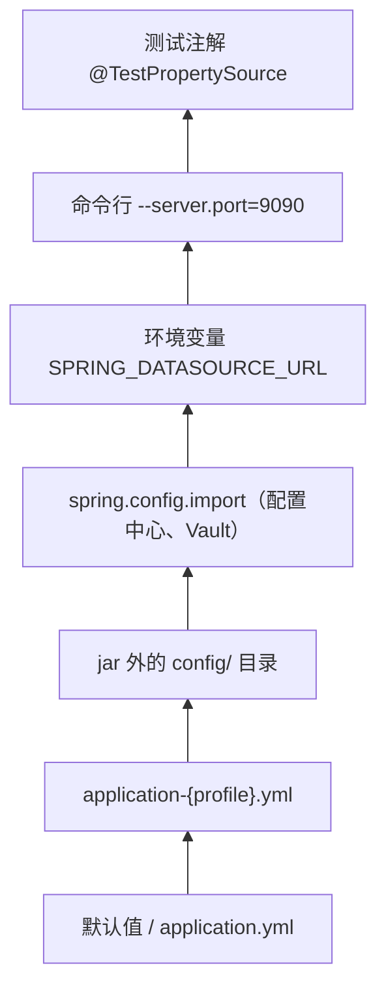

---
sources:
  - 10-第十阶段
---

# 06. 配置分层与密钥外置

> [← 第十阶段导览](01-导览.md) · 配置事故几乎都长一个样：**「我明明改了啊」**。要么改的那份被优先级更高的盖掉了，要么根本没重新加载，要么密钥早就跟着 git 历史泄出去了。本册把「谁赢」「怎么校验」「什么不能刷」「密钥放哪」四件事钉死。

## 1. 优先级全序：谁赢

Boot 的配置是一个 **PropertySource 有序列表**，查询从高到低，第一个命中的赢。简化后的全序（低 → 高）：



四条必须记住的结论：

1. **profile 文件覆盖基础文件，但都属于「config data」这一层**。所以 `application-prod.yml` 里写的值，会被一个环境变量盖掉——这不是 bug，是设计：部署环境（最后一公里）必须能覆盖打包产物。
2. **环境变量高于配置文件，低于命令行**。容器化部署里常见「镜像里写死了一个地址、部署时用 env 覆盖」，靠的就是这一条。
3. **配置中心不是最高优先级**。`spring.config.import` 导入的数据在 config data 层里最高，但仍低于环境变量与命令行。所以「配置中心改了不生效」有一半是 `SPRING_*` 环境变量在盖它。
4. **`@TestPropertySource` 与 `@DynamicPropertySource` 高于一切**，测试才能确定性地控制环境。

**为什么这样排**：越靠近「这次运行」的来源优先级越高。默认值代表「代码作者的意图」，打包文件代表「发布版本的意图」，环境变量与命令行代表「这次部署的意图」，测试注解代表「这次测试的意图」。改配置的人应该永远能赢过写代码的人。

**relaxed binding 是这套体系的润滑剂**：`order.max-items` 可以被 `ORDER_MAX_ITEMS`（环境变量）、`order.maxItems`（yaml 驼峰）命中，不用你手动对齐命名。但它只对 `@ConfigurationProperties` 生效——`@Value("${order.max-items}")` 拿不到 `ORDER_MAX_ITEMS`，这是「本地能跑、容器里是默认值」的经典原因。

## 2. profile 的正确用法与反模式

profile 的唯一正当用途：**同一份产物在不同环境下的差异项**（数据库地址、外部服务端点、日志级别、功能开关的默认值）。

| 用法 | 评价 | 原因 |
|---|---|---|
| `application-prod.yml` 放数据库地址与日志级别 | 正确 | 环境差异，不改代码 |
| `@Profile("!prod")` 装配内存实现 | 正确 | 测试替身与生产实现的切换 |
| `@Profile("sg")` 装配新加坡特有的税费逻辑 | **反模式** | 业务分支被藏进装配层，测试矩阵爆炸 |
| profile 组合成 `dev-local-mysql-https` | **反模式** | 组合爆炸，最终没人知道某个环境加载了什么 |
| 用 profile 控制「是否开启某功能」 | 反模式 | 该用 `@ConfigurationProperties` 的布尔开关，可观测、可动态调 |

反模式的共同点：**把「代码差异」伪装成「配置差异」**。判断标准很简单——这个差异需要写 if 分支吗？需要，就说明它是代码，应该走策略模式 + 一个配置项来选择实现。

两个工程细节：

- **默认 profile 要设**：`spring.profiles.default=local`，否则忘记传 `--spring.profiles.active` 时，`application-prod.yml` 里的必填项缺失，启动报一堆与之无关的绑定错误。
- **profile 文件不要互相 import**：`spring.profiles.include` 会形成隐式链，最终没人能说清优先级。要共享就用 `spring.config.import` 显式引用，链是可见的。

## 3. `@ConfigurationProperties`：构造器绑定 + fail-fast

`@Value` 的三个硬伤：不支持 relaxed binding、没有类型安全（`"8080"` 到 `Int` 的转换错误在运行期才炸）、无法校验。所以规则是：**成组的配置用 `@ConfigurationProperties`，不要用 `@Value`**。

```kotlin
@ConfigurationProperties(prefix = "order", ignoreUnknownFields = false)
@Validated
data class OrderProperties(
    @field:NotBlank val currency: String = "CNY",
    @field:Min(1) @field:Max(10_000) val maxItems: Int = 100,
    @field:Positive val reservationTtl: Duration = Duration.ofMinutes(15),
    @field:NotEmpty val allowedChannels: List<String> = listOf("app", "web"),
    val payment: Payment = Payment(),
) {
    data class Payment(
        @field:NotBlank val endpoint: String = "",
        @field:Positive val timeout: Duration = Duration.ofSeconds(2),
        @field:Min(1) @field:Max(5) val maxAttempts: Int = 3,
    )
}
```

```yaml
order:
  max-items: 200
  reservation-ttl: 20m          # Duration 直接吃 "20m"，不需要毫秒数
  payment:
    endpoint: https://pay.internal
    timeout: 1500ms
```

要点：

- **构造器绑定**：Kotlin `data class` + 全 `val`，天然不可变，绑定发生在 Bean 创建时（不是 setter 注入），所以别处拿到的对象不会被中途改掉。
- **默认值写在参数上**，不要写在 yaml 里。默认值是代码的一部分，yaml 是覆盖层；把默认值散到 yaml 里，换环境时就会出现「这个字段到底有没有默认值」的困惑。
- **`ignoreUnknownFields = false`**：默认是 `true`，意味着你把 `max-items` 拼成 `max-itmes` 时会**静默忽略**，然后用默认值跑一整天。这一行是「配置拼写错误」的唯一防线。
- **`@Validated` + jakarta 约束**：绑定完成即校验，失败在启动阶段抛 `BindValidationException`，进程退出。这就是 fail-fast——比「跑起来之后某个分支 NPE」便宜一百倍。
- **`Duration` 与 `DataSize` 用类型而不是数字**：`20m`、`512MB` 可读，且单位错误会被绑定器拒绝。

注册方式二选一：`@EnableConfigurationProperties(OrderProperties::class)`（显式，推荐给库）或 `@ConfigurationPropertiesScan`（扫包，推荐给应用）。**别忘**——忘了就是「Bean 不存在」，错误信息与你刚写的类毫无关系。

## 4. 配置校验失败的测试

配置类的测试不需要起整个应用，`ApplicationContextRunner` 只装配你指定的那几个 Bean，毫秒级：

```kotlin
class OrderPropertiesTest {

    private val runner = ApplicationContextRunner()
        .withUserConfiguration(PropertiesConfig::class.java)

    @Test
    fun `zero max items fails at startup instead of silently accepting no orders`() {
        runner.withPropertyValues("order.max-items=0")
            .run { context ->
                assertThat(context).hasFailed()
                assertThat(context.startupFailure)
                    .rootCause()
                    .isInstanceOf(BindValidationException::class.java)
                    .hasMessageContaining("maxItems")
            }
    }

    @Test
    fun `a malformed duration fails binding instead of silently using the default`() {
        runner.withPropertyValues("order.reservation-ttl=15 minutes")   // 只认 15m / PT15M
            .run { context ->
                assertThat(context).hasFailed()
                assertThat(context.startupFailure).rootCause()
                    .hasMessageContaining("reservation")
            }
    }

    @Configuration
    @EnableConfigurationProperties(OrderProperties::class)
    class PropertiesConfig
}
```

这两个测试的价值：它们把「配置错误」从「上线后行为异常」提前到「启动失败」，并且**保护这个性质不被后人改回去**——谁删掉一个 `@Min`、谁把 `Duration` 换成 `Long`，测试立刻红。

**坑**：只测「合法配置能绑定」是不够的——绑定成功是框架的能力，边界值被拒绝才是你的约束在生效。所以每个 `@Min`/`@Max`/`@NotBlank` 至少要有一个「越界即失败」的用例。而 `ignoreUnknownFields = false` 这条防线想被测试覆盖，还得单独加一个「拼错 key 就启动失败」的用例，否则它被人改回默认值时没人会发现。

## 5. 动态刷新的代价

「改配置不重启」听着很美，代价藏在实现里：Spring Cloud 的刷新会发出 `EnvironmentChangeEvent`，`ConfigurationPropertiesRebinder` 重新绑定属性类；而 `@RefreshScope` 的 Bean 会被**销毁，下次访问时重建**。

| 刷新方式 | 机制 | 代价 | 能刷吗 |
|---|---|---|---|
| `@ConfigurationProperties` 重绑定 | 属性对象重新绑定 | 极低（不改 Bean 引用） | 能，且推荐 |
| `@RefreshScope` | 代理 + 销毁重建 | 重建瞬间的抖动；旧实例仍被在途请求持有 | 谨慎 |
| 连接池 / Kafka 消费者 | 重建 = 断连 + 重连 + 再均衡 | 秒级不可用、消息重复 | **不要刷** |
| 缓存 / 本地状态 | 重建 = 缓存清空 | 缓存击穿 | **不要刷** |

三条纪律：

1. **有状态的 Bean 永不进 `@RefreshScope`**：`DataSource`、`KafkaListenerContainerFactory`、`CaffeineCache`、任何持有连接或缓冲区的对象。刷新它们不是「换配置」，是「重启一个子系统」。
2. **刷新有窗口期**：刷新的一瞬间，不同线程可能读到新旧两份配置。对「超时时间」这类参数无所谓，对「开关类」参数会造成短暂不一致。要求强一致的配置只能重启。
3. **刷新必须可观测**：每次刷新打一条结构化日志（哪个 key、旧值、新值、触发人）。否则「配置漂移」这条最常见的线上谜案永远破不了——三个实例里只有一个生效了新配置，而没人知道为什么。

**取舍**：动态刷新真正值得用的场景只有两类——**紧急降级开关**（关掉某个非核心功能）与**限流阈值**（突发流量时临时抬高）。其余配置走「改 → 发布」的路径更安全：有评审、有 diff、有回滚点。

## 6. 配置即代码

配置必须进 git，和代码一样走 PR 评审。理由不是洁癖，是三个具体能力：

| 能力 | 只有 git 才有 | 在控制台点出来的配置 |
|---|---|---|
| 谁改的、什么时候、为什么 | `git blame` + PR 讨论 | 审计日志（如果有） |
| 回滚 | `git revert`，分钟级 | 手动改回去，靠记忆 |
| 变更评审 | diff 就在眼前 | 无 |
| 与代码版本的对应关系 | tag 一一对应 | 靠时间猜 |

**「配置即代码」的边界**：结构化的、影响行为的、需要评审的配置进 git；**密钥不进**（下一节）。灰度开关这类高频变动的值可以放配置中心，但它的**默认值与结构**（key 名、类型、取值范围）仍然在 git 里，否则代码里的绑定会悄悄失效。

一个落地检查项：`application.yml` 里出现 `password`、`secret`、`token`、`key`、`private` 这些词，CI 就该报警——哪怕是「测试环境的弱口令」，因为它会成为「生产也这么写」的模板。

## 7. 密钥的三级演进

| 级别 | 做法 | 泄露面 | 什么时候可以用 |
|---|---|---|---|
| L1 字面量 | 写在 yaml / 代码里 | git 历史、镜像层、制品仓库、每台克隆机 | 永不 |
| L2 环境变量 | 部署时注入 | `/proc/<pid>/environ`、`docker inspect`、崩溃转储、日志里的启动参数 | 小团队起步、非核心凭据 |
| L3 密钥管理 | Vault / KMS 动态凭据 | 内存中的短时凭据 | 生产标准 |

L2 为什么不算「安全」：环境变量对同主机同用户的所有进程可读；`docker inspect` 能看到；某些框架会把它打进启动日志。它的价值是「不进 git」，不是「不可读」。对数据库密码这类长期凭据，L2 只是把「永久泄露」变成「较难泄露」。

L3 的核心差异是**短期凭据 + 审计**：Vault 可以为每个 Pod 签发有效期 1 小时的数据库账号，进程重启就换新，泄露的凭据几十分钟后自动失效。Spring 侧的接入点是 `spring.config.import`：

```yaml
spring:
  config:
    import: "optional:vault://"
  cloud:
    vault:
      uri: https://vault.internal:8200
      authentication: KUBERNETES     # Pod 身份换 token，不需要在镜像里放任何凭据
      kv:
        enabled: true
        backend: secret
```

**「历史提交里的密钥怎么办」——正确顺序是**：

1. **先轮换**。假定它已泄露。清理 git 历史不会让已经 clone 的仓库、fork、CI 缓存、日志里的副本消失。轮换是唯一真正止损的动作。
2. **再清理历史**。`git filter-repo` 或 BFG 重写历史，推送到所有远端，通知所有协作者重新 clone（旧的 commit hash 全部失效）。这一步是为了让「未来的人」搜不到，不是为了让泄露消失。
3. **最后加防线**。pre-commit 钩子（gitleaks / detect-secrets）、CI 扫描、密钥统一走 L3。否则三个月后同样的事再发生一次。

**坑**：很多人第一步做的是「删掉那一行再提交一次」。这在 git 里毫无作用——`git log -p` 依然能看到，克隆下来的人依然能拿到。**「已提交」等于「已泄露」，这个判断必须成为条件反射。**

## 8. 「配置放哪」决策表

| 配置 | 放哪 | 谁改 | 为什么 |
|---|---|---|---|
| 线程池大小、超时默认值 | 代码里的 `@ConfigurationProperties` 默认值 | 开发者（走 PR） | 属于系统设计，改动要评审 |
| 数据库地址、下游端点 | 环境变量 / 配置中心 | 运维（部署时） | 环境差异，同一镜像多环境 |
| 日志级别 | 环境变量（`LOGGING_LEVEL_*`）+ 动态刷新 | 值班（应急） | 排障时需要立刻调，且无状态 |
| 功能开关默认值 | git 里的 yaml；运行期值放配置中心 | 产品 + 开发 | 结构进 git，值可动态 |
| 限流阈值 | 配置中心（可刷新） | 值班 | 突发流量要临时抬 |
| 数据库密码 | Vault / KMS 动态凭据 | 无人手动改 | 短期、可审计、可轮换 |
| 第三方 API Key | Vault，按服务授权 | 平台团队 | 泄露面最小 |
| 租户级业务参数 | 数据库（业务表），不是配置文件 | 运营后台 | 数量随租户增长，配置文件装不下 |

最后一行常被忽略：**配置文件不是数据库**。任何「每个租户/每个商户一个值」的配置，都该进业务表，否则你会得到一个几千行的 yaml 和一次「加一个租户要发一次版」的流程灾难。

## 9. 自测

1. `application-prod.yml` 里写了 `server.port: 8080`，容器里设了 `SERVER_PORT=9090`，最终端口是多少？为什么这个顺序是合理的？
2. `order.max-items` 拼成了 `order.max-itmes`，默认配置下会发生什么？哪一行配置能把它变成启动失败？
3. 为什么 `DataSource` 不该加 `@RefreshScope`？刷新它实际发生了什么？
4. `@Value("${order.max-items}")` 在容器里读不到 `ORDER_MAX_ITEMS`，而 `@ConfigurationProperties` 可以。原因是什么？
5. 发现三个月前把一个生产数据库密码提交进了 git。列出你的三步动作及顺序，并说明为什么「删掉再提交一次」无效。
6. 团队用 `@Profile("sg")`、`@Profile("hk")` 装配不同地区的税费逻辑，一年后加第三个地区会发生什么？该怎么改？

## 10. 延伸

- 上一册：[05-可观测性落地-指标-日志与链路](05-可观测性落地-指标-日志与链路.md)——`/actuator/env` 暴露的正是本册的配置，端点安全要一起做。
- 下一册：[07-交付-分层镜像-探针与优雅停机](07-交付-分层镜像-探针与优雅停机.md)——环境变量与 `spring.config.import` 在容器里的实际用法。
- 密钥管理与字段加密的完整方案见[第九阶段 07 册](../09-第九阶段/07-口令哈希-密钥管理与字段加密.md)。
- profile 与条件装配的底层机制见[第三阶段 05 册](../03-第三阶段/05-自动配置与条件装配.md)。
- 多环境配置中心与刷新在微服务下的形态见[第十一阶段 06 册](../11-第十一阶段/06-服务发现与配置中心.md)。
