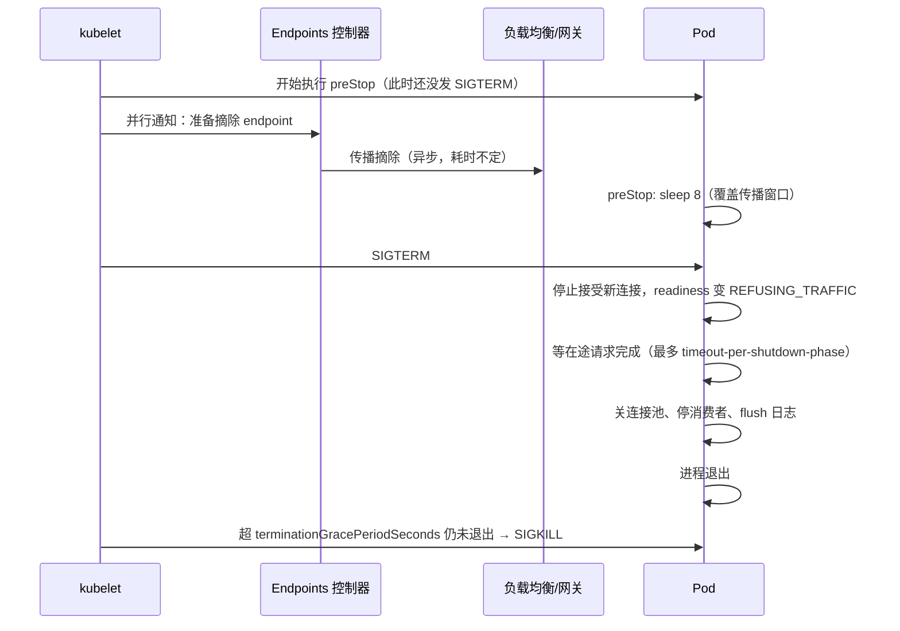

---
sources:
  - 10-第十阶段
---

# 07. 交付：分层镜像、探针与优雅停机

> [← 第十阶段导览](01-导览.md) · 上线前的最后一段路，决定的是「发布这件事本身会不会造成故障」。三件事必须同时做对：镜像要能被快速搬运，容器里的 JVM 要知道自己有几斤内存，进程要能在被杀的瞬间把手上的活干完。

## 1. 分层镜像：让不变的层别动

Docker 镜像由层组成，`push`/`pull` 只传输**本地没有的层**。而 Spring Boot 的 fat jar 是「一个文件」——改一行代码，整个 60MB 的 jar 变成新层，每次发布都要重传 60MB。

解法是把 jar 拆成四层，按「变化频率」从低到高排列：

| 层 | 内容 | 变化频率 | 体积量级 |
|---|---|---|---|
| `dependencies/` | 第三方依赖（`BOOT-INF/lib`） | 只在改依赖时变 | 40~80MB |
| `spring-boot-loader/` | 启动器类 | 几乎不变（随 Boot 版本） | < 1MB |
| `snapshot-dependencies/` | SNAPSHOT 依赖 | 偶发 | 0~几 MB |
| `application/` | 你的类与资源 | **每次发布都变** | 几百 KB~几 MB |

```dockerfile
# ---------- 构建 ----------
FROM eclipse-temurin:25-jdk AS build
WORKDIR /src
COPY gradlew settings.gradle.kts build.gradle.kts gradle.properties ./
COPY gradle ./gradle
# 依赖单独一层：只要构建脚本没变，这一层就命中缓存
RUN --mount=type=cache,target=/root/.gradle \
    ./gradlew dependencies --no-daemon
COPY src ./src
RUN --mount=type=cache,target=/root/.gradle \
    ./gradlew bootJar --no-daemon -x test

# ---------- 拆层 ----------
FROM eclipse-temurin:25-jre AS layers
WORKDIR /app
COPY --from=build /src/build/libs/app.jar app.jar
RUN java -Djarmode=tools -jar app.jar extract --layers --destination /app/extracted

# ---------- 运行 ----------
FROM eclipse-temurin:25-jre
WORKDIR /app
COPY --from=layers /app/extracted/dependencies/ ./
COPY --from=layers /app/extracted/spring-boot-loader/ ./
COPY --from=layers /app/extracted/snapshot-dependencies/ ./
COPY --from=layers /app/extracted/application/ ./
USER 10001:10001
EXPOSE 8080 8081
ENTRYPOINT ["java", \
  "-XX:MaxRAMPercentage=75", \
  "-XX:+ExitOnOutOfMemoryError", \
  "org.springframework.boot.loader.launch.JarLauncher"]
```

三个关键点：

- **`--mount=type=cache,target=/root/.gradle`** 让 Gradle 的依赖缓存在构建之间保留（需要 BuildKit，现代 Docker 默认开启）。没有它，每次改代码都要重新下载全部依赖，构建时间从 40 秒变 3 分钟。
- **先 `COPY` 构建脚本、再 `COPY src`**：这是 Docker 层缓存的经典技巧——源码变了不影响「下载依赖」那一层。
- **`-Djarmode=tools`** 是 Boot 3.2+ 的写法（`layertools` 已改名）。拆层后的启动类在 `org.springframework.boot.loader.launch.JarLauncher`，老写法 `org.springframework.boot.loader.JarLauncher` 在 4.x 里已不是入口。

**收益有多大**：一次「只改业务代码」的发布，push 体积从 60MB 降到 1MB 以内；在跨机房或 CI runner 带宽受限时，这决定了发布是 30 秒还是 5 分钟。K8s 拉镜像同理——节点上已有的依赖层不会重拉。

**坑**：`COPY --from=layers` 的顺序不能变。分层镜像的收益完全来自「低变频率的层在前面」，顺序错了（比如把 `application/` 放前面）会让后面所有层每次都失效。

### 1.5 镜像里那几个会导致「优雅停机失效」的细节

| 细节 | 正确做法 | 做错的后果 |
|---|---|---|
| `ENTRYPOINT` 形式 | JSON 数组（exec 形式） | shell 形式会多一层 `sh`，**SIGTERM 不转发给 JVM**，`server.shutdown=graceful` 形同虚设 |
| 日志输出 | 写 stdout/stderr，收集交给平台 | 写文件 = 容器层膨胀 + 必须挂卷 + 日志丢失 |
| 时区 | `ENV TZ=Asia/Shanghai` + `-Duser.timezone=Asia/Shanghai` | 容器默认 UTC，日志与业务时间差 8 小时，跨时区排障必错 |
| 根文件系统 | `readOnlyRootFilesystem: true` + 可写 `emptyDir` 挂 `/tmp` | 应用能改自己的镜像内容，事故后无法用镜像复现 |
| JDK vs JRE 基础镜像 | 运行用 `-jre`，另做一个 `-jdk` 的诊断镜像 | 用 `-jre` 省 100MB，但容器里没有 `jcmd`/`jstack`，出事时无法现场取证 |
| `HEALTHCHECK` | 不写，交给 K8s 探针 | 两套健康检查同时生效，Docker 层把「不健康」的容器重启，与 K8s 的判断打架 |

`readOnlyRootFilesystem` 会被很多框架的默认行为破坏（写临时文件、写 pid 文件、解压 native 库）。上线前先跑一遍，否则 Pod 会在启动阶段就因为 `Read-only file system` 崩掉。

## 2. 容器内 JVM 参数：算清内存这笔账

容器里最常见的两个写法，一个浪费、一个致命：

| 写法 | 问题 |
|---|---|
| `-Xmx4g` 写死 | 容器 limit 改成 2GiB 后，JVM 申请超过 limit → **OOMKilled**（不是 OOM 异常，是容器直接被杀，日志里什么都没有） |
| 不写任何参数 | JDK 默认 `MaxRAMPercentage=25`，1GiB 容器只有 256MB 堆 → GC 频繁、吞吐腰斩，而监控只显示「CPU 高」 |

正确写法是 `-XX:MaxRAMPercentage=75`：JVM 读 cgroup 的 limit，堆按比例算。但**75% 不是随便取的数**，它来自一笔必须算清的账：

| 占用项 | 1GiB limit 下的典型值 | 说明 |
|---|---|---|
| 堆（`MaxRAMPercentage=75`） | 768MB | 对象、数组、GC 内部结构 |
| Metaspace | 80~150MB | 类元数据，Spring 应用类多，别设太小 |
| Code cache | 40~60MB | JIT 编译产物 |
| 直接内存 / Netty / NIO | 50~150MB | `-XX:MaxDirectMemorySize` 默认等于堆上限，**这是最容易爆的一项** |
| 线程栈 | `-Xss` × 线程数 | 默认 1MB；200 个平台线程 = 200MB；虚拟线程的栈块也在堆外 |
| GC 与 JVM 自身 | 30~60MB | 卡表、标记位图等 |

768 + 120 + 50 + 100 + 200 + 50 ≈ 1288MB > 1024MB。**这就是「堆只用了 70%，容器却被 OOMKilled」的原因**——账没算完，75% 不是安全的，它只是「通常够」。

三条配套措施：

1. **显式限制直接内存**：`-XX:MaxDirectMemorySize=128m`，把不可控项变成可控项。
2. **限制元空间**：`-XX:MaxMetaspaceSize=192m`，让「类加载泄漏」表现为可读的 `OutOfMemoryError: Metaspace`，而不是容器被杀。
3. **`-XX:+ExitOnOutOfMemoryError`**：真 OOM 时快速退出、让编排系统重启，比僵死在半死不活的状态（还能接流量但全错）好得多。

**取舍**：`MaxRAMPercentage=75` 适合「线程数中等、无大量直接内存」的常规 Web 服务。如果你的服务线程数上千（平台线程）或大量用 Netty/Netty-based 客户端，应降到 60~65%，把余量留给堆外。**验证方式不是算，是压**——压测时同时看 `jvm.memory.used` 与容器 `working_set`，两者差距就是堆外占用。

## 3. 三种探针：各管一件事

| 探针 | 回答的问题 | 失败后发生什么 | 该检查什么 | 绝不能检查 |
|---|---|---|---|---|
| `startupProbe` | 启动完成了吗 | 在预算内不断重启 | 应用上下文就绪（能响应 HTTP） | 无 |
| `readinessProbe` | 能接流量吗 | 从 Service Endpoints 摘除（不重启） | 本实例自身可服务 | 重依赖（会级联摘除全集群） |
| `livenessProbe` | 进程还活着吗 | **重启容器** | 进程是否僵死/死锁 | 数据库、下游、任何外部依赖 |

三者的失败后果完全不同，配错的后果也完全不同：

- **startup 缺失 + liveness 的 `initialDelaySeconds` 太短**：启动需要 40 秒、liveness 从第 10 秒开始探，第三次失败就重启——永远起不来，`CrashLoopBackOff`。`startupProbe` 的意义就是「在它成功之前，liveness 和 readiness 都不生效」，所以启动预算只需要在 startup 上配一次（`failureThreshold: 30 × periodSeconds: 2` = 60 秒）。
- **readiness 里查数据库**：数据库抖动 10 秒，所有实例同时变 not ready，Service 一个可用端点都不剩，网关返回 503。**你本想「不把流量给不能服务的实例」，结果把整个集群摘空了。**
- **liveness 里查数据库**：数据库抖动 → 所有 Pod 重启 → 重启后连接池要重建、缓存要预热、消费者要再均衡 → 恢复时间从 10 秒变成 5 分钟。这是教科书级的「用探针制造雪崩」。

```yaml
startupProbe:
  httpGet: { path: /actuator/health/liveness, port: 8081 }
  periodSeconds: 2
  failureThreshold: 30          # 最多给 60s 启动
readinessProbe:
  httpGet: { path: /actuator/health/readiness, port: 8081 }
  periodSeconds: 5
  failureThreshold: 2
livenessProbe:
  httpGet: { path: /actuator/health/liveness, port: 8081 }
  periodSeconds: 10
  failureThreshold: 3
```

注意端口是 **8081**（管理端口）。探针打到业务端口是最常见的配置错误之一——不是探针不工作，是 `/actuator/health` 根本不在那个端口上，于是 404，Pod 永远不 ready。

**为什么 liveness 用 `/actuator/health/liveness` 而不是 `/actuator/health`**：后者聚合了所有 `HealthIndicator`，包括数据库和 Redis。用聚合端点等于「liveness 里检查了下游」，只是换了个写法。

## 4. 优雅停机：完整时序

优雅停机的目标只有一句：**在进程消失之前，让它手上的请求都干完，并且不再接新的。** 时序里任何一步缺了，都会变成用户可见的 5xx。



三个容易搞错的点：

1. **`preStop` 执行期间不会收到 SIGTERM**。所以 `preStop: sleep 8` 的作用是「在还正常服务的情况下，等 Endpoints 摘除传播完」，而不是「等请求处理完」。
2. **摘除 endpoint 与发 SIGTERM 是并行的**，没有先后保证。这就是必须有 `preStop` 的原因——没有它，Pod 可能在 LB 还在转发时就已经停止接受连接。
3. **`terminationGracePeriodSeconds` 必须 > preStop + 停机等待**。`preStop 8s` + 在途请求最长 25s = 33s，设 40s 才安全。设 30s 的话，最后一个大请求会被 SIGKILL 掐断——客户端看到 502。

```yaml
spec:
  terminationGracePeriodSeconds: 40
  containers:
    - name: order-service
      lifecycle:
        preStop:
          exec:
            command: ["sh", "-c", "sleep 8"]
```

```yaml
server:
  shutdown: graceful            # 关键：默认是 immediate
spring:
  lifecycle:
    timeout-per-shutdown-phase: 25s
```

`server.shutdown=immediate`（默认值）在收到关闭信号时直接关掉 connector 并断开所有连接，在途请求全部收到 RST。**这一个配置项的差别，就是「发布时零星 502」和「零 502」的差别。**

Kotlin 侧只需要两件事：别在关停时丢数据，别让预热拖到 readiness 之后。

```kotlin
@Component
class WarmupRunner(private val pricingCache: PricingCache) : ApplicationRunner {
    private val log = LoggerFactory.getLogger(javaClass)

    // ApplicationRunner 在 readiness 变 UP 之前执行完，
    // 所以这里做的预热不会造成「已接流量但缓存是冷的」
    override fun run(args: ApplicationArguments) {
        val started = System.nanoTime()
        pricingCache.preload()
        log.info("pricing cache preloaded in {}ms", (System.nanoTime() - started) / 1_000_000)
    }
}

@Component
class OutboxFlusher(private val outbox: OutboxRepository) {

    @PreDestroy
    fun flush() {
        // 上下文关闭阶段执行：在连接池关闭之前把待发事件刷出去
        val pending = outbox.findPending(limit = 500)
        if (pending.isNotEmpty()) {
            outbox.publishAll(pending)
        }
    }
}
```

**坑**：`@PreDestroy` 的执行顺序由 Bean 依赖关系决定，不保证「消费者先停、连接池后关」。要保证顺序，用 `SmartLifecycle` 的 `getPhase()` 显式排序：消费者 phase 小（先停），连接池 phase 大（后停）。顺序错了的症状是「关停时大量 `Connection closed` 异常日志」——不致命，但会把真正的错误淹掉。

```kotlin
@Component
class KafkaConsumerLifecycle(
    private val container: KafkaMessageListenerContainer<*, *>,
) : SmartLifecycle {

    override fun getPhase() = 100              // 数值小先停：消费者在连接池之前关闭
    override fun start() = container.start()
    override fun stop() = container.stop()     // 这里能拿到「给我 25s 收尾」的宽限期
    override fun isRunning(): Boolean = container.isRunning
}
```

## 5. 滚动更新与「零 5xx」

```yaml
spec:
  strategy:
    type: RollingUpdate
    rollingUpdate:
      maxSurge: 1               # 先多起一个
      maxUnavailable: 0         # 关键：任何时刻可用副本数不下降
  minReadySeconds: 10         # 新 Pod ready 后再观察 10s 才算可用，防抖动
```

`maxUnavailable: 0` 是「零 5xx」的前提：它保证新 Pod 通过 readiness 之后才开始杀旧的，容量不会出现缺口。代价是发布期间多占一份资源，且发布变慢（每次只能推进一个）。

**但仅靠这两个参数不够**——「零 5xx」还取决于第 4 节的时序和下面这张表里的每一项。

| # | 502 的原因 | 现象 | 修法 |
|---|---|---|---|
| 1 | readiness 过早变 UP（依赖还没连上） | 新 Pod 刚 ready 就报错，持续几秒 | 就绪检查覆盖关键依赖（用 `HealthIndicator` 的 `readiness` group，不要用 liveness） |
| 2 | 没有 `preStop` | 发布瞬间出现一批 502，几十毫秒到几秒 | `preStop: sleep 8`，覆盖 endpoint 传播 |
| 3 | `terminationGracePeriodSeconds` 太短 | 长请求被 SIGKILL，502/504 集中在慢接口 | 设为 preStop + 停机等待 + 余量 |
| 4 | `server.shutdown` 还是 `immediate` | 每次发布都有 RST，客户端看到连接重置 | 改 `graceful` 并设 `timeout-per-shutdown-phase` |
| 5 | keep-alive 长连接被复用 | 老 Pod 上残留连接被 LB 继续转发 | LB 侧开启连接 draining，或缩短 keep-alive 空闲超时 |
| 6 | 探针打到了业务端口 | Pod 永不 ready，或健康状态永远 200 | 探针端口与管理端口对齐（8081） |

验证方法不是「看日志里没有错误」，而是**发布期间持续打请求并统计状态码**：

```bash
: > /tmp/codes.txt
end=$((SECONDS + 180))
while [ $SECONDS -lt $end ]; do
  curl -s -o /dev/null -m 2 -w '%{http_code}\n' \
    -H 'Accept: application/json' http://order.internal/api/orders/o-1 >> /tmp/codes.txt
  sleep 0.1
done
sort /tmp/codes.txt | uniq -c | sort -rn
```

在一次滚动更新期间跑这个循环，输出里只该有 `200`（和预期的 `404`）。出现任何 `502`/`503`/`000`（连接失败），就按上表逐项排查。这个脚本比任何「发布 checklist」都可靠，因为它不看人的记忆。

**取舍**：`maxSurge: 1` + `maxUnavailable: 0` 在副本数少（2~3 个）时发布很慢，且要求集群有空余资源。副本数多时可以放宽 `maxUnavailable: 1`（25% 容量损失可接受）来提速。但「先保证不 5xx，再谈发布速度」这个顺序不能反。

## 6. 自测

1. 为什么 fat jar 每次发布都要传 60MB，而分层后只传不到 1MB？哪一层在变？
2. 容器 limit 1GiB、`MaxRAMPercentage=75`，堆用了 70% 却被 OOMKilled。列出至少三个堆外占用项，并给出两个限制它们的手段。
3. readiness 探针里检查数据库会带来什么后果？liveness 里检查数据库呢？为什么两者的后果不同？
4. `preStop: sleep 8` 期间，进程收到 SIGTERM 了吗？如果没有它，会看到什么现象？
5. `terminationGracePeriodSeconds: 30`、`preStop: 10s`、`timeout-per-shutdown-phase: 25s`，最长的一个请求能不能活下来？
6. 滚动更新期间统计到 0.3% 的 502，集中在每次发布后的第 2~5 秒。按六个原因排序，你最怀疑哪两个？

## 7. 延伸

- 上一册：[06-配置分层与密钥外置](06-配置分层与密钥外置.md)——镜像里不该有密钥，`spring.config.import` 与 Vault 的接入点。
- 下一册：[08-压测与调优方法论](08-压测与调优方法论.md)——把本册的参数（堆大小、线程池、探针）拿到压测里验证。
- 探针背后的 `/actuator/health` 分组与端点安全见[05-可观测性落地-指标-日志与链路](05-可观测性落地-指标-日志与链路.md)。
- 容器内线程模型与虚拟线程的内存账见[第八阶段 03 册](../08-第八阶段/03-虚拟线程-pinning与适用边界.md)。
- 灰度、蓝绿与发布顺序在微服务下的完整流程见[第十一阶段 09 册](../11-第十一阶段/09-大型应用工程化-联调-灰度与容量.md)。
