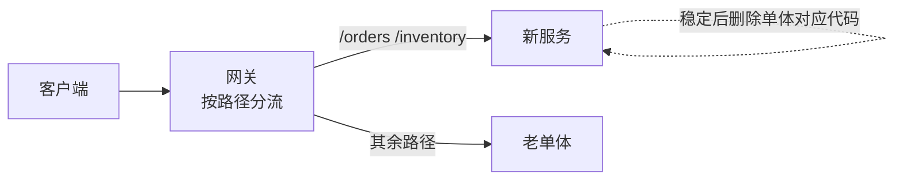

---
sources:
  - 11-第十一阶段
---

# 02. 该不该拆：单体、模块化单体与微服务判据

> [← 第十一阶段导览](01-导览.md) · 拆微服务买的是「组织与部署的解耦」，卖掉的是「分布式的一切麻烦」；动手之前先用四个维度给系统打分，多数系统该停在模块化单体。

## 1. 三种形态：不是进化阶梯，是三个物种

最常见的误解是把三者当成一条进化路线——「所有系统迟早走到微服务」。事实是：它们是三种在不同约束下各自最优的形态，选哪种取决于**团队规模 × 变更频率**，不取决于「先进程度」。单服务天花板的讨论见[第十阶段 08 册](../10-第十阶段/08-压测与调优方法论.md)：性能瓶颈大多能靠扩容与缓存解决，拆分解决的是另一件事——人和发布。

四个维度的对比：

| 维度 | 单体 | 模块化单体 | 微服务 |
|---|---|---|---|
| 开发速度 | 最快：一次编译、一次启动、断点全链路 | 接近单体，多一层模块纪律成本 | 最慢：契约先行、联调、版本协调 |
| 部署 | 简单：一个包一条流水线 | 同单体 | 每服务独立流水线，发布顺序成为新问题（09 册） |
| 故障域 | 整体：一次慢查询、一个内存泄漏拖垮全部 | 仍整体（单进程的宿命） | 可隔离，但引入级联风险（08 册的可用性乘法） |
| 团队协作 | 5~10 人内无摩擦；超过 10 人互相踩 | 模块分属 owner，评审与构建可并行 | 可扩展到几十团队，代价是治理成本 |

注意一个容易忽略的点：**微服务的成本不是均匀支付的**。开发期多付一点契约成本，真正的账单在运行期集中爆发——分布式事务（07 册）、链路追踪（08 册）、环境治理与容量规划（09 册）。而且第十阶段做的全部单服务生产化工作（测试、可观测、探针、压测），拆完之后**每个服务都要再来一遍**。3 个服务 ≈ 3 份交付成本，这笔账在拆之前要先乘出来。

## 2. 拆分的真实动因与伪动因

### 2.1 四个真动因

1. **多团队并行阻塞**。30 个人在一个单体里提交，代码冲突、构建排队、发布窗口互相占坑，每两周一次的发布要所有人协调。这是康威定律的推论：想并行交付，就先把交付单元切开。
2. **伸缩差异巨大**。商品详情读 10 万 QPS、下单写 1 千 QPS、报表每天跑一次——放一个进程里只能整体扩容。伸缩差异大的模块拆出来，独立扩缩既省钱又省心。
3. **合规与安全隔离**。支付、医疗、个人数据要求独立的网络域、独立的审计与权限。这不是性能诉求，是外部强制的边界。
4. **发布节奏解耦**。营销服务一天发三次、账务服务一个月发一次，捆在一个发布单元里就永远在互相等待。

四条有一个共同点：**都与「人」和「流程」有关，没有一条是「代码写得不好」**。

### 2.2 三个伪动因的反驳

| 伪动因 | 反驳 |
|---|---|
| 「代码太乱」 | 那是模块化没做好，重构即可。烂代码拆成微服务，得到的是**带网络延迟和一致性问题的烂代码**——分布式不是重构手段 |
| 「QPS 不够」 | 先压测定位（第十阶段 08 册）。单体加缓存、加读副本、水平扩容，撑到几万 QPS 是常态；瓶颈在数据库就先拆读副本，不是先拆服务 |
| 「大公司都用微服务」 | 大公司拆是因为团队数（动因 1），不是因为微服务先进。看到「别人都拆了」就拆，是把规模问题的药方抄给了协作问题 |

伪动因的统一特征：**试图用架构手段解决工程问题**。代码乱是纪律问题，QPS 是容量问题——它们各自有更便宜的工具。

## 3. 拆错的典型症状

拆错的代价比不拆更大，而且不易回退（合并服务比拆服务难得多）。四个典型症状，每一个都指向边界或粒度的错误：

1. **一个业务变更要改五个服务**。比如「订单加一个备注字段」要动订单、库存、营销、物流、通知——说明拆分是按技术分层（接口层/数据层）切的，而不是按业务能力切的。正确边界应该让「一个业务需求通常落在一个服务内」。
2. **跨服务事务满天飞**。单体里同一个 `@Transactional` 的逻辑，拆开后变成 Saga、TCC 加补偿——这不是拆分成熟，是**把一个事务硬切成了五段**（07 册第一节就讲：优先避免，而不是硬切）。强一致需求扎堆的地方，说明边界切在了数据内部。
3. **联调环境永远起不全**。20 个服务 × 多个分支 × 环境组合，谁也凑不出一套完整的 dev 环境。这不是运维不行，是服务粒度太细——粒度下限由「一个团队能养得起的服务数」决定。
4. **排查一个问题要拉四个人**。没有跨服务 trace 串联（08 册）、依赖关系靠口口相传，一次排障变成跨团队会议。可观测性欠账在微服务下被放大成组织成本。

四个症状可以用一条自检规则概括：**如果拆完之后日常变更的协作次数比拆之前更多了，就是拆错了**。

症状还会自我强化。联调环境起不来，团队就绕过环境直接上测试环境验证——测试环境开始承载联调职责，数据被写脏、服务被互相重启，测试结果不再可信；排障要拉四个人，团队就倾向「先在本地把问题复现了再说」——于是每个人都在维护一套自己的 mock，mock 与真实下游的漂移又制造新的线上问题。**拆错不是一次性损失，是一个会滚雪球的负反馈循环**；这也是为什么发现前两个症状时就要停下来重新审视边界，而不是继续用工具修补后面的两个。

另一个值得提前知道的性质：拆错的方向感很难靠「再拆一次」或「合并回去」纠正。合并服务要处理数据迁移、契约下线、团队职责重组——比当初拆它时阻力更大（当初拆的时候每一步都有「解耦」的红利做奖励，合并时每一步都是纯付出）。所以第二册开头说的「单向门」不是修辞：**宁可慢一点拆对，不要快一点拆错**。

## 4. 模块化单体：默认答案

在单进程内按限界上下文分模块，模块间只走接口与事件，禁止直接读别的模块的表和内部类。它同时买到了三样东西：

- 可并行开发：模块分属不同 owner，评审、构建、冲突按模块隔离；
- 可独立测试：模块边界即 mock 边界，模块测试不需要全量上下文；
- **为未来拆分留好了边界**：将来真要拆，就是把接口实现换成 HTTP 客户端、把进程内事件换成消息——业务代码一行不改。这是本阶段 03 册限界上下文的单进程版本。

Spring Modulith 的思路可以概括为「**包结构即边界约定，工具强制执行**」：

- 顶层包即模块，模块内 `internal` 包对外不可见；
- 模块间通信只用 `ApplicationEventPublisher` 发布事件、监听器消费事件；
- 测试里 `ApplicationModules.of(...).verify()` 自动校验非法依赖与循环依赖——纪律不靠自觉，靠构建失败。

一个必须提前想清的坑：**进程内事件默认同步且在事务内**，和微服务时代的「发布即已提交、消费必幂等」语义不同。要用 `@TransactionalEventListener(phase = AFTER_COMMIT)` 把监听推迟到事务提交之后，否则会出现「事件处理了、业务事务回滚了」的幽灵事件。

```kotlin
// ---- orders 模块：对外只暴露接口，不暴露实现与实体 ----
package com.shop.orders

interface OrderFacade {
    fun placeOrder(cmd: PlaceOrderCommand): OrderId
}

// ---- inventory 模块发布的事件：自包含、带幂等键；字段是契约，只加不改 ----
package com.shop.inventory.api

data class StockReserved(
    val eventId: UUID,
    val orderId: OrderId,
    val sku: String,
    val qty: Int,
)

// ---- inventory 模块内部：internal 修饰，包外编译期不可见 ----
package com.shop.inventory.internal

@Service
internal class InventoryService(private val repo: StockRepository) {
    fun reserve(sku: String, qty: Int): StockReserved = /* 省略 */
}

// ---- orders 模块消费事件：不回查 inventory 的表，只依赖事件字段 ----
package com.shop.orders.internal

@Component
class StockReservedHandler(private val orders: OrderRepository) {

    // AFTER_COMMIT：事件在业务事务提交后才处理，语义对齐微服务时代的「已提交事实」
    @TransactionalEventListener(phase = TransactionPhase.AFTER_COMMIT)
    fun on(event: StockReserved) {
        orders.markReserved(event.orderId, event.eventId)
    }
}
```

```kotlin
// 模块纪律的强制执行：进 CI，非法依赖与循环依赖直接构建失败
class ModularityTests {

    @Test
    fun `模块间无非法依赖、无循环依赖`() {
        ApplicationModules.of(Application::class.java).verify()
    }
}
```

## 5. 绞杀者模式：要拆，也要循序渐进

真要拆，也不推倒重来。绞杀者模式（strangler fig）的做法：在单体前面放一层分流（网关或反向代理），按路径把流量逐步切到新服务，新服务稳定后从单体里删掉对应代码，直到单体被「绞杀」干净。每一刀都小、都可验证、都可回滚。



顺序纪律两条，写进迁移计划而不是凭感觉：

| 阶段 | 先切 | 后切 | 原因 |
|---|---|---|---|
| 读写维度 | **读** | **写** | 读不改变状态，切错可立即回退；写要处理数据双主与一致性，风险高一个量级 |
| 状态维度 | **无状态** | **有状态** | 无状态功能切完即可退役代码；有状态功能必须先做数据迁移，迁移完成前禁止双写同一张表 |

坑在数据上：绞杀期老单体与新服务共享一份库可以，但**所有权必须一次性移交**——某张表移交后，写路径只有新服务，老单体只读或不再访问；「两个系统同时写同一张表」的过渡期越短越好，超过一个迭代周期就要重新审视切法。回滚开关（网关按路径一键切回单体）必须保留到新服务经过一个完整业务周期为止。

绞杀者还有一个常被漏掉的收尾纪律：**绞杀完要真的删代码**。新服务稳定后，老单体里对应的模块留着「以防万一」，一留就是两年——两份实现各自演化，后来者不知道哪份是真的，绞杀变成了增重。每一刀的验收标准应该包含「单体里对应代码已删除」这一条；删除依赖的调用方清理（老代码里残留的内部调用），比把路径切走难得多，所以切路径之前先看清楚还有谁在进程内调它。

## 6. 判断表：四个维度打分，决定停在哪

把第 1~2 节的讨论收敛成一张可执行的判断表。给系统打分（每维 0/1/2），总分定形态：

| 维度 | 打分问题 | 0 分 | 1 分 | 2 分 |
|---|---|---|---|---|
| 团队并行 | 多少个团队要在同一套代码上独立交付？ | 1 个 | 2~4 个 | 5 个以上 |
| 伸缩差异 | 各模块的流量画像差异大到要独立扩缩吗？ | 差异 < 10 倍 | 10~100 倍 | 100 倍以上或合规强制隔离 |
| 发布节奏 | 不同模块的发布频率差多少？ | 同节奏 | 差一个量级 | 每日多次 vs 每月一次 |
| 故障域要求 | 有没有「不能一起挂」的硬性要求？ | 无 | 业务可容忍短暂整体故障 | 合规/SLA 强制隔离 |

解读规则比打分本身更重要：

- **总分 0~2：单体**。别折腾，把工程化（第十阶段）做扎实。
- **总分 3~5：模块化单体**。默认答案——先拿到边界，再谈拆分。
- **总分 6~8：微服务**。但还有一个否决项：**八个维度分不能靠单维度撑起来**。只有「伸缩差异」2 分、其余全 0 的系统，正确解法是单体 + 缓存 + 读副本，不是拆服务。至少三个维度达到 1 分以上，才值得付分布式的全套成本。

最后一条心法：**模块化单体到微服务是单向门，微服务到模块化单体几乎不可行**。在单向门前选保守的一侧，错了还能补救；选激进的一侧，错了只能绞杀回来。

## 7. 自测

1. 「一个变更改五个服务」和「跨服务事务满天飞」分别说明拆分时的哪个错误？各自的正确解法是什么？
2. 「代码太乱」为什么不是拆分理由？模块化单体在这一点上提供了什么替代方案？
3. Spring Modulith 用什么机制把模块纪律从「约定」变成「强制」？进程内事件与消息事件在事务语义上的差异，用什么注解对齐？
4. 绞杀者模式为什么先切读后切写、先切无状态后有状态？数据所有权在过渡期怎么处理？
5. 一个系统只有「伸缩差异」维度是 2 分，其余全 0，该拆吗？给出替代方案与理由。
6. 你们团队的系统按第 6 节打分落在哪个形态？列出扣分最重的一个维度，以及把它降到 0 分需要做的两件事。

## 8. 延伸

- 下一册：[03-服务边界-DDD限界上下文与数据所有权](03-服务边界-DDD限界上下文与数据所有权.md)——决定「模块边界将来能不能变成服务边界」的那条线怎么画。
- 拆完之后的发布与治理成本见 [09 册](09-大型应用工程化-联调-灰度与容量.md)；跨服务一致性为什么优先避免见 [07 册](07-分布式事务与Saga编排.md)。
- 单服务的压测与容量基线，见[第十阶段 08 册](../10-第十阶段/08-压测与调优方法论.md)——「QPS 不够」这个伪动因先在那里被证伪。
- 架构决策的组织视角（康威定律、单向门），见 architecture 站的对应章节；本册只落在工程实现一侧。
