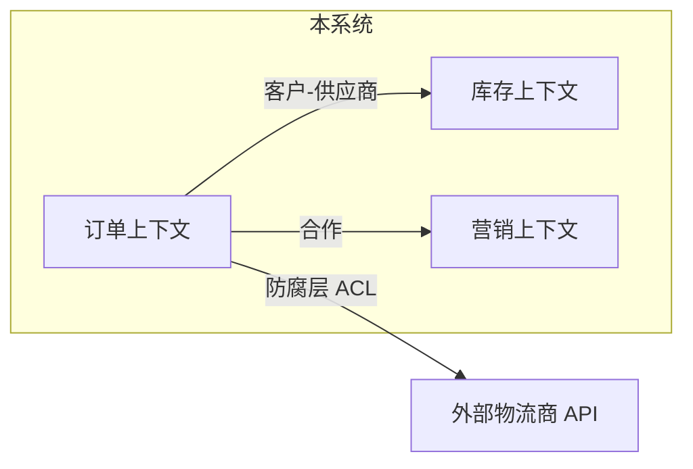

---
sources:
  - 11-第十一阶段
---

# 03. 服务边界：DDD 限界上下文与数据所有权

> [← 第十一阶段导览](01-导览.md) · 服务拆在哪条线上，决定的不是部署图而是未来五年的改造成本：边界内语言一致、模型自洽，边界外只靠契约与事件通信；数据归谁，服务就归谁。

## 1. 限界上下文 = 语言一致 + 模型自洽

限界上下文（bounded context）的定义可以浓缩成一句话：**一组人、一套语言、一个自洽的模型**。同一个「商品」在不同上下文里是不同的东西——订单域关心「成交时的快照」（id、名称、成交价），库存域关心「SKU、仓位、可售量」，营销域关心「活动价、券适用范围」。三个模型都对，因为它们回答的问题不同。

判断边界的方法不是看表结构，是看**语言在哪里打架**：当两个团队对同一个词展开解释开始不一致（订单说的「下单」含不含预扣库存？营销说的「下单」含不含改价？），那条裂缝就是上下文边界。边界之内，一个词只有一个含义、一个模型没有妥协字段。

为什么这条线值得较真：模型自洽意味着**每个上下文的不变量都能在本地完整执行**。一旦一个模型被迫服务两种语言，字段就开始为「别的场景」让步——订单模型里塞进营销的促销标记、库存模型里塞进订单的状态机，每个变更都要协调所有使用方。第二册讲的「一个变更改五个服务」，病根就在这里。

最大的反面教材是**按技术分层拆服务**：`api-service` 收请求、`data-service` 管数据库。这种拆法让任何一个业务变更都要横跨服务，等于把单体的分层耦合升级成了网络分层耦合——边界错得比不拆还彻底。服务必须沿业务能力（business capability）切，不沿技术层切。

## 2. 上下文映射：边界之间怎么相处

限界上下文之间总有依赖，上下文映射（context mapping）描述的就是这些依赖的「外交关系」：



| 关系 | 含义 | 什么时候用 | 风险 |
|---|---|---|---|
| 合作（partner） | 双方共同演进契约，变更互相通知 | 两个上下文都归自己团队、变更频率接近 | 一方独大时退化为客户-供应商 |
| 客户-供应商（customer-supplier） | 上游迁就下游的需求，下游提需求 | 明确的主从关系：库存是订单的上游 | 上游强势后下游被迫迁就，模型开始妥协 |
| 防腐层（ACL） | 一层翻译，把外部模型转换成本域模型 | 依赖外部系统、遗留系统、模型不想被污染 | 多一层代码与延迟；但换来边界完整 |

防腐层是最值得投资的模式：外部系统的模型（尤其是第三方）不是你能控制的，让它的字段直接渗进本域模型，等于把外人的 schema 变成了自己的公共契约。第 6 节给一段防腐层的实现代码。

## 3. 聚合根决定事务边界

聚合（aggregate）是一致性边界：**一次事务只改一个聚合**。订单聚合（订单 + 行项）在一个事务里改完；改库存是另一个聚合——服务化之后甚至是另一个服务的事——靠事件最终一致。

为什么这条规则如此强硬：聚合的存在意义就是保证不变量在事务内成立（订单行项合计 = 总额，不能改一半）。跨聚合的「必须同时成功」，要么说明两个聚合其实是同一个（该合并），要么说明业务其实能接受最终一致（该用事件）——执念通常源于没问过业务能不能接受「待确认态」。第二册的「跨服务事务满天飞」症状，一半来自聚合划得太大，一半来自拒绝接受最终一致。

聚合大小也是权衡：太小，一次业务操作拆成多个事务，最终一致的编排成本上升；太大，并发修改的锁冲突随之上升（第六阶段 04 册的乐观锁重试会放大）。经验法则：**一个事务里业务上必须一起改的，才放进同一个聚合**。

落成代码，事务边界就是方法边界：

```kotlin
@Service
class PlacingOrderService(
    private val orders: OrderRepository,        // 订单聚合的仓储
    private val events: ApplicationEventPublisher,
) {

    // 一个事务只碰订单聚合：改订单 + 行项，合法性（不变量）在聚合内校验
    @Transactional
    fun place(cmd: PlaceOrderCmd): OrderId {
        val order = Order.place(cmd)            // 行项合计 = 总额等不变量在这里断言
        orders.save(order)

        // 改库存是另一个聚合（甚至另一个服务）：事务里不写库存表，
        // 事务提交后发事件，由库存侧异步预扣——失败则订单走补偿取消（07 册）
        events.publishEvent(order.toPlacedEvent())
        return order.id
    }
}
```

对照着看「越界」的形状：如果上面这个方法里出现了 `stockRepository.decrease(...)`——聚合边界就破了；拆成服务之后，它会变成一个跨服务的同步调用 + 补偿逻辑，也就是第二册说的「跨服务事务满天飞」。**聚合边界划对，服务拆分只是把同一道界线从方法边界搬到进程边界**。

## 4. 「一服务一库」为什么是地基

微服务的地基只有一条：**一个服务的数据库，只有它自己能访问**。共享数据库等于共享 schema，等于共享事务——订单服务把事务写到了库存的表上，这个事务的边界事实上横跨两个服务，你拆掉的只是进程，拆不掉的耦合全部还在：

- schema 变成公共契约：改一个列名要协调所有连库方，「拆开」变成幻觉；
- 锁传播：一个服务的慢查询/长事务，把另一个服务的写操作堵死，故障域重新合并；
- 性能隔离消失：谁也没法独立换库、独立扩容、独立做迁移。

反过来说，**数据所有权先于服务边界**：先回答「这块数据归谁管、谁有权写」，服务边界自然浮现。「一个变更改五个服务」的另一个病根就是数据边界没划清——五个服务都写同一批表，服务拆了数据还是一体的。

给存量系统的演化路径：先**逻辑隔离**（独立 schema + 独立数据库账号 + 权限只放行自己的表），再**物理拆库**。逻辑隔离阶段所有违规连库会在权限层报错，比任何评审都有效地逼出边界。

## 5. 跨服务查询的四种解法

一服务一库之后，「跨库 JOIN」这个选项消失了。所有跨服务查询只有四种解法，没有第五种：

| 解法 | 做法 | 实时性 | 一致性 | 成本 | 适用面 |
|---|---|---|---|---|---|
| API 组合（BFF 聚合） | 调两个服务的接口再拼 | 高 | 最新 | 低（首次）/每次付两次网络往返 | 面向单个用户的交互式页面；两个服务以内 |
| 本地冗余快照 | 消费事件，把需要的字段存进自己的库 | 高 | 最终一致（事件延迟内） | 中（消费端 + 幂等） | 高频查询、JOIN 字段变化慢（订单里的商品名） |
| 事件驱动读模型（CQRS） | 消费事件维护专门的读库/ES 索引 | 中 | 最终一致 | 高（一套投影 + 重建机制） | 多维检索、列表页、搜索 |
| 报表走数仓 | 数据进数仓，报表在数仓出 | 低（T+1 / 小时） | 快照一致 | 高（独立链路） | 跨全业务的运营报表；别让在线服务扛 |

选型的心法：**先问这个查询是「业务交互」还是「分析洞察」**。交互走前三种（一个页面上的两个服务优先 API 组合；高频列表优先冗余快照），分析一律走数仓——最贵的错误是把运营报表做成在线 API 组合，让两个业务服务为一条 SQL 扛全公司的分析流量。

## 6. 数据所有权的纪律

两条纪律，写进代码评审清单：

**别人服务的表不能直接查，只读也不行。** 只读共享的危害不在性能，在于它把对方的 schema 变成了公共契约：对方从此不敢改名、不敢拆表，隐式耦合正式挂牌。要数据，走它的 API 或者它的事件。

**跨服务引用只存 ID，不存对方的状态数据。** 订单存 `userId`，不存用户昵称——昵称变了要跨服务同步，同步必有漏。两个例外要分清：

| 数据 | 存不存 | 理由 |
|---|---|---|
| 用户昵称 | 只存 ID，展示时查或快照冗余 | 可变属性，所有权在用户域 |
| 下单时的成交价 | **存**（事实记录） | 「当时成交价多少」是订单域的事实，用户域改价格不影响历史订单 |
| 商品名称 | 只存 ID，冗余快照可选 | 展示可容忍延迟；审计场景转事实记录 |

判断标准一句话：**如果这个值在业务上「定格于发生时刻」，它就是你域的事实数据，存下来；如果它属于别人域的可变状态，只存 ID。**

## 7. 防腐层代码

外部物流商的模型（`ShipmentDTO`，字段命名与其内部系统耦合）通过防腐层转换成本域的 `Shipment` 模型——外部模型从不越过这层：

```kotlin
// 外部模型：字段是对方的契约，改动与你无关，也不许渗进本域
data class CarrierShipmentDto(
    val waybillNo: String,          // 对方的运单号格式
    val st: String,                 // 神秘缩写：对方的状态枚举，随时会加新值
    val etaTs: Long?,               // 毫秒时间戳，可能缺省
)

// 本域模型：自洽、类型安全，状态是穷尽的
enum class ShipmentStatus { CREATED, IN_TRANSIT, DELIVERED, LOST }

data class Shipment(
    val trackingNumber: TrackingNumber,
    val status: ShipmentStatus,
    val eta: Instant?,
)

// 防腐层：唯一的翻译点；未知状态不崩溃、不猜测，显式进「待人工」路径
@Component
class CarrierShipmentAcl(
    private val carrier: CarrierClient,
) {

    fun query(orderId: OrderId): Shipment {
        val dto = carrier.getShipment(orderId.value)
        return Shipment(
            trackingNumber = TrackingNumber(dto.waybillNo),
            status = translate(dto.st, orderId),
            eta = dto.etaTs?.let { Instant.ofEpochMilli(it) },
        )
    }

    private fun translate(raw: String, orderId: OrderId): ShipmentStatus =
        when (raw) {
            "CREATED", "NEW" -> ShipmentStatus.CREATED
            "IN_TRANSIT", "DISPATCHED" -> ShipmentStatus.IN_TRANSIT
            "DELIVERED", "SIGNED" -> ShipmentStatus.DELIVERED
            else -> {
                // 对方加了新枚举值：映射失败记日志并告警，返回最保守的状态，
                // 而不是让未知值击穿下游的状态机
                log.warn("unknown carrier status {} for order {}", raw, orderId)
                ShipmentStatus.LOST
            }
        }
}
```

防腐层的三条实现纪律：转换发生在**进入本域的第一跳**（不是用到的时候再转）；未知值不抛异常猜状态，走显式的保守路径并告警——外部系统的枚举演进不该成为你的线上事故；防腐层的测试只依赖外部模型的形状（stub DTO），外部真实接口的行为归集成测试。

## 8. 边界划分清单

把本册收敛成一张评审清单，新服务立项与接口变更时逐条过：

| # | 检查项 | 不合格的信号 |
|---|---|---|
| 1 | 服务名能用一句业务语言解释吗 | 名字带「data」「common」「api」等技术词 |
| 2 | 服务内的词有歧义吗 | 团队对同一个业务词有两种解释 |
| 3 | 一次典型变更落在本服务内吗 | 「这个需求要动三四个服务」成为常态 |
| 4 | 数据库只有本服务连吗 | 存在其他服务的连接串或只读账号 |
| 5 | 跨服务引用只存 ID 吗 | 本域表里存着别人域的可变状态字段 |
| 6 | 一次事务只改一个聚合吗 | 业务操作需要两个服务「必须同时成功」 |
| 7 | 外部模型被防腐层挡住了吗 | 第三方 DTO 直接出现在业务代码里 |
| 8 | 跨服务查询选对解法了吗 | 运营报表走在线 API 组合；页面 JOIN 用 CQRS |

## 9. 自测

1. 「同一个『商品』在订单域和库存域是两个模型」——各自的模型里有哪些字段？为什么不能合成一个模型？
2. 客户-供应商关系里「上游迁就下游」退化成什么后果？防腐层在哪种关系下是必需的？
3. 为什么「一次事务只改一个聚合」？两个聚合「必须同时成功」时，有哪两条出路？
4. 共享数据库的三层耦合（schema 契约、锁传播、性能隔离）分别怎么瓦解微服务？给存量系统的两步演化路径是什么？
5. 跨服务查询的四种解法各适合什么场景？运营报表为什么不能走 API 组合？
6. 订单里「成交价」和「用户昵称」一个要存一个只存 ID，判断标准是什么？

## 10. 延伸

- 上一册：[02-该不该拆-单体-模块化单体与微服务判据](02-该不该拆-单体-模块化单体与微服务判据.md)——模块化单体的模块边界就是本册限界上下文的单进程版本。
- 聚合内并发控制（乐观锁、唯一约束）见[第六阶段 04 册](../06-第六阶段/04-并发控制-乐观锁-悲观锁与唯一约束.md)；跨聚合最终一致的机制见[第六阶段 06 册](../06-第六阶段/06-跨服务一致性-Outbox-Saga-TCC与分布式锁.md)与[本阶段 07 册](07-分布式事务与Saga编排.md)。
- 冗余快照与读模型的事件消费实现，见[第七阶段 06 册](../07-第七阶段/06-Spring消息集成-幂等消费-重试死信与积压.md)。
- 限界上下文的领域理论（子域、通用语言、事件风暴），见 architecture 站 DDD 章节；本册只落在「边界怎么变成代码与库表纪律」。
