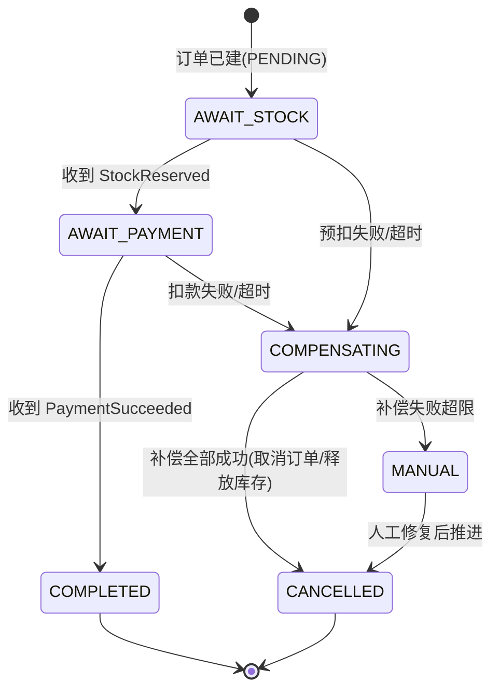

---
sources:
  - 11-第十一阶段
---

# 07. 分布式事务与 Saga 编排

> [← 第十一阶段导览](01-导览.md) · 机制细节（Outbox 表结构、投递器、TCC 三笔债）在[第六阶段 06 册](../06-第六阶段/06-跨服务一致性-Outbox-Saga-TCC与分布式锁.md)已经讲透；这一册回答服务化之后的新问题：怎么避免、多实例投递怎么排、跨服务幂等怎么防、Saga 协调者怎么写、Seata 什么时候值得用。

## 1. 先立判断：优先避免分布式事务

第六阶段 06 册的分级方法（三问：不可逆损失？能重放修复？中间态会被看到？）在这里直接引用，不重复。服务化之后要多问一步：**这个「跨服务必须同时成功」的执念，是边界问题还是业务问题？**

两条避免的路，优先级高于任何分布式事务方案：

| 路线 | 做法 | 例子 |
|---|---|---|
| **改边界** | 把强一致需求收进一个服务（03 册的聚合标准：一个事务里必须一起改的，属于同一个聚合，通常也该属于同一个服务） | 「订单创建必须同时预扣库存」——如果预扣是订单成交的一部分而非独立业务，考虑让它归订单服务 |
| **改业务设计** | 「先受理、后异步完成」：主操作先落一个明确的中间态，后续步骤异步推进，用户看到的是「已受理」而不是「全部完成」 | 订单先建为 PENDING，库存异步预扣，失败则自动取消并告知 |

两条都不行的少数场景（资金类、库存扣减这类不可逆操作），才进入方案选择。**方案选择的顺序本身就是本册的主线**，见第 6 节的表。

## 2. Outbox 覆盖 80%：服务化后的两个新问题

Outbox 的机制与表结构见第六阶段 06 册 §2——业务事务里写「待发消息」，独立投递器发出，消费侧幂等。服务化之后，两处会暴露新问题：

**新问题一：投递器多实例下的顺序。** 单实例投递时 `order by id` 串行发送天然有序；多实例（服务化后必然）用 `skip locked` 各拿各的批，**同一聚合的两条事件可能由两个实例并发发出**——库存先预留、后释放的两条事件可能乱序到达。解法是把「按 id 串行」升级为「按聚合分片」：投递时按 `aggregate_id` 哈希分区，同一聚合的记录只由一个投递者按序处理（配合 06 册说过的 Kafka 分区键 `aggregate_id`，两端对齐才完整）。

**新问题二：消费侧跨服务幂等。** 去重表必须在**消费服务自己的库**里，幂等键是「事件源服务 + 事件类型 + eventId」的组合——只靠 eventId 不够，因为不同服务的事件可能撞键；只靠业务键不够，因为重放整批事件时没有业务上下文。消费侧的纪律（第六阶段 05 册的幂等基础在此的跨服务版本）：

```kotlin
@Component
class OrderCreatedHandler(private val jdbc: JdbcClient) {

    @KafkaListener(topics = ["ORDER_EVENTS"], groupId = "inventory-service")
    fun on(msg: ConsumerRecord<String, String>) {
        val event = OrderEvent.parse(msg.value())
        // 去重表在消费方自己的库：键 = 源服务 + 事件类型 + eventId
        // insert on conflict：第一次插入成功才处理，重复投递静默跳过——
        // 这是 Outbox「至少一次」契约的消费侧一半
        val inserted = jdbc.sql("""
            insert into consumed_events(source_service, event_type, event_id)
            values (:src, :type, :eid)
            on conflict (source_service, event_type, event_id) do nothing
        """).param("src", event.source).param("type", event.type)
          .param("eid", event.eventId.toString()).update()

        if (inserted == 0) return   // 已消费过：幂等跳过

        try {
            reserveStock(event)
        } catch (e: Exception) {
            // 处理失败要删掉去重记录，让下次投递重试——
            // 否则这条事件会被「标记已消费」但从未真正处理
            jdbc.sql("delete from consumed_events where source_service = :src and event_type = :type and event_id = :eid")
                .param("src", event.source).param("type", event.type)
                .param("eid", event.eventId.toString()).update()
            throw e   // 重新抛出让监听容器重试/进死信（第七阶段 06 册）
        }
    }
}
```

「插入成功才处理 + 失败回删」这个组合，是跨服务幂等最容易写错的两个半边：只插入不回删，消息会丢；只处理不插入，重复投递会重复扣库存。

## 3. 编排式 Saga

需要补偿的流程（3 步以上、跨 3 个以上服务、或涉及资金），用编排式 Saga：协调者持有显式状态机，每步有对应补偿，超时有兜底。与协同式（各服务听事件自行决定下一步）的对比见第六阶段 06 册 §3.1——结论不变：**默认选编排**，服务越多越要一个能查、能重放、能人工推进的中心。

状态机（订单 → 预扣库存 → 扣款）：



协调者的骨架：状态落库（`saga_instance`：当前状态、每步 deadline、重试计数），事件驱动推进，超时扫描兜底：

```kotlin
@Service
class OrderSagaCoordinator(
    private val jdbc: JdbcClient,
    private val publisher: EventPublisher,
) {

    // 事件推进：每个状态只有一个合法出口集合，其他输入一律拒绝
    @KafkaListener(topics = ["STOCK_EVENTS", "PAYMENT_EVENTS"], groupId = "order-saga")
    fun on(event: SagaEvent) {
        val saga = loadSaga(event.orderId) ?: return
        when (Pair(saga.state, event.type)) {
            State.AWAIT_STOCK to EventType.STOCK_RESERVED -> {
                transit(saga, State.AWAIT_PAYMENT, deadline = now() + 60.s)
                publisher.send(PaymentRequest(saga.orderId, saga.amount, sagaId = saga.id))
            }
            State.AWAIT_PAYMENT to EventType.PAYMENT_SUCCEEDED -> complete(saga)
            State.AWAIT_PAYMENT to EventType.PAYMENT_FAILED -> startCompensation(saga)
            // 状态与事件不匹配（重复投递、乱序）：幂等忽略，不推进不报错
            else -> log.debug("ignored event {} in state {}", event.type, saga.state)
        }
    }

    // 超时兜底：deadline 过了还没等到结果——不盲目补偿（扣款可能已成功），
    // 先向下游查询实际状态，查不到才补偿；补偿失败进 MANUAL + 工单
    @Scheduled(fixedDelay = 10_000)
    fun sweepTimeout() {
        jdbc.sql("select * from saga_instance where state in ('AWAIT_STOCK','AWAIT_PAYMENT') and deadline < now()")
            .query { rs, _ -> loadSaga(rs) }.list()
            .forEach { saga ->
                if (downstreamStateKnown(saga)) transit(saga, saga.state, deadline = now() + 30.s) // 按真实状态续命
                else startCompensation(saga)
            }
    }

    private fun startCompensation(saga: Saga) {
        // 补偿动作幂等（第六阶段 06 册 §3.3）：重复执行不产生二次释放
        publisher.send(ReleaseStock(saga.orderId, saga.sku, saga.qty))
        transit(saga, State.COMPENSATING, deadline = now() + 30.s)
    }
}
```

三个必须写对的地方（细节论证见第六阶段 06 册 §3.3）：**补偿幂等**（会重复执行）、**状态不确定先查再补**（盲目补偿可能退两次款）、**MANUAL + 工单是一等公民**（没有人工兜底的 Saga 是把分布式问题藏进日志）。

## 4. Seata 的适用面与成本

Seata 是开箱即用的分布式事务框架，两种模式值得区分：

| 模式 | 机制 | 适用 | 成本 |
|---|---|---|---|
| **AT** | 自动拦截 SQL，记录前后镜像（undo_log），全局提交时异步删除、回滚时按镜像反向补偿；全局锁防脏写 | 内部系统、低到中并发、想少改代码 | 每个参与者加 undo_log 表 + TC（事务协调器）集群；**全局锁串行化冲突分支**，热点数据吞吐明显下降；镜像依赖「没有别的写路径绕过它」 |
| **TCC** | Try/Confirm/Cancel 三个接口手写（空回滚、悬挂、幂等三套逻辑） | 资金类：必须预留资源且补偿不足以挽回（冻结额度、锁定库存） | 侵入大：每个参与方 3 接口 + 2 表，代码量约是 Saga 的 3 倍（第六阶段 06 册 §4 的成本账） |

选用判据：AT 的「对业务侵入小」换来的是**吞吐与运维的隐性成本**——全局锁让热点行（秒杀库存、账户余额）退化成串行执行，这类场景 AT 反而不如「条件更新 + Outbox」。TCC 只给「预留」语义的业务。一句话：**Seata 适合「低冲突、要快上」的内部一致性；高冲突热点和资金语义，回到手写方案**。Spring 侧的集成（`@GlobalTransactional` 注解替换 `@Transactional`）本身不难，难在选型时想清楚上面这张表。

## 5. 对账：最后防线

第六阶段 06 册 §7 的结论原样适用于服务化系统：所有机制（Outbox、Saga、TCC）的共同点是「尽力」——消息可能丢、补偿可能失败，对账是唯一能**发现**这些失败的机制。服务化后的对账矩阵：

| 对账 | 频率 | 比对 | 发现 |
|---|---|---|---|
| 内部对账 | 每 5 分钟 | 订单服务的状态 vs 库存服务的预留流水 | 消息丢失、消费漏处理 |
| 跨服务对账 | 每小时 | Saga 实例表 vs 各参与方的执行流水 | 卡在中间态、补偿未闭环 |
| 全量对账 | T+1 | 全链路流水逐笔核对 | 一切「机制没发现」的差异 |

差异修复走工单（幂等重放为主、人工介入为辅），产出差异率与修复时长两个指标——差异率突升几乎总意味着上游刚发过版，比任何监控都灵敏。

## 6. 跨服务流程的测试

Saga 最难测的是**补偿路径**——正常路径单测覆盖得到，补偿只在下游失败时触发，上线后第一次触发就是生产验证。测试策略三层：

1. **协调者单测**：下游 stub 掉（接口层 mock），逐个状态转移断言——「第 2 步失败 → 第 1 步补偿被发出」「补偿响应失败 × N → 进 MANUAL」；
2. **集成测试**：Testcontainers 起真 Kafka + stub 下游（WireMock 类工具可编程地返回失败/超时），验证「消息驱动推进 + 去重表幂等」的真实行为；
3. **故障注入**：对补偿路径注入延迟与异常（第十阶段 04 册的方法在跨服务流程的应用），验证超时扫描与 MANUAL 工单真的触发。

一段可复用的断言模板：模拟「扣款失败」，断言「释放库存事件已发出、订单进入 COMPENSATING、deadline 已重设」——这三件事缺一不可，只断言状态转移不看补偿事件，是 Saga 测试最常见的漏测。

## 7. 一致性方案选型顺序

| 顺序 | 方案 | 触发条件 | 一致性 | 主要成本 |
|---|---|---|---|---|
| 0 | 不需要：改边界 | 强一致需求能收进一个服务 | 强 | 一次边界重构 |
| 0' | 不需要：先受理后异步 | 业务能接受中间态 | 最终（业务可见） | 状态机设计 |
| 1 | Outbox + 消息 | 通知类、可重放类（80% 场景） | 最终一致 | 去重表 + 投递器 |
| 2 | 编排式 Saga | 3 步以上、需要补偿与超时兜底 | 最终一致 + 补偿 | 状态机 + 工单运营 |
| 3 | Seata AT | 低冲突、想少改代码的内部强一致 | 准强一致 | 全局锁吞吐 + TC 集群 |
| 3' | TCC | 资金预留语义 | 准强一致（预留） | 3 接口 × N 方侵入 |
| ∞ | 对账 | **所有涉及钱的系统，无条件** | 提供「发现」 | 日常运营 |

记忆口诀：**能收进一个服务就收 → 跨服务先 Outbox → 要补偿上 Saga → 要预留才 TCC/Seata → 涉及钱必有对账**。顺序不可跳级：直接上 Seata 解决「其实 Outbox 就够」的问题，是最常见的过度设计。

## 8. 自测

1. 「订单创建必须同时预扣库存」——用第 1 节的两条避免路线各给出一个解，判断标准是什么？
2. 多实例投递器下，同一聚合的事件为什么会乱序？两端（投递侧与 Kafka 分区侧）分别怎么对齐？
3. 消费侧去重表「只插入不回删」会丢什么、「只处理不插入」会错什么？幂等键为什么要三个字段组合？
4. Saga 超时兜底为什么「不盲目补偿、先查下游状态」？写出一个盲目补偿造成资损的时序。
5. Seata AT 模式的全局锁对哪类数据退化成串行执行？这类场景的正确替代是什么？
6. 跨服务流程测试的三层里，哪一层覆盖补偿路径？只断言状态转移、不断言补偿事件，漏掉了什么？

## 9. 延伸

- 机制基础：Outbox 表结构与投递器、TCC 空回滚/悬挂的完整推演，见[第六阶段 06 册](../06-第六阶段/06-跨服务一致性-Outbox-Saga-TCC与分布式锁.md)；幂等基础见[第六阶段 05 册](../06-第六阶段/05-幂等-幂等键-去重表与状态机.md)。
- 消息消费的容器重试与死信，见[第七阶段 06 册](../07-第七阶段/06-Spring消息集成-幂等消费-重试死信与积压.md)；故障注入方法见[第十阶段 04 册](../10-第十阶段/04-并发-幂等与故障注入测试.md)。
- 跨服务流程的 trace 串联（Saga 实例 id 怎么进链路），见[本阶段 08 册](08-多服务可观测性与契约治理.md)。
- Saga/分布式事务的理论模型（ACID 与 BASE 的取舍），见 architecture 站分布式理论章节。
