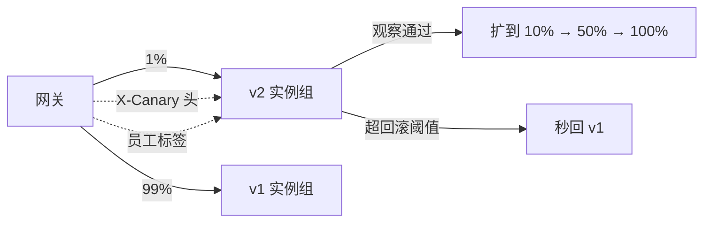

---
sources:
  - 11-第十一阶段
---

# 09. 大型应用工程化：联调、灰度与容量

> [← 第十一阶段导览](01-导览.md) · 拆完之后工程问题换了一茬：本地起不全、发布要切流、容量按服务算、回滚有顺序。这一册是拆分代价的最后一笔账，也是阶段实践的施工手册。

## 1. 多服务本地联调的三种现实

服务一多，第一个崩塌的是「本地起全栈」的幻想：20 个服务 × 每人的机器，起不全也起不快，而且每个开发实例都是一份环境漂移。三种现实方案：

| 方案 | 做法 | 适用 | 取舍 |
|---|---|---|---|
| Compose + Testcontainers | Compose 起依赖中间件（PG/Redis/Kafka），Testcontainers 起「别人的服务」的镜像 | 依赖 3~5 个服务的开发 | 环境与生产对齐、离线可跑；镜像版本要锁定，否则测的不是真实下游 |
| 统一 dev 环境 | 团队共享一套 dev 命名空间，本地只跑自己改的服务，靠服务发现/网关路由到 dev 实例 | 服务多、联调频繁 | 无需本地资源；共享环境会被互相覆盖，要有「按开发者隔离实例组」的机制（请求头路由到个人实例） |
| 按需 mock | 只跑自己的服务，下游全 stub | 只改单服务逻辑 | 最快最稳；但 stub 与真实下游的漂移要靠契约测试兜底（第十阶段 03 册） |

三者不互斥，是递进的日常：单服务逻辑用 mock，跨服务联调起 Testcontainers，验证环境行为进统一 dev。一条底线纪律：**「别人的服务」用镜像，别用源码**——把同事的分支拉下来本地编译跑，等于把自己的机器变成一个漂移源。镜像版本锁定到与 dev 环境相同的 tag，是本地结果可信的前提。

## 2. 灰度发布：三种切流与三件套

灰度的本质是把「全量发布」这个不可逆的大爆炸拆成一串可逆的小爆炸。三种切流维度：

| 切流方式 | 机制 | 适用 |
|---|---|---|
| 按比例 | 网关权重路由：1% → 10% → 50% → 100%（05 册的 Weight 过滤器） | 常规发布，验证性能与错误率 |
| 按用户标签 | 白名单/内部员工/指定租户先进 | 新功能验证——员工先当小白鼠，问题在真实使用中暴露 |
| 按请求头 | `X-Canary: true` 或特定 API 版本头进新版本 | 开发者自测、客户端定向联调（06 册的个人实例隔离靠它） |



切流只是手段，纪律是**三件套**，灰度方案里三项缺一不算发布：

1. **进入条件**：测试全绿、与 v1 基线对齐（接口契约测试通过）、容量评估完成。进入条件没达标就灰度，等于拿生产当测试环境。
2. **观察指标**：错误率、P99、资源水位（CPU/内存/连接池）三组各盯一个数，且**与 v1 同口径对比**（08 册的「分开统计」）；业务指标（下单成功率）必须包含——技术指标全绿、业务指标跌掉的技术事故每年都在发生。
3. **回滚阈值**：提前写死数字——「错误率 > 1% 或 P99 > v1 两倍，自动/立即回滚」。阈值现场开会决定的过程，就是把决策质量交给恐慌的过程。

## 3. 蓝绿与金丝雀的取舍

| 维度 | 蓝绿 | 金丝雀 |
|---|---|---|
| 切换 | 全量一次性切换 | 渐进切流 |
| 资源 | 双份全程（蓝+绿都活着） | 新版本只需小实例组，逐步扩 |
| 回滚 | 秒级（路由切回） | 秒级（权重归零） |
| 观察窗口 | 切换瞬间之后才能看全量表现 | 每档比例都有观察窗口 |
| 适用 | 版本差异大、要整体快速回滚；或双版本不兼容 | 常规发布；有真实流量验证的诉求 |

取舍心法：金丝雀是默认，蓝绿是特例——蓝绿的双份资源成本长期背着不划算，且**数据库变更永远做不到「蓝绿」**（一个库没法同时服务两套 schema，除非变更设计成向后兼容，见第 4 节）。蓝绿真正的适用面是「接口不兼容的大版本切换 + 强回滚诉求」的组合，多数发布用不着。

## 4. 容量规划与冷启动预热

容量估算的公式很朴素，难的是参数来源：

```text
实例数 = 峰值 QPS × 单请求资源占用（CPU·ms / 内存 MB / 连接数）× 冗余系数 / 单实例容量
```

- **峰值 QPS**：取历史峰值的 1.5~2 倍（大促、突发），不是平均值；
- **单请求资源**：来自压测（第十阶段 08 册的完整方法），拍脑袋估的数会被真实流量教育；
- **冗余系数**：通常 1.5——要扛住「一个可用区挂掉 + 流量迁移」的场景，不是扛住日常。

估算只是初值，**压测验证才是闭环**：按估算扩容后重压，确认 P99 与错误率在 SLO 内（08 册）。估算 → 压测 → 修正，两轮起步。

冷启动是容量数字的隐形折扣：新实例刚起来时，连接池是空的（第一个请求要现建连接）、JIT 没热（字节码还在解释执行）、本地缓存全 miss（缓存击穿流量直冲数据库）。三件预热手段：启动后打合成流量（健康检查外的真实路径探测）让 JIT 与连接池热起来；readiness 探针加「预热完成」判定（第十阶段 07 册的探针设计在扩容语境的延伸），别让冷实例接全量流量；本地缓存的空转期用「启动时预加载热数据」缩短。扩容 50 个实例然后瞬间全量接流，等于对数据库发起一次自己人打的突发流量——**先扩、预热、再进流量**。

```kotlin
// 预热器：在 readiness 放行之前把三个慢源消除掉
@Component
class WarmupRunner(
    private val dataSource: DataSource,
    private val cache: HotItemCache,
    private val readiness: ApplicationReadiness,   // 第十阶段 07 册的状态门
) : ApplicationRunner {

    override fun run(args: ApplicationArguments) {
        // 1. 连接池：建满最小连接 + 跑一条真实 SQL（驱动/JIT 的首次路径）
        repeat(10) { dataSource.connection.use { it.prepareStatement("select 1").execute() } }

        // 2. 本地缓存：预加载热数据，空转期的 miss 流量不会直冲数据库
        cache.preloadTopItems()

        // 3. JIT：内部压一小波合成流量后（代码略），才允许 readiness 放行
        readiness.markReady()
    }
}
```

## 5. 发布顺序纪律

多服务的发布顺序不是细节，是正确性约束。四条纪律按场景给出：

| 场景 | 顺序 | 原因 |
|---|---|---|
| 数据库变更 + 服务变更 | **数据库先行且向后兼容**（加列可空/带默认值 → 服务发布 → 下下个版本才删旧列） | 第五阶段 07 册的零停机迁移：新代码兼容旧 schema，回滚才能安全 |
| 消息 schema 变更 | **消费者先升级（兼容新旧两种消息）→ 生产者后切** | 队列里滞留的旧消息会在发布后的一段时间里继续到达——消费者不兼容旧格式就丢数据 |
| 接口变更（04 册的公告期流程） | 先加新版本 → 消费者迁移 → 删旧版本 | 08 册的破坏性变更协调，发布顺序是它的执行时序 |
| 扩缩容与发布同行 | **先扩后缩**：新版本实例就绪并预热后才摘旧实例 | 「边扩边缩」会让容量瞬间下探，预热期的新实例接不住全量 |

四条的共性：**发布顺序的目标是让任意时刻的线上组合（新旧版本 × 新旧 schema）都自洽**。回滚能成立的前提，就是每一步都保持了这种自洽。

## 6. 回滚的正确顺序与回滚评审

回滚是发布失败时的应激操作，恰恰因为应激，顺序更要提前定死。正确顺序与发布相反：

1. **先切流量**：网关权重归零回旧版本（秒级，止血第一动作）；
2. **停新版写入**：确认没有在途请求打到新版本（连接排空）；
3. **数据只前进不回滚**：数据库变更不逆向执行——向前兼容的设计（第 5 节）保证了旧版本代码能在新 schema 上跑；逆向执行 schema 变更是数据丢失的第一大来源。

**回滚也要评审**，理由不是官僚，是应激状态下人会跳步：三个问题 thirty 秒问完——影响面（只是 P99 劣化还是数据错了？）、数据兼容（旧版本能吃下已写入的新数据吗？）、止血优先（要不要先切流量再讨论？）。回滚评审的产出是一行记录：什么时间、什么阈值触发、切了多少、数据是否兼容——事后复盘的原料全在这里。

## 7. 灰度切流配置

按比例切流 + 按头自测的组合配置（Gateway 的 Weight 过滤器按组分配权重）：

```yaml
spring:
  cloud:
    gateway:
      routes:
        # 默认路由：canary 组拿 10% 权重
        - id: orders-canary
          uri: http://orders-v2
          predicates:
            - Path=/api/orders/**
            - Weight=orders-rollout, 10
          filters:
            - JwtAuth
        - id: orders-stable
          uri: http://orders-v1
          predicates:
            - Path=/api/orders/**
            - Weight=orders-rollout, 90
          filters:
            - JwtAuth
        # 开发者自测路由：带头直达 v2，不占权重份额
        - id: orders-canary-by-header
          uri: http://orders-v2
          predicates:
            - Path=/api/orders/**
            - Header=X-Canary, always
```

```kotlin
// 回滚阈值的自动化判断：灰度观察器把「三件套」的第三件变成代码而不是口头约定
@Component
class CanaryMonitor(
    private val meterRegistry: MeterRegistry,
    private val rollout: RolloutControl,   // 封装「改网关权重」的 API
) {

    @Scheduled(fixedDelay = 30_000)
    fun check() {
        val v2ErrorRate = errorRateOf("orders", version = "v2")
        val v1ErrorRate = errorRateOf("orders", version = "v1")   // 同口径对比（08 册）

        if (v2ErrorRate > v1ErrorRate * 2 || v2ErrorRate > 0.01) {
            rollout.setWeight(group = "orders-rollout", canary = 0)   // 秒回 v1
            log.error("canary rolled back: v2 errorRate={} v1={}", v2ErrorRate, v1ErrorRate)
            alert("canary rollback", "orders v2 已回滚，请检查发布")   // 回滚动作永远带告警
        }
    }
}
```

## 8. 发布检查单

发布前的逐条检查，最后一列写「不合格时发布要停」：

| # | 检查项 | 不合格的后果 |
|---|---|---|
| 1 | 数据库变更向后兼容吗（新代码兼容旧 schema） | 回滚即数据事故 |
| 2 | 消费者兼容新旧消息 schema 吗 | 滞留消息丢失或消费报错 |
| 3 | 进入条件全绿吗（测试、契约、容量） | 拿生产当测试环境 |
| 4 | 观察指标与回滚阈值写死了吗 | 阈值现场拍脑袋 |
| 5 | 新实例预热方案就绪吗（先扩后缩） | 扩容瞬间打垮依赖 |
| 6 | 回滚步骤演练过吗（切流 → 排空 → 数据前进） | 应激状态下跳步 |
| 7 | 灰度比例与观察窗口定了吗（1% → 10% → 50% → 100%） | 一次切全量等于没灰度 |
| 8 | 业务指标在观察面板里吗 | 技术全绿、业务跌掉 |

## 9. 自测

1. 本地联调三种方案怎么递进使用？「别人的服务为什么必须用镜像不用源码」？
2. 灰度三件套是什么？为什么回滚阈值必须提前写死数字？
3. 蓝绿为什么做不到数据库变更的「蓝绿」？它的真实适用面是什么？
4. 冷启动的三个慢源是什么？「扩 50 个实例瞬间接全量流量」对数据库意味着什么？
5. 消息 schema 变更为什么消费者先升级？数据库变更为什么「只前进不回滚」？
6. 回滚评审的三个问题是什么？「回滚也要评审」防的是哪种失效？

## 10. 延伸

- 上一册：[08-多服务可观测性与契约治理](08-多服务可观测性与契约治理.md)——灰度观察指标的同口径对比在那里定过口径。
- 切流的网关配置与限流见[本阶段 05 册](05-网关与BFF.md)；零停机迁移的兼容顺序见[第五阶段 07 册](../05-第五阶段/07-Schema演进与零停机迁移.md)；探针与优雅停机见[第十阶段 07 册](../10-第十阶段/07-交付-分层镜像-探针与优雅停机.md)。
- 压测方法与瓶颈定位见[第十阶段 08 册](../10-第十阶段/08-压测与调优方法论.md)——容量公式的参数来源。
- 阶段实践要求的三服务拆分与灰度验证，按本册检查单逐条执行；架构视角的发布策略（渐进交付），见 architecture 站对应章节。
