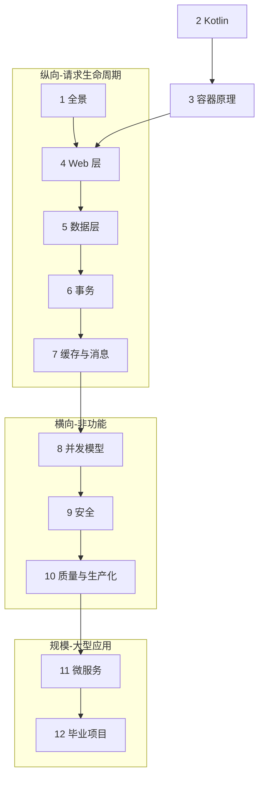

---
references:
  - 01-第一阶段
  - 02-第二阶段
  - 03-第三阶段
  - 04-第四阶段
  - 05-第五阶段
  - 06-第六阶段
  - 07-第七阶段
  - 08-第八阶段
  - 09-第九阶段
  - 10-第十阶段
  - 11-第十一阶段
  - 12-第十二阶段
---

# 后端开发学习大纲

> 目标：以 **Kotlin + Spring Boot** 为主线，把「一个 HTTP 请求从进进程到出响应」的每一站吃透，再横向扩到数据建模、缓存、消息、并发、安全，纵向扩到微服务与大型应用的工程治理。
> 用法：按阶段推进，学到哪一册就勾选对应条目；`[ ]` 未学，`[x]` 已完成。每册末尾有自测题，每阶段有实践任务——「看懂」不算数，**跑出来、测出来、量出来**才算。

## 技术基线

本站不是「Spring 入门教程」：它假定你会写 Java/Kotlin，但把版本钉在当前生态上——很多教材还停在 Boot 2.x/3.x，而你在生产里遇到的坑大多来自版本差异。

| 层次 | 选型 | 说明 |
|---|---|---|
| 语言 | **Kotlin 2.2+** | 全程 Kotlin，Java 只在互操作与源码对照时出现 |
| 运行时 | **JDK 25 LTS**（最低 17） | 虚拟线程、结构化并发、JFR 是第八、十阶段的实验基础 |
| 构建 | **Gradle 9**（最低 8.14） | version catalog、构建缓存、多模块 |
| 框架 | **Spring Boot 4.1** / Spring Framework 7 | Jakarta EE 11、Servlet 6.1、Jackson 3；4.0→4.1 的差异在正文里点名 |
| 数据 | PostgreSQL 17 + HikariCP + Flyway | 示例以 PG 为主，MySQL 差异单列 |
| 中间件 | Redis 8、Kafka 4 / RabbitMQ 4 | 阶段七的两条消息路线对照 |
| 微服务 | **Spring Cloud 2025.1（Oakwood）** | 与 Boot 4.0/4.1 对应；Gateway 5、Config、Consul/Eureka |

> **3.5 → 4.x 的五个必知差异**（第十一阶段之前会反复出现）：starter 重命名（`spring-boot-starter-web` → `spring-boot-starter-webmvc`）、Jackson 3 换坐标（`com.fasterxml.jackson` → `tools.jackson`，`ObjectMapper` 换成 `JsonMapper`）、`@MockBean` 移除改用 `@MockitoBean`、Undertow 不再支持、tracing 自动配置拆成独立模块。

## 主时间线：一次请求在 Spring Boot 里走过的十五站

全站内容都挂在下面这条主线上。第一阶段先建这本「总账本」——每一站有名字、有典型耗时、有归属线程；之后每个阶段都是在给其中某几站做精修，精修完回来核账。

```mermaid
flowchart LR
  A[① 连接接入<br>Tomcat/NIO] --> B[② 过滤器链<br>Filter]
  B --> C[③ 路由匹配<br>DispatcherServlet]
  C --> D[④ 参数解析<br>与类型转换]
  D --> E[⑤ 参数校验<br>Bean Validation]
  E --> F[⑥ 拦截器<br>preHandle]
  F --> G[⑦ 事务开启<br>@Transactional]
  G --> H[⑧ 领域逻辑]
  H --> I[⑨ 连接池取连接<br>SQL 执行]
  I --> J[⑩ 外部 IO<br>缓存/消息/HTTP]
  J --> K[⑪ 事务提交<br>或回滚]
  K --> L[⑫ 拦截器<br>postHandle]
  L --> M[⑬ 序列化<br>Jackson 3]
  M --> N[⑭ 异常归一<br>ProblemDetail]
  N --> O[⑮ 写回响应<br>指标埋点]
```

| 站点 | 发生在哪 | 本站哪个阶段讲 |
|---|---|---|
| ①② | 内嵌容器线程 / Filter 链 | 第四阶段 |
| ③④⑤ | DispatcherServlet 与 HandlerAdapter | 第三、四阶段 |
| ⑥⑦⑪⑫ | 拦截器、事务代理（AOP） | 第三、四、六阶段 |
| ⑧ | Service 层，你的业务代码 | 全站 |
| ⑨ | 连接池 + 数据库 | 第五阶段 |
| ⑩ | Redis / MQ / 下游 HTTP | 第七、八、十一阶段 |
| ⑬⑭ | 消息转换器与 `@ControllerAdvice` | 第四阶段 |
| ⑮ | 容器写回 + Micrometer | 第十阶段 |

**学完本站的验收标准**：任给一个线上接口，你能说出这十五站各自花了多少时间、跑在哪个线程上、瓶颈最可能在哪几站，并能改代码把数字改小——这就是第十二阶段的毕业项目。

---

## 第一阶段：后端全景与工程地基

先看全景再钻细节：建立十五站时间线与耗时账本，把环境和技术基线钉死，搭出一个「以后所有实验都在里面做」的工程骨架，并装好度量工具。

- [ ] [01-导览](01-第一阶段/01-导览.md) · 阶段入口：怎么记总账本、实验环境怎么搭
- [ ] [02-一次请求的十五站主时间线与账本](01-第一阶段/02-一次请求的十五站主时间线与账本.md) · 逐站展开、本地/容器/跨机房三套耗时量级表、线程归属
- [ ] [03-技术基线与本地环境](01-第一阶段/03-技术基线与本地环境.md) · JDK 25 / Kotlin 2.2 / Gradle 9 / Boot 4.1 选型理由、Docker Compose 起 PG+Redis+Kafka
- [ ] [04-工程骨架与分层约定](01-第一阶段/04-工程骨架与分层约定.md) · 模块化单体优先、包结构、DTO 与领域对象边界、配置分层
- [ ] [05-度量地基-JFR-JMH与Actuator](01-第一阶段/05-度量地基-JFR-JMH与Actuator.md) · 火焰图怎么读、微基准别测错、Actuator 端点先开起来

**阶段实践**：跑通骨架服务，给十五站各埋一个计时点，产出第一版账本（每站 P50/P99）。

## 第二阶段：Kotlin 服务端工程化

Kotlin 不是「带语法糖的 Java」。这一阶段把语言特性收敛成服务端可用的规约：什么样的数据建模能挡住空指针和非法状态，什么样的语法糖该用、什么时候是负担。

- [ ] [01-导览](02-第二阶段/01-导览.md) · 阶段入口
- [ ] [02-空安全与不可变数据建模](02-第二阶段/02-空安全与不可变数据建模.md) · `data class` 做 DTO、值对象防裸类型、不可变集合、`copy` 的陷阱
- [ ] [03-类型系统进阶](02-第二阶段/03-类型系统进阶.md) · `value class` 零开销包装、`sealed` 穷尽 `when`、`inline`/契约、泛型变型
- [ ] [04-扩展-委托与DSL的边界](02-第二阶段/04-扩展-委托与DSL的边界.md) · 扩展函数静态解析、`by lazy`/`observable`、类型安全 DSL 与「DSL 滥用」
- [ ] [05-协程基础-suspend与结构化并发](02-第二阶段/05-协程基础-suspend与结构化并发.md) · `suspend` 的本质、结构化并发、取消传播、`CoroutineExceptionHandler`、与线程池的关系
- [ ] [06-Kotlin与Spring的接缝-allopen-noarg与DSL配置](02-第二阶段/06-Kotlin与Spring的接缝-allopen-noarg与DSL配置.md) · `allopen`/`noarg` 插件、final 类与 CGLIB、Kotlin DSL 配置 Bean、Java 互操作平台类型
- [ ] [07-Gradle构建-version-catalog与多模块](02-第二阶段/07-Gradle构建-version-catalog与多模块.md) · 依赖集中管理、构建缓存、`buildSrc` vs convention plugin、ktlint/detekt

**阶段实践**：把骨架的「裸类型满天飞」重构为值对象 + 密封错误模型，并用 detekt 定下团队规约。

## 第三阶段：Spring 容器与启动原理

框架不是黑盒。这一阶段回答「为什么我的 Bean 是 null」「为什么 `@Transactional` 在这里不生效」「启动为什么慢」，最后手写一个 60 行的迷你容器把 IoC/AOP 的原理焊死在脑子里。

- [ ] [01-导览](03-第三阶段/01-导览.md) · 阶段入口
- [ ] [02-IoC容器与BeanDefinition注册](03-第三阶段/02-IoC容器与BeanDefinition注册.md) · 扫描、注册、构造器注入为什么是默认最优、作用域与循环依赖
- [ ] [03-Bean生命周期与十二个扩展点](03-第三阶段/03-Bean生命周期与十二个扩展点.md) · 实例化 → 属性填充 → Aware → `BeanPostProcessor` → 初始化 → 销毁，顺序实测
- [ ] [04-AOP与代理-自调用的真相](03-第三阶段/04-AOP与代理-自调用的真相.md) · JDK 动态代理 vs CGLIB、`this` 调用为什么绕过代理、代理链与顺序
- [ ] [05-自动配置与条件装配](03-第三阶段/05-自动配置与条件装配.md) · `@Conditional` 家族、`AutoConfiguration.imports`、Boot 4 的模块化拆分、怎么排除
- [ ] [06-启动流程refresh与内嵌容器](03-第三阶段/06-启动流程refresh与内嵌容器.md) · `refresh()` 十二步、Tomcat 何时启动、事件与 `ApplicationRunner`、优雅停机钩子
- [ ] [07-手写一个迷你容器](03-第三阶段/07-手写一个迷你容器.md) · 60 行实现扫描 + 注入 + 代理，再回头看框架的每一行

**阶段实践**：关掉自动配置手工装配一次，打印每个 Bean 的创建顺序与耗时，找出启动慢的元凶。

## 第四阶段：Web 层与接口契约

请求真正落地的一层。核心不是「怎么写 `@GetMapping`」，而是分发链路、错误模型、序列化行为与接口契约——这四项决定了一个 API 是能被别人依赖，还是三天后就得改。

- [ ] [01-导览](04-第四阶段/01-导览.md) · 阶段入口
- [ ] [02-Tomcat线程模型与Servlet6.1](04-第四阶段/02-Tomcat线程模型与Servlet6.1.md) · NIO 连接器、`maxThreads` 与排队、请求生命周期、虚拟线程执行器
- [ ] [03-Filter-Interceptor-AOP的执行顺序](04-第四阶段/03-Filter-Interceptor-AOP的执行顺序.md) · 谁先谁后、各能拿到什么、鉴权/日志/幂等分别该放哪
- [ ] [04-DispatcherServlet分发与参数解析](04-第四阶段/04-DispatcherServlet分发与参数解析.md) · HandlerMapping、`HandlerAdapter`、`ArgumentResolver` 扩展点、自定义参数绑定
- [ ] [05-校验体系与Kotlin陷阱](04-第四阶段/05-校验体系与Kotlin陷阱.md) · Bean Validation 分组、自定义约束、`@Valid` 与 Kotlin 构造器/默认值的坑
- [ ] [06-错误模型-ProblemDetail与错误码](04-第四阶段/06-错误模型-ProblemDetail与错误码.md) · RFC 9457、`@ControllerAdvice` 分层、错误码体系与国际化
- [ ] [07-Jackson3序列化](04-第四阶段/07-Jackson3序列化.md) · `tools.jackson` 迁移、Kotlin 模块、null 与默认值、多态、时间与数值精度
- [ ] [08-REST契约-幂等-分页-版本化与OpenAPI](04-第四阶段/08-REST契约-幂等-分页-版本化与OpenAPI.md) · 资源语义、幂等键、游标分页、Boot 4 API versioning、契约先行
- [ ] [09-补充-注解版SpringMVC从零实现](04-第四阶段/09-补充-注解版SpringMVC从零实现.md) · 无 XML 的装配分水岭、无 XML 的 IoC 容器（root/子容器与 `WebApplicationContext`）、Servlet 3.0 SPI 注册 `DispatcherServlet`、注解如何变成路由表、一百多行迷你 MVC、五个启动期才炸的坑

**阶段实践**：给同一资源写 v1（裸 JSON）与 v2（ProblemDetail + 契约文档）两版接口，用契约测试把差异钉死。

## 第五阶段：数据层——建模、SQL、连接池与持久化

后端事故的高发区。这一阶段从**表怎么设计**开始（约束与类型选型决定了一半的正确性），再要求「能看懂执行计划、能证明隔离级别、能说清 ORM 到底发了哪些 SQL」，而不是会写 `findById`。

- [ ] [01-导览](05-第五阶段/01-导览.md) · 阶段入口
- [ ] [02-连接池与JDBC真相](05-第五阶段/02-连接池与JDBC真相.md) · HikariCP 参数含义、池大小怎么算、连接泄漏与「池满」现场
- [ ] [03-数据建模-表结构-约束与类型选型](05-第五阶段/03-数据建模-表结构-约束与类型选型.md) · 主键选型、金额/时间/枚举/JSONB 的类型铁律、约束表达业务不变量、软删除的代价、关系与树形建模、反范式的边界
- [ ] [04-SQL与索引-执行计划与慢查询](05-第五阶段/04-SQL与索引-执行计划与慢查询.md) · `EXPLAIN ANALYZE` 逐行读、索引失效的十种写法、慢查询定位与治理
- [ ] [05-事务与隔离级别的实证](05-第五阶段/05-事务与隔离级别的实证.md) · MVCC 快照、四种隔离级别实测、幻读与间隙锁、死锁日志分析
- [ ] [06-持久化选型-JPA-MyBatis-JdbcClient](05-第五阶段/06-持久化选型-JPA-MyBatis-JdbcClient.md) · 三种风格的边界、什么时候 ORM 是负债
- [ ] [07-JPA实战-映射-脏检查-N+1与批量](05-第五阶段/07-JPA实战-映射-脏检查-N+1与批量.md) · 关联抓取策略、`EntityGraph`、批量插入、只读查询
- [ ] [08-Schema演进与零停机迁移](05-第五阶段/08-Schema演进与零停机迁移.md) · Flyway 版本化、加字段/改类型/删列的兼容顺序、回滚预案

**阶段实践**：为毕业项目设计一版表结构并写下每条约束的理由，复现一次 N+1（数 SQL 条数）与一次索引失效（看执行计划变化），用数字把修复前后钉死。

## 第六阶段：事务、锁与一致性

`@Transactional` 是全 Spring 最容易被误用的注解。这一阶段先穷尽它失效的现场，再往上走到跨服务一致性——单体里靠事务，分布式里只能靠「幂等 + 补偿 + 对账」。

- [ ] [01-导览](06-第六阶段/01-导览.md) · 阶段入口
- [ ] [02-Transactional全解与六种失效现场](06-第六阶段/02-Transactional全解与六种失效现场.md) · 传播行为矩阵、只读、超时、回滚规则、自调用/异步/异常被吞
- [ ] [03-编程式事务与事务边界设计](06-第六阶段/03-编程式事务与事务边界设计.md) · `TransactionTemplate`、事务内做 IO 的灾难、长事务治理、事务与重试的关系
- [ ] [04-并发控制-乐观锁-悲观锁与唯一约束](06-第六阶段/04-并发控制-乐观锁-悲观锁与唯一约束.md) · version 字段、`SELECT FOR UPDATE`、唯一索引兜底、锁粒度与热点行
- [ ] [05-幂等-幂等键-去重表与状态机](06-第六阶段/05-幂等-幂等键-去重表与状态机.md) · 幂等键设计、去重表/Redis 去重、状态机约束、重复请求的六种来源
- [ ] [06-跨服务一致性-Outbox-Saga-TCC与分布式锁](06-第六阶段/06-跨服务一致性-Outbox-Saga-TCC与分布式锁.md) · 本地消息表、Saga 编排、TCC 成本账、Redis/etcd 锁与 Redlock 争议

**阶段实践**：写一组「故意写错」的用例（自调用、异步、异常被吞、传播用错），逐个证明它为什么不回滚，再逐个修掉。

## 第七阶段：缓存与异步消息

单机性能的两把刀，也是两把会伤自己的刀。缓存解决「读太慢」，消息解决「写太慢/耦合太紧」；两者的共同敌人都是「一致性」与「重复」。

- [ ] [01-导览](07-第七阶段/01-导览.md) · 阶段入口
- [ ] [02-Redis数据模型与原子性](07-第七阶段/02-Redis数据模型与原子性.md) · 结构选型、Lua 脚本、Pipeline、过期与淘汰策略、大 key 与热 key
- [ ] [03-缓存模式与一致性取舍](07-第七阶段/03-缓存模式与一致性取舍.md) · Cache-Aside/Write-Through/Write-Behind、双写与删缓存顺序、TTL 抖动
- [ ] [04-穿透击穿雪崩与多级缓存](07-第七阶段/04-穿透击穿雪崩与多级缓存.md) · 布隆过滤器、单飞（singleflight）、逻辑过期、Caffeine + Redis 两级
- [ ] [05-消息中间件-Kafka与RabbitMQ模型](07-第七阶段/05-消息中间件-Kafka与RabbitMQ模型.md) · 分区/队列、投递语义、顺序性、消费组再均衡、可靠性配置
- [ ] [06-Spring消息集成-幂等消费-重试死信与积压](07-第七阶段/06-Spring消息集成-幂等消费-重试死信与积压.md) · `@KafkaListener`、手动 ack、重试与死信、积压排查与扩容
- [ ] [07-定时任务与调度](07-第七阶段/07-定时任务与调度.md) · `@Scheduled` 的坑、ShedLock 多实例互斥、Quartz 与「任务即消息」

**阶段实践**：把一个热点读接口从 0 压到 10k QPS，用缓存把数据库打回安全水位，记录命中率与 P99 变化。

## 第八阶段：并发模型深潜

同样一个接口，线程池写、虚拟线程写、响应式写，行为和故障模式完全不同。这一阶段要求你能说出「这个接口该用哪种模型，为什么」，并用压测数据证明。

- [ ] [01-导览](08-第八阶段/01-导览.md) · 阶段入口
- [ ] [02-线程池参数-池隔离与上下文传递](08-第八阶段/02-线程池参数-池隔离与上下文传递.md) · core/max/queue 的组合后果、拒绝策略、按依赖隔离池、MDC/TraceId 透传
- [ ] [03-虚拟线程-pinning与适用边界](08-第八阶段/03-虚拟线程-pinning与适用边界.md) · Loom 的成本模型、`synchronized` 与 native 调用导致的 pinning、什么时候不该用
- [ ] [04-Kotlin协程在服务端](08-第八阶段/04-Kotlin协程在服务端.md) · suspend 边界划在哪、自定义 Dispatcher、协程上下文与超时取消、与阻塞库共存
- [ ] [05-Reactor与WebFlux-背压与取舍](08-第八阶段/05-Reactor与WebFlux-背压与取舍.md) · 操作符心智模型、背压策略、WebFlux 的真实收益与代价、协程 × WebFlux
- [ ] [06-弹性-超时-重试-熔断-舱壁与限流](08-第八阶段/06-弹性-超时-重试-熔断-舱壁与限流.md) · Resilience4j、超时必须小于上游超时、重试放大、令牌桶与并发限流
- [ ] [07-三种并发模型压测对比](08-第八阶段/07-三种并发模型压测对比.md) · 同接口三实现 + 同压测脚本，出一份对比报告

**阶段实践**：把「调用三个下游再聚合」的接口用三种并发模型各实现一遍，压测对比吞吐、P99、内存与故障表现。

## 第九阶段：安全与鉴权

安全不是加个 filter 就完了。这一阶段沿「认证 → 授权 → 数据隔离 → 输入输出 → 密钥」五层推进，重点是越权和密钥这两类真实事故。

- [ ] [01-导览](09-第九阶段/01-导览.md) · 阶段入口
- [ ] [02-SpringSecurity过滤器链与认证授权时序](09-第九阶段/02-SpringSecurity过滤器链与认证授权时序.md) · 过滤器链顺序、`SecurityFilterChain` 配置、认证与授权在链路里的位置
- [ ] [03-会话-JWT与OAuth2-OIDC](09-第九阶段/03-会话-JWT与OAuth2-OIDC.md) · 有状态 vs 无状态、JWT 吊销/续期/存储的真实代价、OIDC 登录、资源服务器
- [ ] [04-权限模型-RBAC-ABAC与ReBAC](09-第九阶段/04-权限模型-RBAC-ABAC与ReBAC.md) · RBAC0~RBAC3 与职责分离、角色爆炸的三个维度、权限点粒度、数据权限四类、判权与权限缓存、ABAC/ReBAC 的适用边界
- [ ] [05-授权落地与多租户数据隔离](09-第九阶段/05-授权落地与多租户数据隔离.md) · 方法级安全与 `PermissionEvaluator`、IDOR 越权案例、租户隔离的四种实现与三道兜底
- [ ] [06-Spring侧的Web攻击面防线](09-第九阶段/06-Spring侧的Web攻击面防线.md) · CSRF/CORS、XSS、SQL/JPQL 注入、SSRF、反序列化、路径穿越
- [ ] [07-口令哈希-密钥管理与字段加密](09-第九阶段/07-口令哈希-密钥管理与字段加密.md) · BCrypt/Argon2、密钥外置（Vault/KMS）、敏感字段加密与脱敏
- [ ] [08-审计-依赖漏洞与安全响应头](09-第九阶段/08-审计-依赖漏洞与安全响应头.md) · 审计日志、SCA 扫描、CSP/HSTS、错误信息泄露

**阶段实践**：在自己的服务上真实打穿一次（构造越权读他人订单），修复并补上回归测试与审计日志。

## 第十阶段：质量、可观测性与单服务生产化

从「能跑」到「敢上线」。测试决定你敢不敢改，可观测性决定出事后能不能定位，交付与压测决定它能不能扛住第一个流量高峰。

- [ ] [01-导览](10-第十阶段/01-导览.md) · 阶段入口
- [ ] [02-测试金字塔与切片测试](10-第十阶段/02-测试金字塔与切片测试.md) · 纯单测、`@WebMvcTest`/`@DataJpaTest`、`@MockitoBean` 迁移、测试数据的可读性
- [ ] [03-Testcontainers与契约测试](10-第十阶段/03-Testcontainers与契约测试.md) · 真数据库集成测试、容器复用、消费者驱动契约、测试执行时间治理
- [ ] [04-并发-幂等与故障注入测试](10-第十阶段/04-并发-幂等与故障注入测试.md) · 并发一致性测试、幂等重放、Chaos 式故障注入（延迟/异常/断连）
- [ ] [05-可观测性落地-指标-日志与链路](10-第十阶段/05-可观测性落地-指标-日志与链路.md) · Micrometer 指标命名、结构化日志、OTel 链路贯穿异步与消息、Actuator 端点安全
- [ ] [06-配置分层与密钥外置](10-第十阶段/06-配置分层与密钥外置.md) · 多环境配置、动态刷新、配置即代码、密钥不进仓库
- [ ] [07-交付-分层镜像-探针与优雅停机](10-第十阶段/07-交付-分层镜像-探针与优雅停机.md) · 分层 Dockerfile、容器内 JVM 参数、readiness/liveness、优雅停机的完整时序
- [ ] [08-压测与调优方法论](10-第十阶段/08-压测与调优方法论.md) · 压测工具与场景设计、瓶颈定位顺序（CPU/GC/池/DB/锁）、一次完整调优报告

**阶段实践**：给服务补上测试与指标，压测到极限，按「CPU → GC → 连接池 → 数据库 → 锁」的顺序定位并调优。

## 第十一阶段：微服务与大型应用

单服务的天花板来自「团队规模 × 变更频率」，不是「QPS 不够」。这一阶段先讲该不该拆，再讲拆完必须付的五笔账：边界、通信、数据、治理、可观测性。

- [ ] [01-导览](11-第十一阶段/01-导览.md) · 阶段入口
- [ ] [02-该不该拆-单体-模块化单体与微服务判据](11-第十一阶段/02-该不该拆-单体-模块化单体与微服务判据.md) · 三种形态的成本对比、绞杀者模式、拆错的典型症状
- [ ] [03-服务边界-DDD限界上下文与数据所有权](11-第十一阶段/03-服务边界-DDD限界上下文与数据所有权.md) · 限界上下文、聚合、一服务一库、跨服务查询怎么办
- [ ] [04-服务间通信-同步与异步](11-第十一阶段/04-服务间通信-同步与异步.md) · REST/gRPC/HTTP Service Clients、Feign 的定位、消息 vs RPC 的选择表、超时与重试预算
- [ ] [05-网关与BFF](11-第十一阶段/05-网关与BFF.md) · Spring Cloud Gateway 5 路由与过滤器、鉴权前置、限流、BFF 聚合与「网关不该做的事」
- [ ] [06-服务发现与配置中心](11-第十一阶段/06-服务发现与配置中心.md) · Eureka/Consul/K8s 原生三种路线、配置中心与刷新、注册中心挂了会怎样
- [ ] [07-分布式事务与Saga编排](11-第十一阶段/07-分布式事务与Saga编排.md) · Outbox + 消息、编排式 Saga、Seata 的适用面、对账兜底
- [ ] [08-多服务可观测性与契约治理](11-第十一阶段/08-多服务可观测性与契约治理.md) · 跨服务 trace 串联、服务级 SLO、契约测试与 API 版本治理、依赖拓扑
- [ ] [09-大型应用工程化-联调-灰度与容量](11-第十一阶段/09-大型应用工程化-联调-灰度与容量.md) · 多服务本地联调（Compose/Testcontainers）、灰度与蓝绿、容量规划与压测、发布顺序与回滚

**阶段实践**：把第十阶段的服务拆成三个服务，跑通「网关 → 服务 → 消息 → 下游服务」一跳，并证明链路追踪能串起来。

## 第十二阶段：毕业项目——从单体到微服务

全站收官。把前十一阶段的知识收拢成一次完整交付：先写模块化单体并压出基线，再按边界拆两个服务，最后做生产化收尾与复盘。

- [ ] [01-导览](12-第十二阶段/01-导览.md) · 阶段入口与选题
- [ ] [02-选题与需求拆解](12-第十二阶段/02-选题与需求拆解.md) · 三个候选选题（订单/短链/预约）、接口清单、数据模型、非功能指标
- [ ] [03-模块化单体与压测基线](12-第十二阶段/03-模块化单体与压测基线.md) · 单体内分模块、契约先行、测试齐全、拿到基线的 P99 与容量数字
- [ ] [04-拆出两个服务-边界-通信与数据迁移](12-第十二阶段/04-拆出两个服务-边界-通信与数据迁移.md) · 选边界、切数据、补偿与灰度、拆完的延迟变化
- [ ] [05-生产化收尾与故障演练](12-第十二阶段/05-生产化收尾与故障演练.md) · 可观测、安全、限流降级、故障注入演练、容量与成本
- [ ] [06-复盘报告与验收清单](12-第十二阶段/06-复盘报告与验收清单.md) · 报告模板（指标前后对比/决策记录/踩坑清单）与逐条验收

**阶段实践**：交付一个可运行、可观测、可压测、可回滚的最小生产系统，并写一份能让别人接手的复盘报告。

---

## 三条主线：怎么用这个站

- **纵向**（1 → 4 → 5 → 6 → 7）：跟着一次请求往下钻，先把「功能正确 + 数据正确」做扎实。
- **横向**（8 → 9 → 10）：补非功能能力，决定这套系统能不能扛住流量、攻击与变更。
- **规模**（11 → 12）：只在有「多团队、多变更」的真实需求时才走，否则模块化单体更划算。

阶段 2、3 是地基，越早补收益越大；阶段 8~10 与日常线上问题强相关，可以按需跳读后再回头补全。

## 与其他站点的分工

| 站点 | 它讲什么 | 与本站的边界 |
|---|---|---|
| [软件架构学习笔记](https://yidafu.github.io/tech-learning/architecture/) | 架构思维、经典模式、分布式核心理论 | 那站讲**怎么设计**，本站讲**怎么实现出来** |
| [可观测性学习站](https://yidafu.github.io/tech-learning/observability/) | Metrics/Logging/Tracing 的原理与体系 | 那站讲**原理**，本站讲在 Spring Boot 里**怎么接** |
| [安全学习笔记](https://yidafu.github.io/tech-learning/security/) | 攻防、漏洞原理、CTF | 那站讲**怎么打**，本站讲**怎么防与怎么配** |
| [浏览器与网络原理学习站](https://yidafu.github.io/tech-learning/browser/) | 请求在浏览器与网络层的全程 | 那站到「服务端收到请求」为止，本站从这里接手 |

## 说明：为什么正文用内嵌代码片段

本站所有示例代码都是**正文内嵌的 Kotlin 片段**，不提供可运行的示例工程仓库——目的是让每段代码都紧贴它要说明的那个结论（一个失效现场、一条 SQL、一次压测配置），而不是让你 clone 一堆跑不起来的脚手架。需要动手时，落在你自己的骨架工程里做：阶段一的工程骨架就是为此准备的。
