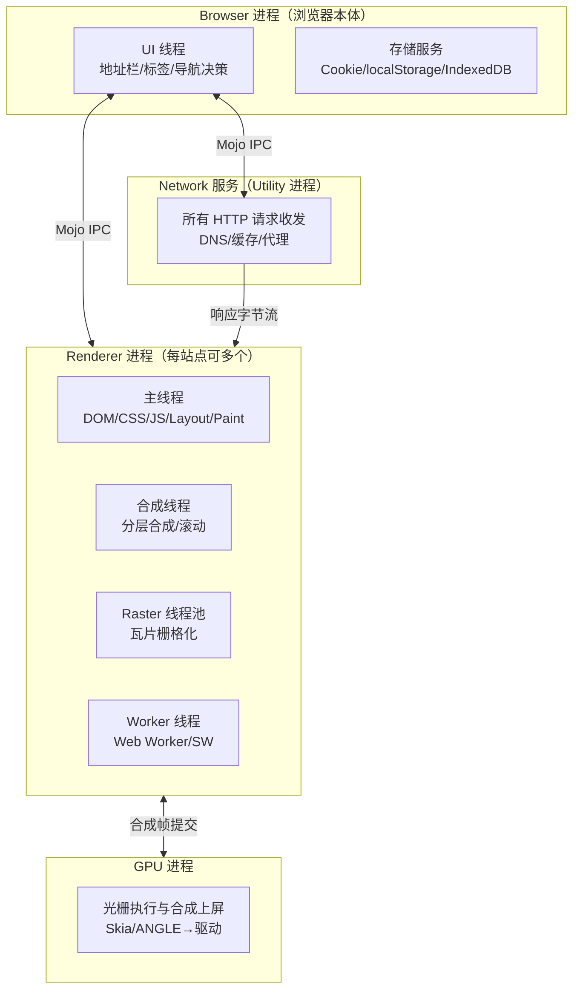
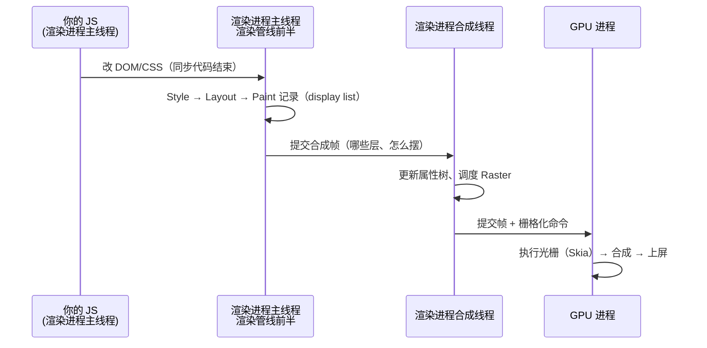

# 浏览器组成：进程、线程与站点隔离

> [← 第一阶段导览](01-导览.md) · 上一册的账本里每一段都标了「归属进程」，本册把这一列展开成完整的架构图。本册是全站的「地图册」：后面讲到任何机制（导航、缓存、解析、合成），都会落到这张图的某个进程/线程上。

## 1. 为什么前端要学浏览器架构

因为**归因**。页面出问题时，你的第一判断是「慢在谁身上」：

| 现象 | 架构视角的第一判断 |
|---|---|
| 主线程卡死 | 渲染进程主线程——你的 JS？还是解析/样式计算？ |
| 一个页面崩溃但其他标签页正常 | 渲染进程被进程边界隔离住了 |
| 关了网络页面还能滚 | 合成线程在干活，不依赖网络也不依赖主线程 |
| `localStorage` 写入把页面卡了 200ms | 数据进了 Browser 进程的存储服务——这是**跨进程 IPC** |
| GPU 加速动画掉帧 | GPU 进程与合成线程的管线堵了 |

不知道架构，这些判断只能靠猜。知道了架构，Performance 面板的每条轨道都有了主人。本册结束时你应该能对着任务管理器，把每个进程说出「它管什么、崩了会怎样」。

## 2. 从单进程到多进程：演化动机

### 2.1 史前时代（2008 前）

主流浏览器是单进程（IE、早期 Firefox）——UI、网络、页面渲染、插件全在一个进程里。后果按严重程度排：

1. **稳定性**：一个页面崩，整个浏览器陪葬；插件（Flash）崩溃率极高，直接拖垮浏览器；
2. **响应性**：一个页面的死循环，卡住所有标签页；
3. **安全**：所有站点的数据在同一地址空间里——一个漏洞就是全家桶。

### 2.2 2008 年 Chrome 的答案

多进程架构（原始论文 *Multi-process Architecture*）：每个站点一个渲染进程，浏览器本体（Browser 进程）与渲染进程隔离。十四年过去，这套架构被所有主流浏览器吸收——Firefox 的 Fission、Safari 的内容进程，殊途同归。

### 2.3 2018 年的补丁：site isolation

Meltdown/Spectre 漏洞证明：**同一进程内的数据可以被另一个「线程」用侧信道读走**。那么只要两个站点同进程，A 站点就有理论上可能读 B 站点的数据（同进程共享内存空间，再严的同源策略也是软件边界）。浏览器的回应：

> 跨站文档绝不放同一进程——「站点隔离」从性能优化项升级为**安全模型基石**。

这是理解现代浏览器「为什么这么多进程」的钥匙：进程是硬件级隔离单元（地址空间独立），软件层面的一切防线上不封顶时，最后的边界就是进程。

### 2.4 进程模型的三个心智测试

不用背架构图，用三个「测试题」校验自己是否真的理解了进程边界：

| 测试 | 问题 | 过关标准 |
|---|---|---|
| **崩溃测试** | 这个东西崩了，死多大范围？ | 能按进程说出崩溃半径（§3.6 表） |
| **慢速测试** | 这个东西慢了，谁在等？ | 能指出阻塞发生在哪个进程的哪个线程 |
| **权限测试** | 这个动作越界了吗？ | 能说出沙箱代理链（渲染进程 → Browser 裁决 → 执行） |

三个测试都过，后面的阶段（导航跨进程、缓存跨进程、合成跨进程）只是这三个模型的重复应用——架构学习的复利从这里开始。

## 3. 五类进程走读



### 3.1 Browser 进程

浏览器的「大管家」，唯一不可缺的进程：

- **UI**：地址栏、标签栏、书签、下载、系统对话框；
- **导航**：第二阶段的决策与路由主角（commit 拍板就在这里）；
- **存储服务**：Cookie、localStorage、IndexedDB 的真身在这里，渲染进程经 IPC 访问；
- **扩展管理、窗口管理**。

对应时间线：①②（输入与导航决策）、⑩（commit 拍板选渲染进程）。

前端视角的坑：**同步访问存储 = 跨进程 IPC**。`localStorage` 的读写是一次 IPC 往返，Browser 进程繁忙时（比如另一个标签页在大量写存储）你的同步读会变慢——「localStorage 很慢」的真实根因常在这里。实验方法见 §9.4。

### 3.2 Network 服务（Utility 进程）

所有 HTTP 请求的唯一出口（渲染进程被沙箱**不允许直接碰网络**）：

- DNS、TCP/TLS、代理协商、HTTP 协议实现、磁盘缓存管理、HSTS/证书状态。

对应时间线：③~⑨ 全部。

设计动机：网络栈复杂且庞大（历史漏洞重灾区），独立进程意味着它被攻破也不等于渲染进程被攻破；同时网络不占用渲染进程资源——页面在解析时，下载照跑（这正是第一册 ⑧⑪ 重叠的架构前提）。

### 3.3 Renderer 进程（渲染进程）

执行网页内容的地方，也是**你最常打交道的进程**：

| 线程 | 管什么 | 与你的代码的关系 |
|---|---|---|
| **主线程** | DOM 树、样式计算、布局、绘制记录、JS（V8）、事件处理 | 你写的同步代码全在这里；它每卡 1ms，一帧预算就少 1ms |
| **合成线程** | 层合成、滚动、transform/opacity 动画的推进、输入的初步接洽 | 不跑你的 JS；主线程死循环时它仍能让页面滚动 |
| **Raster 线程池** | 执行栅格化（调用 Skia，可能再交给 GPU 进程） | 层数多/瓦片多时它忙；层爆炸的代价在这结算 |
| **Worker 线程** | Web Worker、OffscreenCanvas、AudioWorklet | 唯一能让「你的代码」离开主线程的地方 |
| **SW 线程** | Service Worker 生命周期与 fetch 拦截 | 第六阶段主角；拦的是网络请求，优先于 HTTP 缓存判定 |

**一个进程可能服务多个同站页面**（标签页与它的同站弹窗），也可能一个页面独占一个进程——复用规则见第二阶段 04 册。

### 3.4 GPU 进程

浏览器唯一的「画笔」：

- 接收渲染进程提交的合成帧（哪些瓦片、怎么摆放、什么特效），执行真正的光栅化（配合 Skia）与最终合成，把像素交给窗口系统；
- 对应时间线：⑮ 末端、⑯ 的最后一站。

它不是渲染进程的一部分——**所有渲染进程共享一个 GPU 进程**，因为 GPU 上下文昂贵且必须序列化访问。GPU 进程崩溃的表现：全浏览器所有页面白屏一瞬后重绘（浏览器会自动重建）。

### 3.5 Utility 进程族

杂务进程池：网络存储服务、音频服务、（历史）Flash/PPAPI 插件、V8 的 proxy 解析器等。设计原则与 Network 服务一致：**功能模块化 + 崩溃隔离 + 权限最小化**。

### 3.6 一张总对照表

| 进程 | 核心职责 | 对应时间线 | 崩溃症状 | 前端可观测入口 |
|---|---|---|---|---|
| Browser | UI/导航/存储 | ①②⑩ | 全浏览器消失 | 任务管理器、chrome://process-internals |
| Network | HTTP 出入+缓存 | ③~⑨ | 所有请求失败重连 | chrome://net-internals、Network 面板 |
| Renderer | 页面内容执行 | ⑪~⑮ | 该页面崩/恢复 | DevTools、Performance 面板 |
| GPU | 光栅与合成上屏 | ⑮ 末⑯ | 全页面闪白重绘 | Layers 面板、GPU 轨道 |
| Utility | 杂务（存储/音频等） | 分散 | 对应功能失效 | 难直接观测 |

### 3.7 Chromium 源码锚点（查资料时的坐标表）

读 Chromium 源码文档或 issue 时会用到的组件名——本站的每个概念在源码里的锚点：

| 本站概念 | Chromium 组件名 | 所在 |
|---|---|---|
| Browser 进程 | `ChromeBrowserMainParts` / `BrowserProcess` | `chrome/browser/` |
| Network 服务 | `NetworkContext` / `NetworkService` | `services/network/` |
| 渲染进程 | `RenderProcessHostImpl`（Browser 侧）/ `RenderProcessImpl` | `content/` |
| 主线程文档对象 | `RenderFrameHostImpl` / Blink `Document` | `content/` + `third_party/blink/` |
| 合成线程 | `cc::Scheduler`（Chromium Compositor） | `cc/` |
| GPU 进程 | `GpuProcessHost` / `GpuChannelHost` | `gpu/` |
| Mojo IPC | `mojo::`（接口定义 `.mojom`） | `mojo/` |

用法：搜 Chromium 设计文档（`chromium.org/developers/design-documents`）时，用右列的名字当关键词——「navigation」「Mojo」「cc Scheduler」都是独立的设计文档主题。本站不逐个展开，只给坐标。

## 4. 渲染进程内部的协作时序

全站最值得背下来的一张协作图——第八、九阶段全部发生在这几个线程上：

```text
主线程:  [JS 执行] → [Style] → [Layout] → [Paint 记录] ──提交合成帧──▶
合成线程:                                          [合成帧处理/滚动/动画推进]
Raster 线程:                                       [瓦片栅格化（Skia）]
GPU 进程:                                              [执行光栅/合成上屏]
```

- 主线程与合成线程之间靠「合成帧」交换信息，这是「主线程卡死、动画照跑」的机制基础；
- 「一帧的一生」的完整展开在第八阶段 07 册，这里先记住分工边界：**主线程决定画什么，合成线程决定怎么贴，GPU 执行画**。

### 4.1 一帧横跨三个进程（mermaid 全景）

把「一次 JS 修改到像素上屏」的跨进程旅程画全（第八阶段反复回来看）：



三个观察点：

1. **JS 与渲染管线前半同线程**——你的脚本每多 1ms，这一帧的 Style/Layout 就少 1ms 预算；
2. **合成帧提交是主线程的「出口」**——提交之后的事（栅格化/合成/上屏）都不依赖主线程；
3. **GPU 进程是终点站**——它服务所有渲染进程，是全浏览器共享的最后一段流水线。

## 5. 进程间通信：Mojo

进程是孤岛，导航、网络、存储、合成全靠 IPC 桥接。Chrome 的 IPC 框架叫 **Mojo**：各能力以「接口」为单位定义（`.mojom` 文件声明方法与数据结构），两端生成代理实现，像调用本地对象一样发起跨进程调用。

前端工程师不需要写 Mojo，但需要知道三件事：

1. **导航是一串 Mojo 消息**：UI 线程发起 → Browser 进程路由 → Network 服务发请求 → 响应头到达 → Browser 进程挑渲染进程 → commit 消息送达 → 数据流建立。第二阶段 04 册会把这条消息链走全；
2. **存储访问是 IPC**：Cookie/localStorage/IndexedDB 的读写都要跨进程——理解「同步存储 API 为什么慢」「IndexedDB 为什么值得异步用」；
3. **崩溃边界 = 进程边界**：渲染进程崩了只死一个页面；GPU 进程崩了全浏览器闪一下；Network 服务崩了所有请求重连。任务管理器里看到的进程数，就是崩溃半径清单。

## 6. 沙箱：渲染进程被拿走了什么

渲染进程解析的是**不可信输入**（任意网站的任意代码），所以它是全浏览器最被严防的进程。沙箱拿走了：

| 权限 | 被拿走后的表现 |
|---|---|
| **文件系统** | 没有任意文件读写。`<input type="file">` 必须弹系统对话框——渲染进程自己拿不到文件，须经 Browser 进程代理 |
| **网络** | 不能直接开 socket。所有 `fetch`/`XHR` 都是「渲染进程发 IPC 请求 → Network 服务代理执行」 |
| **显示** | 不能直接画屏幕。合成帧只能提交给 GPU 进程，「上屏」这个动作渲染进程无权执行 |
| **设备** | 摄像头/麦克风/USB 等都要经权限仲裁（user gesture + 权限 API） |

沙箱下的工作模式是**代理（broker）**：渲染进程申请能力 → Browser 进程裁决（策略：同源策略、权限 API、用户手势）→ 代理执行 → 结果回传。这就是为什么「浏览器里你的 JS 看似无所不能」，实际上每个出界动作都在过安检——也是「哪些 Web API 天然昂贵」的架构解释。

## 7. 站点隔离：粒度与代价

- **隔离单位是「站点」（site）**：`registered-domain + scheme`（eTLD+1）。`a.example.com` 与 `b.example.com` 同站可同进程；`example.com` 与 `other.com` 跨站必分进程（site/origin 的精确辨析与 frame tree 展开在第二阶段 05 册）；
- **跨站 iframe 独立进程（OOPIF）**：页面内嵌的跨站 iframe 不再寄生在父页面进程里，而是自己的进程；
- **代价**：进程数暴涨。实测参考：开 10 个不同站点标签页，任务管理器里进程轻松破 30（含 Utility/GPU），每进程基线内存几十 MB。site isolation 是用内存买安全的典型交易，Chrome 做过多轮「进程合并策略」在两者间找平衡；
- **什么时候不隔离**：same-site 页面倾向共享进程（复用规则见第二阶段）；低内存设备有降级策略（隔离粒度放宽）。

### 7.5 site isolation 的实测账

把 §7 的「代价」变成可抄的数字（本机实测口径，你的数字会有出入、量级不会）：

| 场景 | Renderer 进程数 | 总内存量级 |
|---|---|---|
| 单标签页（无跨站 iframe） | 1 | ~150–250MB |
| 单标签页 + 2 个跨站 iframe | 3（父 + 2×OOPIF） | +100MB 级 |
| 10 个不同站点的标签页 | ~10（再加 Utility/GPU/Browser） | 1.5GB+ |
| 低内存设备降级 | 数量下降（进程合并策略） | 换来 OOM 风险上升 |

读法：OOPIF 的内存成本按「跨站 iframe 的个数」线性上涨，而不是按页面数——信息流页面嵌十个第三方 iframe 的内存账单，就是 site isolation 的账单。低内存设备上浏览器自动放宽隔离（process consolidation），这也解释了「同一页面在低端安卓机进程数明显更少」的观察：隔离强度是动态的，安全与内存的杠杆两头都要看。

## 8. 三家浏览器架构对比

| | Chrome | Safari（WebKit） | Firefox |
|---|---|---|---|
| 多进程 | Browser + Network + 多 Renderer + GPU | UI 进程 + WebContent 进程（多页可共享/新建，策略不同） | UI + 多 content 进程 + GPU/Utility |
| 站点隔离 | 全面（跨站 iframe 独立进程） | 部分场景启用，粒度与 Chrome 不完全相同 | Fission（2021 起默认），同样按站点分进程 |
| 渲染引擎 | Blink（分叉自 WebKit） | WebKit | Gecko |
| JS 引擎 | V8 | JavaScriptCore | SpiderMonkey |

注意两点：

1. 三家进程**策略**不同但「多进程 + 内容隔离」的方向一致——本站讲机制时以 Chrome/Blink 为准（资料最全、DevTools 可观测性最好），遇到分歧会标注；
2. 引擎不同意味着同样的 CSS 可能有不同的布局耗时分布——性能结论跨引擎要复测。

## 9. 实验：把架构看见

1. **任务管理器**（Shift+Esc）：看进程清单与各进程内存/CPU。多开几个站点的标签页，找出：每标签一个 Renderer？GPU 进程只有一个？Network 服务在哪？记录你数到的进程数与归类。
2. **`chrome://process-internals/`**：看 frame tree——每个 frame 的进程 ID。造一个跨站 iframe（比如嵌一个 YouTube embed），验证它和父页面不在同一进程。
3. **崩溃隔离验证**：DevTools 里 `while(1){}` 卡死一个标签页——其他标签页、地址栏是否仍然流畅？（主线程死循环 ≠ Browser 进程卡死。）
4. **存储 IPC 观察**：一个标签页疯狂写 localStorage（循环几万次），另一个标签页同步读 localStorage——观察读延迟变化，体会「存储在 Browser 进程」。
5. **trace 里的线程对照**：Performance 面板录制时展开左侧轨道列表，认出 Main Thread / Compositor / Raster / Worker 各轨道——本册的线程表在 trace 里的实体。

## 9.5 进程模型 FAQ（高频疑问速答）

| 疑问 | 速答 |
|---|---|
| 「打开任务管理器进程好多，正常吗？」 | 正常——五类进程 × 多 Renderer（含 OOPIF）。10 个站点标签页破 30 是常态 |
| 「为什么两个标签页开同一网站只有两个 Renderer？」 | same-site 复用策略；严格隔离粒度是「站点实例」不是「标签页」 |
| 「浏览器如何决定一个 Renderer 服务几个页面？」 | 同站 + 无内存压力 → 可共享；跨站绝不共享（§7） |
| 「DevTools 里看到 Worker 线程是独立进程吗？」 | 线程，同渲染进程内；SW 的进程归属随实现版本变化 |
| 「进程越多越安全还是越卡？」 | 安全单调上升；内存线性上涨——site isolation 就是这笔交易本身 |

| 「同一标签页刷新后进程会变吗？」 | 跨站导航会换进程（第二阶段 04 册）；同站刷新通常复用——「刷新后内存占用下降」常是新进程重建的堆 |
| 「扩展运行在哪个进程？」 | 扩展宿主是独立进程族，与页面渲染进程隔离——「扩展把页面搞卡」要同时看扩展进程轨道 |
| 「怎么从 trace 里数进程？」 | Performance 面板轨道按进程分组，Process 标签即进程清单——对照任务管理器可交叉验证 |

## 10. 常见误区

1. **「一个标签页一个进程」**：这只是粗略近似。same-site 可复用、跨站 iframe 各自进程、小内存设备会合并。准确说法：按「站点实例」分配，规则在第二阶段 04 册展开。
2. **「GPU 进程渲染我的页面」**：GPU 进程只执行光栅与合成；「画什么」的决策（DOM→指令）在渲染进程主线程。你的 CSS 优化影响的是渲染进程，显存代价结算在 GPU 侧。
3. **「Service Worker 是独立的进程所以很快」**：SW 是独立**线程**（进程归属随实现变化），它拦截请求有 IPC 与调度成本——SW 慢响应会直接拖 TTFB（第六阶段 04 册实测）。
4. **「沙箱只是安全话题与性能无关」**：每次出界动作（网络/存储/文件）都是 IPC 往返——架构决定了「哪些 API 天然贵」。
5. **「多进程是 Chrome 私有设计」**：它是全行业共识（Firefox Fission、WebKit 内容进程），只是隔离粒度与复用策略不同。

## 11. 自测题

1. 列出五类进程与各自职责，并把时间线 17 步逐一分配到进程。
2. 为什么渲染进程不允许直接访问网络？这个设计对「页面解析时下载照跑」有什么贡献？
3. `localStorage` 写入慢，根因可能在哪个进程？怎么用实验验证？
4. 主线程死循环时页面还能滚动吗？哪个线程在管滚动？这个机制叫什么？
5. site isolation 的动机是什么漏洞事件？它改变的是性能模型还是安全模型？
6. `a.example.com` 与 `b.example.com` 的两个页面会共享渲染进程吗？`example.com` 与 `example.org` 呢？判定单位是什么？
7. 为什么 GPU 进程全浏览器只有一个？它崩溃时用户看到什么？
8. 三次崩溃实验：渲染进程崩 / Network 服务崩 / GPU 进程崩，各自的用户可见症状是什么？
9. Mojo 是什么？说出两条「前端行为背后是 Mojo 消息」的具体例子。
10. Safari 与 Chrome 在进程策略上的主要差异是什么？为什么本站性能结论「跨浏览器要复测」？
11. 画出渲染进程五个线程的分工表，并指出「你的 JS 代码」可能运行在哪几个线程上（提示：不止主线程——Worker 和 SW）。
12. （提示题）§4.1 的时序图里，「合成帧提交」之后哪几步不依赖主线程？这就是「合成器动画」的全部秘密。
13. 用 §3.6 的总对照表回答：页面显示「喔唷，崩溃啦」时，哪个进程出了事？其他标签页为什么没事？

## 12. 延伸

- 下一册：[04-度量基础-Network与Performance面板入门](04-度量基础-Network与Performance面板入门.md)——架构图上的每条轨道，在 DevTools 里都有对应可视。
- 第二阶段 04 册将展开「导航如何在这张架构图上流转」；第二阶段 05 册展开 OOPIF；第八阶段 06 册展开合成线程。
- 深入源码级细节（Mojo 接口定义、调度器实现）可读 Chromium 文档 *Multi-process Architecture* 与 *Mojo Documentation*——本站以「可观测行为」为主线，源码细节按需查阅。
