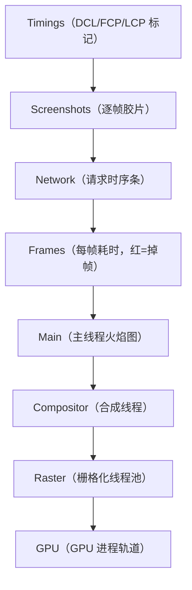

# 度量基础：Network 与 Performance 面板入门

> [← 第一阶段导览](01-导览.md) · 账本有了（02 册）、舞台摸清了（03 册），本册配齐「笔」：DevTools 两个核心面板的最小必要用法。目标是**读**——后面所有阶段的实验都建立在「能从面板里读出正确结论」上。

## 1. 两种数据：lab 与 field

先立规矩：性能数据分两种，混着看必然出错。

| | Lab（受控环境测量） | Field（真实用户测量 RUM） |
|---|---|---|
| 手段 | DevTools 节流、Lighthouse、本机复测 | 真实用户上报（web-vitals + CrUX 等平台） |
| 环境 | 固定设备/CPU/网络 | 不可控（机型/网络/并发千差万别） |
| 回答的问题 | 「这个页面**在我构造的条件下**表现如何、为什么」 | 「**真实用户**感受到了什么」 |
| 适用 | 归因、调试、优化前后对比 | 确定优化优先级、验收线上效果 |

本站前九个阶段的实验全部是 lab 数据；field 数据的采集与平台化归 `observability/` 站，第九阶段讲指标时会再衔接。**记住方向**：lab 找原因，field 定轻重。

## 2. Network 面板

### 2.1 瀑布图：每一列是什么

| 列 | 含义 | 读法要点 |
|---|---|---|
| Name | 资源名 | 悬停可见完整 URL；点击看请求/响应头 |
| Status | 状态码 | 200/304/`(from cache)` 系列是缓存判定证据 |
| Type | MIME 类型 | document/css/script/xhr…——与第六阶段接收流水线呼应 |
| **Initiator** | **谁发起的** | parser（哪一行 HTML）、script、preload——归因第三方请求的第一工具（第十阶段深用） |
| Size | 传输/资源体积 | 两段式显示「传输体积 / 解压后体积」；`disk cache`/`memory cache` 表示零网络命中 |
| Time | 总耗时 | 各段之和；点开 Timing 看分解 |
| Waterfall | 时序条 | 颜色 = 生命周期各段（见下） |

> Size 列是**缓存判定的肉眼证据**：`memory cache`（进程内命中）、`disk cache`（磁盘命中）、`304 Not Modified`（协商）、真实数字（完整下载）。第六阶段 03 册将把这四种状态与缓存判定流程一一对上。

### 2.2 一条请求的生命周期段

点开任意请求 → Timing 标签，看到分段计时。把它们与 17 步时间线对上：

| Timing 段 | 对应时间线 | 内容 |
|---|---|---|
| Queueing | ⑥ 前的排队 | 请求等待发送：优先级低的让路、连接数已达上限（h1 每域 6 条）、磁盘缓存写盘占用 |
| Stalled | ⑥ 前的等待 | 代理协商、**磁盘缓存查找**、（queueing 之外的时间都算这里） |
| DNS Lookup | ③ | 域名解析；命中本地缓存时趋近 0 或不显示 |
| Initial connection | ④ | TCP 握手（≈1 RTT） |
| SSL | ⑤ | TLS 握手（h2 over TLS 1.3 ≈1 RTT） |
| Request sent | ⑥ | 请求报文发出（首个字节到末字节，通常极短） |
| **Waiting for server response (TTFB)** | ⑦ | 从发出到收到**第一个字节**：服务端处理 + 回程第一字节 |
| Content Download | ⑧ | 剩余字节下载完成 |

分段时序一图：


> 注意复用连接的请求：DNS/Connection/SSL 三段直接缺失——这是「连接复用省了什么」的肉眼版（第三阶段展开）。

### 2.3 归因速查表：哪段长找谁

| 异常段 | 最可能的原因 | 验证动作 |
|---|---|---|
| Queueing 长 | h1 六连接满 / 低优先级让路 | 查 Protocol 列是否 h1；看前面是否有同域阻塞请求 |
| Stalled 长 | 磁盘缓存忙 / 代理 | 换隐身窗（无扩展代理）复测 |
| DNS 长 | 冷缓存 / resolver 慢 | 刷新对比（热缓存）；换 DoH 服务对比 |
| Connection 长 | RTT 大 / 服务器握手慢 | 对比不同地域（CDN 节点差异） |
| SSL 长 | TLS 1.2（2-RTT）/ 证书链不完整 | 查协议版本；openssl 验证书链 |
| TTFB 长 | 服务端慢（SSR 计算/回源） | 第五阶段逐段拆；对比静态资源 TTFB |
| Download 长 | 体积大 / 带宽窄 | 对比压缩前后体积；检查是否已压缩 |

### 2.4 必会的四个操作

1. **Disable cache**：勾上后每次请求都走网络（量冷启动必勾）。注意：它只对「DevTools 开着」的这次会话生效——量「真实二次访问」必须不勾；
2. **Throttling**：Fast 4G / Slow 4G / 自定义。本站默认 Fast 4G + CPU 4x（在 Performance 面板设置里），全书统一；
3. **过滤与排序**：按类型（Doc/CSS/JS/Img/XHR）过滤；右键可复制为 cURL（第四阶段实验用）；
4. **列定制**：右键列名可加 Protocol、Priority 列——Priority 就是第六阶段资源优先级表的实测入口。

### 2.5 一条真实请求的完整字段记录（实验记录形态）

点开一条主文档请求，把 Headers/Preview/Timing 三个标签的关键字段抄成记录（`labs/请求记录-日期.md` 的形态）：

```text
# 请求记录 2026-11-14 Fast4G+CPU4x 冷启动
General
  Request URL:    https://example.com/
  Status:         200（或 304 / (disk cache)——缓存判定的第一证据）
Response Headers（挑与链路相关的抄）
  content-encoding: br          ← 压缩方式（第五阶段 05 册对号）
  cache-control: no-store       ← HTML 不缓存（第六阶段 03 册判定）
  strict-transport-security: max-age=63072000（第二阶段 03 册）
  server: cloudflare            ← 边缘证据（第五阶段 02 册）
Request Headers
  cookie: …(1.2KB!)             ← ⑥ 段请求头体积的嫌疑人
Timing（抄进账本 ③~⑧）
  Queueing 2ms / Stalled 1ms
  DNS 168ms / Connect 112ms / SSL 104ms
  TTFB 486ms / Download 88ms
```

这份记录的价值在**对号入座**：每行都已在或将在本站某册被精讲——现在先建立「面板字段 ↔ 链路段落」的条件反射。

### 2.6 Lighthouse 一瞥

Network/Performance 之外最常用的 lab 工具是 Lighthouse（DevTools → Lighthouse 面板）：一键跑出性能分 + 各审计项 + 截图。

| 它是什么 | 它不是什么 |
|---|---|
| 一组自动化审计（加载/可访问性/SEO…） | 不会替你归因——分数只告诉你「哪里有嫌疑」 |
| 单次模拟环境（移动模拟 + 节流） | 数值不稳定，别当 KPI 报 |
| 给出「审计项 ↔ 建议」清单 | 建议落地前要回到本册的瀑布/trace 验证 |

工作流定位：**Lighthouse 发现嫌疑（audit fail）→ Network/Performance 归因（本册）→ 修复 → 复跑对比**。第十阶段 02 册会把 Lighthouse 审计项与本站各阶段逐一对应。

### 2.7 节流模拟的边界

DevTools 节流是「带宽/延迟参数化」，不是真实弱网：没有真实的丢包、抖动、信号切换。lab 结论方向可信、数值保守——最终验收看 field 数据（第九阶段、observability 站）。

## 3. Performance 面板

Network 面板只讲网络段的故事；⑪~⑯ 的计算段全在这里。

### 3.1 录制设置

- **CPU**：4x slowdown（移动端基线）；量本机极限时用 No throttling；
- **Network**：Fast 4G（与 Network 面板节流一致）；
- **勾选 Screenshots**：每一帧的页面截图串成胶片——白屏到底白在哪一刻，胶片比数字直观；
- **勾选 Memory**：JS heap 曲线，诊断内存泄漏用（本站第十阶段才深用）。

### 3.2 轨道地图

| 轨道 | 回答的问题 | 对应架构（03 册） |
|---|---|---|
| Timings | 关键时刻：DCL / FCP / LCP 标记线 | ⑯ 的锚点 |
| Screenshots | 每一刻用户看到什么 | 体感验证 |
| Network | 每个请求的时序条 | ③~⑧ |
| Frames | 每帧的耗时与掉帧标记 | ⑮⑰ 的节拍 |
| **Main** | 主线程火焰图：函数级调用树 | ⑪~⑮ 前半 + ⑬ |
| **Compositor / Raster / GPU** | 合成线程、栅格化、GPU 的活动 | ⑮ 后半 |

### 3.3 Main 火焰图初读

火焰图规则（第八、十阶段会反复用）：

- **横轴 = 时间**：格子越宽越耗时；**纵轴 = 调用栈**：上层是下层调用的；
- **颜色 = 活动类型**：蓝 = 加载（HTML 解析、网络相关入栈）、黄 = 脚本执行（V8）、紫 = 渲染（Recalculate Style / Layout）、绿 = 绘制（Paint）、灰 = 其他；
- **必认的格子**：`Parse HTML`（⑪）、`Evaluate Script`（⑬）、`Recalculate Style`（⑭）、`Layout`（⑮ 布局）、`Paint` / `Rasterize Paint`（⑮ 绘制栅格化）、`Preload Scanner`（⑪ 的并行下载预告）；
- **必认的标记线**：DCL（DOMContentLoaded，⑪⑬ 大体完成）、FCP（第一帧内容上屏）、LCP（最大内容上屏）。

初读工作流（背下来）：

1. 录完先看 **Timings 竖线**：FCP 在时间轴的位置直接告诉你「计算段总共吃了多久」；
2. 找到 FCP 前的 Main 轨道，从左到右扫：蓝段（解析）、黄段（脚本）、紫段（样式布局）各占多宽；
3. 点最宽的格子 → 底部 **Bottom-Up** 标签看「自己耗时」排名；
4. 掉帧问题：Frames 轨道找红色标记帧 → 放大到该帧区间 → 看 Main 里什么卡住了。

### 3.4 用 Console 快速拿到关键数字

不是所有数字都要进面板——Performance API 一行命令就能拿到锚点：

```js
const nav = performance.getEntriesByType('navigation')[0];
const paint = performance.getEntriesByType('paint');

nav.responseStart - nav.startTime;   // TTFB（⑥⑦⑧ 首字节）
paint.find(p => p.name === 'first-contentful-paint').startTime; // FCP
nav.domContentLoadedEventEnd;        // DCL
nav.loadEventEnd;                    // load
```

这些值与面板里的标记线一一对应——面板读图，API 取数，两下印证。第九阶段会把这套 API 扩展到 LCP/CLS/INP。

### 3.5 轨道全景一图 + 速查

录完一份完整加载，轨道从上到下依次是（记住顺序，找数据才快）：



找数据的条件反射：

| 想知道什么 | 去哪条轨道 |
|---|---|
| 加载到几秒用户才看到内容 | Timings（FCP/LCP 位置）|
| 白屏期页面长什么样 | Screenshots 胶片 |
| 某请求何时发/何时回 | Network |
| 掉帧发生在哪一帧 | Frames（红条）|
| 掉的那帧里主线程卡在哪 | Main（放大到该帧区间）|
| 主线程闲但还卡 | Compositor/Raster/GPU |

### 3.6 保存 trace

录制结果菜单可导出 `.json` trace 文件。**每份账本的原始凭证都存进 `labs/`**（文件名 `日期-环境-场景.trace.json`），复测对比、跨会话分析全靠它。trace 文件也能直接拖回 Performance 面板重新打开。

### 3.7 一次完整走查：从 trace 读出账本

把本册所有工具串成一次 5 分钟走查（冷启动、Fast 4G、CPU 4x，某 SSR 站点）——这就是以后每个阶段的「标准开场」：

1. **Timings 线**：FCP = 2.4s、LCP = 3.1s、DCL = 1.9s——先记住三个锚点；
2. **Screenshots**：0~1.2s 全白 → 1.2s 出现导航壳 → 2.4s 正文文字上屏。白屏期 1.2s 是第一个「用户感受」数字；
3. **Network**：主文档 TTFB 620ms → CSS ×3 → JS ×5 → 图片若干；瀑布里可见一条串行依赖：主文档结束 → CSS 才开始；
4. **Main 轨道**：FCP 前的构成 = `Parse HTML` 80ms + `Evaluate Script` 420ms（两个黄块）+ `Recalculate Style` 60ms + `Layout` 40ms——**脚本是计算段的最大嫌疑**；
5. **点开最宽黄块** → Bottom-Up：某第三方 SDK 的 `evaluate` 独占 280ms——归因到具体脚本；
6. **Console 复核**：`nav.responseStart - nav.startTime` ≈ 618ms，与 Network 面板 TTFB 一致——两源印证，数字可信。

结论写进账本的形态（模板）：

```text
账本 v1（2026-11-14 Fast4G+CPU4x 冷启动）
⑥⑦⑧ 网络    : TTFB 618ms（主文档）
⑨~⑪ 接收解析 : Parse HTML 80ms
⑬ 脚本      : 420ms（其中 280ms 为第三方 SDK——优化目标 #1）
⑭⑮ 样式布局  : 100ms
⑯ 首帧      : FCP 2.4s（白屏 1.2s + 网络 + 计算的合计）
下一动作    : 第三方 SDK 延迟加载实验（第十阶段的手法）
```

这份走查是后面九个阶段的工作原型——每学一个新阶段，账本里就多一段可归因的数字，凭证（trace 文件）永远可回溯。

## 4. 指标全景

第一阶段只需认识「指标 ↔ 时间线段落」的映射；计算原理在第九阶段 03 册深潜：

| 指标 | 一句话定义 | 对应时间线 | 阈值（好） |
|---|---|---|---|
| TTFB | 请求发出到首字节 | ⑥⑦⑧ | <800ms |
| FP | 第一个像素（哪怕只是背景） | ⑯ 首次合成 | — |
| FCP | 首次画出真实内容（文本/图片） | ⑯ | <1.8s |
| LCP | 最大内容元素上屏 | ⑯ | <2.5s |
| CLS | 布局位移累计（稳定性） | ⑰ 中意外位移 | <0.1 |
| INP | 交互响应延迟（98 分位） | ⑰ | <200ms |
| TBT | 阻塞主线程的总时长（lab 指标） | ⑬ 的长任务 | <300ms |
| TTI | 可稳定交互（已淡出指标体系） | ⑬⑰ | 历史 |

> 兴衰注记：TTI 已退出 Core Web Vitals（不可稳定测量），TBT 作为其 lab 代理存在。指标体系会演进，**「指标是对 17 步账本某些段落的命名」**这个视角不会——学会归因，指标怎么换都读得懂。

### 4.5 阈值与分位数的两句话交代

表里的阈值（LCP<2.5s 等）来自 Core Web Vitals 的「好」档，而它们在真实用户数据里以 **p75**（75 分位）评估——注意两个易混点：

1. **阈值是给 field 数据用的**：本地 lab 跑出 LCP 2.4s ≠ 达标——要的是「真实用户 p75 < 2.5s」；
2. **p75 的含义**：75% 的用户体验比你测的这个数好——它是「最差的那 25% 用户也不至于太差」的承诺线。

lab 与 field 的阈值桥梁在第九阶段 03 册展开；本阶段只需要把「阈值属于 p75、属于真实用户」这两个定语钉住，避免「本地达标 = 上线达标」的误判。

## 5. 度量纪律

1. **固定环境再对比**：同一台机器、同一组节流、同一缓存状态。变量不固定，前后对比就是编故事；
2. **多次采样**：单次测量受调度抖动影响，正式账本取 3~5 次的稳定值（剔除明显异常样本并记录）；
3. **区分冷热**：冷缓存（首访）与热缓存（复访）是两本账；只报一个数字时说明是哪本；
4. **DevTools 开着本身有开销**：录制/面板渲染会轻微影响数据。正式测量用无痕窗口 + 录制最小时间段；
5. **记录原始凭证**：trace 文件 + 截图入 `labs/`，账本数字必须能回溯到凭证。

## 6. 实践清单

1. 对目标站点录「冷启动 + Fast 4G + CPU 4x」完整加载，按 02 册模板填第一版账本（⑨⑩ 等不可见段记 n/a）；
2. 在 Network 面板找出一个「Size 列显示 cache 命中」的请求，再 Disable cache 复测，对照 Timing 段差异；
3. 点开主文档请求的 Timing 标签，把 DNS/Connect/SSL/TTFB/Download 各段抄进账本——你的第一份实测 ③~⑧；
4. 在 Main 轨道找到并截图：`Parse HTML`、`Evaluate Script`、`Recalculate Style`、`Layout` 四种格子各一处；
5. 跑一遍 §3.4 的 Console 取数命令，与面板标记线互相对照；
6. 导出本次 trace 存入 `labs/`，以后每阶段核账都在这份凭证基础上追加。

## 7. 常见误区

1. **「Disable cache 勾着量复访」**：勾着它你永远量的是冷启动。量什么状态、勾不勾，先想清楚。
2. **拿 Time 列平均值说事**：Time 是各段之和，TTFB 长和 Download 长是两种病——看 Timing 分解，别只看总和。
3. **把 Screenshots 关了**：白屏期多长、白在哪一刻，「胶片」往往比指标数字更有诊断价值。
4. **录制时长随意**：录制窗口切断了加载过程，FCP/LCP 标记丢失。从刷新前开始录，到 LCP 后停。
5. **只看 Main 轨道**：合成线程与 GPU 的活动不在 Main 里——「Main 空闲但还掉帧」的问题要往下翻轨道找。
6. **「console 取的数字与面板不一致是 bug」**：两者采样时机不同（API 在事件发生时刻，面板标记在合成上屏时刻），小差异正常——以面板标记为准做账本。

7. **「节流设置只影响 Network 面板」**：CPU 节流在 Performance 面板设置里，Network 节流在两个面板各自生效——量「完整体验」时两处都要配（本站统一 Fast 4G + CPU 4x 的原因）。

## 8. 自测题

1. Queueing 和 Stalled 的区别是什么？各自最常见的三个成因？
2. 一条请求的 Timing 里完全没有 DNS/Connection/SSL 段——说明什么？「省掉的这些时间」原本各要多久？
3. TTFB 段覆盖了时间线的哪几步？为什么它不能用来单独判定「服务端慢」？
4. Size 列的 `disk cache` 和 `304` 的区别是什么？两者各自的网络开销是多少？
5. Disable cache 影响哪层缓存？（提示：第六阶段会讲它是「HTTP 缓存层」而不是全部——BFCache/SW 它管不了。）
6. 火焰图里找「自己最耗时的函数」用哪个视图？找「整棵调用子树最耗时」呢？
7. DCL、FCP、LCP 三个标记分别对应时间线的哪些步骤完成？
8. 为什么正式采样要在无痕窗口做？DevTools 打开本身干扰哪类测量？
9. 你录到「Main 轨道很闲但 Frames 轨道持续掉帧」，下一该看哪条轨道？这类问题的典型原因是什么？
10. lab 数据和 field 数据的分工是什么？「本地 Fast 4G 下 LCP 2.0s」能得出「用户 LCP 达标」的结论吗？
11. 写出用 Performance API 取 TTFB 与 FCP 的两行代码，并说出它们分别对应账本哪几段。
12. （提示题）Lighthouse 报「LCP 候选是图片且未 preload」——按本册的工作流，下一步该去哪个面板验证什么？
13. §2.5 的请求记录里，cookie 1.2KB 影响账本哪一段？DNS 168ms 说明什么状态？（提示：第一册 ⑥ 段与 DNS 冷/热缓存。）

## 9. 延伸

- 下一册起进入第二阶段：[发起请求之前](../02-第二阶段/01-导览.md)——本册的所有度量手段即将第一次用于「请求发出前」的决策观测。
- 本册是「会用」；第十阶段 02 册是「精通」（全轨道解剖、call tree/bottom-up 深用、Lighthouse 对照）。
- Field 数据体系（RUM 采集、CrUX、指标平台）归 `observability/` 站，第九阶段会做接口衔接。
