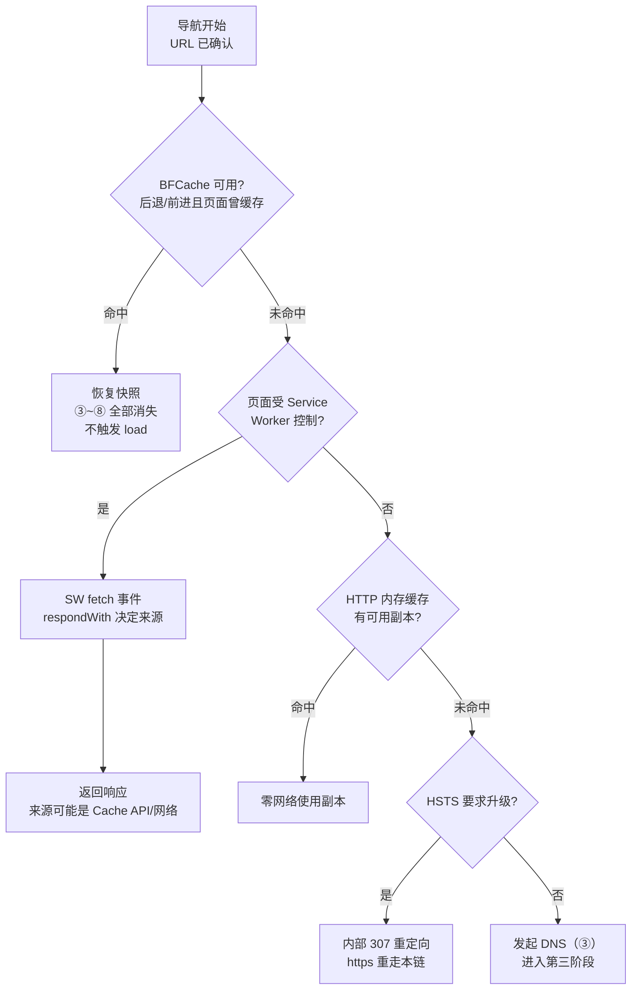

# 导航决策链：HSTS、Service Worker、缓存与 BFCache

> [← 第二阶段导览](01-导览.md) · 时间线 ②。URL 确认是导航后、第一个 DNS 包飞出前，浏览器按固定顺序查四条「不发网络请求」的捷径。这一册是「为什么有的加载几乎零请求」的完整答案。

## 1. 决策全景：命中即停



注意两件事：

1. 这四条捷径**有优先级**，命中任何一条，后面的都不再查；
2. 它们各自缓存的东西不同——

| 捷径 | 缓存的是什么 | 粒度 | 失效条件 |
|---|---|---|---|
| BFCache | 整个活页面（DOM+JS 堆+渲染树） | 一次会话内的导航历史 | 拦路虎任一命中 |
| Service Worker | 响应的「控制权」 | 注册 scope 内 | 卸载/未注册 |
| HTTP 内存缓存 | 字节副本 | URL+验证器 | 进程退出 |
| HSTS | 无（只改写协议） | 域名级 | max-age 过期 |

逐条展开。

## 2. BFCache：后退/前进缓存

**定义**：把「离开时」的完整活页面（DOM 状态 + JS 堆 + 渲染树）冻结进内存，后退时**原样复活**。它是唯一能让整本 17 步账本消失的机制——复活后的页面不解析、不执行主脚本、不发任何请求。

### 2.1 复活语义

- 不触发 `load`（它只在真正加载时触发一次），触发 `pageshow`，其中 `event.persisted === true` 标记「我是 BFCache 复活的」；
- 离开时触发 `pagehide`（`persisted === true` 同样成立）——正确写暂停/恢复逻辑的位置；
- 所有计时器冻结、媒体暂停、JS 上下文整体挂起。

```js
window.addEventListener('pageshow', (event) => {
  if (event.persisted) {
    // BFCache 复活：时间戳类数据已过期、轮询要重启、IM 连接要重验
    refreshStaleData();
  }
});
```

「复活后数据是旧的」是 BFCache 事故的核心形态，三类典型：

| 事故形态 | 症状 | 修复位置 |
|---|---|---|
| 列表页后退回来 | 页面还是离开时的快照，顶部余额/状态徽标停在过去 | `pageshow` 里重拉数据或打脏标记 |
| 轮询/定时器 | 复活后 interval 的节奏错乱、与服务器时间漂移 | `pageshow` 重启、`pagehide` 暂停 |
| IM/WebSocket | 冻结期间的消息丢失感知 | 复活后重连 + 服务端补发 |

产品视角这不是 bug（后退就该快），工程视角**必须**在 `pageshow` 里补数据新鲜度逻辑。

### 2.2 拦路虎全表

任何一条不满足，BFCache 直接放弃缓存该页面。重点条目：

| 拦路虎 | 为什么挡 | 备注 |
|---|---|---|
| `unload` / `beforeunload` 处理器 | 处理器可能关连接/清状态/发埋点，复活后页面与真实状态矛盾 | **历史第一大杀手**；Chrome 已用 `pagehide` 取代语义，但大量旧埋点 SDK 仍带 `unload` |
| `Cache-Control: no-store` | 字面语义「禁止存储副本」，BFCache 尊重它 | Chrome 近年在限定条件下做放宽实验——**以本机实测为准，别背结论** |
| 打开的 WebSocket / WebTransport | 连接另一端会持续推数据，冻结期间的消息无法补送 | 复活后连接状态不可信 |
| 打开的 WebRTC 通道 / RTCDataChannel | 同上，实时会话无法冻结 | |
| `window.opener` 引用（跨文档场景） | opener 与被开页面互相可达，复活语义复杂 | 部分场景可绕过 |
| 页面在 iframe 中的跨站导航历史等结构性状态 | frame tree 冻结约束 | |
| （旧版）未关闭的 IndexedDB 连接/事务 | 事务挂起会锁库 | 新版已放宽 |

**不要背这张表**——它随版本演进。正确姿势：DevTools → Application 面板 → **Back/forward cache** 栏 → 点「Run Test」：浏览器直接告诉你当前页面能不能进 BFCache、不能的原因是哪一条。这张面板就是本册的答案之书（见实验 2）。

### 2.3 各家支持与历史坐标

BFCache 不是 Chrome 一家的事，但各家的实现深度不同（影响「跨浏览器测试后退」的预期）：

| 浏览器 | 支持情况 | 关键差异 |
|---|---|---|
| Chrome/Safari | 深度支持（主战场） | Safari 更早实现，对内存里缓存的页面数策略更激进 |
| Firefox | 支持 | 拦路虎清单略不同（以自家文档为准） |
| 无痕/隐身窗口 | 通常禁用 | 隐私考量——隐身窗里测后退总是全量加载 |

历史坐标一句话：BFCache 是「老机制、新重视」——十年前就有，但 2019 年前后 Chrome 大力治理拦路虎（尤其是推动业界告别 `unload`）之后才真正大规模可用。**「我这页面怎么以前后退快、现在变慢了」的答案常常是一次埋点 SDK 升级带回了 `unload`。**

### 2.4 与 SW 的交互

页面受 SW 控制通常**不妨碍** BFCache（SW 生命独立于页面），但 SW 自身更新时可能影响——结论同样以面板实测为准。真正要在代码层做的三件事：

1. 去 `unload`（改 `pagehide`）——含检查第三方埋点 SDK 版本；
2. `pageshow` 补新鲜度；
3. 用官方面板跑一次目标站点，把发现记进 `labs/`。

### 2.5 BFCache 的容量与逐出

BFCache 不是无限的：每个浏览器会话有内存预算，装满后按策略逐出（大致是「最早离开的先丢」）。工程含义：

| 现象 | 原因 |
|---|---|
| 「后退到三页之前变慢了」 | 中途页把预算挤掉了——逐出后全量加载 |
| 后退有时快有时慢 | 快 = 命中缓存，慢 = 逐出后重载——两种形态都是「正常」，不是玄学 |
| 低内存设备后退普遍慢 | 预算小、逐出激进（site isolation 的内存账 × BFCache 预算叠加，一阶段 03 册 §7.5） |

测试时注意：连访多个页面再依次后退，能观察到「近处秒回、远处全量」的分层形态——这是容量策略的直接证据，也是「后退性能要按『隔几步』分别测」的原因。

## 3. HSTS：发出去之前被改写

**机制**：站点在 HTTPS 响应里发 `Strict-Transport-Security: max-age=31536000; includeSubDomains; preload`，浏览器把「该域（及子域）强制 HTTPS」写入本地列表。列表有效期内：

1. 用户输入 `http://example.com`（或页面里有 http 链接）；
2. 浏览器查本地 HSTS 列表命中 → **不发 http 请求**，直接内部改写为 https；
3. Network 面板里出现一条 **`307 Internal Redirect`** 的虚拟条目——它是浏览器伪造的，网络上不存在这次往返。

三个常被问错的点：

- **「307 会不会占用一个 RTT？」**——不会，纯本地。但它**出现在瀑布图里**，初学者常把它误判成服务器行为；
- **`preload` 标志本身不做什么**，它是申请进入 **HSTS preload 列表**（hstspreload.org，随浏览器分发的全局列表）的声明——列表里的域名对新用户**首次访问**就强制 HTTPS。本地 HSTS 只在「见过一次 HTTPS」之后生效，**首次访问是缺口**，preload 列表补的就是这个缺口；
- **max-age 过期后再访问 http** 才真的会出网——「改了 HSTS 怎么还有 http 请求」的排查第一步是查各端缓存里的列表状态。

指令速记表：

| 指令 | 作用 |
|---|---|
| `max-age=N` | 列表有效期（秒）；0 = 从列表移除 |
| `includeSubDomains` | 覆盖全部子域（子域里有纯 http 服务的要小心，这是滚动启用 HSTS 的经典事故） |
| `preload` | 声明可进全局列表 |

### 3.5 HSTS 的隐私边界：超级 cookie 问题

HSTS 列表是「按域名存储、跨会话持久」的本地状态——这使它理论上可被滥用为**跨站追踪的存储介质**（超级 cookie）：站点让浏览器对一串自家子域做 HSTS 查询/记录，用「哪些子域在列表里」编码一个用户标识，别的站点再诱导浏览器查同样的子域、比对命中与否。

浏览器的对策（现代默认）：

1. **HSTS 查询分区化**：查询结果与「发起查询的站点」绑定（Network State Partitioning），不同站点查同名子域互不可见；
2. **分区键**：与 Cookie 的 CHIPS（第四阶段 05 册）同一思想——「状态跟站点走，不跟用户走」。

链路学习的收获：**本册的每一条「本地状态」（HSTS 列表、DNS 缓存、连接池）都有隐私维度**——它们既是性能资产（快），也是潜在的追踪面（被分区化治理）。性能与隐私在这条决策链上短兵相接。

## 4. Service Worker 拦截

**命中条件**：页面 URL 落在某 SW 的 scope 内（`/app/sw.js` 注册的 scope 默认是 `/app/`），且**该客户端已被 SW 控制过**（至少经历过一次安装激活；首次访问不受控，这次导航直接走网络——所以「SW 加速首访」是不成立的，它加速的是第二次起）。

受控导航的时序：导航请求先到 SW 线程触发 `fetch` 事件 → SW 的 `respondWith(promise)` 决定响应来源：

```js
self.addEventListener('fetch', (event) => {
  if (event.request.mode === 'navigate') {
    event.respondWith(
      caches.match(event.request).then((hit) =>
        hit ?? fetch(event.request)   // cache-first for navigation
      )
    );
  }
});
```

三种来源的链路差异：

| respondWith 返回 | 网络行为 | 额外成本 |
|---|---|---|
| Cache API 命中 | **完全不出网**（连 HTTP 缓存都不碰） | SW 线程调度 + IPC |
| `fetch(event.request)` | 正常走 ③~⑧ | 同上 + SW 响应慢会拖 TTFB |
| promise 失败 | 浏览器回退网络或错误页 | — |

`navigationPreload` 是给「SW 想回网络」场景的优化：让网络请求与 SW 唤醒**并行**发起，省掉「先唤醒 SW、SW 再发起网络」的串行。SW 生命周期的完整展开在第六阶段 04 册。

### 3.6 HSTS 滚动部署清单（工程案例形态）

给一个存量站点启用 HSTS 的安全路径（直接 max-age 一年 + includeSubDomains 是经典事故源）：

| 阶段 | 头值 | 目的 |
|---|---|---|
| ① 试探 | `max-age=300`（无 includeSubDomains） | 观察 5 分钟内有没有报错 |
| ② 域级确认 | `max-age=2592000`（30 天） | 常规用户全部走 https |
| ③ 子域排查 | 确认所有子域都 https 可用 | 补齐 http 子域（老服务/内网面板） |
| ④ 加子域 | `max-age=2592000; includeSubDomains` | 覆盖面扩大 |
| ⑤ 长期值 | `max-age=31536000` + 申请 preload | 定格 |

每一步的回滚方式都是把 max-age=0 发一阵子——但注意：**只有还没进 preload 列表的域名才能这样回滚**，preload 列表的移除要以浏览器版本为单位等几个月。这条时间差就是「HSTS 决策要慢」的原因。

## 5. HTTP 内存缓存查找

无 SW（或 SW 选择回网络）时，导航响应也会查 HTTP 缓存的两级：

| 层 | 位置 | Network 面板显示 | 生命周期 |
|---|---|---|---|
| 内存缓存 | 进程内热副本 | `memory cache` | 绑定进程与会话 |
| 磁盘缓存 | 持久目录 | `disk cache` | 跨会话 |

判定逻辑（新鲜度/验证器）是第六阶段 03 册的主题，本册只需要知道**导航请求也会查它**——`Cache-Control: no-store` 的页面二次导航会重新出网，就是这层在起作用（顺带这也解释了为什么 no-store 同时是 BFCache 拦路虎：两层都遵从它）。

## 6. beforeunload 与用户确认

若页面注册了 `beforeunload` 且用户有未保存交互，离开前弹「确定离开？」——这是决策链里唯一「人参与的环节」：

1. 它在时间线 ② 里属于**旧页面的卸载前置**：用户点「离开」之前，新导航完全没开始；
2. 点「离开」之后才回到 §1 的决策流从头跑；
3. 这也是 beforeunload 与 BFCache 冲突的根源——它把「离开」变成了可能被打断的交互，冻结语义无法表达这种打断。

### 6.5 prerender：决策链的「预支」形态

现代浏览器的 **Speculation Rules**（第六阶段 05 册完整展开）允许页面声明「用户很可能点这个链接，提前把导航做完」：

```html
<script type="speculationrules">
{"prerender": [{"urls": ["/likely-next-page"], "eagerness": "moderate"}]}
</script>
```

预渲染页的导航**完整走过本册的决策链与网络段**（③~⑧ 全跑），渲染到几乎可上屏——用户点击的瞬间只是「激活」。三个与决策链的衔接点：

| 衔接点 | 说明 |
|---|---|
| 捷径照常生效 | 预渲染发起时也查 SW/缓存——捷径思路同样适用 |
| 时机受限 | 含副作用的页面（登录态变化）不能随便预渲染——「提前 commit」必须无副作用才安全 |
| 指标特殊 | 激活才算用户开始（Navigation Timing 的 `activationStart`，第二阶段 04 册提过） |

记忆锚点：**决策链的终点是「发请求」，而 prerender 把终点挪到了「用户还没点」**——这条链的性能极限就是把 17 步全部预支。

## 7. 决策的产物

全部决策做完，网络栈拿到一份「导航请求工单」：

| 工单字段 | 来源决策 | 影响 |
|---|---|---|
| 最终 URL | HSTS 改写 | 协议可能已升级 |
| 缓存模式 | 导航默认 `default`；强制刷新 `reload`；硬绕 `no-store` | 第三阶段及缓存判定 |
| 目标进程提示 | site isolation / 复用规则 | 第二阶段 04 册 |
| 请求优先级与凭据模式 | 资源类型 | 第四、六阶段 |

之后才进入 ③（DNS）。**回头看这条链的价值**：四条捷径各覆盖一类场景——BFCache 管来回、SW 管策略、HTTP 缓存管副本、HSTS 管协议。性能优化的第一梯队不在网络层，而在「让请求根本不发生」。

## 8. 实验

1. **BFCache 往返对比**：写页面 A（正常）与 A'（带 `Cache-Control: no-store` 响应头，或加 `window.addEventListener('unload', ()=>{})`），都加访问计数与 `pageshow` 日志。前进 → 后退，对比：A 零请求复活、A' 重新完整加载。Network 面板截图进 `labs/`。
2. **官方判定面板**：对目标站点跑 Application → Back/forward cache 测试，把「不能缓存的原因」抄进笔记——你大概率会发现是某个第三方埋点 SDK 的 `unload`。
3. **HSTS 观察**：访问一个 preload 列表里的域名（如 `http://mozilla.org`），Network 面板找 `307 Internal Redirect` 虚拟条目，点开看响应头里的 HSTS 信息；再对比一个无 HSTS 的 http 站点。
4. **SW 控制实验**：注册一个最简 SW（导航 cache-first），二次访问该页面，Network 面板 Size 列观察「（ServiceWorker）」标记——响应来自 Cache API 还是网络一目了然。
5. **beforeunload 确认**：加 beforeunload 弹确认，观察「取消」与「确定」两种选择下 Network 面板的差异（取消 = 零请求；确定 = 决策链从头跑）。
6. **`includeSubDomains` 事故推演**：假设 example.com 启用了 `includeSubDomains`，而 `blog.example.com` 是一个纯 http 老服务——列出会发生什么、该怎么滚动迁移。

### 8.5 决策链的四个高频疑问

**Q：为什么「清了缓存再刷新」还是零请求秒开？**
BFCache 或 SW 层在兜——它们不受「清除浏览数据」里那个「缓存的图片和文件」选项影响的程度随浏览器版本而异。验证归因：隐身窗（BFCache 常禁用）+ 无 SW 环境 + Disable cache 三件套全开，还能秒开才见鬼——通常这时候就看到请求了。

**Q：HSTS 列表里已经有域名，为什么某些请求还走了 http？**
三个缺口逐一查：子域不在 includeSubDomains 覆盖内（§3 指令表）；页面代码里写死的 http 资源被「升级不安全请求」策略处理了（那是另一个机制，不是 HSTS）；或该请求来自未见过 HSTS 头的新环境（首次访问缺口）。

**Q：SW 控制导航后，HTTP 缓存还有用吗？**
有——两层叠加。SW 的 `fetch(event.request)` 交给网络栈时，网络栈照常走 HTTP 缓存判定；SW 的 Cache API 命中则完全不碰 HTTP 缓存（§4 表）。所以「SW 层没拦住」≠「没有缓存」，反之亦然——两层各拦各的。

**Q：决策链顺序能跳过吗？比如已知有 SW 还查 BFCache 吗？**
顺序固定（§1 流程图），但短路照常：BFCache 命中时后面的全不查。决策链的性能纪律是「先查便宜的」——BFCache 是内存快照（最便宜），SW 唤醒有 IPC 成本，HSTS 是本地列表查询——顺序按成本排列，这也是所有「拦截器链」设计的通用范式。

## 9. 常见误区

1. **「后退一定快」**：被拦路虎挡掉的页面后退 = 完整重新加载。用户感知的「这网站后退慢」往往就是埋点 SDK 的 `unload`。
2. **「307 Internal Redirect 是服务器发的」**：浏览器本地伪造，网络抓包里不存在这个包。
3. **「装了 SW 首次访问就快」**：SW 控制从第二次访问开始；首次导航不受控。
4. **「SW 缓存和 HTTP 缓存是一回事」**：两层独立体系，判定逻辑、生命周期、观测方式（Cache API vs Size 列）都不同；SW 里 fetch 还能再命中 HTTP 缓存（叠加）。
5. **「BFCache 复活页面不需要处理」**：数据新鲜度逻辑必须在 `pageshow` 里补，否则用户看到的是过去。
6. **「HSTS 头发了就立即全网生效」**：本地列表逐端逐浏览器生效；preload 列表随浏览器版本分发——安全整改要按「最长生效时间」排期。

7. **「决策链是理论概念没有观测价值」**：四条捷径各有明确的 DevTools/抓包形态（§8 实验）——「为什么这个页面零请求」的每一次回答都来自这条链的某一条短路。
8. **「HSTS 头忘了发，下次会自动补上」**：HSTS 是严格的 opt-in——没收到头就永远不进列表；「记得配了」要靠 curl 实证（§8 实验 3），不是记忆。

**Q：怎么把四条捷径的收益写成可汇报的数字？**
分别测三次主文档导航：正常复访（BFCache 命中，~0ms）、禁 BFCache 复访（SW/HTTP 缓存层）、强制冷启动（Disable cache + 隐身窗）——三条曲线的差就是各层的钱。汇报口径：BFCache 省的是「整页重建」，SW/缓存省的是「网络全额」，两者相加常占复访加载的 90% 以上。

## 10. 自测题

1. 写出导航决策链四条捷径的优先级顺序，以及各自「缓存的是什么」。
2. BFCache 复活触发哪个事件？`load` 为什么不触发？数据新鲜度逻辑写在哪？
3. 列出至少五个 BFCache 拦路虎，并解释其中「unload 处理器」被禁的深层原因。
4. `Strict-Transport-Security` 头的三个指令各做什么？本地列表与 preload 列表的生效时机差异是什么？
5. 为什么说「本地 HSTS 有首次访问缺口」？preload 列表补的是什么？
6. 一个页面 URL 是 `/app/list`，SW 文件在 `/sw.js`（scope `/`）与在 `/app/sw.js`（scope `/app/`）两种注册下分别受控吗？
7. SW respondWith 返回 Cache API 命中时，这次导航经过 HTTP 缓存吗？由此说明两层缓存的关系。
8. `navigationPreload` 优化的是哪个串行段？不开它时 SW 唤醒与网络请求的时序是什么样？
9. beforeunload 确认框出现在决策链的哪个位置？用户点「取消」后时间线上发生了什么？
10. 把本册放回账本：四条捷径分别消灭了 17 步里的哪几段？哪一条能「整本账本消失」？
11. 「`includeSubDomains` 上线后某子域 http 服务全挂」——按 §3 的指令表推演事故链与修复顺序。
12. （提示题）HSTS 为什么能被当「超级 cookie」用？浏览器的分区化对策把哪个维度改掉了？——「状态跟站点走，不跟用户走」。
13. prerender 页面对用户点击的响应为什么几乎是零延迟？它预支了 17 步里的哪几段？（提示：③~⑮ 全部。）

**Q：这册的内容与「弱网优化」是什么关系？**
最强关系：弱网下 ③~⑧ 每一步都贵，而四条捷径让这些步骤**根本不发生**——BFCache 省 100% 网络段、SW/缓存省 100% 或 304、HSTS 省一次重定向。弱网优化的第一梯队不在「让请求更快」，在「让请求消失」——本册就是这句口号的实现清单。

## 11. 延伸

- 下一册：[04-导航执行-跨进程流转与commit](04-导航执行-跨进程流转与commit.md)——决策做完、决定真发请求，导航在进程架构图上跑起来。
- SW 生命周期与缓存策略选型的完整展开在第六阶段 04 册；HTTP 缓存判定全表在第六阶段 03 册。
- HSTS/CSP 等安全头的攻防视角归 `security/` 站，本站只讲它们在链路上的位置。
