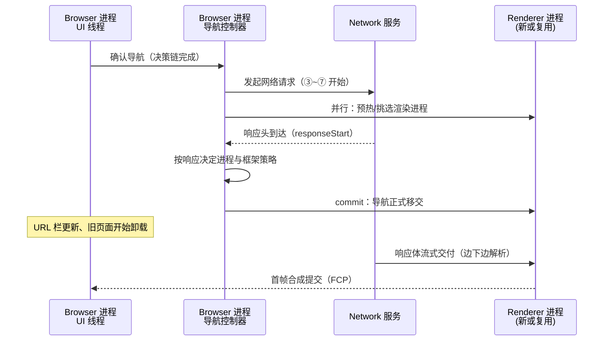

# 导航执行：跨进程流转与 commit

> [← 第二阶段导览](01-导览.md) · 时间线 ②→⑩ 的交界。上一册决策完「要不要发请求」，这一册跟单：一次导航如何穿过第一阶段的进程架构图（Browser → Network → Renderer），以及全链路最关键的节点——**commit**。

## 1. 全程时序



关键点先立住：**网络请求与渲染进程准备是并行的**。从发起请求到响应头到达这段时间（可能是几百毫秒的 TTFB），浏览器没闲着——渲染进程的挑选/预热、旧页面卸载的前置工作都在同步推进。这是 Chrome 交互细节里不显眼但重要的一笔：commit 时刻的「换页」才能做到无缝。

## 2. 逐段走读

### 2.1 UI 线程 → 导航控制器

地址栏确认导航（或链接点击、JS `location` 赋值、表单提交）后，Browser 进程的导航控制器接手：跑完上一册的决策链，产出请求工单。注意这个分工——**UI 线程不碰网络**，它是纯决策者。

### 2.2 Network 服务出网

工单交给 Network 服务，DNS/TCP/TLS/HTTP 开始跑（第三、四、五阶段的主角）。这一步对 Browser 进程是异步的：导航控制器进入「等待响应头」状态，期间用户看到旧页面（或白屏，取决于旧页面是否还在与是否首次导航）。

### 2.3 渲染进程的挑选与预热

Browser 进程现在就要决定「等响应来了，交给谁渲染」：

| 场景 | 进程选择 | 原因 |
|---|---|---|
| 跨站导航 | 新渲染进程 | site isolation 硬约束 |
| same-site 导航 | 复用现有渲染进程 | 省一次进程冷启动 |
| 内存压力 | 可能合并/降级隔离 | 软优化让位于资源 |

**进程预热（speculative renderer）**：Chrome 会在等待网络响应期间**提前启动一个空的渲染进程**，把进程创建、V8 初始化这类固定成本从 commit 之后挪到 commit 之前——TTFB 的等待时间被用来热身。这也是「进程创建成本基本隐藏」的原因：你几乎从不在 trace 里看到进程启动占了多少首屏时间。

选择渲染进程的完整复用规则（同站标签共享、进程合并、内存压力降级）是实现细节，方向记住一条：**site isolation 是硬约束，复用是软优化**——硬约束不可破，软优化在内存压力下可牺牲。

### 2.4 响应头到达：commit 时刻

Network 服务收到**响应头**（不是响应体！），回报导航控制器。此刻 Browser 进程拍板：

1. **commit**：导航正式移交给选定的渲染进程，URL 栏更新为新地址、旧页面开始卸载（`pagehide` → `unload`）；
2. 之后 Network 服务把响应体**流式**交给渲染进程——HTML 字节一到，第七阶段的解析立即开工。

**为什么 commit 在响应头而不是响应体**——响应头已经包含了做决策的全部信息：

| 决策 | 依据的头 |
|---|---|
| 是渲染还是下载 | `Content-Type`（非 HTML → 下载流程） |
| 是否重定向回炉 | 状态码 3xx + `Location` |
| 该渲染进程能否承接 | CSP / COEP / Cross-Origin-Embedder-Policy 等安全策略承诺 |
| 用什么编码解码 | `Content-Type: charset`（第七阶段 02 册） |

body 只剩「搬运」，没有决策价值。

**commit 前后用户看到什么**（把 TTFB 的体感定位清楚）：

| 时段 | 用户看到 | 地址栏 |
|---|---|---|
| 点击链接 → 响应头到达 | 旧页面还活着（或首次导航的白屏） | 未变（或 spinner） |
| commit | 旧页面卸载 | 变为新 URL |
| commit → 首帧 | 新页面白屏（解析+渲染中） | 新 URL |

TTFB 3 秒的页面，那 3 秒用户盯着**旧页面**——这就是「服务器慢，用户却怪前端白屏」错觉的来源：白屏其实发生在 commit **之后**，而它长短取决于 TTFB 与渲染速度的接力。

### 2.5 重定向的回炉

若响应头是 3xx，commit 不会发生——导航控制器按 Location 发起新一轮导航（重新走决策链与网络）。多跳重定向 = 多个「请求→响应头」往返，每跳都 commit 失败重来。第五阶段 06 册会算这笔账。

### 2.6 失败也是一次 commit

DNS 失败、连接被拒、SSL 错误——这些「没有响应头」的失败也走完导航生命周期：Browser 进程把错误码交给渲染进程，渲染一张错误页（chrome-error:// 页面同样消耗渲染进程）。Network 面板里 `(failed)` 状态的请求与「错误页也是页面」是同一件事的两面。

### 2.7 失败模式全家福

导航失败时的分层速查表（每层对应后续某个阶段的精修册）：

| 层 | 典型错误 | 浏览器呈现 | 精修册 |
|---|---|---|---|
| DNS | NXDOMAIN / 超时 | DNS_PROBE_FINISHED_NXDOMAIN 等 | 三阶段 02 |
| TCP | 拒绝连接 / 超时 / RST | ERR_CONNECTION_REFUSED / ERR_CONNECTION_RESET | 三阶段 03 |
| TLS | 证书过期/不匹配/链断裂 | ERR_CERT_DATE_INVALID / ERR_CERT_COMMON_NAME_INVALID 等 | 三阶段 04 |
| HTTP | 4xx/5xx | 页面渲染服务器错误体（5xx 也算「成功 commit」） | 四、五阶段 |
| 协议层 | h2 流被重置 | ERR_HTTP2_PROTOCOL_ERROR | 四阶段 03 |

两个值得记的细节：

1. **5xx 不算导航失败**——服务器回了响应头，commit 正常发生，浏览器渲染的是服务器给的错误页内容。「页面显示 500」和「页面打不开」在时间线上是完全不同的两件事；
2. **证书错误有「继续访问」旁路**（跳过警告），但 HSTS 域名**不允许**跳过——安全模型里 HSTS 是「没有用户旁路」的硬约束。

## 3. 用 Navigation Timing 验证

`performance.getEntriesByType('navigation')[0]` 把本册时间戳全给你（单位毫秒，从导航开始起算）：

| 字段 | 对应本册哪一步 |
|---|---|
| `startTime` | 导航开始（决策链完成） |
| `redirectStart/End`、`redirectCount` | §2.5 的回炉（0 = 无重定向） |
| `domainLookupStart/End` | ③ DNS |
| `connectStart/End`、`secureConnectionStart` | ④⑤ |
| `requestStart` | ⑥ 请求发出 |
| `responseStart` | **响应头到达 ≈ commit 时刻** |
| `responseEnd` | 响应体交付完 |
| `domContentLoadedEventStart/End` | ⑪⑬ 大体完成 |
| `loadEventStart/End` | 全部资源就绪 |

Console 里直接算（第一阶段 04 册 §3.4 的扩展）：

```js
const nav = performance.getEntriesByType('navigation')[0];
nav.responseStart - nav.startTime;   // 本次导航的 TTFB
nav.responseEnd - nav.responseStart; // 体下载时长
// 两段比值直接告诉你「这个页面慢在网络还是在传输」
```

另一个细节：BFCache 复活的导航 **没有 Navigation Timing 条目**（它不经过本册的任何流程）——用「timing 为 null」可以程序化识别 BFCache 复活，与 `pageshow.persisted` 互为印证。

几个字段的使用细节：

| 字段 | 易错点 |
|---|---|
| `type` | `navigate`（常规）/ `reload` / `back_forward`（含 BFCache 前的老式往返）/ `prerender`（预渲染页被激活）——「reload 也会重跑整条时间线」从这里可见 |
| `redirectCount` | 同源重定向才计数（跨源重定向出于隐私不计）——「数不到的重定向」在这里 |
| `activationStart`（预渲染） | prerender 页面被激活的时刻——预渲染页面（Speculation Rules，第六阶段 05 册）的时间线从激活才对用户开始，指标计算要用它裁剪 |
| `domInteractive` | 解析完成、可交互的点（⑪ 大体结束）——比 DCL 更早的锚点 |

### 3.5 commit 时刻的 DevTools 观测点

「commit 发生在何时」可以在 DevTools 里看到三个证据：

| 观测点 | 现象 | 说明 |
|---|---|---|
| Network 面板主文档 Timing | `responseStart` 附近 | 响应头到达 ≈ commit 前后（§3 表） |
| Performance 录制的 Screenshots | 旧页面→白屏的切换帧 | 白屏第一帧 ≈ commit（§2.4 的时段表） |
| `chrome://process-internals/` | frame 的 host 切到新进程 | 跨站导航时进程 ID 在此刻变更 |

三个证据的时序应能对上（±渲染节拍的误差）；对不上时的排查顺序：先怀疑重定向（多跳的 responseStart 是最后一跳的），再怀疑 BFCache（根本没有时间线）。这个「三源互证」的口径在第十阶段的完整案例分析里会再用到。

## 4. 同文档导航：不走这条链

锚点跳转（`#section`）、`history.pushState`、`popstate`——这些**同文档导航**不产生网络请求、不 commit、不换渲染进程，只有 URL 与历史记录变化。区分两类导航的实用判据：

| | 跨文档导航（本册主角） | 同文档导航 |
|---|---|---|
| 网络请求 | 通常有 | 无 |
| Navigation Timing | 新条目 | 无新条目 |
| 事件 | unload/pagehide → 新页面 load | `hashchange` / `popstate` |
| 渲染进程 | 可能换 | 不变 |
| BFCache | 可能进 | 不涉及 |

SPA 路由「感觉像换页但不出网」的机制基础就在这——它把所有导航都做成同文档导航，把跨文档导航留给首屏那一次。

**Navigation API**（现代标准）正在把 SPA 路由从「钩 history 的缝」升级为一等公民：

```js
navigation.addEventListener('navigate', (e) => {
  // 任何导航（含同文档）都会先走这里；可拦截、可改道
});
navigation.addEventListener('navigatesuccess', () => { /* 路由完成 */ });
```

它统一了两类导航的事件模型，还带来 `navigation.transitionWhile()`（过渡期接管）。对链路学习的意义：**SPA 的「假导航」正在被标准化**，但底层的「同文档不 commit、不换进程」机制不变——API 再新，时间线账本照旧。

## 5. 实验

1. **时间戳对照**：对目标站点跑 navigation timing，抄下 §3 表格各字段的值，与 Network 面板主文档的 Timing 分段互相对照（数字应能对上，出处不同）。
2. **commit 时刻观察**：找一个 TTFB 明显的站点（弱网节流下），点击站内链接——注意地址栏 URL 变更的瞬间与旧页面消失的瞬间是否同步（都是 commit）。
3. **进程切换验证**：`chrome://process-internals/` 打开，站内跳转（same-site）观察进程 ID 是否不变；跳到另一站点观察进程 ID 变化。
4. **预热体验**：在瀑布图里对比「站内第二次跳转」与「首次进入」的首帧时间差——预热渲染进程 + 复用进程 + 已热连接的叠加效果。
5. **重定向链复盘**：找一个带一跳 301 的 URL（如旧域名跳新域名），看 Network 面板的两条主文档条目与 `redirectCount` 的值。
6. **同文档导航验证**：hash 页面上点锚点，确认 Network 面板零新增请求、performance 无新 navigation 条目、`hashchange` 触发。

### 5.5 瀑布对比实验：冷跳转 vs 同站跳转

把本册的并行与复用收益量出来（一次实验，三个结论）：

| 观测项 | 冷跳转（跨站/首访） | 同站二次跳转 |
|---|---|---|
| DNS/Connect/SSL 段 | 全有（③④⑤） | **全无**（连接池复用） |
| 渲染进程 | 新建（预热中） | 复用（无进程开销） |
| commit 前等待 | ≈TTFB 全额 | TTFB（仅服务端计算） |
| 首帧相对 commit 的延迟 | 解析全量启动 | 解析启动但连接已热 |

实验步骤：Wireshark + Network 面板同开 → 访问站点 A（冷）→ 站内跳转一页 → 跳到站点 B → 回 A。把四次主文档请求的 Timing 抄成上表形态。**三个结论**：复用省 ③④⑤、预热藏进程成本、服务端计算是 commit 前唯一不可预支的等待——这正是第五阶段（服务端）要解决的问题。

### 5.6 导航执行的包级视角（与第三阶段对账）

把本册时序图与抓包的包序列对上——「进程视角」与「包视角」是同一次导航的两面：

| 本册步骤 | 抓包里的实体 | 备注 |
|---|---|---|
| Network 服务出网 | DNS 查询 → SYN → ClientHello → … | ③④⑤（连接池未命中时） |
| 等待响应头 | GET 请求包 → 静默等待 | TTFB 的主体 |
| 响应头到达 | 首个含响应头的数据包 | `responseStart` 的时刻戳 |
| **commit** | **没有专门的包**——纯 Browser 进程内部决策 | **抓包看不到 commit** |
| 流式交付 | 后续数据包流 | 到 `responseEnd` 收尾 |

最重要的观察：commit 是纯软件动作，网络上零痕迹——这是「面板与抓包对不上」的高频原因：DevTools 的 `responseStart` ≈ commit 前后，而抓包只能给你「包到达的时间」。两层观测的结合点在第三阶段 06 册 §7 的对账表，本册补齐了它缺的进程侧那一半。预热视角同理：speculative renderer 的进程创建也不产生任何网络包——**抓包里看不见的成本，不等于不存在**。

### 5.7 两类导航的 Console 验证包

一段可以贴进任意页面的验证脚本（区分两类导航的最快办法）：

```js
addEventListener('popstate', () => console.log('同文档回退', location.href));
addEventListener('hashchange', () => console.log('hash 变化', location.hash));
addEventListener('pagehide', (e) => console.log('页面卸载（跨文档）', e.persisted));
addEventListener('pageshow', (e) => console.log('页面展示', e.persisted ? 'BFCache 复活' : '首次'));
```

四类事件盖住了两类导航的全部分叉：

| 你看到的输出 | 发生了什么 |
|---|---|
| 只有 `hash 变化` / `同文档回退` | 同文档导航——时间线无新增 |
| `页面卸载 → 页面展示 首次` | 跨文档真加载（17 步全跑） |
| `页面卸载(persisted=true) → 页面展示 BFCache 复活` | 跨文档但命中 BFCache（17 步全免） |

SPA 路由框架的事件系统本质就是把这四类事件重新包装成「路由钩子」——读框架源码时对号入座即可。

### 5.8 导航执行的三个高频疑问

**Q：点击链接后「毫无反应」的一小段时间是什么？**
决策链（02/03 册）+ TTFB 前半，页面注册了 beforeunload 时还要加用户确认的等待。这段里用户盯着旧页面——优化方向：给链接加即时按压反馈（active 态）、服务端压 TTFB（第五阶段）、去掉不必要的 beforeunload。

**Q：地址栏的 spinner 什么时候开始转？**
导航被 UI 线程确认就开始（commit 之前很早）——它表达「导航在进行」，与网络是否已出包无关。所以「spinner 转了很久页面还是旧的」= TTFB 长，不是「浏览器没响应」。

**Q：commit 之后还能取消吗？**
基本不能。commit 意味着旧页面已开始卸载、新渲染进程已接管——单向门。取消窗口只在 commit 之前（决策链阶段）。这也是「误触链接立刻按返回」有时仍闪一下新页面的原因：返回发生在 commit 之后，走的已经是「再来一次导航」，不是「取消这次」。

## 6. 常见误区

1. **「白屏是浏览器还没开始干活」**：commit 后的白屏是渲染进程在解析渲染（第七阶段在跑）；commit 前的「白屏」（首次导航）是 TTFB。两段白屏要分开归因。
2. **「响应体下载完才算导航完成」**：commit 在响应头。`responseStart` 与 `responseEnd` 之间浏览器已经开始解析——边下边渲染从这里开始。
3. **「换页卡顿是渲染进程冷启动」**：预热机制已把进程启动挪到 TTFB 窗口内并行完成；可见的卡顿多半来自旧页面卸载阻塞（unload 里的同步逻辑）或重定向链。
4. **「SPA 切换页面也会走 commit」**：SPA 路由是同文档导航，不 commit 不换进程。它快，是因为把跨文档导航降级成了 URL 变化。
5. **「错误页不是页面」**：错误页同样是渲染进程产物，同样有渲染开销；`chrome-error://` 的存在说明失败导航也走完整生命周期。
6. **「BFCache 复活也有 Navigation Timing」**：没有——timing 为 null 是复活页面的程序化特征之一。

7. **「commit 是网络事件」**：commit 是 Browser 进程的内部决策，抓包里没有对应实体（§5.6）——「面板有、抓包无」的时间点清单里它排第一。
8. **「预热渲染进程 = 新开一个空标签页」**：预热是隐藏的后台行为，用户不可见也不可交互；它与「进程池保底数量」策略配合，把进程冷启动成本从关键路径上摘走。

## 7. 自测题

1. 画出导航执行的时序图（四类参与者），标出并行段：哪两件事在等待响应头期间同时发生？
2. commit 为什么发生在响应头而不是响应体？决策需要哪些信息、各来自哪个头？
3. TTFB 3 秒的跨站跳转，用户在 3 秒里看到的是什么？地址栏状态如何变化？
4. speculative renderer 把什么成本挪到了什么时候？为什么你在 trace 里几乎看不到进程启动时间？
5. same-site 与跨站导航在渲染进程选择上的规则差异？哪个是硬约束？
6. 302 重定向在 commit 之后还是之前被发现？多跳重定向的时间代价如何累加？
7. DNS 失败时导航生命周期的终点是什么？「错误页」由谁渲染？
8. 抄写 Navigation Timing 字段表并默写每个字段对应的时间线步骤；BFCache 复活为什么没有 timing 条目？
9. 同文档导航与跨文档导航的判据有哪些？SPA 路由利用了哪一种？
10. 把本册放回账本：②⑨⑩ 三步的「决策—接收—移交」分别发生在哪个进程？commit 对应账本哪一步的终点？
11. 为什么「unload 里的同步逻辑」会拖慢换页？结合 §2.4 的卸载时序说明。
12. 服务器返回 500——这次导航算失败吗？commit 发生了吗？它与 ERR_CONNECTION_REFUSED 在时间线上的差异是什么？
13. 为什么 HSTS 域名的证书错误没有「继续访问」按钮？用「安全模型无用户旁路」解释。
14. prerender 页面被激活时，`activationStart` 在指标计算里起什么作用？（预告第六阶段 Speculation Rules）

## 7.5 自查清单

排查导航问题的 60 秒自检（按时间线顺序问）：

| # | 检查 | 证据来源 | 异常指向 |
|---|---|---|---|
| 1 | 是搜索还是 URL？ | 地址栏下拉第一项 | 分类阶段被拦（02 册） |
| 2 | 有几条主文档请求？ | Network 面板 Doc 过滤 | 多于 1 = 重定向链（§2.5） |
| 3 | 主文档状态码？ | Status 列 | 3xx 回炉 / (failed) 见 §2.7 全家福 |
| 4 | redirectCount？ | Navigation Timing | 与面板条目数对上没 |
| 5 | TTFB 与 Download 比值 | Timing 分解 | 网络型慢 or 传输型慢 |
| 6 | commit 后白屏多长？ | Performance：responseStart→FCP | 渲染段问题（七、八阶段） |
| 7 | 是跨站跳转吗？ | URL 对比 + process-internals | 换进程 → 预热是否生效 |
| 8 | 复活还是真加载？ | pageshow.persisted / timing null | BFCache 语义（03 册） |

### 7.6 导航排障的三个高频问答

**Q：点击后地址栏变了但页面长时间白屏——瓶颈在哪一段？**
地址栏已变 = commit 已过；白屏 = commit 到 FCP 这段。看 Performance：若 responseEnd 之后 Main 轨道挤满解析与脚本（黄/蓝块），是前端段问题（第七阶段）；若下载条还在拉长，是传输段问题（本阶段与第五阶段）。

**Q：同一链接有时点击秒开有时等两秒，怎么抓？**
先用 §5.5 的对比实验定性（冷/热差异），再抓慢的那次：Network 面板看主文档有无 DNS/Connect/SSL 段（有 = 连接池没命中）、TTFB 段长度（长 = 服务端）。三次复测取慢样本的 Timing 截图——「偶发」要在样本里抓，不是猜。

**Q：怎么确认导航被 SW 拦了而不是走了网络？**
Network 面板 Size 列「(ServiceWorker)」标记 + 抓包无请求包——两个证据齐了才能下结论。只有 Size 标记可能是 SW 回了网络响应（拦了但转发）——SW 的「控制」与「离线」是两件事。

## 8. 延伸

- 下一册：[05-站点隔离深潜-frame tree与OOPIF](05-站点隔离深潜-frame tree与OOPIF.md)——「选渲染进程」背后的隔离模型展开。
- commit 后的接收端细节（渲染进程拿到字节流之后）在第七阶段 02/03 册；重定向时间账在第五阶段 06 册。
- Mojo 接口层面的导航流程（NavigationHandle、FrameHost 等接口名）可在 Chromium 文档 *navigation* 主题下按需查阅——本站以可观测行为为主线。
