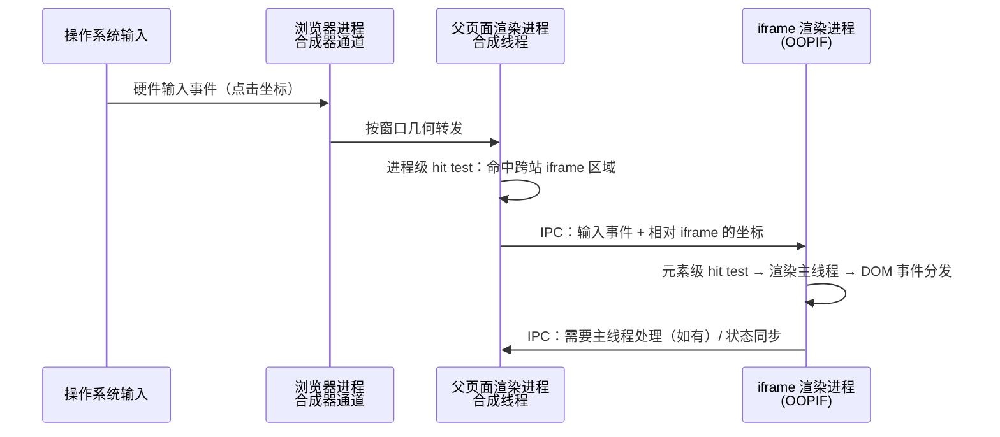

# 站点隔离深潜：frame tree 与 OOPIF

> [← 第二阶段导览](01-导览.md) · 时间线 ② 的前置约束。第一册（03-浏览器组成）说「跨站文档绝不放同一进程」，这一册把这条约束展开：隔离的单位是什么、页面内部的 iframe 树怎么跨进程分布、OOPIF 给事件与渲染带来什么代价。

## 1. 先分清三个词：site / origin / host

| 概念 | 定义 | 例子（对比 `https://a.example.com`） |
|---|---|---|
| host | 完整主机名 | `a.example.com` |
| origin | scheme + host + port | `https://a.example.com`（与 `https://a.example.com:8443` 不同源） |
| **site** | scheme + **eTLD+1** | `https://example.com`（与 `https://b.example.com` 同站） |

**eTLD+1**（公共后缀 + 1）是关键：`github.io` 是公共后缀（用户可注册的后缀），所以 `foo.github.io` 与 `bar.github.io` 是**不同站**——如果按「最后一个点后取一段」的朴素算法，两个陌生人的页面会被判同站，隔离形同虚设。公共后缀清单（Public Suffix List）就是为这个维护的。

隔离的判定单位就是 **site**。记忆锚点：

| 边界 | 管什么 | 层级 |
|---|---|---|
| 同源策略（origin） | JS 能不能互相摸数据 | 软件边界，细粒度 |
| **站点隔离（site）** | 数据能不能进同一进程地址空间 | **硬件边界，粗粒度、安全向** |

后者是前者的兜底：软件防线（同源策略）出现绕过漏洞时，进程边界还在。

## 2. frame tree：页面内的文档树

一个页面不只是一个文档：主文档 + N 个 iframe（还有 `<frame>` 的历史遗产）构成 frame tree。`chrome://process-internals/` 里能直接看到这棵树，每个节点标注所属进程。

判定节点归属的规则（现代 Chrome）：

1. 主 frame 必然占一个渲染进程；
2. **same-site 子 frame**：与主 frame 同进程（树内复用）；
3. **cross-site 子 frame**：独立进程——这就是 **OOPIF**（Out-Of-Process Iframe）。

一个典型页面的进程分布示例：

```text
https://news.example.com（进程 1001）
├─ iframe: ads.ad-network.com     → 进程 1002（跨站，OOPIF）
├─ iframe: video.cdn-partner.net  → 进程 1003（跨站，OOPIF）
└─ iframe: widget.news.example.com→ 进程 1001（同站，共享）
```

嵌套再深一层（iframe 里有 iframe）同理逐节点判定。「进程数 ≈ 标签页数」的直觉因此彻底失效——真实页面的进程数远大于此，这也是 site isolation 内存代价的来源。

## 3. OOPIF 的代价账单：跨进程的每一件事

iframe 独立成进程后，原本「进程内函数调用」的事都变成跨进程通信。前端可感知的三条：

### 3.1 事件路由

点击一个跨站 iframe 里的按钮，事件路径：

```text
合成器 hit test → 判定命中 OOPIF
  → 跨进程把输入事件路由到 iframe 所在渲染进程
    → iframe 进程内部正常分发（capture/target/bubble）
```

对页面逻辑透明（你仍然只是 `addEventListener`），但**每次交互多了一次 IPC 往返**——单个事件几毫秒内完成，感知不到；高频交互（iframe 内拖拽、canvas 游戏嵌套）才能量出差异（实验 3 给了量法）。

### 3.2 滚动与合成的拼接

每个渲染进程独立合成自己的 frame；浏览器最终把多个进程的合成帧**拼接**上屏。后果两条：

- 跨站 iframe 的滚动由它自己的进程驱动——父页面主线程卡死时，iframe 内的滚动可能还在动（它不依赖父页面进程）；
- 嵌套滚动（父页面滚 + iframe 内滚）的边界判定要跨进程协商——「iframe 边缘滚动粘连」类 bug 的架构根源在这。

### 3.3 hit test 的双层结构

合成器线程的 hit test 分两层：

1. 先判「命中哪个进程的 frame」（进程级）；
2. 再进入该进程内部细判（元素级）。

输入优先级（比如滚动手势先给谁）在跨进程边界上需要明确仲裁——这些仲裁规则正是浏览器差异（嵌套 iframe 滚动手感差异）的来源之一。

### 3.4 一次跨进程点击的完整时序

把 §3.1 的文字路径画成时序图——注意「合成器先接住」与「IPC 两次」两个关键点：



两条工程结论：

1. **输入总是先走合成器通道**——iframe 进程内的元素级 hit test 也是先在它的合成线程判「哪个元素区域」，需要 JS 处理才上主线程。这就是「主线程卡死时点击仍能触发合成器级反馈（如滚动）」的原因；
2. **每次跨进程边界都是一次序列化 + 调度**——坐标、事件类型、修饰键状态、时间戳都要打包传输。单次微秒到毫秒级，但「iframe 内高频拖拽」类场景要把它算进帧预算。

## 4. 什么时候 iframe 不隔离（边界与例外）

| 场景 | 进程策略 | 备注 |
|---|---|---|
| same-site iframe | 同主 frame 进程 | 「把第三方内容换自域子域」曾是性能优化，但放弃了隔离安全——现代实践不推荐 |
| srcdoc / about:blank iframe | 继承父 origin，同进程 | |
| 沙箱 iframe（sandbox 属性） | 即使同源也受限 | 进程策略可能特殊 |
| 内存压力设备 | 降级：放宽隔离换内存 | 低端机进程数比桌面少 |
| 未开启隔离的浏览器/版本 | 全同进程 | 以 `chrome://process-internals/` 实测为准 |

## 5. 对性能工作的实际影响

1. **第三方广告/视频 iframe 的加载**：OOPIF 进程的启动、网络、解析都在独立进程——它**不再与主页面争抢主线程**（好事！这也是 site isolation 意外的性能红利），但共享 CPU、内存带宽与 GPU 进程。第三方 iframe 拖慢页面，有时拖的是 GPU 合成与内存，而不是主线程——归因时别只看主线程轨道。
2. **iframe 通信（postMessage）**：跨站 iframe 间通信必然跨进程，序列化+IPC；高频 postMessage（动画同步类）是真开销，量法：双向 ping-pong 一万次取均值（实验 3）。
3. **DevTools 的进程视角**：iframe 在独立进程意味着它的 JS 断点/内存要切 context（Console 顶部下拉选 iframe context）——「明明加了断点不生效」的经典原因。
4. **iframe 内的资源加载**：独立进程有独立的加载管线，其内部请求不会与主页面共享 h2 连接连接池——「iframe 里的请求为什么重新建连」的答案在这。

## 5.5 前沿一瞥：fenced frame 与 Portals

OOPIF 解决「隔离」，但它只是这个方向的第一步。两个相关的新原语（认识即可，不必深挖）：

| 原语 | 解决什么 | 与本册的关系 |
|---|---|---|
| **Fenced Frame**（`<fencedframe>`） | 广告/隐私沙盒场景里，嵌入内容不仅独立进程，还**不给它读「自己被嵌在哪个页面」的能力**（no communication by default） | OOPIF 是进程隔离；fenced frame 在其上再加「通信隔离」 |
| **Portals**（提案演进中） | 无缝嵌入 + 原子过渡的「可预览内容」，试图替代「iframe 嵌整站 + postMessage」的缝合怪 | 把「嵌入」变成一等公民而非 frame tree 补丁 |

共同的方向：**「嵌入」正在从「随便共享一个进程」演进为「按需隔离 + 显式契约」**。理解 OOPIF 后再读这些提案，你会发现它们全部在回答「OOPIF 之後还不够的部分」。

## 5.6 进程数实测记录表（labs 模板）

每次做进程盘点实验，按这个表记录（`labs/process-count.md`）：

| 页面 | 预期进程数 | 实测进程数 | 跨站 iframe 数 | 内存（Renderer 合计） | 备注 |
|---|---|---|---|---|---|
| 纯静态单页 | 1 Renderer | | 0 | | 基线 |
| 含 1 个广告 OOPIF | 2 | | 1 | | |
| 门户首页（3+ 跨站 iframe） | 4+ | | | | |
| 十个站点标签页合计 | — | | — | | 对照第一册 §7 的「破 30」 |

这张表的价值在复测：浏览器版本升级、隔离策略调整时，数字变化本身就是观察点。

### 5.5 postMessage 成本解剖（跨进程通信的通用账）

跨站 iframe 的 `postMessage` 是最常被滥用的通道。它的一次投递链路：

```text
发送方: postMessage(data)
  → 结构化克隆（structured clone，深拷贝语义）
  → Mojo IPC 序列化 → 跨进程传输
接收方: 反序列化 → message 事件入队 → 宏任务执行
```

| 成本项 | 量级 | 说明 |
|---|---|---|
| 结构化克隆 | 与对象规模线性 | 深拷贝，函数/DOM 节点不可传 |
| IPC 序列化+传输 | 微秒~毫秒 | 进程边界税（§3） |
| 事件调度 | 一层宏任务延迟 | **不保证同步到达** |

三条反模式与正解：

1. **每帧 postMessage 同步动画**（父滚 iframe 跟随）——一帧一次 IPC + 宏任务延迟，必然抖。正解：`IntersectionObserver`/CSS 滚动驱动动画，或接受固有延迟重新设计交互；
2. **高频状态同步**（输入框逐字符互通）——用 `BroadcastChannel`（同源场景）或节流合并；
3. **大对象频繁互传**——克隆成本放大；一次传共享引用不可能（进程隔离），改为「传 ID、各自取数」。

对照实验（实验 3）里量出的差值就是「进程边界税」——same-site iframe 的 postMessage 也要序列化+调度，但省掉跨进程传输，通常低一个数量级。

### 5.6 DevTools 调试 OOPIF 的完整工作流

iframe 在独立进程，调试工具链要跟着切：

| 场景 | 操作 | 忘了做的症状 |
|---|---|---|
| 看 iframe 的 JS 日志 | Console 顶栏下拉切到 iframe 的 context（按 origin 分组） | log「消失」 |
| iframe 内断点 | Sources 面板左侧按 frame 分组的文件树选对层级；或对 iframe 右键「DevTools 单独打开」 | 断点不生效 |
| 看 iframe 的性能 | Performance 录制时轨道按进程分组，找到 iframe 进程自己的 Main 轨道 | 在父页面 Main 里白找 |
| 看 iframe 的网络 | Network 面板默认聚合所有 frame 的请求；Initiator 列区分归属 | 归因错对象 |

一页记法：**进程边界 = 工具边界**——凡是「按进程组织」的工具（context/断点/轨道），跨站 iframe 都要显式切换。

### 5.7 嵌套滚动：一次跨进程仲裁的完整走查

「父页面滚动、iframe 内也滚动」的边界行为是 OOPIF 仲裁规则的最佳观察窗：

```text
手指落在 iframe 区域并滚动：
① iframe 进程合成线程先接住（它有自己的合成器）
② 判断「iframe 内部还能滚吗」：
   - 能 → iframe 自己滚，父页面不动
   - 不能（已到边界 overscroll）→ 仲裁：把滚动交给父页面？
③ 跨进程协商：iframe 进程向父页面进程询问边界状态
④ 父页面接管滚动（链式滚动/scroll chaining）
```

两个可观测的体感差异：

- **协商有成本**：边界处的「弹性停顿」比纯同进程滚动长几毫秒——多 iframe 页面的滚动「顿挫感」来源之一；
- **`overscroll-behavior` 是干预手柄**：在 iframe 或容器上声明 `contain` 可以掐断链式滚动，减少跨进程协商（CSS 一个属性改变架构级行为——第八阶段会再遇到这种「CSS 是给合成器的指令」的例子）。

### 5.8 OOPIF 与资源加载：独立连接池的推论

第一册说过渲染进程不允许直接碰网络——网络在 Network 服务里，而**连接池按加载上下文分账**。跨站 iframe 的请求有自己的加载上下文，三条推论：

| 推论 | 说明 | 观测点 |
|---|---|---|
| 不共享主页面的 h2 连接 | iframe 的请求可能重新走 DNS/TCP/TLS | 抓包看 ③④⑤ 在 iframe 域名上重现 |
| HTTP 缓存仍全局共享 | 缓存按 URL+验证器判定，不分进程 | iframe 引用主页面同款资源时 Size 列 cache 命中 |
| 并发预算独立计算 | 「每 host 6 连接」按加载上下文各自计数 | iframe 域名的排队与主页面互不干扰 |

由此解释一个高频现象：**主页面已是 h2 热连接，iframe 里的第三方资源却显示完整握手**——不同进程、不同加载上下文、不同连接池。第三方资源「慢半拍」的架构原因之一找到了（其余原因——加载顺序/优先级/第三方自身性能——归第十阶段的第三方治理）。

## 6. 实验

1. **进程分布实测**：写一个页面嵌三个 iframe（同站子域、跨站免费服务如 example.org 页面、srcdoc），`chrome://process-internals/` 里找出四个 frame 各自的进程 ID，画成 §2 那样的树。
2. **主线程隔离红利**：iframe 里跑 `while(1){}` 死循环——验证父页面主线程、父页面滚动是否不受影响；再在父页面跑死循环看 iframe 内滚动是否照常（合成器滚动）。把两组现象记成对照表。
3. **跨进程通信成本**：父页面与跨站 iframe 用 postMessage 做 ping-pong（各 1000 次），测单次往返均值；换成 same-site iframe 再测——差值就是进程边界的价。
4. **DevTools context 切换**：iframe 里写 `console.log` 与断点，体验 Console/Source 的 context 下拉切换；忘了切换是什么现象。
5. **任务管理器盘点**：开三个含第三方 iframe 的真实站点，Shift+Esc 数进程并归类（Renderer × N、GPU、Network…），对照第一册五类进程。

## 7. 常见误区

1. **「iframe 是页面的一部分所以同进程」**：跨站 iframe 独立进程是 site isolation 时代的常态，不是例外。
2. **「site = 域名最后一段」**：必须用 eTLD+1（公共后缀清单）；`github.io` 的反例背下来。
3. **「OOPIF 让 iframe 变慢」**：交互级差异通常低于感知阈值；真正的收益（安全隔离 + 主线程解耦）远大于 IPC 成本。别用这条吓阻第三方 iframe 的合理使用。
4. **「隔离了就互不影响」**：进程隔离挡的是地址空间与主线程争抢；CPU/内存带宽/GPU 进程仍是共享资源。
5. **「断点不生效是 DevTools bug」**：先查 context 是否切到 iframe 进程。
6. **「同站子域 iframe 能省进程所以推广它」**：省的是进程，丢的是隔离安全（同进程内一个 iframe 被攻破可侧信道读另一 iframe）——性能收益不能为安全倒退买单。

7. **「iframe 里的 alert/confirm 是父页面弹的」**：弹窗属于 iframe 自己的进程与文档上下文；「看起来一样」是因为模态覆盖全窗口——归属不同，被拦截策略（如沙箱 iframe 禁弹窗）也不同。
8. **「OOPIF 调试只能靠重启浏览器」**：iframe 的 DevTools 可单独开（右键 → DevTools 单独打开），进程边界是工具边界不是工具障碍（§5.6）。

## 7.5 多进程的内存账（OOPIF 代价的量化）

「隔离安全」的账单要用数字看。一个含 3 个跨站 iframe 的页面的内存构成（量级示意，以本机实测为准）：

| 项 | 单价（量级） | 页面里 × 数量 |
|---|---|---|
| 渲染进程基线（V8/Blink 初始化） | 几十 MB | 1 + OOPIF 数 |
| 每个进程的堆（实际内容） | 视页面复杂度 | 各进程独立持有 |
| 进程间通信缓冲 | 小但存在 | 与交互频率相关 |

三个推论：

1. **OOPIF 数量线性推高进程数**——广告联盟的页面（5+ 第三方 iframe）进程数轻松翻倍；
2. **低内存设备的降级不是 bug**——「我的旧手机上 iframe 没有独立进程」是降级策略在工作（§4）；
3. **监控进程数的正确姿势**——任务管理器 Renderer 条目数 ≈ 1 + 跨站 frame 数，偏离这个公式才是异常。

## 7.6 自查清单

| # | 检查 | 工具 | 异常指向 |
|---|---|---|---|
| 1 | 跨站 iframe 真的独立进程？ | process-internals | 同进程 = 隔离未生效/降级中 |
| 2 | iframe 断点不生效？ | Sources 的 frame 树 | context 没切（§5.6） |
| 3 | postMessage 延迟高？ | ping-pong 实测 | 高频互传反模式（§5.5） |
| 4 | iframe 内滚动异常？ | 双侧录制 trace | 嵌套滚动跨进程仲裁 |
| 5 | 第三方 iframe 拖慢页面？ | Performance 按进程分轨道 | 别只看主页面 Main |
| 6 | 内存涨得离谱？ | 任务管理器 Renderer 合计 | OOPIF 数量 × 基线（§7.5） |

### 7.7 OOPIF 时代的第三方嵌入决策清单

往页面里嵌第三方 iframe 之前，把本册的全部代价变成决策项过一遍：

| 决策项 | 问什么 | 依据 |
|---|---|---|
| 必要性 | 这个 iframe 的业务价值，值得 +1 进程 + 持续 IPC 吗？ | §3 代价账单 |
| 时机 | 能延迟到用户表达兴趣后再加载吗（facade 模式）？ | IntersectionObserver + 假封面 |
| 通信量 | 与父页面的 postMessage 频率与数据量？ | §5.5 成本表 |
| 滚动嵌套 | 会与父页面滚动边界打架吗？ | §5.7 + `overscroll-behavior` |
| 归因预算 | 它拖慢页面时，你能在哪条轨道找到它？ | §5.6 调试工作流 |

facade 模式多说一句：视频/聊天类第三方 iframe 常用「假封面 + 点击后才真正加载」——iframe（连同它的整个进程）在用户点击前根本不创建。这是把 OOPIF 代价推迟到「值得付」的时刻；完整的第三方治理策略（按业务价值分级、按真实耗时排序治理）在第十阶段 03 册展开，本册提供的是架构层的判断依据。

## 8. 自测题

> 提示：第 5、12、13 题需要结合第一册（03-浏览器组成）的线程模型作答。

1. site、origin、host 三者的判定范围差在哪？各举一个「同 site 不同 origin」的例子。
2. 为什么 `foo.github.io` 和 `bar.github.io` 是不同站？如果不用公共后缀清单会出什么安全漏洞？
3. 画出三 iframe 页面（同站/跨站/srcdoc）的 frame tree 与进程归属。
4. OOPIF 下点击 iframe 按钮的完整事件路径要跨几次进程边界？单次交互的成本量级？
5. 父页面主线程死循环时，跨站 iframe 内的滚动还能工作吗？为什么（两层原因：进程 + 线程）？
6. 跨站 iframe 的 postMessage 为什么必然比 same-site iframe 慢？慢在哪个环节？
7. 列出「iframe 不隔离」的三种例外场景。
8. 第三方 iframe 拖慢页面的三种可能机制分别是什么？用哪个面板区分？
9. DevTools 里 iframe 断点不生效的最常见原因是什么？
10. 把本册放回账本：OOPIF 改变的是 ⑪~⑮ 的哪一层归属？「进程数 ≈ 页面数」的直觉为什么必须升级？
11. 同站子域 iframe 的「性能收益 vs 安全代价」各是什么？给出你的取舍立场与理由。
12. （提示题）§3.4 的时序图里，为什么输入事件先经过两个合成线程而不是直达父页面主线程？——回忆第一册「合成器滚动」的架构动机。
13. fenced frame 与 OOPIF 的隔离强度差在哪一层？——「进程隔离」与「通信隔离」两个词的分工。

### 8.5 常见问答

**Q：iframe 数量有没有「性能红线」？**
本册给的口径：跨站 iframe 每个 = 1 个进程基线（几十 MB）+ 独立加载管线 + IPC——5 个以上就该过 §7.7 决策清单，10 个以上通常有架构问题（该合并的合并、该 facade 的 facade）。红线不是浏览器给的，是你的内存与归因成本给的。

**Q：怎么快速列出页面上所有跨站 iframe？**
Console 一行：`[...document.querySelectorAll('iframe')].map(f => f.src)`，再对照 `chrome://process-internals/` 的进程归属——src 的 site 与父页不同的就是 OOPIF 候选。这个清单是第三方治理（第十阶段）的起点数据。

## 9. 延伸

- 第二阶段收束：决策（02/03 册）→ 执行（04 册）→ 隔离模型（本册）。下一站：[第三阶段 · 建立连接](../03-第三阶段/01-导览.md)，DNS 的第一个包终于上路。
- Spectre 侧信道与 COOP/COEP 的攻防细节归 `security/` 站；本站只讲隔离的架构事实。
