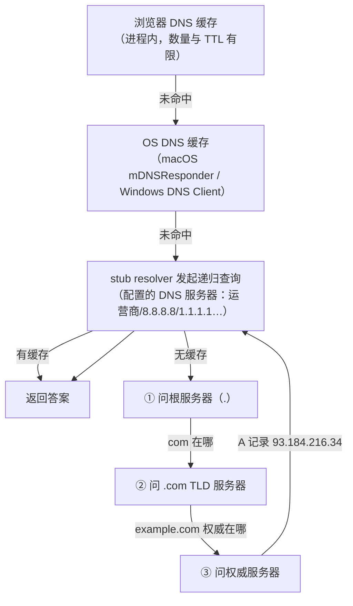

# DNS 解析全链路

> [← 第三阶段导览](01-导览.md) · 时间线 ③。把域名变成 IP——全链路第一个网络动作。弱网下它可能是数百毫秒的大头，命中缓存时接近零。这一册把「查一次 DNS」逐级拆开，并回答两个工程问题：为什么二次访问快、CDN 怎么借 DNS 把你调到最近的节点。

## 1. 缓存经济学：为什么 DNS 值得学

一次全新解析的代价 = 客户端到 resolver 的往返 + resolver 到各级服务器的往返。弱网（RTT≈100ms）下：

| 场景 | 耗时量级 | Network 面板表现 |
|---|---|---|
| 全链冷查询（无任何缓存） | 100~500ms+ | DNS 段显著 |
| resolver 有缓存 | ≈1 RTT（~100ms） | DNS 段 ≈1 RTT |
| OS/浏览器缓存命中 | <1ms | DNS 段趋近 0 或不显示 |
| 连接复用（根本不查） | 0 | Timing 里没有 DNS 段 |

首屏要连的域名常常不止一个（主站 + CDN + 字体 + 统计 + 第三方 SDK），每个新域名都是一次独立解析。**DNS 优化的本质是缓存层级的游戏**——所以本册的展开顺序就是查询路径本身。

## 2. 查询路径逐级走读



### 2.1 浏览器缓存

进程内小缓存（Chrome 数量上限约千条，TTL 受限），首次装页面时承接大部分重复查询。注意**浏览器缓存与 OS 缓存独立**——清了系统缓存浏览器里可能还有。观测点：`chrome://net-internals/#dns`（可查可清）。

### 2.2 OS 缓存与 stub resolver

操作系统自己的解析缓存（macOS 的 mDNSResponder、Windows 的 DNS Client 服务、Linux 的 nscd/systemd-resolved）。应用（浏览器）最终把查询交给这里的 stub resolver——它不是权威也不是递归服务器，只负责「替应用把问题问出去、把答案拿回来」。

清缓存命令（复测时逐层失效用）：

```bash
# macOS
sudo killall -HUP mDNSResponder
# Windows
ipconfig /flushdns
```

### 2.3 本地 resolver（递归查询）

浏览器/OS 拿着配置的 DNS 服务器地址（运营商自动下发，或手动 8.8.8.8 / 1.1.1.1 / 阿里 223.5.5.5 等）发起**递归查询**——告诉 Resolver「你负责帮我问到底，拿到最终答案再回我」。

Resolver 拿到问题后自己也没有缓存时，走**迭代查询**（下节）——「递归」与「迭代」的分界线就在这里：

| | 谁负责问到底 | 典型发生在哪 |
|---|---|---|
| 递归查询 | 被查询方承诺返回最终答案 | 客户端 → resolver |
| 迭代查询 | 被查询方只返回「下一个该问谁」 | resolver → 根 → TLD → 权威 |

为什么 resolver 到权威之间用迭代？——根服务器不可能替全世界做递归（容量与放大攻击面），它只答「.com 的服务器列表在这里」。

### 2.4 根 → TLD → 权威

- **根服务器**：全球 13 组逻辑根（A~M，anycast 复制成上百个物理点）。回答「`.com` 的 NS 与地址」；
- **TLD 服务器**（.com/.cn/…）：回答「example.com 的权威 NS 是谁」；
- **权威服务器**：域名的最终答案持有者，返回 A/AAAA/CNAME 记录。

`dig +trace example.com` 会把这三级逐段打出来——本册最好的实验（见 §8）。

### 2.5 DNS 报文格式全解（抓包展开的那个结构）

一次查询与应答的报文结构（Wireshark 里展开 UDP 53 的包就是它）：

```text
Header     → ID、QR(查询/应答)、RD(期望递归)、RA(服务器支持递归)、RCODE(NOERROR/NXDOMAIN)
Question   → 名字 + 类型(A/CNAME…) + 类(IN)
Answer     → 资源记录：名字、TTL、类型、数据
Authority  → 权威信息（NS；NXDOMAIN 时含负缓存用的 SOA）
Additional → 附加记录（如 A 记录随 NS 附送）
```

**Header 是固定 12 字节**，逐字段拆开（Wireshark 的 `Flags` 行就是中间那 16 个比特）：

```text
 0                15 16                31
+------------------+-------------------+
|         ID（报文标识，16 位）         | ← 查询与应答靠它配对（请求头层的「请求 id」）
+------------------+-------------------+
|QR| Opcode |AA|TC|RD|RA| Z |RCODE    | ← 标志位 + 响应码（下表逐个认）
+------------------+-------------------+
|        QDCOUNT（Question 条数）       | ← 查询几乎总是 1
|   ANCOUNT / NSCOUNT / ARCOUNT        | ← Answer / Authority / Additional 各区条数
+--------------------------------------+
```

各标志位干什么用（排障真正碰得到的）：

| 位 | 含义 | 工程视角 |
|---|---|---|
| QR | 0=查询 / 1=应答 | 抓包里一眼分方向 |
| Opcode | 0=标准查询 / 1=反向(PTR) / 4=通知 / 5=更新 | 日常几乎全是 0 |
| AA | 应答方是权威服务器 | 缓存应答没有它——「答案出自权威还是缓存」的包级证据 |
| **TC** | Truncated，响应被截断 | **关键字段**：见本节末尾「截断与 DNS over TCP」 |
| RD / RA | 客户端要求递归 / 服务器支持递归 | 递归 vs 迭代的包级证据（§2.3） |
| RCODE | NOERROR(0) / FORMERR(1) / SERVFAIL(2) / NXDOMAIN(3) / NOTIMP(4) / REFUSED(5) | NXDOMAIN=域名不存在，SERVFAIL=解析链上游出问题，REFUSED=策略拒绝（递归未开放/权限） |

对账时最有用的三个字段：

| 字段 | 看什么 |
|---|---|
| RD/RA | 确认这次是不是递归查询（§2.3 递归/迭代的包级证据） |
| RCODE | NOERROR / NXDOMAIN / SERVFAIL——负缓存的判定依据 |
| Answer 的 TTL | 倒计时从这里开始（§3 的 TTL 衰减实验就看它） |

**名称压缩（指针）**：报文里域名经常重复（Question 里的名字与 Answer 记录的 owner 名往往相同），RFC 1035 允许用「两字节指针」指向报文内先前出现的位置——首两位为 `11`（`0xC0` 开头的字节）就是指针，其余 14 位是偏移量。写解析器的人必须处理它；读抓包的人只需知道：Wireshark 里 Answer 区域名偶尔显示为「pointer to offset 12」，不是包坏了。

**一条资源记录（RR）的五元组**：`owner 名字 · TTL · CLASS(IN) · TYPE · RDATA`。Answer 区的每一行都是它——§3.5 dig 输出里 `example.com. 86400 IN A 93.184.216.34` 的五段与之一一对应，最后那个 IP 就是 RDATA。

**EDNS0（RFC 6891）：报文的扩展机制**。1987 年设计的 UDP 报文上限是 512 字节——装不下大响应（根服务器 NS 列表、带 ECS 的应答、DNSSEC 签名）。EDNS0 用一条**伪记录**（OPT，只出现在 Additional 区，不参与缓存）扩展出：

| 能力 | 说明 |
|---|---|
| 更大的 UDP 载荷 | 宣告「我能收 4096 字节」；公共 resolver 间常见 1232（刻意规避 IP 分片）~4096。抓包里表现为一条 OPT 记录 + UDP 长度超 512 |
| EDNS Client Subnet | §5 的 ECS 就挂在 OPT 里 |
| DNSSEC OK 位 | 客户端声明「我能处理 DNSSEC 响应」 |
| TCP Keepalive / Padding 等选项 | 后续扩展的统一挂载点 |

**截断与 DNS over TCP**：响应超过协商的 UDP 载荷上限时，服务器置 **TC=1**、只给部分数据；客户端收到 TC=1 后**必须改用 TCP 53 重发同一查询**拿完整响应。这就是「DNS 用 UDP，但不止 UDP」的完整表述——大响应（尤其 DNSSEC）与 zone 传送（AXFR）都走 TCP。抓包对照：先见 UDP 53 应答带 TC 标志，紧跟一条 TCP 53 的重查——这个序列出现即「响应超了 UDP 上限」（04 册讲 UDP 时会回到这里：为什么 DNS 偏爱 UDP 又必须留 TCP 后门）。

## 3. 记录类型与 TTL

工程上高频的五类记录：

| 类型 | 内容 | 前端相关的坑 |
|---|---|---|
| A / AAAA | IPv4 / IPv6 地址 | 双栈环境浏览器按 Happy Eyeballs 竞速，别假设用哪个 |
| CNAME | 别名 → 另一个域名 | **常见链**：`static.example.com` → `static.example.com.cdn-provider.net` → CDN 边缘名——一次查询实际串了多次解析 |
| NS | 谁是权威 | 迁移 DNS 供应商时改的就是这层 |
| SOA | 域的管理信息 | 含负缓存的参数（见 §4） |
| TXT | 文本（SPF/验证） | 与加载性能无关，排查归属时常用 |
| **HTTPS / SVCB** | 服务端能力宣告（协议/端口/ECH 密钥/地址提示） | h3 发现与 ECH 的新通道，见 §3.3 |

**TTL**（生存期）：每条记录自带「可以缓存多久」。缓存的判定取**沿途各层缓存服从的最小 TTL**（上级缓存可能已把 TTL 倒计时过）。工程含义：

- TTL 越长 → 缓存越久 → 切换 IP（迁移/故障转移）生效越慢；
- 「改了 DNS 怎么没生效」的标准答案：不是某一层慢，是**所有曾缓存过的层都要等自己的 TTL 到期**（浏览器 + OS + resolver + 中间代理，逐层过期）；
- 部分 resolver 不严格服从 TTL（有下限覆盖/上限截断）——迁移 DNS 要按「最长可能生效时间」做预案，而不是按配置值。

### 3.3 HTTPS/SVCB 记录：DNS 层的服务能力宣告

SVCB（Service Binding）及其特化形式 HTTPS 记录（RFC 9460）是 DNS 里最新的高频记录——查询 `_dns.res.arpa` 风格的前缀名（如 `example.com` 的 HTTPS 记录查 `_https.example.com` 或直接查本名），Answer 里带一组**服务参数**：

| 参数键 | 内容 | 干什么用 |
|---|---|---|
| alpn | `h3,h2` | 宣告「这个域名支持 h3/h2」——DNS 解析时就拿到协议能力，省一次 Alt-Svc 往返（第四阶段 04 册的 h3 发现通道之一） |
| ech | ECH 配置 | TLS 握手里加密 SNI 所需的密钥（05 册 §10） |
| port | 非标端口 | 服务端口与默认不同时 |
| ipv4hint / ipv6hint | 地址提示 | 客户端可跳过一次 A/AAAA 追问（权威通常还是会附上记录） |

对浏览器的实际影响：**「解析一次 = 拿到 IP + 拿到能力清单」**——h3 的发现从「第一次响应头告诉你要点两次才用上」提前到「第一次解析就知道」。`dig example.com HTTPS` 可以直接看（国内主流站点 2026 年已普遍下发）。它与 §5 的 CDN 调度是接力关系：调度（选哪个边缘节点）靠 A/AAAA + ECS，能力宣告（到节点后说什么协议）靠 HTTPS 记录。

### 3.5 dig 完整输出逐行解读

`dig example.com` 的一次典型输出，逐行标注（这是本册最重要的实跑材料）：

```text
$ dig example.com

;; <<>> DiG 9.10.6 <<>> example.com            ← 客户端版本与查询
;; global options: +cmd
;; Got answer:
;; ->>HEADER<<- opcode: QUERY, status: NOERROR ← RCODE：NOERROR=成功，NXDOMAIN=不存在
;; flags: qr rd ra;                            ← qr=应答, rd=客户端要求递归, ra=服务器支持递归
;; QUESTION SECTION:
;example.com.      IN  A                       ← 问了什么（名字/类型/类）

;; ANSWER SECTION:
example.com.       86400 IN  A  93.184.216.34  ← ↑名字  ↑TTL(秒)  ↑类型  ↑值
                                               ← 这个 86400 就是缓存层服从的生存期

;; Query time: 42 msec                          ← 本次查询耗时（缓存命中时会非常小）
;; SERVER: 192.168.1.1#53(192.168.1.1)          ← 谁回答的（你的 resolver）
;; WHEN: Sat Nov 14 10:00:00 CST 2026
;; MSG SIZE  rcvd: 45
```

三个读法要点：

1. **`flags` 一行是递归/迭代的判定依据**：`rd`（客户端要求递归）+ `ra`（服务器支持递归）同时出现 = 这是一次递归查询——§2.3 的文字描述落到字段上；
2. **`Query time` 是缓存状态的直接观测**：冷查询几十毫秒起，热查询 <5ms——比任何理论都直观；
3. **`SERVER` 告诉你答案来自哪一层**——排查「为什么解析结果不对」时，先看是谁回答的。

### 3.6 一次真实解析链：CNAME 逐跳实录

拿一个真实的 CDN 静态资源域名跑 `dig +answer <域名>`，把 Answer 区整段抄下来（域名示意）：

```text
static.example.com.              300  IN  CNAME  static.example.com.cdn.dnsv1.com.
static.example.com.cdn.dnsv1.com.
                                 120  IN  CNAME  cdn-gh-1.example-cloudedge.net.
cdn-gh-1.example-cloudedge.net.
                                 60   IN  A      203.0.113.7
cdn-gh-1.example-cloudedge.net.
                                 60   IN  A      203.0.113.9
```

逐行读出四个信息：

1. **两环 CNAME**：业务域 → CDN 服务商调度域 → 边缘节点域——「一次查询」实际是三跳；
2. **TTL 递减**（300→120→60）：越靠近调度决策的记录变化越频繁（§5 的动态调度要把你调来调去），所以 TTL 越短；
3. **多条 A 记录**：一个边缘域名挂多个 IP，客户端挨个尝试（连接失败换下一个，双栈环境还有 Happy Eyeballs 竞速）；
4. **末段 TTL=60 是调度灵活性的代价**：缓存一分钟就过期、必须重新问——CDN 随时可把你调去别的节点。

这张实录同时解释了 Network 面板里「一个 CDN 请求的 DNS 段有时特别长」：三跳叠加，任何一跳未命中缓存都要补齐整条链。

## 4. 负缓存：查不到也缓存

域名解析失败（NXDOMAIN）同样被缓存，时长由权威 SOA 的 minimum（或 SOA TTL）决定。后果：**刚注册/刚修复的域名，短时间内到处都是「不存在」的缓存答案**。排查「新域名解析不到」时，负缓存是隐形嫌疑人——换个 resolver（8.8.8.8）或等负缓存过期是标准动作。

### 4.5 DNSSEC 一眼：答案的真伪验证（概念层）

传统 DNS 应答**不验真伪**——resolver 拿到的「答案」只靠 UDP 53 明文传来，中间任何设备都能篡改（§6 劫持的根源）。DNSSEC（RFC 4033~4035）给应答装上**签名链**：

| 新记录类型 | 作用 |
|---|---|
| RRSIG | 对 RRset（同名同类型的一组记录）的数字签名，随应答下发 |
| DNSKEY | 区域的公钥，用于验 RRSIG |
| DS | 父区域对子区域 DNSKEY 的指纹——**信任链逐级搭桥**（根 → .com → example.com） |
| NSEC / NSEC3 | 「这个名字确实不存在」的签名证明——负缓存也有签名为证 |

验证路径：浏览器/resolver 用系统内置的根公钥起步，沿 DS 链逐级验到答案——**信任锚只有根，其余靠密码学**。UDP 53 的明文包仍可被中间人「看见」，但改一个字节签名就碎——窃听面仍在，篡改面关死（这正是 §6 DoH 要解决的另一半）。

为什么工程上知道即可：公共 resolver（8.8.8.8/1.1.1.1）默认做验证并标记 AD 位，浏览器端不重复验证；`.com` 全域已签名，国内 `.cn` 主流域覆盖也已很高。排障里 DNSSEC 的存在感主要是一种故障模式：**签名过期/断链的域名会解析失败（SERVFAIL）**——「别的域名都好、某个域名 SERVFAIL」时，查一下它的 DNSSEC 状态（`dig +dnssec` 看 RRSIG 与 AD 标志）。

## 5. CDN 调度：DNS 是第一次负载均衡

同一域名在不同地区解析出不同 IP——这不是 DNS 的副业，是 CDN 流量调度的主通道：

1. **权威服务器按「谁在问」返回不同答案**。判定依据首先是 **resolver 的 IP**（递归查询时权威看到的是 resolver，不是终端用户）；
2. resolver IP 对地理位置的近似可能很粗（Google 的公共 resolver 在上海访问时，权威看到的是它的海外节点）→ **EDNS Client Subnet（ECS）**：resolver 把终端用户的网段前缀（IPv4 一般 /24）夹在查询里带给权威，权威按真实用户位置调度；
3. 更现代的方案：**HTTPS/SVCB DNS 记录**（DNS 层直接宣告 `h3`、`ech` 等服务端能力，还省一次 Alt-Svc 往返，第四阶段 04 册再接上）。

前端的收获是认知而非操作：**「解析出哪个 IP」本身就是调度结果**——Network 面板里连接到的远程地址，已经是「CDN 认为你该去的节点」。同一域名在国内与海外测出的 TTFB 差异，第一变量就是它。

### 5.5 浏览器侧的 DNS 行为细节

几个浏览器实现层的行为（影响你的观测预期）：

| 行为 | 说明 | 对观测的影响 |
|---|---|---|
| 并发预取 | 主文档解析时，Chrome 会对未来可能的域名**并发预解析** | 抓包里出现「你没请求过的域名」的 DNS 查询 |
| 查询取消 | 页面关掉时未完成的 DNS 查询被取消 | 抓包里偶见「只查不连」的域名 |
| 连接池复用优先 | 有热连接时根本不触发解析 | Timing 里「没有 DNS 段」≠「DNS 没发生」，可能是「不需要发生」 |
| dns-prefetch 上限 | 并行预取有数量限制 | 撒网式 prefetch 不是免费的 |

### 5.6 双栈环境：A 与 AAAA 的竞速（Happy Eyeballs）

现代网络同时有 IPv4（A 记录）与 IPv6（AAAA 记录）——解析会返回两类地址，浏览器不傻等某一种：

```text
解析返回 [AAAA, A]（或乱序）
  → 浏览器优先尝试 AAAA 连接
  → 若 ~300ms 内未成功（Happy Eyeballs 阈值），并行发起 A 连接
  → 谁先建立用谁（另一条放弃）
```

对观测的含义：**「Timing 里连接段偶尔翻倍」未必是网络抖动**——可能是双栈竞速被触发了；而「IPv6 环境下反而更慢」常见于 6to4 隧道/MTU 问题——排查时先确认解析给了哪些地址（`dig AAAA 域名`）、实际用哪条连接（chrome://net-internals 的 sockets 列表）。

## 6. 加密 DNS：DoH / DoT

传统 DNS 是明文 UDP 53——链路上任何设备都能看（你问了哪个域名）与改（返回劫持 IP）。两条加密路线：

| | 全称 | 传输 | 浏览器支持 |
|---|---|---|---|
| DoT | DNS over TLS | 独立端口 853 | 系统级为主（Android 私有 DNS 等） |
| **DoH** | DNS over HTTPS | 443，与网页流量同通道 | Chrome/Edge/Firefox/Safari 均已内置（「安全 DNS / Secure DNS」设置） |

浏览器启用 DoH 后，DNS 查询从「UDP 53 明文包」变成「HTTPS 请求」——抓包实验里 UDP 53 消失即是 DoH 生效的信号（第五阶段视角看，它还复用了 HTTP 连接基础设施）。注意 DoH 的解析结果仍走同样的缓存体系，改变的只是**传输与信任**，不是「DNS 变快了」。

### 6.5 DoH 的三种启用模式（浏览器设置对应表）

浏览器「安全 DNS」设置的三个档位，行为与链路影响完全不同：

| 模式 | 行为 | 链路影响 | 排障提示 |
|---|---|---|---|
| 关闭 | 全走明文 UDP 53 | 传统链路 | 抓包能看到全部 DNS 包 |
| 自动升级 | 先问系统 resolver 是否支持 DoH，支持则升级 | 首次仍可能明文 | 偶尔抓到 53 包属正常 |
| 指定服务商 | 全部 DNS 走该 DoH 服务商（443） | 53 端口消失 | resolver 挂了 DNS 全断——切换服务商即修复 |

「自动升级」模式的公司内网坑：内网自建 DNS 解析内网域名，被升级到公共 DoH 后内网域名全断——DoH 的企业兼容历来是部署阻力（与 TLS 1.3 的中间设备问题同源：**加密让中间设备失明**）。

### 6.6 迁移 DNS 的预案清单（工程案例形态）

「把 example.com 从旧解析商迁到云厂商」这类操作的完整预案（把本册知识全部用上）：

1. **先降 TTL**：迁移前 48 小时把 TTL 降到 300——让全网缓存快速过期；
2. **记录当前全链**：`dig +trace` 存档（NS 链、CNAME 链、TTL 现值）——回滚的基线；
3. **切换**：在低峰时段改 NS 或 A 记录；
4. **分层验证**：换 resolver（8.8.8.8/1.1.1.1/运营商）分别 `dig`，确认新答案已出；本地清浏览器+OS 缓存复测；
5. **观察负缓存**：迁移过程中误删记录会造成 NXDOMAIN 被缓存——恢复后还要等负缓存过期；
6. **升 TTL**：稳定后再把 TTL 调回正常值。

整个预案里**没有一个步骤是「即时生效」的**——DNS 工程的全部心法就是「与缓存的时间常数共处」。

## 7. dns-prefetch 与 preconnect：把 ③ 挪到前面

本站第一次出现资源 hint（第五、六阶段会系统性展开），先记 DNS 相关的两个：

```html
<link rel="dns-prefetch" href="//static.example.com">  <!-- 只提前查 DNS -->
<link rel="preconnect"  href="https://static.example.com">  <!-- DNS+TCP+TLS 全提前 -->
```

两者的差异与取舍：

| | 提前哪几步 | 收益上限（弱网） | 成本 | 适用 |
|---|---|---|---|---|
| `dns-prefetch` | ③ | 数百 ms → <1ms | 几乎零 | 「现在不连、稍后要连」的域名，可以撒网 |
| `preconnect` | ③④⑤ | 三段合计（数百 ms） | 占连接资源 | 确定要用的高价值域名，少量精准 |

收益上限 = **第三阶段这几步在关键路径上的耗时**——弱网数百毫秒，本地几乎为零。这再次验证第一册账本的结论：同一手法收益随环境差一个数量级。

## 8. 实验

1. **`dig +trace example.com`**：观察根 → TLD → 权威的三段迭代；再跑一次普通 `dig example.com`（走 resolver 缓存），对比答案来源注释（`;; SERVER`）与耗时（`;; Query time`）。
2. **CNAME 链观察**：`dig` 一个 CDN 域名（如某图床/静态资源域名），数一数 CNAME 链有几环、最终 A 记录是谁家的 IP。
3. **TTL 衰减观察**：连续两次 `dig` 同一域名，第二次 Answer 区的 TTL 数字比第一次小——你命中了 resolver 的缓存，TTL 在倒计时。
4. **负缓存实验**：`dig` 一个肯定不存在的域名，记录响应与耗时；再查一次，对比（第二次命中负缓存，更快）。
5. **DoH 对照**：浏览器关闭/开启「安全 DNS」设置，Wireshark 里对比 UDP 53 包的有无（本阶段 06 册抓包实验会做完整版）。
6. **清缓存动作收齐**：`chrome://net-internals/#dns` Clear host cache；OS 层命令见 §2.2。复测同一域名，观察缓存逐层失效后 Timing 里 DNS 段的变化。

## 8.5 自查清单

| # | 检查 | 工具 | 异常指向 |
|---|---|---|---|
| 1 | Timing 里 DNS 段多大？ | Network 面板 | 持续大 = 缓存不生效/resolver 慢 |
| 2 | 抓包 UDP 53 有没有？ | Wireshark | 有 = 未走 DoH；无且 DNS 秒回 = 缓存/DoH |
| 3 | 改记录生效了吗？ | 分层 dig（换 resolver） | 某层还在吐旧答案（§3 TTL） |
| 4 | 新域名解析不到？ | dig 看 RCODE | NXDOMAIN 负缓存（§4） |
| 5 | 解析出的 IP 合理吗？ | Network 面板远程地址 | 调度失真——查 resolver/ECS（§5） |
| 6 | preconnect 生效了吗？ | 后续请求无 DNS 段 | hint 没写对/域名对不上（§7） |

## 9. 常见误区

1. **「DNS 查询就是一个包一次回答」**：全冷时是三段迭代 + 可能的 CNAME 串联；「一次查询」的真实包数远超直觉（06 册抓包数一数）。
2. **「清了系统缓存就等于没缓存」**：浏览器、OS、resolver 三层独立；改 DNS 记录验证时要逐层清或换环境。
3. **「TTL 1800 意味着 30 分钟后全网都更新」**：是「最迟」不是「准时」——各层缓存各自倒计时，且部分 resolver 不严格服从 TTL，迁移 DNS 要按「最长可能生效时间」做预案。
4. **「CDN 调度看我本机 IP」**：权威服务器看到的是 resolver（除非 ECS）；公共 resolver 场景下调度可能失真——跨地区性能测试要用当地 resolver 才准。
5. **「上 DoH 是性能优化」**：它是隐私与防劫持优化；查询本身还得走网络，速度取决于 DoH 服务质量。收益判断别拿错科目。

## 10. 自测题

1. 画出客户端 → resolver → 根 → TLD → 权威的完整查询路径，标注哪段递归、哪段迭代。
2. 为什么根服务器只做迭代应答？如果根服务器提供递归会出什么问题？
3. 一次「全冷」解析里，CNAME 链会让包数怎么变化？举一条你测到的真实 CNAME 链。
4. TTL、负缓存各缓存什么？「改 DNS 不生效」的排查顺序是什么？
5. EDNS Client Subnet 解决什么问题？没有它时公共 resolver 场景的 CDN 调度会怎么失真？
6. DoH 与 DoT 的差异是什么？浏览器开启 DoH 后抓包里哪个现象消失？
7. `dns-prefetch` 与 `preconnect` 各提前了时间线的哪几步？收益上限如何随环境变化？
8. HTTPS/SVCB 记录宣告什么信息？它与响应头的 Alt-Svc 是什么关系（预告第四阶段）？
9. 为什么「同域名在国内与国外测出的 TTFB 差异」要先查解析结果再查服务器？
10. 把本册放回账本：③ 段在什么条件下为 0？列出至少三种让它归零的机制。
11. `dig` 两次同一域名，第二次 TTL 变小——这个现象说明什么？「TTL 会变小到 0」与「缓存已过期」是什么关系？
12. （提示题）迁移 DNS 预案里为什么「先降 TTL 48 小时」而不是「直接切」？——用「所有曾缓存过的层都要等 TTL」作答。
13. `dig` 输出的 flags 里 `qr rd ra` 各代表什么？哪两个同时出现才能确认是一次递归查询？（提示：§3.5 的逐行解读。）

## 11. 延伸

- 下一册：[03-TCP-三次握手与传输控制](03-TCP-三次握手与传输控制.md)——拿到 IP，开始建管道。
- 资源 hint 的系统用法在第六阶段 05 册；DoH 的安全权衡归 `security/` 站。
