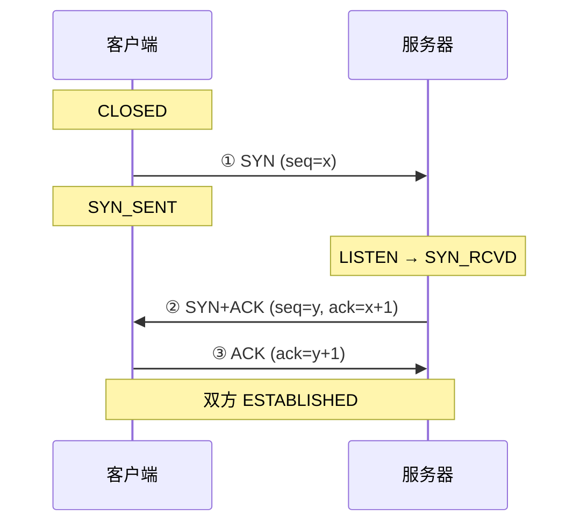

# TCP：三次握手与传输控制

> [← 第三阶段导览](01-导览.md) · 时间线 ④。拿到 IP 之后建立可靠管道。三次握手本身只有 1 个 RTT，但它定下了一个对首屏很不友好的基调：连接刚出生时吞吐起不来（慢启动）。这一册讲清握手与状态机，再把「连接建立之后怎么传数据」的传输控制框架搭起来——第五阶段讲响应回程、第八阶段讲帧节奏时都要回到这里。

## 1. TCP 在时间线的位置与它的性格

TCP 提供**可靠、有序、字节流**传输。代价是两件事：

1. **建立成本**：三次握手 = 1 个 RTT 纯开销，期间零数据；
2. **拥塞谨慎**：网络状态未知时保守起步（慢启动），突发短传输吃亏。

首屏加载恰好是「短、突发、多连接」的形态——TCP 的保守对它最不利。理解这个矛盾，后面所有优化（复用、0-RTT、h3）的动机就全通了。

## 2. 报文头走读

只需要认识六个字段（共 20 字节固定头）：

| 字段 | 作用 | 本册相关点 |
|---|---|---|
| 源端口/目的端口 | 进程寻址（浏览器侧是临时端口 49152+） | 一条连接 = 四元组（源IP源端口，目的IP目的端口） |
| 序列号 seq | 字节流编号 | ISN（初始序号）随机化——防旧连接的包串台 |
| 确认号 ack | 期望对方下一个字节的序号 | 「我收到了 X 之前的所有字节」 |
| 标志位 | SYN/ACK/FIN/RST/PSH/URG | 握手用 SYN/ACK，断开用 FIN/RST |
| 窗口 window | 接收方还能收多少（流控） | 滑动窗口的基础 |
| 选项 | MSS、窗口缩放、SACK、时间戳 | 握手时协商——抓包里的 Options 区就是它们 |

**连接四元组**是理解复用的钥匙：同一浏览器到同一服务器可以开多条连接（四元组的源端口不同），HTTP/1.1 的 6 连接限制就是浏览器在应用层对四元组数量的自我约束。

### 2.5 首部逐位深读：20 字节固定头 + 选项

把上面那张表钉到比特层——Wireshark 展开的每个数字都能对上号：

```text
 0                   15 16                  31
+----------------------+----------------------+
|      源端口（16 位）      |     目的端口（16 位）    |  ← 0~65535；浏览器侧临时端口 49152+
+----------------------+----------------------+
|               序列号 seq（32 位）              |  ← 字节流偏移；2³² 空间靠 ISN 随机化 + 时间戳防回绕
+----------------------------------------------+
|               确认号 ack（32 位）              |  ← 仅 ACK=1 时有效：期望的下一个字节
+----+----+-+-+-+------------------------------+
|数据偏移|保留 |C|E|U|A|P|R|S|F|   窗口（16 位）    |  ← 4 位首部长度（×4 字节）+ 6~9 位标志 + 接收窗口
+----+----+-+-+-+-+-+-+-+-+---------------------+
|        校验和（16 位）       |   紧急指针（16 位）  |  ← 校验和覆盖伪首部+头+数据；紧急指针现代几乎不用
+-----------------------------+-----------------+
|              选项（0~40 字节，TLV 格式）              |  ← MSS(4B)/WS(3B)/SACK-permitted(2B)/时间戳(10B)/SACK(可变)
+------------------------------------------------------+
```

四个值得单独记的点：

| 点 | 说明 |
|---|---|
| **数据偏移 = 首部长度** | 4 位、单位 4 字节：`5` = 20 字节无选项，`15` = 60 字节封顶——选项空间最多 40 字节 |
| **标志位家族** | SYN/ACK/FIN/RST 之外：**PSH**（提示接收端尽快交付应用，抓包常见于交互流量）、**URG+紧急指针**（telnet 时代的遗产，现代不用）、**ECE/CWR**（ECN 显式拥塞通知——用标记代替丢包传拥塞信号，数据中心常用、公网部署一般） |
| **校验和必算** | IPv4 里 TCP 校验和仍必验（UDP 可关、TCP 不行）；覆盖「伪首部（源/目的 IP+协议号+长度）+TCP 头+数据」——伪首部的作用是把「包真的发给了这台机器」也纳入校验 |
| **选项是 TLV** | 每个选项 = Kind(1B) + Length(1B) + 数据。`Kind=2` MSS、`Kind=3` 窗口缩放、`Kind=4` SACK-permitted、`Kind=8` 时间戳、`Kind=5` SACK 块——Wireshark 的 Options 区展开就是这串编号 |

**时间戳选项**值得多说一句：它干两件事——RTT 精确测量（回显对方的发送时刻）与 **PAWS**（Protect Against Wrapped Sequences：高速链路上 32 位序号可能几分钟回绕，用时间戳丢弃「来自未来的旧序号」包）。这也是长肥管道上抓包常看到时间戳选项的原因。

## 3. 三次握手逐包拆解



- **SYN 消耗一个序号**（ISN=x），所以对方的 ack 是 x+1——「序号按字节编号，SYN/FIN 各占一个序号」是抓包时核对序号的基本功（FIN 同样占一个，ACK 不占）；
- 状态机两条线：

| 端 | 迁移 |
|---|---|
| 客户端 | `CLOSED → SYN_SENT → ESTABLISHED` |
| 服务端 | `LISTEN → SYN_RCVD → ESTABLISHED` |

- **为什么不是两次**：若两次就建立，一个在网络里迷路的旧 SYN（重传迟到的）会让服务端白白建一条死连接、占住资源等一个永远不会来的数据。第三次 ACK 是客户端对「服务端也准备好」的确认，旧 SYN 无法伪造这个确认（ISN 随机化）；
- **握手同时协商选项**：MSS（最大段长，通常 MTU−40）、窗口缩放因子、SACK（选择性确认，丢包恢复的关键）、时间戳——都在 SYN/SYN+ACK 里交换。

断开的四次挥手（了解即可）：FIN → ACK → FIN → ACK。完整状态机表——排障时对着它找「连接卡在哪一步」：

| 阶段 | 主动关闭方状态 | 被动关闭方状态 | 线上的包 |
|---|---|---|---|
| A 发 FIN | `FIN_WAIT_1` | `ESTABLISHED` | FIN（消耗一个序号） |
| B 确认 | `FIN_WAIT_2` | `CLOSE_WAIT` | ACK |
| B 发 FIN | `FIN_WAIT_2` | `LAST_ACK` | FIN |
| A 确认 | `TIME_WAIT`（停 2MSL） | `CLOSED` | ACK |

两个经典现场：

- **TIME_WAIT 停留 2MSL**（报文最大生存时间的两倍）是主动关闭方的宿命——服务端高并发下大量 TIME_WAIT 是经典的容量问题（端口耗尽），解法在服务端（连接复用、so_reuseaddr），但前端要知道「偶发连不上」可能是对端 TIME_WAIT 打满；
- **CLOSE_WAIT 堆积在应用侧**：被动关闭方收到 FIN 后状态是 `CLOSE_WAIT`，等应用调 `close()`——大量 CLOSE_WAIT 说明**应用代码忘了关连接**（泄漏），是代码 bug 不是网络问题。

## 4. SYN 洪水与 SYN cookie

半连接队列（SYN_RCVD 状态）是攻击面：攻击者海量伪造 SYN 不回 ACK，队列打满，正常用户进不来。防御：

- **SYN cookie**：不走队列，把连接状态（四元组摘要+时间戳）编码进 SYN+ACK 的序号里；真正的 ACK 回来时能反解出状态，直接建连。代价是丢弃部分 TCP 选项（如部分协商），属攻击态的降级模式；
- 应用层视角：遇到「握手成功但很慢/被拒」，除了服务器负载，也可能命中了防护态——这属于服务端运维判断，前端只需知道现象对应哪一层。

### 4.5 半连接队列与全连接队列

§4 的 SYN cookie 针对的是半连接队列打满；其实服务端有**两个队列**，溢出现象完全不同：

| 队列 | 存放什么 | 溢出条件 | 客户端看到的现象 |
|---|---|---|---|
| 半连接队列（SYN 队列） | 收到 SYN、还没等到 ACK 的连接（SYN_RCVD 态） | SYN 洪水 / 突发风暴 | 握手超时，Connect 段极长或直接失败 |
| 全连接队列（accept 队列） | 已完成三次握手、等应用 `accept()` 取走的连接 | 应用 accept 得慢（负载高 / GC 停顿） | **握手能完成但请求无响应**，或被 RST |

关键差异：全连接队列溢出时，「三次握手在抓包里是完整的」，但请求发出去石沉大海——排障时「握手 OK、请求超时」这个组合优先怀疑 accept 队列，而不是网络。观测点（Linux）：`ss -lnt` 的 Recv-Q/Send-Q（LISTEN 态下 Recv-Q = 当前积压、Send-Q = backlog 上限）；`netstat -s | grep -i listen` 里 overflow 计数持续增长就是队列打满的证据。

前端为什么要知道这个：大促场景「连接建立成功但首字节极慢」的服务端容量问题常常落在这条队列上——它解释了「加机器」之前要先看队列参数与应用 accept 速度，否则加机器只是把同一堵墙往后挪。

## 5. 建立之后：数据怎么传

四个控制机制，每个都和「页面加载」有直接关系：

### 5.1 滑动窗口（流控）

接收方通过 window 字段通告「我还能收多少」，发送方不越界。窗口为 0 就停，等窗口更新——抓包里的 ZeroWindow 警告就是接收端（服务器写响应慢/客户端读得慢）堵住的表现。

**窗口缩放（Window Scale）的账**：头里的 window 字段只有 16 位，最大 65535 字节——对高带宽长延迟链路（带宽时延积巨大）完全不够用。握手时双方协商一个缩放因子（如 7），之后的通告值 = 字段值 × 2⁷，实际窗口可达 MB 级。抓包核对窗口时**必须看协商出的因子**，否则读出的窗口小 128 倍。这也是「长肥管道（高带宽 × 高延迟）传输慢」的经典原因之一：窗口不够大时，管道永远填不满。

### 5.2 MSS 与 MTU

```text
MTU（链路最大传输单元，以太网 1500）
  − IP 头（20）− TCP 头（20）= MSS（典型 1460）
```

超过 MSS 的应用数据要分包；每个 TCP 包还要带 IP/TCP 头 overhead——「压缩省流量」在头开销视角下还有额外收益：体积减半 = 包数减半 = 头开销也减半。

### 5.3 Nagle 算法与 delayed-ACK

两个「为了效率」的机制凑在一起会打架：

| 机制 | 在谁身上 | 行为 |
|---|---|---|
| **Nagle** | 发送方 | 小块数据攒一攒，没凑满 MSS 就等前面的 ACK 再发 |
| **delayed-ACK** | 接收方 | ACK 不立刻发，等一等（典型 ~40ms）看能不能捎带 |

交互式小包传输（旧版 WebSocket 心跳、自定义 TCP 协议）可能被这两个机制合谋出 40ms 级卡顿（「Nagle-delayed-ACK 交互」）。浏览器对 HTTP 已处理得当（第四阶段看 h1/h2 的实现取舍），但自己写 socket 服务或用旧库时这是经典暗坑——**设置 TCP_NODELAY 是服务端开发的必答题**。

### 5.4 keepalive 与连接保活

TCP keepalive（内核级，默认 2 小时级，别指望它）与 HTTP 层的连接复用是两回事——后者在第四阶段展开。这里只记一点：浏览器连接池里「空闲连接被服务器掐掉」造成的偶发失败（ERR_CONNECTION_RESET 类），源于两端空闲超时参数不一致，重试后成功——第五阶段 05 册排障清单里有它。

### 5.5 缓冲区与带宽时延积（BDP）

窗口能开多大才够用？答案是**带宽时延积**：管道里任一时刻「在途」的数据量上限 = 带宽 × RTT。

| 链路 | 带宽 | RTT | BDP | 需要的窗口 |
|---|---|---|---|---|
| 家宽 → 本地 CDN 节点 | 100Mbps | 5ms | ~62KB | 62KB |
| 家宽 → 跨国源站 | 100Mbps | 200ms | **2.5MB** | 2.5MB |

第二行就是「长肥管道」的量化：即使带宽充足，窗口/缓冲区不足时任何时刻在途数据封顶，**实际吞吐 = 窗口 ÷ RTT**。现代内核会自动调优接收缓冲区，但中间设备的固定小缓冲、老系统配置仍是跨国访问慢的经典原因。它也解释了 CDN 的传输层红利：RTT 从 200ms 压到 5ms，同样的窗口吞吐提高 40 倍，且 §7 的慢启动每 RTT 翻倍、翻倍的绝对间隔也变短——「静态资源放边缘」的完整论证 = 上一册的调度（选近节点）+ 本节的 BDP（近节点管道好填）+ 下一节的爬坡（近节点爬得快）。

### 5.6 临时端口与连接数预算

客户端每条连接占一个临时端口（Linux/macOS 默认范围 49152~65535，约 1.6 万个）。到**同一目标四元组**（目标 IP + 端口）的并发连接数受这个池子约束：压测自己公司的服务时遇到 `EADDRNOTAVAIL`（无法分配端口），就是这条预算打光了。h1 的 6 连接限制让浏览器永远逼近不了它，但自己写压测脚本/爬虫时会撞上。更隐蔽的是 TIME_WAIT 里的连接还占着端口（§3），实际可用比理论更少——压测机「跑几分钟就建不了新连接」的经典翻车点，解法是压测机加 IP/换源端口策略，而不是硬调端口范围。

## 6. 可靠传输：确认、重传与 SACK

「可靠」不是一句口号，是三个机制咬合的结果：**确认 → 重传 → 修复乱序**。这一节把 §6.5 抓包表里的每个现象的机制来源讲清。

### 6.1 累积确认：ACK 数字的确切含义

TCP 的确认是**累积式**：`ack = N` 表示「N 之前的所有字节都收到了，请从 N 开始发」。这个设计的推论要记牢：

- **一个 ACK 不能确认「中间某段」**——收到字节 0~999 与 2000~2999，只能回 `ack=1000`（2000 那段是「乱序到达但确认不了」）；
- **累积确认的好处**：一个 ACK 能抵一整段数据（高吞吐下 ACK 流量远小于数据流量）；
- **代价**：中间有洞时，ACK 无法表达「洞后面其实也到了」——这正是 SACK 要补的洞（§6.4）。

### 6.2 重传定时器：RTO 怎么算

发送方每发出一段就启动定时器，超时（RTO, Retransmission Timeout）未收到确认就重传。RTO 不是拍脑袋的常数，是**从 RTT 测量算出来的**（RFC 6298）：

```text
SRTT = 7/8 × SRTT + 1/8 × 新RTT样本        ← 平滑 RTT（指数加权移动平均）
RTTVAR = 3/4 × RTTVAR + 1/4 × |新RTT − SRTT|  ← 平滑的 RTT 偏差
RTO = SRTT + max(G, 4 × RTTVAR)            ← G 为时钟粒度；1 秒下限
```

三个工程推论：

1. **RTO 永远大于当前 RTT**——它按「最坏情况 + 4 倍波动余量」设定，超时重传是最贵的恢复路径（整个 RTO 白等 + 拥塞窗口砍到底）；
2. **Karn 算法**：重传的段不采样 RTT——你收到 ACK 时分不清确认的是首发还是重传，拿这种含混样本更新 RTO 会算歪；
3. **初始 RTO = 1 秒**：这就是 03 册 §10.5 问答里「两次 SYN 间隔约 1 秒」的出处——弱网第一次握手丢了，等满 1 秒才重试。

### 6.3 快速重传：不等 RTO 的捷径

超时重传太慢，接收方其实一直在用重复 ACK「喊话」：

```text
发送：1  2  [3 丢失]  4  5  6
接收：ack=1(捎带)  ack=1  ack=1  ack=1   ← 收到 4/5/6 但洞在 3，只能反复确认「我到 2 了」
发送方：收到 3 个重复 ACK（即 4 个相同 ack）→ 不等 RTO，立刻重传 3
```

这就是 §7.5 抓包表里 `fast_retransmission` 的机制来源：**3 个重复 ACK 就认定丢包**——比等 RTO 快一个量级。为什么阈值是 3：少量乱序（包重排）也会产生 1~2 个重复 ACK，凑满 3 个才把「乱序」与「真丢包」区分开。

### 6.4 SACK：把「洞后面也到了」告诉发送方

累积确认的盲区（§6.1）需要一个补充通道——SACK（Selective ACK，握手时 `Kind=4` 协商启用）在 ACK 的选项区带上「我还额外收到了这些块」：

```text
ACK: ack=1000, SACK: 2000-3000, 3500-4000
     ↑ 累积确认到 1000   ↑ 两个已收到的乱序块（左右边界各 4 字节）
```

发送方据此精确重传：只补 1000~2000 和 3000~3500 两个洞，不重发已到的 2000~3000——**带宽与恢复速度双赢**。抓包里 `tcp.options.sack` 区展开就是这一对对边界。

对照着看无 SACK 的退化（老设备/被中间盒剥掉选项时）：发送方只能重传「洞之后的一切」（Go-Back-N 式行为）——丢 1 段重发 N 段。弱网老链路慢得离谱的原因之一。现代互联网 SACK 部署率接近 100%，但「为什么必须协商」的历史理由（老实现不理解选项会处理错包）值得知道——它也是 QUIC 把 ACK Range 做成原生特性（第四阶段 04 册）的动因。

### 6.5 现代补充：TLP 与 RACK（知道即可）

两个近年机制补齐快速重传的盲区：

- **TLP（Tail Loss Probe）**：最后 1~2 个段丢了（收不到 3 个重复 ACK——后面没数据了）时，发一个探测包逼出 ACK/重复 ACK，把「尾部丢包」的恢复从等 RTO（1 秒级）压到 2 个 RTT 内；
- **RACK**：用时间戳选项（§2.5）替代「数重复 ACK」判丢——「这个段发出去了 RTO×N 还没回音就当丢了」，对重排序/多丢包场景更准。

浏览器视角不必深究实现，记住一条：**丢包恢复速度 = 首屏加载速度的一部分**——下载 HTML 途中丢一段，恢复用快速重传（快）还是 RTO（1 秒起），用户看得见差别。

## 7. 拥塞控制：为什么刚建连的连接很慢

接收窗口再大，发送方还要过**拥塞窗口（cwnd）**这一关——对网络拥塞状态未知，保守起步：

1. **慢启动**：cwnd 从 10 个 MSS 起步（RFC 6928，IW10），每个 RTT 翻倍；
2. **拥塞避免**：涨到阈值后线性增长；
3. **丢包 = 拥塞信号**：传统算法（Reno/CUBIC）丢包即砍半，然后重新爬坡；**BBR**（Google）改用「测带宽与最小 RTT」建模，丢包不急砍——弱网/有损网络下差距显著。

一个新连接前 4 个 RTT 的传输量示意（IW10、MSS=1460，粗算）：

```text
RTT1: ~14KB   RTT2: ~29KB   RTT3: ~58KB   RTT4: ~116KB
（每 RTT 翻倍——这就是「头几秒吞吐爬坡」的形状）
```

**首屏为什么吃亏**：一个页面几十个请求，若每个都走新连接，每条都要从 IW10 爬坡——「每条连接头几个 RTT 只能传十几 KB」。这就是下面这些手法的传输层动机：

| 手法 | 拥塞视角的解释 |
|---|---|
| 连接复用（keep-alive） | 热连接的 cwnd 已爬起来，后续请求全速 |
| 更少连接（h2/h3 多路复用） | 只爬一次坡，全员受益 |
| 域名收敛（少连几个域） | 少爬几次坡 |
| CDN 边缘节点 | RTT 小，爬坡快，同体积传输更快到达 |

第四阶段讲 h1→h2→h3 时，这四条会反复出现——它们是同一件事（对抗慢启动）在不同协议层的解法。

### 7.5 拥塞事件在抓包里的样子

慢启动/拥塞控制不是抽象概念——每个事件在 Wireshark 里都有实体（对 §5/§6 机制的包级落地）：

| 拥塞事件 | 抓包形态 | Wireshark 标注 | 机制出处 |
|---|---|---|---|
| 丢包 | 序号出现空洞，后续包补上 | `tcp.analysis.lost_segment` | §6.1 累积确认的洞 |
| 快速重传 | 3 个重复 ACK 后重发 | `tcp.analysis.fast_retransmission` | §6.3 |
| 超时重传 | 停等很久（1s+）后重发 | `tcp.analysis.retransmission`（间隔判别） | §6.2 RTO |
| SACK 生效 | ACK 带选择确认块 | `tcp.options.sack` 区 | §6.4 |
| 接收端堵住 | 窗口通告 0，随后窗口更新 | `ZeroWindow` → `Window Update` | §5.1 流控 |

读包结论模板：看到「大量重复 ACK + 快速重传」= 丢包驱动的降速路径（CUBIC 会砍窗）；看到「吞吐起不来但没有丢包」= 怀疑接收窗口小（ZeroWindow/长肥管道）——**两种「慢」的病根不同，药方完全不同**。

### 7.6 一次页面加载的 TCP 视角复盘

把第一阶段账本的样例换成 TCP 的记账视角——首次访问（冷缓存、新连接、RTT=50ms）的包序列与耗时：

| 步骤 | 包 | 累计耗时 | TCP 事件 |
|---|---|---|---|
| 建连 | SYN → SYN+ACK → ACK | 50ms | 1 RTT，协商 MSS=1460 / WS=6 / SACK |
| 请求 | GET 请求（~1KB） | 100ms | 第 1 个数据包 |
| 响应首段 | HTML 头 10KB（7 个段） | 200ms | 慢启动前 2 个 RTT，cwnd 10→14 |
| HTML 尾段 | 剩余 40KB（28 个段） | 350ms | cwnd 指数爬升塞满管道 |
| CSS/JS 各起新连接（h1 并发） | 重复上面全流程 ×2 | 400~500ms | **每条连接都重新爬坡** |
| 复用后（keep-alive 热连接） | GET + 数据直接飞 | +50ms | cwnd 已起来，无建连开销 |

三条结论：

1. **包数估算**：50KB 的 HTML ≈ 34 个 MSS 段——「这个请求会产生多少个包」用 `体积 ÷ 1460` 心算；
2. **h1 多连接的代价量化**：CSS/JS 走新连接各付 50ms 建连 + 2~3 个 RTT 爬坡——把全部并发资源的这笔账加总，就是 h2 多路复用要省下的钱（第四阶段 03 册的动机）；
3. **账本对账**：Network 面板 Timing 的 Initial connection ≈ 50ms、Content Download ≈ 150ms，与上表累计值吻合——本册理论与 DevTools 的数字在这张表里闭环。

## 8. TCP Fast Open：在握手包里捎数据

TFO 允许 SYN 包直接携带数据（用首次连接时拿到的 cookie 加密授权），省掉「握手完才能发请求」的半个 RTT。限制：需要内核与服务端都支持、中间设备兼容性问题、浏览器侧长期只在特定平台/条件启用——了解它，是为了理解 QUIC（h3）最终怎么把「握手+数据」的融合做到位：QUIC 干脆重新设计了握手，不再受 TCP 演进速度约束。

## 9. Wireshark 视角：一个握手包里有什么

对着一个真实 SYN 包的字段树（Wireshark 展开形态，字段值示意）：

```text
Transmission Control Protocol, Src Port: 54321, Dst Port: 443, Seq: 0, Len: 0
  Source Port: 54321            ← 临时端口（49152+ 随机）
  Destination Port: 443
  [Stream index: 0]             ← Wireshark 给连接的编号（四元组的分组依据）
  Sequence Number: 0            ← 相对序号（ISN 被归一化显示）
  Sequence Number (raw): 283746112  ← 真实 ISN（随机化的证据）
  Flags: 0x002, SYN             ← 标志位一眼可读
  Window: 65535                 ← 初始通告窗口
  Options: (12 bytes)
    Maximum segment size: 1460 bytes    ← MSS 协商
    Window scale: 6                     ← 缩放因子（×64）
    SACK permitted                      ← 丢包恢复能力
```

读包三问（每个握手包都这么问）：

1. 标志位说了什么（SYN？SYN+ACK？FIN？）；
2. seq/ack 的关系是否符合「SYN/FIN 各占一个序号」；
3. Options 里协商了什么（MSS/窗口缩放/SACK）——它们决定了之后所有传输的行为。

### 9.5 从 2KB 图片到 1500 字节包：一次传输的分段全景

把「服务端回 2KB 图片」的全部分段算一遍（把本册所有概念串成一条链）：

```text
应用层：2KB 图片字节
  → TCP 分段：2KB ≈ 2 个 MSS 段（1460 × 2，余量并入尾段）
  → 每个 TCP 段包上 20 字节头 → 交给 IP
  → IP 再包 20 字节头 → 2 个链路帧（各 ≤1500 MTU）
```

三个直接推论：

1. **头开销占比**：2KB 数据付了 ~80 字节头（TCP+IP × 2）≈ 4%——体积越小占比越高，这是「小文件合并」的历史依据（h2 用多路复用从另一个方向解决了它，第四阶段）；
2. **慢启动的量化**：IW10 = 10 个 MSS ≈ 14.6KB——**首屏的关键资源（HTML+关键 CSS）最好能塞进第一窗口**，否则要多等 RTT；
3. **抓包数包的预期**：知道 2KB 图片应产生 ~2 个数据包 + 对应 ACK——对不上时优先怀疑抓包混入了其他连接（用 `tcp.stream eq N` 隔离）。

## 10. 实验

1. **抓包看握手**（完整版在 06 册）：Wireshark 过滤 `tcp.flags.syn==1` 观察三次握手与 Options 协商区（MSS/窗口缩放/SACK）。
2. **状态机观察**：`netstat -an | grep ESTABLISHED`（macOS/Linux）看浏览器到某站点的连接状态；杀掉一个连接的对端，看 FIN/RST 包与状态迁移。
3. **传输阶段实测**：下载一个大文件（如 dist 镜像），`nettop`/任务管理器看吞吐爬坡曲线——前几秒的斜率就是慢启动的样子。
4. **复用验证**：同一站点连发两个页面导航，Network 面板第二个页面的主文档请求 Timing 里没有 DNS/Connect/SSL 段——复用让 ③④⑤ 归零的实证。
5. **ZeroWindow 观察**（可选）：服务器响应慢的接口上抓包，找窗口为 0 与窗口更新的包对。
6. **TIME_WAIT 盘点**（若你有自己控制的服务端）：`netstat -an | grep TIME_WAIT | wc -l`，理解「主动关闭方的宿命」。
7. **SACK 与重复 ACK 观察**（进阶）：用 `netem` 注入 1% 丢包后抓包，找「重复 ACK + SACK 块 + 快速重传」三件套同框的包序列——§6 三个机制在同一个真实事件里咬合的现场。

## 11. 常见误区

1. **「三次握手是为了确认双方收发能力」**（半对）：完整答案包含「拒绝旧重复 SYN 建连」——两次握手的漏洞在于历史迷路的 SYN。答「确认能力」只能得一半分。
2. **「握手 1 个 RTT 不算什么」**：弱网下这一个 RTT × 每个新域名 × 多个连接，是首屏 TTFB 的主力构成之一；「不算什么」是本地视角。
3. **「连接建立了就能全速传」**：cwnd 限制先于带宽限制出现——刚建连的头几个 RTT，瓶颈是拥塞窗口不是带宽。
4. **「TCP keepalive 维持 HTTP 连接」**：两码事。HTTP 连接的「保活」靠应用层复用与超时策略（第四阶段）。
5. **「丢包就是网络坏了」**：丢包在传统算法里被解读为拥塞信号（砍窗），但在无线网络里丢包常见于信号抖动——这正是 BBR 重新建模的动机，也解释了同一条 WiFi 上不同传输工具的速度差异。
6. **「窗口越大越好」**：超大窗口在丢包路径上重传代价也大（一口气重塞整个窗口）——窗口大小与丢包恢复效率是一对权衡，BBR 之后的算法栈一直在调这对参数。
7. **「TIME_WAIT 是故障」**：它是协议的防串台设计（旧包过期机制），高并发下的「堆积」才是问题——诊断时区分「有 TIME_WAIT」与「TIME_WAIT 挤占端口预算」两件事。

## 12. 自测题

1. 画出三次握手时序图，标注双方每一步的状态迁移；解释「为什么不是两次」的完整论证。
2. SYN 为什么消耗一个序号？抓包时如何用这个规则核对 SYN+ACK 里的 ack 值？
3. 连接四元组是什么？HTTP/1.1 的 6 连接限制限制的是四元组的哪一部分？
4. SYN cookie 把什么编码进了哪里？代价是什么？
5. MSS 与 MTU 的换算关系？「压缩省流量」在包头开销视角下的额外收益是什么？
6. Nagle 与 delayed-ACK 合谋的卡顿机制是什么？标准解法是什么设置？
7. 慢启动从多少开始、多久翻倍？画出一个新连接前 4 个 RTT 的吞吐爬坡示意。
8. 用「对抗慢启动」的视角解释连接复用/域名收敛/CDN 三种手法。
9. BBR 与 Reno/CUBIC 对「丢包」的处理差异是什么？哪种网络环境下差距最大？
10. 四次挥手与 TIME_WAIT 为什么存在？谁停留在 TIME_WAIT？（提示：主动关闭方。）
11. 把本册放回账本：④ 段在什么条件下归零？「复用让 ③④⑤ 全归零」在 Network 面板的 Timing 里如何验证？
12. 大量 CLOSE_WAIT 出现在服务端说明什么？（提示：被动关闭方等应用 close；是网络问题还是代码问题？）
13. 抓包里 window=1024、协商缩放因子 6，实际通告窗口是多少？为什么直接读字段值会错 64 倍？
14. 累积确认下「洞后面的数据已到达」时 ACK 会显示什么？SACK 怎么补这个盲区？
15. RTO 公式里为什么是 SRTT + 4×RTTVAR？为什么重传段不参与 RTT 采样（Karn 算法）？
16. 快速重传的阈值为什么是 3 个重复 ACK？尾部丢包（TLP 场景）为什么触发不了它？

## 12.5 自查清单

| # | 检查 | 工具 | 异常指向 |
|---|---|---|---|
| 1 | Timing 里 Connect 段 ≈1 RTT？ | Network 面板 | 明显大于 RTT = 丢 SYN 重传/服务端半连接队列满 |
| 2 | 复用生效了吗？ | 第二次导航无 DNS/Connect/SSL 段 | 每次都新建 = keep-alive 配置问题 |
| 3 | 偶发 RESET？ | Network 面板 + Wireshark | 两端空闲超时不一致（§5.4） |
| 4 | 传输起不来但有带宽？ | 吞吐曲线 + 抓包 | 接收窗口小/长肥管道（§5.1） |
| 5 | 丢包多？ | `tcp.analysis.flags` | 无线抖动 vs 拥塞——用 §7 的建模差异解释 |
| 6 | Nagle 卡顿？ | 小包传输延迟 ≈40ms 周期 | TCP_NODELAY（§5.3） |
| 7 | SYN 重传（两次 SYN 间隔 ~1s）？ | Wireshark | 第一个 SYN 丢失——弱网/防火墙静默丢包 |

**Q：为什么抓包里 SYN 发了两次才握手成功？**
第一次 SYN 丢了（无线抖动/防火墙静默丢弃），内核按初始 RTO（约 1 秒）重发——抓包里两个 SYN 间隔 ~1s 是这个现象的指纹。「Connect 段偶尔 ≈1s」的偶发慢连接多数是它：不是服务器慢，是第一个包没到。把 RTO 重传间隔背下来，Wireshark 里一眼认出。

**Q：本册知识在「面试三连」里怎么组合成完整答案？**
「握手为什么三次」→「连接刚建时为什么慢」→「怎么优化」：三问答案分别是本册 §3（拒绝旧 SYN）、§7（慢启动 cwnd 爬坡）、§7 表（复用/收敛/CDN/更少连接）——三段串起来正好是「从协议设计到性能优化」的完整叙事线，也是本站全书的主线结构缩影。

## 13. 延伸

- 下一册：[04-UDP与ICMP-无连接传输与网络层信令](04-UDP与ICMP-无连接传输与网络层信令.md)——TCP 的反面：没有握手、没有可靠性的 UDP，与网络层自己的「报信协议」ICMP；DNS 走的就是前者，抓包排障天天用的是后者。
- 06 册（本阶段）把本册的理论逐包落到 Wireshark；h1/h2/h3 对连接的使用差异在第四阶段。
