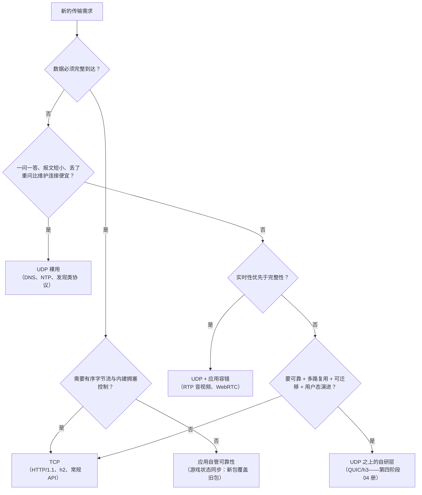

# UDP 与 ICMP：无连接传输与网络层信令

> [← 第三阶段导览](01-导览.md) · 时间线 ③~④ 的另一面。上一册的 TCP 把可靠性做满了；这一册讲传输协议谱系的另一极——**UDP 把能省的全省了**，把可靠性、顺序、拥塞控制的决定权交还给应用。浏览器链路里它无处不在：**DNS 查询走的就是 UDP 53**（02 册），第四阶段的 QUIC/h3 整个建立在 UDP 之上，WebRTC 的音视频流也是它。配套的 **ICMP** 是 IP 层自己的「报信协议」——ping、traceroute、路径 MTU 发现全靠它，抓包排障的第一批线索来自这里。

## 1. 为什么传输层需要两个协议

TCP 与 UDP 的分野一句话说完：**TCP 把「可靠有序字节流」做成服务，UDP 只把「IP 的寻址能力 + 端口复用」包成信封**——其余一切（要不要重传、要不要排序、要不要限速）由应用自己决定。

| | TCP | UDP |
|---|---|---|
| 连接 | 三次握手建立 | **无连接**——拿到地址就发 |
| 可靠性 | 确认+重传保证到达 | **尽力而为**——丢了就丢了 |
| 顺序 | 字节流严格有序 | 报文各自独立，可能乱序 |
| 速度感 | 头部 20 字节起 + 状态机 | 头部 **8 字节** + 零状态 |
| 拥塞控制 | 协议内置（TCP 册 §7 慢启动） | **没有**——应用想发多快发多快 |
| 面向 | 字节流（无边界） | **报文**（一次 send = 一个完整包） |

为什么「不可靠」的协议能活下来且越活越大：很多流量**天然不怕丢或自带恢复**——视频丢几帧花屏一下比等重传强；DNS 查询丢了就重问一次（比维护连接便宜）；游戏心跳丢了下一帧就覆盖。对这些流量，TCP 的可靠性不是白给而是**纯开销**（握手、确认、重传、慢启动全要付）。UDP 的哲学：**传输层不替应用做它没要求的假设**。

### 1.5 选型决策树：一个新流量该走 TCP 还是 UDP

把 §1~§3 的理由收拢成一棵决策树——给「我要不要用 UDP」这类架构评审问题一个可复用的路径（也是本册的浓缩图）：



注意树上所有 UDP 分支都隐含同一组前提（§5 的 NAT 暗面、§4 的单 MTU 纪律、§5.5 的自律三条）——**UDP 不是「省事的选项」，是「把责任拿回来的选项」**。

## 2. UDP 报文头：8 字节逐字段

```text
 0                   15 16                  31
+----------------------+----------------------+
|    源端口（16 位）      |    目的端口（16 位）     | ← 与 TCP 同一套端口空间
+----------------------+----------------------+
|    报文长度（16 位）    |    校验和（16 位）       | ← 长度含头+数据；校验和见 §2.5
+----------------------+----------------------+
|                     数据……
```

四个字段里真正有故事的：

| 字段 | 说明 |
|---|---|
| 源端口 | 可全 0（不需要回包的场景，如 DHCP 发现）——「不用回复我就不留地址」 |
| 目的端口 | 端口语义与 TCP 一致（53=DNS、443=QUIC、123=NTP），但**两套端口互不干扰**：同一端口可同时跑 TCP 与 UDP 服务 |
| 长度 | 整个报文（头+数据）字节数——因为 UDP 是**报文协议**，每个包自带边界；TCP 字节流要靠序号/长度头切分 |
| 校验和 | 见 §2.5；IPv4 可选（全 0 = 不校验），IPv6 **必填**（不填直接丢） |

**「报文有边界」是 UDP 与 TCP 应用写法差别的根源**：UDP 一次 `sendto` = 一个独立报文，接收方一次 `recvfrom` 拿到完整一个；TCP 是字节流，一次 `send(1000B)` 对端可能分三次到——所以 TCP 应用要自己定界（HTTP 的 Content-Length/chunked、WebSocket 的帧），UDP 不需要。这份「省心」的代价是没有流控：接收缓冲区一满，**新包直接丢弃**（不通知发送方）——应用得自己感知「我丢了包」。

### 2.5 校验和：为什么 IPv4 可选、IPv6 强制

UDP 校验和覆盖「伪首部（源/目的 IP+协议号+长度）+ UDP 头 + 数据」，算法与 TCP 相同（16 位反码求和）。差异在**是否强制**：

| 版本 | 规定 | 为什么 |
|---|---|---|
| IPv4 | 可选（发方算好填，或填 0 表示不校验） | 1980 年代 CPU 校验和是开销，链路层已有 CRC 兜底 |
| IPv6 | **强制** | IPv6 的 IP 头不再有校验和（砍掉了），链路 CRC 只保当前一段——网络设备路由时 IP 头字段会被改写（TTL/NAT），UDP 校验和成了唯一的应用层完整性兜底，顺便防「包被误投到别的主机」（伪首部绑定了 IP） |

抓包视角：Wireshark 里常见 UDP Checksum 显示 `unverified`——是因为抓包点（本机）在计算前截获，不是包有问题；真坏了会标 `bad checksum`。

## 3. UDP 的世界：谁在用、为什么

浏览器链路里 UDP 的四大住户，各自的选型理由：

| 住户 | 端口 | 为什么选 UDP |
|---|---|---|
| **DNS** | 53 | 一问一答、单包可容（超 512B 时 TC 截断转 TCP——02 册 §2.5）；不用为每次查询付 TCP 握手 + 挥手，**延迟和服务器状态成本都小一个量级** |
| **QUIC / HTTP-3** | 443 | 本站第四阶段 04 册的主角：在 UDP 上**用户态重造**可靠传输+TLS+多路复用——选 UDP 是因为它「全互联网已放行、允许承载任意载荷」，且 QUIC 想要的「连接迁移、流级重传、包号不回绕」在内核 TCP 里改不动（§5） |
| **WebRTC 音视频** | 动态端口 + STUN/TURN | 实时性优先于完整性：RTP 丢了就丢了（下帧覆盖），重传反而引入延迟抖动；NAT 打洞也需要 UDP 的「无连接」特性 |
| **NTP / DHCP / mDNS** | 123 / 67-68 / 5353 | 广播/组播、无需连接的发现类协议——TCP 的「一对一连接」模型根本不适用 |

通用选型心法：**「一问一答或自带容错 → UDP；必须完整到达 → TCP 或应用自管可靠性」**。DNS 丢了重问是应用自管的微缩版；QUIC 是应用自管的豪华版（把 TCP 级可靠性整个搬进用户态）。

### 3.5 DNS over UDP 的工程细节（衔接 02 册）

把 02 册的 DNS 放到 UDP 视角重看，几个此前一笔带过的细节有了机制解释：

| 现象（02 册） | UDP 层的解释 |
|---|---|
| 查询超时后重试 | UDP 不保证到达——DNS 客户端内置重试定时器（典型 1~5s/次），Wireshark 里「两个相同 DNS 查询包」= 第一次没回音 |
| 抓包偶见端口变化 | stub resolver 每次查询用新的临时源端口——既是 NAT 映射需要，也是缓解缓存投毒的随机化手段 |
| 响应超 512B 时 TC=1 转 TCP | §2 的报文长度字段 + EDNS0 载荷协商（02 册 §2.5）共同决定上限；超限就走 TCP |
| 高并发查询时丢包 | UDP 无流控——resolver 忙不过来时新查询被内核静默丢弃，「DNS 偶发慢」的经典成因（不是解析慢，是包没到） |

### 3.7 浏览器侧的 UDP 观测点

把本册涉及的 UDP 流量收进一张观测速查表（各实验的入口）：

| 想看什么 | 工具/位置 | 对应册 |
|---|---|---|
| DNS 的 UDP 53 包 | Wireshark `udp.port==53` | 02 册实验二 |
| QUIC/h3 的 UDP 443 | `udp.port==443`（展开就是 `quic` 层） | 第四阶段 04 册 §8 |
| UDP 443 通不通 | `nc -uvz 目标 443`；不通 = 你的网络用不了 h3 | 第四阶段 04 册 §7 |
| 浏览器的 UDP socket | `chrome://net-internals/#sockets` | 本册 §9 |
| 「端口没开」vs「被防火墙丢」 | 有 ICMP 3/3 回音 = 明确拒绝；全静默 = 策略丢弃——两种故障形态分开认 | 本册 §6 |

最后一行是排障的分叉点：**UDP 的失败有两种颜色**——「明确拒收」（ICMP 告诉你）与「沉默丢失」（什么都看不到），诊断路径完全不同。

## 4. UDP 与 IP 分片：MTU 的账

UDP 没有 MSS 协商——**应用发多大它就发多大**，超过 MTU 的报文由 IP 层分片：

```text
应用发 4000 字节 → UDP 头 8B → IP 分片：
  片1：IP头(20) + UDP头(8) + 1472B 数据   ← MTU 1500
  片2：IP头(20) + 1472B 数据
  片3：IP头(20) + 1048B 数据
```

分片的代价链要记牢：**任何一片丢失 = 整个报文作废**（IP 层不会只重传一片——它没有重传；UDP 也没有）。丢失概率从「按包算」放大成「按报文算」：1% 的包损率下，4 片报文的丢失率约 4%。这就是为什么工程上**应用层主动把 UDP 报文限制在单 MTU 内**（QUIC 强制 Initial 包 ≤1200B、WebRTC 按 MTU 切 RTP 包）：让「一个应用报文 = 一个链路帧」，把丢包粒度控制回包级，同时绕开中间设备对 IP 分片的不友好（很多防火墙直接丢弃非首片）。

顺带把 02 册 EDNS0 载荷常见值 1232 的谜底揭开：**1232 = IPv6 MTU 1280 − IPv6 头 40 − UDP 头 8**——选它保证 DNS 应答在 IPv6 最小 MTU 下也不分片。「DNS resolver 的 UDP 载荷为什么不是 4096 而常是 1232」就是这道算术。

## 5. 端口与 NAT：UDP 的暗面

UDP「无连接」在 NAT/防火墙眼里是麻烦：TCP 有握手/挥手事件可以据此建表删表，UDP 没有——NAT 只能用**超时**猜会话是否还活着（典型 30s~几分钟）。三个后果：

1. **UDP 流量被限速/优先级压低**：部分运营商对 UDP 长流限速（防滥用）——QUIC 在某些网络「明明通但慢」的经典原因；
2. **UDP 443 可能被封**：部分企业网/校园网只放行 TCP——浏览器 h3 静默回退 h2 的场景（第四阶段 04 册 §7 的回退路径）；
3. **打洞的由来**：WebRTC 两端都在 NAT 后，需要 STUN 探测自己的公网映射、TURN 中继兜底——「无连接」协议的会话语义全靠应用层自建。

这节是理解 h3 部署现状的地基：**QUIC 的全部自由（用户态演进、连接迁移）与全部阻力（UDP 歧视）是同一枚硬币的两面**——第四阶段 04 册展开。

### 5.5 UDP 洪水与「应用自律」三条

UDP 没有拥塞控制，把它放进公网就多出两类风险——理解它们不是为了攻防（归 `security/` 站），是为了理解「为什么 QUIC 要自带拥塞控制」：

| 风险 | 机制 | 与浏览器链路的关系 |
|---|---|---|
| **UDP 洪水** | 海量 UDP 包打满带宽/会话表——无握手意味着无需成本就能发 | 运营商对 UDP 长流限速/歧视的技术理由之一（§5） |
| **反射放大** | 开放的 UDP 服务（DNS/NTP）被当放大器：小请求、大响应、伪造源地址 | 「开放 resolver 要限制递归」的由来——02 册公共 resolver 的部署纪律 |

应用的自律三条（QUIC/WebRTC/DNS 客户端都内置了）：

1. **拥塞控制**：探测带宽再提速（QUIC 的 CUBIC/BBR、WebRTC 的 GCC——都在用户态/应用层实现）；
2. **单 MTU 纪律**：报文不超路径 MTU（§4）；
3. **重试有上限**：超时与重试次数封顶、退避增长——DNS 客户端的内置重试定时器就是微缩版。

一句话：**UDP 把枪交给了应用，纪律也归应用**——「没有内建约束」与「可以没有约束」的区别，就是「能跑的 UDP 应用」与「被打死的 UDP 应用」的区别。

## 6. ICMP：IP 层自己的信令协议

ICMP（Internet Control Message Protocol）不传用户数据，专职**报信**：告诉源主机「你的包到不了/超时了/需要分片了」或提供诊断回显。它在 IP 之上但不算「传输层」——没有端口概念，报文直接嵌在 IP 包里（协议号 1）。

```text
IP 头（协议=1/ICMP）
+--------+--------+----------------+
| 类型(8) | 代码(8) |    校验和(16)    |
+--------+--------+----------------+
|        其余 32 位（因类型而异）        |
+------------------------------------+
|        数据（通常含出错 IP 包的头 8 字节） |
+------------------------------------+
```

排障真正会遇到的类型/代码：

| 类型/代码 | 名字 | 谁发的 | 工程含义 |
|---|---|---|---|
| 0/0 | Echo Reply | 目的主机 | ping 的回答——RTT 的来源 |
| **3/0** | Network Unreachable | 路由器 | 路由表里没有去网——「整个站连不上」类故障 |
| **3/1** | Host Unreachable | 路由器 | 到了网段但主机不在——常见于宕机/IP 改错 |
| **3/3** | Port Unreachable | 目的主机 | UDP 包送达但**没有进程在监听该端口**——「端口没开」的标准回音（TCP 对应的是 RST） |
| **3/4** | Fragmentation Needed + DF | 路由器 | **PMTUD 的关键报文**——「下一跳 MTU 更小，需要分片，但你禁止分片」（§7） |
| 5 | Redirect | 路由器 | 「走我这不如走隔壁」——局域网路由优化提示 |
| 8/0 | Echo Request | ping | ping 的问句 |
| 11/0 | Time Exceeded in Transit | 路由器 | **TTL 减到 0**——traceroute 的机制支柱（§8） |
| 11/1 | Time Exceeded (Reassembly) | 目的主机 | 分片重组超时——§4 分片的另一个坑 |

两条安全注脚（攻防归 security 站）：ICMP 曾是洪水攻击载体（smurf），现代网络普遍对 ICMP 限速——**限速意味着「没收到 ICMP 回音」未必是「链路有问题」**，诊断时别把被限速的静默当成故障证据。

## 7. PMTUD：路径 MTU 发现与「黑洞」

TCP 靠 MSS 协商避分片（上一册 §5.2），但 MSS 只覆盖**两端**的 MTU——中间链路可能有更小的（隧道/VPN/PPPoE，典型 1492 甚至 1400）。PMTUD 的工作方式：

```text
源主机发 1500B 包，DF=1（Don't Fragment，不许分片）
  → 中间某跳 MTU=1400，无法转发又不能分片
  → 该路由器回 ICMP 类型 3/4（Fragmentation Needed），附上「我的 MTU 是 1400」
  → 源主机把 MSS 降到 1400−40，重发——之后全路径畅通
```

**PMTUD 黑洞**：防火墙误杀 ICMP 3/4 时，源主机永远收不到「该降 MTU」的通知——现象极具迷惑性：**小包（握手、请求头）畅通，大包（响应体）卡死**。「HTTPS 站点 TLS 握手成功、页面却加载不出来」「ping 正常、网页超时」的经典疑难杂症之一。定位：

```bash
# 用 DF 位 + 定长包探测路径 MTU（逐步加大 size 直到不通）
ping -D -s 1372 example.com        # Linux/macOS：-s 是 ICMP 数据长度；1372+28(头) = 1400
# 不通 = 路径上有更小 MTU；逐段试出临界值，即路径 MTU
```

解法在网侧（MSS clamping：网关强制改写 TCP MSS、PLPMTUD 用大包探测替代对 ICMP 的依赖），前端要的是**认识现象**：「大的过不去、小的能过」先怀疑 MTU 黑洞，别一头扎进应用层。

## 8. ping 与 traceroute：ICMP 的两个王牌应用

**ping**（Echo 8/0 ↔ 0/0）：测 RTT 与可达性。输出的 `time=23.4 ms` 就是 02 册「弱网 RTT≈100ms」的实测工具；`ttl=56` 字段顺带泄露中间跳数（默认 TTL 64，56 = 经过 8 跳）——TTL 的计数器本质是「防路由环路」：每过一跳减 1，减到 0 即丢弃并回 ICMP 11。

**traceroute** 把这个机制反向利用：**故意把 TTL 设成 1、2、3……** 每个值正好在第 N 跳「死掉」，死掉的路由器回 ICMP 11/0（Time Exceeded），源主机从回音的源地址 + 往返时间拼出**逐跳路径**：

```text
ttl=1 → 第 1 跳路由器回 Time Exceeded   → 记下：192.168.1.1  1.2ms
ttl=2 → 第 2 跳回                       → 记下：10.100.0.1  12ms
ttl=3 → 第 3 跳回                       → 记下：203.0.113.9  23ms
……直到到达目的主机（以 Echo Reply 或 Port Unreachable 收尾）
```

三个读 traceroute 输出的注意点：

| 现象 | 解读 |
|---|---|
| 某跳显示 `* * *` | 该跳不回 ICMP（限速/策略屏蔽）——**不代表路径断了**，看后续跳是否继续回应 |
| 中间跳 RTT 比端到端还大 | 路由器转发平面的 ICMP 处理是低优先级（控制平面限速）——中间跳数字仅供参考，别当瓶颈证据 |
| Windows 上是 `tracert`（纯 ICMP）；Linux/macOS `traceroute` 默认用 **UDP 高端口**（靠 3/3 Port Unreachable 收尾） | 「最后一跳收到的报文类型不同」就是这回事；`traceroute -I` 改用 ICMP |

把 ping/traceroute 归位到排障流程：**ping 定「通不通 + 多快」（RTT 层），traceroute 定「卡在哪一跳」（路径层）**，再回到 Wireshark 看包（机制层）——三层递进，正好是本阶段 06 册抓包实验的入口动作。

### 8.5 mtr：ping 与 traceroute 的合体

逐跳诊断的实战工具是 mtr（macOS `brew install mtr`，Linux 自带）——**持续重复 traceroute 并统计每跳丢包率**，一次给出「卡在哪一跳 + 丢多少」：

```bash
mtr -rw example.com    # -r 报告模式，-w 宽输出；跑约 100 个包后 Ctrl+C 出报告
```

读报告的口诀（对照 §8 的 `* * *` 现象）：

| 读数 | 解读 |
|---|---|
| 第 N 跳 Loss% 高、N+1 起恢复 | 该跳对 ICMP 限速——不是故障（§6 的安全注脚） |
| 第 N 跳起全部后续跳 Loss% 都高 | **真断点/拥塞点在 N**——这才要处理 |
| Best/Worst/Avg 差距大 | 该跳排队抖动大——结合业务流量而非 ICMP 下结论 |

## 9. 实验

1. **ping 三连**：`ping example.com`（记录 RTT 与 ttl）、`ping 8.8.8.8`（跳过 DNS 的对照）、`ping 一个不存在的主机`（观察 DNS 报错 vs 3/1 Host Unreachable 的差异）。
2. **traceroute 全景**：`traceroute example.com` 与 `tracert`（若在 Windows）对照；数一数 `* * *` 出现的位置，用 §8 的表解释它。
3. **路径 MTU 探测**：`ping -D -s 1372` 与 `-s 1472` 各打一次公网站点，找出你的路径 MTU 临界值；再解释 02 册 resolver 1232 的来历。
4. **UDP 53 现场**（与 02 册实验二合并做）：Wireshark 过滤 `udp.port==53`，展开 UDP 头核对 8 字节四字段；观察源端口随机性（多次查询端口不同）。
5. **Port Unreachable 现场**：对本机一个**没有服务监听**的 UDP 端口发包（`nc -u localhost 9999` 后随便打字），Wireshark 里抓 ICMP 3/3 的回音——「端口没开」的 UDP 形态，与 TCP 的 RST 对照。
6. **QUIC 先睹为快**（可选）：访问一个 h3 站点（DevTools Protocol 列验证），Wireshark 过滤 `udp.port==443`——第四阶段 04 册的主角此刻已在你抓包里：UDP 头后面就是 QUIC 长头部。

7. **mtr 报告**（§8.5 落地）：`mtr -rw example.com` 跑约 100 个包，对照口诀读 Loss% 列——找出你到该站点的路径上有没有「限速跳」与「真断点」。

## 10. 常见误区

1. **「UDP 不可靠所以 UDP 是劣质协议」**：不可靠是**设计选择**——把不浪费的机制留给应用选。QUIC 选它正是为了摆脱内核 TCP 的演进枷锁；DNS 选它是因为连接开销远大于重问开销。「不可靠」与「不可用」是两回事。
2. **「UDP 没有拥塞控制，所以随便发」**：UDP 本身确实不管，但**应用必须管**（QUIC 在用户态实现完整拥塞控制）——裸发大流量 UDP 会被中间设备限速甚至封禁，「自由」的代价是自律。
3. **「ping 不通 = 网络断了」**：ICMP 被策略屏蔽/限速的站点比比皆是（`* * *` 或超时但网页正常）。ping 是「探测工具」不是「判定书」——以真实业务流量（TCP/HTTP）的表现为准。
4. **「UDP 报文多大都行，IP 会帮我分片」**：技术上对，工程上错——分片放大丢失（§4 的 1%→4%）、非首片常被防火墙丢弃。应用层限单 MTU 是纪律不是洁癖。
5. **「ICMP 是传输层协议」**：它是 IP 的伴生信令协议，没有端口、不承载数据。说「ICMP 传输」是概念错误；它的正确位置是「网络层的控制平面」。
6. **「DNS 走 UDP 所以 DNS 不可能走 TCP」**：02 册 §2.5 的 TC 标志与 §4 的分片账都在说同一件事——大响应与 zone 传送走 TCP，明文 53 端口两种传输都在用。

### 10.5 常见问答

**Q：UDP 一次最多能发多大？**
理论上限 65507 字节（65535 − 8 字节 UDP 头 − 20 字节 IPv4 头），但实际受路径 MTU 约束（§4）——工程上限是「单 MTU 内」（以太网典型 ~1472），超了要么 IP 分片（§4 的三重代价）、要么赌路径支持。QUIC 干脆把 Initial 包钉死在 1200 字节以下。

**Q：视频会议用 UDP，那 YouTube 看视频也走 UDP 吗？**
点播走 TCP（HTTP + h2/h3）——**可缓冲**的内容能用缓冲把「可靠性的延迟代价」藏起来；**实时交互**（会议/通话）藏不住，丢帧比重传等待好。同一个「视频」，选型可以完全相反——判据是「实时性 vs 完整性」的优先级，不是「是不是视频」。

**Q：QUIC 在 UDP 上重造了 TCP，那它和 TCP 到底差在哪？**
可靠性算法同源（确认/重传/拥塞控制），差异在**实现位置与设计细节**：用户态（演进随浏览器发版）、流级独立重传（第四阶段 04 册 §3）、包号单调不回绕（乱序判断更准）、连接身份是 CID 可迁移（§5 与第四阶段）。一句话：**同样的可靠性，不同的实现位置——位置决定演进速度**。

**Q：我的 API 服务该直接用 UDP 吗？**
别。除非你打算投入 QUIC 级的工程（拥塞控制、加密、丢包恢复、NAT 穿透全自建），否则用 TCP 之上的 h1/h2/h3——「自己造 UDP 可靠层」是被行业反复证明的深坑，QUIC 本身就是「与其各造各的轮子，不如造一个公共的好轮子」的产物。

## 11. 自测题

1. 画出 UDP 头 8 字节的四个字段；「报文有边界」对应用写法意味着什么？TCP 为什么需要自己定界？
2. UDP 校验和在 IPv4 与 IPv6 里的强制性差异是什么？IPv6 强制的两条理由？
3. DNS 为什么选 UDP？「超 512B 走 TCP」的触发字段与机制是什么（提示：TC 位 + EDNS0）？
4. 为什么 QUIC/WebRTC 都刻意把应用报文限制在单个 MTU 内？分片的三重代价是什么？
5. 1232 这个 EDNS 载荷值的算术是怎么来的？（提示：IPv6 最小 MTU 1280 − 40 − 8。）
6. ICMP 类型 3/3 与 TCP 的 RST 各自表达什么？同一台服务器「TCP 端口关闭」与「UDP 端口关闭」的回音差异？
7. PMTUD 的工作循环是什么？「小包通、大包卡」指向什么故障？怎么用 ping 定位路径 MTU？
8. traceroute 的原理一句话是什么？为什么 Windows 与 Linux/macOS 的收尾报文类型不同？
9. 中间跳显示 `* * *` 且后续跳正常，说明什么？为什么中间跳 RTT 可能大于端到端 RTT？
10. 把本册放回账本：③（DNS）段的哪些现象现在有了 UDP 层的解释？④⑤ 段在 QUIC 场景下与 UDP 的关系是什么（预告第四阶段 04 册）？
11. 「NAT 对 UDP 会话只能靠超时猜存活」导出哪三个工程后果？它们分别影响哪个协议（DNS/QUIC/WebRTC）？
12. 一个 4KB 的 DNS 应答（EDNS0 协商了 4096）在 MTU 1500 的链路上会产生几个 IP 分片？任何一片丢失的后果是什么？
13. mtr 报告里「第 3 跳 Loss% 40%、第 4 跳起 0%」与「第 3 跳起全部 40%+」分别说明什么？（提示：§8.5 的口诀。）
14. UDP 反射放大攻击的机制是什么？它与「开放 resolver 要限制递归」是什么关系？（位置题——攻防归 security 站。）
15. 「应用自律三条」各自约束什么？QUIC 与 DNS 客户端分别在哪一层实现了它们？

## 11.5 自查清单

| # | 检查 | 工具 | 异常指向 |
|---|---|---|---|
| 1 | DNS 查询源端口每次都变吗？ | Wireshark `udp.port==53` | 不变 = resolver 实现老/被中间设备固定——投毒面变大 |
| 2 | 抓包里有 IP 分片吗？ | `ip.flags.mf == 1` | 有 = 某应用没做单 MTU 约束（DNS 载荷没收敛/自定义 UDP 服务） |
| 3 | 大响应卡住、小包正常？ | ping -D -s 探测 | PMTUD 黑洞（§7） |
| 4 | UDP 443 通不通？ | `nc -uvz 目标 443` / 抓包 | 被封 = 你的用户永远用不上 h3（第四阶段 04 册 §7） |
| 5 | ICMP 被限速了吗？ | ping 与真实流量对照 | ping 超时但业务正常 = 策略屏蔽，别误判 |
| 6 | traceroute 卡点在哪跳？ | traceroute / mtr | 结合 §8 解读——`* * *` 不一定是断点 |

## 12. 延伸

- 下一册：[05-TLS-从明文到加密信道](05-TLS-从明文到加密信道.md)——TCP 管道与 UDP 信使都认识了，把管道升级成加密信道的握手开始；QUIC 把本册的 UDP 与这一册的 TLS 缝在了一起（第四阶段 04 册）。
- WebRTC/STUN 的完整展开超出本站范围（实时通信专题）；QUIC 选 UDP 的完整论证在第四阶段 04 册 §1。
