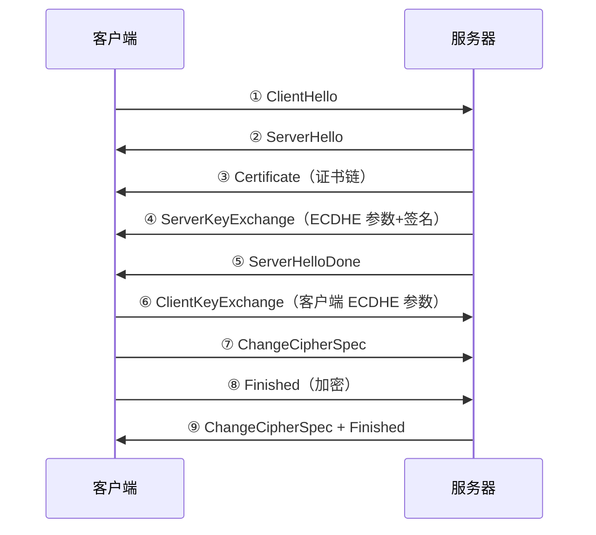
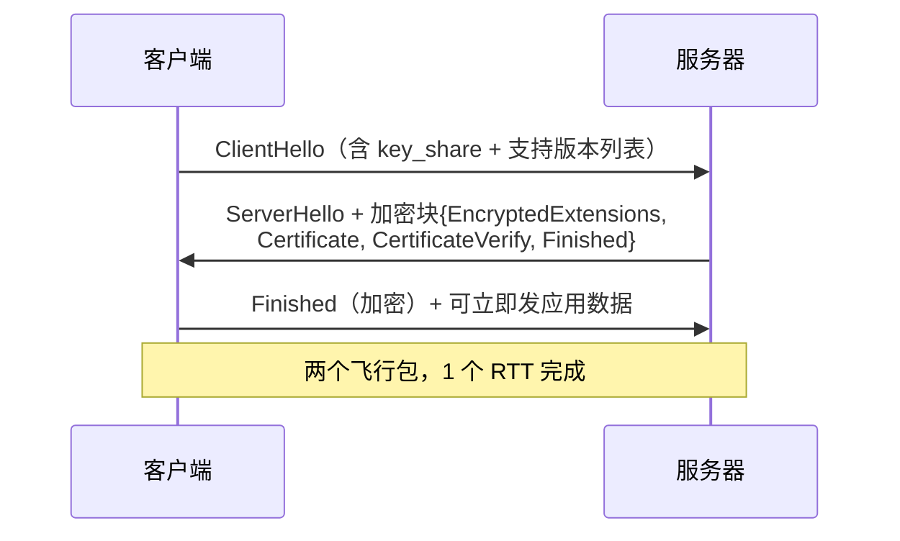

# TLS：从明文到加密信道（HTTPS 握手详解）

> [← 第三阶段导览](01-导览.md) · 时间线 ⑤。TCP 管道通了，但传 HTML 还差最后一步：把明文管道升级成加密信道。这一册是本阶段写得最细的一册——因为 HTTPS 握手是「人人都经过、人人说不清」的典型：浏览器每天都在做，但 ClientHello 里带了什么、密钥怎么算出来、证书到底在证明什么、0-RTT 为什么敢快又为什么危险，多数人答不全。本册从密码学五件套打底，把 TLS 1.2 与 1.3 的握手逐条消息拆到字段级，再回到工程：证书链、吊销、ALPN 与 h2/h3 的衔接（QUIC 把 TCP 握手也一并吃掉，第四阶段 04 册）。

## 1. 总账：TLS 握手的时间线位置

| 方案 | 握手成本 | 说明 |
|---|---|---|
| TLS 1.2 全握手 | 2 个 RTT | 历史主力，大量存量服务 |
| TLS 1.3 全握手 | 1 个 RTT | 2018 定稿（RFC 8446），现代默认 |
| TLS 1.3 + 会话恢复（PSK） | 1 个 RTT（恢复型握手） | 省证书往返 |
| TLS 1.3 + 0-RTT | **0 个 RTT**（第一个包就带数据） | 仅限恢复连接，有重放限制 |
| QUIC 初次连接 | 1 个 RTT（TCP+TLS 合并） | 见第四阶段 04 册 |

弱网（RTT≈100ms）视角：1.2→1.3 省一个 RTT 就是省 ~100ms/连接。**HTTP 事实上依赖 TLS**（现代浏览器把新能力绑在 https 上），这笔账是每个 HTTPS 页面都要付的。

## 2. HTTPS 是什么：先掰清三个词

**HTTPS = HTTP over TLS**。就一句话，但三个常见混淆要先拆掉：

| 混淆 | 澄清 |
|---|---|
| 「HTTPS 加密了网址」 | **没有**。加密的是 TLS 记录层里的内容（HTTP 报文）；域名在 **DNS**（明文/DoH）、**SNI**（明文，除非 ECH）里仍然可见——「加密信道 ≠ 匿名连接」（§10） |
| 「https 比 http 安全在 URL 更隐蔽」 | 安全性来自三件事：**加密**（内容读不到）、**完整性**（内容改不了）、**身份认证**（对面真的是那个域名的主人）——URL 隐蔽性反而是最弱的一环 |
| 「TLS 是 HTTP 的一部分」 | TLS 是独立协议层，位于 TCP 之上、HTTP 之下；同一套 TLS 也能包别的应用（邮件、QUIC 内嵌……）。栈里的位置： |

```text
应用层     HTTP 请求/响应（明文）
   ↓
安全层     TLS 记录层（加密+认证，一段段 ~16KB 的记录）
   ↓
传输层     TCP（可靠字节流，按 MSS 分段）
   ↓
网络层     IP
```

**443 端口**：https 的默认端口，本质只是「这个端口上先跑 TLS 握手、再跑 HTTP」的约定——浏览器看到 `https://` 就直接对 443 发 TLS ClientHello，而不是先发 HTTP 再升级。

**证书验证的对象是「域名」**：访问 `https://example.com` 时，浏览器检查的是「这张证书是否属于 example.com」（SNI 告诉服务器你要哪个域名的证书，§10）——不是「这张证书属于哪家公司」。公司主体信息在证书 Subject 里，但浏览器核心认 SAN 里的域名匹配。

## 3. 为什么需要握手：混合加密模型

目标：双方在没有共享秘密的前提下，协商出只有彼此知道的对称密钥。

| 密码学原语 | 特性 | 在握手里的角色 |
|---|---|---|
| 对称加密（AES/ChaCha20） | 快，适合大量数据；密钥怎么送达是鸡生蛋问题 | 会话数据的实际加密 |
| 非对称签名（RSA/ECDSA） | 慢，但可验证身份 | 证书签名与验证 |
| 密钥交换（ECDHE） | 双方交换公开参数即可算出共享秘密 | 协商对称密钥 |

握手 = 用非对称手段协商对称密钥 + 用证书证明「我就是这个域名的主人」。记不住算法细节没关系，记住握手在产出三样东西：**密码套件的选择、对称会话密钥、身份证明**。

## 4. 密码学五件套打底（不背公式，只要直觉）

看懂逐消息拆解前，把五件套的「能力与用途」对上号，每件只要一个直觉：

| 件 | 能力 | 直觉 | 在 TLS 里的用途 |
|---|---|---|---|
| **哈希**（SHA-256） | 任意输入 → 固定 256 位指纹 | 改一个字节指纹面目全非；不可逆推原文 | Finished 校验、握手转写摘要 |
| **HMAC** | 带密钥的哈希 | 没有密钥的人连「指纹是否被改过」都算不出 | 1.2 记录层的 MAC（防篡改） |
| **对称加密 + AEAD**（AES-GCM/ChaCha20-Poly1305） | 加密+认证一体 | 密文改任何字节，解密直接报错（认证标签对不上）——不需要单独的 MAC | 1.3 与现代 1.2 的记录加密 |
| **签名**（RSA/ECDSA） | 私钥签、公钥验 | 只有私钥持有者能产出合法签名——「这份内容出自我、之后没改过」 | 证书链逐级验签、握手参数防篡改 |
| **DH/ECDHE** | 双方各亮公开参数，各自算出**同一个**秘密，旁观者算不出 | 见下面的小数字例子 | 协商会话密钥 |

**DH 的小数字直觉**（真实用素数/椭圆曲线，这里用 17、5 演示结构）：

```text
公开：模 17、底 5
Alice 选秘密 a=4 → 公开 5⁴ mod 17 = 13
Bob   选秘密 b=3 → 公开 5³ mod 17 = 6
Alice 用「Bob 的公开值 + 自己的秘密」算 6⁴ mod 17；
Bob   用「Alice 的公开值 + 自己的秘密」算 13³ mod 17；
两边得到同一个数（g^(ab) mod p）——而偷看者手里只有 13 和 6，
要从 13 反推 a=4 是「离散对数问题」，大数下计算上不可行。
```

三条对工程的结论：

1. **ECDHE 的 E 是临时（ephemeral）**：每次连接生成新的 a、b——今天的私钥泄露解不开昨天的流量（**前向保密**）。这是「抓包存档也解不开 HTTPS」的根源（06 册实验配密钥日志解决）；
2. **DH 交换本身不验身份**——裸 DH 谁都能掺和，所以要「对 DH 参数做签名」（ServerKeyExchange/CertificateVerify，§5/§6）防中间人；
3. **AEAD 取代了「加密+MAC」的拼装**：1.2 早期是 MAC-then-encrypt（先算指纹再加密，顺序与实现的坑出过若干攻击），1.3 只留 AEAD——认证标签内建于密文。

## 5. TLS 1.2 全握手逐消息详解



逐条拆「这条消息是什么、为什么必须有」：

| # | 消息 | 内容 | 为什么需要 |
|---|---|---|---|
| ① | **ClientHello** | 见下方字段表 | 把「我会什么、我要连谁、我的随机数」一次性报给服务器 |
| ② | ServerHello | 从套件列表**选定一个**、服务器随机数 | 收敛双方能力交集；第二个随机数入场 |
| ③ | Certificate | 证书链（叶子→中间，根不发） | 证明「我是这个域名的合法持有者」——身份认证的主体 |
| ④ | **ServerKeyExchange** | ECDHE 服务器侧参数（曲线+临时公钥）+ **对参数的签名** | 裸 DH 参数谁都能发——签名把参数「钉」在证书身份上，中间人改参数立即验签失败 |
| ⑤ | ServerHelloDone | 空 | 「服务器侧的牌出完了」——第一个 RTT 到此为止 |
| ⑥ | ClientKeyExchange | 客户端 ECDHE 临时公钥 | 双方各持临时私钥+对方临时公钥 → 各自算出同一个 premaster secret |
| ⑦ | ChangeCipherSpec | 1 字节通知 | 「从下一条消息起，我说的都是密文」 |
| ⑧ | **Finished** | 加密的 verify_data = **握手全程消息的哈希** | 防篡改协商的收口：任何一方改过任何握手消息，双方算出的哈希对不上，握手即废——中间人在数学上必然留痕 |
| ⑨ | 服务器侧 CCS + Finished | 同 ⑦⑧ | 双向确认切换到加密信道 |

**ClientHello 字段表**（Wireshark 展开 ClientHello 的真实结构，1.2/1.3 通用）：

| 字段 | 内容 | 工程看点 |
|---|---|---|
| Version | 客户端支持的最高版本 | 1.2 靠它协商；1.3 固定写 1.2、真版本挪进扩展（兼容中间盒的历史包袱） |
| Random | 32 字节随机数 | 参与密钥推导（§5.5）；1.3 里**末 8 字节兼作降级哨兵**（§6） |
| Session ID | 会话恢复的凭证（1.2 时代） | 恢复握手的钥匙孔（§7） |
| Cipher Suites | 支持的套件列表（按偏好排序） | 与服务器求交集；抓包里一长串 `TLS_ECDHE_ECDSA_...` 就是它 |
| Compression | 1.2 有、实际禁用 | 头压缩出过 CRIME 攻击（泄露 cookie），已死 |
| **Extensions** | SNI、ALPN、supported_groups、signature_algorithms、key_share（1.3）、psk_key_exchange_modes（1.3）、status_request（OCSP 装订）、session_ticket…… | **握手的真正内容大半在扩展里**——SNI（§10）、ALPN（§11）各自展开 |

「两个 RTT 的来源」现在能精确说出：**ClientHello→ServerHelloDone**（客户端凑齐材料才能发密钥）是第一个 RTT；**CCS/Finished 往返**是第二个。1.3 砍的就是这两段里的冗余（§6）。

历史注脚——**RSA 密钥交换**（客户端直接用服务器公钥加密 premaster，不走 DH）：因无前向保密（私钥一泄露历史抓包全部可解）已被淘汰；但它的名字还活在套件名里（`TLS_RSA_WITH_...`），也是「私钥泄露 = 全量历史解密」这类老事故的标准成因。

### 5.5 TLS 1.2 的密钥推导链：三样材料 → 六把密钥

握手产出的会话密钥不是「一个密钥」，是一条推导链（PRF = 伪随机函数，基于 SHA-256）：

```text
材料：premaster secret（ECDHE 算出的共享秘密）
    + client_random（①里的 32 字节）
    + server_random（②里的 32 字节）
        │ PRF
        ▼
master secret（48 字节）            ← 每条连接都不同（随机数 + 临时 DH 保证）
        │ PRF（"key expansion"）
        ▼
key block（密钥块）→ 切成六把：
  client_write_MAC_key / server_write_MAC_key    ← 算 HMAC 用（防篡改）
  client_write_key    / server_write_key         ← 加密用（双向各一把）
  client_write_IV     / server_write_IV          ← AEAD 初始向量
```

为什么是**双向各一把**：防「把客户端密文反射回客户端」的反射攻击——两个方向的密钥独立。为什么混入**双方随机数**：让密钥绑定「这一次具体握手」——旧连接的重放/重排材料算不出新密钥。

三个随机数（premaster + client_random + server_random）共同喂出 master secret——「至少一方诚实随机」就有安全密钥：随机数生成器的质量是密码工程的生死线（历史上有实现拿毫秒时间戳当随机源，被秒破）。

## 6. TLS 1.3：一个 RTT 怎么压出来的

核心改动三件：

1. **密钥材料前置**：ClientHello 直接带 key_share 扩展（ECDHE 临时公钥），服务器一个包里就能算出会话密钥——密钥协商的两个来回压成一个；
2. **握手后半段加密**：ServerHello 之后的 Certificate/Finished 全在加密信道里传（1.2 是明文）——顺带**隐藏了证书**，中间设备看不到你连的是哪张证书；
3. **套件大清洗**：砍掉 RSA 静态交换、CBC 模式，只留 AEAD；套件名从几十个减到 5 个（§6.5）。

时序上：



逐条对照 1.2 的变化：

| 1.2 消息 | 1.3 对应 | 变化点 |
|---|---|---|
| ServerKeyExchange（明文参数+签名） | **CertificateVerify**（加密传） | 签的不是 DH 参数本身，而是**整个握手转写**（transcript）——防降级的数学支柱：把「双方看到的一切握手消息」纳入签名，中间人剪掉「支持 1.3」逼双方降级到 1.2 的手法立即验签失败 |
| ServerHelloDone | EncryptedExtensions | 服务器附加策略（ALPN 结果等）也进加密区 |
| ClientKeyExchange | （已并入 ClientHello 的 key_share） | 省掉的一整个来回 |
| ChangeCipherSpec ×2 | **兼容空包**（1 字节假动作） | 真正的切换由消息类型隐含；保留 CCS 只为**穿过只认老形态的中间盒**——抓包里「无意义的 CCS」就是这历史包袱 |
| Finished ×2 | Finished ×2（加密） | 仍是转写哈希校验，语义不变 |

**降级哨兵（downgrade sentinel）**：支持 1.3 的服务器被迫与 1.2 客户端握手时，在 ServerHello.random 末 8 字节写入固定标记；支持 1.3 的客户端看到标记 + 自己被降级 → 断定「中间有人在压版本」，拒绝连接。1.2 对 1.0/1.1 同理——版本协商的每条路径都有人站岗。

**HelloRetryRequest**：客户端的 key_share 组服务器不认时，服务器用它要求换组重发 Hello——多一次往返，抓包里见到它通常是协商组配置问题。

### 6.5 密码套件命名解读

抓包与 DevTools Security 面板里形如 `TLS_AES_128_GCM_SHA256`、`TLS_ECDHE_RSA_WITH_AES_128_GCM_SHA256` 的套件名是握手结果的一行摘要，逐段读：

| 段 | 含义 | 例 |
|---|---|---|
| `TLS_` | 版本前缀 | 1.3 套件名不带 WITH（简化命名） |
| `ECDHE_` | 密钥交换算法 | 临时椭圆曲线 DH（前向保密） |
| `RSA_` | 证书签名算法 | 服务器证书用 RSA 签名 |
| `AES_128_GCM` | 对称加密+模式 | AEAD（加密+认证一体） |
| `SHA256` | PRF/摘要 | 推导密钥用的哈希 |

读套件的三条判断：

1. **有 `ECDHE` 才有前向保密**——套件名里没有它（如老的 `TLS_RSA_WITH_...`）意味着私钥泄露可解历史流量；
2. **`GCM`/`CHACHA20` 是 AEAD 标志**——出现 CBC 的是历史遗留（1.3 已清空）；
3. **1.3 套件名只有 5 个**（如 `TLS_AES_128_GCM_SHA256`）——大清洗的直观体现，1.2 时代几十个套件的「选择困难」被终结。

## 7. 会话恢复与 0-RTT

全握手太贵，「见过面的双方」走捷径：

- **1.2 的恢复**：session ID 或 **session ticket**——服务器握手成功时发一张加密票据，客户端存着；下次连接在 ClientHello 里出示票据（PSK 语义），双方直接恢复会话密钥，省掉证书往返——2 RTT → 1 RTT；
- **1.3 的恢复**：ClientHello 带 PSK 扩展（票据身份 + 绑定的密钥材料）。**PSK-DHE 模式**仍叠加 ECDHE = 票据 + 新鲜 DH（票据服务器密钥泄露也不解历史流量）；**纯 PSK 模式**省 DH 但丢前向保密——主流实现选 PSK-DHE；
- **0-RTT（early data）**：更激进——客户端在**第一个飞行包**（ClientHello）里就捎带加密的 HTTP 请求。代价是**重放风险**：early data 用恢复密钥加密，攻击者截获后可向服务器原样重放（服务器无法区分「真客户端」与「重放者」），且 0-RTT 数据**不享受前向保密**（密钥派生自票据）。

工程规约（敢/不敢进 0-RTT）：

| 敢进 0-RTT | 不敢进 0-RTT |
|---|---|
| 幂等 GET（拉数据） | 一切带副作用的请求（下单/支付/改密） |
| 静态资源请求 | 依赖「只执行一次」语义的操作 |

服务端防线还要补两道：**时间窗**（只接受 N 秒内的 early data，缩小重放窗口）与**单次记账**（记录见过的 ClientHello 摘要拒绝重放——单机布隆过滤器、集群共享状态；「防重放」的分布式成本是 0-RTT 的真实代价）。浏览器侧保守：GET 类导航可进 early data，POST 不会。**QUIC（h3）沿用同一套 0-RTT 纪律**（第四阶段 04 册）。

### 7.5 TLS 记录层：应用数据怎么被封包

握手完成后，HTTP 数据走 TLS **记录层**（record layer）：

```text
应用数据（HTTP 请求/响应字节）
  → 切成记录（最大 ~16KB）
  → 每条记录：类型 + 版本 + 长度 + 加密载荷 + 认证标签（AEAD）
  → 写入 TCP（TCP 再做自己的分段——MSS）
```

四层分段的叠加关系是「报文大小」问题的全景：

| 层 | 上限 | 谁决定 |
|---|---|---|
| HTTP 对象 | 无（流式） | 应用 |
| TLS 记录 | ~16KB | TLS |
| TCP 段 | MSS（~1460） | TCP 握手协商 |
| 链路帧 | MTU（1500） | 物理/链路层 |

抓包看到「一个 HTTP 响应对应 N 个 TCP 包」就是这条分段链的结果——03 册「压缩省包头开销」的具体位置：体积减半时，TLS 记录、TCP 段、IP 包的数量全部同比例减半。

### 7.6 会话恢复在抓包里的识别

§7 的恢复握手有明确的抓包形态特征——第二次连同一站点时对照看：

| 观察点 | 全握手 | 恢复握手（PSK） |
|---|---|---|
| ClientHello 的扩展 | key_share，无 PSK | **pre_shared_key**（走 0-RTT 时再加 early_data） |
| 服务器证书消息 | 有（1.3 加密传、1.2 明文可见） | **没有**——身份靠票据记忆，不重新验证 |
| 飞行包数 | 2 | 1（0-RTT 时请求随 ClientHello 直接飞出） |

openssl 侧观测：连续两次 `curl -v` 同一站点，第二次输出出现 `Reused, TLSv1.3`（curl 自带 session cache）。**用这张表验证 §1 总账**：恢复握手省的是证书验证那轮往返，省不掉 1 个 RTT 下限——突破下限靠 0-RTT，代价（重放限制）见 §7。

## 8. 证书链验证

浏览器拿到 `Certificate` 消息后做的检查，逐项过：

| # | 检查 | 内容 | 失败表现 |
|---|---|---|---|
| 1 | **链** | 叶子证书（你的域名）→ 中间 CA → 根 CA；根在系统信任库 | 「证书不受信任」 |
| 2 | **逐级验签** | 上一级用其公钥验证下一级的签名，直到根 | 同上 |
| 3 | **有效期** | notBefore/notAfter | 「证书已过期」 |
| 4 | **域名匹配** | 叶子证书 SAN 列表必须含目标域名（SNI 发的那个）；通配符 `*.example.com` 只匹配一层子域 | 「名称不匹配」 |
| 5 | **吊销状态** | 见 §9 | 软失败策略下多不阻断 |
| 6 | **用途/约束** | basicConstraints（ca=true）等扩展合法性 | 拒绝 |

链的发送顺序与验证顺序相反要记清：**服务器从叶子往根发（根不发，对方自己有）**；浏览器**从根往叶子验**（信任锚在根）。中间 CA 是「被根授权发证书的证书」——basicConstraints 的 `ca:true` 与 pathlen 限制它的权力边界。

**经典故障：缺中间证书**。服务器只部署叶子证书，没带中间 CA——多数浏览器能救（AIA chasing：顺着证书里的 CA 地址自动下载中间证书），但很多非浏览器客户端（curl、App 内置库、部分移动端）不追，直接失败。这就是「浏览器能开、App 打不开」的证书类故障标准成因。自查：

```bash
openssl s_client -connect example.com:443 -showcerts </dev/null 2>/dev/null | grep -c "BEGIN CERT"
# 应输出「叶子 + 全部中间」的张数；根不用发，对方自己有
```

### 8.5 一张证书的字段速查

`openssl s_client -showcerts` 或 DevTools Security 面板里证书的字段，工程上真正要看的：

| 字段 | 内容 | 排障时看什么 |
|---|---|---|
| Subject | 证书持有者（叶子证书常为空，用 SAN） | — |
| **SAN**（Subject Alternative Name） | 覆盖的域名列表 | 域名不匹配错误查这里；通配符只匹配一层 |
| Issuer | 签发者（中间 CA 名） | 链断了先看它 |
| Validity | notBefore/notAfter | 过期错误 |
| **AIA** | CA 签发者地址 | AIA chasing 的下载源（§8 缺中间证书时） |
| **Authority Info / OCSP URL** | 吊销查询地址 | 装订失败的排查点 |
| Basic Constraints | 是否 CA、路径长度 | 中间证书被误用为叶子的检查 |
| **CT 日志（SCT）** | 证书透明度时间戳 | 现代浏览器要求叶子证书入 CT 日志 |

「证书透明度（CT）」多说一句：任何 CA 给任意域名签证书都会被强制公开记录——「CA 乱发证书」的全球审计机制，本站只记位置，攻防归 security 站。

## 9. 吊销：CRL、OCSP 与装订

证书丢了私钥怎么办——吊销。三种机制与它们的性能账：

| 机制 | 做法 | 性能问题 |
|---|---|---|
| CRL | 客户端下载完整吊销列表 | 列表大，实时性差 |
| OCSP | 客户端实时查询单张证书状态 | **每次握手多一次 OCSP 查询往返**（弱网显著）；查询也暴露浏览目标给 CA |
| **OCSP 装订（stapling）** | 服务器定期取好 OCSP 响应，握手时「装订」着递给客户端 | 客户端零额外往返——工程正解 |

`Must-Staple` 扩展强制要求装订（没装订就拒），属高安全场景的选择。**Chrome 默认软失败**（OCSP 查询超时/失败不阻断握手）——安全与可用性的现实折中。

### 9.5 装订生效与否的两分钟检查

判断一台服务器做没做 OCSP stapling，两条命令：

```bash
# ① openssl 直接看握手里带没带 OCSP 响应
openssl s_client -connect example.com:443 -status </dev/null 2>/dev/null | grep -A2 "OCSP"
# 有 "OCSP Response Status: successful" = 装订生效；无输出 = 没做

# ② 实测时延差：装订省掉的那次 OCSP 查询往返
curl -w 'appconnect=%{time_appconnect}\n' -so /dev/null https://example.com
# 反复几次对比：未装订的站点偶见 +1 RTT 的尖刺（浏览器现场查 OCSP）
```

口径：**「没做装订」不算故障**（浏览器软失败兜底、不阻断握手），但弱网用户占比高的产品里它是可量化的优化项——§9 的「性能账」落到测量的样子。

## 10. SNI 明文与 ECH

ClientHello 明文携带 SNI（Server Name Indication）：告诉服务器「我要连哪个域名」——同一 IP 多站点（server_name 分流）的前提。代价：**中间设备看得见你要访问的域名**——加密了流量却没藏住目的地。审查/运营商据此做 SNI 阻断或分流。

**ECH（Encrypted Client Hello）**：用服务商入口域名的公钥加密真实 SNI——中间设备只看得见「你连了 Cloudflare/某平台」，看不见具体站点。与 DNS 的 HTTPS/SVCB 记录配合（ECH 密钥经 DNS 发布，衔接 02 册 §3.3）。部署率仍低，属「加密边界推进」的前沿——理解方向即可。

## 11. ALPN：握手里顺带协商 HTTP 版本

握手还免费捎带一件对第四阶段至关重要的事：**ALPN**（Application-Layer Protocol Negotiation）扩展在 ClientHello 里列出「我会说的应用协议」，服务器选定其一——HTTP/1.1 → h2 → h3 的协商全靠它：

```text
ClientHello
  extension: application_layer_protocol_negotiation
    ALPN: h2, http/1.1           ← 「我会 h2，也会 h1 兜底」
ServerHello
  ALPN: h2                        ← 「就 h2」→ 这条 TLS 连接从此跑 h2
```

三个要点：

1. **顺序敏感**：客户端把偏好排前面，服务器必须选列表里它支持的第一个——顺序配错会出现「双方都支持 h2 却落在 h1」的哑故障（CDN/网关配置的第一检查点，第四阶段 03 册会回来用它）；
2. **一次往返定终身**：协议升级搭 TLS 握手的便车，没有额外往返——DevTools Protocol 列显示的 `h2` 就是这条协商的结果；
3. **QUIC 内嵌同样的 ALPN**：h3 的协商值是 `h3`（第四阶段 04 册）——「握手时顺带说清上层协议」这个模式跨协议复用。

## 12. 威胁模型对照：这套握手到底防什么

把「HTTPS 安全」拆成四个具体威胁，每个对到机制上——面试与架构评审的标准答案结构：

| 威胁 | 机制 | 失守的样子 |
|---|---|---|
| **窃听**（读内容） | 对称加密（AEAD）——密钥只有双方算得出（ECDHE） | 弱套件/无前向保密的历史事故 |
| **篡改**（改内容/改协商） | AEAD 认证标签 + **Finished 的转写哈希** | 改握手参数 → Finished 对不上 → 连接作废（§5 ⑧ / §6 CertificateVerify） |
| **冒充**（假网站） | 证书链验证 + 签名（§8） | 用户点掉警告 / CA 被黑（CT 日志兜底审计） |
| **中间人**（转发并改写两边） | 签名钉死 DH 参数 + 转写哈希 + 证书身份 | 企业透明代理装根证书才能解——「受信的中间人」是信任库被改，不是协议被破 |

注意最后一条的边界：HTTPS 防不了「你的设备信任了中间人证书」（企业代理/恶意软件装根证书）——加密的强度上限是**信任锚的干净程度**。0-RTT 重放、HSTS 清除、证书告警疲劳这类「信任链管理」问题归 security 站深谈。

## 13. 实验

1. **证书链解剖**：

   ```bash
   openssl s_client -connect example.com:443 -showcerts </dev/null | head -60
   # 数证书张数、读 SAN（Subject Alternative Name）与有效期
   ```

   再用「缺中间证书的站点」复现「能连但验证失败」（若有环境）。
2. **协议版本对照**：

   ```bash
   curl -svo /dev/null --tlsv1.2 https://目标 2>&1 | grep -E "SSL connection|subject"
   curl -svo /dev/null --tlsv1.3 https://目标 2>&1 | grep "SSL connection"
   curl -w '%{time_appconnect}\n' -so /dev/null https://目标   # TLS 段耗时
   ```

3. **0-RTT 观测**：支持 early data 的服务上对比恢复连接的 `time_appconnect` 与 `time_starttransfer`；抓包看 TLS1.3 的 early_data 扩展。
4. **ClientHello 全字段走读**（06 册抓包配合）：Wireshark 展开 ClientHello，对照 §5 字段表逐项认领——SNI、ALPN、supported_groups、key_share、signature_algorithms 全部找到实物。
5. **Network 面板 Security 标签**：任意 HTTPS 请求详情里的 Security 栏，读「Connection — 协议版本、密码套件、证书链」——DevTools 已把本册字段可视化。
6. **解密自己的流量**（06 册完整做）：设置 `SSLKEYLOGFILE` 环境变量 + Wireshark TLS 配置，验证 ECDHE 下没有密钥日志就看不到 HTTP 明文。

### 13.5 TLS 1.2 vs 1.3 全项对照表

把两代差异收进一张表（本册浓缩版，面试/排障两用）：

| 维度 | TLS 1.2 | TLS 1.3 |
|---|---|---|
| 全握手 RTT | 2 | **1** |
| 恢复连接 | session ticket（2→1 RTT） | PSK（1 RTT）+ 可选 0-RTT |
| 密钥协商 | 双方多轮交换 | ClientHello 直接带 key_share |
| 握手后半段 | 明文（证书可见） | **加密**（证书隐藏） |
| 防篡改锚点 | Finished（转写哈希） | CertificateVerify（转写签名）+ Finished |
| 降级保护 | 无系统机制 | random 哨兵 + 转写签名 |
| 套件数量 | 几十个（含 CBC/RSA 交换） | 5 个 AEAD |
| 前向保密 | 靠选 ECDHE 套件 | 强制（RSA 静态交换已删） |
| 抓包观感 | Certificate 明文可读 | Application Data 一片密文 |
| 中间设备兼容 | 好 | 差（看不了证书/拦截部署受阻） |

### 13.6 一次真实的证书故障复盘（工程案例形态）

「运维凌晨收到告警：App 用户全部无法访问，网页端正常」——按本册知识走一遍排查树：

```text
① curl -v 报什么？ → SSL certificate problem: unable to get local issuer certificate
   ↑ 非浏览器客户端不追 AIA → 怀疑缺中间证书
② openssl s_client -showcerts | grep -c "BEGIN CERT" → 输出 1
   ↑ 只有叶子一张 → 确认缺中间证书
③ 为什么浏览器没事？ → Chrome AIA chasing 自动补了中间证书
④ 修复：服务器证书配置补上中间证书链 → 全客户端恢复
⑤ 防复发：部署脚本加 openssl 验证步骤（数证书张数 ≠ 1）
```

复盘要点：**「浏览器能开」从来不是证书配置正确的证明**——它是验证能力最强的客户端，恰恰最不可信。排查证书问题永远用最笨的客户端（curl/openssl）当裁判。

## 14. 常见误区

1. **「TLS 握手=2 个包」**：1.2 全握手是多次往返+证书传输（证书几 KB 也占带宽）；「1 个 RTT」是 1.3 才有的。
2. **「HTTPS 一定比 HTTP 慢很多」**：1.3+会话恢复+装订后，增量是 1 个 RTT 级；且 HTTP/2 事实上要求 TLS——把 TLS 账与协议收益分开算。
3. **「证书配了就万无一失」**：缺中间证书、过期、SAN 不匹配、吊销装订缺失是线上四类高频证书事故；「浏览器能开≠所有客户端能连」。
4. **「0-RTT 随便开」**：重放风险规约（§7）必须落到服务端配置，只开 GET 场景。
5. **「抓 HTTPS 看不到明文是 Wireshark 不行」**：ECDHE 前向保密下本来就该解不开；要明文走密钥日志（本机调试场景）。
6. **「HelloRetryRequest 是攻击」**：它通常是密钥交换组协商不匹配的正常重试；频发则检查客户端/服务端组配置。
7. **「证书验证的是公司身份」**：浏览器核心检查的是**域名归属**（SAN 匹配）——公司主体信息不影响握手成败；把「这家公司可信」与「这个域名是真货」混为一谈是常见的概念滑坡。
8. **「HTTPS 让你匿名」**：DNS（02 册）、SNI（§10）、IP 目的地全程可见——加密保护的是**内容**，不是**元数据**。ECH/DoH 是两条正在补上的边。

## 15. 自测题

1. TLS 握手要产出哪三样东西？混合加密模型里非对称与对称各负责什么？
2. 画出 TLS 1.2 全握手消息序列，指出两个 RTT 分别在哪段之间。
3. ECDHE 的「临时」给了什么安全性质？它对抓包解密意味着什么？
4. ServerKeyExchange 为什么要带签名？不带签名的裸 DH 会被怎么打？
5. Finished 的 verify_data 是什么？它如何让「改过协商的中间人」必然现形？
6. 写出 1.2 密钥推导链：三样材料 → master secret → 六把密钥；为什么双向各一把？
7. TLS 1.3 的三个核心改动是什么？CertificateVerify 签的是什么、为什么能防降级？
8. 降级哨兵藏在哪个字段？它防的是什么场景？
9. HelloRetryRequest 在什么情况下出现？
10. 写出证书链验证的六步检查；「浏览器能开、App 连不上」的标准成因与自查命令？
11. OCSP、装订、CRL 的性能账各是什么？Chrome 对 OCSP 失败的默认策略是什么？
12. 0-RTT 为什么有重放风险？服务端除「只收 GET」外还要配哪两道防线？给出「敢/不敢进 early data」的请求分类表。
13. SNI 泄露什么信息？ECH 怎么解决？它与 DNS 的哪类记录配合（02 册 §3.3）？
14. ALPN 在握手的哪一步完成协商？列表顺序错误会怎样？它与 h3 的关系是什么？
15. 把本册放回账本：⑤ 段在不同方案下的毫秒账是多少（弱网 RTT=100ms）？会话恢复省的是哪个环节？
16. 用 §12 的威胁模型四行表解释「企业透明代理能解密你的 HTTPS」走的是哪条路——协议被破了吗？
17. 一个 2MB 的响应在「四层分段」下大概产生多少 TCP 包？（提示：MSS≈1460 粗算。）
18. 套件名 `TLS_ECDHE_RSA_WITH_AES_128_GCM_SHA256` 里，哪段负责前向保密、哪段验证服务器身份、哪段是实际加密数据的？（提示：§6.5 的逐段表）

## 15.5 自查清单

| # | 检查 | 工具 | 异常指向 |
|---|---|---|---|
| 1 | SSL 段耗时 ≈1 RTT？ | Network 面板 | 2 RTT = TLS 1.2；带 OCSP 往返 = 没装订 |
| 2 | 证书链完整？ | openssl -showcerts 数张数 | 缺中间证书（§8） |
| 3 | SAN 覆盖当前域名？ | DevTools Security | 名称不匹配错误 |
| 4 | 会话恢复生效？ | 二次连接握手包变少 | 每次全握手 = ticket 配置问题 |
| 5 | 0-RTT 只给 GET？ | 服务端 early_data 配置 | 重放面（§7） |
| 6 | 套件里有 ECDHE/AEAD？ | Security 面板套件名 | 无 ECDHE = 无前向保密（§6.5） |
| 7 | ALPN 协商到了预期协议？ | DevTools Protocol 列 | 想要 h2 落了 h1 = ALPN 配置顺序问题（§11） |

## 16. 延伸

- 下一册：[06-实践-用抓包工具拆一次真实握手](06-实践-用抓包工具拆一次真实握手.md)——把 DNS/TCP/UDP/TLS 四册全部落到 Wireshark 的包上，ClientHello 的字段表在抓包里逐项对号。
- TLS 1.3 的 QUIC 化（握手与传输合并）在第四阶段 04 册；证书与攻击面归 `security/` 站。
