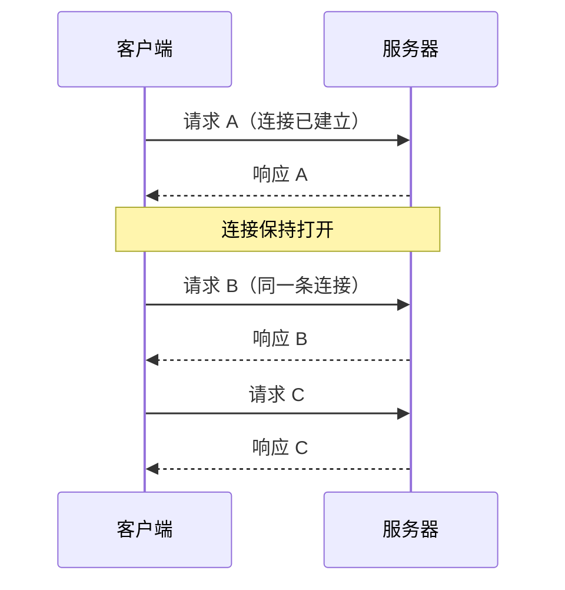

# HTTP/1.1：报文语义与连接管理

> [← 第四阶段导览](01-导览.md) · 时间线 ⑥。③④⑤ 把管道打通，请求报文正式上路。这一册把 h1 报文逐段拆开、把方法与状态码的语义立起来，然后解决 h1 最核心的工程问题：**一根连接同一时刻只能跑一个请求**——keep-alive、管线化、6 连接限制、域名分片、雪碧图，全部是围绕这个限制的攻防史。

## 1. 报文解剖：一段真实报文逐行读

`curl -v` 打到本地明文服务看到的原始报文（明文是学报文结构最快的路径）：

```text
GET /index.html HTTP/1.1          ← 请求行：方法 + 路径 + 版本
Host: localhost:8080              ← h1 唯一强制头（一台 IP 跑多站点全靠它分流）
User-Agent: curl/8.4.0
Accept: */*
Connection: keep-alive
                                  ← 空行（CRLF）：头与体的分界线
[可选的请求体]
```

响应：

```text
HTTP/1.1 200 OK                   ← 状态行：版本 + 状态码 + 短语（短语不参与解析，纯给人看）
Date: Sat, 14 Nov 2026 10:00:00 GMT
Content-Type: text/html; charset=utf-8
Content-Length: 1042
Connection: keep-alive

<!DOCTYPE html> ...               ← 体；长度由 Content-Length 或 chunked 定义（第五阶段 05 册）
```

逐段的角色与出错表现：

| 段 | 谁解析它 | 出错的表现 |
|---|---|---|
| 请求行/状态行 | 协议解析器 | 400 Bad Request |
| 头部 | 应用逐行读（`名: 值`，名大小写不敏感） | 头被忽略或 400 |
| 空行 | 分界符——没有它解析器不知道头在哪结束 | 解析挂起（等一个永远不来的空行） |
| 体 | 按 Content-Length / Transfer-Encoding 定长 | 413（过大）/ 截断 |

**文本协议的三笔历史债**（h2 的每个设计都在还债）：

1. 头名「大小写不敏感」在无数实现里出过 bug → h2 干脆强制小写；
2. 解析存在歧义空间（多余空格、换行宽容度）→ 请求走私（request smuggling）的土壤，归 `security/` 站；
3. 每个请求重复发整套头（Cookie 几百字节 × 几十个请求）→ HPACK 头压缩的动机（下一册）。

## 2. 方法与幂等性

| 方法 | 语义 | 幂等？ | 安全（不改状态）？ | 带体？ |
|---|---|---|---|---|
| GET | 取资源 | ✅ | ✅ | 不该有 |
| HEAD | 只要头不要体 | ✅ | ✅ | 无 |
| POST | 处理（创建/提交） | ❌ | ❌ | 有 |
| PUT | 全量替换 | ✅ | ❌ | 有 |
| DELETE | 删除 | ✅ | ❌ | 可有 |
| PATCH | 部分更新 | ❌* | ❌ | 有 |
| OPTIONS | 问能力（CORS 预检用它） | ✅ | ✅ | — |

PATCH 的 ❌*：规范没承诺幂等（`{op:"add"}` 执行两次结果不同），工程上有实现做成幂等——按「不能假设幂等」对待。

**幂等为什么是头等属性**：它决定「自动重试敢不敢发」。

| 场景 | 敢不敢自动重试 | 原因 |
|---|---|---|
| GET 超时 | 敢 | 再来一次结果一样 |
| POST 下单超时 | 不敢 | 请求可能已成功送达，重试 = 重复下单 |

连接复用场景里它还有个具体的暗坑：你在 keep-alive 连接上发 POST，恰好这条连接刚被服务端掐断——浏览器**不会**自动重试非幂等请求（它无法知道请求是否已经送达），直接报错给你；幂等请求则可能静默换连接重试。这就是「幂等性决定重试策略」在网络层的实体。上一阶段 0-RTT 只敢带 GET，是同一原则的另一个落点。

### 2.5 重试语义的工程清单

把「敢不敢重试」落成一张可以直接抄进代码评审的表：

| 请求类型 | 连接级失败（没发出去） | 响应级失败（超时/5xx） | 工程手段 |
|---|---|---|---|
| GET / HEAD / OPTIONS | 浏览器静默重试 | 应用层可自动重试（退避） | 直接重试 |
| PUT / DELETE | 浏览器可静默重试 | 谨慎重试（语义上幂等，但上游实现可能非幂等） | 重试 + 幂等键 |
| POST | **绝不自动重试** | 不自动重试 | **幂等键（Idempotency-Key 头）**：服务端按键去重 |

幂等键多说一句：它把「不幂等的请求」改造成「可安全重试的请求」——客户端每次重试带同一个键，服务端见到重复键直接返回上次的结果。支付/下单类接口的行业标配。规矩一句话：**重试的资格要么来自方法语义（幂等），要么来自显式协议（幂等键），不能来自「我觉得这次应该没发出去」。**

## 3. 状态码：按家族记，重点背高频

| 家族 | 含义 | 成员 |
|---|---|---|
| 1xx | 中间状态 | 100 Continue、101 Switching Protocols（WebSocket 升级就靠它） |
| 2xx | 成功 | 200、201 Created、204 无体、206 Partial Content（Range） |
| 3xx | 重定向/缓存 | 301/302/303/307/308 + 304（第五阶段 06 册全家族展开） |
| 4xx | 客户端错 | 400/401/403/404/405/412/416/429 |
| 5xx | 服务端错 | 500/502/503/504 |

高频成员的语义边界（排障与面试双高频）：

| 码 | 精确语义 | 常见误用/混淆 |
|---|---|---|
| 200 | 成功且有体 | 用 200 包一个 `{code:500}` 的体——把协议语义降级到体里，监控/CDN/浏览器全瞎 |
| 204 | 成功且无体 | DELETE 成功的标准回法；带体非法 |
| 304 | 缓存验证通过 | 由条件请求触发（05 册），不是「手造」的状态 |
| 401 | 未认证（你是谁？） | 与 403 混用——401 该带 WWW-Authenticate 挑战 |
| 403 | 已知你是谁，但拒绝 | 鉴权通过、授权失败 |
| 429 | 请求过多（限流） | 网关限流的标准姿态，常带 Retry-After |
| 502 | 网关收到上游**无效**响应 | 反代收到上游 RST/畸形响应 |
| 503 | 服务暂不可用 | 过载/维护，常带 Retry-After（第五阶段 03 册） |
| 504 | 网关等上游**超时** | 上游慢过网关超时阈值——TTFB 排障第一线索 |

「502 vs 504」是反代排障第一题：502 = 上游回了但回得不对；504 = 上游根本没在时限内回。看到哪个码，先去哪台机器查日志，答案完全不同。

### 3.5 状态码的「信任链」视角

一个状态码要被正确对待，前提是**每一层都不说谎**：

```text
应用说真话（500 就是 500）
  → 反代不篡改（不改 5xx 为 200）
    → CDN 不缓存错误（默认不缓存 5xx，但自定义缓存规则要查）
      → 前端不吞错（fetch 拿到 5xx 要按错误处理，不是 res.ok 一刀切）
```

任何一环破坏，排障的地基就塌了。反过来说，**监控体系全部建立在状态码诚实的前提上**——「200 包错误体」这个反模式之所以是重罪，就是因为它让后面所有环节集体失明。

## 4. 头部字段速查：按「谁负责」分四类

| 类 | 代表字段 | 干什么 |
|---|---|---|
| 通用头 | Connection、Date、Cache-Control | 管连接与缓存，请求响应都可能出现 |
| 请求头 | Host、User-Agent、Accept*、If-None-Match、Cookie、Range | 表达「我要什么/我带着什么」 |
| 响应头 | Server、Set-Cookie、ETag、Location、Retry-After、Vary | 表达「给你什么/下次怎么办」 |
| 实体头 | Content-Type/Length/Encoding/Language | 描述体的元信息 |

前端最该认识精的十一个：

| 字段 | 一句话 | 展开在哪 |
|---|---|---|
| Host | h1 多站点分流的唯一依据 | 本册 §1 |
| Accept-Encoding | 「我懂 gzip/br」——压缩协商 | 第五阶段 05 册 |
| Content-Type | 体的类型；浏览器渲染决策的输入 | 第七阶段 |
| Cache-Control | 缓存总指令 | 第六阶段 |
| ETag / If-None-Match | 条件请求验证器 | 本站 05 册 |
| Cookie / Set-Cookie | 状态携带 | 本站 05 册 |
| Location | 重定向去向 | 第五阶段 06 册 |
| Retry-After | 「多久后再来」 | 第五阶段 03/06 册 |
| Vary | 缓存键的附加维度 | 第五阶段 02 册 |
| Alt-Svc | 「我还支持 h3」 | 下一册 04 册 |

**头有多重**：实测一个典型浏览器请求头集合（UA + Accept 系 + Cookie）约 400~800 字节；一个 30 请求的页面在 h1 下头开销 15~24KB——还没算任何业务数据。这就是下一册 HPACK 要解决的问题。

### 4.5 版本演进史：0.9 → 1.0 → 1.1，每一步都在还上一步的债

协议不是一天长成这样的。把三个版本并排放，能看到「每一步解决什么、又引入什么新问题」的清晰接力：

| 版本 | 年份/文档 | 核心变化 | 解决了什么 | 引入的新问题 |
|---|---|---|---|---|
| **HTTP/0.9** | 1991（Berners-Lee 原始版） | 只有一行 `GET /path`（连版本号都没有），只回 HTML | 能跑就行——万维网的第一个原型 | 没有头，无法描述内容类型/长度/状态 |
| **HTTP/1.0** | 1996（RFC 1945） | 报文加**头**；方法扩到 POST/HEAD；**状态码**家族；Content-Type/Content-Length；版本号入行（`HTTP/1.0`） | 头让「内容是什么、多长、成功与否」都可表达——浏览器开始能同时渲染文字/图片（MIME 的胜利） | **一个请求一条 TCP 连接**，每请求都付满握手账（§5.1）；无虚拟主机概念 |
| **HTTP/1.1** | 1997（RFC 2068）→ 1999（RFC 2616）→ 2014 重写为 **RFC 7230-7235** | **默认持久连接**（keep-alive）；**Host 头强制**；**chunked** 传输；管线化；缓存头体系（Cache-Control/ETag）；100 Continue | 连接复用砍掉重复握手；一台服务器服务多个站点；流式响应成为可能 | 串行（§6 队头阻塞）留到 h2 才解；管线化失败（§5.3）；头重复开销留到 h2 的 HPACK 才解 |

三个版本各留下一句「祖先的话」：

- **0.9 的血统**：至今一个裸 `GET /` 仍是最小合法请求的骨架——报文的第一行语义 35 年没变；
- **1.0 的血统**：头部体系是全部后续演进的载体——h2/h3 的伪头部、HPACK 压缩、缓存语义都长在 1.0 立起的骨架上；
- **1.1 的血统**：keep-alive/Host/chunked 三个决定让万维网从「文档浏览」变成「Web 应用平台」——也直接造就了本册 §5-§7 的全部工程话题。

顺带一提版本号的正确写法：`HTTP/1.1` 是「协议名/版本」，所以口语里说「HTTP 1.1」「HTTP2」都行，但规范写法是 HTTP/1.1、HTTP/2、HTTP/3（1.1 之后去掉了点号）——h1 与 h2 的书写分界是 IETF 接管后（SPDY 改造期）定下的。

## 5. 连接管理三部曲

### 5.1 短连接（HTTP/1.0 时代）

一个请求一条 TCP 连接，用完即断。每个请求都付满 ③④⑤（DNS+握手+TLS）的账——第三阶段算过，弱网下每个请求先交几百毫秒学费。keep-alive 就是为消灭这笔重复税而生。

### 5.2 keep-alive：复用但串行



h1 默认持久连接。收益立竿见影：第二个请求起，③④⑤ 全免。但**串行**——B 必须等 A 的响应完整到达才能上路。一根连接同一时刻只服务一个请求，这是 h1 的结构性约束（请求-响应严格交替，没有「哪个响应属于哪个请求」的标识——报文里根本没有流 ID 这个概念）。

两端超时参数是 keep-alive 的工程细节：服务端 keepalive_timeout（如 Nginx 默认 60s/75s）到点掐连接，浏览器侧连接池也有自己的空闲回收。「浏览器第 61 秒用一条 60s 被掐的连接」→ 请求失败、自动重试成功，Network 面板里表现为一次离奇的失败 + 正常的重试——第五阶段 06 册排障清单的原生案例。

### 5.3 管线化：一次大胆的失败尝试

管线化（pipelining）试图打破串行：不等响应，把一批请求一口气全发出去。

```text
理想：→ GET A → GET B → GET C    （三个请求同时上路）
      ← 响应 A ← 响应 B ← 响应 C （响应必须严格按请求顺序返回）
```

失败的原因：

1. **响应必须按序回**：服务端必须先交齐 A 才能交 B——慢接口 A 会拖住后面所有已发出的请求，队头阻塞一点没解决，只是把「发送侧等待」变成了「响应侧排队」；
2. 中间代理兼容性地狱：老代理对乱序响应的处理五花八门，实践中出错率高；
3. 一旦失败要重发整批请求——非幂等请求根本不敢管线化。

所以浏览器默认关掉它、h2 用二进制分帧彻底重做了这件事（下一册）。「管线化和 h2 多路复用看起来都解决了串行」的本质差异：**管线化的响应顺序绑死请求顺序，h2 的响应可以任意交错（靠 stream ID 认领）**。

## 6. 队头阻塞：h1 的原罪

keep-alive 串行下，一根连接上「前面的请求慢，后面的全部排队」：

```mermaid
flowchart LR
  subgraph 一根 keep-alive 连接（串行）
    A["请求 A<br>（慢接口 2s）"] --> B["请求 B<br>（10ms 就绪）"] --> C["请求 C<br>（10ms 就绪）"]
  end
  B -.->|"被 A 堵 2s"| X["队头阻塞"]
  C -.->|"被 A 堵 2s"| X
```

量化（同一根连接，A 慢 2s、B/C 各 50ms）：

| 模式 | B 完成 | C 完成 |
|---|---|---|
| 串行（同连接） | ~2050ms | ~2100ms |
| 并行（新开连接） | ~100ms | ~150ms |

于是浏览器的现实策略是：**开多条连接绕过串行**——这就是 6 连接限制的由来。

### 6.5 队头阻塞的三层概念对照（本阶段的主线预告）

「队头阻塞」这个词在三个协议层各有含义，混用是面试与文档阅读的高频错误：

| 层 | 阻塞机制 | 谁解的 | 解法 |
|---|---|---|---|
| **h1 应用层** | 单连接请求-响应严格串行 | 浏览器绕（多连接） | h2 分帧 |
| **h2 传输层（TCP）** | 一个丢包堵住整条字节流 | 无解（TCP 不认识流） | h3/QUIC 流级独立恢复 |
| **h3** | 理论上只剩流内阻塞 | — | 单流内部仍有序（语义需要） |

本册讲的是第一层；第三层表里的「TCP 行」是下一册 §8 的主角。**记住这张表，三代协议的演进主线就是「把队头阻塞逐层拆掉」**——每换一代，堵点的位置换一层，病根的名字不变。

## 7. 6 连接限制与优化军备竞赛

**为什么是 6**：并发太低，h1 队头阻塞浪费严重；并发太高，每条连接都要付握手+慢启动的账（第三册），还挤压同服务器其他用户（不礼貌）。Chrome 等主流浏览器取 6 条/host——工程折中值，不是协议规定。验证：`chrome://net-internals/#sockets` 看连接池。

6 条限制催生的「优化军备竞赛」——每一件都曾被奉为圭臬，又全被 h2 反向淘汰：

| 手法 | 原理 | 为什么有效（h1 语境） | h2 时代的下场 |
|---|---|---|---|
| **域名分片** | 把资源拆到 static1./static2. 两个子域 | 每个 host 各得 6 条连接，并发翻倍 | 反模式：多付 N 份握手+爬坡，且 HPACK 动态表被拆散 |
| **雪碧图** | 几十个小图标拼成一张图 | 减少请求个数（请求是稀缺资源） | 请求不再稀缺；破坏按需缓存与分辨率适配 |
| **内联 JS/CSS** | 塞进 HTML 里省请求 | 同上 | 失去独立缓存——HTML 一变全量重下 |
| **资源合并** | 10 个 JS 拼一个 bundle | 同上 | 小改动触发大 bundle 重下；h2 下细粒度更优 |

**教训的价值大于手法本身**：这批手法全都优化「请求个数」这个稀缺资源，而 h2 把稀缺资源换成了「连接质量」——优化目标一变，手法集体作废。看到今天还有人在新项目里做域名分片，就是用 h1 时代的地图走 h2 的路。

## 8. h1 在 2026 年的位置

h2/h3 早已是主流（下一册看数据），但 h1 没死，它会出现在：

| 场景 | 为什么还是 h1 |
|---|---|
| `localhost` 开发服务器 | 部分本地工具链默认 h1（有些连 keep-alive 都不开） |
| 老旧内网服务/嵌入式设备 | 固件里的 HTTP 栈十年没升级 |
| 降级路径 | h2 的 HTTP/1.1 Upgrade 协商失败时（罕见） |
| 某些第三方 SDK/统计脚本 | 服务端没配 h2，或客户端库指定 h1 |

观测方法：Network 面板打开 Protocol 列（右键列头勾选），`h2`/`h3`/`http/1.1` 一目了然——**找到你站点里那个还在 h1 的第三方请求**是本阶段的标志性练习，它通常意味着「这个域名的所有请求都在付 6 连接限制的税」。

curl 侧的对照：

```bash
curl -sI --http1.1 https://example.com | head -1      # 强制 h1
curl -sI https://example.com | head -1                # 默认协商（curl 看 ALPN 结果）
curl -sI -w '%{http_version}\n' -o /dev/null https://example.com   # 直接输出协商结果版本
```

## 9. 实验

1. **原始报文观察**：`python3 -m http.server 8080` 起本地明文服务，Wireshark 过滤 `http`，展开一个完整请求+响应（对照 §1 逐行认段）；再对本站 h2 站点抓包，对照「密文下一个字节都看不到」与第三阶段 SSLKEYLOGFILE 实验的衔接。
2. **队头阻塞复现**：本地起一个「/slow 睡 2 秒、/fast 立即回」的小服务（Node/Python 十行代码），单连接串行请求两个接口计时；再开两条连接并行请求，对照 §6 量化表。
3. **6 连接限制观察**：写一个页面引用同 host 的 20 张小图（每张带 1s 延迟的服务），Network 面板看瀑布图——前 6 个并行、后面的排队；把图片拆到第二个子域，对比瀑布形态（域名分片现场复现）。
4. **keep-alive 验证**：`curl -v` 同一 URL 两次（`curl -v URL URL`），观察第二次 "Re-using existing connection"——③④⑤ 免除的实证；用 `--no-keepalive` 对照短连接形态。
5. **状态码语义体检**：对自己公司的站点跑一遍主接口，检查有没有「200 包错误体」的反模式；观察 4xx/5xx 的分布是否语义正确（401/403 分得清吗？）。

## 10. 常见误区

1. **「HTTP/1.1 支持并行请求」**：协议上单连接严格串行；「并行」是浏览器开多条连接达成的——并行的能力在浏览器，不在协议。
2. **「管线化失败了所以没意义」**：它证明了「响应按序」这个约束不改掉，并行就无从谈起——h2 的分帧正是先改掉这个约束，思路上的垫脚石。
3. **「域名分片是性能优化」**：它是 h1 限制下的被迫手段；h2 下是净损失（多份握手/爬坡 + HPACK 表拆散）。优化手法随协议代际失效，是链路学习最重要的元教训。
4. **「404 和 500 都是『出错了』」**：4xx 换客户端修、5xx 换服务端修——排障第一分叉点；把 5xx 伪装成 200 的「错误体」会让这道分叉彻底失效。
5. **「幂等只影响后端设计」**：它决定浏览器/网关/重试库敢不敢自动重试——POST 重复提交的线上事故，多数是某层「好心重试」了一个非幂等请求。
6. **「Connection: keep-alive 需要每次手动带」**：h1.1 默认持久连接，这个头只在显式关闭（`close`）时才有信息量；h2 里这个头直接被禁用。

## 10.5 常见问答

**Q：现在学 h1 还有用吗？主流不都是 h2/h3 了吗？**
三层用处：①报文语义（方法/状态码/头）是三代协议共用的——h2 只是把表示形式换成二进制；②排障时大量老服务、内网工具、第三方 SDK 还在 h1，你绕不开；③「为什么 h2 这样设计」的答案全写在 h1 的伤疤里——不懂队头阻塞原罪，就无法真正理解分帧。

**Q：浏览器到同一站点最多开多少条连接？**
h1 下每 host 6 条（Chrome 口径）；h2 下通常 1 条（多路复用够用）；h3 下 1 条 QUIC 连接。但注意「同一浏览器同时打开多个站点、每个站点各自 6 条」——限制是 per-host-per-context 的，全局连接数是所有站点的和。

**Q：接口返回数据业务失败（比如余额不足），该用什么状态码？**
两派实践：422/400 + 错误体，或 200 + 业务错误码。从链路视角强烈推荐前者——语义诚实的状态码让 CDN、监控、网关的重试/告警策略都能正确工作；200 包错误体会让「错误率」这个指标变成瞎子。

## 11. 自测题

1. 手写一个合法的 h1 请求报文与响应报文；空行丢掉会发生什么？
2. h1 强制的唯一请求头是哪个？没有它多站点部署会怎样？
3. 幂等性的定义？它决定网络栈的哪两个自动行为？（提示：重试与 0-RTT）
4. 管线化为什么失败？它与 h2 多路复用的本质差异是什么？
5. 画出 h1 单连接三请求（A 慢 2s）的瀑布图，标注 B/C 的完成时间；再画浏览器 6 连接下的形态。
6. 6 连接限制的「6」是谁定的？它权衡的是什么？在 chrome:// 哪个页面验证？
7. 域名分片/雪碧图/内联在 h2 时代为什么集体失效？说出共性原因。
8. 502 与 504 的区别？各自该去查哪台机器？
9. 401 与 403 的语义边界？各自典型的响应头搭配是什么？
10. 头开销账：30 个请求 × 600B 头，h1 下的总开销多少？HPACK 之后的量级（预告下一册）？
11. keep-alive 两端超时参数不一致会看到什么现象？为什么「重试一次就好」？
12. 你的站点里怎么找到「还在用 h1 的第三方请求」？找到了该怎么处理（能强制对方升级吗）？
13. （提示题）§6.5 三层对照表里，h3 解决的是哪一层？它「没解决」的那一层是什么？（提示：单流内部仍需有序。）
14. 幂等键（Idempotency-Key）解决什么问题？它与「POST 不重试」的默认纪律是什么关系？

## 12. 自查清单

| # | 检查 | 工具 | 异常指向 |
|---|---|---|---|
| 1 | Protocol 列分布健康吗？ | Network 面板 | 关键域名还在 h1 = 白付 6 连接税 |
| 2 | 有没有 200 包错误体？ | 抽查业务接口 | 监控/缓存/CDN 全部失明 |
| 3 | 401/403 用对了吗？ | 接口 review | 鉴权语义混乱，客户端无法区分「该登录」还是「没权限」 |
| 4 | 请求头体积多大？ | Network 面板 Size/Cookie 列 | 单请求 >1KB 头 = Cookie 需要瘦身 |
| 5 | 还在做域名分片吗？ | 代码/域名规划 | h2 下反模式，立即移除 |
| 6 | 本地开发服务支持 keep-alive 吗？ | curl -v 两次 | 不支持 = 本地压测数据失真 |
| 7 | POST 接口有幂等键方案？ | 接口设计 review | 无 = 网络重试场景的重复提交隐患 |

## 13. 延伸

- 下一册：[03-HTTP2-分帧多路复用与优先级](03-HTTP2-分帧多路复用与优先级.md)——二进制分帧怎么把「串行约束」连根拔掉，又怎么留下 TCP 队头阻塞这个新问题。
- 请求语义（协商/Cookie/条件请求）在 05 册；响应回程的连接细节在[第五阶段 05 册](../05-第五阶段/05-响应回程-压缩-分块与连接复用.md)。
