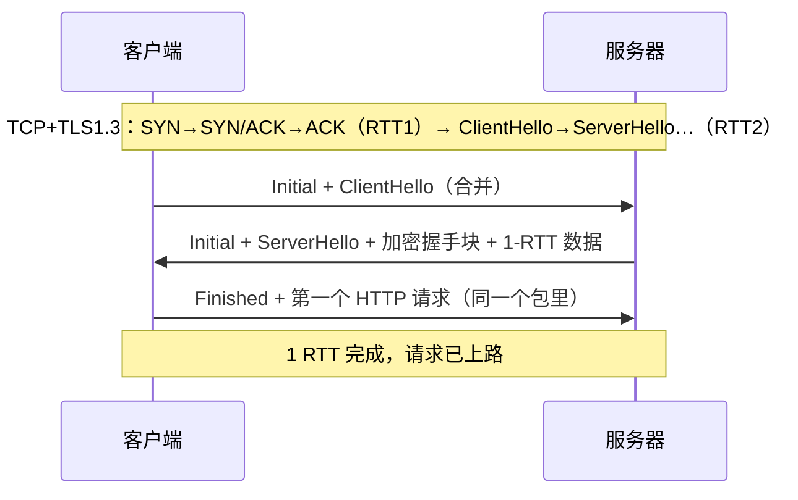
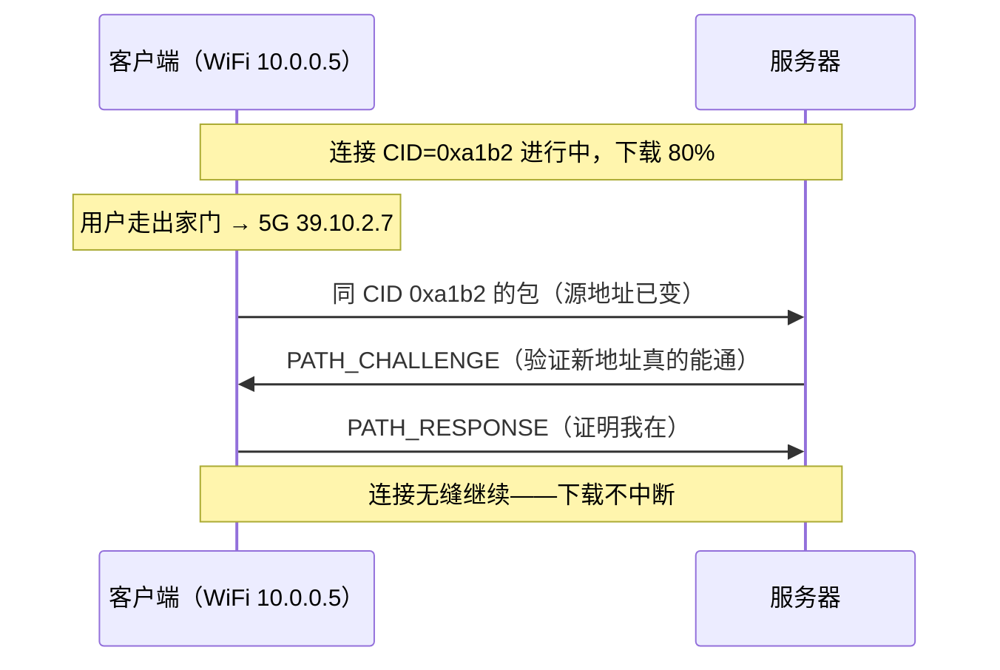

# HTTP/3 与 QUIC：换掉传输层

> [← 第四阶段导览](01-导览.md) · 时间线 ⑥。h2 把应用层队头阻塞解决了，TCP 层的还在；而 TCP 本身僵在内核里动不了——中间设备不认识新选项、操作系统升级以年计。QUIC 的答案是：把「可靠传输 + TLS + 多路复用」整个搬进 UDP 上的用户态，协议演进从此不受内核与中间设备辖制。这一册讲握手合并、连接迁移、流级丢包恢复、QPACK 与部署现状。

## 1. 为什么必须换层：TCP 的三重枷锁

| 枷锁 | 表现 | 为什么 TCP 自己解决不了 |
|---|---|---|
| **TCP 层队头阻塞** | h2 上一册 §8：丢一个包全线冻结 | 重传按字节序设计，不认识「流」——改它 = 改 TCP 语义 |
| **演进僵化** | 新 TCP 选项（TFO/FEC…）多年推不开 | 中间盒（防火墙/NAT）只认老 TCP，认识不了的包直接丢；内核特性要等系统版本铺开（年计） |
| **握手成本** | TCP 1 RTT + TLS 1~2 RTT | 两套握手分属两层，合并需要重设计 |

结论：**修不动 TCP，就绕开它**。QUIC（RFC 9000/9001/9002，2021 定稿）跑在 UDP 上，把可靠性、拥塞控制、加密、多路复用全部实现在**用户态**——发版节奏跟浏览器走，不跟内核走。UDP 只是信封：中间设备看见的是「普通 UDP 流量」，里面的协议世界自己演化。

用户态实现还有一笔常被低估的账：**每包加解密从内核挪到应用层**——CPU 成本上升（早期 h3 的吞吐质疑多源于此），换来的是迭代自由。2026 年的结论是这笔交易已划算：优化后的实现 + 更快的链路，h3 在真实网络的综合体验反超。架构权衡「性能换演进速度」的又一个案例。

### 1.5 演进史：从 gQUIC 到 QUIC——又一个「先生产后标准」的十年长跑

QUIC 的演进线与 SPDY→h2（上一册 §1）惊人地同构——同一家公司、同一个方法论、甚至连主角都重叠（Mike Belshe 参与了两者）：

| 年份 | 事件 | 关键点 |
|---|---|---|
| 2012 | Google 内部立项 **QUIC**（原意 Quick UDP Internet Connections） | 动机来自 SPDY 时代没解掉的两个题：**TCP 层队头阻塞**（h2 药方只到应用层）与 **TCP 演进僵化**（内核/中间盒动不了）——换掉传输层的想法在这一年成形 |
| 2013-2015 | **gQUIC** 在 Chrome 与 Google 服务间大规模部署 | 实测数据驱动：QUIC 显著改善弱网吞吐与重连延迟（搜索流量三成以上走 QUIC 的年代里，连接延迟中位数下降可见）。注意此阶段协议叫 QUIC、且是 **Google 私有版本**（gQUIC）——上层跑的是自家类 h2 协议 |
| 2015 | gQUIC 提交 IETF 草案 | 与 SPDY 同一剧本：**先给生产环境验证过的实现，再进标准化** |
| 2016 | IETF **quic** 工作组成立 | 关键架构决定：传输层（QUIC）用 IETF 全新设计（不兼容 gQUIC 的历史形态），应用层（HTTP/3）另立文档——「传输与应用解耦」自此定调 |
| 2018 | **"HTTP/3" 名称确定** | 用意在切割历史：新协议不叫「HTTP/2.1 over QUIC」也不继承「QUIC」这个名字（避免与 gQUIC 混淆）——你今天抓包偶尔还能遇到 gQUIC 老实现的残影，要认得出它不是 IETF QUIC |
| 2021.5 | **RFC 9000**（QUIC 传输）+ **RFC 9001**（TLS 集成）+ **RFC 9002**（丢包检测）+ **RFC 9204**（QPACK）+ **RFC 9114**（HTTP/3）同批发布 | 五份规范一次出齐——传输/加密/恢复/压缩/应用各管一段，这个「分层成文」本身就是 QUIC 架构的教学大纲 |
| 2022-2026 | Chrome/Edge/Firefox/Safari 全线默认尝试 h3；头部 CDN 全面开启 | §7 的部署现状 |

三个对工程的启示（与 SPDY→h2 一脉相承）：

1. **「实测数据先赢，标准随后追认」**的又一次复现——Google 内部跑通五年才进 IETF，标准文本里几乎找不到「没被生产环境检验过的设计」；
2. **「换代不换生态」**：QUIC 跑在 UDP 上而不是新 IP 协议号（§10.5 问答展开）——演进的上限取决于「能不能在现有互联网上增量部署」，任何要求全网换血的方案都活不过 RFC；
3. **「gQUIC ≠ QUIC」**是抓包排障的实用知识点：gQUIC 的加密握手是自研版（非标准 TLS 1.3），包格式也不同——遇到老实现，本册的 IETF QUIC 知识要打折使用。

## 2. 握手合并：三代协议的时间账

把第四、三阶段的账并排算（RTT=50ms 视角）：

| 方案 | 建连+安全就绪 | 首个请求出发 |
|---|---|---|
| TCP + TLS 1.2（历史） | 3 RTT ≈ 150ms | 4 RTT 后 |
| TCP + TLS 1.3（现代默认） | 2 RTT ≈ 100ms | 3 RTT 后 |
| **QUIC 初次连接** | **1 RTT ≈ 50ms** | 2 RTT 后 |
| **QUIC + 0-RTT 恢复** | **0 RTT** | 请求随第一个包飞出 |

QUIC 一次往返同时完成「传输参数协商」与「TLS 握手」——不是省了 TLS，是把两者叠在同一个飞行包里：



恢复连接走 PSK + 0-RTT（TLS 册 §7 的重放纪律原样适用：early data 只放幂等 GET）。

### 2.5 三代协议建连总对照（收束三、四阶段的账本）

把第三、四阶段所有建连方案放进一张总表——面试与架构评审的高频答案：

| | TCP+TLS1.2 | TCP+TLS1.3 | QUIC（h3） |
|---|---|---|---|
| 传输握手 | 1 RTT | 1 RTT | **与 TLS 合并** |
| 安全握手 | 2 RTT | 1 RTT | 合并后共 1 RTT |
| 恢复连接 | 1~2 RTT | 1 RTT（PSK） | **0 RTT**（early data） |
| 队头阻塞层 | 应用层+传输层 | 应用层+传输层 | 仅单流内部 |
| 弱网敏感度 | 高（多往返×多连接） | 中 | 低（合并+迁移+流恢复） |
| 中间设备友好 | 好 | 差（看不了证书） | 差（UDP 可能被封） |

读表结论：**h3 的每一项优势都是对前代一个具体痛点的精确报复**——握手合并报复「TCP+TLS 两套往返」，流级恢复报复「TCP 字节流」，连接迁移报复「四元组身份」。设计文档里的「为什么」永远不会缺席，缺席的只是读者。

## 3. 流级独立丢包恢复：队头阻塞的最后一刀

QUIC 的每个流有**独立的包号空间**：

```text
h2/TCP：所有流共享一个字节序号 —— 洞 1 个，全体冻结
QUIC ：流 A 的包 0,1,2 / 流 B 的包 0,1,2 各自独立
        流 A 丢包 → 只有流 A 停下等重传
        流 B/C 继续跑 —— 传输层认得流了
```

丢包恢复机制与 TCP 同源，对照着记：

| TCP 概念 | QUIC 对应 | 差异 |
|---|---|---|
| 累积 ACK | ACK 帧（带 ACK Range） | 单帧可确认一大段非连续区间——信息密度更高 |
| SACK | ACK Range | 原生内置，无需握手协商 |
| 快速重传（3 dup-ACK） | 同样按乱序阈值触发 | 每流独立判断 |
| RTO | PTO（Probe Timeout） | 探测式，不等死等 |
| 拥塞控制（CUBIC/BBR） | 用户态可插拔 | 换算法不用动内核 |

「乱序不等于丢包」也被 QUIC 区分得更细：包号严格单调递增（连重传包都是新号），乱序窗口可以放得更宽而不误判——无线网络下的误判重传显著减少（衔接第三册 BBR 的动机）。

### 3.5 一个 QUIC 包的字段树（Wireshark 实景）

过滤 `udp.port==443` 展开一个 Initial 包（字段示意）——对照第三阶段 TCP 册 §9 的 SYN 字段树，感受两代协议的观测形态差异：

```text
User Datagram Protocol           ← UDP 头：8 字节，就这些
  Src Port: 54321, Dst Port: 443

QUIC IETF                        ← 整个 QUIC 包头（加密后的形态）
  Header Form: Long (0)          ← 长头部 = Initial/握手包；短头部 = 数据期
  Packet Type: Initial (0)
  Version: 1
  Destination CID: a1b2c3d4...   ← Connection ID（§4 的连接身份）
  Source CID: e5f6a7b8...
  Token: (empty)
  Packet Number: (protected)     ← 包号也加密了——观测性换隐私的取舍
  Protected Payload [ decrypt with SSLKEYLOGFILE ]

Crypto Frame                     ← 解密后：TLS ClientHello 就住在 CRYPTO 帧里
  TLSv1.3 ClientHello ...        ← §2 的「合并握手」实体
```

四个读包要点：

1. **Initial 包是明文头 + 加密体**——头里的 CID/版本可见（中间设备能看见「你在讲 QUIC」，但看不见内容）；
2. **包号是加密的**——链路观察者无法数包（流量分析防护），代价是你抓包时必须配密钥日志才能数；
3. CRYPTO 帧里躺着完整的 ClientHello——「握手合并」在包层面的实体就是它；
4. 短头部（数据期）连版本号都没有——长连接上的开销被压到最小。

## 4. 连接迁移：换网不断线

TCP 的连接身份是**四元组**——WiFi→5G 切换时客户端 IP 变了，四元组作废，连接必死（视频通话卡断、大文件下载重来）。

QUIC 把身份改成 **Connection ID**（握手时双方协商的一串随机 ID）：



PATH_CHALLENGE/RESPONSE 是防地址欺骗的验证握手（不验证就有人能「劫持」别人的连接往新地址发数据）。限制也要知道：企业 NAT 短超时重绑定、部分中间设备对「陌生 UDP 流」限速，迁移成功与否依网络环境而定——「可能迁移」≠「必然迁移」。

### 4.5 迁移失败的三个现场与排查

| 现场 | 原因 | 特征 |
|---|---|---|
| NAT 重绑定超时 | 企业 NAT 对 UDP 会话的表项几十秒就清 | 换网后新包被视为「陌生 UDP」，直接丢 |
| 运营商 UDP 限速 | UDP 443 长流被限到极低速率 | 迁移「成功」但吞吐崩了 |
| 路径验证失败 | 新网络阻断出向 UDP | 连接降级为「等回退」 |

排查工具链：`chrome://net-internals/#quic` 看会话迁移事件；RUM 数据按「网络切换前后」分段对比（第九阶段的分段口径）。工程口径：**迁移是增强项不是依赖项**——应用层（IM/下载）的重连逻辑永远要留着，h3 迁移成功只是让重连从「必然」变成「偶尔」。

## 5. 流控：连接级 + 流级双层

与 h2 同构但更严格（QUIC 在传输层实现）：

| 层 | 控什么 | 场景 |
|---|---|---|
| 流级 | 单条流的接收窗口 | 限速单流、防大流吃光连接 |
| 连接级 | 所有流的总窗口 | 防总消费超过接收能力 |

MAX_STREAMS/MAX_DATA 帧通告上限，接收方消费后发 MAX_* 增量。行为诊断逻辑照搬 h2/TCP：贴 0 停滞 = 接收端处理不过来。

与 h2 的一个实现差异值得记：QUIC 的流控窗口是**信誉制**（credit）——必须在首块数据前就通告窗口，且流级与连接级窗口都要有余量，否则「三重卡」（流窗口满、连接窗口满、流数上限满）会让新流根本开不出来。调参时三处都要看。

## 6. QPACK：为「乱序友好」重做的 HPACK

HPACK 动态表依赖解码顺序（丢包堵头，03 册 §4）——这在 QUIC 里是局部问题（只堵本流），但头块恰恰是每条流都有的。QPACK 的改法：

| | HPACK（h2） | QPACK（h3） |
|---|---|---|
| 动态表指令 | 内嵌在头块流里（依赖包序） | 走**两条独立单向流**单独传 |
| 丢包影响 | 堵住后续所有流的头解码 | 头块可带「引用旧快照」的阻塞限制，最多阻塞到 `SETTINGS_QPACK_BLOCKED_STREAMS` 条流 |
| 代价 | — | 多一跳内部流的往返，压缩率略低于极限 |

一句话理解：**把「共享状态」与「流数据」解耦成两条通道，用一点点压缩率换乱序下的独立性**——与「流级丢包恢复」同一个设计哲学。

### 6.5 头表大小的配置账

QPACK/HPACK 都有「头表大小」参数（动态表容量），工程上的取舍表：

| 配置 | 压缩率 | 内存 | 适用 |
|---|---|---|---|
| 小表（如 4KB） | 低——大 Cookie/UA 装不下，反复全量发 | 省 | 内存敏感的网关/边缘 |
| 默认（h2 4KB / h3 可协商更大） | 中 | 中 | 通用 |
| 大表（16~64KB，h3 可协商） | 高——大头完全进表 | 每连接多付内存 | 高并发长连接的 API 服务 |

注意大表的「内存 × 连接数」乘法：一百万连接 × 64KB 表 = 64GB——「压缩率换内存」在连接规模大的服务端是真实的容量科目，网关配置评审时要问一句「头表多大」。

## 7. 发现与部署：浏览器怎么找到 h3

鸡生蛋问题：第一次访问一个站点，浏览器不知道它支持 h3（QUIC 握手没成功就得回退 TCP，白付一遍）。两条发现通道：

| 通道 | 机制 | 生效时机 |
|---|---|---|
| **Alt-Svc 响应头** | 服务器在 h2 响应里说「同源还有 h3：`alt="h3" ":443"`」 | 第二次访问起（第一次只能 h2） |
| **HTTPS DNS 记录** | DNS 直接宣告协议能力（衔接第三阶段 DNS 册 §5：解析时就拿到「支持 h3/ECH」） | 理论上第一次导航即可用（DNS 预热后） |

升级时序（Alt-Svc 路径）：

```text
第 1 次访问：h2 建连 → 响应带 Alt-Svc: h3 → 浏览器后台静默用 UDP 443 试探 h3
第 2 次访问：h3 优先（记住的 alt 值 + 放进连接池试）；失败自动回退 h2，无感知
```

部署现状（2026 口径）：Web 请求中 h3 占比约三分之一上下、头部站点过半支持——增长最大的场景是移动弱网与视频流（迁移+0-RTT 红利）。阻碍也真实存在：**UDP 被墙/限速**（某些企业网/运营商 UDP 443 不友好）、中间盒对 UDP 长流的会话表挤压——浏览器全部静默回退 h2，用户无感，这也意味着「你的用户有百分之几真的在 h3」要靠 RUM 数据回答（observability 站的话题）。

### 7.5 部署清单：给你的站点开 h3

按顺序过（每步都有验证动作）：

| # | 步骤 | 验证 |
|---|---|---|
| 1 | CDN/网关层开启 QUIC（多数托管 CDN 一个开关） | 控制台 + 文档确认版本 |
| 2 | 确认 UDP 443 出入放行（云安全组/防火墙） | `nc -u` 探测或抓包 |
| 3 | 确认 Alt-Svc 头出现在 h2 响应里 | curl -sD - 看头 |
| 4 | 浏览器二次访问验证 Protocol 列变 h3 | DevTools |
| 5 | 回退演练：临时封 UDP 443，确认静默回 h2 | Protocol 列 + 用户体验 |
| 6 | RUM 埋点带协议维度（h2/h3 分组看指标） | 第九阶段的分段口径 |

第 5 步是纪律：**任何协议上线都要先验证回退路径**——「能升级」只做对了一半，「能优雅降级」才是完整交付。

## 8. 抓包与调试 h3

h3 的调试形态全变：

| 维度 | TCP 家族 | h3/QUIC |
|---|---|---|
| 端口/协议 | TCP 443 | **UDP 443** |
| Wireshark 过滤 | `tcp.port==443` / `tls.handshake` | `udp.port==443` / `quic` |
| 解密配置 | TLS 密钥日志直接可用 | 同用 SSLKEYLOGFILE，但走 Wireshark 的 **QUIC 协议偏好**（与 TLS 项协作） |
| 握手包名 | SYN/SYN-ACK/ClientHello | Initial 包（里面含加密的 CRYPTO 帧） |

Chrome 内部视角：`chrome://net-export/` 抓网络日志（含 QUIC 事件），`chrome://net-internals/#quic` 看会话状态——调试「h3 到底启用没有」比抓包更快。

### 8.5 h3 观测速查表

| 想确认什么 | 最快路径 |
|---|---|
| 这条连接是 h3 吗 | Protocol 列 / `curl -w '%{http_version}'` |
| Alt-Svc 有没有发 | 响应头找 `alt="h3"` |
| 迁移发生过吗 | chrome://net-export 日志里的 migration 事件 |
| 0-RTT 用上了吗 | 抓包看 Initial 包带 early_data 扩展 |
| 回退率多少 | RUM 按协议维度分组（第 5 步部署清单） |
| 丢包恢复行为 | Wireshark `quic` 过滤 + ACK Range 帧分析 |

## 9. 实验

1. **确认你的站点走没走 h3**：DevTools Protocol 列（需两次访问让 Alt-Svc 生效）；`curl --http3-only https://你的站`（需要支持 h3 的 curl 构建）。
2. **升级时序复现**：清站点数据 → 第一次访问记 Protocol 列（h2）→ 第二次访问对比（h3）——Alt-Svc 两个 RTT 叙事亲手跑一遍。
3. **UDP 443 阻断实验**（进阶，有可控防火墙环境时）：阻断 UDP 443，观察回退是否无感、Protocol 列变回 h2——「优雅降级」的实证。
4. **迁移观察**（真机 + 手机热点）：手机 h3 站点下载中，WiFi↔5G 切换，看下载是否持续——四元组连接必断、CID 连接存活的对照实验。
5. **抓 h3 握手**：Wireshark 过滤 `udp.port==443`，找 Initial 包展开 CRYPTO 帧，对照 §2 的合并握手图与 §3.5 的字段树。

## 10. 常见误区

1. **「QUIC = UDP + TCP 复刻」**：可靠性/拥塞控制在用户态重新设计（包号单调、ACK Range 原生、拥塞算法可插拔），不是内核 TCP 的搬运。
2. **「h3 让首访变快一个 RTT」**：Alt-Svc 路径下第一次访问仍走 h2——红利从第二次访问开始（HTTPS DNS 记录可让首访受益，但依赖 DNS 预热）。
3. **「UDP 不可靠所以 h3 不可靠」**：UDP 只是信封；可靠性由 QUIC 层保证——把「承载协议」与「质量保证」分开看。
4. **「连接迁移必然成功」**：NAT 重绑定、UDP 限速、中间盒会话表都可能让迁移失败——它是「多一次机会」，不是「保证」。
5. **「上了 h3 就不用管 h2 了」**：回退路径常驻（UDP 不友好环境自动 h2）——两个协议的性能、配置、排障都要维护。
6. **「QPACK 压缩率不如 HPACK 是退步」**：它买回来的是「丢包不再堵头」——在真实弱网里净收益为正，别只看压缩率单科目。

### 10.5 常见问答

**Q：为什么 QUIC 选择 UDP 而不是「新 IP 协议号」？**
新 IP 协议号会穿过一切中间设备吗？不会——大量 NAT/防火墙只放行 TCP/UDP，新协议号等于物理断网。UDP 是唯一「全互联网已放行、且允许承载任意载荷」的通道。代价（UDP 被部分网络歧视）也比「直接不通」好——至少能回退。

**Q：h3 的加密是强制的吗？为什么不允许明文？**
强制。TLS 1.3 集成在 QUIC 内部（没有「QUIC 明文模式」）——设计上吸取了 TCP 家族「明文可选导致加密永远推不开」的教训：把加密做成协议的一部分而非选项，中间盒也就没有「协商降级」的口子可钻。

**Q：我的服务是长连接 WebSocket/IM，迁到 h3 有什么变化？**
WebSocket over h3 有标准化方案（WebTransport 是更现代的替代）；核心收益是连接迁移（手机换网 IM 不断线）。但注意应用层心跳与 QUIC 层 keep-alive（PING 帧）的关系要重新设计——两层保活叠加会浪费流量，只留一层。

**Q：0-RTT 与「连接迁移」能叠加吗？换网后的第一个包能带 early data 吗？**
不能——0-RTT 只用于「同一地址的恢复连接」；迁移涉及路径验证（PATH_CHALLENGE），验证完成前发 early data 会被重放攻击面覆盖，QUIC 规范直接禁止。两套机制各管各的加速：0-RTT 管时间（省往返），迁移管空间（换网络不断线）。

**Q：QUIC 有自己的 keep-alive 吗？长连接怎么维持？**
PING 帧——应用层显式发，或连接参数里配置空闲探询间隔。与 TCP keepalive 的分工：QUIC PING 保持 NAT 表项与连接活性（应用可控、间隔可调）；TCP keepalive 那套两小时默认在这里不存在——「保活策略」从内核配置变成了应用决策（长连接服务要自己定间隔，兼顾 NAT 超时与功耗）。

## 11. 自测题

1. TCP 的三重枷锁各是什么？QUIC 用「UDP + 用户态」各绕开了哪一环？
2. 画出 QUIC 1-RTT 合并握手时序，与 TCP+TLS 1.3 的 2-RTT 对齐比较；0-RTT 恢复省的是什么？
3. 「流级独立包号空间」怎么杀死 TCP 层队头阻塞？画流 A 丢包、流 B 正常的示意图。
4. QUIC 的 ACK 帧与 TCP 累积 ACK + SACK 的信息密度差异是什么？
5. 连接迁移为什么可能？PATH_CHALLENGE 防的是什么攻击？哪两类网络环境会让迁移失败？
6. h2 与 h3 的流控都是双层——每层各防什么病？QUIC 的「信誉制」与「三重卡」是什么？
7. QPACK 怎么做到「丢包不堵头」？付出了什么代价？头表大小的容量账怎么算？
8. Alt-Svc 与 HTTPS DNS 记录各在什么时候让 h3 生效？第一次访问能享受 h3 吗（两条通道分别回答）？
9. 弱网（高丢包）下 h1/h2/h3 的性能排序与机制解释？
10. 怎么回答「我们站有多少流量真的在 h3」？需要什么数据？（提示：RUM——observability 站）
11. h3 的重放风险在哪个环节？与 TLS 册 §7 的 0-RTT 纪律是什么关系？
12. Wireshark 抓 h3 的过滤条件与解密配置和 TCP 家族差在哪？包号为什么是加密的？
13. （提示题）§2.5 总对照表里，h3 的每一项优势分别「报复」了前代的哪个痛点？逐行对应。
14. 为什么 QUIC 选 UDP 而不是新 IP 协议号？「全互联网已放行」的论证是什么？

## 12. 自查清单

| # | 检查 | 工具 | 异常指向 |
|---|---|---|---|
| 1 | h3 在你的站点启用了？ | Protocol 列（二次访问） | 全是 h2 = CDN/网关没开 Alt-Svc |
| 2 | 回退路径健康？ | 阻断 UDP 443 复测 | 回退报错 = 降级配置问题 |
| 3 | 移动端收益验证？ | RUM 按网络类型分组 | h3 收益集中在弱网组——均值会骗人 |
| 4 | 0-RTT 纪律落实？ | 服务端 early_data 白名单 | POST 进 early data = 重放风险（§2/§11） |
| 5 | UDP 443 出口策略？ | 网络组确认 | 出口封 UDP = 内部用户永远 h2，别白等 |
| 6 | 应用层重连逻辑还在？ | IM/长连接代码 review | 依赖迁移=把增强项当依赖项 |

**Q：h2 与 h3 的流 ID 命名空间通用吗？**
不通用——h3 的流模型在 QUIC 层定义（双向流 0/4/8…客户端发起，奇偶规则不同），与 h2 帧头的 stream ID 是两套体系。从 h2 迁移到 h3 时，抓包里的 stream 编号会完全对不上——排障时别拿 h2 的编号习惯套 h3 的包。

## 13. 延伸

- 下一册：[05-请求语义-协商-Cookie-条件请求与Range](05-请求语义-协商-Cookie-条件请求与Range.md)——传输效率之外，请求「内容语义」的四大支柱。
- 连接保活与回程的传输细节在[第五阶段 05 册](../05-第五阶段/05-响应回程-压缩-分块与连接复用.md)；0-RTT 攻防归 `security/` 站。
