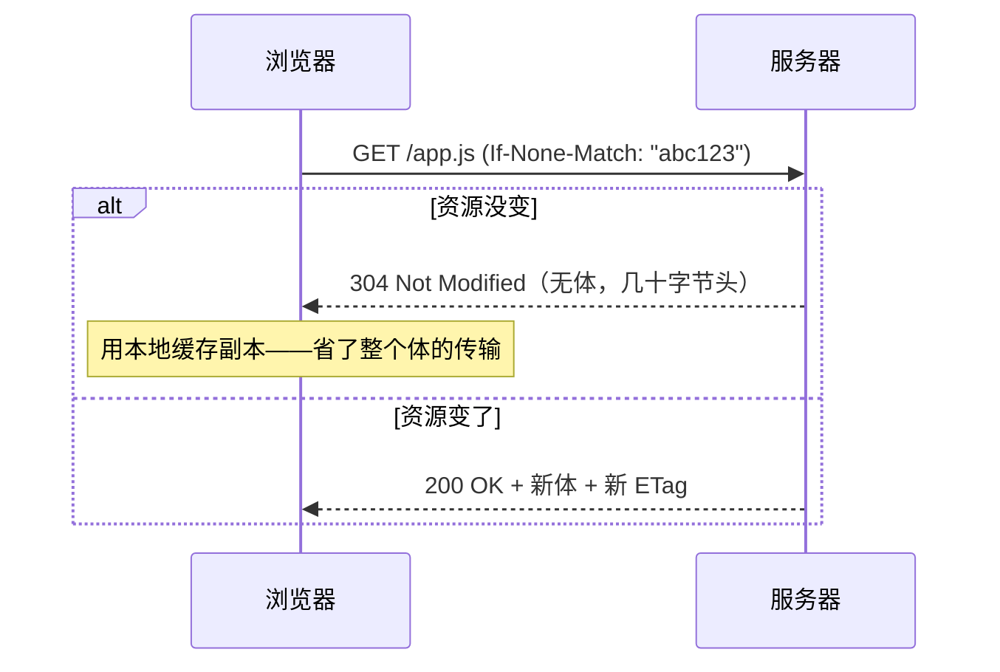

# 请求语义：内容协商、Cookie、条件请求与 Range

> [← 第四阶段导览](01-导览.md) · 时间线 ⑥。传输效率讲完了，这一册讲请求「说什么」的四大语义支柱：内容协商（我要什么形态）、Cookie（我带着什么状态）、条件请求（帮我省一次传输）、Range（只要一段）。它们分别接住了缓存体系（第六阶段）、CDN（第五阶段）、鉴权与性能（Cookie 的双面性）。

## 1. 内容协商：Accept 系列与 Vary

同一 URI，服务端可以给出不同形态——由请求头协商：

| 头 | 协商什么 | 浏览器默认值示例 |
|---|---|---|
| Accept | 媒体类型 | `text/html,application/xhtml+xml,.../*;q=0.8` |
| Accept-Encoding | 压缩算法 | `gzip, deflate, br, zstd` |
| Accept-Language | 语言 | `zh-CN,zh;q=0.9,en;q=0.8` |

q 值语法：`q=0~1` 表偏好权重（省略 = 1）。`zh-CN,zh;q=0.9,en;q=0.8` 读作「中文最好、其次英文」。

**协商是有代价的：响应因此多了一个缓存维度**。同一个 URL，gzip 版与 br 版是两份缓存——服务端必须用 `Vary` 头声明「哪些请求头参与了这个响应的形态决策」：

```text
Vary: Accept-Encoding        ← 「按请求的 Accept-Encoding 分桶缓存我」
```

Vary 的缓存语义（第五阶段 CDN 册的主菜）：缓存键 = URL + Vary 列出的头值。**`Vary: User-Agent` 是移动时代的经典事故头**——UA 几乎每个版本都不同，等于把缓存按用户打散，命中率归零；同类诉求（按设备出不同内容）应走响应式设计或服务端 UA 分组。缺 `Vary: Accept-Encoding` 则是反向事故：代理把 gzip 版发给不懂解压的老客户端——乱码刷屏。

前端口径：**你写的每个接口/静态资源配置，都值得看一眼 Vary**——它是「协商」与「缓存」两个世界的接缝。

### 1.5 服务端视角：一次协商的完整决策链

把「服务端收到请求后怎么决定返回什么」画全（本册各节的串珠）：

```text
收到 GET /article/123
 ① Accept-Language → 选语言版本（zh）
 ② Accept-Encoding → 选压缩（br；不识别则退化 gzip/不压）
 ③ 查缓存：键 = URL + Vary 值（zh + br）——命中则直接回
 ④ 未命中 → 渲染 → 压缩 → 存进对应分桶 → 回
 ⑤ 响应头必须带上：Content-Language + Content-Encoding + Vary: Accept-Language, Accept-Encoding
```

三步排障口径：**响应头的协商结果与请求头对不上**（要 br 给了 gzip）、**Vary 漏写某个协商维度**（两个语言版本共用一个缓存桶——串语）、**协商维度过多**（2 语言 × 3 压缩 × 2 设备 = 12 份缓存）——第三种是命中率杀手，协商维度能砍就砍。

## 2. Cookie：状态的携带与它的属性边界

HTTP 无状态，Cookie 是浏览器侧的状态携带协议。`Set-Cookie` 的每个属性都在回答同一个问题——**「这个 Cookie 在什么边界内可见」**：

| 属性 | 划定的边界 | 默认（不写时） |
|---|---|---|
| Domain | 哪些域可见（含子域） | 当前 host（不含父域，默认更安全） |
| Path | 哪些路径可见 | `/`（全域可见） |
| Expires / Max-Age | 存活多久（会话级 vs 持久） | 会话级（关浏览器就没） |
| Secure | 只在 HTTPS 发送 | 不限 |
| HttpOnly | JS 读不到（document.cookie） | JS 可读 |
| SameSite | 跨站请求带不带 | Lax（现代默认） |
| Partitioned | 按顶级站点分仓（CHIPS） | 不分仓 |

### 2.1 SameSite 三档 × 场景矩阵

「跨站」的定义（site = eTLD+1，衔接第二阶段 OOPIF 册）：`a.example.com` 与 `b.example.com` 同站；`example.com` 与 `other.com` 跨站。

| 场景 | Strict | Lax（默认） | None |
|---|---|---|---|
| 同站请求 | ✅ 带 | ✅ 带 | ✅ 带 |
| 顶级导航 GET（点链接过去） | ❌ 不带 | ✅ 带 | ✅ 带 |
| 顶级导航 POST（表单） | ❌ | ❌ 不带 | ✅ |
| 跨站 ``/XHR/fetch | ❌ | ❌ 不带 | ✅（须配 Secure） |
| iframe 内的跨站请求 | ❌ | ❌ | ✅ |

- **Strict** 最安全但体验崩：从邮件里的链接进站点——登录态 Cookie 不带，用户看着是没登录。只适合「绝对敏感、可接受重新验证」的场景；
- **Lax** 的折中智慧：放行顶级导航 GET（外部链接进来保持登录态），拦截嵌入式跨站请求（CSRF 主战场）；
- **None** 必须配 Secure；第三方 SDK/支付回调 iframe 时代的刚需。

### 2.2 CHIPS（Partitioned）：第三方 Cookie 的体面退场

浏览器全面封杀第三方 Cookie 的大背景下，部分「正当的第三方状态」（如 SaaS 嵌入组件的会话）有了合规出路：

```text
Set-Cookie: __Host-sid=abc; Secure; HttpOnly; Path=/; SameSite=None; Partitioned
```

`Partitioned` 让 Cookie 按**顶级站点分仓**：同一第三方域在 `siteA` 与 `siteB` 的 iframe 里各有一份独立 Cookie，彼此不可见——「嵌入式服务能用，但跨站跟踪做不了」。`__Host-` 前缀另有硬约束（必须 Secure/Path=/、不许 Domain 属性）——前缀是一套「浏览器帮你把关」的声明语法。

### 2.3 Cookie 的性能账

Cookie **每个同域请求都全量回传**（静态资源也不例外）：

| 失控形态 | 数量级 | 后果 |
|---|---|---|
| 业务塞满 Cookie | 2~4KB | h1 下 30 请求白传 60~120KB |
| 老域名的「历史沉积」 | 更大 | 每个请求都背着祖传包袱 |

对策（h1 时代的标准动作，h2 下仍有意义——HPACK 动态表能压掉重复头，但首请求与动态表失效时照样全量）：

1. **静态资源走 cookie-free 域名**（专用 CDN 域不设 Cookie）——注意 h2 下别为此域名分片，权衡点在第四阶段 03 册；
2. Path/Domain 收窄，过期清理；
3. 大状态改走服务端 session + 小 ID。

### 2.4 Cookie 工程规约清单（可直接抄进团队规范）

| # | 规约 | 理由 |
|---|---|---|
| 1 | 会话 Cookie：`HttpOnly; Secure; SameSite=Lax` + 最短必要 Path | 默认安全基线 |
| 2 | 跨站场景才用 `SameSite=None; Secure`，且逐个评审 | None = CSRF 防线部分撤除 |
| 3 | 不用 Cookie 存业务数据，只存 ID | 体积账（§2.3）+ 隐私（数据可读） |
| 4 | Cookie 名用 `__Host-`/`__Secure-` 前缀（新上线） | 浏览器强制把关，防配置回退 |
| 5 | 设置过期清理（Max-Age），不依赖「会话级」兜底 | 沉积Cookie 的年化体积 |
| 6 | 新增 Cookie 前先查现有清单（Application 面板） | 防重复/防祖名复用 |

## 3. 条件请求：304 的经济学

浏览器问服务端「我这有个旧版本，还能用吗」——用验证器：

| 验证器体系 | 请求头 | 响应头 | 强度 |
|---|---|---|---|
| ETag（内容指纹） | If-None-Match | ETag | **强验证器**（字节级一致） |
| Last-Modified（时间戳） | If-Modified-Since | Last-Modified | 弱（秒级精度，多机部署时间不一致就翻车） |



强/弱 ETag：`"abc123"` 强验证（逐字节相同）；`W/"abc123"` 弱验证（语义等价即可，如压缩前后）。**静态资源用强 ETag；动态生成内容若只是「展示等价」用弱**。

304 的账（关键！不是银弹）：

| 项目 | 200（无缓存） | 304 |
|---|---|---|
| RTT | 1 | **1（省不掉）** |
| 体传输 | 全量 | ≈0（只有头） |
| 适用 | — | 体远大于头时才划算 |

**小文件走 304 是亏的**：一个 300B 的 CSS，304 省的体 ≈300B，但验证往返的时间开销与 200 直接回差不多——工程上这类文件应该靠 `Cache-Control` 长缓存+内容哈希文件名（第六阶段的主线方案），让「重新验证」根本不发生。304 的正确生态位是「中等大小、无法内容哈希命名、变更不频繁」的资源。

与 Cache-Control 的优先级关系先立个坐标：** freshness（Cache-Control）优先于 revalidation（条件请求）**——缓存新鲜期内浏览器根本不发请求，304 只在「过期了但想续命」时登场。全谱系在第六阶段展开，本册只负责「协议语义」。

### 3.5 一套静态资源的缓存语义实战（案例形态）

「一个 800KB 的 app.js，发版频繁但日常不变」——用本册语义设计它的完整策略：

```text
文件名带内容哈希：app.a3f8c2.js（构建时生成）
  → 内容变 = 文件名变 = URL 变 → 缓存键天然隔离
  → 响应头：Cache-Control: public, max-age=31536000, immutable
  → 一年内连条件请求都不发（immutable 关掉「重新验证」）
入口 HTML：Cache-Control: no-cache + ETag
  → 每次验证（304 概率高），确保引用到最新的哈希文件名
```

这套「哈希文件名 + 长缓存 + HTML 验证」组合是现代前端发布的行业底座——本册三个语义（ETag/条件请求/Cache-Control）各司其职。**判定你站点用没用上**：Network 面板二次访问，若 JS/CSS 还有任何请求发出（哪怕 304），说明策略没做到位（哈希没上或 immutable 缺失）。

## 4. Range：只要一段

```text
GET /video.mp4
Range: bytes=1000000-1999999        ← 我要第 1MB~2MB 这一段

HTTP/1.1 206 Partial Content
Content-Range: bytes 1000000-1999999/5000000   ← 给你的段 / 总长
Accept-Ranges: bytes                            （首次响应里声明支持）
```

三大应用：

| 场景 | 怎么用 Range |
|---|---|
| 断点续传 | 已下 80% 后中断 → 带 `Range: bytes=4000000-` 续尾巴，配 `If-Range`（验证器没变才续，变了就全量重下） |
| 视频拖动 | 拖到中间直接 `bytes=N-`——「流媒体播放器的 seek」在 HTTP 层就是 Range 请求 |
| 多连接分段下载 | 并发几个 Range 各下一段（下载工具的原理；h2 下意义弱化，一条连接已并行） |

边界与错误码：

- `416 Range Not Satisfiable`：越界（起点超过总长）；
- 服务器可无视 Range 回完整 200——`Accept-Ranges: none` 或不支持时客户端要能兜底；
- 末段简写 `bytes=-500`（最后 500 字节）、开段 `bytes=100-`（从 100 到结尾）。

前端视角的实感：`<video>` 的 currentTime 拖动、DevTools 里一串 206 灰色请求、断点续传工具的进度条——全是这条语义在驱动。

### 4.5 Range 在 CDN/代理层的坑

Range 请求穿过缓存层时是事故高发区（第五阶段 02 册事故表的原型）：

| 坑 | 形态 | 解法 |
|---|---|---|
| CDN 不缓存 206 | 每次 seek 都回源 | 开 CDN 的 Range 缓存支持 |
| Range 不进缓存键 | `bytes=0-` 与 `bytes=100-` 打架 | 按段规范化缓存或整文件缓存+边缘切片 |
| 源站不支持却回 200 | 播放器收到全量，浪费带宽 | 源站正确回 206/416，Accept-Ranges 如实声明 |
| ETag 与 If-Range 配合错误 | 文件变了还续传旧段 | If-Range 用强验证器；变了就全量 |

验证方法：对大文件 CDN 域名发 `curl -H 'Range: bytes=0-99' -sD -`，看回 206 还是 200、状态头里缓存命中标记——两分钟测出整条 Range 链路是否健康。

## 5. CORS 预检：OPTIONS 在链路里的位置

跨站 fetch 请求，「非简单请求」（带自定义头/JSON Content-Type/非常规方法）会先飞一个 `OPTIONS` 预检——问服务端「接下来这个真请求你接吗」：

```text
① OPTIONS /api 实际请求先探路
   Access-Control-Request-Method: POST
   Access-Control-Request-Headers: content-type, x-token
② 服务端回预检许可（Access-Control-Allow-*）
③ 许可覆盖 → 真 POST 才出发
```

本站的关注点是**链路成本**：预检 = 多一次往返（弱网多一个 RTT），且预检结果本身可被缓存（`Access-Control-Max-Age`）。「为什么我的接口每个请求都发 OPTIONS」的高频答案：预检没被缓存、或请求头里有「不自知的多余自定义头」触发了预检——把不必要的自定义头清掉能直接消掉这次往返。安全攻防（简单请求判定、凭证模式、预检绕过）归 `security/` 站。

### 5.5 预检成本的优化工作流

| 步骤 | 动作 | 收益 |
|---|---|---|
| ① 盘点 | Network 面板数 OPTIONS 的数量与频率 | 知道问题规模 |
| ② 查触发原因 | 对比请求头与「简单请求」判定条件 | 找到多余的自定义头/Content-Type |
| ③ 请求瘦身 | 删掉无用的自定义头；JSON 换 form-urlencoded（可行时） | 直接消掉预检 |
| ④ 配 Max-Age | 服务端 `Access-Control-Max-Age: 86400` | 同一 URL 的预检缓存一天 |
| ⑤ 架构级 | 同源化（API 挂同域反代后面） | 预检彻底消失 |

第 ⑤ 步是多数大厂的最终形态——「API 与页面同域」同时消灭预检、第三方 Cookie 问题与部分 CORS 面，一石三鸟；代价是网关层的路由治理（第五阶段 03 册的反代职责）。

## 6. 实验

1. **协商现场**：`curl -H "Accept-Language: en" URL` vs `-H "Accept-Language: ja"` 对比多语言站点响应——协商的真实效果；抓 `Vary` 头看服务端怎么声明。
2. **304 复现**：`curl -sD - URL` 记下 ETag → 带 `If-None-Match` 重放 → 观察 304；故意改错 ETag 观察 200。
3. **304 与 Cache-Control 的优先级**：对同站点先看响应 Cache-Control（新鲜期多长）→ 强刷（DevTools Disable cache）前后的请求行为差异——「新鲜期内根本不发条件请求」的实证。
4. **Range 三连**：`curl -H "Range: bytes=0-99" URL` 看 206 与 Content-Range；越界请求看 416；对大视频站抓包看拖动进度条产生的 Range 请求串。
5. **SameSite 矩阵实测**：自己写两个页（同站/跨站）+ 一个设 SameSite=Lax 的 Cookie，按 §2.1 矩阵逐格验证（img 引用、表单提交、顶级导航）。
6. **预检成本**：对允许 CORS 的接口分别发「简单请求」与「带自定义头请求」，Network 面板数 OPTIONS 的有无；设了 Max-Age 的服务对比二次请求（预检消失）。
7. **哈希缓存策略验证**：找一个用哈希文件名的站点（主流大站都是），二次访问确认 JS/CSS 零请求——§3.5 的策略在别人的站点上的实证。

## 7. 常见误区

1. **「304 比不请求快」**：304 省**体**不省**往返**——新鲜期内不发请求（Cache-Control）才是快；304 是「过期后的体面续命」。
2. **「协商是免费的」**：每个协商维度 = 缓存的一个分桶维度（Vary）——协商越多，命中率越低。
3. **「Cookie 的 Domain=.example.com 更灵活所以更好」**：显式放宽到父域 + 子域全量可见，是 Cookie 泄漏（子域 XSS 偷主域 Cookie）的经典放大器；默认「精确 host」更安全。
4. **「HttpOnly 了 Cookie 就安全了」**：JS 读不到 ≠ 发不出去——XSS 依然能借浏览器发带 Cookie 的请求；它只是防线之一（纵深防御归 security 站）。
5. **「强 ETag 随便设」**：多机部署下「内容相同但指纹不同」（时间戳参与生成）会造成 304 失效风暴——ETag 必须是**内容的函数**，不能是「环境的函数」。
6. **「Range 是视频播放器自己的事」**：服务端必须正确支持（206/Content-Range/Accept-Ranges），网关/CDN 配错会让 seek 全部变成全量下载——「视频站流量暴涨」的经典事故源。
7. **「预检是 CORS 的一部分所以前端能关掉」**：触发条件由请求本身决定（自定义头/JSON 类型）——前端能做的是「让请求变简单」或「配 Max-Age 缓存预检」，不是关掉机制。

### 7.5 常见问答

**Q：Cookie 会被 h2/h3 的头压缩「免费」瘦身吗？**
部分会——HPACK/QPACK 动态表把重复的 Cookie 头压成索引，稳定会话里传输成本大降。但两处失效：每个连接的**第一个请求**仍全量；动态表被冲掉（新连接/表满）时又回到全量。所以「Cookie 瘦身 + cookie-free 域名」仍是根本解，头压缩只是缓解。

**Q：SameSite=Lax 下，为什么邮件里的链接点过去登录态还在？**
顶级导航 GET 被放行（§2.1 矩阵第二行）——这正是 Lax 的设计目的：安全挡「嵌入型」跨站请求（CSRF 主战场），保留「导航型」跨站到达（用户体验）。但顶级 POST 表单会被挡——历史遗留的表单登录流程要注意。

**Q：If-Modified-Since 和 If-None-Match 同时带，服务端以谁为准？**
规范要求 ETag 体系优先（If-None-Match 优先于 If-Modified-Since）——时间戳精度不足，指纹是权威。服务端实现要检查这个优先级；客户端（浏览器）两套都会带上（服务端发过哪种就带哪种）。

**Q：fetch 发的请求为什么和我 curl 发的不完全一样？多出来的头是谁加的？**
浏览器自动补一组请求头：`Accept`/`Accept-Encoding`/`Accept-Language`/`User-Agent`/`Cookie`（符合条件时）/`Referer`/`Origin`（跨站时）——这些不是你代码写的，是网络栈按上下文补的。对比实验（DevTools 里 Copy as cURL）能把「你的头」与「浏览器的头」分开——「为什么 curl 没问题、浏览器不行」的排障第一步就是逐头 diff。

**Q：视频站的请求 DevTools 里显示 «(disk cache)» 但播放器明明在拖动？**
拖动产生的 Range 请求同样走缓存体系——同一段（相同 Range 头）曾拉过且缓存判定允许，就直接用副本。注意 Range 请求的缓存键通常包含 Range 头——「拖回同一位置秒开、新位置才出网」就是键分桶的效果（§4.5 的键规范化的另一面）。

**Q：怎么判断一个接口「该不该加缓存语义」？**
三问：响应随用户变吗（变 → private/no-store）；一秒内的重复请求多吗（多 → 值得配新鲜期或 ETag）；数据能容忍多久陈旧（容忍 N 秒 → max-age=N + s-maxage 配 CDN）。三问全「否/不」的接口才配 `no-store`——「一律 no-store」是把缓存层当敌人，浪费的是全链路的免费加速。

## 8. 自测题

1. Accept-Language 的 q 值语法怎么读？协商与 Vary 的关系是什么？
2. `Vary: User-Agent` 为什么在移动时代是缓存杀手？正确的替代思路是什么？
3. SameSite 三档，画出 × 五场景的矩阵；Lax 放行顶级导航 GET 解决的是什么体验问题？
4. CHIPS 的 Partitioned 解决什么问题？「分仓」的粒度是什么？
5. Cookie 的性能账怎么算？cookie-free 域名在 h2 下的权衡点在哪？
6. 强/弱 ETag 的判定标准？静态资源该用哪个？为什么「ETag 不能是环境的函数」？
7. 304 省了什么、没省什么？多大以下体量的资源不该依赖 304？正确的替代方案是什么？
8. 画出条件请求时序图；If-None-Match 与 If-Modified-Since 谁优先？（提示：ETag 体系优先。）
9. Range 语法三形态（区间/开段/尾段）各怎么写？416 什么时候出现？If-Range 防的是什么坑？
10. 视频拖动在 HTTP 层的动作序列是什么？CDN 配错 Range 会出什么事故？
11. 预检请求的触发条件是什么？前端有哪两招减少预检成本？架构级的最终形态是什么？
12. 「哈希文件名 + 长缓存 + HTML 验证」各环节用了本册哪个语义？怎么验证站点做没做到位？
13. （提示题）§1.5 决策链里「协商维度过多」的数学是什么？2 语言 × 3 压缩 × 2 设备为什么是 12 份缓存？

## 9. 自查清单

| # | 检查 | 工具 | 异常指向 |
|---|---|---|---|
| 1 | 响应 Vary 声明与实际协商一致？ | curl 对比 + 响应头 | 缺 Vary = CDN/代理串味事故源 |
| 2 | Cookie 总体积？ | DevTools Application 面板 | >2KB 该瘦身；静态域 cookie-free |
| 3 | 关键 Cookie 属性齐备？ | Set-Cookie 逐项过 §2 表 | 缺 HttpOnly/Secure/SameSite = 安全面 |
| 4 | 304 用对了场景？ | 中等体量资源的 Timing | 小资源高频 304 = 该改长缓存+哈希名 |
| 5 | ETag 跨机器稳定？ | 多实例环境 curl 对比 | 指纹漂移 = 304 失效风暴 |
| 6 | 视频类服务 Range 正常？ | 拖动进度条抓包 | 全量 200 = CDN 配置事故 |
| 7 | 接口预检可控？ | Network 面板数 OPTIONS | 高频预检 = 清自定义头/配 Max-Age |
| 8 | 静态资源零二次请求？ | 二次访问 Network 面板 | 还有 304 = 哈希/immutable 没做到位 |

**Q：四个语义支柱之间有优先级吗（配置冲突时听谁的）？**
有，缓存判定链上：`Cache-Control`（新鲜度）优先于条件请求（验证器），验证器只在「过期后」登场；Range 与缓存并存时键要含 Range；Cookie 不参与缓存判定但参与「该不该缓存」的口诀判断。本册四节在第六阶段会被重排成一张完整判定流程图——这里是各零件，那里是总装。

## 10. 延伸

- 本阶段收束。下一站：[第五阶段 · 服务端与响应回程](../05-第五阶段/01-导览.md)——请求穿过 CDN 与网关，HTML 被生成、压缩、分块流回。
- 缓存全谱系（本册条件请求只是其中一角）在[第六阶段](../06-第六阶段/01-导览.md)；Cookie 攻防与 CORS 细节归 `security/` 站。
