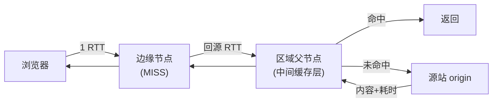

# CDN：边缘、回源与调度

> [← 第五阶段导览](01-导览.md) · 时间线 ⑦。请求离开浏览器、穿出运营商，第一站不是源站——是 CDN 边缘节点。这一册讲节点怎么被选中（第三阶段 DNS 调度的下半场）、缓存键怎么算（命中率的生命线）、命中与回源两条路径的差异、以及 CDN 把 TTFB 压下来到底贡献在哪几个毫秒。

## 1. CDN 在链路里的位置

CDN 的本质：**把源站内容的缓存副本铺到离用户近的机房（边缘节点），请求就近被满足**。它同时干两件事：

| 角色 | 干什么 | 对应章节 |
|---|---|---|
| 调度 | 决定「你该去哪个节点」 | 本册 §2（+第三阶段 DNS 册 §5） |
| 缓存代理 | 决定「这个请求我能不能直接答」 | 本册 §3~§5 |

第三阶段埋的那句话在这里兑现：**「解析出哪个 IP」本身就是调度结果**——你在 Network 面板看到的远程地址，已经是 CDN 认为你该去的节点。

## 2. 边缘节点怎么被选中：两种调度

| 调度方式 | 机制 | 特点 |
|---|---|---|
| **DNS 调度** | 权威 DNS 按 resolver 位置（+ECS）返回不同边缘 IP | 第三阶段细讲过；粒度粗（IP 级）、有 TTL 缓存时滞 |
| **Anycast** | 同一 IP 在全球多个机房广播；BGP 路由把包送进「网络拓扑最近」的节点 | 零查询开销、天然容灾（一个机房挂了路由自动收敛）；缺点是「路由近」≠「地理近」，偶尔把你调度到奇怪的城市 |

现代大厂通常两者混用：Anycast 兜底进网，DNS/HTTP 层再精细纠偏。你不需要操作它们，但需要能解释两个现象：

1. **同一域名在不同地区测延迟差异巨大**——调度结果不同的第一变量；
2. **跨地域性能测试必须用当地网络当地 resolver**——你的 resolver 位置决定调度（DNS 册 §5 的 ECS 规则），「从北京测东京节点」测的是调度不是性能。

### 2.5 一次调度失真的完整复盘（案例形态）

「上海同事反馈站点慢，海外用户却很快」——按调度视角走一遍排查：

```text
① 对比两边的解析结果：上海侧 dig 出的边缘 IP 与海外侧不同 → 调度不同，正常
② 上海侧的边缘节点在哪？traceroute 发现绕去了美西节点 → 失真！
③ 为什么？上海同事配了 8.8.8.8 做 resolver → 权威看到的是 Google 海外节点
   → 按 resolver 位置调度 → 被调到了美西
④ 修复：换回本地运营商 resolver（或依赖 ECS）→ 解析回国内边缘
⑤ 防复发：性能测试规范加一条「用被测地区的网络与 resolver」
```

复盘要点：**调度失真的第一嫌疑人永远是 resolver 配置**——公共 resolver 的位置不等于用户位置（ECS 只在部分链路生效）。这类「网络明明不远却很慢」的问题，先查解析再查路由，别急着怀疑源站。

## 3. 缓存键：命中率的生命线

请求到达边缘节点，它问的第一个问题：「这个请求，我有缓存吗？」——判断依据是**缓存键**。默认键大致是：

```text
cache key = host + path + 查询串（+ Vary 列出的头值）
```

看似简单，四个变量每个都能出线上事故：

| 变量 | 事故形态 | 正确姿势 |
|---|---|---|
| **查询串** | `?utm_source=x`、`?t=123` 这类营销/缓存穿透参数进了键 → 同一资源 N 份缓存，命中率暴跌 | CDN 配查询串白名单/排序标准化（ignore query string） |
| **查询串顺序** | `?a=1&b=2` 与 `?b=2&a=1` 算成两个键 | 开启排序归一化 |
| **Vary 头** | 服务端随手 `Vary: User-Agent` → 键随 UA 打散（第四阶段 05 册） | 服务端克制用 Vary，只写真正参与形态决策的头 |
| **Cookie 进键** | 某些配置把 Cookie 哈希进键 → 每个 user 一份缓存，命中率归零，回源打爆源站 | Cookie 永远不进键；带用户态的内容不缓存在边缘（或用边缘计算注入） |

反向事故更危险：**该进键的没进**。按登录态出不同内容的页面被当成公共资源缓存 → **A 用户看到 B 用户的私人数据（缓存串号）**。判据口诀：

```text
响应内容随「谁在问」变 → 不可公共缓存（Cache-Control: private / no-store）
响应内容只随「问什么」变 → 可以缓存，键 = URL + Vary
```

### 3.5 缓存键的配置实例（两家主流 CDN 的字段对照）

各家 CDN 控制台的键配置字段名不同，语义对照（配置评审时的翻译表）：

| 语义 | Cloudflare 口径 | 阿里云/腾讯云 CDN 口径 |
|---|---|---|
| 查询串全进键 | Query String: All | 参数全保留 |
| 查询串全忽略 | Query String: Ignore | 忽略全部参数 |
| 白名单参数 | Cache Key 自定义 | 参数保留列表 |
| 按 Vary 尊重 | 尊重 origin 的 Vary（可关） | Vary 处理开关 |
| 键加自定义头/版本 | Cache Key header | 「缓存键包含」自定义维度 |

评审要点：**默认值要显式确认**——「查询串全进键」是多数平台的默认，营销参数满天飞的站点不调它，命中率就是灾难。配置完用 `?t=随机数` 打两发验证（穿透参数是否真的被忽略）。

## 4. 命中与回源：两条路径的账

### 4.1 状态字段的家族

看 CDN 响应头的缓存状态字段（`X-Cache`/`CF-Cache-Status`/`X-Swift-CacheTime` 之类，各家命名不同、语义同源）：

| 状态 | 含义 | TTFB 量级（RTT 50ms 视角） |
|---|---|---|
| HIT | 边缘直接命中 | ≈1 RTT（你↔边缘） |
| MISS | 边缘没有，回源取回并顺手缓存 | 2~3 RTT+（你↔边缘↔源站） |
| EXPIRED | 有缓存但过期 → 回源验证（304 则续用本地） | 介于两者 |
| STALE | 过期但按 stale-while-revalidate 策略先给你旧的 | ≈1 RTT（后台再去刷新） |
| REVALIDATED | 回源 304 验证后继续用旧货 | ≈2 RTT（省了体没省往返） |
| BYPASS | 配置规则让这个请求跳过缓存 | 全回源 |
| DYNAMIC | 被判定为不可缓存的动态内容 | 全回源 |

**同一 URL 查两次对比状态字段是本册最重要的实验**——第一次 MISS、第二次 HIT，TTFB 的差就是「回源」这条腿的完整代价。

### 4.2 回源路径与时序

MISS 时的完整路径（大 CDN 常有区域中间层）：



### 4.3 回源风暴与合并回源

热门内容过期瞬间，成千上万个边缘节点同时回源——**源站被自己的缓存体系打爆（thundering herd）**。CDN 的解法：

| 手法 | 做法 |
|---|---|
| **合并回源**（request coalescing） | 同键并发回源只放一个真请求出去，其余等结果共享 |
| **分 TTL 抖动** | 过期时间加随机偏移，避免全网同时到期 |
| **后台刷新** | 到期前主动预热（stale-while-revalidate 的主动版） |

前端的关联：如果你的源站「每次发布后被 CDN 流量冲垮」，大概率是回源风暴没治理（TTL 全一致 + 无合并）——这是容量评审时该问 CDN 配置的问题。

### 4.4 回源的请求头：源站看到的是谁

回源请求不是简单转发——CDN 会改写一组头，源站日志里的「用户」要小心解读：

| 头 | 回源时的形态 | 源站视角的含义 |
|---|---|---|
| Host | 通常保持原域名 | 多站点源站的分流依据不变 |
| X-Forwarded-For | CDN 追加真实用户 IP | 反代链（第五阶段 03 册）的接力 |
| Via | 出现 CDN 节点标识 | 识别「请求经过了谁」的证据 |
| Accept-Encoding | CDN 按自己的能力改写 | 回源压缩与边缘压缩可能不同 |
| Range | 按 CDN 缓存策略改写/拆分 | §4.5 视频站的坑 |

结论：**源站日志里的 IP/头是「CDN 视角」不是「用户视角」**——统计、限流、风控若直接用回源请求的源 IP（会是 CDN 节点 IP），全错。真实用户 IP 要从 X-Forwarded-For 链解，且要防伪造（只信第一跳可信代理），攻防细节归 `security/` 站。

## 5. 缓存指令：CDN 怎么读 Cache-Control

源站发出的 Cache-Control 在 CDN 眼里语义有分层：

| 指令 | CDN 的解读 | 浏览器的解读（第六阶段） |
|---|---|---|
| `max-age=N` | 可缓存 N 秒 | 同 |
| `s-maxage=N` | **共享缓存（CDN/代理）用 N 秒**（优先于 max-age） | 忽略 |
| `private` | 别缓存（内容随用户变） | 可私存 |
| `no-store` | 谁都不许存 | 同 |
| `no-cache` | 可以存，但**每次回源验证**（304 续命） | 同 |
| `stale-while-revalidate=N` | 过期后 N 秒内先回旧的，后台异步刷新 | 同（现代浏览器支持） |
| `stale-if-error=N` | 源站挂了就继续给旧的，最多 N 秒 | 同 |

`s-maxage` 是「浏览器与 CDN 想要不同新鲜期」的标准解法：HTML 页面 `Cache-Control: no-cache, s-maxage=60`——浏览器每次验证、CDN 缓 60 秒，源站压力可控且用户内容不陈旧。

**stale-while-revalidate 的经济学**单独说：它拿「一点新鲜度」换「一次完整往返」——旧内容毫秒级返回（HIT），新内容在后台进缓存供下一个请求享用。适合「内容容忍几十秒陈旧」的列表页/资讯页；实时性敏感的接口别用。

### 5.5 边缘缓存与浏览器缓存的职责分工表

两个缓存体系管同一条响应，分工必须想清楚（配置冲突是命中率问题的隐性来源）：

| 维度 | CDN 边缘缓存 | 浏览器缓存（第六阶段） |
|---|---|---|
| 服务对象 | 全体用户共享 | 单用户私有 |
| 受益口径 | 源站减压 + 全站 TTFB | 单用户零请求 |
| 新鲜期指令 | `s-maxage`（优先） | `max-age` |
| 验证 | 回源条件请求 | 对边缘/源站条件请求 |
| 用户态内容 | 禁止（串号风险） | 可以（private 缓存） |
| 失效手段 | 缓存刷新 API/目录清除 | 强刷/过期 |

一句话分工：**边缘缓存是「规模杠杆」，浏览器缓存是「个体杠杆」**——配置时先想清楚每个资源靠哪个杠杆省流量：静态资源两个都要，登录态页面只能靠浏览器 private 缓存。

## 6. 103 Early Hints：趁生成的空档给提示

SSR 站点的痛点：源站生成 HTML 要几百 ms，浏览器干等——可它明明「马上就要加载 CSS/JS」。103 是一个**中间响应状态码**：源站趁生成的空档先发一行提示，CDN 转发：

```text
HTTP/1.1 103 Early Hints          ← 先到（源站刚开始算就发）
Link: </style.css>; rel=preload; as=style
Link: </app.js>; rel=preload; as=script

HTTP/1.1 200 OK                   ← 真正的 HTML 后到
Link: ...
```

浏览器收到 103 就开始预加载（`rel=preload` 语义在第六阶段展开）——把资源发现提前了「整个 TTFB」那么久。它与 Server Push 的差异（第四阶段 03 册 §7）：Push 推**内容**（猜错白传），103 只推**提示**（决策权在浏览器）。CDN 角色的加分项：有些 CDN 会缓存 103 响应，源站第二次都不用发。

### 6.5 103 的实战约束

| 约束 | 说明 |
|---|---|
| 只是提示 | 浏览器可以不采纳（带宽紧/优先级冲突时）——别把关键逻辑压在「103 一定被遵守」上 |
| 不能带 Cookie/鉴权 | 103 先于真实响应，服务端此刻还不知道「该给什么」——只放公共资源 |
| 与 HTML 里的 hint 重复无害 | 两边都写 preload，浏览器去重——103 + HTML 双保险是推荐姿势 |
| 支持度 | 现代主流浏览器已支持；不支持时安静忽略，零风险 |

## 7. TTFB 拆解：CDN 到底贡献了什么

把 Waiting(TTFB) 打开（第五阶段导览的预告在这里交卷）：

| 构成 | 边缘 HIT | 边缘 MISS 回源 |
|---|---|---|
| 你 ↔ 边缘 RTT | 1 | 1 |
| 边缘处理 | ~1ms | +回源 RTT（边缘↔源站，可能×2 层级） |
| 源站计算 | **0（没参与！）** | 全额（模板/DB，几十~几百 ms） |
| 首字节回程 | 已含在 RTT 里 | +1 RTT 的前半 |

结论口诀：**边缘命中 = 只剩「你↔边缘」的距离税；回源 = 距离税 + 源站全额**。同一页面 HIT 与 MISS 的 TTFB 差 100~300ms 是常态——「命中率每提升 10%，全站 TTFB p50 改善可观」就是这条账的规模化。而「HTML 主文档能不能边缘缓存」取决于内容是否随用户变（§3 口诀）——多数业务站答案是「不能」，所以 HTML 的 TTFB 主战场回到源站（下一册网关与 SSR），CDN 主战场是静态资源。

### 7.5 CDN 观测字段速查（响应头逐个读）

拿到一份 CDN 响应头，逐字段读出整个故事：

| 字段 | 读出什么 |
|---|---|
| `CF-Cache-Status` / `X-Cache` | 命中状态（§4.1 家族表） |
| `Age: 352` | 缓存副本已在边缘存了 352 秒——TTL 内的进度条 |
| `X-Served-By: cache-nrt...` | 服务你的边缘节点代号（nrt=东京）——调度结果的实体 |
| `cf-ray: ...-nrt` | 同上（Cloudflare 口径），跨国排障时比对两端 ray 是标准动作 |
| `Via: 1.1 xxx` | 经过的代理/缓存层链 |
| `Alt-Svc: h3` | 该边缘支持 h3（第四阶段 04 册） |
| `Server: cloudflare` | CDN 供应商自报家门 |

排障组合拳：**X-Served-By/X-Served-By 对比（两端用户看到的节点）→ Age 看新鲜度 → 状态字段看路径**——三行头读出「调度对不对、缓存新不新、走的哪条路」。

## 8. 三个真实事故复盘

| 事故 | 现象 | 根因（对应节） | 修复 |
|---|---|---|---|
| 发布后命中率暴跌 | 每次发版静态资源命中率从 95% → 30%，源站带宽翻倍 | 指纹化做得不全：部分 CSS 引用了不带 hash 的旧路径，版本参数 `?v=20261114` 进了键（§3） | 补全内容哈希命名，去掉版本查询参数 |
| 缓存串号 | 用户 A 短暂看到 B 的账户名 | 页面按登录态渲染却 `Cache-Control: public, max-age=60`，边缘公共缓存（§3 反向事故） | 该页面改 `private` 或 `no-store` + 灰度验证 |
| 视频站回源打爆源站 | 源站带宽打满、5xx 漫天 | 大量 Range 请求 MISS 回源；Range 不在缓存键内且未合并回源（§4.3） | 开合并回源 + Range 缓存支持（或整文件预热） |

复盘的共性方法论：**先看状态字段（HIT/MISS 分布），再看缓存键配置，最后才怀疑源站**——顺序反了会把 CDN 配置问题当成代码问题查半天。

## 9. 实验

1. **HIT/MISS 双跑**：`curl -sD - -o /dev/null URL` 连跑两次，对比状态字段与 `time_starttransfer`——回源代价的实测。
2. **CDN 识别**：读响应头的 Via/X-Cache/CF-RAY/Age/Server 字段组合，判断站点用的哪家 CDN、命中了几层。
3. **查询串穿透实验**：对静态资源分别带 `?t=任意值` 请求，观察状态字段——穿透参数进键的现场。
4. **stale-while-revalidate 观察**：找一个配置了该头的站（或自己用本地 nginx 配），过期后立刻请求——看「旧货秒回 + 后台刷新」的双响应形态（Wireshark 里能看到后台的 revalidation 请求）。
5. **103 抓一次**：支持 Early Hints 的站点（大厂 Homepage 居多）用 `curl -i` 或 DevTools 看两次响应（103 + 200）；注意 DevTools 里 103 需要在 Network 面板设置里打开显示。
6. **调度差异**：找异地的朋友/云主机对同一静态域名 `curl -w '%{remote_ip}'`，对比解析出的边缘 IP——调度的地理性实体。
7. **回源头验证**：若你有自己控制的源站日志，对比「用户直连日志」与「CDN 回源日志」的头差异（X-Forwarded-For/Via/Accept-Encoding）——§4.4 的实体。

## 10. 常见误区

1. **「CDN 就是让静态资源快」**：它还是调度器、安全层（DDoS/WAF 入口）、以及 103/边缘计算的新阵地——只按「加速」理解会漏掉一半事故面。
2. **「命中率是 CDN 运营方的事」**：缓存键设计、Vary、Cache-Control 全是源站（前端+后端）写给 CDN 的指令——命中率一半在你们自己手里。
3. **「max-age 配了 CDN 就一定会缓」**：CDN 还有 BYPASS/DYNAMIC 判定与自定义规则；「配了」与「生效了」要靠状态字段实证。
4. **「回源慢是源站慢」**：回源慢 = 边缘↔源站网络 + 源站计算的总和；先分层归因（§7 拆解），再定位。
5. **「TTL 越长越好」**：命中率与新鲜度对冲——发布系统若没有「缓存失效 API/指纹化」配套，长 TTL 就是「改了没生效」事故的温床。
6. **「源站日志里的 IP 就是用户 IP」**：回源请求的源 IP 是 CDN 节点——统计与风控要用 X-Forwarded-For 链（§4.4）。

## 10.5 常见问答

**Q：动态 API 请求走 CDN 有意义吗？**
有——即使完全不缓存（DYNAMIC/BYPASS），CDN 仍提供：就近接入（TCP/TLS 握手到边缘而非源站，省 RTT）、连接复用（边缘到源站的长连接池）、DDoS 防护。「CDN 不只是缓存」的典型体现。

**Q：命中率多少算健康？**
按内容类型分账：静态资源（哈希化）>90%；HTML（可公共缓存的）视业务 50~90%；登录态页面 0%（本来就不该缓）。看「总命中率」意义有限——分内容类型的命中率才是可行动的数字。

**Q：发布后怎么让旧缓存立即失效？**
两条路：主动调 CDN 的缓存刷新 API（目录级/Preclear）；或架构上依赖哈希文件名——旧文件名缓存自然闲置，无需失效。后者是根本解（§8 事故一的修复思路），前者是应急手段。两者都配齐的团队才算发布体系成熟。

**Q：多 CDN 架构（主备两家）怎么观测？**
响应头字段各家不同（X-Cache vs CF-Cache-Status）——统一观测口径要在边缘加自有标记头（如 `X-Edge-Provider`），或用 CDN 厂商的标准字段映射表归一化后再看命中率。切流演练（主备切换）时，两边命中率与回源量的对账表是必备物料。

**Q：怎么区分「命中率低」与「命中率报表骗我」？**
控制台报表常按「请求数」算命中率，但大文件（视频）一个请求顶一万个请求的回源流量——按「字节数」再算一遍命中率，两个数字的差就是「大对象回源」的占比。容量问题看字节命中率，体验问题看请求命中率，两本账都要看。

## 11. 自测题

1. CDN 的两个角色各是什么？「解析出哪个 IP」是哪个角色的输出？
2. DNS 调度与 Anycast 各怎么选节点？各自的「最近」含义差异是什么？
3. 缓存键的默认构成？四个变量（查询串/顺序/Vary/Cookie）各对应什么事故？
4. 写出「内容该不该公共缓存」的判据口诀；缓存串号事故的根因链是什么？
5. HIT/MISS/EXPIRED/STALE/REVALIDATED 各自的路径与 TTFB 量级？
6. 画出 MISS 回源时序（含区域层）；回源风暴的成因与三个治理手法？
7. s-maxage 与 max-age 的分工？「浏览器每次验证 + CDN 缓 60s」怎么配？
8. stale-while-revalidate 的经济学（换什么、买什么）？哪些内容不适合？
9. 103 Early Hints 与 Server Push 的本质差异？它把哪个环节提前了？四条实战约束是什么？
10. 边缘 HIT 与 MISS 的 TTFB 拆解表；为什么说「HTML 的 TTFB 主战场在源站」？
11. 回源请求头里源站该看什么、不该信什么？X-Forwarded-For 的正确用法与风险？
12. （提示题）§7.5 的字段速查里，`Age` 与 `X-Served-By` 分别回答什么问题？两端用户 X-Served-By 不同说明什么？

## 12. 自查清单

| # | 检查 | 工具 | 异常指向 |
|---|---|---|---|
| 1 | 静态资源命中率？ | CDN 控制台 + X-Cache 抽样 | <80% 查缓存键/查询串穿透 |
| 2 | 发布后命中率曲线？ | CDN 监控 | 发版跳水 = 指纹化不全 |
| 3 | 动态接口被误缓存？ | 抽查 API 响应状态字段 | HIT 出现在登录态接口 = 串号风险，立即修 |
| 4 | HTML 的 Cache-Control 语义正确？ | curl 看头 | 登录态页面 public = 事故前夜 |
| 5 | 回源风暴防护？ | 问清 CDN 合并回源/TTL 抖动配置 | 发布冲垮源站 = §4.3 |
| 6 | 回源路径层级？ | CDN 文档/控制台 | 多层回源放大延迟，评估区域层配置 |
| 7 | 缓存键查询串策略显式配置过？ | CDN 控制台对照 §3.5 | 用默认值 = 营销参数穿透 |

## 13. 延伸

- 下一册：[03-负载均衡-网关与反向代理](03-负载均衡-网关与反向代理.md)——穿过 CDN 之后，请求进入机房的第一站。
- 缓存指令的浏览器侧语义在[第六阶段](../06-第六阶段/01-导览.md)；103 里的 preload 语义在第六阶段 05 册。
