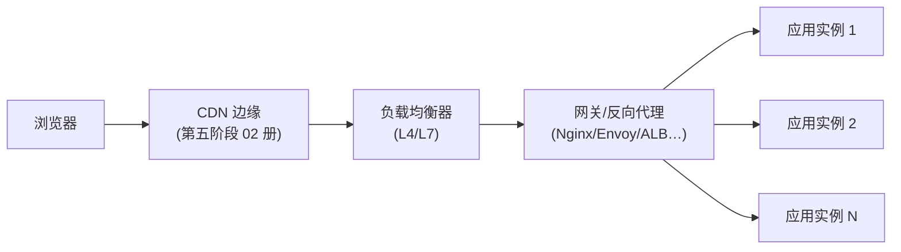

# 负载均衡、网关与反向代理

> [← 第五阶段导览](01-导览.md) · 时间线 ⑦。穿过 CDN 之后，请求进入机房：负载均衡器分流量、网关做协议与安全处理、反向代理把请求递到某台应用服务器。这一册讲清这一层的分层结构与转发逻辑——TTFB 里「排队与转发」的那几毫秒、502/504 的出生地、429/503 的产生机制，都在这里。

## 1. 机房内的一跳：为什么不是源站直接接请求

公网域名背后从来不只有一台应用服务器。请求的完整路径：



每一跳的职责：

| 层 | 职责 | 典型实现 |
|---|---|---|
| 负载均衡器 | 按 L4 或 L7 规则把连接/请求分到后端集群 | 云 LB（SLB/ALB/NLB）、F5、LVS |
| 网关 | TLS 终止、路由、限流、鉴权、协议转换 | API Gateway、Envoy、云 API 网关 |
| 反向代理 | HTTP 层转发、静态文件、缓存、压缩 | Nginx、HAProxy、Caddy |
| 应用实例 | 业务逻辑 | Node/Java/Go/…（多副本） |

中小项目里 LB+网关+反代常由同一台 Nginx/云 LB 兼任——**角色可以合体，概念仍要分清**：排障时「这一跳是谁干的」决定你去看哪台机器的日志。

### 1.5 网关与反代的职责边界：一页说清

「网关」与「反向代理」两个词经常混用，边界在业务语义的浓度：

| | 反向代理 | API 网关 |
|---|---|---|
| 视角 | 「把 HTTP 转发过去」——内容无关 | 「理解你的 API」——内容有关 |
| 路由依据 | path/host 的静态规则 | 服务发现、版本路由、灰度分流 |
| 增值能力 | 缓存、压缩、静态文件、TLS | 鉴权、限流、计费、协议转换、熔断 |
| 配置主体 | 运维 | 平台工程/后端 |
| 典型实现 | Nginx、HAProxy | Kong、Envoy+控制面、云 API 网关 |

实践形态：网关常常「站在反代身后」或「直接用网关替代反代」——但「这台 Nginx 是反代还是网关」取决于它有没有做业务语义的事（鉴权/限流/路由决策）。排障时问「这一跳是内容无关的转发，还是内容相关的决策」，就知道去看哪份配置。

## 2. L4 vs L7：看得见什么决定能做什么

| 维度 | L4（传输层） | L7（应用层） |
|---|---|---|
| 转发依据 | IP + 端口（连接级） | URL/头/Cookie（请求级） |
| 看得见内容 | **看不见**（TLS 下连 SNI 都要靠透传） | TLS 终止后看得见明文 |
| 转发粒度 | 一条 TCP 连接整体 | 单个 HTTP 请求 |
| 能力 | 高性能、协议无关 | 按 path 分流、限流、头改写、A/B |
| 典型位置 | 最外层扛量 | 内层做智能路由 |

**TLS 终止在哪层**是这一节的核心问题：L7 转发的前提是先解密（TLS termination）——证书装在 LB/网关上，应用收到的已是明文（内网再加密与否是另一个决策）。它决定三件事：

1. **日志明文**：TLS 终止层之后的所有日志能看到完整请求（排障友好 + 隐私边界）；
2. **证书归属**：证书配在终止层，应用服务器不需要证书；
3. **端到端语义**：终止层到应用这段是明文时，安全模型假设「内网可信」——零信任架构要求段内再加密（mTLS），攻防归 `security/` 站。

排障口径：**看到请求头丢失/协议版本不对，先问「TLS 在哪终止、终止层改写了什么」**——X-Forwarded-For/X-Forwarded-Proto 这些头就是终止层写给应用的「转发证明」。

### 2.5 L4/L7 串联的实际拓扑（大厂形态）

真实架构里 L4 与 L7 是串联的，各干各的：

```text
公网 → L4 LB（扛住海量 TCP，按连接分发）
        ├→ L7 LB / 网关集群（TLS 终止、按请求智能路由）
        │      ├→ 应用集群 A（订单）
        │      └→ 应用集群 B（内容）
        └→ （健康检查/容灾由 L4 兜底）
```

为什么串联而不是只用 L7：L4 单机转发能力比 L7 高一个量级（不解密、不解析），先让 L4 把「连接洪水」摊薄，L7 集群才不用为「纯转发」浪费 CPU。为什么不只是 L4：L4 看不见请求内容，做不了「/api 走这边、/img 走那边」。「外粗内细」是这一层的通用形状——与 CDN「边缘扛量 + 智能调度」是同一思想的两处落点。

## 3. 反向代理为什么便宜：事件驱动模型

「一连接一线程」模型（老 Apache prefork）：每条连接占一个线程/进程（MB 级内存 + 上下文切换），万级并发 = 万级线程，机器先崩。Nginx 的模型：

```text
少量 worker 进程（常 = CPU 核数）
  └─ 每个 worker：epoll 事件循环，非阻塞 IO
      └─ 同一时刻单 worker 挂着几万条连接，但只在「有事件」（数据到了）时干活
```

| 模型 | 并发连接成本 | 瓶颈 |
|---|---|---|
| 一连接一线程 | ~MB/连接（栈内存）+ 切换开销 | 千~万级连接 |
| 事件驱动（epoll） | ~KB/连接（fd + 缓冲） | 单核 CPU 处理能力 |

这就是「一台 Nginx 扛几万连接」的原理，也是它适合做反代的根本原因：**连接多但每连接流量小**（浏览器等响应的空闲期占大头），事件模型恰好把空闲期的成本压到近零。

对照点（前端向）：Node.js 的事件循环是同一哲学的 JS 版——单线程事件循环 + 非阻塞 IO。理解了 Nginx worker，Node 的并发模型就通了（Node 的细节归 compiler/js-ts 站）。

### 3.5 一台 Nginx 的最小反代配置逐行走读

排障时人人都该读得懂反代配置——最小可用形态（每行注释是本册知识的落点）：

```nginx
upstream app_pool {
    server 10.0.0.11:3000 max_fails=3 fail_timeout=10s;   # 被动健康检查：3 次失败摘 10 秒
    server 10.0.0.12:3000 max_fails=3 fail_timeout=10s;
    keepalive 64;                                          # 到上游的空闲连接池（复用省握手）
}

server {
    listen 443 ssl;                                        # TLS 终止点：证书在这层
    server_name example.com;

    location /api/ {
        proxy_pass http://app_pool;                        # 交给 upstream 分发
        proxy_http_version 1.1;                            # 上游连接协议
        proxy_set_header Connection "";                    # 启用到上游的 keep-alive（配合上行 keepalive）
        proxy_set_header X-Forwarded-For $proxy_add_x_forwarded_for;  # 真实 IP 链接力
        proxy_set_header X-Forwarded-Proto $scheme;        # 告诉应用「用户侧是 https」
        proxy_connect_timeout 3s;                          # 连上游超时（短）
        proxy_read_timeout 60s;                            # 等上游响应超时——504 的阈值就在这
        proxy_next_upstream error timeout;                 # 一台失败自动试下一台（故障转移）
    }
}
```

五个「出过真实事故」的行：`proxy_read_timeout`（504 之源）、`max_fails`（摘除灵敏度）、`keepalive`+`Connection ""`（不配则每请求重建到上游的连接——上游握手税）、`X-Forwarded-Proto`（不配则应用误判 http，Secure Cookie/重定向全乱）、`proxy_next_upstream`（不配则单实例抖动直达用户）。**读配置就是读架构**——这几行的存在与否，直接回答「504 为什么发生」「为什么上游压力大」。

## 4. upstream：选实例与健康检查

### 4.1 负载均衡算法

| 算法 | 规则 | 适用 |
|---|---|---|
| 轮询（round-robin） | 依次分发 | 实例同质（默认） |
| 加权轮询 | 按权重分发 | 实例规格不齐 |
| least_conn | 谁手上活少给谁 | 请求耗时不均 |
| IP 哈希 | 同客户端 IP 固定同实例 | 需要「会话粘性」的老方案 |
| 一致性哈希 | 按 key（如用户 ID）映射到环上的实例 | 缓存亲和、分布式场景 |

粘性的现代替代：会话状态外置（Redis）后，粘性本身多数可以取消——「必须 ip_hash」常常是「状态还在实例内存里」的信号。

### 4.2 健康检查与摘除

| 方式 | 机制 | 特点 |
|---|---|---|
| 主动检查 | LB 定期探活（TCP/HTTP 探针），挂了摘除 | 云 LB 标配；粒度粗 |
| 被动检查 | 真实请求失败计数超阈值（如 `max_fails=3`）暂时摘除 | Nginx 开源版默认方式；反应慢一拍 |

实例挂掉时用户看到什么：摘除完成前，少量请求撞上坏实例 → 502；重试到好实例 → 成功。**「偶发 502、重试就好」的经典形态**。LB 对已建立的连接不主动迁移——摘除通常先「停止新连接」（drain），存量连接跑完或超时。

### 4.5 会话粘性的三种实现与取舍

| 实现 | 机制 | 代价 | 适用 |
|---|---|---|---|
| IP 哈希 | 同 IP → 同实例 | NAT 下大用户群挤一台；摘除时该组用户全掉线 | 老系统过渡 |
| Cookie 注入 | LB 发一张「路由 Cookie」标记实例 | 需 L7 层；多一跳状态 | 云 LB 常见默认 |
| 状态外置 | 会话进 Redis，实例无状态 | 一次额外存储往返 | **现代默认** |

判断你所在系统的形态：登录后刷新几次，看反代日志落到哪台实例（`$upstream_addr`）——每次都变 = 无粘性（状态已外置），固定 = 有粘性（找找是哪种实现）。粘性不是罪，但它放大故障半径（一台挂，粘住它的用户全体受影响）——容量与容灾评审时的必问项。

## 5. 限流与熔断在浏览器侧的样子

过载保护的两层，浏览器视角的观测面：

| 机制 | 语义 | 浏览器看到 |
|---|---|---|
| **限流**（rate limit） | 单位时间配额（令牌桶/漏桶），超了拒绝 | **429 Too Many Requests**，常带 `Retry-After: 30` |
| **熔断**（circuit breaker） | 上游错误率过高时直接快速失败，不再打扰 | **503**（网关代答，秒回）或批量 504 |

要建立的三个认知：

1. **浏览器不会自动重试 429/503**——Retry-After 是「给你看的信息」，消费方是你的应用代码。前端写重试要有指数退避 + 抖动（backoff + jitter），避免「Retry-After=30 秒后所有客户端齐刷刷重发」的同步风暴；
2. **限流是逐层配置的**：CDN、网关、应用各自有限流，429 可能来自任何一层——看响应头里的限流标识（如 `X-RateLimit-Remaining`、CDN 专属头）判断是谁在拦；
3. **前端自己的并发也是被限对象**：页面一次性发起 50 个请求打爆个人配额是真实事故——控制并发数/合并请求是前端的责任。

### 5.5 限流的四种算法对照

「限流怎么算的」四派，行为差异在突发流量的处理：

| 算法 | 规则 | 优点 | 短板 |
|---|---|---|---|
| 固定窗口计数 | 每分钟重置计数器 | 最简单 | 窗口边界突发 2 倍（59s+61s 各打满 = 2 秒内 2 倍流量） |
| 滑动窗口 | 统计最近 60s 的滚动计数 | 边界平滑 | 实现稍重 |
| 令牌桶 | 恒速发令牌，桶有容量；有令牌才放行 | **允许受控突发**（攒令牌） | 参数（速率+桶深）要调 |
| 漏桶 | 恒速放行，超速排队/丢弃 | 输出绝对平滑 | 削掉合法突发，延迟敏感场景受伤 |

判定你被哪派限：观察 429 的时间分布——周期性整点恢复 = 固定窗口；短突发能过、持续高压被拒 = 令牌桶。前端视角的对策不变（退避+抖动+降并发），但「知道对方是什么限流器」能预判恢复时机（固定窗口等整点最划算，令牌桶按速率线性恢复）。

## 6. 排障视角：反代日志的两列时间

Nginx 日志里最值钱的两个字段：

| 字段 | 含义 | 用途 |
|---|---|---|
| `request_time` | 收到请求 → 回完响应的总耗时 | 用户体验视角 |
| `upstream_response_time` | 反代等上游首字节/响应的时间 | **上游健康视角** |

判定逻辑：

```text
request_time ≈ upstream_response_time  → 慢在应用
request_time >> upstream_response_time → 慢在反代自己（buffer 满/限速/连接排队）
upstream_response_time 突然尖刺        → 应用实例抖动/GC/DB 慢查询
配合 $upstream_addr 看是哪台实例        → 定位到具体机器
```

这组字段把「TTFB 慢」的三种嫌疑（网络/反代/应用）一刀切开——第五阶段导览自测题 3 的验证方法就在这：**TTFB 800ms 时看 upstream_response_time，600ms 在应用内部（DB/计算），则网络与网关先洗清嫌疑**。

### 6.5 一次 504 排障的日志走查（实录形态）

「下午 3 点起零星 504」——用日志两列时间走一遍（数字示意）：

```text
$ grep ' 504 ' access.log | tail -5
10.2.3.4 - - [14/Nov/2026:15:07:11] "POST /api/submit HTTP/1.1" 504
  request_time=60.003  upstream_response_time=60.001  upstream_addr=10.0.0.13:3000
                                       ↑ 等上游整整 60 秒 = proxy_read_timeout 打满
$ grep '10.0.0.13' access.log | tail -20 | awk '{print $upstream_response_time}'
0.11 0.13 60.00 0.12 0.10 60.00 ...     ← 只有 13 号实例超时，其他实例正常
$ 上 13 号机看：应用日志里 DB 连接池耗尽，慢查询挂死
```

推理链：**60 秒整 = 网关超时阈值（不是应用挂）→ 只有 13 号超时 = 实例级问题（不是全站容量）→ 上机看应用日志 = DB 连接池**。四步走完，从「零星 504」到根因不到十分钟——前提是反代日志配了 upstream 两列（本册自查清单第 3 条）。504 的「出生地」叙事（第五阶段 06 册速查表）在这条实录里完整落地。

### 6.6 反代层面的四个黄金信号读法

把 SRE 的黄金信号（延迟/流量/错误/饱和度）翻译到反代日志与指标上——每一层都有便宜的观测点：

| 信号 | 反代上的读法 | 异常形态 |
|---|---|---|
| 延迟 | request_time / upstream_response_time 分布（p50/p95/p99） | upstream p99 尖刺 = 上游抖动；整体抬升 = 容量到顶 |
| 流量 | 每秒请求数 × 请求大小（access log 聚合） | 突增 = 热点/攻击/发布回源 |
| 错误 | 5xx 率（按 upstream_addr 分组） | 单实例 5xx = 坏实例；全组 5xx = 依赖/容量 |
| 饱和度 | worker 连接数、CPU、上游 keepalive 池占用 | 池满 = 连接建立风暴（§3.5 的 keepalive 没配） |

最小实现：access log + 一条日志聚合查询（按分钟聚合四信号）——没有监控平台也能先跑起来，APM 是它的升级而非替代。

## 7. 实验

1. **本机反代搭建**：Docker 或本地装 Nginx，`proxy_pass` 到一个本地 Node 服务；观察 access log 的 request_time/upstream_response_time 两个字段（`log_format` 里显式开启）。
2. **算法观察**：配 3 个 upstream 实例（三个端口起三个小服务），round-robin 下连发请求看分发序列；改 least_conn，让一个实例人为变慢，观察流量偏移。
3. **健康摘除复现**：杀掉一个 upstream 实例，观察 502 出现的窗口与之后流量的自动转移；配 max_fails/passive 检查对比摘除速度。
4. **限流体感**：给 Nginx 配 `limit_req`，用脚本并发打请求，观察 429（或 503）+ Retry-After 的响应形态；再写一个指数退避的重试脚本，对比「无退避齐发重试」的二次风暴。
5. **TLS 终止位置确认**：对自己公司的站点，从响应头（Server 字段、证书 Subject 的签发对象）与公开信息推断 TLS 在 CDN/LB/网关哪层终止；内网抓包（若有权）验证终止层之后的明文段。
6. **504 制造与走查**：把某 upstream 换成 sleep 70s 的假服务（proxy_read_timeout 60s），复现 504，然后按 §6.5 的日志推理链走一遍全流程。

## 8. 常见误区

1. **「负载均衡就是均分流量」**：算法选择要匹配请求耗时分布——耗时不均时轮询会让快实例空转、慢实例压死；「分得均」≠「负载均」。
2. **「L7 一定比 L4 高级」**：L4 转发快一个量级，架构常配成「L4 扛量 + L7 做智能」的串联——不是替代关系。
3. **「429 了等一等就好」**：客户端必须自己实现退避重试；没有退避的「傻重试」会放大风暴，Retry-After 不看等于没看。
4. **「502 全是后端的锅」**：502 出生在反代——可能是上游真挂了，也可能是反代与上游的连接参数（超时/缓冲）配错；先看 upstream_addr 与 upstream_response_time 再定责。
5. **「事件驱动模型没有代价」**：单 worker 阻塞（如同步读大文件）会卡住该 worker 上所有连接——Nginx 配置里禁用阻塞操作、Node 里禁同步 IO，是同一个道理的两个方言。
6. **「反代日志只有排障时才配」**：upstream 两列时间是容量评审、故障复盘、SLO 度量的基础数据——事后补配置，历史数据永远缺失。

### 8.5 常见问答

**Q：网关限流和应用限流重复配了，会不会双重扣额度？**
会——两层各自独立计数，同一请求在两层都可能被拒。工程惯例是「外层粗、内层细」：网关按 IP/全局防洪水，应用按用户/接口做精确配额。两层阈值要拉开差距（网关上限 > 应用配额总和），否则网关先触发会把「应用层的精细限流语义（429+Retry-After）」吞成粗暴的 503。

**Q：为什么反代要放在应用前面做静态文件，应用自己发不行吗？**
行，但浪费：应用进程（如 Node 单线程）被静态文件的 IO 占住就是阻塞其他请求（§3.5 的事件模型短板）。反代用 sendfile/零拷贝发静态文件几乎不占 CPU——「让专业进程干专业活」的微观版。这也是「同源化部署」（第四阶段 05 册 §5.5）里静态与 API 同域的常见实现。

**Q：云 LB（如 ALB）自己有 keep-alive 吗？到应用的长连接要谁管？**
有，但每段连接的空闲超时是独立参数：LB↔客户端、LB↔应用各一套。「层层递增」原则（第五阶段 05 册 §4）在这里最关键——LB 到应用的超时若短于 LB 到客户端的，LB 会把「已死的应用连接」递给客户端请求，产生间歇性 502/RESET。云控制台的监听器超时参数是排查这类问题的第一站。

**Q：灰度发布（金丝雀）在这层怎么实现？**
L7 层的按规则分流：按 Cookie/用户 ID 哈希/百分比把小流量导到新版本实例组（upstream 拆两组）。观测期盯两组的 5xx 率与 upstream_response_time 差异，达标后逐级放量。这层是「发布安全」的最后一道网——它做不了的话，灰度就只能靠应用内部开关（架构权衡归 architecture 站）。

## 9. 自测题

1. 画出请求从 CDN 到应用实例的完整路径；三层（LB/网关/反代）各自的职责是什么？「网关与反代」的边界判据是什么？
2. L4 与 L7 的转发依据、粒度、能力差异？TLS 终止位置决定哪三件事？为什么串联而不是二选一？
3. X-Forwarded-For/Proto 是谁写给谁的？应用为什么需要它们？
4. 一连接一线程与事件驱动模型的并发成本差异？Nginx 单机扛几万连接的原理是什么？
5. §3.5 配置走读里，哪五行「出过真实事故」？各自不配的症状是什么？
6. 负载均衡五算法各自的适用场景？「必须 ip_hash」通常说明什么架构问题？
7. 会话粘性的三种实现？怎么用 upstream_addr 判断系统有无粘性？
8. 主动/被动健康检查的差异？实例摘除过程中用户看到什么？
9. 429 与 503 各自的产生机制？浏览器会自动重试吗？正确的客户端重试策略是什么？
10. 限流四算法的突发行为差异？怎么从 429 的时间分布反推限流器类型？
11. request_time 与 upstream_response_time 的差值说明什么？写出三种判定组合。
12. 按 §6.5 的推理链回答：「504 且 request_time=60.003」说明什么？下一步查什么？
13. 「偶发 502、重试就好」的完整机制链是什么？

**Q：为什么反代要配 «client_max_body_size»？默认值多大？**
Nginx 默认 1MB——上传类接口直接 413，且错误发生在反代层（应用日志毫无痕迹）。它是「请求入口的守门参数」，与超时参数一起构成反代的四件套（超时/体量/缓冲/头大小）。排障「上传偶发失败」第一步就是查它与应用侧限制的最小值——谁小谁先拦。

## 10. 自查清单

| # | 检查 | 工具 | 异常指向 |
|---|---|---|---|
| 1 | 429/503 的来源层可识别？ | 响应头（RateLimit/CDN 标识） | 分不清是谁拦的 = 排障要人肉逐层查 |
| 2 | 前端重试有退避 + 抖动？ | 重试代码 review | 齐发重试 = 二次风暴 |
| 3 | 反代日志两列时间都在？ | log_format 配置 | 缺 upstream_response_time = 无法给应用定责 |
| 4 | 会话粘性是否必要？ | upstream_addr 序列 | 依赖 ip_hash = 状态未外置的信号 |
| 5 | 健康检查参数合理？ | LB 控制台 | 探针间隔过长 = 摘除慢、502 窗口大 |
| 6 | X-Forwarded 链完整？ | 应用收到的头 | 链断裂 = 限流/审计拿错真实 IP |
| 7 | 超时参数层层递增？ | 各层超时配置表 | 内层更短 = 死连接递给上游 |
| 8 | 网关/应用限流阈值拉开差距？ | 配置 review | 外层先触发 = 精细限流失效 |

## 11. 延伸

- 下一册：[04-服务端如何生成HTML-模板-SSR与流式](04-服务端如何生成HTML-模板-SSR与流式.md)——请求终于到达应用，HTML 开始被生产。
- 502/504/429 的失败模式速查在[06 册](06-错误-重定向与失败模式.md)；WAF/DDoS 防护归 `security/` 站；反代之上的架构权衡归 `architecture/` 站。
